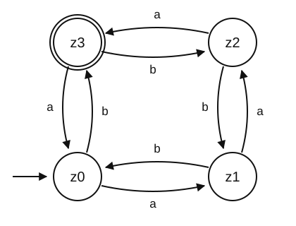

# Pool 5: Theoretical Computer Science

*Exam question pool · session 9 · typically **question 5**, 9–12 points.*
See [README](README.md) for the item format, [Blueprint](Blueprint.md) for
assembly.

---

## The recurring automaton

Five exams have used the same deterministic finite-state automaton. It is worth
keeping, because it looks harder than it is and the language is genuinely
interesting.



Starting state $z_0$, accepting state $z_3$, input alphabet $\{a, b\}$.

**What it does.** The four states form a cycle. Reading `a` advances one step
forward ($z_0 \to z_1 \to z_2 \to z_3 \to z_0$) and reading `b` one step backward
($z_0 \to z_3 \to z_2 \to z_1 \to z_0$). So the state after reading a word $w$ is
$$z_{(\#a(w) - \#b(w)) \bmod 4}$$
and the automaton accepts exactly the words for which
$\#a - \#b \equiv 3 \pmod 4$, equivalently, $\#a - \#b + 1$ is divisible by 4.

*(This is worth knowing when marking: students who trace correctly but describe
the language as "three more a than b" have missed the modular arithmetic.)*

---

## TC-01 · The 5-tuple of a finite-state automaton · 3 pts · [2023-Ex Q6a, 2023-E2 Q5a, `TE-09` Ex. 1a]

> A finite state automaton is defined by the 5-tuple $(Q, \Sigma, \delta, q_0,
> X)$. For the automaton depicted above, describe what each element of the
> 5-tuple consists of.

**Solution.**

- $Q = \{z_0, z_1, z_2, z_3\}$, the finite set of **states**.
- $\Sigma = \{a, b\}$, the input **alphabet**.
- $\delta: Q \times \Sigma \to Q$, the **transition function**, given by the
  arrows:

  | $\delta$ | $a$ | $b$ |
  |---|---|---|
  | $z_0$ | $z_1$ | $z_3$ |
  | $z_1$ | $z_2$ | $z_0$ |
  | $z_2$ | $z_3$ | $z_1$ |
  | $z_3$ | $z_0$ | $z_2$ |

- $q_0 = z_0$, the **start state**, marked by the incoming arrow from nowhere.
- $X = \{z_3\}$, the set of **accepting states**, drawn with a double circle.

**Notes.** The table is the answer to $\delta$; a student who writes
"$\delta$ is the transition function" without giving it has done a third of the
work. Note that $\delta$ here is **total**, defined for every state/symbol pair
which is what makes the automaton deterministic *and* complete, and matters for
`TC-03`.

---

## TC-02 · Which inputs are accepted · 2 pts · [2023-Ex Q6b, 2023-E2 Q5b, 2024-E2 Q5a, 2025-E1 Q5a, 2025-E2 Q4a]

> Determine whether the automaton above recognizes the following inputs. Show the
> sequence of states that justifies your answer.
> i) `aaabbbb`  ii) `abaabb`

**Solution.**

i) `aaabbbb`:
$$z_0 \xrightarrow{a} z_1 \xrightarrow{a} z_2 \xrightarrow{a} z_3
\xrightarrow{b} z_2 \xrightarrow{b} z_1 \xrightarrow{b} z_0 \xrightarrow{b} z_3$$
Ends in $z_3$ → **accepted**. ($\#a - \#b = 3 - 4 = -1 \equiv 3 \bmod 4$.)

ii) `abaabb`:
$$z_0 \xrightarrow{a} z_1 \xrightarrow{b} z_0 \xrightarrow{a} z_1
\xrightarrow{a} z_2 \xrightarrow{b} z_1 \xrightarrow{b} z_0$$
Ends in $z_0$ → **not accepted**. ($3 - 3 = 0$.)

**Other input pairs used.**

| Source | Input | Result |
|---|---|---|
| 2025-E2 Q4a | `aaabbb` | rejected ($z_0$); $3-3=0$ |
| 2025-E2 Q4a | `ababab` | rejected ($z_0$); $3-3=0$ |
| 2023-Ex, 2023-E2, 2024-E2 | `bbaaabaaa` | **accepted** ($z_3$); $6-3=3$ |
| 2023-Ex, 2023-E2, 2024-E2 | `abba` | rejected ($z_0$); $2-2=0$ |

**Notes.** Cheap to mark and cheap to earn, but the question says *"show the
sequence of states"*, so a bare yes/no is worth nothing. When picking a pair,
include at least one accepted and one rejected input.

---

## TC-03 · Deterministic or non-deterministic? · 2 pts · [2023-Ex Q6c, 2023-E2 Q5c, 2024-E2 Q5b, 2025-E1 Q5b, 2025-E2 Q4b]

> Is the automaton above a **non-deterministic** finite state automaton? Justify
> your answer.

**Solution.** **No, it is deterministic.** For every state and every input symbol
there is **exactly one** outgoing transition, the table in `TC-01` has one entry
in each cell, no cell is empty and no cell has two targets. There are also no
$\varepsilon$-transitions. So at every point the next state is uniquely
determined by the current state and the symbol read, which is the definition of a
DFA.

An automaton is **non-deterministic** if any of these holds: some state has two
or more transitions on the same symbol; some state has no transition on some
symbol; or there are $\varepsilon$-transitions that change state without reading
input.

**Worth adding:** determinism is not a restriction on *power*. Every NFA has an
equivalent DFA, by the subset construction (`TC-08d`), at the cost of up to
$2^{|Q|}$ states. NFAs are a convenience for describing languages, not a stronger
machine.

**Related** [2023-Ex Q6c]: *"What is the difference between deterministic and
non-deterministic finite state automata?"*, same content, phrased generally.

---

## TC-04 · Design a DFA for a substring · 3 pts · [2023-Ex Q6e, 2023-E1 Q5d, 2024-Ex Q5d, 2025-E1 Q5c, `TE-09` Ex. 1e]

> Design a **deterministic** finite state automaton that recognizes strings
> containing the substring `ICSS` in an alphabet composed of $\{I, C, S, X\}$.
> Show a diagram with its states and transitions.

**Solution.** The automaton cannot store the input; it can only be in one of
finitely many states. What it must remember is **how much of the pattern it has
matched so far**, the longest suffix of what it has read that is a prefix of
`ICSS`. That gives five states.

| State | Meaning | `I` | `C` | `S` | `X` |
|---|---|---|---|---|---|
| $q_0$ | nothing matched | $q_1$ | $q_0$ | $q_0$ | $q_0$ |
| $q_1$ | matched `I` | $q_1$ | $q_2$ | $q_0$ | $q_0$ |
| $q_2$ | matched `IC` | $q_1$ | $q_0$ | $q_3$ | $q_0$ |
| $q_3$ | matched `ICS` | $q_1$ | $q_0$ | $\mathbf{q_4}$ | $q_0$ |
| $q_4$ | **accepting**, found `ICSS` | $q_4$ | $q_4$ | $q_4$ | $q_4$ |

Start $q_0$; accepting $\{q_4\}$; $q_4$ is a **trap**, once the substring has
appeared, nothing can un-appear it.

**The subtle transitions**, and where students lose the points:
- $q_1 \xrightarrow{I} q_1$, not $q_0$: reading `II` leaves you having just seen
  an `I`, which is still a one-symbol match.
- $q_2 \xrightarrow{I} q_1$ and $q_3 \xrightarrow{I} q_1$: after `ICI` or `ICSI`
  the trailing `I` restarts a match rather than destroying it.
- $q_3 \xrightarrow{S} q_4$: `ICS` + `S` = `ICSS`. Reading `S` from $q_2$ goes to
  $q_3$, but from $q_3$ it completes the pattern.

**Variants.**

| Source | Substring | Alphabet | States |
|---|---|---|---|
| 2023-Ex Q6e | `SEDS` | $\{S, E, D, X\}$ | 5, with $q_1 \xrightarrow{S} q_1$ and $q_3 \xrightarrow{S} q_4$ |
| 2023-E1 Q5d, 2024-Ex Q5d | `ICSCI` | $\{I, C, S, X\}$ | 6; note $q_4$ (`ICSC`) on `S` goes to $q_0$, since no suffix of `ICSCS` is a prefix of `ICSCI` |
| `TE-09` Ex. 1e | `ICSS` | $\{I, C, S, X\}$ | as above |

**Notes.** The general construction is the prefix automaton behind the
Knuth–Morris–Pratt string search, worth a sentence in the exam review, since it
shows the same idea doing real work. Marking: 1 point for the right number of
states with the right meaning, 1 for the forward transitions, 1 for the restart
transitions. Missing $q_1 \xrightarrow{I} q_1$ is the single most common error.

---

## TC-05 · Design a DFA for parity conditions · 3 pts · [2025-E2 Q4c]

> Write a DFA that recognizes a string in the alphabet $\{a, b, c\}$ if and only
> if it has an **even number of `a`** and an **odd number of `b`**.

**Solution.** The automaton must remember two independent bits: the parity of the
`a` count and the parity of the `b` count. Four states, one per combination.

| State | (parity of `a`, parity of `b`) | `a` | `b` | `c` |
|---|---|---|---|---|
| $q_{EE}$ | (even, even): **start** | $q_{OE}$ | $q_{EO}$ | $q_{EE}$ |
| $q_{EO}$ | (even, odd): **accepting** | $q_{OO}$ | $q_{EE}$ | $q_{EO}$ |
| $q_{OE}$ | (odd, even) | $q_{EE}$ | $q_{OO}$ | $q_{OE}$ |
| $q_{OO}$ | (odd, odd) | $q_{EO}$ | $q_{OE}$ | $q_{OO}$ |

Reading `a` flips the first coordinate, `b` flips the second, and `c` changes
nothing, so every state has a `c` self-loop. The only accepting state is
$q_{EO}$.

**Notes.** The instructive point is that the state set is a **product** of two
independent two-state machines, $2 \times 2 = 4$. That generalizes: any two
conditions each needing $m$ and $n$ states can be combined with $mn$ states. The
`c` self-loops are where marks are lost, the automaton must be *total*, and a
letter that is irrelevant to the condition still needs a transition.

---

## TC-06 · Push-down automaton: trace, examples and grammar · 3+2+3 pts · [2023-E1 Q5a–c, 2024-Ex Q5a–c]

> Consider the following push-down automaton with three states $Q_0$, $Q_1$ and
> $Q_d$, where the starting state is $Q_0$:
>
> | Input | State | Stack top | Stack action | Next state |
> |---|---|---|---|---|
> | 1 | $Q_0$ | any | Push A | $Q_0$ |
> | X | $Q_0$ | any | nothing | $Q_1$ |
> | 0 | $Q_0$ | any | nothing | $Q_d$ |
> | □ | $Q_0$ | any | nothing | $Q_d$ |
> | 0 | $Q_1$ | A | Pop | $Q_1$ |
> | □ | $Q_1$ | # | Pop | $Q_1$ |
> | 1 | $Q_1$ | any | nothing | $Q_d$ |
> | X | $Q_1$ | any | nothing | $Q_d$ |
> | 0 | $Q_1$ | # | nothing | $Q_d$ |
> | □ | $Q_1$ | A | nothing | $Q_d$ |
> | any | $Q_d$ | any | nothing | $Q_d$ |
>
> The input alphabet is $\{0, 1, X, □\}$ with `□` marking the end of the input.
> The stack alphabet is $\{A, \#\}$ with `#` starting at the bottom of the stack.
> An input string is **accepted** if `#` is popped from the stack when reaching
> `□`; otherwise it is rejected.
>
> a) Show how the PDA runs for the input `1110X0111□`, writing the state and the
>    stack after each input symbol has been read. Show clearly whether the input
>    is accepted.
> b) Write two examples of inputs that are recognized by the PDA above.
> c) Write the production rules of the grammar that generates the language
>    recognized by the PDA above. Is it a context-sensitive grammar? Justify.

**Solution.**

a) Stack written bottom-to-top.

| Read | State | Stack | Comment |
|---|---|---|---|
| – | $Q_0$ | `#` | initial |
| `1` | $Q_0$ | `#A` | push A |
| `1` | $Q_0$ | `#AA` | push A |
| `1` | $Q_0$ | `#AAA` | push A |
| `0` | $Q_d$ | `#AAA` | **a `0` in $Q_0$ goes to the dead state** |
| `X` | $Q_d$ | `#AAA` | |
| `0` | $Q_d$ | `#AAA` | |
| `1` | $Q_d$ | `#AAA` | |
| `1` | $Q_d$ | `#AAA` | |
| `1` | $Q_d$ | `#AAA` | |
| `□` | $Q_d$ | `#AAA` | |

**Rejected.** $Q_d$ is a dead state with no way out, and `#` was never popped at
`□`. The input fails at the fourth symbol, long before the end.

b) The automaton pushes one `A` per `1` in the first phase, switches phase on
`X`, then pops one `A` per `0`. It accepts exactly $1^n X 0^n □$:

- `11X00□`, push, push, switch, pop, pop, then `□` with `#` on top → accepted.
- `1X0□`, accepted.
- `X□`, also accepted, with $n = 0$.

c) The language is $L = \{1^n X 0^n \mid n \ge 0\}$, generated by

$$S \to 1\,S\,0 \quad\mid\quad X$$

**Is it context-sensitive?** Careful, this is a trick. The grammar is
**type 2 (context-free)**: every left-hand side is a single non-terminal.
Because the Chomsky hierarchy is **nested** (type 3 ⊂ type 2 ⊂ type 1 ⊂ type 0),
every context-free language is *also* context-sensitive, and indeed both
productions satisfy the type-1 condition $|\text{LHS}| \le |\text{RHS}|$. So the
literal answer is "yes, it is also context-sensitive", but the **proper**
classification is context-free, and that is what a PDA characterizes.

It is **not** type 3 (regular), because recognizing $1^n X 0^n$ requires counting
$n$ without bound, and a finite-state automaton has only finitely many states.
The stack is exactly what supplies the unbounded memory.

> **Note for the examiner.** Both 2023-E1 and 2024-Ex phrase (c) as *"Is it a
> context-sensitive grammar?"* Marking should accept either "yes, since CFLs are
> a subset of CSLs" or "no, it is context-free" **provided the nesting is
> explained**. Consider rewording to *"Which type in the Chomsky hierarchy does
> this grammar belong to? Justify."*

**Related** [`TE-09` Ex. 2]: a richer PDA that pushes `A` on `1` and `B` on `0`
and pops matching symbols after `X`, recognizing $w\,X\,w^R$, palindromic
structure rather than plain counting.

---

## TC-07 · Grammar types in the Chomsky hierarchy · 1–2 pts · [2023-Ex Q6d, 2023-E2 Q5d]

> Which type of grammar in the Chomsky hierarchy corresponds to languages that
> can be decided with a **non-deterministic finite state automaton**?

**Solution.** **Type 3, regular grammars**, whose productions all have the form
$A \to aB$ or $A \to a$ (right-linear), recognized by finite-state automata.

The point of naming the *non-deterministic* variant is that it changes nothing:
NFAs and DFAs recognize exactly the same class of languages, so both correspond
to type 3.

The full correspondence, worth having memorized:

| Type | Grammar | Machine | Example language |
|---|---|---|---|
| 3 | Regular | Finite-state automaton | $a^*b^*$ |
| 2 | Context-free | Push-down automaton | $a^n b^n$ |
| 1 | Context-sensitive | Linear bounded automaton | $a^n b^n c^n$ |
| 0 | Unrestricted | Turing machine | anything recognizable |

---

## TC-08 · Non-deterministic finite automaton · 1+3+2–3+3 pts · [2024-E1 Q5a–d, 2025-Ex Q5a–d]

> Consider the following non-deterministic finite-state automaton:
> $$Q = \{q_1, q_2, q_3, q_4, q_r\},\qquad \Sigma = \{0, 1\}$$
> $$\delta(q_1, 0) = \{q_1\},\quad \delta(q_1, 1) = \{q_1, q_2\}$$
> $$\delta(q_2, 0) = \{q_3\},\quad \delta(q_2, 1) = \{q_3\}$$
> $$\delta(q_3, 0) = \{q_4\},\quad \delta(q_3, 1) = \{q_4\}$$
> $$\delta(q_4, 0) = \{q_r\},\quad \delta(q_4, 1) = \{q_r\}$$
> $$\delta(q_r, 0) = \{q_r\},\quad \delta(q_r, 1) = \{q_r\}$$
> $$q_0 = q_1 \text{ (starting state)},\qquad X = \{q_4\} \text{ (accept states)}$$
>
> a) Draw a diagram of its states and transitions.
> b) Determine whether it recognizes the following inputs. Explain your answer:
>    `000111`, `0101`, `11000`.
> c) Describe in your own words the language recognized by this NFA.
> d) Write the transition diagram of a **deterministic** version of this NFA.

**Solution.**

a) Five states in a row, with $q_1$ carrying a self-loop on both symbols:

```
        0,1
       ┌───┐
       ↓   │
  →( q1 )──┘ ──1──▶ ( q2 ) ──0,1──▶ ( q3 ) ──0,1──▶ (( q4 )) ──0,1──▶ ( qr )
                                                                        ↺ 0,1
```

The non-determinism is at $q_1$ on input `1`: the machine may stay in $q_1$ or
move to $q_2$.

b) A string is accepted if **some** computation path ends in $q_4$. From $q_1$
the machine may idle for a while, then take a `1` to $q_2$, and must then read
**exactly two more symbols** to reach $q_4$. So acceptance means: there is a `1`
with exactly two symbols after it, i.e. the **third symbol from the end is a
`1`**.

- `000111`, length 6, third from the end is position 4 = `1` → **accepted**.
  Path: $q_1 \xrightarrow{0} q_1 \xrightarrow{0} q_1 \xrightarrow{0} q_1
  \xrightarrow{1} q_2 \xrightarrow{1} q_3 \xrightarrow{1} q_4$.
- `0101`, length 4, third from the end is position 2 = `1` → **accepted**.
  Path: $q_1 \xrightarrow{0} q_1 \xrightarrow{1} q_2 \xrightarrow{0} q_3
  \xrightarrow{1} q_4$.
- `11000`, length 5, third from the end is position 3 = `0` → **not accepted**.
  Every path either stays in $q_1$ forever or leaves too early and lands in
  $q_r$; no path ends in $q_4$.

c) **The set of binary strings whose third symbol from the end is a `1`**, i.e.
strings of the form $w\,1\,x\,y$ with $w \in \{0,1\}^*$ and $x, y \in \{0,1\}$.
Every such string has length at least 3. It is a **regular** language (type 3),
and therefore also context-free, a natural follow-up asked in 2024-E1 Q5c.

d) By the subset construction, or directly: a DFA must remember the **last three
symbols**, because it cannot know which symbol will turn out to be third from the
end until the input stops. That needs $2^3 = 8$ states.

State $[b_1 b_2 b_3]$ = the last three symbols read, starting at $[000]$ (padding
with zeros is safe, since a padded `0` in the first position correctly rejects
strings shorter than 3). The transition is a shift:
$$[b_1b_2b_3] \xrightarrow{\;c\;} [b_2b_3c]$$
and the accepting states are the four with $b_1 = 1$.

| State | on `0` | on `1` | accepting? |
|---|---|---|---|
| $[000]$ | $[000]$ | $[001]$ | |
| $[001]$ | $[010]$ | $[011]$ | |
| $[010]$ | $[100]$ | $[101]$ | |
| $[011]$ | $[110]$ | $[111]$ | |
| $[100]$ | $[000]$ | $[001]$ | ✓ |
| $[101]$ | $[010]$ | $[011]$ | ✓ |
| $[110]$ | $[100]$ | $[101]$ | ✓ |
| $[111]$ | $[110]$ | $[111]$ | ✓ |

**Notes.** This four-part item is a complete 10-point question 5. Part (d) is the
hard one and its point is the **exponential blow-up**: 5 NFA states become 8 DFA
states here, and $|Q|$ NFA states can become $2^{|Q|}$ in general. Accept a
subset-construction answer with states written as sets, it is the same automaton
relabelled. A student who produces fewer than 8 states has almost certainly
merged states that differ.

---

## TC-09 · Is the language context-free? · 2 pts · [2024-E1 Q5c, 2024-E2 Q5d]

> Is the language recognized by the above finite-state automaton a **context-free
> language**? Explain why.

**Solution.** **Yes.** Anything recognized by a finite-state automaton is a
**regular** language (type 3), and the Chomsky hierarchy is nested: every regular
language is context-free (type 2). Concretely, a push-down automaton can simulate
any finite automaton by simply never using its stack.

The answer is therefore yes **for a trivial reason**, and the informative
statement is the tighter one: the language is *regular*, which is a strictly
smaller class. A student who says "no, it is regular, not context-free" has the
right instinct about tightness but the wrong answer about membership, worth
partial credit with the explanation.

---

## TC-10 · NP-completeness and P vs NP · 3 pts · [2024-E2 Q5e, 2025-Ex Q5e]

> Explain the **NP-complete** problem class and how it is related to the P vs NP
> problem.

**Solution.**

**P** is the class of decision problems **solvable** in polynomial time by a
deterministic algorithm. **NP** is the class of decision problems whose "yes"
answers can be **verified** in polynomial time given a certificate, equivalently,
solvable in polynomial time by a non-deterministic machine. Every problem in P is
in NP (solve it, and the solution is its own certificate).

A problem $L$ is **NP-complete** when both hold:

1. $L \in \mathrm{NP}$, a candidate solution can be checked in polynomial time;
2. $L$ is **NP-hard**, every problem in NP reduces to $L$ in polynomial time.

Condition 2 makes NP-complete problems the **hardest problems in NP**: a
polynomial-time algorithm for any one of them can be composed with the reduction
to solve *every* NP problem in polynomial time. Examples: SAT (Cook–Levin, the
first), 3-SAT, CLIQUE, Hamiltonian path, graph coloring, subset sum.

**The relation to P vs NP.** The open question is whether $\mathrm{P} =
\mathrm{NP}$, whether being able to *check* an answer quickly implies being able
to *find* one quickly. NP-complete problems are the hinge:

- If **any** NP-complete problem is shown to be in P, then $\mathrm{P} =
  \mathrm{NP}$, all of them collapse at once.
- If **any** problem in NP is shown *not* to be in P, then $\mathrm{P} \ne
  \mathrm{NP}$ and no NP-complete problem is in P.

Decades of failed attempts on thousands of NP-complete problems are the main
practical evidence that $\mathrm{P} \ne \mathrm{NP}$, though no proof exists
either way. The practical consequence: showing your problem is NP-complete is
good grounds for stopping the search for an exact efficient algorithm and turning
to approximations or heuristics.

**Notes.** Three points: 1 for the two conditions, 1 for "hardest in NP / all
reduce to it", 1 for the collapse statement. A common half-answer is defining NP
correctly and then saying NP-complete means "very hard", with no reduction.

---

## TC-11 · A fast algorithm for 3-SAT · 3 pts · [2025-E1 Q5d, 2025-E2 Q4d]

> Consider the 3-SAT problem where $N$ is the number of clauses to check for
> satisfiability. If you discover an algorithm that can solve 3-SAT with a
> complexity of $O(N^{1.001})$, can you say that 3-SAT is a problem in P? Justify
> your answer and explain how it relates to the problem of P vs NP.

**Solution.** **Yes.** $N^{1.001}$ is a polynomial in $N$, the exponent need not
be an integer, only a constant, so an $O(N^{1.001})$ algorithm places 3-SAT in
**P**.

The consequence is dramatic. 3-SAT is **NP-complete**, so every problem in NP
reduces to it in polynomial time. Composing that reduction with the new algorithm
solves every NP problem in polynomial time (a polynomial of a polynomial is a
polynomial). Therefore $\mathbf{P = NP}$, one of the seven Millennium Prize
Problems, resolved.

**Variant** [2025-E2 Q4d]: the same question with complexity
$O(1.0001^N)$. Now the answer is **no**. $1.0001^N$ is **exponential**, and any
exponential eventually overtakes any polynomial, however small the base and
however large the exponent of the polynomial, so this does not place 3-SAT in P
and says nothing about P vs NP.

Worth adding: such an algorithm would nonetheless be extremely useful. At
$N = 10\,000$ clauses, $1.0001^{10000} \approx 2.7$, trivial. The exponential
growth only bites around $N \approx 10^6$. **Asymptotic classification and
practical usefulness are different questions**, and this pair of variants is the
clearest illustration of it in the whole course.

**Notes.** The two variants are near-identical in wording and opposite in answer,
which makes them an excellent pair to alternate between the final and the resit.
The non-integer exponent in the first is the deliberate trap.

---

## TC-12 · Satisfiability by hand · 3 pts · [2023-E2 Q5e, `TE-09` Ex. 4c]

> Determine the satisfiability of the following formulas and reason your answers.
> i) $(\bar{x}_1 \vee \bar{x}_2 \vee x_3 \vee \bar{x}_4) \wedge (\bar{x}_3 \vee x_5 \vee \bar{x}_6) \wedge (x_3 \vee x_6)$
> ii) $\bar{x}_1 \wedge (x_1 \vee x_2) \wedge (x_1 \vee \bar{x}_2)$

**Solution.**

i) **Satisfiable.** Exhibit an assignment: $x_1 = \text{F}$, $x_3 = \text{F}$,
$x_6 = \text{T}$, and $x_2, x_4, x_5$ arbitrary.
- Clause 1: $\bar{x}_1 = \text{T}$ ✓
- Clause 2: $\bar{x}_3 = \text{T}$ ✓
- Clause 3: $x_6 = \text{T}$ ✓

*(Many other assignments work, the formula has few constraints relative to its
six variables. Producing **one** witness is a complete proof of satisfiability,
and is far cheaper than a truth table with $2^6 = 64$ rows.)*

ii) **Unsatisfiable.** Reason it out:
- The unit clause $\bar{x}_1$ forces $x_1 = \text{F}$.
- With $x_1 = \text{F}$, clause $(x_1 \vee x_2)$ forces $x_2 = \text{T}$.
- With $x_1 = \text{F}$, clause $(x_1 \vee \bar{x}_2)$ forces $x_2 = \text{F}$.

$x_2$ cannot be both, so no satisfying assignment exists.

**Notes.** The asymmetry is the lesson, and it is the essence of NP: proving
**satisfiability** needs only one witness, checkable in linear time; proving
**unsatisfiability** requires ruling out every assignment, which is why SAT is
in NP but its complement is not obviously so. Make the asymmetry explicit when
marking: a student who builds a full truth table for (i) gets the right answer
inefficiently and has missed the point.

---

## TC-13 · Turing machine trace · 3 pts · [`TE-09` Ex. 3, 2024 sheet 10] · **figure**

> Consider the Turing machine
> $M = (Q, \Sigma, \Gamma, \delta, q_1, q_{accept}, q_{reject})$ with
> $Q = \{q_1, \ldots, q_5, q_{accept}, q_{reject}\}$, $\Sigma = \{0\}$,
> $\Gamma = \{0, x, ␣\}$ and $\delta$ given by the diagram in
> [`Exercise09.md`](../TheoryExercises/Exercise09.md).
>
> a) Show how the Turing machine processes the string `0000`.
> b) Show how it processes the string `000`.
> c) Describe in your own words what language is recognized by the machine.

**Solution.**

a) `0000`, writing the tape, the head position `^` and the state:

| Step | Tape | Head | State | Action |
|---|---|---|---|---|
| 0 | `0000␣` | 1 | $q_1$ | read `0`, write `␣`, R |
| 1 | `␣000␣` | 2 | $q_2$ | read `0`, write `x`, R |
| 2 | `␣x00␣` | 3 | $q_3$ | read `0`, R (unmarked, skipped) |
| 3 | `␣x00␣` | 4 | $q_4$ | read `0`, write `x`, R |
| 4 | `␣x0x␣` | 5 | $q_3$ | read `␣`, L |
| 5–8 | `␣x0x␣` | 4→1 | $q_5$ | walk left over `x`, `0`, `x` to the `␣` |
| 9 | `␣x0x␣` | 2 | $q_2$ | read `x`, R |
| 10 | `␣x0x␣` | 3 | $q_2$ | read `0`, write `x`, R |
| 11 | `␣xxx␣` | 4 | $q_3$ | read `x`, R |
| 12 | `␣xxx␣` | 5 | $q_3$ | read `␣`, L |
| 13–16 | `␣xxx␣` | 4→1 | $q_5$ | walk left to the `␣` |
| 17–20 | `␣xxx␣` | 2→5 | $q_2$ | skip all the `x` |
| 21 | `␣xxx␣` | – | $q_{accept}$ | read `␣` in $q_2$ → **ACCEPT** |

b) `000`:

| Step | Tape | Head | State | Action |
|---|---|---|---|---|
| 0 | `000␣` | 1 | $q_1$ | read `0`, write `␣`, R |
| 1 | `␣00␣` | 2 | $q_2$ | read `0`, write `x`, R |
| 2 | `␣x0␣` | 3 | $q_3$ | read `0`, R (skipped) |
| 3 | `␣x0␣` | 4 | $q_4$ | read `␣` → **REJECT** |

Reaching a blank in $q_4$ means an odd number of unmarked `0`s was left over,
the count could not be halved evenly.

c) **The language of strings of `0`s whose length is a power of two:**
$$L = \{\,0^{2^n} \mid n \ge 0\,\} = \{\,\texttt{0}, \texttt{00}, \texttt{0000}, \texttt{00000000}, \ldots\}$$

The machine works by **repeated halving**. On each left-to-right sweep it marks
every second remaining `0` with an `x`; if it ever finds an odd number of
unmarked `0`s left over ($q_4$ hitting a blank) it rejects, and if exactly one
remains at the start of a sweep it eventually finds only `x`s and accepts. A
number can be halved down to 1 without remainder exactly when it is a power of
two.

This language is **not regular** and **not context-free**, the halving needs
unbounded read-write memory that a stack cannot supply, since the counts must be
revisited repeatedly.

**Notes.** Three points: 1 per trace and 1 for the language. Accept any clear
notation for the configuration, but insist on **all three** of tape, head
position and state, the state is what students most often omit, and without it
the trace cannot be checked. The rejecting trace being only four steps long is
deliberate and makes this affordable in exam time.

---

## TC-14 · Verifying a clique · 5 pts · [`TE-09` Ex. 4, 2024 sheet 10] · **figure**

> A $k$-clique is a fully connected graph of $k$ vertices. The **CLIQUE** problem
> is the decision problem of determining whether a graph $G$ contains a
> $k$-clique of a given size $k$. *(The graph figure is in
> [`Exercise09.md`](../TheoryExercises/Exercise09.md).)*
>
> a) Write the pseudocode of an algorithm to **verify** that a given solution $c$
>    is a proof that a graph $G$ contains a $k$-clique of size $k$.
> b) Based on your algorithm above, what can you say about the complexity classes
>    that CLIQUE belongs to?

**Solution.**

a) The verifier is given the candidate clique and only has to check it.

```
Procedure VERIFY-CLIQUE(G, k, c)
Inputs:
      G = (V, E): a graph
      k: the size of the clique looked for
      c: a candidate set of vertices
Result: TRUE if c is a k-clique of G, FALSE otherwise
If |c| ≠ k
      then return FALSE
For each vertex v in c:
      If v ∉ V
            then return FALSE
For each pair of distinct vertices u, v in c:
      If {u, v} ∉ E
            then return FALSE
return TRUE
```

b) The verifier checks $\binom{k}{2} = k(k-1)/2$ pairs, each in $O(1)$ with an
adjacency matrix, so it runs in $O(k^2)$, polynomial in the size of the input,
since $k \le |V|$.

Existence of a polynomial-time verifier is exactly the definition of **NP**, so
$$\textbf{CLIQUE} \in \textbf{NP}.$$

This says nothing about whether CLIQUE is in **P**: finding the clique is a
different problem from checking one, and the obvious search examines all
$\binom{|V|}{k}$ subsets, which is exponential. CLIQUE is in fact **NP-complete**,
one of Karp's original 21 problems, but proving that requires a reduction
*from* a known NP-complete problem, which this algorithm does not provide.

**Notes.** The distinction between a **verifier** and a **solver** is the whole
point, and it is where most students go wrong: they write a search over all
subsets, which is a solver, exponential, and answers a different question. Marks:
3 for a genuine verifier, 2 for "NP because a polynomial verifier exists", with a
deduction for claiming NP-completeness on this evidence alone.

---

## Also available from the 2026 exercise sheets

[`Exercise09.md`](../TheoryExercises/Exercise09.md) is the richest
sheet in the course for this pool.

| Where | Contents | Never examined? |
|---|---|---|
| Ex. 1–2 | FSA 5-tuple and a push-down automaton (2023/24 sheet) | seen |
| Ex. 3–4 | Turing machine trace and CLIQUE (2024 sheet 10) | **yes**: `TC-13`, `TC-14` |
| A1 | Build DFAs: ends in 0, even number of 1s, contains `101`, divisible by 3 | **yes** |
| A2 | What automata cannot do: $a^nb^n$, $a^nb^nc^n$, balanced parentheses | **yes** |
| A3 | Grammars and derivations | **yes** |
| A4 | Turing machines in words: even length, binary increment, TM vs PDA | **yes** |
| A5 | Computability: which properties of programs are decidable | **yes** |
| A6 | Classifying problems into P, NP, NP-complete, NP-hard | partly (`TC-10`) |
| A7 | Reductions, and why they prove hardness rather than easiness | **yes** |

**The strongest never-examined item** is A1(d): a DFA over $\{0,1\}$ accepting
binary numbers divisible by 3, which needs only three states (one per remainder,
with $r \mapsto (2r + b) \bmod 3$). It is a beautiful demonstration that a
finite automaton can do arithmetic, and it is a 3-point question.

**Computability (A5) has never been examined at all**, the halting problem and
undecidability are in the lecture and in the transcript but have never reached an
exam paper. A5's four-part "is this property of programs decidable?" item would
fix that in 3 points.
