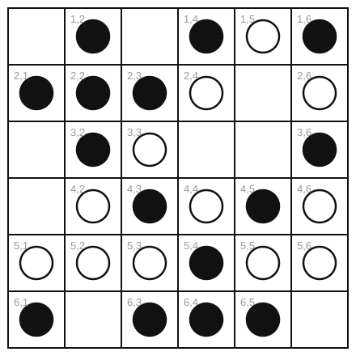

# Pool 6: Databases, Machine Learning and Applications

*Exam question pool · sessions 10, 11 and 13 · typically **question 6**,
9–12 points.*
See [README](README.md) for the item format, [Blueprint](Blueprint.md) for
assembly.

Databases have appeared in every exam. **Machine learning (session 10) has never
been examined**, and social science applications only once; items `DB-10` to
`DB-16` fill those gaps and are all unseen.

---

## DB-01 · Primary key of a flat table · 2 pts · [2023-E2 Q6a, `TE-11` Ex. 1a]

> You receive the following table from the sales department:
>
> | UserNumber | UserName | PurchaseTime | ProductName | N | ProductID | Delivered |
> |---|---|---|---|---|---|---|
> | 011011 | Hans | 2020.03.06 11:15:55 | Milk | 1 | 011011 | True |
> | 012311 | Hans | 2020.04.07 01:50:50 | Milk | 2 | 011011 | True |
> | 011011 | Hans | 2020.05.06 10:05:00 | Coffee | 1 | 215511 | True |
> | 405444 | Marie | 2020.12.06 21:15:05 | Coffee | 45 | 215511 | False |
> | 556677 | Peter | 2021.03.06 03:50:50 | Coffee | 4 | 215511 | True |
>
> Without adding any columns, what combination of columns can you use as a
> **primary key**? Explain the assumptions of your solution.

**Solution.** **(UserNumber, PurchaseTime)**, under the assumption that **one
user makes at most one purchase per second**, the timestamps have
second granularity, so two purchases by the same user in the same second would be
indistinguishable.

If that assumption is too strong, a user buying milk and coffee in a single
checkout, then **(UserNumber, PurchaseTime, ProductID)** is needed, assuming
that the same user does not buy the same product twice in the same second (which
would in any case be recorded as one row with a larger `N`).

**What does *not* work, and why:**
- `PurchaseTime` alone is unique **in these five rows**, but that is an accident
  of the sample. Two different users can buy at the same second. A key must hold
  for every possible state of the table, not just the one you are looking at.
- `UserNumber` alone: Hans appears twice with 011011.
- `UserName`: Hans appears with **two different UserNumbers** (011011 and
  012311). Either these are two people called Hans, or the data is inconsistent,
  worth pointing out, and a good half-point.

**Notes.** The marks are for the *assumptions*, as the question says. A student
who names a working combination without stating what must be true of the world
for it to be a key has answered half the question.

---

## DB-02 · Query a flat table · 2 pts · [2023-E2 Q6b, 2024-E2 Q6a, `TE-11` Ex. 1b]

> Assuming the table above is the only one of a SQL database, write a query that
> lists all rows that correspond to **delivered purchases of more than one
> unit**.

**Solution.**

```sql
SELECT * FROM Purchases
WHERE Delivered = TRUE AND N > 1;
```

Returns two rows: Hans's purchase of 2 Milk (2020.04.07) and Peter's purchase of
4 Coffee (2021.03.06). Marie's 45 Coffee is excluded because `Delivered` is
`False`.

**Variant** [2024-E2 Q6a]: *"lists the user number and the product name"*,
replace `*` with `SELECT UserNumber, ProductName`, i.e. add a projection to the
selection.

**Notes.** Both conditions are needed. The most common error is `N > 1` alone;
the second most common is writing `Delivered = 'True'` as a string, which is
acceptable here since the column type is not specified.

---

## DB-03 · Restructure into a relational database · 2–3 pts · [2023-E2 Q6c, 2024-E2 Q6b, 2025-E2 Q5c, `TE-11` Ex. 1c]

> Show how to restructure the above table into the tables of a relational
> database that increases the efficiency of **changing the name of products while
> keeping the same ProductID**. Indicate the primary key of this new table and
> give it a name.

**Solution.** The product name is currently repeated once per purchase, so
renaming a product means updating every row that mentions it, and missing one
leaves the table self-contradictory. Store the name **once**, in its own table.

**New table `Products`:**

| **ProductID** (PK) | ProductName |
|---|---|
| 011011 | Milk |
| 215511 | Coffee |

**Modified table `Purchases`:**

| UserNumber | UserName | PurchaseTime | N | ProductID (FK → Products) | Delivered |
|---|---|---|---|---|---|
| 011011 | Hans | 2020.03.06 11:15:55 | 1 | 011011 | True |
| … | | | | | |

`ProductName` is removed from `Purchases`; `ProductID` becomes a **foreign key**
referencing `Products.ProductID`. Renaming a product is now a single-row
`UPDATE Products SET ProductName = ... WHERE ProductID = ...`, it cannot be done
inconsistently, and the database can enforce that no purchase refers to a
non-existent product.

**Variant** [2024-E2 Q6b], do the same for **users**:

- `Users(UserID` **PK**`, UserName)`
- `Purchases(UserID` FK`, PurchaseTime, N, ProductID` FK`, Delivered)`

The same argument applies twice, and the `Purchases` table shrinks to keys plus
the facts that genuinely belong to a purchase.

---

## DB-04 · Query the restructured database · 2 pts · [2023-E2 Q6d, 2024-E2 Q6c, `TE-11` Ex. 1d]

> Based on your tables of the previous result, write a SQL query that gives the
> **delivery status of all purchases of the product named "Milk"**.

**Solution.**

```sql
SELECT p.PurchaseTime, p.UserNumber, p.Delivered
FROM Purchases p
INNER JOIN Products pr ON p.ProductID = pr.ProductID
WHERE pr.ProductName = 'Milk';
```

The join is now necessary precisely *because* of the normalization in `DB-03`:
the name lives in one table and the delivery status in another. That is the
trade-off, cheaper updates, more joins on read.

**Variant** [2024-E2 Q6c]: *"the product name of all purchases made by users
called 'Adam'"*, a three-table join through `Users` and `Products`:

```sql
SELECT pr.ProductName
FROM Purchases p
JOIN Users u   ON p.UserID    = u.UserID
JOIN Products pr ON p.ProductID = pr.ProductID
WHERE u.UserName = 'Adam';
```

---

## DB-05 · Design a schema from a specification · 5 pts · [2024-E1 Q6a, 2025-Ex Q6a]

> You were selected by the Students' Union of Data Scientists to help organize a
> bar-crawl. Create a database schema that stores the most important data about
> bars and participants:
> - the **name and phone number** of all participants, and the name of all the
>   **beverages they like**;
> - the **name, address, capacity and owner** of each bar, the name of all the
>   beverages they **serve**, and the **price of each beverage at each bar**;
> - the **name, producer and alcohol content** of each beverage.
>
> Constraints:
> - A beverage is produced by exactly one producer.
> - Each bar has a unique name and a single owner, but an owner can own multiple
>   bars.
> - The same person may like many beverages.
> - Each person has a unique name.
> - Producer names are unique and producers don't produce multiple beverages with
>   the same name. However, **different producers might produce a beverage with
>   the same name**.
>
> Write a database schema that stores all the data needed. **Avoid storing
> redundant information.** Clearly indicate primary and foreign keys.

**Solution.** Six tables. Primary keys **bold**, foreign keys marked →.

| Table | Columns |
|---|---|
| `Person` | **name**, phone |
| `Producer` | **name** |
| `Beverage` | **name**, **producer** → `Producer.name`, alcohol_content |
| `Likes` | **person** → `Person.name`, **bev_name**, **bev_producer** *(→ `Beverage`)* |
| `Bar` | **name**, address, capacity, owner → `Person.name` |
| `Serves` | **bar** → `Bar.name`, **bev_name**, **bev_producer** *(→ `Beverage`)*, price |

**The three design decisions that carry the marks:**

1. **`Beverage` has a composite key `(name, producer)`.** The constraint says
   different producers may make a beverage of the same name, so the name alone is
   not unique, but a producer does not repeat a name, so the pair is. Every
   reference to a beverage must therefore carry **both** columns. This is the
   only genuinely difficult part of the specification and is where most students
   go wrong.
2. **`Likes` and `Serves` are separate tables.** Both are **many-to-many**
   relations: a person likes many beverages and a beverage is liked by many
   people; a bar serves many beverages and a beverage is served by many bars.
   A many-to-many relation always needs its own table, you cannot put a list in
   a cell (session 11: every SQL attribute has an atomic type).
3. **`price` belongs on `Serves`, not on `Beverage`.** The price is a property of
   the *pair* (bar, beverage), since the same beer costs different amounts in
   different bars. Putting it on `Beverage` loses information; putting it on
   `Bar` is nonsense.

`owner` is a plain foreign key to `Person`, because "an owner can own multiple
bars" is one-to-many and needs no extra table. Accept a separate `Owner` table if
the student argues that owners need not be participants.

**Notes.** Five points, and they should be spread: 2 for the tables and keys,
1 for the composite beverage key, 1 for the two many-to-many tables, 1 for the
price placement. A schema that is workable but stores the alcohol content on
`Serves` is not "avoiding redundant information" and should lose a point.

---

## DB-06 · Query across a many-to-many schema · 2 pts · [2024-E1 Q6b, 2025-Ex Q6b]

> Write an SQL query for your database that selects the **name and address of all
> the bars which serve at least one of the beverages the participant named
> "Marie" likes**.

**Solution.**

```sql
SELECT DISTINCT b.name, b.address
FROM Bar b
JOIN Serves s ON s.bar = b.name
JOIN Likes  l ON l.bev_name     = s.bev_name
             AND l.bev_producer = s.bev_producer
WHERE l.person = 'Marie';
```

Three points of technique:
- The join condition uses **both** parts of the composite beverage key. Joining
  on the name alone would wrongly match a different producer's identically named
  drink, the exact failure the constraint in `DB-05` was designed to expose.
- **`DISTINCT`** is required by "at least one": a bar serving three of Marie's
  beverages would otherwise appear three times.
- Marie's own row in `Person` is never needed, since `Likes` already carries her
  name as the key.

---

## DB-07 · A naive algorithm over registrations · 5 pts · [2023-E1 Q6a, 2024-Ex Q6a, 2025-E2 Q5a]

> You are working for a local statistics office. Your town is divided into
> separate blocks of houses and you want to investigate patterns of population
> change. The data is in two tables:
>
> **Registrations**
>
> | RegistrationID | Date | BlockID |
> |---|---|---|
> | 000001 | 19700 | 001 |
> | 000002 | 19710 | 001 |
> | 000003 | 19730 | 002 |
> | 000004 | 19730 | 001 |
> | 000005 | 19745 | 002 |
>
> **Inhabitants**
>
> | RegistrationID | Name | ID |
> |---|---|---|
> | 000001 | Hans Zimmermann | 00164684 |
> | 000001 | Anna Zimmermann | 00187458 |
> | 000002 | Max Mustermann | 00241232 |
> | 000003 | Max Mustermann | 01231234 |
> | 000004 | Michael Nix | 00214212 |
> | 000004 | Andrew None | 48468456 |
> | 000005 | Hans Zimmermann | 78945987 |
>
> Dates are stored as the number of days counted from a given reference date. All
> historical registrations are recorded, so the latest registration of a person is
> where they currently live.
>
> To find out whether registrations in the same blocks are related, write the
> pseudocode of an algorithm that **exhaustively** compares the entries for all
> $N$ registrations and returns, for every individual registration, the total
> number of registrations in the **same block up to 30 days later**. You can
> assume the data is loaded in a data structure of your choice but explain clearly
> how you access it.

**Solution.** Load `Registrations` into an array `R[1..N]` of records with fields
`.id`, `.date` and `.block`, accessed by index in $O(1)$.

```
Procedure COUNT-FOLLOWING-REGISTRATIONS(R)
Inputs:
      R: an array R[1..N] of registrations with the fields id, date and block
Result: a table C mapping each registration id to the number of registrations
      in the same block strictly later and within 30 days
C ← empty hash table
For i = 1 to N:
      c ← 0
      For j = 1 to N:
            If j ≠ i and R[j].block = R[i].block
                     and R[i].date < R[j].date ≤ R[i].date + 30
                  then c ← c + 1
      C[R[i].id] ← c
return C
```

Complexity $O(N^2)$, the exhaustive comparison the question asks for.

**On the sample data:**

| Registration | Block | Date | Window | Counted | $C$ |
|---|---|---|---|---|---|
| 000001 | 001 | 19700 | (19700, 19730] | 000002, 000004 | **2** |
| 000002 | 001 | 19710 | (19710, 19740] | 000004 | **1** |
| 000003 | 002 | 19730 | (19730, 19760] | 000005 | **1** |
| 000004 | 001 | 19730 | (19730, 19760] | – | **0** |
| 000005 | 002 | 19745 | (19745, 19775] | – | **0** |

*(000004 is exactly 30 days after 000001, so it is inside the window with `≤`.)*

**A faster version, worth mentioning:** group the registrations by block into a
hash table, sort each block's list by date, and for each entry binary-search the
end of its 30-day window. That is $O(N \log N)$ instead of $O(N^2)$, the same
sorting-as-an-investment argument as `AC-15e`.

**Notes.** Five points. Two of them are for the *conditions*, which are easy to
get subtly wrong: same block, **strictly** later, **at most** 30 days, and not
counting the registration itself. "Explain clearly how you access it" means the
data structure choice must be stated, an answer that says "assume a list" and
then indexes it randomly has not explained anything.

---

## DB-08 · SQL over two related tables · 2–3 pts · [2023-E1 Q6b, 2024-Ex Q6b, 2025-E2 Q5b]

> Assuming that the two tables above are stored in a SQL database, write a query
> that shows **all the dates of registration and ID of each inhabitant**.

**Solution.**

```sql
SELECT i.ID, i.Name, r.Date
FROM Inhabitants i
INNER JOIN Registrations r ON i.RegistrationID = r.RegistrationID
ORDER BY i.ID, r.Date;
```

The join is on `RegistrationID`, which is the primary key of `Registrations` and
a foreign key in `Inhabitants`, a one-to-many relation, since one registration
covers several inhabitants.

**Variant** [2025-E2 Q5b]: *"the number of blocks that have an inhabitant called
'Max Mustermann'"*:

```sql
SELECT COUNT(DISTINCT r.BlockID)
FROM Registrations r
JOIN Inhabitants i ON i.RegistrationID = r.RegistrationID
WHERE i.Name = 'Max Mustermann';
```

On the sample data the answer is **2**: Max Mustermann appears in registration
000002 (block 001) and 000003 (block 002), with *different* IDs, so these are two
different people who share a name. `DISTINCT` is essential: without it, the query
counts registrations rather than blocks.

**Related** [2023-E1 Q6c, 2024-Ex Q6c, 2025-E2 Q5c]: *"Modify the table structure
to enable faster change of names of inhabitants."* The name is currently repeated
once per registration of that person, so a name change touches many rows. Split
it out:

- `Person(` **ID** `, Name)`
- `RegistrationPerson(` **RegistrationID** → `Registrations`, **PersonID** → `Person` `)`

Now a name change is a single-row update, and `Person.ID` is the identity, which
also makes explicit that "Hans Zimmermann" with IDs 00164684 and 78945987 are
**two different people**, something the original design silently conflates.

---

## DB-09 · Aggregation and a self-join · 3+3 pts · [2025-E1 Q6a+b]

> Consider a database of a company with the following three tables:
>
> `customers(id INT, name VARCHAR)`
> `orders(id INT, customerId INT)`
> `employees(id INT, name VARCHAR, salary INT, managerId INT)`
>
> Managers are employees and each employee has at most one manager, specified by
> the attribute `managerId`.
>
> a) Write a SQL query that returns the **name of each customer with the number of
>    orders that they made**.
> b) Write a SQL query that returns the **names of the employees that have a
>    higher salary than their manager**.

**Solution.**

a)
```sql
SELECT c.name, COUNT(o.id) AS n_orders
FROM customers c
LEFT JOIN orders o ON o.customerId = c.id
GROUP BY c.id, c.name;
```

Two details carry the marks:
- **`LEFT JOIN`**, so customers who ordered nothing still appear. An `INNER JOIN`
  silently drops them, and "each customer" means each.
- **`COUNT(o.id)`, not `COUNT(*)`.** With a left join, a customer with no orders
  produces one row full of `NULL`s; `COUNT(*)` would count that row and report 1,
  while `COUNT(o.id)` ignores `NULL`s and correctly reports 0.

b)
```sql
SELECT e.name
FROM employees e
INNER JOIN employees m ON e.managerId = m.id
WHERE e.salary > m.salary;
```

This is a **self-join**: the same table appears twice under two aliases, `e` for
the employee and `m` for their manager. The `INNER JOIN` is correct here, because
an employee with no manager (`managerId IS NULL`) has no manager to be paid more
than and should not appear.

**Notes.** The self-join is the point of (b) and it is worth all three points,
students who have only ever joined two *different* tables often cannot see that a
table can be joined to itself. Part (a) is the standard `LEFT JOIN` + `GROUP BY`
+ `COUNT(column)` idiom, and each of the three is a place to lose a point.

---

## DB-10 · Evaluating a classifier · 4 pts · `new` (session 10)

> A research group builds a classifier to detect hate speech in social media
> posts and evaluates it on 1000 posts, of which 100 are actually hate speech:
>
> | | Predicted: hate speech | Predicted: normal |
> |---|---|---|
> | **Actually hate speech** | 60 | 40 |
> | **Actually normal** | 30 | 870 |
>
> a) Compute the **accuracy**, **precision** and **recall** of the classifier.
> b) A colleague proposes a classifier that always predicts "normal". Compute the
>    same three metrics for it (if one of them is not defined, say so and explain
>    why), and explain which classifier looks better under which metric and why.
> c) The group wants to use the classifier to **automatically delete** posts.
>    Would you optimize for precision or for recall? What if instead it flags
>    posts for a **human moderator**? Justify both answers.

**Solution.**

a) $TP = 60$, $FN = 40$, $FP = 30$, $TN = 870$.
- Accuracy $= (60 + 870)/1000 = \mathbf{93\%}$
- Precision $= TP/(TP+FP) = 60/90 = \mathbf{0.667}$
- Recall $= TP/(TP+FN) = 60/100 = \mathbf{0.60}$
- *(F1 $= 2 \cdot 0.667 \cdot 0.60 / 1.267 = 0.632$)*

b) The always-"normal" classifier: $TP = 0$, $FP = 0$, $FN = 100$, $TN = 900$.
- Accuracy $= 900/1000 = \mathbf{90\%}$, only 3 points worse!
- Precision: undefined ($0/0$); by convention 0.
- Recall $= 0/100 = \mathbf{0}$, so $F_1 = \mathbf{0}$.

Under **accuracy** the useless classifier looks almost as good, because accuracy
weights every post equally and 90% of posts are normal, this is the **class
imbalance** problem. Under **recall** and **F1** the difference is total: 0.60
against 0. Report precision, recall and F1 on the minority class, never accuracy
alone.

c) **Automatic deletion → optimize precision.** A false positive silently
censors a legitimate post, which is a serious and invisible harm; a false
negative leaves one bad post up, which is recoverable. Set a high decision
threshold: delete only when the model is confident.

**Flagging for human review → optimize recall.** The cost of a false positive is
now a few seconds of a moderator's time, while a false negative never reaches
a human at all. Catch as much as possible and let the person filter, subject to
the moderators' capacity, which is the real constraint on how low the threshold
can go.

**The general principle:** the metric follows from the **cost of each kind of
error in the deployment**, and the same model can be right for one use and wrong
for another.

**Notes.** Written for this pool because session 10 has never been examined.
Part (c) is the discriminating half and is unbluffable. All arithmetic is doable
without a calculator.

---

## DB-11 · Train/test splitting and overfitting · 3 pts · `new` (session 10)

> A team has 5000 tweets from 300 users, each labeled positive or negative, and
> wants to train a classifier.
>
> a) Explain why the test set must not be touched during training.
> b) The team builds its feature set by finding which words are most strongly
>    associated with the labels **across the whole dataset**, and only then splits
>    80/20. What is wrong, and what happens to the reported performance?
> c) Some users contributed more than 100 tweets each and the team splits tweets
>    at random. Explain the problem and describe a better split.

**Solution.**

a) The purpose of the test set is to estimate performance on **new, unseen
data**, generalization. Any use of it during training, however indirect, makes
it seen, so the estimate is no longer about unseen data. The test score then
measures how well the model fits data it has already been tuned on, which is
always optimistic.

b) This is **information leakage**. Choosing features using the labels of the
whole dataset lets information from the test set into the model before it is
ever evaluated. The reported performance will be **optimistically biased**,
sometimes dramatically, and will not be reproduced on genuinely new data.
The fix: do feature selection **inside** the training fold only.

c) With 300 users and 5000 tweets, random row-wise splitting puts the **same
user** in both sets. The model can then learn to recognize individual users,
their vocabulary, topics, punctuation habits, rather than the phenomenon of
sentiment, and it will be tested on more tweets from users it has memorized. The
test score measures user recognition, not sentiment classification.

The fix is a **group-wise (grouped) split**: assign whole *users* to train or
test, so no user appears in both. The rule to remember is **split by the unit of
dependence, not by the row**, which for social media data is usually the user,
and sometimes the time period or the conversation.

---

## DB-12 · K-means and choosing K · 4 pts · `new` (session 10)

> A researcher has survey responses from 2000 people on 12 attitude items and
> wants to identify groups of respondents with similar profiles, using K-means.
>
> a) Is this supervised or unsupervised learning? Justify by saying what plays the
>    role of $X$ and of $Y$.
> b) Write the pseudocode of the K-means algorithm. Be explicit about the stopping
>    condition.
> c) The researcher computes the within-cluster sum of squares for
>    $K = 1 \ldots 10$:
>
>    | $K$ | 1 | 2 | 3 | 4 | 5 | 6 | 7 | 8 | 9 | 10 |
>    |---|---|---|---|---|---|---|---|---|---|---|
>    | WSS | 8400 | 5100 | 3200 | 2900 | 2700 | 2560 | 2440 | 2340 | 2250 | 2170 |
>
>    Which $K$ would you choose, and why? Explain why simply choosing the $K$ with
>    the lowest WSS is not an option.

**Solution.**

a) **Unsupervised.** $X$ is the 12 attitude items for each of the 2000
respondents; there is **no $Y$**, no known group label to predict. The groups
are the output, not the input.

b)
```
Procedure K-MEANS(X, K)
Inputs:
      X: a set of n points x₁ … xₙ
      K: the number of clusters
Result: an assignment C of points to clusters and the cluster means m₁ … m_K
choose K points of X at random as the initial means m₁ … m_K
changed ← TRUE
While changed:
      changed ← FALSE
      For i = 1 to n:                                   # assignment step
            k ← the j in 1..K that minimizes ‖xᵢ − m_j‖²
            If C(i) ≠ k
                  then C(i) ← k
                       changed ← TRUE
      For j = 1 to K:                                   # update step
            m_j ← the mean of all points with C(i) = j
return C, m₁ … m_K
```

The stopping condition is that **no point changed cluster** in a full pass. This
always terminates: each step can only decrease the total within-cluster variance,
and there are finitely many assignments.

c) **Choose $K = 3$**, by the **elbow method**. The drops are
$3300, 1900, 300, 200, 140, 120, 100, 90, 80$: enormous through $K=3$, then flat.
Each cluster up to the third buys a large reduction in WSS; every one after
buys almost nothing, so the extra clusters are splitting groups that are already
homogeneous.

**Why not simply minimize WSS:** WSS **decreases monotonically** with $K$ by
construction, and reaches **zero** at $K = n$, where every point is its own
cluster. Minimizing it therefore always selects the most useless possible answer.
The elbow looks at where the *rate* of decrease changes, not at the level.

The elbow is a **heuristic, not a test**: it is often ambiguous, and no plot
substitutes for asking whether the resulting clusters mean anything
substantively. Running K-means several times from different initializations is
also necessary, since it converges to a *local* minimum.

---

## DB-13 · Which kind of learning? · 3 pts · `new` (session 10)

> For each research task, say which family of machine learning it belongs to and
> name the specific task type (classification, regression, clustering,
> dimensionality reduction). One sentence of justification each.
>
> a) Predicting a country's GDP next year from this year's indicators.
> b) Grouping parliamentary speeches into themes without a predefined list.
> c) Deciding whether a tweet is about climate change, given 5000 labeled tweets.
> d) Reducing 40 survey items to a small number of underlying attitude dimensions.
> e) Training a robot to walk by rewarding forward movement.

**Solution.**

a) **Supervised, regression.** $Y$ is continuous (GDP) and past years supply
   labeled examples.
b) **Unsupervised, clustering.** There is no $Y$; the themes are what is to be
   discovered.
c) **Supervised, classification.** $Y$ is categorical and 5000 labels exist.
d) **Unsupervised, dimensionality reduction** (PCA or factor analysis). No
   target; the goal is a lower-dimensional representation of $X$.
e) **Reinforcement learning**, neither of the first two. There are no labeled
   examples and no fixed dataset; the algorithm learns from rewards received by
   acting in an environment.

**Notes.** Fast, wide and easy to mark, a good opening subquestion if question 6
covers machine learning, paired with `DB-10` or `DB-12` as the anchor.

---

## DB-14 · Schelling's segregation model · 5 pts · [2025-Ex Q6c–e] · **figure**

> Consider the following state of a simulation of Schelling's segregation model.
> Filled and open circles are the two kinds of agents; blank cells are empty. The
> neighborhood of a cell is made of the up to 8 cells around it, and an agent is
> satisfied when the fraction $f$ of its occupied neighbors that are of its own
> kind is at least the threshold $F$. Cells are labeled (row, column).
>
> 
>
> a) For a satisfaction threshold $F = 0.35$, mark which agents will be
>    unsatisfied.
> b) Where do agents relocate in this model? Illustrate this rule with one example
>    from the state above.
> c) For a value of $F = 0.5$, what can we expect at the end of the simulation?
>    And for $F = 0.4$?

**Solution.**

a) An agent is unsatisfied when $f < F$, where $f$ is the fraction of its
**occupied** neighbors (of the up-to-8 surrounding cells) that are of its own
kind. Empty cells are not counted in the denominator; corner and border cells
simply have fewer neighbors. Only the agents below the threshold are listed.

| Cell (row, col) | Kind | Same | Occupied | $f$ | Unsatisfied? |
|---|---|---|---|---|---|
| (1, 4) | filled | 1 | 3 | 0.333 | **yes** |
| (1, 6) | filled | 0 | 2 | 0.000 | **yes** |
| (2, 6) | open | 1 | 3 | 0.333 | **yes** |
| (3, 6) | filled | 1 | 3 | 0.333 | **yes** |
| (4, 3) | filled | 2 | 7 | 0.286 | **yes** |
| (4, 5) | filled | 2 | 6 | 0.333 | **yes** |
| (6, 1) | filled | 0 | 2 | 0.000 | **yes** |

**Seven unsatisfied agents.** Every other agent has $f \ge 0.35$.

b) **An unsatisfied agent jumps to the closest empty cell where it would be
satisfied**, i.e. where its $f$ in the new neighborhood would be $\ge F$.
Satisfied agents do not move.

*Example.* The filled agent at **(1, 6)** has $f = 0$: both its occupied
neighbors, (1, 5) and (2, 6), are open circles. The nearest empty cell is
**(2, 5)**. Moving there, its neighbors would be (1, 4) filled, (1, 5) open,
(2, 4) open, (2, 6) open and (3, 6) filled, two of five of its own kind, so
$f = 0.4 \ge 0.35$. It is satisfied, and it moves.

c) **For $F = 0.5$: strong segregation.** Agents demand that at least half their
neighbors be like them, so the grid sorts into large single-kind blocks with
sharp boundaries.

**For $F = 0.4$: also clearly segregated**, and this is the point of the model.
At $F = 0.4$ an agent is content to be **in the minority** in its own
neighborhood, which no reasonable reading calls intolerant. Yet the outcome is
still strongly segregated, because unsatisfied agents move, their departure
changes the composition of the neighborhood they left, and that pushes further
agents below threshold. Small local adjustments compound into global sorting.

**The methodological conclusion:** a segregated macro-outcome does **not** imply
prejudiced micro-preferences. You cannot read individual motives off an aggregate
pattern.

**Notes.** Five points: 2 for (a), award the *method* (count occupied
neighbors, compute the fraction, compare to $F$) even if one or two cells are
miscounted: 1 for (b) with a worked example, and 2 for (c), where the
$F = 0.4$ half is the one that matters. The parts were c, d and e in the 2025
example exam, where they followed two database parts.

---

## DB-15 · Digital trace data and its limits · 4 pts · `new` (session 13)

> A research group wants to study whether public attention to climate change
> increased after a major flood in Germany. They count posts mentioning
> "Klimawandel" on a social media platform in the four weeks before and the four
> weeks after the flood, find a 40% increase, and conclude that "public attention
> to climate change rose by 40%".
>
> a) Name and explain **three distinct threats** to the validity of this design,
>    saying for each how it could produce a spurious increase.
> b) Rewrite the conclusion so that it says only what the data supports.

**Solution.**

a) Three from among:

- **Coverage error.** The platform's users are not the German public, they are
  younger, more urban and more politically engaged. A change among them is not a
  change in "the public". *(Spurious increase: the flood may have mobilized
  exactly the demographic that is over-represented.)*
- **Behavioral distortion.** Posting about a topic is not the same as attending
  to it. Posting is dominated by a small hyperactive minority, so counting
  **posts** rather than **people** measures the activity of a few. *(A handful of
  accounts posting more would produce the whole effect.)*
- **Algorithmic confounding.** What is visible and collectable is shaped by the
  platform's ranking algorithm and its API, which change without notice. *(A
  trending-topic promotion during the flood would inflate the count with no
  change in anyone's attention.)*
- **Measurement validity.** A single keyword is not a measure of attention to
  climate change: it misses posts using other words and catches sarcasm, news
  reposts, advertisements and bot traffic.
- **No counterfactual.** Attention is seasonal and event-driven; without a
  comparison series (another topic, another country, another year) there is
  nothing to attribute the change to. Any large news event increases posting in
  general.

b) *"Among posts collected from this platform, the number mentioning
'Klimawandel' was 40% higher in the four weeks after the flood than in the four
weeks before. Because the platform's users are not representative of the German
public, because posts are not people, and because no comparison series was used,
this does not by itself establish a change in public attention."*

**Notes.** Four points: 3 for three distinct, correctly explained threats, they
must be genuinely distinct, not three phrasings of "the sample is biased", and
1 for a rewritten conclusion that survives the objections. This is the closest
thing in the pool to a real research-methods question, and it discriminates well.

---

## DB-16 · Agent-based modeling and what it proves · 3 pts · `new` (session 13)

> a) What does an agent-based model demonstrate when it reproduces an observed
>    macro-pattern? What does it **not** demonstrate?
> b) Give two reasons to build such a model even if you never run a simulation.
> c) The COVID university model from the lecture compares mitigation policies.
>    Why was a model used instead of a randomized experiment?

**Solution.**

a) It demonstrates **generative sufficiency**: the proposed micro-rules are
*enough* to produce the observed pattern. It does **not** demonstrate that these
are the rules people actually follow, and it is **not empirical evidence**, other
mechanisms may generate the same pattern (equifinality). A model generates a
hypothesis; testing it needs data.

b) **First:** writing the model as code **forces every assumption to be
explicit**. A verbal theory can stay ambiguous indefinitely; a program cannot
compile ambiguity, so the act of formalizing exposes gaps in the theory.
**Second:** a formal model often admits **analytical results**, equilibria,
limits, comparative statics, that can be derived mathematically without
simulating anything.

c) Because the interventions **cannot be randomized**. You cannot assign half a
university to "no masks" during a wave, for ethical and practical reasons, and
you cannot rerun the same semester under different policies. The model supplies
comparable counterfactuals with its assumptions written down where they can be
challenged. Its output is a hypothesis about mechanisms and a comparison of
scenarios, not evidence of the kind a trial produces.

---

## Also available from the 2026 exercise sheets

| Sheet | Contents | Never examined? |
|---|---|---|
| [`Exercise10.md`](../TheoryExercises/Exercise10.md) | Ex. 1 classifier evaluation, Ex. 2 train/test and overfitting, Ex. 3 clustering; A1 TF-IDF, A2 Naive Bayes by hand, A3 bias/variance, A4 kNN by hand, A5 macro vs micro F1, A6 learning families, A7 ethics | **entirely**, session 10 has never been on an exam |
| [`Exercise11.md`](../TheoryExercises/Exercise11.md) | Ex. 1 the purchases table, Ex. 2 designing a schema for parliamentary debates; A1 ACID, A2 normalizing, A3 reading joins, A4 writing queries, A5 SQL injection, A6 declarative vs procedural | A1, A3, A5, A6 never examined |
| [`Exercise13.md`](../TheoryExercises/Exercise13.md) | Ex. 1 designing a trace-data study, Ex. 2 Schelling, Ex. 3 methods and risks; A1 representation, A2 ABM, A3 the end of theory, A4 reading a CSS paper, A5 privacy, A6 vocabulary | almost entirely |

**Three database topics have never been examined** despite being lecture
content, and each is a ready 2–3 point subquestion:

1. **ACID and transactions** (`TE-11` A1), name the property at stake in a
   scenario. The single most important idea in session 11 that has never reached
   a paper.
2. **SQL injection** (`TE-11` A5), what query results from a given input, and
   how parameterized queries prevent it.
3. **Join semantics and `NULL`** (`TE-11` A3), how many rows does this join
   return, and which rows are lost. Students consistently underestimate this.
