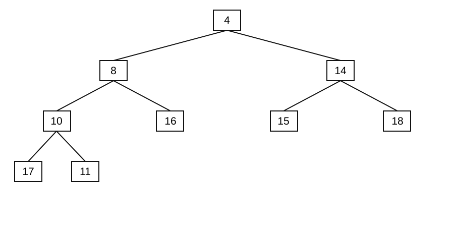

# Solutions: Pool 2: Data Structures and Recursion

*Solutions with references for [`Pool-2-DataStructures.md`](../Pool-2-DataStructures.md). Every item*
*keeps its question in the pool file; here each solution starts with where the*
*material is in the slides and in the handout (the lecture transcript). Slide*
*numbers count the title slide as 1.*

*Generated by `tools/gensolutions.py` from the pool file; edit the pool, not this file.*

---

## DS-01 · A stack for a task queue · 3 pts · [2023-Ex Q4a, 2023-E2 Q2d, 2025-E1 Q2a]

**Where to look.** Slides: session 5, slides 26 to 29 (*Abstract data structures; Queues; Stacks*), in `Slides/05-Algorithms/ICSS-2026-05-Algorithms.qmd`. Handout: [05 §6 Abstract data structures: queues and stacks](../../Transcripts/05-Algorithms.md#6-abstract-data-structures-queues-and-stacks), [03 §1 What a data structure is, and why it matters](../../Transcripts/03-DataStructures.md#1-what-a-data-structure-is-and-why-it-matters).

**Solution.** **No.** A stack is **LIFO** (last in, first out): the task served
next is the one that arrived most recently. Under sustained load this is
pathological, a task that arrives during a busy period can be pushed down and
never reached, so a user who clicked first waits longest and may wait forever
(**starvation**). It also makes latency unbounded and unpredictable.

The correct structure is a **queue**, which is **FIFO** (first in, first out):
tasks are appended at the tail with `enqueue` and served from the head with
`dequeue`, so every task is served after a bounded number of others and users
are served in the order they acted. Both operations are $O(1)$.

**Refinements worth credit:** a **priority queue** if some tasks must jump ahead
(a payment before a "like"), noting that this reintroduces starvation for
low-priority tasks unless priority ages with waiting time; and the observation
that the queue must be safe for concurrent access (session 12), since many
threads push and pop at once.

**Where a stack *is* right:** undo history, the call stack (session 6),
depth-first search, anywhere the most recent item is genuinely the one you want
next.

**Notes.** This item has been used in three exams and is the most reliable
discriminator in the data-structures pool: everyone knows the definitions, and
the marks separate students who can apply them. Full marks require naming the
starvation problem, not just saying "a queue is FIFO".

---

## DS-02 · Linked lists versus arrays · 2 pts · [2023-Ex, 2024-E1 Q2a, 2025-E1 Q2b]

**Where to look.** Slides: session 3, slides 8 to 12 (*Arrays; Linked lists*), in `Slides/03-DataStructures/ICSS-2026-03-DataStructures.qmd`. Handout: [03 §2 Arrays](../../Transcripts/03-DataStructures.md#2-arrays), [03 §3 Linked lists](../../Transcripts/03-DataStructures.md#3-linked-lists), [03 §4 The trade-off: editing versus searching](../../Transcripts/03-DataStructures.md#4-the-trade-off-editing-versus-searching).

**Solution.**

**Advantage.** Insertion and deletion in the middle are $O(1)$ once you hold the
node, because only two pointers change; an array must shift every later element,
which is $O(n)$. A linked list also grows without needing a contiguous block of
memory or a costly reallocation.

**Disadvantage.** No random access: reaching element $k$ costs $O(k)$ because
you must follow the pointers from the head, while an array computes the address
arithmetically in $O(1)$. Linked lists also use extra memory for the pointers
and have poor cache locality, since consecutive elements can be anywhere in
memory.

**Notes.** Accept any one advantage and one disadvantage that are genuinely
about the *difference*. "Linked lists are dynamic" alone is not enough: Python
lists are dynamic arrays. The comparison that shows understanding is
*insertion cost versus access cost*.

---

## DS-03 · Hash tables versus arrays · 2 pts · [2024-E2 Q2a, 2025-Ex Q2a]

**Where to look.** Slides: session 3, slides 8 to 9 (*Arrays*), in `Slides/03-DataStructures/ICSS-2026-03-DataStructures.qmd`; session 3, slides 33 to 45 (*Hash tables; Dictionaries*), in `Slides/03-DataStructures/ICSS-2026-03-DataStructures.qmd`. Handout: [03 §2 Arrays](../../Transcripts/03-DataStructures.md#2-arrays), [03 §8 Hashing and hash tables](../../Transcripts/03-DataStructures.md#8-hashing-and-hash-tables), [03 §9 Dictionaries](../../Transcripts/03-DataStructures.md#9-dictionaries).

**Solution.**

**Advantage.** A hash table indexes by an arbitrary **key**, a string, a tuple,
in $O(1)$ average time, whereas an array can only be indexed by a position
$1..n$. Looking up "is this user in my dataset?" is $O(1)$ in a hash table and
$O(n)$ in an unsorted array.

**Disadvantage.** The $O(1)$ is only *average*: collisions degrade it, and in the
worst case (all keys hashing to one slot) lookup becomes $O(n)$. Hash tables also
waste memory, they must be kept below a load factor to stay fast, and they have
**no order**, so you cannot ask for the smallest key or iterate in sorted order
without extra work.

---

## DS-04 · Hash table with linear probing · 3–4 pts · [2025-E1 Q2c, 2025-E2 Q2a] · needs no figure

**Where to look.** Slides: session 3, slides 34 to 43 (*Hashing; Hash functions; Hash collisions; Linear and random probing*), in `Slides/03-DataStructures/ICSS-2026-03-DataStructures.qmd`. Handout: [03 §8 Hashing and hash tables](../../Transcripts/03-DataStructures.md#8-hashing-and-hash-tables).

**Solution.** Compute $f$, then probe forward on a collision.

| Key | $2x$ | $f(x)$ | Probes | Lands in |
|---|---|---|---|---|
| 6 | 12 | 12 | – | 12 |
| 0 | 0 | 0 | – | 0 |
| 2 | 4 | 4 | – | 4 |
| 12 | 24 | 8 | – | 8 |
| 3 | 6 | 6 | – | 6 |
| 11 | 22 | 6 | 6 taken (E) → 7 | 7 |
| 16 | 32 | 0 | 0 taken (B) → 1 | 1 |

Final state:

| Slot | 0 | 1 | 2 | 3 | 4 | 5 | 6 | 7 | 8 | 9 | 10 | 11 | 12 | 13 | 14 | 15 |
|---|---|---|---|---|---|---|---|---|---|---|---|---|---|---|---|---|
| Value | B | H | | | C | | E | F | D | | | | A | | | |

---

## DS-05 · What is wrong with that hash function · 2 pts · [2025-E1 Q2d]

**Where to look.** Slides: session 3, slides 34 to 43 (*Hashing; Hash functions; Hash collisions; Linear and random probing*), in `Slides/03-DataStructures/ICSS-2026-03-DataStructures.qmd`. Handout: [03 §8 Hashing and hash tables](../../Transcripts/03-DataStructures.md#8-hashing-and-hash-tables).

**Solution.** $f(x) = 2x \bmod 16$ can only produce **even** values, because
$\gcd(2, 16) = 2$ divides every output. Eight of the sixteen slots, all the odd
ones, are unreachable by hashing, so the table is effectively half its size and
collisions occur at twice the expected rate. Worse, $f$ is not injective on
$\{0, \ldots, 15\}$: $f(x) = f(x+8)$ for every $x$, so keys 8 apart always
collide.

**Fixes.** Use a modulus that is **coprime** with the multiplier, best of all a
**prime** table size, so no factor is shared with any multiplier. Or use
$f(x) = x \bmod m$ with $m$ prime, or multiplicative hashing
$f(x) = \lfloor m (xA \bmod 1) \rfloor$ with irrational $A$. Generally: the hash
should spread keys uniformly over *all* slots, and multiplying by a factor of the
table size guarantees that it does not.

**Related variant** [2023-E1 Q2a+b, 2024-Ex Q2a+b, 2024-E2 Q2b+c]:
$f(x) = (2x+3) \bmod 10$ with separate chaining and the inputs
`12012020, 14022015, 21022025, 12122010, 3062005, 10102012`.
All these dates end in 0 or 5, so $2x \bmod 10 \in \{0\}$ and all but the last
land in slot **3**; `10102012` lands in slot **7**. Five of six keys in one
chain, the table has degenerated into a linked list, and lookup is $O(n)$. Same
diagnosis: a modulus sharing a factor with the multiplier, applied to keys that
are themselves not uniformly distributed. With $f(x) = (2x+1) \bmod 10$
(2024-E2) the five land in slot **1** and `10102012` in slot **5**.

---

## DS-06 · Binary search trace · 3 pts · [2023-E2 Q2a]

**Where to look.** Slides: session 3, slides 49 to 51 (*Appendix: binary search*), in `Slides/03-DataStructures/ICSS-2026-03-DataStructures.qmd`. Handout: [03 §5 Binary search](../../Transcripts/03-DataStructures.md#5-binary-search).

**Solution.** Indices 1–11.

| Step | lo | hi | mid | `A[mid]` | Comparison | New range |
|---|---|---|---|---|---|---|
| 1 | 1 | 11 | 6 | 31 | $31 < 34$ | lo ← 7 |
| 2 | 7 | 11 | 9 | 35 | $35 > 34$ | hi ← 8 |
| 3 | 7 | 8 | 7 | 33 | $33 < 34$ | lo ← 8 |
| 4 | 8 | 8 | 8 | 34 | found | return 8 |

**4 comparisons**, consistent with $\lceil \log_2 12 \rceil = 4$.

> **Erratum.** The array printed in 2023-E2 was
> `10 33 19 26 27 28 31 34 35 42 44`, which is **not sorted**. Binary search is
> undefined on unsorted input, it would compare against 28 at the midpoint,
> conclude the target is to the right, and the answer would depend on accidents
> of the data rather than on the algorithm. The array above is the corrected
> version.

**Notes.** A good follow-up worth 1 extra point: *"what happens if the array is
not sorted?"*, the algorithm still terminates but may report "not found" for an
element that is present, because the invariant it relies on (everything left of
`mid` is smaller) is false.

---

## DS-07 · Build a binary search tree · 1–2 pts · [2023-E1 Q2c, 2024-Ex Q2c, 2024-E1 Q2b, 2025-Ex Q2d]

**Where to look.** Slides: session 3, slides 15 to 32 (*Binary trees; Binary search trees*), in `Slides/03-DataStructures/ICSS-2026-03-DataStructures.qmd`. Handout: [03 §6 Binary trees and binary search trees](../../Transcripts/03-DataStructures.md#6-binary-trees-and-binary-search-trees), [03 §7 Operations on a BST](../../Transcripts/03-DataStructures.md#7-operations-on-a-bst).

**Solution.** Each new key walks down from the root, going left when smaller and
right when larger, and becomes a leaf where it stops.

```
            0
          /   \
        -1     1
        /       \
      -10        2
                  \
                   4
```

**Variant** [2023-E1 Q2c, 2024-Ex Q2c]: insertion order $4, 6, 2, 1, 3, 10, 12$.

```
            4
          /   \
         2     6
        / \      \
       1   3      10
                    \
                     12
```

**Notes.** Both trees are deliberately unbalanced on one side, a natural cue for
a follow-up: *"what insertion order of the same keys would give the worst
possible tree, and what would its height be?"* (Sorted order; height $n$, and
search degrades to $O(n)$.)

---

## DS-08 · Remove the minimum from a min-heap · 2–3 pts · [2024-E2 Q2d, 2025-Ex Q2b] · **figure**

**Where to look.** Slides: session 7, slides 41 to 46 (*Data structures for sorting; Heaps; Min-heaps*), in `Slides/07-SortingAlgorithms/ICSS-2026-07-SortingAlgorithms.qmd`; session 7, slides 79 (*Heapsort: pseudocode*), in `Slides/07-SortingAlgorithms/ICSS-2026-07-SortingAlgorithms.qmd`. Handout: [07 §8 Heaps and heapsort](../../Transcripts/07-SortingAlgorithms.md#8-heaps-and-heapsort).

**Solution.** The minimum is always the root. Removing it would leave a hole, so
we move the *last* element into the root, which keeps the tree nearly complete,
and then let it sink until the heap property holds again.

```
Procedure EXTRACT-MIN(H)
Inputs:
      H: a min-heap stored in an array, with H.size elements
Result: returns the minimum, and H is again a min-heap
If H.size < 1
      then error "heap underflow"
min ← H[1]
H[1] ← H[H.size]                  # move the last element to the root
H.size ← H.size − 1
SIFT-DOWN(H, 1)
return min

Procedure SIFT-DOWN(H, i)
Inputs:
      H: a min-heap stored in an array
      i: an index whose two subtrees are valid min-heaps
Result: the subtree rooted at i is a min-heap
l ← 2i
r ← 2i + 1
smallest ← i
If l ≤ H.size and H[l] < H[smallest]
      then smallest ← l
If r ≤ H.size and H[r] < H[smallest]
      then smallest ← r
If smallest ≠ i
      then swap H[i] with H[smallest]
           SIFT-DOWN(H, smallest)
```

Complexity $O(\log n)$, the element travels at most the height of the tree.

**Notes.** Two full points require (i) moving the **last** element, not a child,
to the root, moving a child breaks the nearly-complete shape, and (ii) sifting
**down** with the *smaller* of the two children, so the swapped-up value is
smaller than both siblings.

---

## DS-09 · Trace the min-heap extraction · 2 pts · [2024-E2 Q2e, 2025-Ex Q2c] · **figure**

**Where to look.** Slides: session 7, slides 41 to 46 (*Heaps; Min-heaps*), in `Slides/07-SortingAlgorithms/ICSS-2026-07-SortingAlgorithms.qmd`; session 7, slides 47 to 79 (*Heapsort: example and pseudocode*), in `Slides/07-SortingAlgorithms/ICSS-2026-07-SortingAlgorithms.qmd`. Handout: [07 §8 Heaps and heapsort](../../Transcripts/07-SortingAlgorithms.md#8-heaps-and-heapsort).

**Solution.** As an array: `[2, 4, 14, 10, 8, 15, 18, 17, 11, 16]`.

1. Return the root, **2**.
2. Move the last element **16** into the root; size becomes 9.
   `[16, 4, 14, 10, 8, 15, 18, 17, 11]`
3. Sift down from index 1: children are 4 and 14; the smaller is **4** and
   $4 < 16$ → swap. `[4, 16, 14, 10, 8, 15, 18, 17, 11]`
4. Now at index 2: children are 10 (index 4) and 8 (index 5); the smaller is
   **8** and $8 < 16$ → swap. `[4, 8, 14, 10, 16, 15, 18, 17, 11]`
5. Now at index 5: its only child would be index 10, beyond the heap size. Stop.

Resulting heap:



**Notes.** The trap is swapping with the *left* child by reflex at step 4. The
figure is generated by `tools/genexam.py`, which actually runs the algorithm, so
the two figures cannot disagree.

---

## DS-10 · Reduce a key in a min-heap · 5 pts · [2023-Ex Q4d+e]

**Where to look.** Slides: session 7, slides 41 to 46 (*Heaps; Min-heaps*), in `Slides/07-SortingAlgorithms/ICSS-2026-07-SortingAlgorithms.qmd`. Handout: [07 §8 Heaps and heapsort](../../Transcripts/07-SortingAlgorithms.md#8-heaps-and-heapsort), [06 §2 The three parts of a recursive definition](../../Transcripts/06-Recursion.md#2-the-three-parts-of-a-recursive-definition).

**Solution.** Lowering a value can only break the property *upwards*, against the
parent, so the element bubbles up rather than sinking.

```
Procedure REDUCE(H, x, y)
Inputs:
      H: a min-heap stored in an array
      x: a position in H
      y: the new value for H[x], with y < H[x]
Result: H[x] = y and H is again a min-heap
If y > H[x]
      then error "the new value is larger than the current one"
H[x] ← y
While x > 1 and H[⌊x/2⌋] > H[x]:
      swap H[x] with H[⌊x/2⌋]
      x ← ⌊x/2⌋
```

Complexity $O(\log n)$.

**Trace** [2023-Ex Q4e], on the heap of `DS-09` reducing the last node (value 16,
position 10) to 1:

- $H[10] \leftarrow 1$. Parent is position 5, value 8; $8 > 1$ → swap →
  position 5 holds 1, position 10 holds 8.
- Parent of 5 is position 2, value 4; $4 > 1$ → swap → position 2 holds 1,
  position 5 holds 4.
- Parent of 2 is position 1, value 2; $2 > 1$ → swap → root holds 1, position 2
  holds 2.
- $x = 1$, stop.

Final array: `[1, 2, 14, 10, 4, 15, 18, 17, 11, 8]`.

**Notes.** This is the operation Dijkstra's algorithm needs (`GP-06`), which
makes it a natural bridge item between questions 2 and 4. Students who sift
*down* here have not understood which direction a decrease can violate.

---

## DS-11 · Recursive minimum of a BST · 3 pts · [2024-E1 Q2c, 2025-Ex Q2e]

**Where to look.** Slides: session 3, slides 15 to 32 (*Binary search trees*), in `Slides/03-DataStructures/ICSS-2026-03-DataStructures.qmd`; session 6, slides 13 to 15 (*Components of recursion*), in `Slides/06-Recursion/ICSS-2026-06-Recursion.qmd`; session 6, slides 77 (*Types of recursive algorithms*), in `Slides/06-Recursion/ICSS-2026-06-Recursion.qmd`. Handout: [03 §6 Binary trees and binary search trees](../../Transcripts/03-DataStructures.md#6-binary-trees-and-binary-search-trees), [06 §2 The three parts of a recursive definition](../../Transcripts/06-Recursion.md#2-the-three-parts-of-a-recursive-definition), [06 §7 Types of recursion](../../Transcripts/06-Recursion.md#7-types-of-recursion).

**Solution.** By the BST property every key in the left subtree is smaller, so
the minimum is the leftmost node.

```
Procedure BST-MINIMUM(node)
Inputs:
      node: the root of a non-empty binary search tree
Result: the smallest key in the tree
If node.left = NIL
      then return node.key
return BST-MINIMUM(node.left)
```

**Kind of recursion: linear and, specifically, tail recursion**, there is a
single recursive call and it is the last thing the procedure does, with nothing
left to compute on the way back. Time complexity is $O(h)$ where $h$ is the
height: $O(\log n)$ for a balanced tree, $O(n)$ for a degenerate one.

---

## DS-12 · Iterative version, and what changes · 3 pts · [2024-E1 Q2d, 2025-Ex Q2f]

**Where to look.** Slides: session 6, slides 24 to 25 (*Factorial: iterative and recursive implementation*), in `Slides/06-Recursion/ICSS-2026-06-Recursion.qmd`; session 6, slides 43 to 48 (*Memory of a running program*), in `Slides/06-Recursion/ICSS-2026-06-Recursion.qmd`. Handout: [06 §3 Factorial](../../Transcripts/06-Recursion.md#3-factorial), [06 §4 How recursion runs: the program stack](../../Transcripts/06-Recursion.md#4-how-recursion-runs-the-program-stack).

**Solution.**

```
Procedure BST-MINIMUM-ITERATIVE(node)
Inputs:
      node: the root of a non-empty binary search tree
Result: the smallest key in the tree
While node.left ≠ NIL:
      node ← node.left
return node.key
```

**The difference is memory, not time.** Both are $O(h)$ in time and visit the
same nodes. The recursive version pushes a **stack frame** for every level, so
it uses $O(h)$ additional memory and can hit a **stack overflow** on a very
unbalanced tree (in Python, the recursion limit at about 1000 frames). The
iterative version uses $O(1)$ extra memory. Each call also costs a little time
for frame setup and teardown, so the iterative version is somewhat faster by a
constant factor.

Because the recursion is *tail* recursion, a compiler could in principle
transform it into exactly the loop above, but Python does not do this.

**Notes.** The expected answer is memory/stack depth. "The recursive one is
slower" alone is a weak answer; it is true but is the smaller effect and misses
the failure mode.

---

## DS-13 · Recursive search in a linked list · 3–4 pts · [2023-E1 Q2d, 2024-Ex Q2d, 2023-E2 Q2b+c]

**Where to look.** Slides: session 3, slides 11 to 12 (*Linked lists*), in `Slides/03-DataStructures/ICSS-2026-03-DataStructures.qmd`; session 6, slides 13 to 15 (*Components of recursion*), in `Slides/06-Recursion/ICSS-2026-06-Recursion.qmd`; session 6, slides 77 (*Types of recursive algorithms*), in `Slides/06-Recursion/ICSS-2026-06-Recursion.qmd`. Handout: [03 §3 Linked lists](../../Transcripts/03-DataStructures.md#3-linked-lists), [06 §2 The three parts of a recursive definition](../../Transcripts/06-Recursion.md#2-the-three-parts-of-a-recursive-definition), [06 §7 Types of recursion](../../Transcripts/06-Recursion.md#7-types-of-recursion).

**Solution.**

```
Procedure LIST-CONTAINS(node, k)
Inputs:
      node: the head of a singly linked list, possibly NIL
      k: the key looked for
Result: TRUE if some node holds key k, FALSE otherwise
If node = NIL
      then return FALSE                 # base case: end of the list
If node.key = k
      then return TRUE                  # base case: found
return LIST-CONTAINS(node.next, k)      # recursive case
```

**Linear (tail) recursion:** one recursive call, in the last position.
Complexity $O(n)$ time, $O(n)$ stack space.

**Variant for a BST** [2023-E1 Q2d, 2024-Ex Q2d]:

```
Procedure BST-CONTAINS(node, k)
Inputs:
      node: the root of a binary search tree, possibly NIL
      k: the key looked for
Result: TRUE if some node holds key k, FALSE otherwise
If node = NIL
      then return FALSE
If node.key = k
      then return TRUE
If k < node.key
      then return BST-CONTAINS(node.left, k)
      else return BST-CONTAINS(node.right, k)
```

Also linear recursion, there are two calls in the *code*, but only one is
executed per invocation, so each level spawns one call. Time $O(h)$.

**Notes.** The BST variant is where students most often say "tree recursion".
The test is how many calls *run*, not how many appear. Contrast with the naive
Fibonacci, where both calls run and the recursion tree branches.

---

## DS-14 · Fixing a slow dictionary loop · 3 pts · [2024-E1 Q2e]

**Where to look.** Slides: session 3, slides 33 to 45 (*Hash tables; Dictionaries in Python*), in `Slides/03-DataStructures/ICSS-2026-03-DataStructures.qmd`. Handout: [03 §8 Hashing and hash tables](../../Transcripts/03-DataStructures.md#8-hashing-and-hash-tables), [03 §9 Dictionaries](../../Transcripts/03-DataStructures.md#9-dictionaries), [08 §9 Using O-notation](../../Transcripts/08-TimeComplexity.md#9-using-o-notation).

**Solution.** The problem is `.keys()` combined with `in`. In Python 2 (and in
any code that materializes the keys into a list) `mydictionary.keys()` builds a
sequence of $N$ keys and `in` scans it linearly, making each test $O(N)$ and the
loop $O(N^2)$.

```python
for key, value in mydictionary.items():
    print(value)
```

This iterates the dictionary once, in $O(N)$ total. Every key is present by
assumption, so the membership test is redundant work, the loop is really just
"print every value".

A smaller fix that keeps the original structure:

```python
for i in range(N):
    if i in mydictionary:      # hashes i and probes one slot: O(1)
        print(mydictionary[i])
```

`i in mydictionary` uses the hash table directly instead of building or scanning
a key sequence, so the loop is $O(N)$.

**Explanation to give:** a hash table answers "is this key present?" in $O(1)$
average time by computing the slot from the key. Converting it to a list throws
that away and forces a linear scan. This is the practical payoff of `DS-03`.

**Notes.** The only item in the pool that examines session 4 directly. Accept
either fix; the marks are for identifying that the membership test, not the
printing, is the cost.

---

## DS-15 · Choosing a data structure · 3 pts · `new`

**Where to look.** Slides: session 3, slides 7 to 14 (*Data structures; Arrays; Linked lists; The question of editing vs search*), in `Slides/03-DataStructures/ICSS-2026-03-DataStructures.qmd`; session 3, slides 33 to 45 (*Hash tables; Dictionaries*), in `Slides/03-DataStructures/ICSS-2026-03-DataStructures.qmd`; session 5, slides 26 to 29 (*Queues; Stacks*), in `Slides/05-Algorithms/ICSS-2026-05-Algorithms.qmd`; session 5, slides 35 to 37 (*Adjacency matrix; Adjacency list*), in `Slides/05-Algorithms/ICSS-2026-05-Algorithms.qmd`; session 7, slides 41 to 46 (*Heaps*), in `Slides/07-SortingAlgorithms/ICSS-2026-07-SortingAlgorithms.qmd`. Handout: [03 §4 The trade-off: editing versus searching](../../Transcripts/03-DataStructures.md#4-the-trade-off-editing-versus-searching), [03 §8 Hashing and hash tables](../../Transcripts/03-DataStructures.md#8-hashing-and-hash-tables), [05 §6 Abstract data structures: queues and stacks](../../Transcripts/05-Algorithms.md#6-abstract-data-structures-queues-and-stacks), [05 §8 Representing graphs](../../Transcripts/05-Algorithms.md#8-representing-graphs), [07 §8 Heaps and heapsort](../../Transcripts/07-SortingAlgorithms.md#8-heaps-and-heapsort).

**Solution.**

a) A **min-heap of size 100**. Compare each new paper with the root (the
smallest of the current top 100) in $O(1)$; if it is larger, extract-min and
insert in $O(\log 100)$. Total $O(n \log k)$ with $k = 100$, and only $k$ items
are ever in memory, sorting all $n$ would be $O(n \log n)$ and need all of them.

b) A **hash set**. Insertion and membership are $O(1)$ average. (A student who
mentions that a Bloom filter trades a small false-positive rate for far less
memory has gone beyond what is asked and should be rewarded.)

c) **Adjacency lists**, or equivalently a hash set of neighbors per person.
An adjacency matrix would need $80\,000\,000^2$ entries, impossible, while the
network has only a few hundred edges per person, so lists use $O(|V| + |E|)$.
The query is $O(\deg(A))$, or $O(1)$ with a hash set per person. See `GP-04`.

d) A **stack**. Each edit is pushed; undo pops the most recent, the one case in
this pool where LIFO is exactly what is wanted (contrast `DS-01`).


**Notes.** Written for this pool as a fast, wide-coverage item: it touches
heaps, hash tables, graph representations and stacks in 3 points, and it is
almost impossible to answer from memorization. Good closing subquestion.

---
