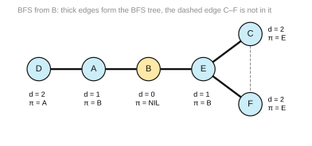
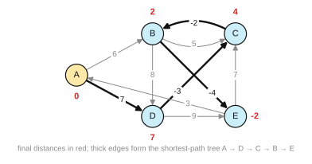

# Solutions: Pool 4: Graph Algorithms and Parallelization

*Solutions with references for [`Pool-4-GraphsParallel.md`](../Pool-4-GraphsParallel.md). Every item*
*keeps its question in the pool file; here each solution starts with where the*
*material is in the slides and in the handout (the lecture transcript). Slide*
*numbers count the title slide as 1.*

*Generated by `tools/gensolutions.py` from the pool file; edit the pool, not this file.*

---

## GP-01 · From adjacency matrix to graph · 1 pt · [2023-E1 Q4a, 2024-E2 Q4a, 2025-E2 Q2b]

**Where to look.** Slides: session 5, slides 32 to 37 (*Graphs; Graphs: formalization; Adjacency matrix*), in `Slides/05-Algorithms/ICSS-2026-05-Algorithms.qmd`. Handout: [05 §7 Graphs](../../Transcripts/05-Algorithms.md#7-graphs), [05 §8 Representing graphs](../../Transcripts/05-Algorithms.md#8-representing-graphs).

**Solution.** A non-zero entry in row $u$, column $v$ is a directed edge
$u \to v$ with that weight. Ten edges:

$$A\xrightarrow{6}B,\quad A\xrightarrow{7}D,\quad B\xrightarrow{5}C,\quad
B\xrightarrow{8}D,\quad B\xrightarrow{-4}E,$$
$$C\xrightarrow{-2}B,\quad D\xrightarrow{-3}C,\quad D\xrightarrow{9}E,\quad
E\xrightarrow{3}A,\quad E\xrightarrow{7}C$$

Note that the matrix is **not symmetric**, which is what makes the graph
directed: $B \to C$ has weight 5 while $C \to B$ has weight $-2$. Zeros here mean
"no edge", not "an edge of weight zero", a convention worth stating, and a
genuine ambiguity in graphs that may have zero-weight edges.

**Notes.** One point, and it is a gift, but it is also the foundation for
`GP-08`, so a student who draws it wrong loses everything downstream. Consider
printing the drawn graph instead when the trace is the real question.

---

## GP-02 · Adjacency lists · 1 pt · [2024-E1 Q4a]

**Where to look.** Slides: session 5, slides 35 to 37 (*Adjacency matrix; Adjacency list; Adjacency matrix vs adjacency list*), in `Slides/05-Algorithms/ICSS-2026-05-Algorithms.qmd`. Handout: [05 §8 Representing graphs](../../Transcripts/05-Algorithms.md#8-representing-graphs).

**Solution.** One list per vertex, holding the vertices reachable by an outgoing
edge:

```
A → [E]
B → [E]
C → [B, F, G]
D → [G]
E → [A, F]
F → [C]
G → [D]
```

Nine edges over seven vertices. The matrix uses $7^2 = 49$ cells; the lists use
$7 + 9 = 16$ entries.

---

## GP-03 · Breadth-first search trace · 3 pts · [2023-E2 Q4b]

**Where to look.** Slides: session 5, slides 39 to 50 (*Example: finding distances; Algorithm: breadth-first search*), in `Slides/05-Algorithms/ICSS-2026-05-Algorithms.qmd`. Handout: [05 §9 Breadth-First Search](../../Transcripts/05-Algorithms.md#9-breadth-first-search).

**Solution.** Adjacency lists: `A: B,D` · `B: A,E` · `C: E,F` · `D: A` ·
`E: B,C,F` · `F: C,E`.

| Step | Dequeue | Discovered (gray) | Queue after |
|---|---|---|---|
| 0 | – | B ($d=0$) | `[B]` |
| 1 | B | A ($d=1$, $\pi=B$), E ($d=1$, $\pi=B$) | `[A, E]` |
| 2 | A | D ($d=2$, $\pi=A$): B already seen | `[E, D]` |
| 3 | E | C ($d=2$, $\pi=E$), F ($d=2$, $\pi=E$): B already seen | `[D, C, F]` |
| 4 | D | none | `[C, F]` |
| 5 | C | none | `[F]` |
| 6 | F | none | `[ ]` |

Final state:

| Vertex | A | B | C | D | E | F |
|---|---|---|---|---|---|---|
| $d$ | 1 | **0** | 2 | 2 | 1 | 2 |
| $\pi$ | B | NULL | E | A | B | E |

BFS tree edges: B–A, B–E, A–D, E–C, E–F.



**Notes.** Award the queue states, not just the final distances, the queue is
what makes BFS breadth-first, and a student who produces correct distances with a
stack-shaped trace has traced the wrong algorithm. The alphabetical rule matters
at step 1 (A before E) and step 3 (C before F).

---

## GP-04 · Depth-first search trace · 3 pts · [2024-E1 Q4b, 2024-E2 Q4d]

**Where to look.** Slides: session 6, slides 54 to 76 (*Depth-first search*), in `Slides/06-Recursion/ICSS-2026-06-Recursion.qmd`. Handout: [06 §6 Depth-First Search](../../Transcripts/06-Recursion.md#6-depth-first-search).

**Solution.** With discovery time $d[u]$, finish time $f[u]$, colors and
parents.

Trace: visit **C** (d=1) → its neighbors B, F, G in order.
- **B** (d=2) → neighbor E → **E** (d=3) → neighbors A, F.
  - **A** (d=4) → neighbor E is GRAY → nothing → f[A]=5.
  - **F** (d=6) → neighbor C is GRAY → nothing → f[F]=7.
  - f[E]=8, f[B]=9.
- Back at C: **F** is already BLACK → skip.
- **G** (d=10) → neighbor D → **D** (d=11) → neighbor G is GRAY → f[D]=12 →
  f[G]=13.
- f[C]=14.

| Vertex | A | B | C | D | E | F | G |
|---|---|---|---|---|---|---|---|
| $d$ | 4 | 2 | **1** | 11 | 3 | 6 | 10 |
| $f$ | 5 | 9 | 14 | 12 | 8 | 7 | 13 |
| $\pi$ | E | C | NULL | G | B | E | C |
| color | BLACK | BLACK | BLACK | BLACK | BLACK | BLACK | BLACK |

All seven vertices are reachable from C, so one DFS tree covers the graph.

**Variant** [2024-E2 Q4d]: DFS from **A** on the 5-node graph of `GP-01`,
ignoring weights:

| Vertex | A | B | C | D | E |
|---|---|---|---|---|---|
| $d$ | **1** | 2 | 3 | 5 | 6 |
| $f$ | 10 | 9 | 4 | 8 | 7 |
| $\pi$ | NULL | A | B | B | D |

(From A go to B; from B to C, which has only the gray B as a neighbor and
finishes immediately; then from B to D, from D to E, which finds A gray and C
black and finishes.)

**Notes.** The gray/black distinction is what the question means by "all values
associated with the nodes". Encountering a **gray** vertex means a back edge, a
cycle, while a **black** one is a cross or forward edge; that observation is
worth an extra point and is the basis of cycle detection.

---

## GP-05 · Complexity of BFS and DFS · 2–3 pts · [2023-E2 Q4c, 2024-E1 Q4c, 2024-E2 Q4e]

**Where to look.** Slides: session 8, slides 25 to 28 (*Complexity of BFS*), in `Slides/08-TimeComplexity/ICSS-2026-08-TimeComplexity.qmd`; session 6, slides 54 to 76 (*Depth-first search*), in `Slides/06-Recursion/ICSS-2026-06-Recursion.qmd`. Handout: [08 §7 Graph algorithms: BFS](../../Transcripts/08-TimeComplexity.md#7-graph-algorithms-bfs), [06 §6 Depth-First Search](../../Transcripts/06-Recursion.md#6-depth-first-search).

**Solution.** $\mathbf{O(|V| + |E|)}$ with adjacency lists.

Two separate accounting arguments, and both are needed:

- **Every vertex is enqueued at most once.** It is colored gray when discovered
  and never re-discovered, so the `while` loop dequeues at most $|V|$ times, each
  in $O(1)$ with a proper queue. That contributes $O(|V|)$.
- **Every edge is examined at most once** (twice in an undirected graph, once from
  each endpoint). Scanning $u$'s adjacency list costs $O(\deg(u))$, and
  $\sum_u \deg(u) = 2|E|$. That contributes $O(|E|)$.

The two are added, not multiplied, because the edge scans are spread across the
vertex visits rather than repeated inside each. **DFS is $O(|V| + |E|)$ for
exactly the same reasons**, only with a stack (or recursion) instead of a queue.

**With an adjacency matrix instead**, finding the neighbors of $u$ requires
reading a whole row of $|V|$ cells whether or not they are edges, so the cost
becomes $\mathbf{O(|V|^2)}$, which is worse for sparse graphs and identical for
dense ones.

---

## GP-06 · Edge list or adjacency matrix for a social network · 2 pts · [2024-E1 Q4d]

**Where to look.** Slides: session 5, slides 35 to 37 (*Adjacency matrix vs adjacency list*), in `Slides/05-Algorithms/ICSS-2026-05-Algorithms.qmd`. Handout: [05 §8 Representing graphs](../../Transcripts/05-Algorithms.md#8-representing-graphs), [05 §10 Graphs in social science](../../Transcripts/05-Algorithms.md#10-graphs-in-social-science).

**Solution.** An **edge list** (or adjacency lists), by an enormous margin.

An adjacency matrix costs $|V|^2$ entries regardless of how many edges there are.
With $|V| \approx 8.4 \times 10^7$ that is about $7 \times 10^{15}$ cells, seven
petabits even at one bit each, which no machine holds.

An edge list costs $O(|E|)$. Real social networks are **sparse**: people have on
the order of a few hundred friends, not eighty million, so
$|E| \approx 8.4\times 10^7 \times 200 / 2 \approx 8.4 \times 10^9$ edges, large,
but a factor of about a million smaller than the matrix, and storable.

**The general rule:** a matrix is competitive only when the graph is **dense**,
$|E| = \Theta(|V|^2)$. It buys $O(1)$ "are $u$ and $v$ adjacent?" queries and
pays $O(|V|)$ for "who are $u$'s neighbors?"; the list is the other way round.
Since almost every real-world network is sparse, lists almost always win, and
BFS/DFS need exactly the neighbor query (`GP-05`).

---

## GP-07 · How edge density changes BFS complexity · 3 pts · [2023-E2 Q4d]

**Where to look.** Slides: session 8, slides 25 to 28 (*Complexity of BFS*), in `Slides/08-TimeComplexity/ICSS-2026-08-TimeComplexity.qmd`; session 8, slides 30 to 36 (*O-notation; Upper bound*), in `Slides/08-TimeComplexity/ICSS-2026-08-TimeComplexity.qmd`. Handout: [08 §7 Graph algorithms: BFS](../../Transcripts/08-TimeComplexity.md#7-graph-algorithms-bfs), [08 §8 Asymptotic behavior and O-notation](../../Transcripts/08-TimeComplexity.md#o-notation).

**Solution.** BFS is $O(|V| + |E|)$; substitute each growth law.

- **Dataset 1**, $|E| = \Theta(\log |V|)$: BFS is
  $O(|V| + \log|V|) = \mathbf{O(|V|)}$, i.e. **linear**. It *is* also in
  $O(|V|^2)$, $O$ is an upper bound (`AC-14c`), but that bound is loose and
  uninformative. The tight answer is $\Theta(|V|)$.
  *(Note that such graphs are extremely disconnected: with fewer edges than
  vertices, most vertices are isolated and a single BFS reaches only a tiny
  component. The $O(|V|)$ comes almost entirely from initializing the vertices.)*
- **Dataset 2**, $|E| = \Theta(|V|)$: BFS is
  $O(|V| + |V|) = \mathbf{O(|V|)}$, again linear and again inside but far below
  $O(|V|^2)$.

**Neither dataset makes BFS quadratic.** BFS is $\Theta(|V|^2)$ only when the
graph is **dense**, $|E| = \Theta(|V|^2)$, or when adjacency *matrices* are used
regardless of density (`GP-05`).

**Notes.** The question is really about the difference between $O$ and $\Theta$,
dressed as a graph question. Both answers are technically "yes, it is in
$O(|V|^2)$", and a student who stops there has answered correctly but shallowly.
Full marks need the tight bound and the reason.

---

## GP-08 · Bellman-Ford trace · 3–5 pts · [2023-E1 Q4b, 2024-E2 Q4b, 2025-E2 Q2c]

**Where to look.** Slides: session 5, slides 34 to 37 (*Graphs: formalization; Adjacency matrix*), in `Slides/05-Algorithms/ICSS-2026-05-Algorithms.qmd`; session 5, slides 39 to 50 (*Finding distances; Breadth-first search*), in `Slides/05-Algorithms/ICSS-2026-05-Algorithms.qmd`. Handout: [05 §8 Representing graphs](../../Transcripts/05-Algorithms.md#8-representing-graphs), [05 §9 Breadth-First Search](../../Transcripts/05-Algorithms.md#9-breadth-first-search).

**Solution.** Edge order:
$(A,B), (A,D), (B,C), (B,D), (B,E), (C,B), (D,C), (D,E), (E,A), (E,C)$.

Initial: $A = 0$, all others $\infty$.

**Iteration 1**

| Edge | Test | Action |
|---|---|---|
| $(A,B)\,6$ | $\infty > 0+6$ | $B \leftarrow 6$, $\pi_B = A$ |
| $(A,D)\,7$ | $\infty > 0+7$ | $D \leftarrow 7$, $\pi_D = A$ |
| $(B,C)\,5$ | $\infty > 6+5$ | $C \leftarrow 11$, $\pi_C = B$ |
| $(B,D)\,8$ | $7 > 6+8$? no | – |
| $(B,E)\,{-4}$ | $\infty > 6-4$ | $E \leftarrow 2$, $\pi_E = B$ |
| $(C,B)\,{-2}$ | $6 > 11-2$? no | – |
| $(D,C)\,{-3}$ | $11 > 7-3$ | $C \leftarrow 4$, $\pi_C = D$ |
| $(D,E)\,9$ | $2 > 7+9$? no | – |
| $(E,A)\,3$ | $0 > 2+3$? no | – |
| $(E,C)\,7$ | $4 > 2+7$? no | – |

After 1: $A=0$, $B=6$, $C=4$, $D=7$, $E=2$.

**Iteration 2**, only $(C,B)$ fires: $6 > 4-2 = 2$ → $B \leftarrow 2$,
$\pi_B = C$.
After 2: $A=0$, $B=2$, $C=4$, $D=7$, $E=2$.

**Iteration 3**, only $(B,E)$ fires: $2 > 2-4 = -2$ → $E \leftarrow -2$,
$\pi_E = B$.
After 3: $A=0$, $B=2$, $C=4$, $D=7$, $E=-2$.

**Iteration 4**, no relaxation succeeds. The algorithm has converged.

**Final result:**

| Vertex | A | B | C | D | E |
|---|---|---|---|---|---|
| distance | **0** | 2 | 4 | 7 | −2 |
| parent | NULL | C | D | A | B |

Shortest-path tree: $A \to D \to C \to B \to E$, a single path, which is why the
result needed three iterations to propagate.



**Notes.** The edge ordering is essential and students must be told it, because
the *intermediate* states depend on it (the final answer does not). Award the
iteration-by-iteration table, not only the last row.

---

## GP-09 · Complexity of Bellman-Ford · 2 pts · [2023-E1 Q4c]

**Where to look.** Slides: session 8, slides 13 to 17 (*Runtime analysis*), in `Slides/08-TimeComplexity/ICSS-2026-08-TimeComplexity.qmd`; session 8, slides 25 to 28 (*Complexity of BFS*), in `Slides/08-TimeComplexity/ICSS-2026-08-TimeComplexity.qmd`. Handout: [08 §4 Runtime analysis](../../Transcripts/08-TimeComplexity.md#runtime-analysis), [08 §7 Graph algorithms: BFS](../../Transcripts/08-TimeComplexity.md#7-graph-algorithms-bfs).

**Solution.** $\mathbf{O(|V| \cdot |E|)}$.

From the pseudocode: the initialization on lines 2–4 is $O(|V|)$. The outer loop
on line 6 runs exactly $|V| - 1$ times, and the inner loop on line 7 iterates
over **every** edge, doing $O(1)$ work per edge. So the nested loops cost
$(|V|-1) \cdot |E| = O(|V| \cdot |E|)$, which dominates.

**Why $|V| - 1$ iterations:** a shortest path in a graph with no negative cycle
has at most $|V| - 1$ edges, and each full pass over the edges extends every
shortest path by at least one more edge. Hence $|V|-1$ passes always suffice.
(The trace in `GP-08` converged after 3 of the 4 passes; the bound is worst-case.)

Compare with Dijkstra's $O((|V| + |E|)\log|V|)$, asymptotically better, but
Dijkstra requires **non-negative** weights, which is precisely what Bellman-Ford
buys with the extra factor.

---

## GP-10 · Negative cycles · 2 pts · [2023-E1 Q4d, 2024-E2 Q4c]

**Where to look.** Slides: session 5, slides 38 to 39 (*Examples of graph problems; Example: finding distances*), in `Slides/05-Algorithms/ICSS-2026-05-Algorithms.qmd`. Handout: [05 §9 Breadth-First Search](../../Transcripts/05-Algorithms.md#9-breadth-first-search).

**Solution.** The change creates a **negative cycle**:
$$B \xrightarrow{-4} E \xrightarrow{7} C \xrightarrow{-4} B \quad\text{with total weight } -1.$$
(With the original $-2$ the same cycle sums to $+1$, so no negative cycle
exists.)

Going round the cycle once lowers the distance by 1, and you may go round as
often as you like, so **there is no shortest path**, the infimum is $-\infty$
for every vertex on or reachable from the cycle.

Bellman-Ford does not loop forever: line 6 stops after exactly $|V| - 1$
iterations. It simply returns **wrong answers**, distances that keep decreasing
and are not the length of any simple path, with a parent structure that contains
a cycle rather than being a tree.

**Detection.** Run **one extra pass** over the edges after the loop. If any
relaxation still succeeds, no valid shortest-path solution exists and a negative
cycle is reachable from the source, because after $|V|-1$ passes nothing more
should be improvable. Real implementations of Bellman-Ford include this pass and
report an error; it is the algorithm's main advantage over Dijkstra, which
silently produces nonsense on negative weights.

---

## GP-11 · Dijkstra trace · 5 pts · [2023-Ex Q5b, 2024-Ex Q4a, 2025-Ex Q4a] · **figure**

**Where to look.** Slides: session 5, slides 38 to 39 (*Examples of graph problems; Example: finding distances*), in `Slides/05-Algorithms/ICSS-2026-05-Algorithms.qmd`; session 7, slides 41 to 46 (*Heaps; Min-heaps*), in `Slides/07-SortingAlgorithms/ICSS-2026-07-SortingAlgorithms.qmd`. Handout: [05 §9 Breadth-First Search](../../Transcripts/05-Algorithms.md#9-breadth-first-search), [07 §8 Heaps and heapsort](../../Transcripts/07-SortingAlgorithms.md#heapsort).

**Solution.** Edges: $a\to b\,(10)$, $a\to d\,(5)$, $b\to c\,(1)$,
$b\to d\,(2)$, $d\to b\,(3)$, $d\to c\,(9)$, $d\to e\,(2)$, $c\to e\,(6)$,
$e\to c\,(4)$, $e\to a\,(7)$.

| Extracted | Its distance | Relaxations | Distances after ($a,b,c,d,e$) |
|---|---|---|---|
| – | – | initial | $0, \infty, \infty, \infty, \infty$ |
| **a** | 0 | $b \leftarrow 10\ (\pi=a)$; $d \leftarrow 5\ (\pi=a)$ | $0, 10, \infty, 5, \infty$ |
| **d** | 5 | $b \leftarrow 8\ (\pi=d)$; $c \leftarrow 14\ (\pi=d)$; $e \leftarrow 7\ (\pi=d)$ | $0, 8, 14, 5, 7$ |
| **e** | 7 | $c \leftarrow 11\ (\pi=e)$; $a$: $0 \not> 14$ | $0, 8, 11, 5, 7$ |
| **b** | 8 | $c \leftarrow 9\ (\pi=b)$; $d$: $5 \not> 10$ | $0, 8, 9, 5, 7$ |
| **c** | 9 | $e$: $7 \not> 15$ | $0, 8, 9, 5, 7$ |

**Final result:**

| Vertex | $a$ | $b$ | $c$ | $d$ | $e$ |
|---|---|---|---|---|---|
| distance | **0** | 8 | 9 | 5 | 7 |
| parent | NULL | $d$ | $b$ | $a$ | $d$ |

**Shortest-path tree** (the edges to highlight): $a \to d$, $d \to b$,
$d \to e$, $b \to c$.

**Notes.** The instructive part is that the direct edge $a \to b$ of weight 10 is
**not** in the tree, the detour $a \to d \to b$ costs 8. Students who assume the
first relaxation is final get $b = 10$ and everything downstream is wrong. Award
the extraction order as well as the final table: it is what shows the priority
queue was understood.

---

## GP-12 · Dijkstra and the cost of extractMin · 2 pts · [2025-Ex Q4b]

**Where to look.** Slides: session 7, slides 41 to 46 (*Heaps; Min-heaps*), in `Slides/07-SortingAlgorithms/ICSS-2026-07-SortingAlgorithms.qmd`; session 8, slides 25 to 28 (*Complexity of BFS*), in `Slides/08-TimeComplexity/ICSS-2026-08-TimeComplexity.qmd`. Handout: [07 §8 Heaps and heapsort](../../Transcripts/07-SortingAlgorithms.md#heapsort), [08 §7 Graph algorithms: BFS](../../Transcripts/08-TimeComplexity.md#7-graph-algorithms-bfs).

**Solution.** `extractMin` is called exactly **once per vertex**, the `while`
loop empties the queue, so its cost is multiplied by $|V|$ and enters the total
as $|V| \cdot T_{\text{extractMin}}$. The other queue operation, `reduce`, is
called at most once per **edge**, contributing $|E| \cdot T_{\text{reduce}}$.

The choice of data structure therefore decides the complexity:

| Priority queue | `extractMin` | `reduce` | Total |
|---|---|---|---|
| Unsorted array | $O(\|V\|)$ | $O(1)$ | $O(\|V\|^2 + \|E\|) = O(\|V\|^2)$ |
| Binary min-heap | $O(\log \|V\|)$ | $O(\log \|V\|)$ | $O((\|V\| + \|E\|)\log \|V\|)$ |
| Fibonacci heap | $O(\log \|V\|)$ | $O(1)$ amortized | $O(\|V\| \log \|V\| + \|E\|)$ |

So a **dense** graph is fine with the simple array: $|E|$ is already $|V|^2$,
while a **sparse** graph is much faster with a heap. This is the pay-off of the
min-heap operations in `DS-08` and `DS-10`: `extractMin` is `EXTRACT-MIN` and
`reduce` is `REDUCE`.

**Notes.** The expected answer is "it is called $|V|$ times, so it multiplies".
The table is a bonus. The deeper point, that the *same* algorithm has three
different complexities depending on a data structure choice, is worth making in
the exam review.

---

## GP-13 · Amdahl's law · 2–4 pts · [2023-Ex Q5a, 2023-E2 Q6e, 2024-Ex Q4b, 2024-E1 Q6c, 2024-E2 Q6c, 2025-Ex Q4c]

**Where to look.** Slides: session 12, slides 48 to 49 (*Limits to parallelization; Amdahl's law*), in `Slides/12-ParallelProgramming/ICSS-2026-12-ParallelProgramming.qmd`. Handout: [12 §11 Amdahl's law](../../Transcripts/12-ParallelProgramming.md#limitations).

**Solution.** Amdahl's law:
$$S = \frac{1}{(1-P) + \dfrac{P}{N}}$$
with $P$ the parallelizable fraction and $N$ the number of processors.

a) $P = 0.75$, $N = 3$:
$$S = \frac{1}{0.25 + \frac{0.75}{3}} = \frac{1}{0.25 + 0.25} = \mathbf{2.0}$$
Three processors, double the speed, already only 67% efficiency.

b) **It is impossible.** Take the limit as $N \to \infty$: the term $P/N$ goes to
0, so
$$S_{\max} = \frac{1}{1-P} = \frac{1}{0.25} = \mathbf{4}$$
No number of processors can give a speedup above 4 while a quarter of the work
stays serial. Setting $S = 10$ gives
$0.25 + 0.75/N = 0.1$, i.e. $0.75/N = -0.15$ and $N < 0$, no solution.
To reach 10× you would have to reduce the serial fraction to at most 10%, not add
hardware.

**Variants.**

| Source | $P$ | Asked | Answer |
|---|---|---|---|
| 2023-Ex Q5a | 0.75 | speedup 4? | Impossible: 4 is the unreachable limit, approached only as $N\to\infty$. |
| 2024-E1 Q6c | 0.80 | max with infinite processors | $1/0.2 = \mathbf{5}$ |
| 2023-E2 Q6e, 2024-E2 Q6c | 0.80 | processors for speedup 10 | Impossible; the ceiling is 5. |
| – | 0.80 | $N = 4$ | $1/(0.2+0.2) = \mathbf{2.5}$ |

**Notes.** Every version of this item is a **trap question**: the requested
speedup always exceeds $1/(1-P)$. It has been used in six exams and students
still solve for $N$ and report a negative number without noticing. Full marks
require identifying the ceiling and saying *why*, the serial fraction dominates
as $N$ grows.

---

## GP-14 · Maximum speedup of MapReduce · 4 pts · [2025-E1 Q6d, 2025-E2 Q6d]

**Where to look.** Slides: session 12, slides 33 to 36 (*Software parallelization; MapReduce*), in `Slides/12-ParallelProgramming/ICSS-2026-12-ParallelProgramming.qmd`; session 12, slides 47 to 49 (*Limitations; Limits to parallelization; Amdahl's law*), in `Slides/12-ParallelProgramming/ICSS-2026-12-ParallelProgramming.qmd`. Handout: [12 §9 Software parallelization and MapReduce](../../Transcripts/12-ParallelProgramming.md#software), [12 §11 Amdahl's law](../../Transcripts/12-ParallelProgramming.md#limitations).

**Solution.** The theoretical maximum is $\mathbf{N}$, linear speedup, achieved
only if the entire computation is parallelizable ($P = 1$ in `GP-13`), the work
splits into $N$ equal parts and communication is free.

Five reasons it is not reached in practice:

1. **The serial fraction (Amdahl's law).** The Reduce phase combines results and
   is at least partly sequential; so are reading the input and writing the output.
   With $P = 0.95$ the ceiling is 20 regardless of $N$.
2. **Communication time.** Map results must travel to the reducer over the
   network, and $T_{\text{comm}}$ does not shrink with $N$, it typically *grows*,
   since more machines send more messages. This is the cost that distinguishes
   distributed computing from plain parallel processing, and the reason for the
   "bring the code to the data" principle.
3. **Load imbalance and stragglers.** The job finishes when the *slowest* machine
   finishes. Skewed data (one key holding 60% of the records), slower hardware or
   a machine doing something else all leave the rest idle.
4. **Overheads.** Starting tasks, scheduling, serializing data and fault tolerance
   (re-running failed tasks) all cost time that does not exist in the serial
   version.
5. **Shared bottlenecks.** Disk and network bandwidth are finite and shared;
   beyond some $N$ the machines contend for them and adding more slows the job
   down.

**Notes.** Four points: 1 for "$N$", and 3 for the limiting factors, expect at
least three of the five, with Amdahl and communication as the essential two. A
strong answer notes that the *statistical* quality of the result can also degrade
(see `GP-17`), which is a limit of a different kind.

---

## GP-15 · Concurrency versus parallelism · 3 pts · [2025-E2 Q6a, `TE-12` Ex. 3b]

**Where to look.** Slides: session 12, slides 13 to 17 (*Types of parallelization; Concurrent vs parallel; Concurrency costs and advantages*), in `Slides/12-ParallelProgramming/ICSS-2026-12-ParallelProgramming.qmd`. Handout: [12 §4 Types of parallelization](../../Transcripts/12-ParallelProgramming.md#4-types-of-parallelization), [12 §5 Concurrency vs parallelism](../../Transcripts/12-ParallelProgramming.md#5-concurrency-vs-parallelism).

**Solution.**

**The difference.** *Concurrency* means an application makes progress on several
tasks in the same period without necessarily executing them at the same instant:
tasks are interleaved on one processor and their order is not fixed.
*Parallelism* means tasks genuinely execute at the same instant on different
processors. Concurrency is a property of how the program is **structured**;
parallelism is a property of how it is **executed**. A concurrent program running
on a single core is not parallel; the same program on four cores is.

**Advantages of concurrency over sequential execution.**
1. **No idle waiting on slow resources.** A CPU cycle is under a nanosecond while
   a disk seek is milliseconds and a network round trip tens of milliseconds.
   While one task waits for I/O, the processor runs another, so total wall-clock
   time falls sharply for I/O-bound work.
2. **Responsiveness.** A program stays usable while a long task runs, a text
   editor autosaves while you type, a server accepts a new request while another
   is still being served.

**Disadvantage.** **Context switching costs time.** Saving and restoring
registers and reloading instructions and data into cache is real work done by the
operating system, so the *total* amount of computation increases. On purely
CPU-bound tasks, concurrency on one core is therefore strictly slower than
running them one after another. Concurrency also introduces **race conditions**
and makes the program non-deterministic and much harder to debug.

**The rule:** concurrency for I/O-bound work, parallelism for CPU-bound work.

---

## GP-16 · Speculative execution · 2 pts · [2025-E2 Q6b, `TE-12` Ex. 3c]

**Where to look.** Slides: session 12, slides 21 to 29 (*Instruction-level parallelism and its caveats*), in `Slides/12-ParallelProgramming/ICSS-2026-12-ParallelProgramming.qmd`. Handout: [12 §7 Instruction-level parallelism](../../Transcripts/12-ParallelProgramming.md#7-instruction-level-parallelism).

**Solution.** A pipelined processor overlaps the stages of consecutive
instructions, so it must start the next instruction before the current one
finishes. At a **branch** (an `if`, a loop test) the next instruction is not yet
known, so the CPU **guesses** which way the branch will go and begins executing
along that path. If the guess was right, nothing was wasted and the pipeline
stayed full; if it was wrong, the speculative results are discarded and the
pipeline restarts, a *flush* costing several cycles.

**The security risk.** Discarding the *architectural* results does not undo the
*side effects*. Speculatively executed instructions leave traces in the CPU
**cache**, and cache state can be observed by timing memory accesses. The
**Spectre** and **Meltdown** attacks exploit exactly this: they induce the CPU to
speculatively read memory the program is not allowed to read, the check that
would have stopped it has not completed yet, and then recover the value from
which cache lines are now fast to access. Private data of other programs, or of
the operating system kernel, leaks across a boundary the hardware was supposed to
enforce.

The lesson worth stating: this is a bug not in any program but in an
**optimization strategy of the hardware**, present in nearly every processor made
between 1995 and 2018, and the mitigations cost real performance.

---

## GP-17 · Computing statistics on data that does not fit · 3 pts · [2025-E2 Q6c, `TE-12` Ex. 3d]

**Where to look.** Slides: session 12, slides 37 to 47 (*Distributed statistical inference; Averaging; Pearson's correlation; Limitations*), in `Slides/12-ParallelProgramming/ICSS-2026-12-ParallelProgramming.qmd`. Handout: [12 §10 Distributed statistical inference](../../Transcripts/12-ParallelProgramming.md#10-distributed-statistical-inference).

**Solution.** Split the data into 3000 blocks of a million posts and process each
block independently, but **do not compute a correlation per block and average
them.** Pearson's $\rho$ is a nonlinear function of the data, and the average of
correlations is not the correlation of the pooled data.

Instead, note that $\rho$ can be written entirely in terms of **sums**:
$$\rho_{xy} = \frac{n\sum_i x_i y_i - \sum_i x_i \sum_i y_i}
{\sqrt{n\sum_i x_i^2 - (\sum_i x_i)^2}\ \sqrt{n\sum_i y_i^2 - (\sum_i y_i)^2}}$$
So each block returns only **six numbers**:
$$n_j,\quad \sum x,\quad \sum y,\quad \sum x^2,\quad \sum y^2,\quad \sum xy$$
Sums are additive over a partition, so the coordinator adds the six across the
3000 blocks and evaluates the formula **once**. The result is **exactly** the
whole-data correlation, not an approximation, and memory never exceeds one
block plus six accumulators. In MapReduce terms this is the Map phase; the
addition and the final formula are the Reduce phase.

**Limitations.**
- **Numerical precision.** Summing $10^9$ squared values in floating point
  accumulates rounding error, and the formula subtracts two large nearly equal
  numbers, catastrophic cancellation. Use a numerically stable (Welford-style)
  update or higher precision.
- **Overflow** of $\sum x^2$ in fixed-width integers.
- **It only works because $\rho$ has small additive sufficient statistics.** A
  median or a quantile does not, and needs several communication rounds or an
  approximation with a stated error bound.
- **The reading of the input is still $O(n)$**, you cannot beat one pass over 3
  billion posts, only avoid a second one.

**Variant** [`TE-12` Ex. 3d]: the same question for the **mean** and then the
**standard deviation** of the number of likes. The mean needs only $\sum x$ and
$n$. The standard deviation needs $\sum x^2$ as well, via
$\mathrm{Var} = \frac{1}{n}\sum x_i^2 - \left(\frac{1}{n}\sum x_i\right)^2$, one
extra accumulator, still one pass, with the same precision caveat.

**Notes.** The discriminating answer is recognizing that averaging block-level
statistics is wrong for a nonlinear statistic and right for a linear one. A
student who says "compute the correlation in each block and average" has given
the natural wrong answer and should get at most one point.

---
