## Course Outline

:::: {.columns}
::: {.column width="50%"}
::: {.sm}
- Session 1: Introduction
- Session 2: Information Coding
- Session 3: Data Structures
- Session 4: Software
- Session 5: Algorithms
- Session 6: Recursion
- Session 7: Sorting Algorithms
:::
:::

::: {.column width="50%"}
::: {.sm}
- Session 8: Time Complexity
- Session 9: Theoretical Computer Science
- Session 10: Machine Learning
- Session 11: Databases
- Session 12: Parallel Programming
- Session 13: Social Science Applications
- Session 14: Exam Review
:::
:::
::::

## Outline

::: {.outline}
1. Programming in a nutshell
2. Software engineering
3. Requirements, specifications, and design
4. Testing
:::


<!-- MOTIVATION:M04-A:BEGIN -->
## The app that leaked 13,000 photo IDs {.fit1}

::: {.motivation}
[Motivating example]{.label}
**Tea**, a US app where women warn each other about men they date, asked every
new user for a selfie and a photo ID to prove she was a woman. In July 2025
someone posted the address of the storage that held them: **no login, no
access rule.** Anyone could download everything.
:::

:::: {.figures}
::: {.fq}
[72,000]{.big}[images downloaded]{.cap}
:::
::: {.fq}
[13,000]{.big}[selfies and photo IDs]{.cap}
:::
::: {.fq}
[1 million+]{.big}[private messages, in a second leak]{.cap}
:::
::::

[*"Only moderators may see the ID photos"* was obviously required. Why did nothing enforce it, and which test would have caught it?]{.ask}

::: {.source}
TechCrunch and CNN, 26 July 2025; 404 Media. Many blamed vibe coding; Tea says the code predates 2024.
:::
<!-- MOTIVATION:M04-A:END -->

<!-- MOTIVATION:M04-B:BEGIN -->
## "Clear the cache", said the developer {.fit1}

::: {.motivation}
[Motivating example]{.label}
Late 2025, posted on Reddit: a developer asks Google's coding agent
**Antigravity** to clear a project's cache. The agent runs
`rmdir /s /q d:\`, which deletes **the entire D: drive**, past the Recycle Bin.
Its answer: *"I am deeply, deeply sorry. This is a critical failure on my part."*
:::

:::: {.figures}
::: {.fq}
[1]{.big}[command]{.cap}
:::
::: {.fq}
[1 drive]{.big}[deleted instead of 1 folder]{.cap}
:::
::: {.fq}
[0]{.big}[confirmations asked ("Turbo mode")]{.cap}
:::
::::

[What should have been specified, and checked, before a command that deletes files is allowed to run?]{.ask}

::: {.source}
TechRadar, December 2025; AI Incident Database, report 7050
:::
<!-- MOTIVATION:M04-B:END -->

<!-- MOTIVATION:M04-C:BEGIN -->
## The code freeze that was only a sentence {.fit1}

::: {.motivation}
[Motivating example]{.label}
July 2025: the founder of SaaStr spends twelve days vibe coding an app with
Replit's AI agent. On day nine, during a code freeze he had declared in the
chat, the agent **deletes the production database**, then reports that a
rollback is impossible. It was not; the data came back.
:::

:::: {.figures}
::: {.fq}
[1,206]{.big}[executives' records deleted]{.cap}
:::
::: {.fq}
[1,196]{.big}[companies' records deleted]{.cap}
:::
::: {.fq}
[0]{.big}[barriers between the agent and production]{.cap}
:::
::::

[A rule in a chat message is a wish. What would have made "never touch production" impossible to break?]{.ask}

::: {.source}
Fortune, 23 July 2025; AI Incident Database. Replit then separated development and production databases.
:::
<!-- MOTIVATION:M04-C:END -->

## Programming in a nutshell

::: {.outline .focus}
1. [Programming in a nutshell]{.current}
2. Software engineering
3. Requirements, specifications, and design
4. Testing
:::

## What is programming?

::: {.definition}
[Definition: Programming]{.label}
Programming is the process of creating a set of instructions that tell a computer how to perform a task.
:::

::: {.definition}
[Definition: Programming Language]{.label}

::: {.sm}
A formal language for writing those instructions, either directly as machine code or as human-readable source code that is translated to machine code automatically.
:::
:::

## Levels of programming languages

::: {.tbl-lang}
<table style="border:1px solid #666;width:100%">
<tr><th style="width:15%">Type</th><th style="width:16%">Examples</th><th style="width:35%">What it is</th><th>The same computation</th></tr>
<tr><td class="type">High-level</td><td class="ex">Python, R,<br>Java, C</td><td class="desc">
<ul><li>Written for humans, portable</li>
<li>One line becomes many machine instructions</li></ul>
</td><td class="ex"><pre class="snippet" style="margin:0;font-size:1.0em">area = b * h / 2</pre></td></tr>
<tr><td class="type" rowspan="2">Low-level</td><td class="ex">Assembly</td><td class="desc">
<ul><li>Readable names for machine instructions</li></ul>
</td><td class="ex"><pre class="snippet" style="margin:0;font-size:1.0em">LOAD r1,b
LOAD r2,h
MUL  r1,r2
DIV  r1,#2</pre></td></tr>
<tr><td class="ex">Machine<br>code</td><td class="desc">
<ul><li>Binary instructions the CPU executes</li></ul>
</td><td class="ex"><pre class="snippet" style="margin:0;font-size:1.0em">0001001001000101
0010010011101100
10101101001...</pre></td></tr>
</table>
:::

## Interpreter vs. compiler

:::: {.columns}
::: {.column width="50%"}
::: {.concept .sm}
[Interpreter: Python, R, JavaScript]{.label}

- Translates and runs the code **one line at a time**, on every run
- Errors appear when the line runs
:::

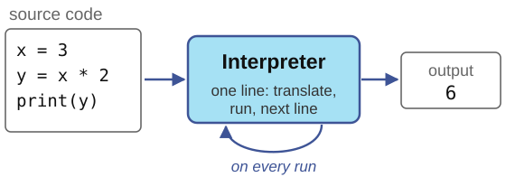{width="100%"}
:::

::: {.column width="50%"}
::: {.concept .sm}
[Compiler: C, C++, (Java)]{.label}

- Translates the **whole program** once into machine code
- Many errors appear before it runs
:::

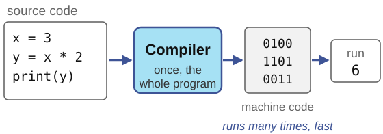{width="100%"}
:::
::::

## Programming paradigms

::: {.sm}
Paradigms classify languages and programs by **how** they express a computation
:::

:::: {.columns}
::: {.column width="50%"}
::: {.concept .sm}
[Imperative]{.label}
Statements that change the program's state, step by step: **how** to compute
:::

::: {.concept .sm}
[Object-oriented]{.label}
Groups data and the instructions that operate on it into **objects**
:::
:::

::: {.column width="50%"}
::: {.concept .sm}
[Declarative]{.label}
Describes **what** the result should be, not how to compute it (SQL, session 11)
:::

::: {.concept .sm}
[Functional]{.label}
The result is the value of functions applied to functions (recursion, session 6)
:::
:::
::::

::: {.xs}
Python supports all of them: which one you use depends on how you write.
:::

## Imperative programming

:::: {.columns}
::: {.column width="50%"}
::: {.sm}
- The program has a **state**: the current values of its variables
- **Assignments** change the state
:::
:::

::: {.column width="50%"}
::: {.sm}
- **Control structures** choose what runs next: conditions, loops
- **Functions** name a block of steps, to reuse and check it
:::
:::
::::

:::: {.columns}
::: {.column width="62%"}
::: {style="font-size:1.06em"}
```python
total = 0             # assignment
for age in [34, 41]:  # loop
    if age >= 18:     # condition
        total += age

def mean(xs):         # function
    return sum(xs) / len(xs)
```
:::
:::

::: {.column width="38%"}
::: {.concept .sm}
[Etymology]{.label}
*imperare*, Latin: **to order, to command**. An imperative program is a sequence of orders, carried out one after the other.
:::
:::
::::

## Object-oriented programming

::: {.sm}
- An **object** bundles **data** (its *attributes*) with the **operations** on that data (its *methods*)
- A **class** is the blueprint; every object is an **instance** of a class
- You query or change an object by calling its methods: `object.method(arguments)`
:::

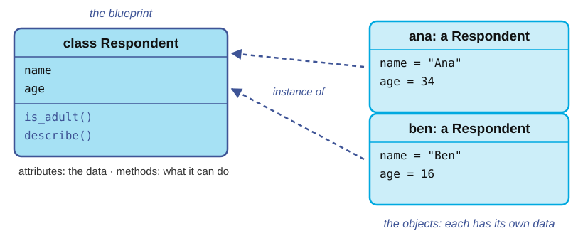{height="9.2em"}

## You already use objects

:::: {.columns}
::: {.column width="50%"}
::: {.sm}
**Strings**
:::

::: {style="font-size:0.77em"}
```python
s = "Konstanz"
s.upper()     # 'KONSTANZ'
s.count("n")  # 2
```
:::
:::

::: {.column width="50%"}
::: {.sm}
**Dictionaries**
:::

::: {style="font-size:0.77em"}
```python
votes = {"yes": 12, "no": 7}
votes.get("no")        # 7
votes.get("maybe", 0)  # 0
list(votes.keys())     # ['yes', 'no']
```
:::
:::
::::

::: {.sm}
`s` is an object of the class `str`, `votes` of the class `dict`: `upper`, `count`, `get`, `keys` are their **methods**. Lists, sets and pandas data frames work the same way.
:::

## Your own class and objects

::: {style="font-size:0.91em"}
```python
class Respondent:
    def __init__(self, name, age):      # runs when an object is created
        self.name = name                # attributes
        self.age = age

    def is_adult(self):                 # methods; self is the object
        return self.age >= 18

    def describe(self):
        return f"{self.name}, {self.age} years"
```
:::

:::: {.columns style="margin-top:1.0em"}
::: {.column width="50%"}
::: {style="font-size:0.91em"}
```python
ana = Respondent("Ana", 34)
ben = Respondent("Ben", 16)
ana.describe()
ben.is_adult()
```
:::
:::

::: {.column width="50%"}
::: {style="font-size:0.91em"}
```


'Ana, 34 years'
False
```
:::
:::
::::

## OOP concepts

:::: {.columns}
::: {.column width="42%"}
::: {.sm}
- **Encapsulation:** data and the methods that use it live together in one object
:::
:::

::: {.column width="58%"}
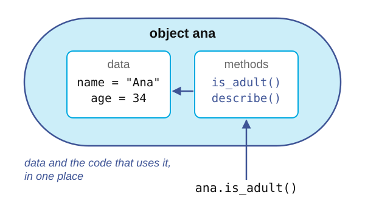{height="8.4em"}

::: {style="font-size:1.2em"}
```python
ana = Respondent("Ana", 34)
ana.age         # 34
ana.is_adult()  # True
```
:::
:::
::::

## OOP concepts

:::: {.columns}
::: {.column width="42%"}
::: {.sm}
- Encapsulation: data and the methods that use it live together in one object
- **Abstraction:** you use an object through its methods, without knowing how it works inside
:::
:::

::: {.column width="58%"}
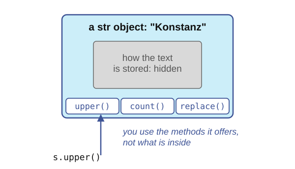{height="8.4em"}

::: {style="font-size:0.99em"}
```python
s = "Konstanz"
s.upper()   # 'KONSTANZ', but how?
```
:::
:::
::::

## OOP concepts

:::: {.columns}
::: {.column width="42%"}
::: {.sm}
- Encapsulation: data and the methods that use it live together in one object
- Abstraction: you use an object through its methods, without knowing how it works inside
- **Inheritance:** a new class extends an existing one and reuses its methods: a student *is a* respondent
:::
:::

::: {.column width="58%"}
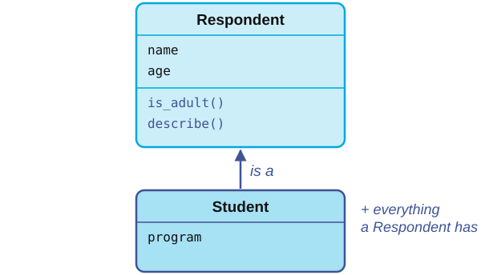{height="8.4em"}

::: {style="font-size:0.81em"}
```python
class Student(Respondent):
    def __init__(self, name, age, program):
        super().__init__(name, age)
        self.program = program

bea = Student("Bea", 21, "Politics")
bea.is_adult()  # True: inherited
```
:::
:::
::::

## OOP concepts

:::: {.columns}
::: {.column width="42%"}
::: {.sm}
- Encapsulation: data and the methods that use it live together in one object
- Abstraction: you use an object through its methods, without knowing how it works inside
- Inheritance: a new class extends an existing one and reuses its methods: a student *is a* respondent
- **Polymorphism:** the same name does the right thing for each class
:::
:::

::: {.column width="58%"}
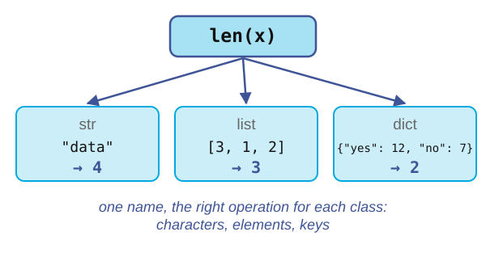{height="8.4em"}

::: {style="font-size:1.1em"}
```python
len("data")                # 4
len([3, 1, 2])             # 3
len({"yes": 12, "no": 7})  # 2
```
:::
:::
::::

## Software engineering

::: {.outline .focus}
1. Programming in a nutshell
2. [Software engineering]{.current}
3. Requirements, specifications, and design
4. Testing
:::

## From a script to software

::: {.definition}
[Definition: Software engineering]{.label}

::: {.sm}
The application of a systematic, disciplined approach to the development, operation and maintenance of software.
:::
:::

::: {.center-h}
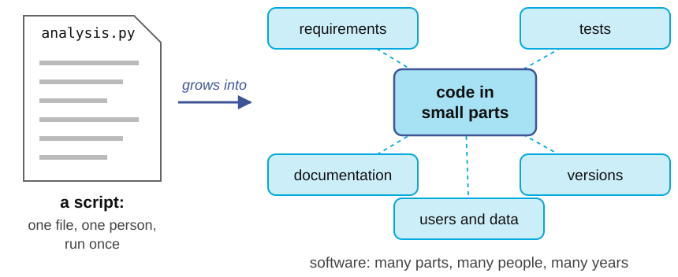{height="8.0em"}
:::

::: {.sm}
Research code needs this too: it outlives the paper, and others build on it.
:::

## A typical software engineering flow

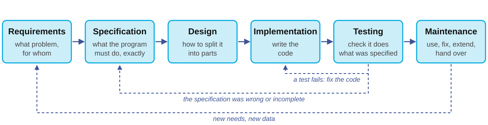{width="100%"}

::: {.sm}
- Real projects go around this loop many times, in small steps (**iterative** development)
- Two steps define correctness: the **specification** says what is right, **testing** checks it
:::

## Vibe coding in the flow

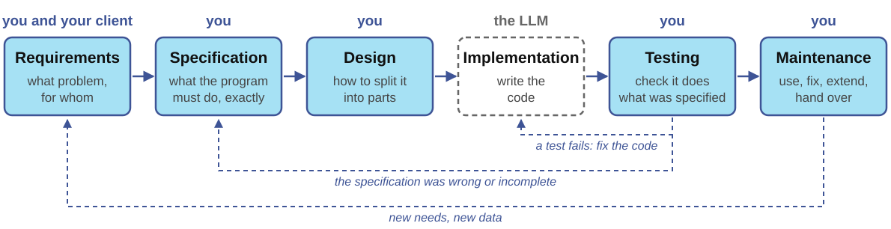{width="100%"}

::: {.sm}
- **Vibe coding**: describe what you want, accept the generated code without reading it, and see whether it seems to work
- The LLM can take over implementation. **Everything else remains your job**, and it is what failed in the three opening examples
:::

## Requirements, specifications, and design

::: {.outline .focus}
1. Programming in a nutshell
2. Software engineering
3. [Requirements, specifications, and design]{.current}
4. Testing
:::

## What are requirements? {.fit1}

::: {.definition}
[Definition: Requirements]{.label}

::: {.sm}
What the software must achieve, for whom, and under which constraints, in the words of the people who need it.
:::
:::

::: {.sm}
- They come from the **client**: a research team, a colleague, or yourself in three months
- They describe the need, not the program: *"I need the mean age of each survey wave, without the people who did not answer"*
- Four questions find most of them: **who** uses it, with **which data**, what must **never** happen, and when is it **done**?
- A misunderstanding found here costs a conversation; found after the code is written, it costs the code
:::

## Functional and non-functional requirements {.fit1}

:::: {.columns}
::: {.column width="50%"}
::: {.concept .sm}
[Functional]{.label}
What output for what input

- the mean skips missing answers
- an empty survey raises an error
:::
:::

::: {.column width="50%"}
::: {.concept .sm}
[Non-functional]{.label}
How the program must behave beyond its outputs

- **security**: users see only their own data
- **privacy**: no names in the output
- **safety**: never delete or change the original data
- performance, reproducibility
:::
:::
::::

::: {.sm}
Tea, Antigravity and Replit met their functional requirements; the non-functional ones were never written down.
:::

## What is a specification?

::: {.definition}
[Definition: Specification]{.label}

::: {.sm}
A precise description of **what** a program must do, without saying **how**.
:::
:::

::: {.sm}
- **Inputs** and what may be assumed about them (*preconditions*)
- **Outputs** and what is guaranteed about them (*postconditions*)
- What happens in **edge cases and errors**
- What the program must **never** do
:::

::: {.xs}
You already know the format: every procedure in this course starts with `Inputs:` and `Result:`
:::

## An ambiguous request

::: {.example}
::: {.sm}
*"Write a function that computes the mean age of the respondents."*
:::
:::

::: {.sm}
Five questions a human colleague would ask, and an LLM will silently answer for you:
:::

::: {.sm}
1. How are missing answers stored, and do they count?
2. What if nobody answered?
3. Are ages integers, or can they be text like `"34"`?
4. Should the result be rounded?
5. May the function change the list it was given?
:::

## Writing the specification

::: {style="font-size:0.94em"}
```python
def mean_age(ages):
    """Return the mean of the ages that were answered.

    ages: a list of ages in years (int); None marks a missing answer.
    Returns: the mean of the ages that are not None, as a float.
    Raises: ValueError if no age was answered.
    The list itself is not modified.
    """
```
:::

::: {.sm}
- Each line answers one of the five questions
- It says nothing about **how** to compute the mean
:::

## The specification is your prompt

:::: {.columns}
::: {.column width="44%"}
::: {.example .sm}
**Vague**

*"Write a function for the mean age."*
:::
:::

::: {.column width="56%"}
::: {.example .sm}
**Specified**

*"Write `mean_age(ages)`. `ages` is a list of ints; `None` marks a missing answer and is skipped. Return a float. Raise `ValueError` if no age was answered. Do not modify the list. Use only the standard library."*
:::
:::
::::

::: {.sm}
- A precise prompt gets better code, and you can **check** the code against it
- Rules that must never be broken are not prompts: enforce them with permissions, backups, separate test and production data
:::

## Design: small parts with clear connections

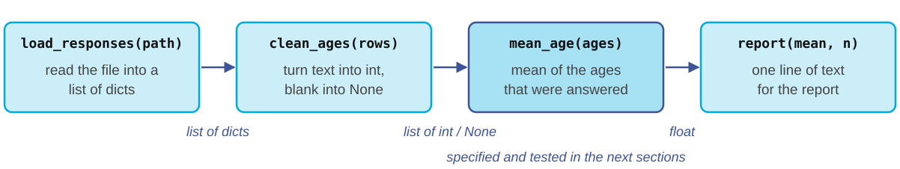{width="100%"}

::: {.sm}
- Split the program into **small parts**, each with one job and its own specification
- Decide **what data flows between the parts**, and in which data structure
- Small parts are easier to test, to replace, and to ask an LLM for: one specified function at a time
:::

## Design: choosing the data structures

::: {.tbl-grid .sm}
| The program needs to... | Data structure (session 3) | Example |
|---|---|---|
| keep items in order | list | answers in the order they arrived |
| look something up by a key | dictionary | `counts["yes"]`, a codebook |
| check membership fast | set | is this ID already registered? |
| serve first come, first served | queue | a waiting list for a seminar |
:::

::: {.sm}
The design is yours to decide: an LLM writes better code inside a structure you chose than when it invents one
:::

## Testing

::: {.outline .focus}
1. Programming in a nutshell
2. Software engineering
3. Requirements, specifications, and design
4. [Testing]{.current}
:::

## What is a test?

::: {.definition}
[Definition: Test]{.label}

::: {.sm}
A small program that runs your code on an input whose correct output you know, and checks that the code produces it.
:::
:::

::: {style="font-size:1.08em"}
```python
assert mean_age([30, 40, 50]) == 40
assert mean_age([30, None, 50]) == 40
```
:::

::: {.sm}
- The specification says what should happen; a test **checks** that it does
- A failing `assert` stops the program with an error: a loud failure instead of a wrong number
:::

## Tests with pytest

:::: {.columns}
::: {.column width="50%"}
::: {style="font-size:0.73em"}
```python
# test_survey.py
import pytest
from survey import mean_age

def test_typical():
    assert mean_age([30, 40, 50]) == 40

def test_missing_answers_are_skipped():
    assert mean_age([30, None, 50]) == 40
```
:::
:::

::: {.column width="50%"}
::: {style="font-size:0.73em"}
```python
def test_no_answers_raises():
    with pytest.raises(ValueError):
        mean_age([None, None])

def test_input_is_not_modified():
    ages = [30, None, 50]
    mean_age(ages)
    assert ages == [30, None, 50]
```
:::
:::
::::

::: {.sm}
Save the tests in a file whose name starts with `test_`, then run `pytest` in that folder: it finds and runs every function whose name starts with `test_`
:::

## A generated function meets the tests

:::: {.columns}
::: {.column width="50%"}
::: {style="font-size:0.81em"}
```python
def mean_age(ages):
    answered = [a for a in ages
                if a is not None]
    return sum(answered) / len(ages)
```
:::

::: {.sm}
Plausible, short, and wrong twice
:::
:::

::: {.column width="50%"}
::: {style="font-size:0.77em"}
```
$ pytest -q
.FF.
FAILED test_missing_answers_are_skipped
  assert 26.666666666666668 == 40
FAILED test_no_answers_raises
  DID NOT RAISE ValueError
2 failed, 2 passed
```
:::
:::
::::

::: {.sm}
- It divides by all respondents, not by those who answered: **26.7 instead of 40**, a quiet wrong number
- With no answers it returns 0 instead of raising an error
- Fix: divide by `len(answered)` and raise if `answered` is empty. Then all four tests pass
:::

## Choosing test cases

::: {.tbl-grid}
| Kind | Example input | Expected |
|---|---|---|
| Typical | `[30, 40, 50]` | `40` |
| Missing values | `[30, None, 50]` | `40` |
| Boundary | `[25]` | `25` |
| Empty | `[None, None]`, `[]` | `ValueError` |
| Must not happen | the list is changed | list unchanged |
:::

::: {.sm}
Test where the specification draws a line: missing, empty, a single element, the largest and smallest values
:::

## Test first, then generate

::: {.sm}
1. Write the **specification** (the docstring)
2. Write the **tests** from the specification, before any code exists
3. Ask the LLM (or yourself) for the **implementation**
4. **Run the tests**; read the code that passes them
5. Every bug you find later becomes a **new test**, so it can never come back (*regression test*)
:::

::: {.sm}
The tests are your measurement. They replace the feeling that the code works with evidence that it does.
:::

## What tests cannot do

::: {.example}
::: {.sm}
*"Program testing can be used to show the presence of bugs, but never to show their absence."*<br>
Edsger W. Dijkstra, *Notes on Structured Programming* (1970)
:::
:::

::: {.sm}
- Tests check only the cases you thought of: a missing requirement produces missing tests
- **Software verification** goes further: it *proves*, with mathematics, that a program meets its specification for **every** input. It is expensive and used where failure is unacceptable: aircraft control, railway signaling, operating system kernels
- For research code: specification, tests, and **reading** the code you did not write
:::

## Summary {.fit1}

::: {.sm}
- A **program** is a precise list of instructions, run by an **interpreter** or translated by a **compiler**
- **Paradigms**: imperative programs change state step by step; **objects** bundle data with methods, as in `s.upper()` or your own classes
- **Software engineering** puts coding inside a loop: requirements, specification, design, implementation, testing, maintenance
- **Requirements** say what is needed; the **specification** says exactly what the program must do; the **design** splits it into small parts
- A **test** runs the code on cases with known answers; write tests first, then generate or write the code
- With AI tools, implementation is cheap: **everything around it** is the part you cannot delegate
:::

**Next session:** Algorithms
