## Course Outline

:::: {.columns}
::: {.column width="50%"}
::: {}
- Session 1: Introduction
- Session 2: Information Coding
- Session 3: Data Structures
- Session 4: Software
- Session 5: Algorithms
- Session 6: Recursion
- Session 7: Sorting Algorithms
:::
:::

::: {.column width="50%"}
::: {}
- Session 8: Time Complexity
- Session 9: Theoretical Computer Science
- Session 10: Machine Learning
- Session 11: Databases
- Session 12: Parallel Programming
- Session 13: Social Science Applications
- Session 14: Exam Review
:::
:::
::::

## Outline

::: {.outline}
1. Algorithms
2. Representation of Algorithms
3. Abstract Data Structures
    - Queues and Stacks
    - Graphs
:::


<!-- MOTIVATION:M05-A:BEGIN -->
## Six handshakes, and how you would check {.fit1}

::: {.motivation}
[Motivating example]{.label}
Milgram's 1967 experiment asked people in Nebraska to get a letter to a stranger
in Boston by passing it only to someone they knew personally. The chains that
arrived had a median of **five intermediaries**. Fifty years later the same
question was answered directly over **1.59 billion people**, giving **3.57**.
:::

:::: {.figures}
::: {.fq}
[5.2]{.big}[Milgram, 1967: mean over the 64 letters that arrived]{.cap}
:::
::: {.fq}
[3.57]{.big}[Facebook, 2016: 1.59 × 10⁹ people]{.cap}
:::
::::

[Milgram needed volunteers and postage. What *procedure* answers the same question from the network itself?]{.ask}

::: {.source}
Milgram, *Psychology Today* (1967); Edunov, Diuk, Filiz, Bhagat & Burke, Facebook Research (2016)
:::
<!-- MOTIVATION:M05-A:END -->

<!-- MOTIVATION:M05-B:BEGIN -->
## Whose contacts, within two steps?

::: {.motivation}
[Motivating example]{.label}
A case is confirmed on Monday. Public health needs everyone this person met, and
everyone **those** people met, but not the whole population, and not next week.
On the contact graph of a mid-sized city that is thousands of people, and it
must be answered in **seconds**.
:::

- "Everyone within two steps" is easy to say and useless until you specify
  *which person you look at next* and *how you know you are finished*.

[What is the exact recipe, and how do you keep from going round in circles?]{.ask}
<!-- MOTIVATION:M05-B:END -->

<!-- MOTIVATION:M05-C:BEGIN -->
## The network that would not fit

::: {.motivation}
[Motivating example]{.label}
You want to store who is friends with whom among the **84 million** people in
Germany. Written as a table of everyone against everyone, that is
**7 × 10¹⁵ cells**, seven petabits at one bit each, more than most data centers
hold. Written the other way round it fits on a laptop and answers the same
questions.
:::

:::: {.figures}
::: {.fq}
[7 × 10¹⁵]{.big}[cells, as a matrix]{.cap}
:::
::: {.fq}
[8 × 10⁹]{.big}[friendships, as adjacency lists]{.cap}
:::
::: {.fq}
[~10⁶×]{.big}[smaller, same facts]{.cap}
:::
::::

[Same network, same questions. Why does the *representation* decide whether the study can happen?]{.ask}
<!-- MOTIVATION:M05-C:END -->

## What is an algorithm?

::: {.definition}
[Definition]{.label}

::: {}
An algorithm is a self-contained step-by-step set of operations to solve a given problem. Algorithms perform calculation, data processing, and/or automated reasoning tasks.
:::
:::

## Other uses of the word algorithm {.fit1}

:::: {.columns}
::: {.column width="72%"}
::: {.sm}
The word *algorithm* is commonly used nowadays with slightly different meanings, especially in the context of Artificial Intelligence:

- Algorithm as **method to fit a predictive model**. Can be as simple as least squares to fit linear regression and as complicated as distributed stochastic gradient descent to fit neural networks
- Algorithm as **the model after training**. This focuses on the predictive model as a program with a behavior that is not carefully designed, but learned from empirical data.
:::

::: {.center-h .sm}
Related terms to these other meanings: algorithmic bias, algorithmic media, machine behavior, algorithm auditing, algorithmic decision-making…
:::
:::

::: {.column width="28%"}
::: {.imgcol}
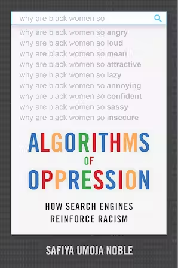{height="6.0em"}

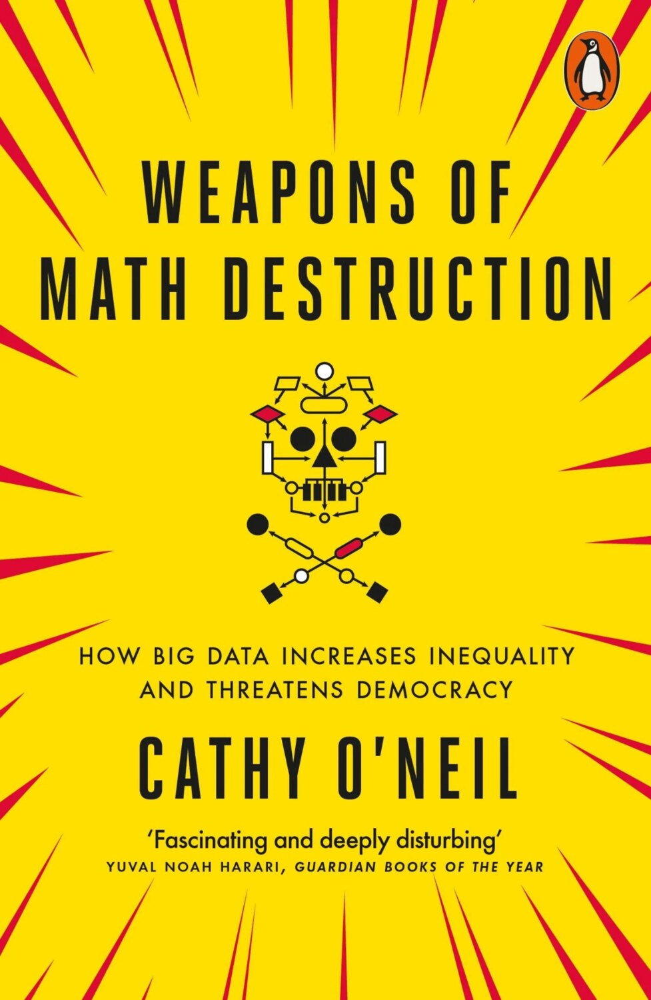{height="5.8em"}
:::
:::
::::

## al-Khwarizmi: the namesake of algorithms {.fit1}

:::: {.columns}
::: {.column width="62%"}
::: {.xs}
**Muhammad ibn Musa abu Djafar al-Khwarizmi**<br>(780 – 850, Khwarazm, Uzbekistan)

- Popularized algebra and published the first systematic way to solve linear and quadratic equations
- His book on how to calculate with Hindu-Arabic numerals was translated into Latin with the title *Algoritmi de Numero Indorum*
- *Algoritmi* later changed to *Algorithmus* as a mix with *arithmos* in Greek (number)
:::
:::

::: {.column width="38%"}
{height="7.4em"}
:::
::::

::: {.xs}
- It is clear that algorithms predate him (e.g. in Babylon, Egypt, India, and Greece)
- He widely popularized the idea of systematic treatment of data (numbers)
- He emphasized doing this in as few steps as possible - thus using a decimal system with pen and paper rather than Roman numerals with an abacus
:::

## Algorithms: python example {.fit1}

:::: {.columns}
::: {.column width="52%"}
::: {.codewrap style="font-size:1.00em"}
<pre class="pseudocode"><b>Procedure</b> K-SMALLEST-ELEMENT(<i>M</i>, <i>n</i>, <i>k</i>)
<i>Inputs:</i>
  <i>M</i>: an array
  <i>n</i>: the number of elements in <i>M</i>
  <i>k</i>: which smallest element to find (<i>k</i> = 1 is the minimum)
<i>Result:</i> the <i>k</i>-th smallest element of <i>M</i>
<b>For</b> <i>i</i> = 1 to <i>k</i>:
      <i>smallest</i> &larr; <i>i</i>
      <b>For</b> <i>j</i> = <i>i</i> + 1 to <i>n</i>:
            <b>If</b> <i>M</i>[<i>j</i>] &lt; <i>M</i>[<i>smallest</i>]
                  <b>then</b> <i>smallest</i> &larr; <i>j</i>
      swap <i>M</i>[<i>i</i>] with <i>M</i>[<i>smallest</i>]
<b>return</b> <i>M</i>[<i>k</i>]</pre>
:::
:::

::: {.column width="48%"}
::: {.xs}
**Example: kth smallest element in a list**

`Inputs:` list `M` of length `n`, index `k`<br>
`Data:` `i, j, m, min_val`<br>
`Result:` the `k`-th smallest element of `M`

::: {.codewrap style="font-size:1.00em"}
```python
def min_k(M, k):
    for i in range(0, k):
        m = i
        min_val = M[i]
        for j in range(i+1, len(M)):
            if M[j] < min_val:
                m = j
                min_val = M[j]
        M[i], M[m] = M[m], M[i]
    return M[k-1]
```
:::
:::
:::
::::

## Algorithms: properties

:::: {.columns}
::: {.column width="46%"}
::: {.sm}
**Specification:**

- **input specification:** required input such that a given output can be produced (many or no inputs)

<br>

- **output specification:** result to be produced by the algorithm
:::
:::

::: {.column width="54%"}
::: {.xs}
**Example: kth smallest element in a list**

::: {.codewrap style="font-size:1.10em"}
```python
def min_k(M, k):
    for i in range(0, k):
        m = i
        min_val = M[i]
        for j in range(i+1, len(M)):
            if M[j] < min_val:
                m = j
                min_val = M[j]
        M[i], M[m] = M[m], M[i]
    return M[k-1]
```
:::
:::
:::
::::

## Algorithms: properties

:::: {.columns}
::: {.column width="46%"}
::: {.sm}
**Transferability:**

- input should be parameterizable
- different instances of the problem must be allowed as inputs

The example allows lists of any possible length, not just one length

It also allows to find any kth smallest element, not just for one k
:::
:::

::: {.column width="54%"}
::: {.xs}
**Example: kth smallest element in a list**

::: {.codewrap style="font-size:1.10em"}
```python
def min_k(M, k):
    for i in range(0, k):
        m = i
        min_val = M[i]
        for j in range(i+1, len(M)):
            if M[j] < min_val:
                m = j
                min_val = M[j]
        M[i], M[m] = M[m], M[i]
    return M[k-1]
```
:::
:::
:::
::::

## Algorithms: properties {.fit1}

:::: {.columns}
::: {.column width="46%"}
::: {.sm}
**Description:**

- **finiteness:** must terminate after a finite number of steps
- **definiteness:** each step must be clear, well-defined and precise (no ambiguity)

**Execution and return, alternatives:**

- **deterministic:** same output for same input(s)
- **stochastic:** a random component makes the output vary for the same input(s)
:::
:::

::: {.column width="54%"}
::: {.sm}
**Example: kth smallest element in a list**

::: {.codewrap style="font-size:1.10em"}
```python
def min_k(M, k):
    for i in range(0, k):
        m = i
        min_val = M[i]
        for j in range(i+1, len(M)):
            if M[j] < min_val:
                m = j
                min_val = M[j]
        M[i], M[m] = M[m], M[i]
    return M[k-1]
```
:::
:::
:::
::::

## Algorithms: properties {.fit1}

:::: {.columns}
::: {.column width="46%"}
::: {.sm}
**Time complexity:**

- effort the given algorithm needs for completion
- is dependent on specific implementation
- measured by counting the number of key operations such as comparisons in the sorting algorithm

**Memory complexity:**

- required memory during execution
- measured by counting the maximum memory space required by the algorithm
:::
:::

::: {.column width="54%"}
::: {.sm}
**Example: kth smallest element in a list**

::: {.codewrap style="font-size:1.10em"}
```python
def min_k(M, k):
    for i in range(0, k):
        m = i
        min_val = M[i]
        for j in range(i+1, len(M)):
            if M[j] < min_val:
                m = j
                min_val = M[j]
        M[i], M[m] = M[m], M[i]
    return M[k-1]
```
:::
:::
:::
::::

## Algorithms: properties

:::: {.columns}
::: {.column width="46%"}
::: {.sm}
**Correctness:**

- **partial correctness:** whenever the algorithm terminates, its output is correct

<br>

- **terminates:** for correct inputs, the algorithm must always terminate in a finite number of steps
:::
:::

::: {.column width="54%"}
::: {.xs}
**Example: kth smallest element in a list**

::: {.codewrap style="font-size:1.10em"}
```python
def min_k(M, k):
    for i in range(0, k):
        m = i
        min_val = M[i]
        for j in range(i+1, len(M)):
            if M[j] < min_val:
                m = j
                min_val = M[j]
        M[i], M[m] = M[m], M[i]
    return M[k-1]
```
:::
:::
:::
::::

## Representation of Algorithms

::: {.outline .focus}
1. Algorithms
2. [Representation of Algorithms]{.current}
3. Abstract Data Structures
    - Queues and Stacks
    - Graphs
:::

## Representation

::: {.center-h}
**How to create a new program?**
:::

::: {.example style="width:70%;margin:0.8em auto"}
::: {.sm}
- Evaluate your requirements

- Define a structure for programming with a method of representation for its algorithm:
  - Pseudocode
  - Structograms
  - Flow diagrams
  - UML Unified Modeling Language

- Start programming
:::
:::

## Representation

::: {.center-h}
**How to create a new program?**
:::

::: {.example style="width:70%;margin:0.8em auto"}
::: {.sm}
- Evaluate your requirements

- Define a structure for programming with a method of representation for its algorithm:
  - **Pseudocode**
  - Structograms
  - **Flow diagrams**
  - UML Unified Modeling Language

- Start programming
:::
:::

## Pseudocode

::: {.sm}
- representation of the steps in an algorithm as a combination of natural language and mathematical notation
- often uses structural conventions of a programming language
- not for machine interpretation but for illustration purposes among humans
:::

::: {.codewrap style="font-size:1.10em"}
<pre class="pseudocode" style="width:56%;margin:0.6em auto"><b>Procedure</b> NAME(<i>inputs</i>)
<i>Inputs:</i> input variables
<i>Data:</i> auxiliary variables
<i>Result:</i> output variables
preparation
<b>While</b> not the trivial case:
      work
bookkeeping</pre>
:::

## Good pseudocode

:::: {.columns}
::: {.column width="50%"}
::: {.codewrap style="font-size:1.50em"}
<pre class="pseudocode"><b>Procedure</b> NAME(<i>inputs</i>)
<i>Inputs:</i> input variables
<i>Data:</i> auxiliary variables
<i>Result:</i> output variables
preparation
<b>While</b> not the trivial case:
      work
bookkeeping</pre>
:::
:::

::: {.column width="50%"}
::: {.sm}
Specify **input** and **output** if not clear from the context (problem)

<br>

If you use auxiliary data structures, comment how to access and edit them

<br>

Make sure loops and conditional scopes are **unambiguous**
:::
:::
::::

::: {.sm}
**Bottom line:** using your pseudocode, another human has to be able to follow its instructions to solve the problem with pen and paper (and later program it)
:::

## Flowcharts {.fit1}

::: {}
- graphical representation of execution of an algorithm using symbols and transitions
- shows the steps as boxes, and their order by connecting the boxes with arrows
:::

::: {.center-h}
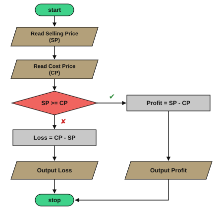{height="12.4em"}
:::

## Flowcharts {.fit2}

:::: {.columns}
::: {.column width="64%"}
- program start and end
  - beginning and ending of a program or sub-process

- data
  - process of inputting/entering and outputting/displaying data

- execute operations
  - set of operations that changes value, form, or location of data

- conditional split
  - conditional operation that determines the program path
  - commonly a yes/no question or true/false test
:::

::: {.column width="36%"}
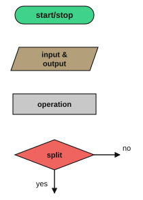{height="14.0em"}
:::
::::

## Flowchart example

:::: {.columns}
::: {.column width="42%"}
{height="12.9em"}
:::

::: {.column width="58%"}
::: {.xs}
- The program starts and reads selling price as SP
- Then reads cost price as CP
- The program tests if SP is larger than or equal CP
- If the condition is true, it takes the right path:
  - Calculate profit as SP-CP
  - Output profit
- if the condition is false, it takes the bottom path:
  - Calculate loss as CP - SP
  - Then output loss
- Program ends
:::
:::
::::

## Exercise: write pseudocode as a flowchart

::: {.example style="width:62%;margin:0.6em auto"}
::: {.xs}
**Example: kth smallest element in a list**

`Inputs:` list `M` of length `n`, index `k`<br>
`Data:` `i, j, m, min_val`<br>
`Result:` the `k`-th smallest element of `M`

::: {.codewrap style="font-size:1.20em"}
```python
def min_k(M, k):
    for i in range(0, k):
        m = i
        min_val = M[i]
        for j in range(i+1, len(M)):
            if M[j] < min_val:
                m = j
                min_val = M[j]
        M[i], M[m] = M[m], M[i]
    return M[k-1]
```
:::
:::
:::

## Another flowchart example

::: {.center-h}
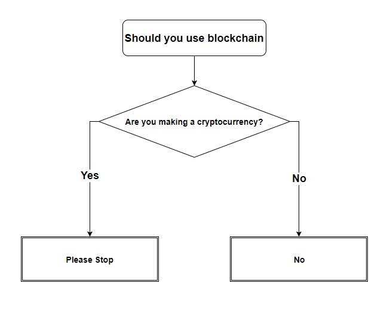{height="14.1em"}
:::

::: {.source}
<https://www.reddit.com/r/ProgrammerHumor/comments/7etmm1/a_diagram_to_help_you_decide_whether_blockchain/>
:::

## Abstract Data Structures

::: {.outline .focus}
1. Algorithms
2. Representation of Algorithms
3. [Abstract Data Structures]{.current}
    - Queues and Stacks
    - Graphs
:::

## Abstract Data Structures {.fit1}

::: {.sm}
- Characteristics
  - represent data in a way best suited to our (algorithmic) needs
    - arrangement, coding and link among data matter
  - allow for administration and access to data in an efficient way
  - exact specification is dependent on implementation and the use case
- We already saw a number of abstract data structures
  - arrays
  - linked lists
  - binary search trees
  - associative arrays (= dictionaries)
- Choice of data structure matters a lot for performance of specific algorithms
  - next: illustrative examples for each structure
:::

## Queues

:::: {.columns}
::: {.column width="56%"}
::: {}
- Linear data structure following the **FIFO** principle: First In, First Out
- Two operations:
  - ENQUEUE($Q$, $v$): add element $v$ to the rear of the queue $Q$
  - DEQUEUE($Q$): remove and return the element at the front of the queue $Q$
- Example applications:
  - processing requests in order
  - having several queues for priority
:::
:::

::: {.column width="44%"}
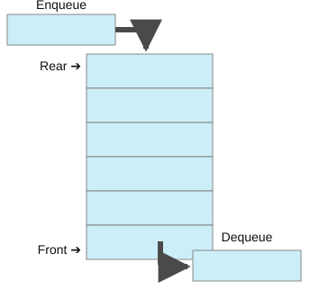{height="13.1em"}
:::
::::

## Stacks {.fit1}

:::: {.columns}
::: {.column width="56%"}
::: {.sm}
- Linear data structure following the **LIFO** principle: Last In, First Out
- Two operations:
  - PUSH($S$, $v$): add an element $v$ to the top of the stack $S$
  - POP($S$): remove and return the most recently added element, i.e. the top of the stack $S$
- Example applications:
  - Stack segment of the memory
    - management of layered execution of sub-routines
  - Recursion: more details in next session
:::
:::

::: {.column width="44%"}
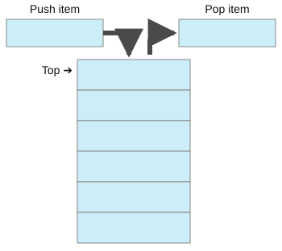{height="13.9em"}
:::
::::

## Graphs: motivation

:::: {.columns}
::: {.column width="48%"}
::: {}
**Leonhard Euler: Seven bridges of Königsberg**

**Problem:** Find a path that uses every bridge exactly once and ends in the same place.

Example of a graph representation in a problem that motivated graph theory
:::
:::

::: {.column width="52%"}
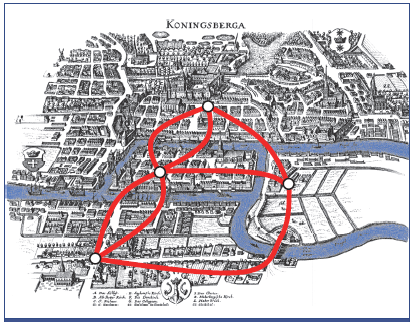{height="10.0em"}

::: {.source}
By Peter Berger: *Einführung in die Graphentheorie*
:::
:::
::::

## Graph examples

::: {}
Many real-world structures can be represented as a graph. Examples are:
:::

:::: {.columns}
::: {.column width="33%"}
::: {.center-h}
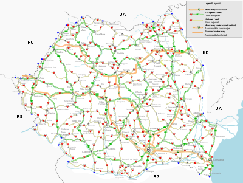{height="3.5em"}

::: {}
A road map
:::

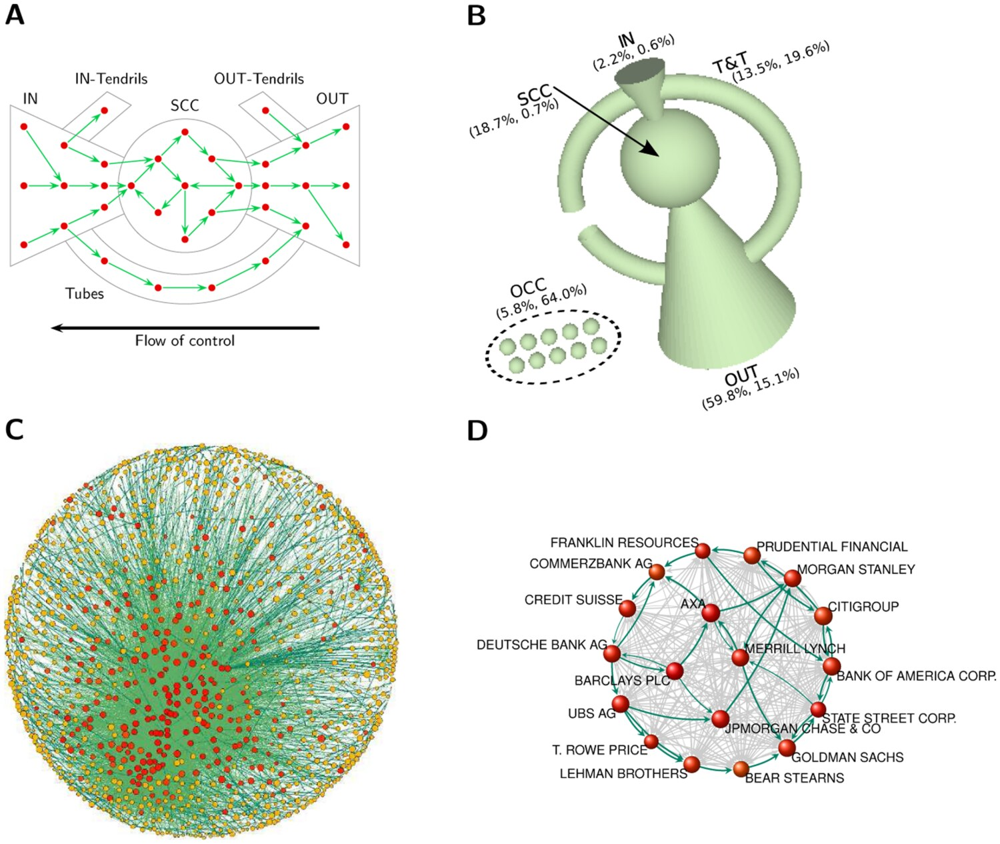{height="3.5em"}

::: {}
Ownership between companies
:::
:::
:::

::: {.column width="33%"}
::: {.center-h}
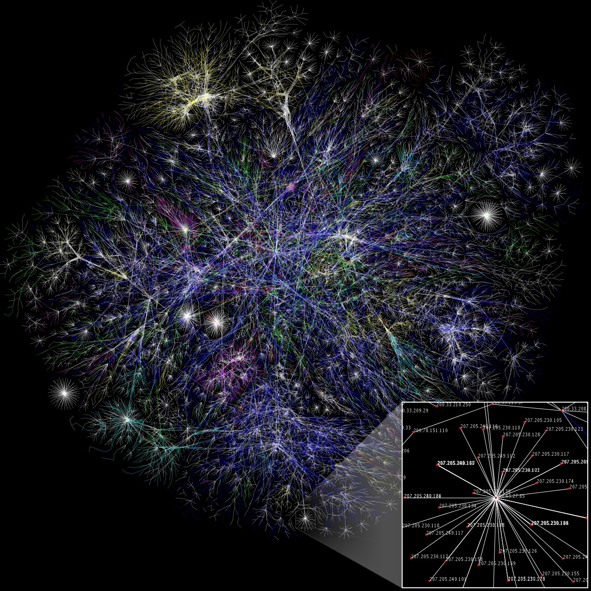{height="3.5em"}

::: {}
The Internet
:::

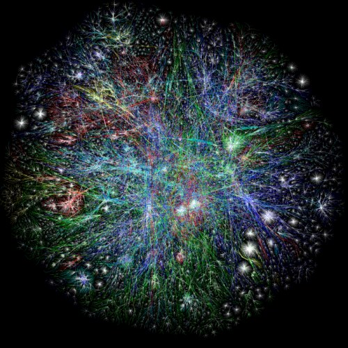{height="3.5em"}

::: {}
The Web
:::
:::
:::

::: {.column width="33%"}
::: {.center-h}
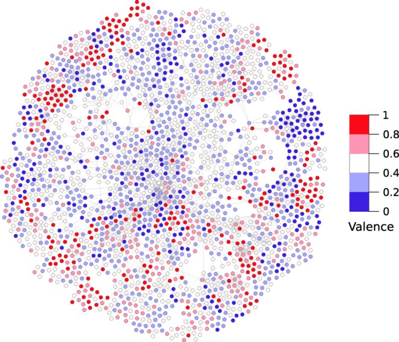{height="3.5em"}

::: {}
Word associations
:::

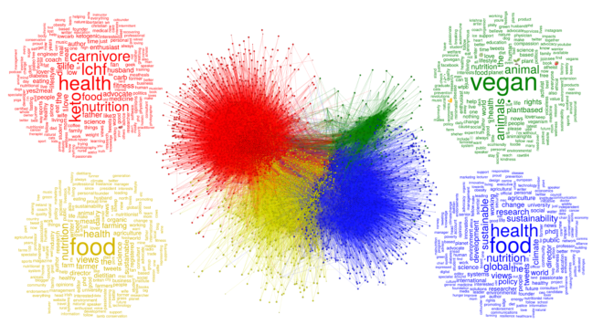{height="3.5em"}

::: {}
Social relations
:::
:::
:::
::::

## Graphs

::: {}
- consist of **vertices** and **edges**
- especially suitable to represent interdependencies between data points
:::

::: {.center-h}
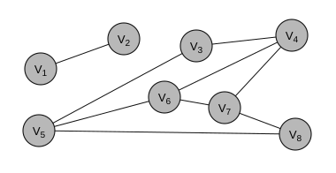{height="10.9em"}
:::

## Graphs

::: {.sm}
- **vertices** represent any object
  - cities, physical states, atoms, steps in a process, persons
  - can be labeled or not
- **edges** represent the relationship between nodes
  - roads between cities, transitions between physical states, atomic bonds etc.
  - edges can have labels and variables, for example
    - physical distance (e.g. 2 Km in a map)
    - type of connection (e.g. friends or enemies)
    - weight of connection (e.g. strong versus weak)
  - can be **directed** or **undirected**
:::

## Graphs: Formalization

::: {.definition style="width:74%;margin:0.6em auto"}
::: {}
A graph $G$ is a tuple $G = (V, E)$, where

- $V$ is the set of all **vertices**
- $E$ is the set of all **edges**
:::
:::

::: {}
- For **directed** graphs, $E$ consists of ordered pairs $(v_1, v_2)$, i.e., the edge goes from $v_1$ to $v_2$
- For **undirected** graphs, $E$ consists of unordered pairs $\{v_1, v_2\}$
- How do we represent graphs as an abstract data structure?
:::

## Adjacency Matrix {.fit2}

::: {.definition}
[Definition of Adjacency Matrix]{.label}

::: {.xs}
If $G = (V, E)$ is a graph then two vertices $v, w \in V$ are **adjacent** if they are connected by an edge $\{v, w\} \in E$.
The matrix $A(G)$ is called **adjacency matrix** if $a_{v,w} = 1$ if $\{v, w\} \in E$ and $a_{v,w} = 0$ otherwise.
:::
:::

:::: {.columns}
::: {.column width="46%"}
{height="9.5em"}
:::

::: {.column width="54%"}
::: {.xxs}
$$A(G) = \begin{array}{c|cccccccc}
 & v_1 & v_2 & v_3 & v_4 & v_5 & v_6 & v_7 & v_8\\\hline
v_1 & 0&1&0&0&0&0&0&0\\
v_2 & 1&0&0&0&0&0&0&0\\
v_3 & 0&0&0&1&1&0&0&0\\
v_4 & 0&0&1&0&0&1&1&0\\
v_5 & 0&0&1&0&0&1&0&1\\
v_6 & 0&0&0&1&1&0&1&0\\
v_7 & 0&0&0&1&0&1&0&1\\
v_8 & 0&0&0&0&1&0&1&0
\end{array}$$
:::
:::
::::

## Adjacency list

::: {.sm}
**Adjacency list:** Alternative representation to adjacency matrix

- array of vertices in which all neighbors are stored as a linear list
- compressed representation of an adjacency matrix where all zeros have been eliminated. More memory efficient for sparse graphs.
:::

:::: {.columns}
::: {.column width="48%"}
{height="7.9em"}
:::

::: {.column width="52%"}
::: {.tbl-grid .xs}
| | |
|---|---|
| $v_1$ | $\rightarrow v_2$ |
| $v_2$ | $\rightarrow v_1$ |
| $v_3$ | $\rightarrow v_4 \rightarrow v_5$ |
| $v_4$ | $\rightarrow v_3 \rightarrow v_6 \rightarrow v_7$ |
| $v_5$ | $\rightarrow v_3 \rightarrow v_6 \rightarrow v_8$ |
| $v_6$ | $\rightarrow v_4 \rightarrow v_5 \rightarrow v_7$ |
| $v_7$ | $\rightarrow v_4 \rightarrow v_6 \rightarrow v_8$ |
| $v_8$ | $\rightarrow v_5 \rightarrow v_7$ |
:::
:::
::::

## Adjacency Matrix vs Adjacency List {.fit2}

::: {.sm}
Comparing adjacency matrix and list representation

- example 1: does an edge exist between $v_i$ and $v_j$?
  - adjacency matrix: direct access
  - adjacency list: iterate through all neighbors
- example 2: how many edges does a vertex $v_i$ have?
  - adjacency matrix: iterate through all vertices
  - adjacency list: iterate only through all neighbors
- choice of representation clearly matters for access efficiency
:::

::: {.sm}
Adjacency lists are more memory efficient for **sparse** networks (few edges per node)

- If Facebook stored the friendship network data of 2.7 Billion users as an adjacency matrix and each entry in the matrix took just one bit, it would take 455 Petabytes (455,000 Terabytes) to store just the presence or absence of friendships between users.
:::

## Examples of Graph Problems

::: {}
- Finding distances between nodes and shortest paths
- Finding subgraphs that are connected: i.e. there are paths between every two nodes in the subgraph
- Coloring nodes such that two neighbors do not have the same color
- Finding the nodes with the shortest average distance to all other nodes
- Ranking nodes by the number of shortest paths that go through them
- Finding a tree that connects all nodes with the lowest number of edges
- Finding a path connecting all nodes and using edges at most once
- Finding if two graphs can be mapped into each other (isomorphism)
:::

## Example: Finding distances {.fit2}

::: {.sm}
Let's consider this (undirected) graph $G = (V, E)$ with<br>
$V = \{a,b,c,d,e,f,g\}$ and<br>
$E = \{\{a,e\}, \{e,b\}, \{b,c\}, \{c,f\}, \{c,g\}, \{d,g\}, \{e,f\}\}$
:::

::: {.center-h}
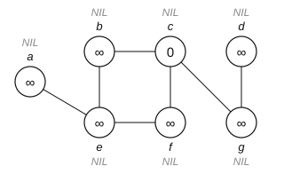{height="7.0em"}
:::

::: {.sm}
**Problem:** Given a source node (aka starting node) $s$,

(a) find all reachable nodes from it and
(b) find a shortest path to each of them from $s$

$\rightarrow$ To do so use the **Breadth-First Search (BFS)** algorithm
:::

## Algorithm: Breadth-First Search {.fit1}

::: {.sm}
The first step is to initialize the graph with the INITIALIZE-BFS($G$, $s$) procedure.
:::

:::: {.columns}
::: {.column width="55%"}
::: {.codewrap style="font-size:1.10em"}
<pre class="pseudocode"><b>Procedure</b> INITIALIZE-BFS(<i>G</i>, <i>s</i>)
<i>Inputs:</i>
  <i>G</i>: an undirected graph
  <i>s</i>: the starting node
<i>Result:</i> the graph is initialized for a breadth-first
search starting at node <i>s</i>
<b>For</b> each vertex <i>u</i> in <i>G</i>.<i>V</i> \ {<i>s</i>}:
      color[<i>u</i>] &larr; WHITE
      <i>d</i>[<i>u</i>] &larr; &infin;            # distance
      &pi;[<i>u</i>] &larr; NIL           # parent
color[<i>s</i>] &larr; GRAY
<i>d</i>[<i>s</i>] &larr; 0
&pi;[<i>s</i>] &larr; NIL</pre>
:::
:::

::: {.column width="45%"}
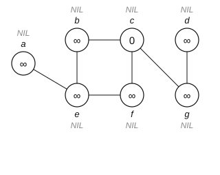{height="10.6em"}

::: {.xs}
Initialized with starting node $s = c$. The distance is inside each node, its name above or below it, and its parent in gray capitals (NIL for all nodes so far).
:::
:::
::::

## Algorithm: Breadth-First Search {.fit1}

::: {.codewrap style="font-size:1.00em"}
<pre class="pseudocode"><b>Procedure</b> BFS(<i>G</i>, <i>s</i>)
<i>Inputs:</i>
  <i>G</i>: an undirected graph
  <i>s</i>: the starting node
<i>Result:</i> every node reachable from <i>s</i> stores its distance <i>d</i> to <i>s</i> and its parent &pi;
INITIALIZE-BFS(<i>G</i>, <i>s</i>)
<i>Q</i> &larr; &empty;
ENQUEUE(<i>Q</i>, <i>s</i>)                             # put s in the queue Q
<b>While</b> <i>Q</i> &ne; &empty;:
        <i>u</i> &larr; DEQUEUE(<i>Q</i>)                    # take the next element from the queue Q
        <b>For</b> each vertex <i>v</i> in neighbors(<i>u</i>):  # check all neighbors of u
               <b>If</b> color[<i>v</i>] = WHITE           # only continue if v has not been seen yet
                      <b>then</b> color[<i>v</i>] &larr; GRAY     # mark v as seen
                              <i>d</i>[<i>v</i>] &larr; <i>d</i>[<i>u</i>] + 1   # one step further than u
                              &pi;[<i>v</i>] &larr; <i>u</i>          # u is the parent of v
                              ENQUEUE(<i>Q</i>, <i>v</i>)      # put v in the queue Q
        color[<i>u</i>] &larr; BLACK                   # all neighbors of u have been processed</pre>
:::

## Algorithm: Breadth-First Search {.fit1}

::: {.sm}
Next initialize the Queue $Q$
:::

:::: {.columns}
::: {.column width="55%"}
::: {.codewrap style="font-size:1.00em"}
<pre class="pseudocode"><b>Procedure</b> BFS(<i>G</i>, <i>s</i>)
<i>Inputs:</i> …
<i>Result:</i> …
INITIALIZE-BFS(<i>G</i>, <i>s</i>)
<i>Q</i> &larr; &empty;
ENQUEUE(<i>Q</i>, <i>s</i>)
<b>While</b> <i>Q</i> &ne; &empty;:
        <i>u</i> &larr; DEQUEUE(<i>Q</i>)
        <b>For</b> each vertex <i>v</i> in neighbors(<i>u</i>):
               <b>If</b> color[<i>v</i>] = WHITE
                      <b>then</b> color[<i>v</i>] &larr; GRAY
                              <i>d</i>[<i>v</i>] &larr; <i>d</i>[<i>u</i>] + 1
                              &pi;[<i>v</i>] &larr; <i>u</i>
                              ENQUEUE(<i>Q</i>, <i>v</i>)
        color[<i>u</i>] &larr; BLACK</pre>
:::
:::

::: {.column width="45%"}
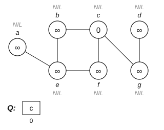{height="10.6em"}
:::
::::

## Algorithm: Breadth-First Search {.fit1}

::: {.sm}
Iterate through the first while-loop for $u \leftarrow c$
:::

:::: {.columns}
::: {.column width="55%"}
::: {.codewrap style="font-size:1.00em"}
<pre class="pseudocode"><b>Procedure</b> BFS(<i>G</i>, <i>s</i>)
<i>Inputs:</i> …
<i>Result:</i> …
INITIALIZE-BFS(<i>G</i>, <i>s</i>)
<i>Q</i> &larr; &empty;
ENQUEUE(<i>Q</i>, <i>s</i>)
<b>While</b> <i>Q</i> &ne; &empty;:
        <i>u</i> &larr; DEQUEUE(<i>Q</i>)
        <b>For</b> each vertex <i>v</i> in neighbors(<i>u</i>):
               <b>If</b> color[<i>v</i>] = WHITE
                      <b>then</b> color[<i>v</i>] &larr; GRAY
                              <i>d</i>[<i>v</i>] &larr; <i>d</i>[<i>u</i>] + 1
                              &pi;[<i>v</i>] &larr; <i>u</i>
                              ENQUEUE(<i>Q</i>, <i>v</i>)
        color[<i>u</i>] &larr; BLACK</pre>
:::
:::

::: {.column width="45%"}
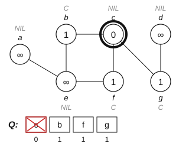{height="10.6em"}
:::
::::

## Algorithm: Breadth-First Search {.fit1}

::: {.sm}
Iterate through the next while-loop for $u \leftarrow b$ (b is next in the queue &ndash; FIFO)
:::

:::: {.columns}
::: {.column width="55%"}
::: {.codewrap style="font-size:1.00em"}
<pre class="pseudocode"><b>Procedure</b> BFS(<i>G</i>, <i>s</i>)
<i>Inputs:</i> …
<i>Result:</i> …
INITIALIZE-BFS(<i>G</i>, <i>s</i>)
<i>Q</i> &larr; &empty;
ENQUEUE(<i>Q</i>, <i>s</i>)
<b>While</b> <i>Q</i> &ne; &empty;:
        <i>u</i> &larr; DEQUEUE(<i>Q</i>)
        <b>For</b> each vertex <i>v</i> in neighbors(<i>u</i>):
               <b>If</b> color[<i>v</i>] = WHITE
                      <b>then</b> color[<i>v</i>] &larr; GRAY
                              <i>d</i>[<i>v</i>] &larr; <i>d</i>[<i>u</i>] + 1
                              &pi;[<i>v</i>] &larr; <i>u</i>
                              ENQUEUE(<i>Q</i>, <i>v</i>)
        color[<i>u</i>] &larr; BLACK</pre>
:::
:::

::: {.column width="45%"}
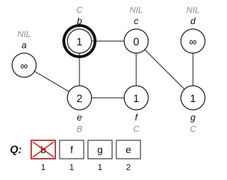{height="10.6em"}
:::
::::

## Algorithm: Breadth-First Search {.fit1}

::: {.sm}
Iterate through the next while-loop for $u \leftarrow f$
:::

:::: {.columns}
::: {.column width="55%"}
::: {.codewrap style="font-size:1.00em"}
<pre class="pseudocode"><b>Procedure</b> BFS(<i>G</i>, <i>s</i>)
<i>Inputs:</i> …
<i>Result:</i> …
INITIALIZE-BFS(<i>G</i>, <i>s</i>)
<i>Q</i> &larr; &empty;
ENQUEUE(<i>Q</i>, <i>s</i>)
<b>While</b> <i>Q</i> &ne; &empty;:
        <i>u</i> &larr; DEQUEUE(<i>Q</i>)
        <b>For</b> each vertex <i>v</i> in neighbors(<i>u</i>):
               <b>If</b> color[<i>v</i>] = WHITE
                      <b>then</b> color[<i>v</i>] &larr; GRAY
                              <i>d</i>[<i>v</i>] &larr; <i>d</i>[<i>u</i>] + 1
                              &pi;[<i>v</i>] &larr; <i>u</i>
                              ENQUEUE(<i>Q</i>, <i>v</i>)
        color[<i>u</i>] &larr; BLACK</pre>
:::
:::

::: {.column width="45%"}
{height="10.6em"}
:::
::::

## Algorithm: Breadth-First Search {.fit1}

::: {.sm}
Iterate through the next while-loop for $u \leftarrow g$
:::

:::: {.columns}
::: {.column width="55%"}
::: {.codewrap style="font-size:1.00em"}
<pre class="pseudocode"><b>Procedure</b> BFS(<i>G</i>, <i>s</i>)
<i>Inputs:</i> …
<i>Result:</i> …
INITIALIZE-BFS(<i>G</i>, <i>s</i>)
<i>Q</i> &larr; &empty;
ENQUEUE(<i>Q</i>, <i>s</i>)
<b>While</b> <i>Q</i> &ne; &empty;:
        <i>u</i> &larr; DEQUEUE(<i>Q</i>)
        <b>For</b> each vertex <i>v</i> in neighbors(<i>u</i>):
               <b>If</b> color[<i>v</i>] = WHITE
                      <b>then</b> color[<i>v</i>] &larr; GRAY
                              <i>d</i>[<i>v</i>] &larr; <i>d</i>[<i>u</i>] + 1
                              &pi;[<i>v</i>] &larr; <i>u</i>
                              ENQUEUE(<i>Q</i>, <i>v</i>)
        color[<i>u</i>] &larr; BLACK</pre>
:::
:::

::: {.column width="45%"}
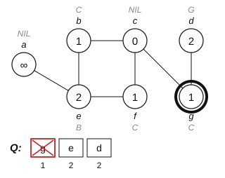{height="10.6em"}
:::
::::

## Algorithm: Breadth-First Search {.fit1}

::: {.sm}
Iterate through the next while-loop for $u \leftarrow e$
:::

:::: {.columns}
::: {.column width="55%"}
::: {.codewrap style="font-size:1.00em"}
<pre class="pseudocode"><b>Procedure</b> BFS(<i>G</i>, <i>s</i>)
<i>Inputs:</i> …
<i>Result:</i> …
INITIALIZE-BFS(<i>G</i>, <i>s</i>)
<i>Q</i> &larr; &empty;
ENQUEUE(<i>Q</i>, <i>s</i>)
<b>While</b> <i>Q</i> &ne; &empty;:
        <i>u</i> &larr; DEQUEUE(<i>Q</i>)
        <b>For</b> each vertex <i>v</i> in neighbors(<i>u</i>):
               <b>If</b> color[<i>v</i>] = WHITE
                      <b>then</b> color[<i>v</i>] &larr; GRAY
                              <i>d</i>[<i>v</i>] &larr; <i>d</i>[<i>u</i>] + 1
                              &pi;[<i>v</i>] &larr; <i>u</i>
                              ENQUEUE(<i>Q</i>, <i>v</i>)
        color[<i>u</i>] &larr; BLACK</pre>
:::
:::

::: {.column width="45%"}
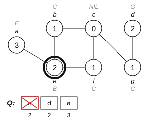{height="10.6em"}
:::
::::

## Algorithm: Breadth-First Search {.fit1}

::: {.sm}
The while-loop for $u \leftarrow e$ finishes
:::

:::: {.columns}
::: {.column width="55%"}
::: {.codewrap style="font-size:1.00em"}
<pre class="pseudocode"><b>Procedure</b> BFS(<i>G</i>, <i>s</i>)
<i>Inputs:</i> …
<i>Result:</i> …
INITIALIZE-BFS(<i>G</i>, <i>s</i>)
<i>Q</i> &larr; &empty;
ENQUEUE(<i>Q</i>, <i>s</i>)
<b>While</b> <i>Q</i> &ne; &empty;:
        <i>u</i> &larr; DEQUEUE(<i>Q</i>)
        <b>For</b> each vertex <i>v</i> in neighbors(<i>u</i>):
               <b>If</b> color[<i>v</i>] = WHITE
                      <b>then</b> color[<i>v</i>] &larr; GRAY
                              <i>d</i>[<i>v</i>] &larr; <i>d</i>[<i>u</i>] + 1
                              &pi;[<i>v</i>] &larr; <i>u</i>
                              ENQUEUE(<i>Q</i>, <i>v</i>)
        color[<i>u</i>] &larr; BLACK</pre>
:::
:::

::: {.column width="45%"}
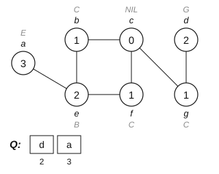{height="10.6em"}
:::
::::

## Algorithm: Breadth-First Search {.fit1}

::: {.sm}
Iterate through the next while-loop for $u \leftarrow d$
:::

:::: {.columns}
::: {.column width="55%"}
::: {.codewrap style="font-size:1.00em"}
<pre class="pseudocode"><b>Procedure</b> BFS(<i>G</i>, <i>s</i>)
<i>Inputs:</i> …
<i>Result:</i> …
INITIALIZE-BFS(<i>G</i>, <i>s</i>)
<i>Q</i> &larr; &empty;
ENQUEUE(<i>Q</i>, <i>s</i>)
<b>While</b> <i>Q</i> &ne; &empty;:
        <i>u</i> &larr; DEQUEUE(<i>Q</i>)
        <b>For</b> each vertex <i>v</i> in neighbors(<i>u</i>):
               <b>If</b> color[<i>v</i>] = WHITE
                      <b>then</b> color[<i>v</i>] &larr; GRAY
                              <i>d</i>[<i>v</i>] &larr; <i>d</i>[<i>u</i>] + 1
                              &pi;[<i>v</i>] &larr; <i>u</i>
                              ENQUEUE(<i>Q</i>, <i>v</i>)
        color[<i>u</i>] &larr; BLACK</pre>
:::
:::

::: {.column width="45%"}
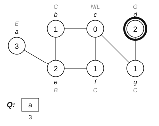{height="10.6em"}
:::
::::

## Algorithm: Breadth-First Search {.fit1}

::: {.sm}
Iterate through the next while-loop for $u \leftarrow a$ &nbsp;&nbsp; **BFS Algorithm stops**
:::

:::: {.columns}
::: {.column width="55%"}
::: {.codewrap style="font-size:1.00em"}
<pre class="pseudocode"><b>Procedure</b> BFS(<i>G</i>, <i>s</i>)
<i>Inputs:</i> …
<i>Result:</i> …
INITIALIZE-BFS(<i>G</i>, <i>s</i>)
<i>Q</i> &larr; &empty;
ENQUEUE(<i>Q</i>, <i>s</i>)
<b>While</b> <i>Q</i> &ne; &empty;:
        <i>u</i> &larr; DEQUEUE(<i>Q</i>)
        <b>For</b> each vertex <i>v</i> in neighbors(<i>u</i>):
               <b>If</b> color[<i>v</i>] = WHITE
                      <b>then</b> color[<i>v</i>] &larr; GRAY
                              <i>d</i>[<i>v</i>] &larr; <i>d</i>[<i>u</i>] + 1
                              &pi;[<i>v</i>] &larr; <i>u</i>
                              ENQUEUE(<i>Q</i>, <i>v</i>)
        color[<i>u</i>] &larr; BLACK</pre>
:::
:::

::: {.column width="45%"}
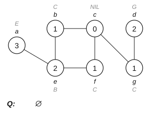{height="10.6em"}
:::
::::

## Outtake &ndash; Social Science Applications

::: {}
- Graphs in social science research
  - Social networks can be represented as graphs
    - classical work in sociology, then later also in political science, economics etc.
    - recent boom in research on this topic due to online social networks data
  - Many real-world structures can be represented as graphs
    - examples are road networks, flight routes, trade connections, treaty networks etc.
    - suite of tools available from mathematics, computer science, political methodology
:::

## Summary

- An **algorithm** is a finite, well-defined sequence of steps
- It needs a clear **specification** and must be **finite**, **definite** and **correct**
- **Pseudocode** and **flowcharts** describe algorithms for humans
- **Queues** are first in, first out; **stacks** are last in, first out
- A **graph** $G = (V, E)$ is stored as an adjacency **matrix** or adjacency **lists**
- **Breadth-first search** uses a queue to find shortest distances

**Next session:** Recursion
