## Course Outline

:::: {.columns}
::: {.column width="50%"}
::: {}
- Session 1: Introduction
- Session 2: Information Coding
- Session 3: Data Structures
- Session 4: Software
- Session 5: Algorithms
- Session 6: Recursion
- Session 7: Sorting Algorithms
:::
:::

::: {.column width="50%"}
::: {}
- Session 8: Time Complexity
- Session 9: Theoretical Computer Science
- Session 10: Machine Learning
- Session 11: Databases
- Session 12: Parallel Programming
- Session 13: Social Science Applications
- Session 14: Exam Review
:::
:::
::::

<!-- MOTIVATION:M06-A:BEGIN -->
## How many people report to her?

::: {.motivation}
[Motivating example]{.label}
An organizational chart has a chief executive, division heads, department heads,
team leads and staff, and **nobody knows how deep it goes**, because it differs
by division. You are asked a simple question: how many people, in total, sit
below any given manager?
:::

- A loop over levels needs to know **how many levels** to go through.
- You don't. And the answer changes next month.

[How do you write a procedure that works without knowing in advance how deep the structure is?]{.ask}
<!-- MOTIVATION:M06-A:END -->

<!-- MOTIVATION:M06-B:BEGIN -->
## The comment thread with no bottom

::: {.motivation}
[Motivating example]{.label}
A discussion thread has replies, replies to replies, and replies to those. To
count the posts, render the page, or measure how deep an argument went, something
has to walk the whole structure, and the structure is **defined in terms of
itself**:
:::

::: {.definition}
[A comment is]{.label}
a post, plus a list of **comments**.
:::

[When the *data* is defined in terms of itself, what should the *procedure* look like?]{.ask}
<!-- MOTIVATION:M06-B:END -->

<!-- MOTIVATION:M06-C:BEGIN -->
## The algorithm that is 2 300 years old {.fit1}

::: {.motivation}
[Motivating example]{.label}
Euclid's *Elements*, Book VII, around 300 BC, gives a procedure for the greatest
common divisor: **replace the larger number by its remainder against the
smaller, and repeat.** It is still the algorithm your computer uses today.
:::

::: {.example}
[gcd(270, 192)]{.label}
gcd(270, 192) → gcd(192, 78) → gcd(78, 36) → gcd(36, 6) → gcd(6, 0) = **6**
:::

[What makes this procedure *stop*? And what happens to a procedure that calls itself and forgets to?]{.ask}

::: {.source}
Euclid, *Elements*, Book VII, Propositions 1–2
:::
<!-- MOTIVATION:M06-C:END -->

## Recursion example

::: {.center-h}
{height="11.6em"}

**Simpleland**
:::

## Recursion example {.fit1}

::: {.sm}
A person (P) is a citizen of Simpleland if it satisfies any of these conditions:

- P was born in Simpleland
- either of P's parents are citizens of Simpleland
:::

Simpleland

## Recursion example {.fit1}

::: {.sm}
A person (P) is a citizen of Simpleland if it satisfies any of these conditions:

- P was born in Simpleland
- either of P's parents are citizens of Simpleland
:::

::: {.sm}
**Is P a citizen of Simpleland?**
:::

Simpleland

## Recursion example {.fit1}

::: {.sm}
A person (P) is a citizen of Simpleland if it satisfies any of these conditions:

- [P was born in Simpleland]{.hl}
- either of P's parents are citizens of Simpleland
:::

::: {.sm}
**Is P a citizen of Simpleland?**
:::

Simpleland

## Recursion example {.fit1}

::: {.sm}
A person (P) is a citizen of Simpleland if it satisfies any of these conditions:

- P was born in Simpleland
- either of P's parents are citizens of Simpleland
:::

::: {.sm}
**Is P a citizen of Simpleland?**
:::

Simpleland

## Recursion example {.fit1}

::: {.sm}
A person (P) is a citizen of Simpleland if it satisfies any of these conditions:

- P was born in Simpleland
- [either of P's parents are citizens of Simpleland]{.hl}
:::

::: {.sm}
**Is P a citizen of Simpleland?**
:::

Simpleland

## Recursion example {.fit1}

::: {.sm}
A person (P) is a citizen of Simpleland if it satisfies any of these conditions:

- P was born in Simpleland
- either of P's parents are citizens of Simpleland
:::

::: {.tag .qcentre}
Is P a citizen of Simpleland?
:::

Simpleland

## Components of Recursion {.fit1}

::: {.sm}
A person (P) is a citizen of Simpleland if it satisfies any of these conditions:

- P was born in Simpleland &nbsp;&nbsp; [**Base case**]{.hl}
- either of P's parents are citizens of Simpleland
:::

Simpleland

## Components of Recursion {.fit1}

::: {.sm}
A person (P) is a citizen of Simpleland if it satisfies any of these conditions:

- P was born in Simpleland
- either of P's parents are citizens of Simpleland &nbsp;&nbsp; [**Recursion case**]{.hl}
:::

::: {.tag .qcentre}
Is P a citizen of Simpleland?
:::

Simpleland

## Recursion {.fit1}

::: {.definition}
[Definition of recursion]{.label}

::: {.sm}
Recursion is a technique in mathematics, logic and computer science to specify a function through itself (a *recursive definition*). The fundamental principle of recursion is to define the value of a function $f$ through previously calculated values of the same function $f(n)$, $f(n-1)$, …
:::
:::

::: {.sm}
- as long as the start value of the function $f$ is known for sufficiently many arguments (**base cases**), any value of $f$ can be calculated
- a recursive call of the function $f$ keeps calling itself until
  - the function converges to a specific target value
  - or a pre-defined **abort condition** has been met
:::

## Issues with Recursion {.fit1}

::: {.sm}
A person (P) is a citizen of Simpleland if it satisfies any of these conditions:

- P was born in Simpleland
- either of P's parents are citizens of Simpleland
:::

::: {.tag .qcentre}
What if we don't know all ancestors of P?
:::

Simpleland

## Issues with Recursion {.fit1}

::: {.sm}
A person (P) is a citizen of Simpleland if it satisfies any of these conditions:

- P was born in Simpleland
- either of P's parents are citizens of Simpleland
- if we don't know P's parents, P is not a citizen of Simpleland &nbsp;&nbsp; [**Abort case**]{.hl}
:::

Simpleland

## Recursion and Fractals

::: {.imgrow .middle}
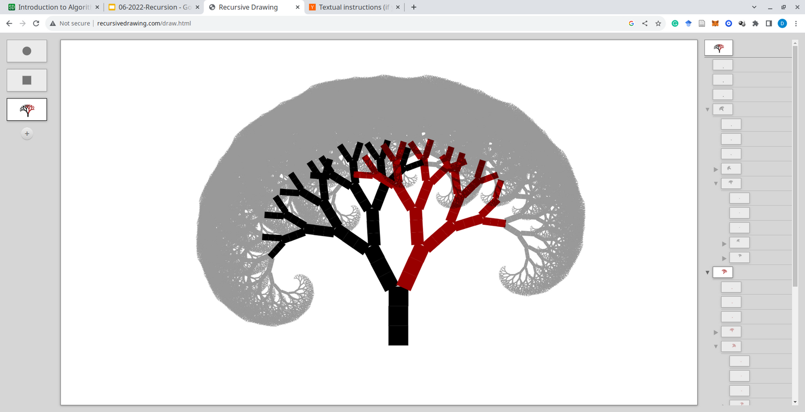{height="5.1em"}
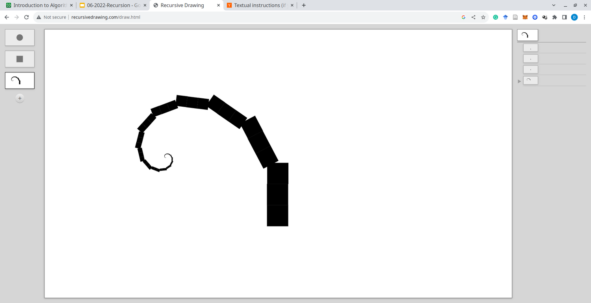{height="5.1em"}
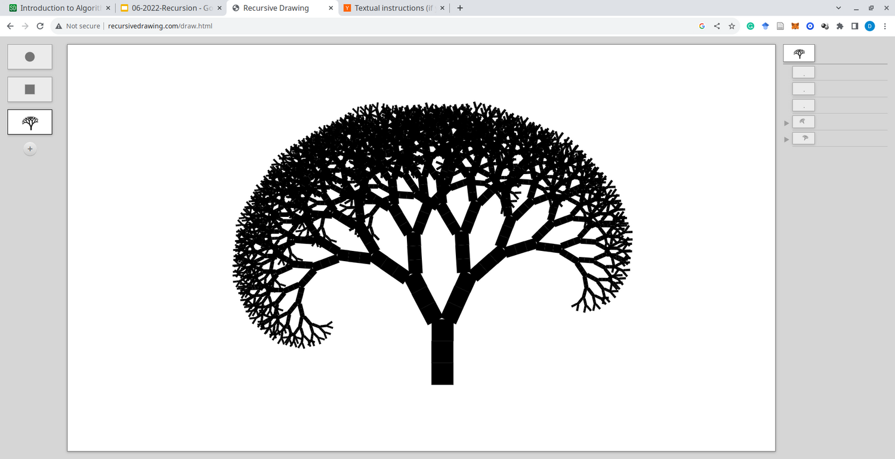{height="5.1em"}
:::

::: {.source}
<http://recursivedrawing.com/>
:::

## Factorial: An Example

::: {}
How many different ways exist for arranging the four diners?
:::

:::: {.columns}
::: {.column width="16%"}
::: {}
**Slots**

 

**Choices**
:::
:::

::: {.column width="84%"}
{height="5.4em"}
:::
::::

## Factorial: An Example

::: {}
How many different ways exist for arranging the four diners?
:::

:::: {.columns}
::: {.column width="16%"}
::: {}
**Slots**

 

**Choices**
:::
:::

::: {.column width="84%"}
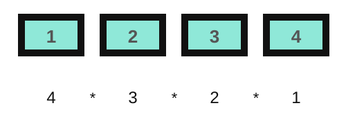{height="9.5em"}
:::
::::

## Factorial: An Example

::: {}
How many different ways exist for arranging the four diners?
:::

:::: {.columns}
::: {.column width="16%"}
::: {}
**Slots**

 

**Choices**
:::
:::

::: {.column width="84%"}
{height="9.5em"}
:::
::::

::: {.center-h}
$4! = 4 \cdot 3 \cdot 2 \cdot 1 = 24$ arrangements
:::

## Factorial: A Recursive Definition

::: {}
**Iterative definition:** &nbsp;&nbsp; $n! = n \, (n-1) \, (n-2) \dots (1)$

 

**Recursive definition:** &nbsp;&nbsp; $n! = n \, (n-1)!$
:::

## Factorial: A Recursive Definition

::: {}
**Iterative definition:** &nbsp;&nbsp; $n! = n \, (n-1) \, (n-2) \dots (1)$

 

**Recursive definition:** &nbsp;&nbsp; $n! = n \, (n-1)!$
:::

::: {.center-h}
$$n! = \begin{cases} 1 & \text{if } n = 1 \quad \text{(base case)}\\
n \cdot (n-1)! & \text{if } n > 1 \quad \text{(recursion case)} \end{cases}$$
:::

## Factorial: Iterative Implementation

::: {.codewrap style="font-size:1.50em"}
<pre class="pseudocode" style="width:60%;margin:0.4em auto"><b>Procedure</b> ITERATIVE-FACTORIAL(<i>n</i>)
<i>Inputs:</i>
  <i>n</i>: a positive integer
<i>Result:</i> the factorial of <i>n</i>
<i>result</i> &larr; 1
<b>While</b> <i>n</i> &gt; 1:
      <i>result</i> &larr; <i>result</i> · <i>n</i>
      <i>n</i> &larr; <i>n</i> - 1
<b>return</b> <i>result</i></pre>
:::

::: {.center-h .sm}
$n! = n \, (n-1) \, (n-2) \dots (1)$
:::

## Factorial: Recursive Implementation

::: {.codewrap style="font-size:1.50em"}
<pre class="pseudocode" style="width:64%;margin:0.4em auto"><b>Procedure</b> RECURSIVE-FACTORIAL(<i>n</i>)
<i>Inputs:</i>
  <i>n</i>: a positive integer
<i>Result:</i> the factorial of <i>n</i>
<b>If</b> <i>n</i> = 1
      <b>then return</b> 1
      <b>else return</b> <i>n</i> · RECURSIVE-FACTORIAL(<i>n</i> - 1)</pre>
:::

::: {.center-h .sm}
$n! = n \, (n-1)!$ &nbsp;&nbsp;&nbsp; $1! = 1$
:::

## Recursive factorial in Python

::: {.center-h}
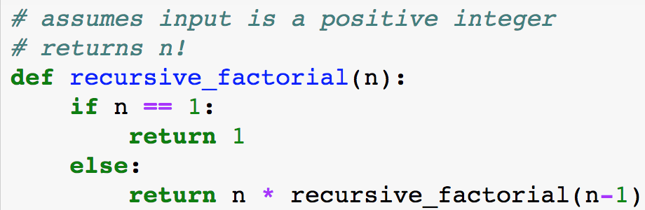{height="10.6em"}
:::

::: {.center-h .sm}
$n! = n \, (n-1)!$ &nbsp;&nbsp;&nbsp; $1! = 1$
:::

## Factorial: Recursive Execution

::: {.sm}
- Calculation can be represented as a tree
  - example: `fac(4)`
:::

::: {.imgrow .middle style="flex-wrap:wrap;gap:0.6em 1.4em"}
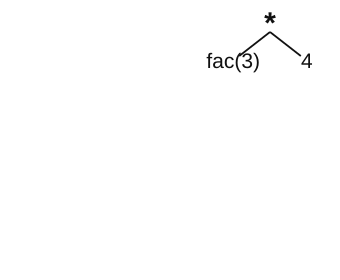{height="5.4em"}
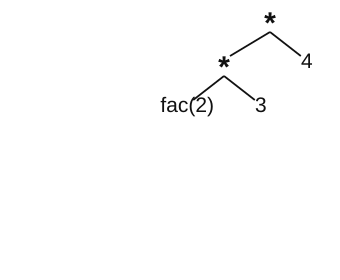{height="5.4em"}
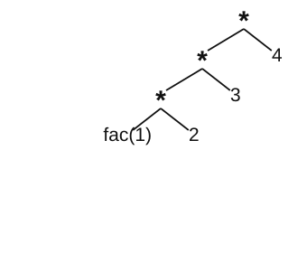{height="5.4em"}
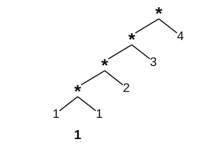{height="5.4em"}
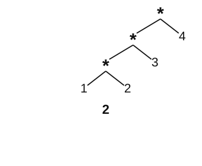{height="5.4em"}
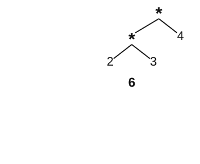{height="5.4em"}
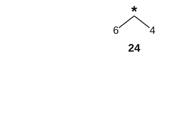{height="5.4em"}
:::

## Factorial: Recursive Execution

::: {.sm}
- Calculation can be represented as a tree
  - example: `fac(4)`
:::

::: {.center-h}
{height="10.4em"}
:::

## Factorial: Recursive Execution

::: {.sm}
- Calculation can be represented as a tree
  - example: `fac(4)`
:::

::: {.center-h}
{height="10.4em"}
:::

## Factorial: Recursive Execution

::: {.sm}
- Calculation can be represented as a tree
  - example: `fac(4)`
:::

::: {.center-h}
{height="10.4em"}
:::

## Factorial: Recursive Execution

::: {.sm}
- Calculation can be represented as a tree
  - example: `fac(4)`
:::

::: {.center-h}
{height="10.4em"}
:::

## Factorial: Recursive Execution

::: {.sm}
- Calculation can be represented as a tree
  - example: `fac(4)`
:::

::: {.center-h}
{height="10.4em"}
:::

## Factorial: Recursive Execution

::: {.sm}
- Calculation can be represented as a tree
  - example: `fac(4)`
:::

::: {.center-h}
{height="10.4em"}
:::

## Factorial: Recursive Execution

::: {.sm}
- Calculation can be represented as a tree
  - example: `fac(4)`
:::

::: {.center-h}
{height="10.4em"}
:::

::: {.center-h .sm}
$\Rightarrow$ `fac(4)` = 24
:::

## Factorial: Recursive Execution

::: {.center-h}
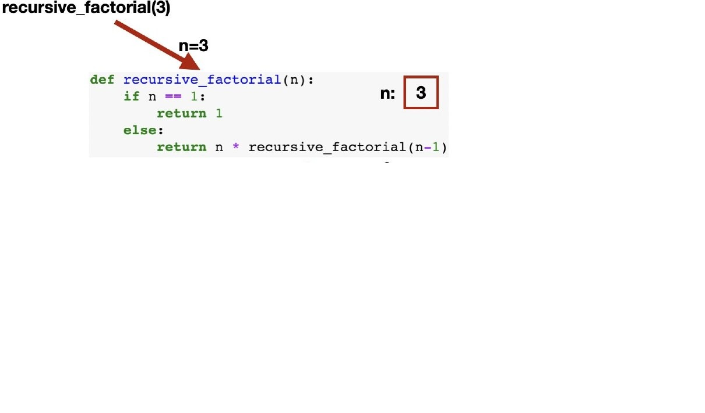{height="14.0em"}
:::

## Factorial: Recursive Execution

::: {.center-h}
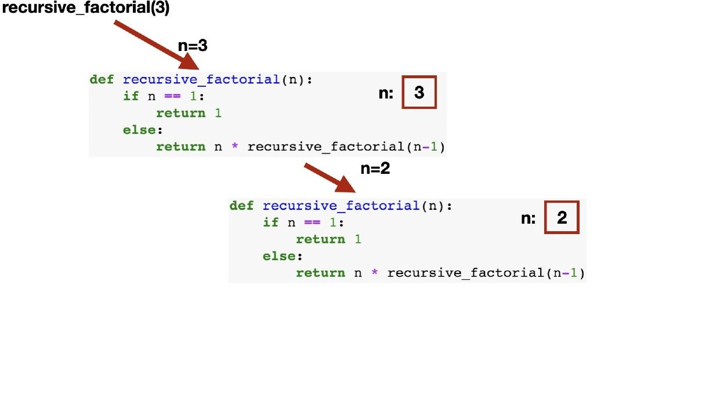{height="14.0em"}
:::

## Factorial: Recursive Execution

::: {.center-h}
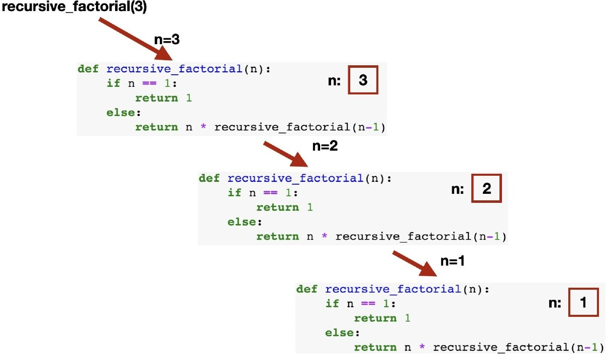{height="14.0em"}
:::

## Factorial: Recursive Execution

::: {.center-h}
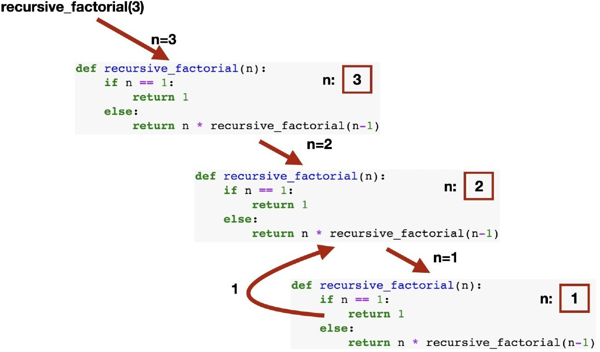{height="14.0em"}
:::

## Factorial: Recursive Execution

::: {.center-h}
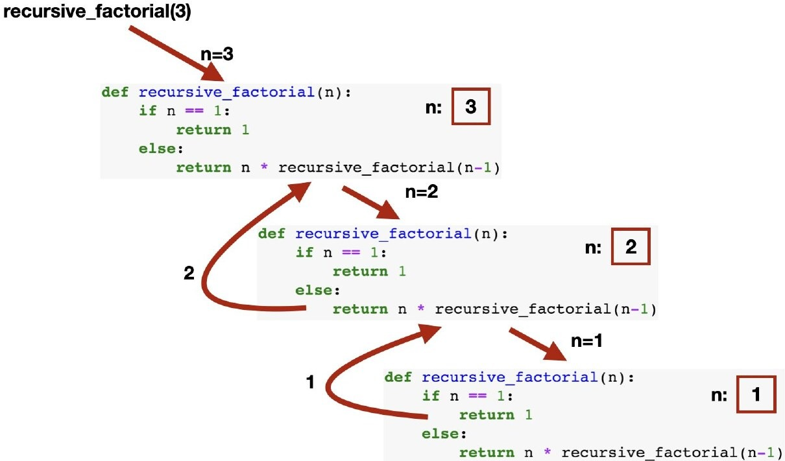{height="14.0em"}
:::

## Factorial: Recursive Execution

::: {.center-h}
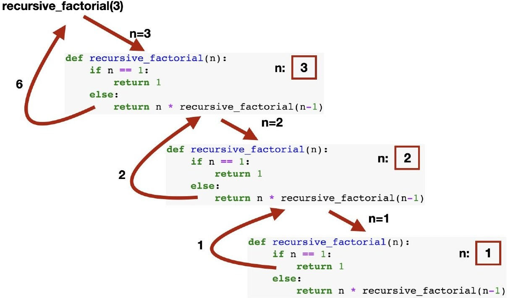{height="14.0em"}
:::

## Factorial: Recursive Execution

::: {.center-h}
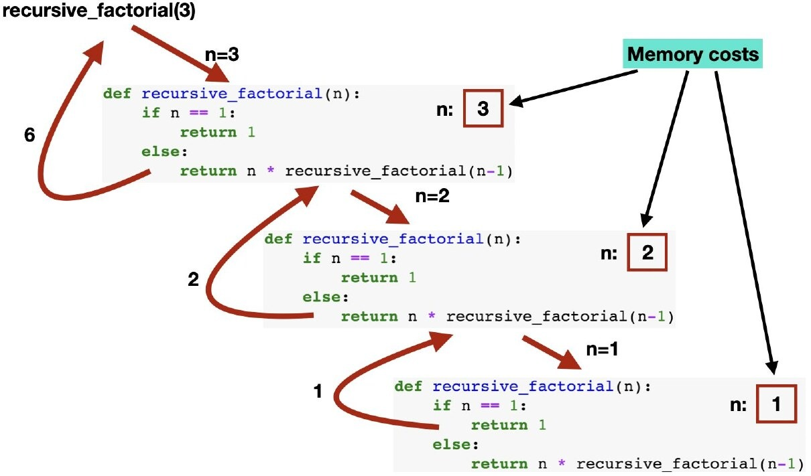{height="14.0em"}
:::

## Factorial: Recursive Execution

::: {.center-h}
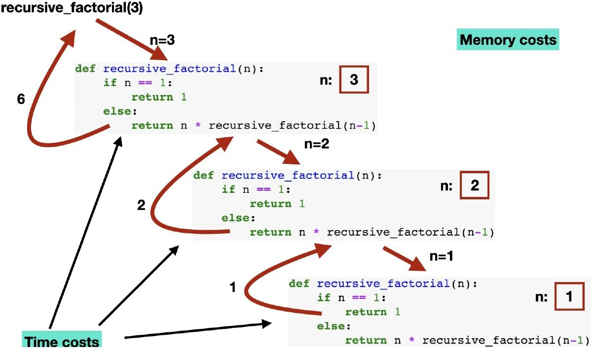{height="14.0em"}
:::

## Intermission: Memory of a running program

:::: {.columns}
::: {.column width="52%"}
::: {.sm}
A program being run in a machine is called a **process**. Processes require memory to run, which is organized as follows:

- Code Segment (CS)
- Stack Segment (SS)
- Data Segment or Heap (DS)
:::
:::

::: {.column width="48%"}
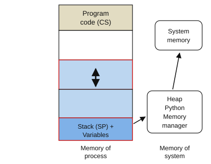{height="11.9em"}
:::
::::

## Memory of a running program

:::: {.columns}
::: {.column width="52%"}
::: {.sm}
A program being run in a machine is called a **process**. Processes require memory to run, which is organized as follows:

- Code Segment (CS)
  - contains executable instructions, i.e., a program loaded from hard disc
  - typically read-only and of fixed size
- Stack Segment (SS)
- Data Segment or Heap (DS)
:::
:::

::: {.column width="48%"}
{height="11.9em"}
:::
::::

## Memory of a running program

:::: {.columns}
::: {.column width="52%"}
::: {.sm}
A program being run in a machine is called a **process**. Processes require memory to run, which is organized as follows:

- Code Segment (CS)
- Stack Segment (SS)
  - contains local variables, parameters, return address
  - typically no execute (NX)
  - limited in size, e.g. 8 MB for Linux, 1 MB for Windows and Java
- Data Segment or Heap (DS)
:::
:::

::: {.column width="48%"}
{height="11.9em"}
:::
::::

## Memory of a running program

:::: {.columns}
::: {.column width="52%"}
::: {.sm}
A program being run in a machine is called a **process**. Processes require memory to run, which is organized as follows:

- Code Segment (CS)
- Stack Segment (SS)
- Data Segment or Heap (DS)
  - contains global data; Python manages all objects in a (private) heap
  - typically no execute (NX)
  - size is limited by main memory (RAM) or by explicit parameter when run
:::
:::

::: {.column width="48%"}
{height="11.9em"}
:::
::::

## Recursion: Implementation in memory

::: {}
- Recursion uses the **program stack**:
  - parameters
  - return address
  - local variables
  - return values
- stack grows and shrinks automatically with every method call
  - BUT has a maximum size: **stack overflows** are possible!
  - Warning: recursion in functions easily leads to stack overflow
:::

## Memes warned you about recursion

:::: {.columns}
::: {.column width="44%"}
::: {.sm}
**3 Steps to being a good Programmer**

1. Avoid recursion
2. Repeat steps 1 and 2
3. Always have an exit condition
4. Beware of being off by one
:::

{height="5.6em"}
:::

::: {.column width="56%"}
{height="8.6em"}
:::
::::

## Outline

::: {.outline .focus}
1. Recursion
2. [Recursive Algorithms]{.current}
3. Dynamic Programming
:::

## The Greatest Common Divisor

::: {.center-h}
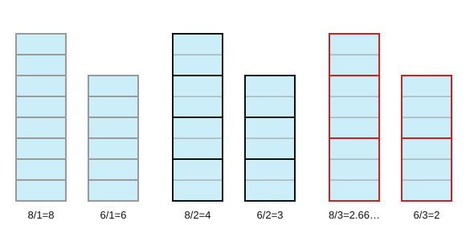{height="14.5em"}
:::

## Euclid's algorithm

::: {}
Uses the mathematical property: $\gcd(a,b) = \gcd(b,\ a \bmod b)$
:::

::: {.codewrap style="font-size:1.50em"}
<pre class="pseudocode"><b>Procedure</b> GCD(<i>a</i>, <i>b</i>)
<i>Inputs:</i>
      <i>a</i>, <i>b</i>: natural numbers (<i>a</i>, <i>b</i> &isin; &#8469;) with <i>a</i> &ge; <i>b</i>
<i>Result:</i> the greatest common divisor of <i>a</i> and <i>b</i>
<b>If</b> <i>b</i> = 0
      <b>then return</b> <i>a</i>
      <b>else return</b> GCD(<i>b</i>, <i>a</i> <b>mod</b> <i>b</i>)</pre>
:::

## Euclid's algorithm

::: {.sm}
Uses the mathematical property: $\gcd(a,b) = \gcd(b,\ a \bmod b)$
:::

:::: {.columns}
::: {.column width="62%"}
::: {.codewrap style="font-size:1.50em"}
<pre class="pseudocode"><b>Procedure</b> GCD(<i>a</i>, <i>b</i>)
<i>Inputs:</i>
      <i>a</i>, <i>b</i>: natural numbers (<i>a</i>, <i>b</i> &isin; &#8469;) with <i>a</i> &ge; <i>b</i>
<i>Result:</i> the greatest common divisor of <i>a</i> and <i>b</i>
<b>If</b> <i>b</i> = 0
      <b>then return</b> <i>a</i>
      <b>else return</b> GCD(<i>b</i>, <i>a</i> <b>mod</b> <i>b</i>)</pre>
:::
:::

::: {.column width="38%"}
::: {.sm}
- $\gcd(270, 192)$
  - $270 \bmod 192 = 78$
  - $\gcd(192, 78)$
    - $192 \bmod 78 = 36$
    - $\gcd(78, 36)$
      - $78 \bmod 36 = 6$
      - $\gcd(36, 6)$
        - $36 \bmod 6 = 0$
        - $\gcd(6, 0)$
          - **return 6**
:::
:::
::::

## Euclid and the GCD

:::: {.columns}
::: {.column width="70%"}
::: {.sm}
- Euclid (~300 BC) Greek mathematician
- "Euclid of Alexandria" but little is actually known about his life, neither birth year nor place
- Commonly known as the father of geometry
- Euclid's most influential book is *Elements*, which includes the algorithm to calculate the gcd
- The original version of the algorithm did subtractions on the terms instead of modulo operations but it was recursive. However, it required more steps
- One of his lesser known books is titled *Data* (Δεδομένα), on how to study given information geometrically
:::
:::

::: {.column width="30%"}
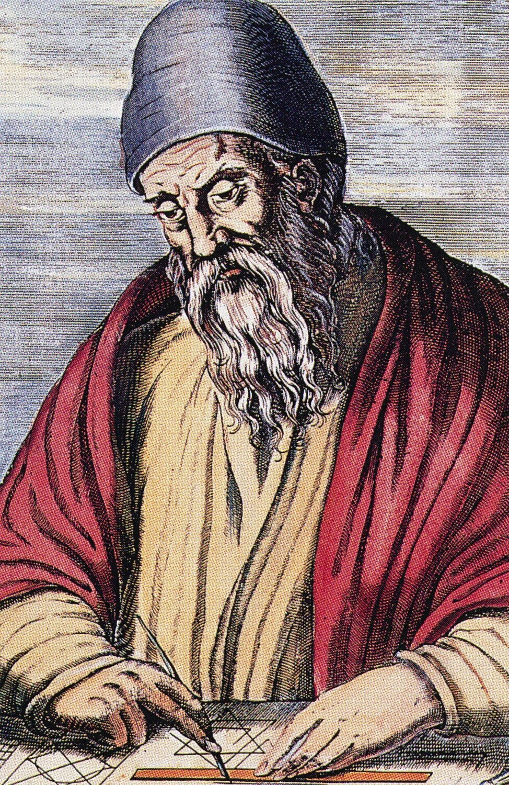{height="8.6em"}

::: {.sm}
Imagination of how Euclid could have looked like
:::
:::
::::

## Depth-First Search in Directed Graphs

::: {.center-h}
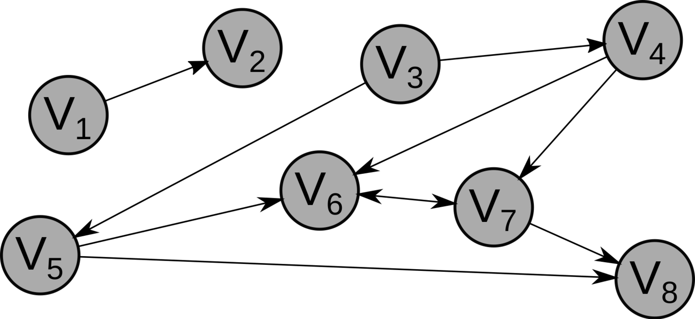{height="8.4em"}
:::

::: {.sm}
Several problems can be solved with depth-first search, such as:

- Is node $x$ included in the graph?
- Does a graph have a cycle?
- Does the graph have a strongly connected component?
:::

## Depth-First Search {.fit1}

:::: {.columns}
::: {.column width="50%"}
::: {.codewrap style="font-size:1.30em"}
<pre class="pseudocode"><b>Procedure</b> DFS(<i>G</i>)
<i>Inputs:</i>
  <i>G</i>: a graph
<i>Result:</i> every vertex stores its discovery time <i>d</i>,
its finishing time <i>f</i> and its parent &pi;
<b>For</b> each vertex <i>u</i> in <i>G</i>.<i>V</i>:
      color[<i>u</i>] &larr; WHITE
      &pi;[<i>u</i>] &larr; NIL              # parent
<i>time</i> &larr; 0                      # global counter
<b>For</b> each vertex <i>u</i> in <i>G</i>.<i>V</i>:
      <b>If</b> color[<i>u</i>] = WHITE
            <b>then</b> DFS-VISIT(<i>G</i>, <i>u</i>)</pre>
:::
:::

::: {.column width="50%"}
{height="9.2em"}

::: {.sm}
Example: the For loop takes vertex $c$ first; among neighbors, go alphabetically time = 0 Enter For-Loop: call `DFS-VISIT(G, c)`
:::
:::
::::

## Depth-First Search {.fit1}

:::: {.columns}
::: {.column width="50%"}
::: {.codewrap style="font-size:1.00em"}
<pre class="pseudocode"><b>Procedure</b> DFS-VISIT(<i>G</i>, <i>u</i>)
<i>Inputs:</i>
  <i>G</i>: a graph
  <i>u</i>: the vertex to be processed
<i>Result:</i> <i>u</i> and every vertex reachable from it are visited
<i>time</i> &larr; <i>time</i> + 1
<i>d</i>[<i>u</i>] &larr; <i>time</i>                 # discovered
color[<i>u</i>] &larr; GRAY
<b>For</b> each vertex <i>v</i> in neighbors(<i>u</i>):
      <b>If</b> color[<i>v</i>] = WHITE
            <b>then</b> &pi;[<i>v</i>] &larr; <i>u</i>
                 DFS-VISIT(<i>G</i>, <i>v</i>)
color[<i>u</i>] &larr; BLACK
<i>time</i> &larr; <i>time</i> + 1
<i>f</i>[<i>u</i>] &larr; <i>time</i>                 # finished</pre>
:::
:::

::: {.column width="50%"}
{height="9.2em"}

::: {.sm}
call `DFS-VISIT(G, c)` time = 1 Enter For-Loop: next adjacent white node: b add parent of b call `DFS-VISIT(G, b)`
:::
:::
::::

## Depth-First Search {.fit1}

:::: {.columns}
::: {.column width="50%"}
::: {.codewrap style="font-size:1.00em"}
<pre class="pseudocode"><b>Procedure</b> DFS-VISIT(<i>G</i>, <i>u</i>)
<i>Inputs:</i>
  <i>G</i>: a graph
  <i>u</i>: the vertex to be processed
<i>Result:</i> <i>u</i> and every vertex reachable from it are visited
<i>time</i> &larr; <i>time</i> + 1
<i>d</i>[<i>u</i>] &larr; <i>time</i>                 # discovered
color[<i>u</i>] &larr; GRAY
<b>For</b> each vertex <i>v</i> in neighbors(<i>u</i>):
      <b>If</b> color[<i>v</i>] = WHITE
            <b>then</b> &pi;[<i>v</i>] &larr; <i>u</i>
                 DFS-VISIT(<i>G</i>, <i>v</i>)
color[<i>u</i>] &larr; BLACK
<i>time</i> &larr; <i>time</i> + 1
<i>f</i>[<i>u</i>] &larr; <i>time</i>                 # finished</pre>
:::
:::

::: {.column width="50%"}
{height="9.2em"}

::: {.sm}
call `DFS-VISIT(G, b)` time = 2 Enter For-Loop: next adjacent white node: e add parent of e call `DFS-VISIT(G, e)`
:::
:::
::::

## Depth-First Search {.fit1}

:::: {.columns}
::: {.column width="50%"}
::: {.codewrap style="font-size:1.00em"}
<pre class="pseudocode"><b>Procedure</b> DFS-VISIT(<i>G</i>, <i>u</i>)
<i>Inputs:</i>
  <i>G</i>: a graph
  <i>u</i>: the vertex to be processed
<i>Result:</i> <i>u</i> and every vertex reachable from it are visited
<i>time</i> &larr; <i>time</i> + 1
<i>d</i>[<i>u</i>] &larr; <i>time</i>                 # discovered
color[<i>u</i>] &larr; GRAY
<b>For</b> each vertex <i>v</i> in neighbors(<i>u</i>):
      <b>If</b> color[<i>v</i>] = WHITE
            <b>then</b> &pi;[<i>v</i>] &larr; <i>u</i>
                 DFS-VISIT(<i>G</i>, <i>v</i>)
color[<i>u</i>] &larr; BLACK
<i>time</i> &larr; <i>time</i> + 1
<i>f</i>[<i>u</i>] &larr; <i>time</i>                 # finished</pre>
:::
:::

::: {.column width="50%"}
{height="9.2em"}

::: {.sm}
call `DFS-VISIT(G, e)` time = 3 Enter For-Loop: next adjacent white node: a add parent of a call `DFS-VISIT(G, a)`
:::
:::
::::

## Depth-First Search {.fit1}

:::: {.columns}
::: {.column width="50%"}
::: {.codewrap style="font-size:1.00em"}
<pre class="pseudocode"><b>Procedure</b> DFS-VISIT(<i>G</i>, <i>u</i>)
<i>Inputs:</i>
  <i>G</i>: a graph
  <i>u</i>: the vertex to be processed
<i>Result:</i> <i>u</i> and every vertex reachable from it are visited
<i>time</i> &larr; <i>time</i> + 1
<i>d</i>[<i>u</i>] &larr; <i>time</i>                 # discovered
color[<i>u</i>] &larr; GRAY
<b>For</b> each vertex <i>v</i> in neighbors(<i>u</i>):
      <b>If</b> color[<i>v</i>] = WHITE
            <b>then</b> &pi;[<i>v</i>] &larr; <i>u</i>
                 DFS-VISIT(<i>G</i>, <i>v</i>)
color[<i>u</i>] &larr; BLACK
<i>time</i> &larr; <i>time</i> + 1
<i>f</i>[<i>u</i>] &larr; <i>time</i>                 # finished</pre>
:::
:::

::: {.column width="50%"}
{height="9.2em"}

::: {.sm}
call `DFS-VISIT(G, a)` time = 4 Enter For-Loop: no adjacent white nodes finish `DFS-VISIT(G, a)`
:::
:::
::::

## Depth-First Search {.fit1}

:::: {.columns}
::: {.column width="50%"}
::: {.codewrap style="font-size:1.00em"}
<pre class="pseudocode"><b>Procedure</b> DFS-VISIT(<i>G</i>, <i>u</i>)
<i>Inputs:</i>
  <i>G</i>: a graph
  <i>u</i>: the vertex to be processed
<i>Result:</i> <i>u</i> and every vertex reachable from it are visited
<i>time</i> &larr; <i>time</i> + 1
<i>d</i>[<i>u</i>] &larr; <i>time</i>                 # discovered
color[<i>u</i>] &larr; GRAY
<b>For</b> each vertex <i>v</i> in neighbors(<i>u</i>):
      <b>If</b> color[<i>v</i>] = WHITE
            <b>then</b> &pi;[<i>v</i>] &larr; <i>u</i>
                 DFS-VISIT(<i>G</i>, <i>v</i>)
color[<i>u</i>] &larr; BLACK
<i>time</i> &larr; <i>time</i> + 1
<i>f</i>[<i>u</i>] &larr; <i>time</i>                 # finished</pre>
:::
:::

::: {.column width="50%"}
{height="9.2em"}

::: {.sm}
finish `DFS-VISIT(G, a)` time = 5 return to For-Loop of `DFS-VISIT(G, e)`
:::
:::
::::

## Depth-First Search {.fit1}

:::: {.columns}
::: {.column width="50%"}
::: {.codewrap style="font-size:1.00em"}
<pre class="pseudocode"><b>Procedure</b> DFS-VISIT(<i>G</i>, <i>u</i>)
<i>Inputs:</i>
  <i>G</i>: a graph
  <i>u</i>: the vertex to be processed
<i>Result:</i> <i>u</i> and every vertex reachable from it are visited
<i>time</i> &larr; <i>time</i> + 1
<i>d</i>[<i>u</i>] &larr; <i>time</i>                 # discovered
color[<i>u</i>] &larr; GRAY
<b>For</b> each vertex <i>v</i> in neighbors(<i>u</i>):
      <b>If</b> color[<i>v</i>] = WHITE
            <b>then</b> &pi;[<i>v</i>] &larr; <i>u</i>
                 DFS-VISIT(<i>G</i>, <i>v</i>)
color[<i>u</i>] &larr; BLACK
<i>time</i> &larr; <i>time</i> + 1
<i>f</i>[<i>u</i>] &larr; <i>time</i>                 # finished</pre>
:::
:::

::: {.column width="50%"}
{height="9.2em"}

::: {.sm}
return to For-Loop of `DFS-VISIT(G, e)` time = 5 Back in the For-Loop: next adjacent white node: f add parent of f call `DFS-VISIT(G, f)`
:::
:::
::::

## Depth-First Search {.fit1}

:::: {.columns}
::: {.column width="50%"}
::: {.codewrap style="font-size:1.00em"}
<pre class="pseudocode"><b>Procedure</b> DFS-VISIT(<i>G</i>, <i>u</i>)
<i>Inputs:</i>
  <i>G</i>: a graph
  <i>u</i>: the vertex to be processed
<i>Result:</i> <i>u</i> and every vertex reachable from it are visited
<i>time</i> &larr; <i>time</i> + 1
<i>d</i>[<i>u</i>] &larr; <i>time</i>                 # discovered
color[<i>u</i>] &larr; GRAY
<b>For</b> each vertex <i>v</i> in neighbors(<i>u</i>):
      <b>If</b> color[<i>v</i>] = WHITE
            <b>then</b> &pi;[<i>v</i>] &larr; <i>u</i>
                 DFS-VISIT(<i>G</i>, <i>v</i>)
color[<i>u</i>] &larr; BLACK
<i>time</i> &larr; <i>time</i> + 1
<i>f</i>[<i>u</i>] &larr; <i>time</i>                 # finished</pre>
:::
:::

::: {.column width="50%"}
{height="9.2em"}

::: {.sm}
call `DFS-VISIT(G, f)` time = 6 Enter the For-Loop: no adjacent white nodes finish `DFS-VISIT(G, f)`
:::
:::
::::

## Depth-First Search {.fit1}

:::: {.columns}
::: {.column width="50%"}
::: {.codewrap style="font-size:1.00em"}
<pre class="pseudocode"><b>Procedure</b> DFS-VISIT(<i>G</i>, <i>u</i>)
<i>Inputs:</i>
  <i>G</i>: a graph
  <i>u</i>: the vertex to be processed
<i>Result:</i> <i>u</i> and every vertex reachable from it are visited
<i>time</i> &larr; <i>time</i> + 1
<i>d</i>[<i>u</i>] &larr; <i>time</i>                 # discovered
color[<i>u</i>] &larr; GRAY
<b>For</b> each vertex <i>v</i> in neighbors(<i>u</i>):
      <b>If</b> color[<i>v</i>] = WHITE
            <b>then</b> &pi;[<i>v</i>] &larr; <i>u</i>
                 DFS-VISIT(<i>G</i>, <i>v</i>)
color[<i>u</i>] &larr; BLACK
<i>time</i> &larr; <i>time</i> + 1
<i>f</i>[<i>u</i>] &larr; <i>time</i>                 # finished</pre>
:::
:::

::: {.column width="50%"}
{height="9.2em"}

::: {.sm}
finish `DFS-VISIT(G, f)` time = 7 return to For-Loop of `DFS-VISIT(G, e)`
:::
:::
::::

## Depth-First Search {.fit1}

:::: {.columns}
::: {.column width="50%"}
::: {.codewrap style="font-size:1.00em"}
<pre class="pseudocode"><b>Procedure</b> DFS-VISIT(<i>G</i>, <i>u</i>)
<i>Inputs:</i>
  <i>G</i>: a graph
  <i>u</i>: the vertex to be processed
<i>Result:</i> <i>u</i> and every vertex reachable from it are visited
<i>time</i> &larr; <i>time</i> + 1
<i>d</i>[<i>u</i>] &larr; <i>time</i>                 # discovered
color[<i>u</i>] &larr; GRAY
<b>For</b> each vertex <i>v</i> in neighbors(<i>u</i>):
      <b>If</b> color[<i>v</i>] = WHITE
            <b>then</b> &pi;[<i>v</i>] &larr; <i>u</i>
                 DFS-VISIT(<i>G</i>, <i>v</i>)
color[<i>u</i>] &larr; BLACK
<i>time</i> &larr; <i>time</i> + 1
<i>f</i>[<i>u</i>] &larr; <i>time</i>                 # finished</pre>
:::
:::

::: {.column width="50%"}
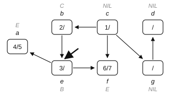{height="9.2em"}

::: {.sm}
return to For-Loop of `DFS-VISIT(G, e)` time = 7 Back in the For-Loop: no adjacent white nodes finish `DFS-VISIT(G, e)`
:::
:::
::::

## Depth-First Search {.fit1}

:::: {.columns}
::: {.column width="50%"}
::: {.codewrap style="font-size:1.00em"}
<pre class="pseudocode"><b>Procedure</b> DFS-VISIT(<i>G</i>, <i>u</i>)
<i>Inputs:</i>
  <i>G</i>: a graph
  <i>u</i>: the vertex to be processed
<i>Result:</i> <i>u</i> and every vertex reachable from it are visited
<i>time</i> &larr; <i>time</i> + 1
<i>d</i>[<i>u</i>] &larr; <i>time</i>                 # discovered
color[<i>u</i>] &larr; GRAY
<b>For</b> each vertex <i>v</i> in neighbors(<i>u</i>):
      <b>If</b> color[<i>v</i>] = WHITE
            <b>then</b> &pi;[<i>v</i>] &larr; <i>u</i>
                 DFS-VISIT(<i>G</i>, <i>v</i>)
color[<i>u</i>] &larr; BLACK
<i>time</i> &larr; <i>time</i> + 1
<i>f</i>[<i>u</i>] &larr; <i>time</i>                 # finished</pre>
:::
:::

::: {.column width="50%"}
{height="9.2em"}

::: {.sm}
finish `DFS-VISIT(G, e)` time = 8 return to For-Loop of `DFS-VISIT(G, b)`
:::
:::
::::

## Depth-First Search {.fit1}

:::: {.columns}
::: {.column width="50%"}
::: {.codewrap style="font-size:1.00em"}
<pre class="pseudocode"><b>Procedure</b> DFS-VISIT(<i>G</i>, <i>u</i>)
<i>Inputs:</i>
  <i>G</i>: a graph
  <i>u</i>: the vertex to be processed
<i>Result:</i> <i>u</i> and every vertex reachable from it are visited
<i>time</i> &larr; <i>time</i> + 1
<i>d</i>[<i>u</i>] &larr; <i>time</i>                 # discovered
color[<i>u</i>] &larr; GRAY
<b>For</b> each vertex <i>v</i> in neighbors(<i>u</i>):
      <b>If</b> color[<i>v</i>] = WHITE
            <b>then</b> &pi;[<i>v</i>] &larr; <i>u</i>
                 DFS-VISIT(<i>G</i>, <i>v</i>)
color[<i>u</i>] &larr; BLACK
<i>time</i> &larr; <i>time</i> + 1
<i>f</i>[<i>u</i>] &larr; <i>time</i>                 # finished</pre>
:::
:::

::: {.column width="50%"}
{height="9.2em"}

::: {.sm}
return to For-Loop of `DFS-VISIT(G, b)` time = 8 Back in the For-Loop: no adjacent white nodes finish `DFS-VISIT(G, b)`
:::
:::
::::

## Depth-First Search {.fit1}

:::: {.columns}
::: {.column width="50%"}
::: {.codewrap style="font-size:1.00em"}
<pre class="pseudocode"><b>Procedure</b> DFS-VISIT(<i>G</i>, <i>u</i>)
<i>Inputs:</i>
  <i>G</i>: a graph
  <i>u</i>: the vertex to be processed
<i>Result:</i> <i>u</i> and every vertex reachable from it are visited
<i>time</i> &larr; <i>time</i> + 1
<i>d</i>[<i>u</i>] &larr; <i>time</i>                 # discovered
color[<i>u</i>] &larr; GRAY
<b>For</b> each vertex <i>v</i> in neighbors(<i>u</i>):
      <b>If</b> color[<i>v</i>] = WHITE
            <b>then</b> &pi;[<i>v</i>] &larr; <i>u</i>
                 DFS-VISIT(<i>G</i>, <i>v</i>)
color[<i>u</i>] &larr; BLACK
<i>time</i> &larr; <i>time</i> + 1
<i>f</i>[<i>u</i>] &larr; <i>time</i>                 # finished</pre>
:::
:::

::: {.column width="50%"}
{height="9.2em"}

::: {.sm}
finish `DFS-VISIT(G, b)` time = 9 return to For-Loop of `DFS-VISIT(G, c)`
:::
:::
::::

## Depth-First Search {.fit1}

:::: {.columns}
::: {.column width="50%"}
::: {.codewrap style="font-size:1.00em"}
<pre class="pseudocode"><b>Procedure</b> DFS-VISIT(<i>G</i>, <i>u</i>)
<i>Inputs:</i>
  <i>G</i>: a graph
  <i>u</i>: the vertex to be processed
<i>Result:</i> <i>u</i> and every vertex reachable from it are visited
<i>time</i> &larr; <i>time</i> + 1
<i>d</i>[<i>u</i>] &larr; <i>time</i>                 # discovered
color[<i>u</i>] &larr; GRAY
<b>For</b> each vertex <i>v</i> in neighbors(<i>u</i>):
      <b>If</b> color[<i>v</i>] = WHITE
            <b>then</b> &pi;[<i>v</i>] &larr; <i>u</i>
                 DFS-VISIT(<i>G</i>, <i>v</i>)
color[<i>u</i>] &larr; BLACK
<i>time</i> &larr; <i>time</i> + 1
<i>f</i>[<i>u</i>] &larr; <i>time</i>                 # finished</pre>
:::
:::

::: {.column width="50%"}
{height="9.2em"}

::: {.sm}
return to For-Loop of `DFS-VISIT(G, c)` time = 9 Back in the For-Loop: next adjacent white node: g add parent of g call `DFS-VISIT(G, g)`
:::
:::
::::

## Depth-First Search {.fit1}

:::: {.columns}
::: {.column width="50%"}
::: {.codewrap style="font-size:1.00em"}
<pre class="pseudocode"><b>Procedure</b> DFS-VISIT(<i>G</i>, <i>u</i>)
<i>Inputs:</i>
  <i>G</i>: a graph
  <i>u</i>: the vertex to be processed
<i>Result:</i> <i>u</i> and every vertex reachable from it are visited
<i>time</i> &larr; <i>time</i> + 1
<i>d</i>[<i>u</i>] &larr; <i>time</i>                 # discovered
color[<i>u</i>] &larr; GRAY
<b>For</b> each vertex <i>v</i> in neighbors(<i>u</i>):
      <b>If</b> color[<i>v</i>] = WHITE
            <b>then</b> &pi;[<i>v</i>] &larr; <i>u</i>
                 DFS-VISIT(<i>G</i>, <i>v</i>)
color[<i>u</i>] &larr; BLACK
<i>time</i> &larr; <i>time</i> + 1
<i>f</i>[<i>u</i>] &larr; <i>time</i>                 # finished</pre>
:::
:::

::: {.column width="50%"}
{height="9.2em"}

::: {.sm}
call `DFS-VISIT(G, g)` time = 10 Enter the For-Loop: next adjacent white node: d add parent of d call `DFS-VISIT(G, d)`
:::
:::
::::

## Depth-First Search {.fit1}

:::: {.columns}
::: {.column width="50%"}
::: {.codewrap style="font-size:1.00em"}
<pre class="pseudocode"><b>Procedure</b> DFS-VISIT(<i>G</i>, <i>u</i>)
<i>Inputs:</i>
  <i>G</i>: a graph
  <i>u</i>: the vertex to be processed
<i>Result:</i> <i>u</i> and every vertex reachable from it are visited
<i>time</i> &larr; <i>time</i> + 1
<i>d</i>[<i>u</i>] &larr; <i>time</i>                 # discovered
color[<i>u</i>] &larr; GRAY
<b>For</b> each vertex <i>v</i> in neighbors(<i>u</i>):
      <b>If</b> color[<i>v</i>] = WHITE
            <b>then</b> &pi;[<i>v</i>] &larr; <i>u</i>
                 DFS-VISIT(<i>G</i>, <i>v</i>)
color[<i>u</i>] &larr; BLACK
<i>time</i> &larr; <i>time</i> + 1
<i>f</i>[<i>u</i>] &larr; <i>time</i>                 # finished</pre>
:::
:::

::: {.column width="50%"}
{height="9.2em"}

::: {.sm}
call `DFS-VISIT(G, d)` time = 11 Enter the For-Loop: no adjacent white nodes finish `DFS-VISIT(G, d)`
:::
:::
::::

## Depth-First Search {.fit1}

:::: {.columns}
::: {.column width="50%"}
::: {.codewrap style="font-size:1.00em"}
<pre class="pseudocode"><b>Procedure</b> DFS-VISIT(<i>G</i>, <i>u</i>)
<i>Inputs:</i>
  <i>G</i>: a graph
  <i>u</i>: the vertex to be processed
<i>Result:</i> <i>u</i> and every vertex reachable from it are visited
<i>time</i> &larr; <i>time</i> + 1
<i>d</i>[<i>u</i>] &larr; <i>time</i>                 # discovered
color[<i>u</i>] &larr; GRAY
<b>For</b> each vertex <i>v</i> in neighbors(<i>u</i>):
      <b>If</b> color[<i>v</i>] = WHITE
            <b>then</b> &pi;[<i>v</i>] &larr; <i>u</i>
                 DFS-VISIT(<i>G</i>, <i>v</i>)
color[<i>u</i>] &larr; BLACK
<i>time</i> &larr; <i>time</i> + 1
<i>f</i>[<i>u</i>] &larr; <i>time</i>                 # finished</pre>
:::
:::

::: {.column width="50%"}
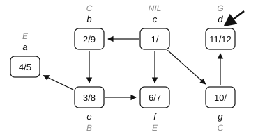{height="9.2em"}

::: {.sm}
finish `DFS-VISIT(G, d)` time = 12 return to For-Loop of `DFS-VISIT(G, g)`
:::
:::
::::

## Depth-First Search {.fit1}

:::: {.columns}
::: {.column width="50%"}
::: {.codewrap style="font-size:1.00em"}
<pre class="pseudocode"><b>Procedure</b> DFS-VISIT(<i>G</i>, <i>u</i>)
<i>Inputs:</i>
  <i>G</i>: a graph
  <i>u</i>: the vertex to be processed
<i>Result:</i> <i>u</i> and every vertex reachable from it are visited
<i>time</i> &larr; <i>time</i> + 1
<i>d</i>[<i>u</i>] &larr; <i>time</i>                 # discovered
color[<i>u</i>] &larr; GRAY
<b>For</b> each vertex <i>v</i> in neighbors(<i>u</i>):
      <b>If</b> color[<i>v</i>] = WHITE
            <b>then</b> &pi;[<i>v</i>] &larr; <i>u</i>
                 DFS-VISIT(<i>G</i>, <i>v</i>)
color[<i>u</i>] &larr; BLACK
<i>time</i> &larr; <i>time</i> + 1
<i>f</i>[<i>u</i>] &larr; <i>time</i>                 # finished</pre>
:::
:::

::: {.column width="50%"}
{height="9.2em"}

::: {.sm}
return to For-Loop of `DFS-VISIT(G, g)` time = 12 Back in the For-Loop: no adjacent white nodes finish `DFS-VISIT(G, g)`
:::
:::
::::

## Depth-First Search {.fit1}

:::: {.columns}
::: {.column width="50%"}
::: {.codewrap style="font-size:1.00em"}
<pre class="pseudocode"><b>Procedure</b> DFS-VISIT(<i>G</i>, <i>u</i>)
<i>Inputs:</i>
  <i>G</i>: a graph
  <i>u</i>: the vertex to be processed
<i>Result:</i> <i>u</i> and every vertex reachable from it are visited
<i>time</i> &larr; <i>time</i> + 1
<i>d</i>[<i>u</i>] &larr; <i>time</i>                 # discovered
color[<i>u</i>] &larr; GRAY
<b>For</b> each vertex <i>v</i> in neighbors(<i>u</i>):
      <b>If</b> color[<i>v</i>] = WHITE
            <b>then</b> &pi;[<i>v</i>] &larr; <i>u</i>
                 DFS-VISIT(<i>G</i>, <i>v</i>)
color[<i>u</i>] &larr; BLACK
<i>time</i> &larr; <i>time</i> + 1
<i>f</i>[<i>u</i>] &larr; <i>time</i>                 # finished</pre>
:::
:::

::: {.column width="50%"}
{height="9.2em"}

::: {.sm}
finish `DFS-VISIT(G, g)` time = 13 return to For-Loop of `DFS-VISIT(G, c)`
:::
:::
::::

## Depth-First Search {.fit1}

:::: {.columns}
::: {.column width="50%"}
::: {.codewrap style="font-size:1.00em"}
<pre class="pseudocode"><b>Procedure</b> DFS-VISIT(<i>G</i>, <i>u</i>)
<i>Inputs:</i>
  <i>G</i>: a graph
  <i>u</i>: the vertex to be processed
<i>Result:</i> <i>u</i> and every vertex reachable from it are visited
<i>time</i> &larr; <i>time</i> + 1
<i>d</i>[<i>u</i>] &larr; <i>time</i>                 # discovered
color[<i>u</i>] &larr; GRAY
<b>For</b> each vertex <i>v</i> in neighbors(<i>u</i>):
      <b>If</b> color[<i>v</i>] = WHITE
            <b>then</b> &pi;[<i>v</i>] &larr; <i>u</i>
                 DFS-VISIT(<i>G</i>, <i>v</i>)
color[<i>u</i>] &larr; BLACK
<i>time</i> &larr; <i>time</i> + 1
<i>f</i>[<i>u</i>] &larr; <i>time</i>                 # finished</pre>
:::
:::

::: {.column width="50%"}
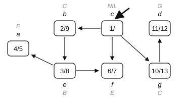{height="9.2em"}

::: {.sm}
return to For-Loop of `DFS-VISIT(G, c)` time = 13 Back in the For-Loop: no adjacent white nodes finish `DFS-VISIT(G, c)`
:::
:::
::::

## Depth-First Search {.fit1}

:::: {.columns}
::: {.column width="50%"}
::: {.codewrap style="font-size:1.00em"}
<pre class="pseudocode"><b>Procedure</b> DFS-VISIT(<i>G</i>, <i>u</i>)
<i>Inputs:</i>
  <i>G</i>: a graph
  <i>u</i>: the vertex to be processed
<i>Result:</i> <i>u</i> and every vertex reachable from it are visited
<i>time</i> &larr; <i>time</i> + 1
<i>d</i>[<i>u</i>] &larr; <i>time</i>                 # discovered
color[<i>u</i>] &larr; GRAY
<b>For</b> each vertex <i>v</i> in neighbors(<i>u</i>):
      <b>If</b> color[<i>v</i>] = WHITE
            <b>then</b> &pi;[<i>v</i>] &larr; <i>u</i>
                 DFS-VISIT(<i>G</i>, <i>v</i>)
color[<i>u</i>] &larr; BLACK
<i>time</i> &larr; <i>time</i> + 1
<i>f</i>[<i>u</i>] &larr; <i>time</i>                 # finished</pre>
:::
:::

::: {.column width="50%"}
{height="9.2em"}

::: {.sm}
finish `DFS-VISIT(G, c)` time = 14 All nodes finished &rarr; **FINISHED**
:::
:::
::::

## Depth-First Search

::: {}
More on Depth-First Search: See Cormen (2009)
:::

::: {.imgrow .middle}
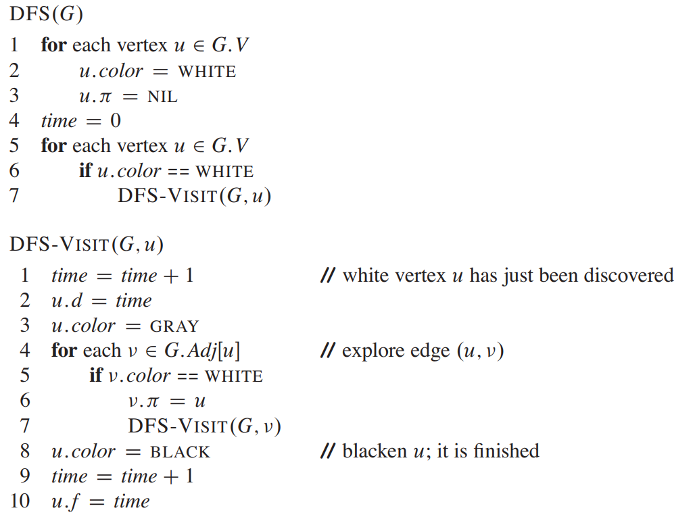{height="11.7em"}
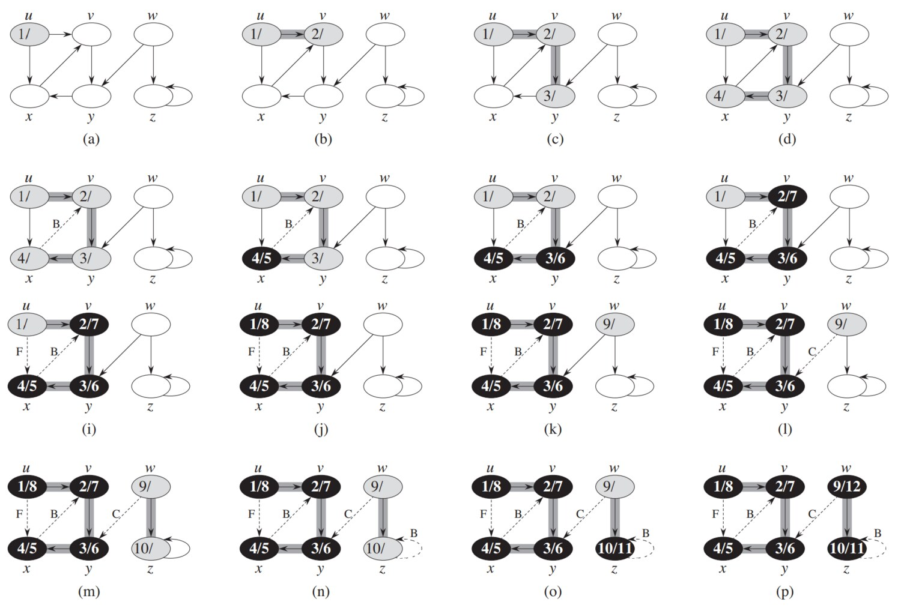{height="11.7em"}
:::

::: {.source}
From *Introduction to Algorithms* by Thomas Cormen (2009)
:::

## Types of recursive algorithms {.fit2}

:::: {.columns}
::: {.column width="64%"}
::: {.sm}
- **linear** recursion
  - method calls itself once recursively e.g., factorial, gcd
- **tree** or **cascade** recursion
  - method calls itself multiple times recursively e.g., DFS, fibonacci numbers (next section)
- **tail-end** recursion
  - return value of a function is calculated as a call to itself and nothing else
    - gcd is tail-recursive
  - result of the last recursive call is the final return value
- other types: **nested** recursion
  - parameters of the method contain recursive calls e.g., Ackermann function:
:::
:::

::: {.column width="36%"}
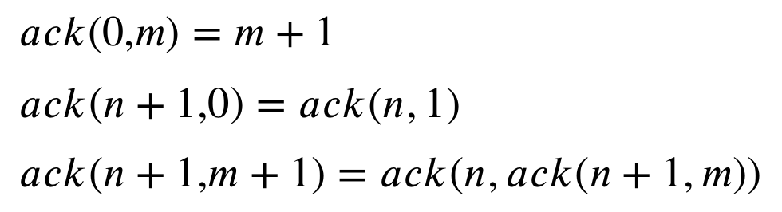{height="3.9em"}
:::
::::

## Outline

::: {.outline .focus}
1. Recursion
2. Recursive Algorithms
3. [Dynamic Programming]{.current}
:::

## Optimization Problems (Motivation)

::: {}
- An **optimization problem** consists of maximizing or minimizing a real function by systematically choosing input values from within an allowed set and computing the value of the function
- finding "best available" values of some objective function given a defined domain or input
- many problems in applied social science research actually have this structure
  - optimizing a statistical model
  - optimizing the parameters of a simulation model
  - calculating the shortest geographical path
:::

## Dynamic Programming {.fit1}

::: {.definition}
[Definition of dynamic programming]{.label}

::: {.sm}
Dynamic programming refers to simplifying a complicated problem by breaking it down into simpler sub-problems and **saving the result** for the future so that we will not have to compute that same problem again.
:::
:::

::: {.sm}
While some problems cannot be taken apart this way, problems that span several points in time often do break apart recursively.

- both a mathematical optimization method and an algorithm design principle
- common technique used in engineering and economics; goes back to the idea of Richard Bellman in the 1950s
- **optimal substructure**: if a problem can be solved optimally by breaking it into sub-problems and recursively finding optimal solutions to sub-problems
:::

## Dynamic Programming for Recursion

::: {.sm}
- Idea behind dynamic programming
  - use recursion but also save and re-use intermediate solutions:
    - breaking down an optimization problem into simpler sub-problems, and storing the solution to each sub-problem (called **memoization**) so that each sub-problem is only solved once
  - step-by-step put overlapping partial solutions together to form the overall solutions
  - requires checking global values at intermediate steps using all partial solutions
  - typical implementation through iteratively "filling up" an array or a matrix
  - makes code faster by reducing time complexity (reduced compute cycles) by efficient use of space
:::

## Example: Fibonacci numbers

::: {.codewrap style="font-size:1.70em"}
<pre class="pseudocode" style="width:66%;margin:0.4em auto"><b>Procedure</b> FIB(<i>n</i>)                  # recursive version
<i>Inputs:</i>
  <i>n</i>: a natural number (<i>n</i> &isin; &#8469;)
<i>Result:</i> the <i>n</i>-th Fibonacci number
<b>If</b> <i>n</i> = 0 <b>then return</b> 0
<b>If</b> <i>n</i> = 1 <b>then return</b> 1
<b>return</b> FIB(<i>n</i> - 1) + FIB(<i>n</i> - 2)</pre>
:::

::: {.center-h .sm}
The number of calls to `fib(n)` grows **exponentially** with $n$
:::

## Example: Fibonacci numbers

::: {.codewrap style="font-size:1.30em"}
<pre class="pseudocode" style="width:70%;margin:0.4em auto"><b>Procedure</b> FIB(<i>n</i>)                  # recursive, with memoization
<i>Inputs:</i>
  <i>n</i>: a natural number (<i>n</i> &isin; &#8469;)
<i>Data:</i> <i>memo</i>: an array indexed from 0 to <i>n</i>, initially all NIL
<i>Result:</i> the <i>n</i>-th Fibonacci number
<b>If</b> <i>n</i> = 0 <b>then return</b> 0
<b>If</b> <i>n</i> = 1 <b>then return</b> 1
<b>If</b> <i>memo</i>[<i>n</i>] &ne; NIL <b>then return</b> <i>memo</i>[<i>n</i>]
<i>memo</i>[<i>n</i>] &larr; FIB(<i>n</i> - 1) + FIB(<i>n</i> - 2)
<b>return</b> <i>memo</i>[<i>n</i>]</pre>
:::

## Example: Fibonacci numbers

::: {.codewrap style="font-size:1.30em"}
<pre class="pseudocode" style="width:70%;margin:0.4em auto"><b>Procedure</b> FIB(<i>n</i>)                  # recursive, with memoization
<i>Inputs:</i>
  <i>n</i>: a natural number (<i>n</i> &isin; &#8469;)
<i>Data:</i> <i>memo</i>: an array indexed from 0 to <i>n</i>, initially all NIL
<i>Result:</i> the <i>n</i>-th Fibonacci number
<b>If</b> <i>n</i> = 0 <b>then return</b> 0
<b>If</b> <i>n</i> = 1 <b>then return</b> 1
<b>If</b> <i>memo</i>[<i>n</i>] &ne; NIL <b>then return</b> <i>memo</i>[<i>n</i>]
<i>memo</i>[<i>n</i>] &larr; FIB(<i>n</i> - 1) + FIB(<i>n</i> - 2)
<b>return</b> <i>memo</i>[<i>n</i>]</pre>
:::

::: {.center-h .sm}
Previously calculated results are saved in `memo`
:::

## Example: Fibonacci numbers

::: {.codewrap style="font-size:1.50em"}
<pre class="pseudocode" style="width:66%;margin:0.4em auto"><b>Procedure</b> FIB(<i>n</i>)                  # fully iterative
<i>Inputs:</i>
  <i>n</i>: a natural number (<i>n</i> &isin; &#8469;)
<i>Data:</i> <i>memo</i>: an array indexed from 0 to <i>n</i>
<i>Result:</i> the <i>n</i>-th Fibonacci number
<i>memo</i>[0] &larr; 0
<i>memo</i>[1] &larr; 1
<b>For</b> <i>i</i> = 2 to <i>n</i>:
      <i>memo</i>[<i>i</i>] &larr; <i>memo</i>[<i>i</i> - 1] + <i>memo</i>[<i>i</i> - 2]
<b>return</b> <i>memo</i>[<i>n</i>]</pre>
:::

## Outtake &ndash; Types of algorithms {.fit1}

::: {.sm}
The most prevalent problem-solving heuristics you will encounter

- **Recursion**
  - optimization through recursive function call, e.g. DFS
  - requires specifying sensible abort conditions
- **Greedy**
  - successive extension of partial solutions, e.g. building a Huffman code
  - determines locally optimal choice at each step, then moves on
  - only correct if local optimum also leads to globally optimal solutions
- **Divide and Conquer**
  - separate the problem into decoupled/non-overlapping smaller sub-problems. More next session!
  - solve sub-problems independently
  - if necessary, collapse all sub-results to global results
:::

## Summary

- Recursion: a **base case** plus a **recursive case** that moves towards it
- Every call waits on the **program stack** until its own calls return
- **Factorial** and **Euclid's algorithm** run their recursive definitions
- **Depth-first search** records discovery and finishing times
- Recursion can be **linear**, **tree**, **tail-end** or **nested**
- **Dynamic programming** reuses the results of overlapping subproblems

**Next session:** Sorting Algorithms

## Evaluation for Introduction to Programming with Python

::: {.center-h}
{height="9.0em"}

<https://evasys.uni-konstanz.de/evasys/online.php?pswd=DPQ9D>
:::
