## Course Outline

:::: {.columns}
::: {.column width="50%"}
::: {.sm}
- Session 1: Introduction
- Session 2: Information Coding
- Session 3: Data Structures
- Session 4: Software
- Session 5: Algorithms
- Session 6: Recursion
- Session 7: Sorting Algorithms
:::
:::

::: {.column width="50%"}
::: {.sm}
- Session 8: Time Complexity
- Session 9: Theoretical Computer Science
- Session 10: Machine Learning (8.01) K503, lecture 13:30-15:00, practice 15:15-16:45
- Session 11: Databases
- Session 12: Parallel Programming
- Session 13: Social Science Applications
- Session 14: Exam Review
:::
:::
::::

## Outline

::: {.outline}
1. Sorting
2. Iterative sorting: Selection sort
3. Divide and Conquer: Mergesort and Quicksort
4. Data structures for sorting: Heapsort
:::

<!-- MOTIVATION:M07-A:BEGIN -->
## Sorted by region, then by age, and the regions came apart {.fit1}

::: {.motivation}
[Motivating example]{.label}
You sort a respondent table by **region**, then sort the same table by **age**
to inspect the age distribution. The regions, which were in a deliberate order,
come back shuffled, because the second sort was allowed to move equal-aged rows
past one another. Nothing warned you. The appendix tables are wrong.
:::

- Both sorts produced a **correctly sorted** table.
- Only one of them preserved the work of the first.

[Two algorithms, the same sorted order, different results. What property separates them, and which do you have?]{.ask}
<!-- MOTIVATION:M07-A:END -->

<!-- MOTIVATION:M07-B:BEGIN -->
## Two seconds, or fourteen hours

::: {.motivation}
[Motivating example]{.label}
A million records. **Selection sort** compares every element against every
other: about **5 × 10¹¹** comparisons. **Mergesort** halves the problem
repeatedly: about **2 × 10⁷**. At ten million comparisons a second, that is the
difference between **fourteen hours** and **two seconds**.
:::

:::: {.figures}
::: {.fq}
[5 × 10¹¹]{.big}[comparisons, selection sort]{.cap}
:::
::: {.fq}
[2 × 10⁷]{.big}[comparisons, mergesort]{.cap}
:::
::: {.fq}
[25 000×]{.big}[fewer, same result]{.cap}
:::
::::

[Both are correct. What is it about the *shape* of one procedure that makes it collapse at scale?]{.ask}
<!-- MOTIVATION:M07-B:END -->

<!-- MOTIVATION:M07-C:BEGIN -->
## Why sort at all?

::: {.motivation}
[Motivating example]{.label}
A codebook lookup costs **13** comparisons if the list is sorted and **6 000** if
it is not. But sorting the codebook costs something too. With **one** lookup,
sorting is wasted effort. With **forty million**, it is the only thing that makes
the job possible.
:::

:::: {.figures}
::: {.fq}
[1]{.big}[lookup: don't sort, you would pay more than you save]{.cap}
:::
::: {.fq}
[25]{.big}[lookups: the break-even point]{.cap}
:::
::: {.fq}
[40 × 10⁶]{.big}[lookups: sorting is the whole difference]{.cap}
:::
::::

[Sorting is an **investment**. How do you work out whether it pays?]{.ask}
<!-- MOTIVATION:M07-C:END -->

## Sorting

:::: {.columns}
::: {.column width="58%"}
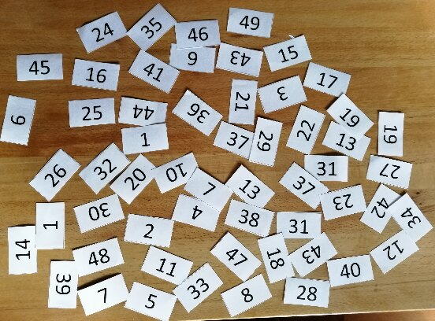{height="10.6em"}
:::

::: {.column width="42%"}
::: {}
**Which numbers are duplicates?**
:::
:::
::::

## Sorting

:::: {.columns}
::: {.column width="42%"}
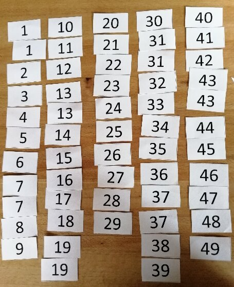{height="11.4em"}
:::

::: {.column width="58%"}
::: {}
**Which numbers are duplicates?**
:::
:::
::::

## Sorting

::: {.center-h .sm}
**Are the number sets different?**
:::

::: {.imgrow .middle}
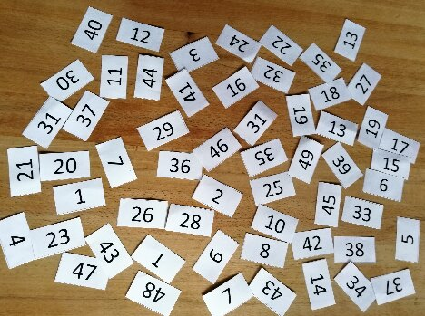{height="8.4em"}
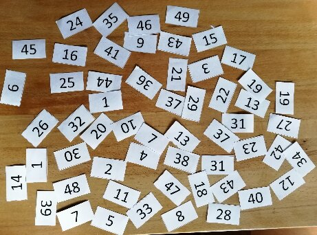{height="8.4em"}
:::

## Sorting

::: {.center-h .sm}
**Are the number sets different?**
:::

::: {.imgrow .middle}
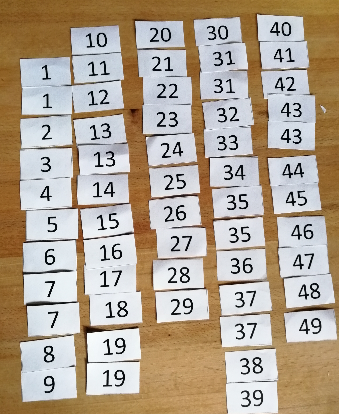{height="10.0em"}
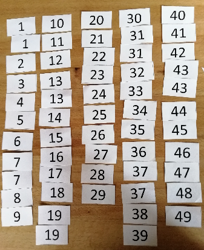{height="10.0em"}
:::

## Sorting

::: {.center-h .sm}
**Are the number sets different?**
:::

::: {.imgrow .middle}
{height="10.0em"}
{height="10.0em"}
:::

## Sorting

::: {}
- **Fundamentals**
  - we are operating on:
    - set of objects $U$
    - set of keys $S$ with linear order relation $\leq$ (i.e., a linearly ordered set)
    - sorting function that maps all objects $U$ to $S$ (i.e., $s: U \rightarrow S$)
  - we are searching for a permutation of indices $i_1 \dots i_n$ of the objects in $U$, such that:
:::

::: {.center-h}
$$\forall\, 1 \leq k \leq n-1: \; s(u_{i_k}) \leq s(u_{i_{k+1}})$$
:::

## Stable vs. unstable sorting {.fit1}

::: {.xs}
- **Stable sorting methods**
  - different objects can have the same key value used for sorting, e.g., students with the exact same name
  - If a sorting algorithm, after sorting the contents, does not change the sequence of similar content in which they appear, it is called **stable** sorting. Otherwise it is **unstable** sorting.
  - stable sorting methods ensure that
    - objects with the same value for a given sorting function $s_1$ have different values for another function $s_2$
    - sorting according to $s_1$ in this case does not change the order of the objects
:::

:::: {.columns}
::: {.column width="30%"}
::: {.xs}
**example: sort by first name**

| | |
|---|---|
| 123456 | Christina |
| 234567 | Sandra |
| 345678 | Sandra |
| 456789 | Carl |
:::
:::

::: {.column width="30%"}
::: {.xs}
&nbsp;

| | |
|---|---|
| 456789 | Carl |
| 123456 | Christina |
| 234567 | Sandra |
| 345678 | Sandra |

**stable**
:::
:::

::: {.column width="30%"}
::: {.xs}
&nbsp;

| | |
|---|---|
| 456789 | Carl |
| 123456 | Christina |
| 345678 | Sandra |
| 234567 | Sandra |

**unstable**
:::
:::
::::

## Iterative sorting

::: {.outline .focus}
1. Sorting
2. [Iterative sorting: Selection sort]{.current}
3. Divide and Conquer: Mergesort and Quicksort
4. Data structures for sorting: Heapsort
:::

## Iterative Sorting: Repeated Minimum Search {.fit1}

::: {.sm}
**Sorting through selection as fundamental principle**

- intuitive strategy:
  - find maximum/minimum of a set and move it to front
  - iteratively apply the logic to the remaining set
- algorithmic strategy (**repeated minimum search**)
  - split list into two parts
    - sorted part on left, $L$
    - unsorted part on right, $R$
  - at start: sorted part is empty, i.e. $L = \emptyset$, unsorted part $R$ is the entire list
  - find minimum in unsorted $R$ and append to sorted $L$
  - stop if $\text{length}(R) = 1$
:::

## Repeated minimum search

::: {.center-h}
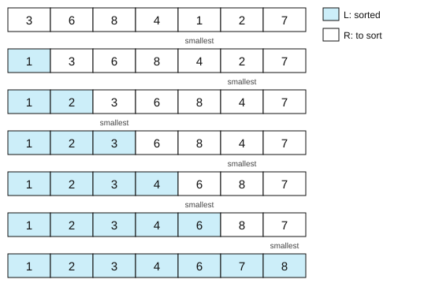{height="15.3em"}
:::

## Selection sort

::: {.codewrap style="font-size:1.30em"}
<pre class="pseudocode" style="width:74%"><b>Procedure</b> SELECTION-SORT(<i>A</i>, <i>n</i>)
<i>Inputs:</i>
  <i>A</i>: an array
  <i>n</i>: the number of elements in <i>A</i> to sort
<i>Result:</i> the elements of <i>A</i> are sorted into nondecreasing order
<b>For</b> <i>i</i> = 1 to <i>n</i> - 1:
      <i>smallest</i> &larr; <i>i</i>
      <b>For</b> <i>j</i> = <i>i</i> + 1 to <i>n</i>:
            <b>If</b> <i>A</i>[<i>j</i>] &lt; <i>A</i>[<i>smallest</i>]
                  <b>then</b> <i>smallest</i> &larr; <i>j</i>
      swap <i>A</i>[<i>i</i>] with <i>A</i>[<i>smallest</i>]</pre>
:::

::: {.source}
From *Algorithms Unlocked*. Thomas Cormen, 2013, pp. 32&ndash;34
:::

## Selection sort

:::: {.columns}
::: {.column width="74%"}
::: {.codewrap style="font-size:1.30em"}
<pre class="pseudocode"><b>Procedure</b> SELECTION-SORT(<i>A</i>, <i>n</i>)
<i>Inputs:</i>
  <i>A</i>: an array
  <i>n</i>: the number of elements in <i>A</i> to sort
<i>Result:</i> the elements of <i>A</i> are sorted into nondecreasing order
<b>For</b> <i>i</i> = 1 to <i>n</i> - 1:
      <i>smallest</i> &larr; <i>i</i>
      <b>For</b> <i>j</i> = <i>i</i> + 1 to <i>n</i>:
            <b>If</b> <i>A</i>[<i>j</i>] &lt; <i>A</i>[<i>smallest</i>]
                  <b>then</b> <i>smallest</i> &larr; <i>j</i>
      swap <i>A</i>[<i>i</i>] with <i>A</i>[<i>smallest</i>]</pre>
:::
:::

::: {.column width="26%"}
::: {.tag .xs}
Find the smallest in R
:::

  

::: {.tag .xs}
Swap it to be the last of L
:::
:::
::::

::: {.source}
From *Algorithms Unlocked*. Thomas Cormen, 2013, pp. 32&ndash;34
:::

## Selection sort example

::: {.center-h}
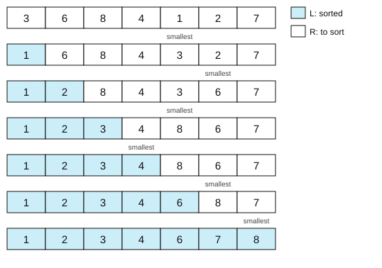{height="15.3em"}
:::

## Repeated minimum search vs selection sort {.fit2}

::: {.xs}
**Characteristics of iterative sorting algorithms**

- both algorithms are **partially correct**
  - any element still in $R$ is larger or equal to any in $L$, $L$ is sorted
- both algorithms **terminate**
  - remaining part $R$ shrinks in every step, eventually it has to have length 1
- different use depending on data structure of list:
  - repeated minimum appends in the middle of the list: better for **linked lists**
  - selection sort uses swaps: better for **arrays**
- **stability**:
  - repeated minimum is *stable*:
    - in case of ambiguity, takes the first minimum in $R$
    - this always correctly preserves any other ordering
  - selection sort is *unstable*:
    - swapping does not necessarily preserve other ordering in $R$
:::

## Outtake &ndash; Social Science Applications {.fit1}

::: {.sm}
**Why should we care about sorting?**

- Sorting for the sake of sorting
  - we are sorting data more often than we think
  - especially for data science applications complex data often needs to be sorted to be analyzed or shown
  - in practice, speed matters here for analysts and users
  - sorting is healthy: it helps to notice data issues
- Sorting for searching
  - many search algorithms require sorted sets of data to work (e.g., binary search)
  - it is in practice much easier to find items in an ordered than an unordered list
:::

::: {.refresh}
Exercise: write the pseudocode of repeated minimum search
:::

## Divide and Conquer

::: {.outline .focus}
1. Sorting
2. Iterative sorting: Selection sort
3. [Divide and Conquer: Mergesort and Quicksort]{.current}
4. Data structures for sorting: Heapsort
:::

## Divide and Conquer

:::: {.columns}
::: {.column width="46%"}
::: {}
- Fundamental algorithmic principle inspired by military history: *divide et impera*
  - separate a problem into separate sub-problems
  - continue until those sub-problems are solvable
  - then recombine partial results to full solution
:::
:::

::: {.column width="54%"}
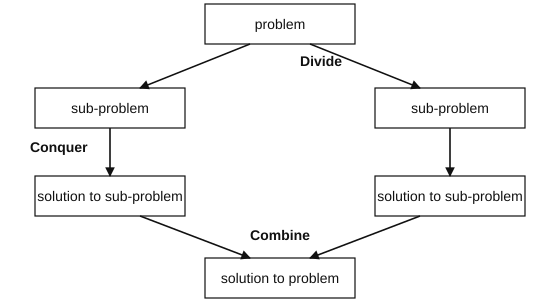{height="9.4em"}
:::
::::

## Divide and Conquer

::: {}
**Divide and conquer $\neq$ recursion**

- it is not the same as recursion, i.e., recursive calls of the same function
- recursion is a natural implementation strategy for algorithms following a divide and conquer approach
  - by definition, the sub-problems in divide and conquer are self-similar
  - generate overall solution by combining solutions of sub-problems
- BUT we can also implement a divide and conquer strategy iteratively
:::

## Mergesort

::: {.sm}
- **Mergesort** first divides the list into equal halves and then combines them in a sorted manner. Mergesort sorts by *merging* (sub-)lists
- principle:
  - a list with one element is trivially sorted
  - merging two sorted lists is simple:
    - compare first element of each sub-list
    - append smaller of the two to merged list and remove from sub-list
    - continue with remaining sub-lists
- algorithmic strategy
  - repeated division of list until just one element is remaining per list
  - repeated merging of sorted sub-lists until only one sorted list remains
:::

## Mergesort

::: {.codewrap style="font-size:1.30em"}
<pre class="pseudocode" style="width:88%"><b>Procedure</b> MERGE-SORT(<i>A</i>, <i>p</i>, <i>r</i>)
<i>Inputs:</i>
      <i>A</i>: an array
      <i>p</i>, <i>r</i>: the starting and ending index of the subarray
<i>Result:</i> the elements of the subarray <i>A</i>[<i>p</i>..<i>r</i>] are sorted into nondecreasing order
<b>If</b> <i>p</i> &ge; <i>r</i>
      <b>then</b> return without doing anything    # A[p..r] has at most one element
      <b>else</b> <i>q</i> &larr; ⌊(<i>p</i> + <i>r</i>) / 2⌋
            MERGE-SORT(<i>A</i>, <i>p</i>, <i>q</i>)             # sort the left half recursively
            MERGE-SORT(<i>A</i>, <i>q</i> + 1, <i>r</i>)         # sort the right half recursively
            MERGE(<i>A</i>, <i>p</i>, <i>q</i>, <i>r</i>)             # merge the two sorted halves</pre>
:::

::: {.source}
From *Algorithms Unlocked*. Thomas Cormen, 2013, pp. 40&ndash;47
:::

## The MERGE function

::: {.codewrap style="font-size:1.10em"}
<pre class="pseudocode" style="width:88%"><b>Procedure</b> MERGE(<i>A</i>, <i>p</i>, <i>q</i>, <i>r</i>)
<i>Inputs:</i>
      <i>A</i>: an array
      <i>p</i>, <i>q</i>, <i>r</i>: indices such that <i>A</i>[<i>p</i>..<i>q</i>] and <i>A</i>[<i>q</i>+1..<i>r</i>] are sorted
<i>Result:</i> <i>A</i>[<i>p</i>..<i>r</i>] contains the elements of both subarrays, sorted
<i>n</i>1 &larr; <i>q</i> - <i>p</i> + 1; <i>n</i>2 &larr; <i>r</i> - <i>q</i>
<i>B</i>[1..<i>n</i>1] &larr; copy of <i>A</i>[<i>p</i>..<i>q</i>]; <i>C</i>[1..<i>n</i>2] &larr; copy of <i>A</i>[<i>q</i>+1..<i>r</i>]
<i>B</i>[<i>n</i>1 + 1] &larr; &infin;; <i>C</i>[<i>n</i>2 + 1] &larr; &infin;        # sentinels, never copied
<i>i</i> &larr; 1; <i>j</i> &larr; 1
<b>For</b> <i>k</i> = <i>p</i> to <i>r</i>:
      <b>If</b> <i>B</i>[<i>i</i>] &le; <i>C</i>[<i>j</i>]
            <b>then</b> <i>A</i>[<i>k</i>] &larr; <i>B</i>[<i>i</i>]; <i>i</i> &larr; <i>i</i> + 1
            <b>else</b> <i>A</i>[<i>k</i>] &larr; <i>C</i>[<i>j</i>]; <i>j</i> &larr; <i>j</i> + 1</pre>
:::

## MERGE example

::: {.center-h}
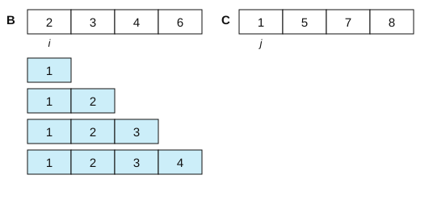{height="15.0em"}
:::

## MERGE example

::: {.center-h}
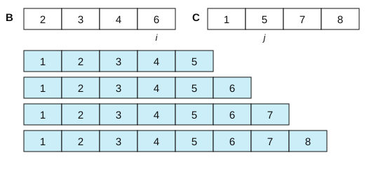{height="15.0em"}
:::

## Mergesort

::: {.sm}
- **Mergesort split:** first divides the whole list iteratively into equal halves (no change in sequence of items in the original) until atomic values are achieved.
:::

::: {.center-h}
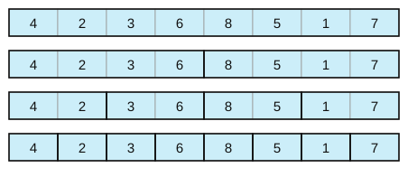{height="12.2em"}
:::

## Mergesort

::: {.sm}
- **Mergesort algorithm** &ndash; merge them into another list in a sorted manner
:::

::: {.center-h}
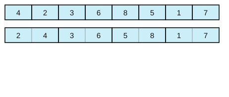{height="12.2em"}
:::

## Mergesort

::: {.sm}
- **Mergesort algorithm** &ndash; merge them into another list in a sorted manner
:::

::: {.center-h}
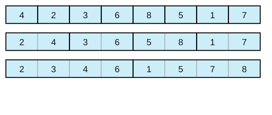{height="12.2em"}
:::

## Mergesort

::: {.sm}
- **Mergesort algorithm** &ndash; merge them into another list in a sorted manner
:::

::: {.center-h}
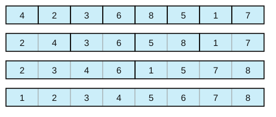{height="12.2em"}
:::

## Mergesort

::: {}
**Mergesort as a divide and conquer strategy**

- **Divide:** splitting into two sub-lists (with half the size)
  - recursive implementation of sub-list sorting
    - call mergesort on itself
    - assume that output is a sorted list in each recursion step
    - requires well-defined base case (= list with one element)
- **Combine:** merging two lists preserving order
  - systematic and efficient merger of partial lists to one large sorted list
  - see *Algorithms Unlocked* (Cormen, 2013) for MERGE pseudocode
:::

## Mergesort

::: {}
**Characteristics of mergesort**

- **correctness**
  - merge steps sort correctly
  - no changing of order outside of merging
  - all elements are sorted and algorithm terminates
- **memory and stability**
  - need additional memory (in addition to list) for handling sub-lists
  - stable algorithm because other ordering structure is preserved during merging
:::

## John von Neumann: more than mergesort's father {.fit1}

:::: {.columns}
::: {.column width="68%"}
::: {.sm}
**John von Neumann** (Neumann János Lajos, Budapest, 1903-1957)

- One of the most influential figures of Computer Science, Math, and Physics in the 20th century
- Inventor of the mergesort algorithm
- Among the first to talk about the time complexity of algorithms in the 1950s
- Popularized the modern computer architecture with main memory, ALU, registries, etc.
- Proposed cellular automata that self-replicated
- Warned about anthropogenic global warming as early as 1955
:::
:::

::: {.column width="32%"}
{height="9.4em"}
:::
::::

## Quicksort

::: {}
- Similar divide and conquer logic to mergesort but division into sub-lists not necessarily regular
- **Quicksort rationale:**
  - pick **pivot** element from list
  - sort list such that all elements left (right) of pivot are smaller (larger) than its value
  - after this **partition** operation the pivot element is already in its final (sorted) position, sorting now occurs only right/left of the pivot element
  - split list at pivot and apply logic recursively to left and right sub-list
:::

## Quicksort

::: {.codewrap style="font-size:1.40em"}
<pre class="pseudocode" style="width:76%;margin:0.6em auto"><b>Procedure</b> QUICK-SORT(<i>A</i>, <i>p</i>, <i>r</i>)
<i>Inputs and Result:</i> same as MERGE-SORT
<b>If</b> <i>p</i> &ge; <i>r</i>
      <b>then</b> return without doing anything
      <b>else</b> <i>q</i> &larr; PARTITION(<i>A</i>, <i>p</i>, <i>r</i>)      # A[q] is now in its final place
            QUICK-SORT(<i>A</i>, <i>p</i>, <i>q</i> - 1)
            QUICK-SORT(<i>A</i>, <i>q</i> + 1, <i>r</i>)</pre>
:::

## The PARTITION function

::: {.center-h}
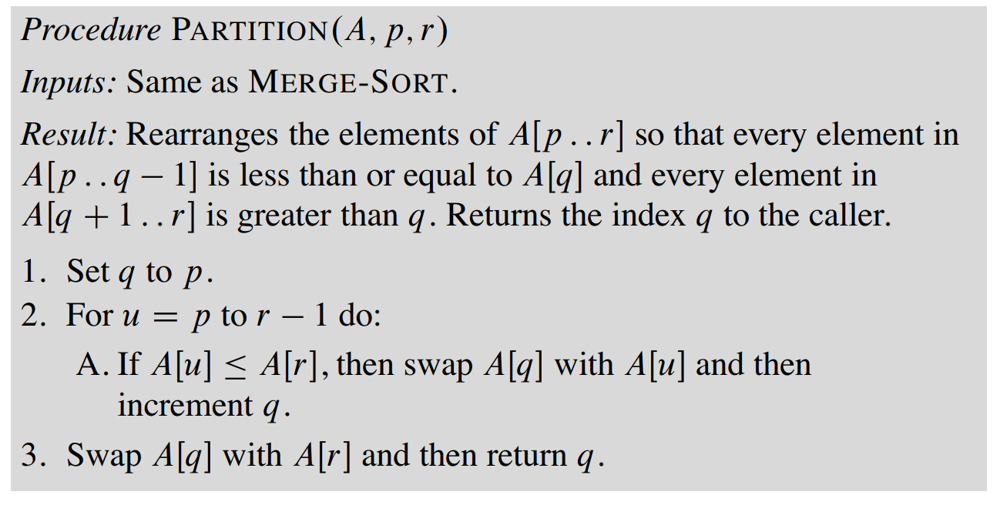{height="11.7em"}
:::

::: {.refresh}
Exercise: run quicksort on pen and paper on the same example as mergesort
:::

## Quicksort: properties

::: {.sm}
- **advantages**
  - very memory efficient
  - in-place procedure: is (usually) faster than merge sort
- **disadvantages**
  - efficiency depends on choice of pivot and the partition scheme chosen (more next week)
- **differences from mergesort:**
  - in quicksort all the heavy lifting is done while dividing the array into subarrays, while in mergesort all the real work happens during merging the subarrays
  - in quicksort, the combine step does absolutely nothing
:::

## Data structures for sorting

::: {.outline .focus}
1. Sorting
2. Iterative sorting: Selection sort
3. Divide and Conquer: Mergesort and Quicksort
4. [Data structures for sorting: Heapsort]{.current}
:::

## Heaps {.fit1}

:::: {.columns}
::: {.column width="52%"}
- Search algorithms can use data structures for help: **heaps** as an example
- partially ordered binary trees without gaps (or holes)
  - children of any node not larger than the node
  - not a binary search tree: only local ordering of nodes and children
  - all levels filled, the last one from the left
- example: does this tree satisfy the heap property?
:::

::: {.column width="48%"}
{height="6.4em"}

:::
::::

## Heaps {.fit1}

:::: {.columns}
::: {.column width="52%"}
- Search algorithms can use data structures for help: **heaps** as an example
- partially ordered binary trees without gaps (or holes)
  - children of any node not larger than the node
  - not a binary search tree: only local ordering of nodes and children
  - all levels filled, the last one from the left
- example: does this tree satisfy the heap property?
:::

::: {.column width="48%"}
{height="6.4em"}

**No:** 8 is larger than its parent 4

:::
::::

## Heaps {.fit1}

::: {}
- partially ordered binary trees without gaps (or holes)
  - children of any node not larger than the node
  - not a binary search tree, i.e., just require local ordering of nodes and children. All levels filled, last filled from the left
:::

::: {}
- Heap property can be efficiently "recovered"
:::

::: {.imgrow .middle}
{height="6.4em"}
{height="6.4em"}
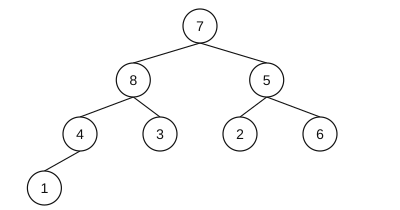{height="6.4em"}
:::

## Min-Heaps

::: {}
- Same as a heap but:
  - children of any node not **smaller** than the node
  - All levels filled, last filled from the left
:::

::: {.center-h}
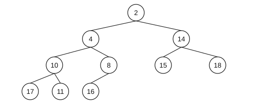{height="9.4em"}
:::

## Min-Heaps

::: {.sm}
- Same as a heap but:
  - children of any node not **smaller** than the node
  - All levels filled, last filled from the left
:::

::: {.center-h}
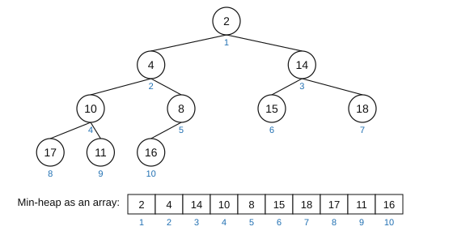{height="10.4em"}
:::

## Heapsort

::: {}
- **conceptual foundation:**
  - in a min-heap the smallest element is on top
  - children are not smaller because of heap property
  - same is recursively true for the entire tree
  - we can start by building a heap of the list
- **idea:**
  - remove the top (smallest) element from tree
  - replace it with the last element of the tree
  - recover the heap property through permuting elements
:::

## Heapsort: Example

:::: {.columns}
::: {.column width="82%"}
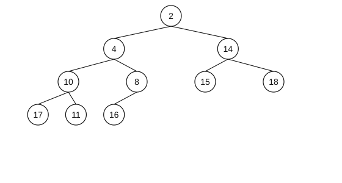{height="14.4em"}
:::

::: {.column width="18%"}
::: {.tag .xs}
Extract top (minimum) and place it first
:::
:::
::::

## Heapsort: Example

:::: {.columns}
::: {.column width="82%"}
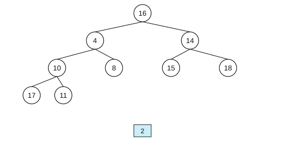{height="14.4em"}
:::

::: {.column width="18%"}
::: {.tag .xs}
Move last to top
:::
:::
::::

## Heapsort: Example

:::: {.columns}
::: {.column width="82%"}
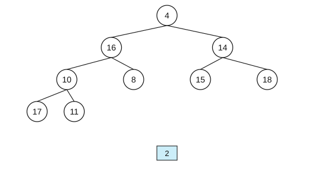{height="14.4em"}
:::

::: {.column width="18%"}
::: {.tag .xs}
Recover min-heap property
:::
:::
::::

## Heapsort: Example

:::: {.columns}
::: {.column width="82%"}
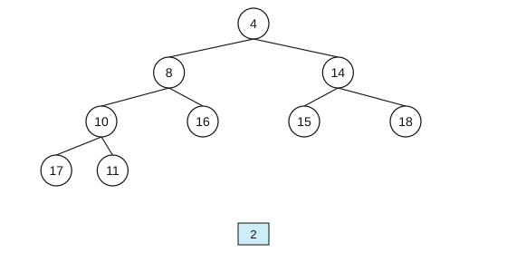{height="14.4em"}
:::

::: {.column width="18%"}
::: {.tag .xs}
Recover min-heap property
:::
:::
::::

## Heapsort: Example

:::: {.columns}
::: {.column width="82%"}
{height="14.4em"}
:::

::: {.column width="18%"}
::: {.tag .xs}
Extract min
:::
:::
::::

## Heapsort: Example

:::: {.columns}
::: {.column width="82%"}
{height="14.4em"}
:::

::: {.column width="18%"}
::: {.tag .xs}
Move last to top
:::
:::
::::

## Heapsort: Example

:::: {.columns}
::: {.column width="82%"}
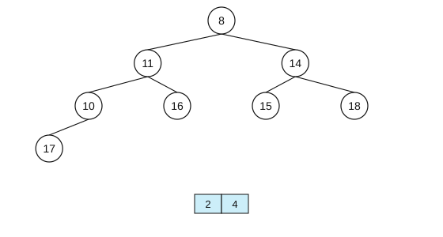{height="14.4em"}
:::

::: {.column width="18%"}
::: {.tag .xs}
Recover min-heap property
:::
:::
::::

## Heapsort: Example

:::: {.columns}
::: {.column width="82%"}
{height="14.4em"}
:::

::: {.column width="18%"}
::: {.tag .xs}
Recover min-heap property
:::
:::
::::

## Heapsort: Example

:::: {.columns}
::: {.column width="82%"}
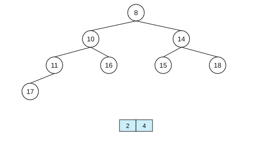{height="14.4em"}
:::

::: {.column width="18%"}
::: {.tag .xs}
Extract min
:::
:::
::::

## Heapsort: Example

:::: {.columns}
::: {.column width="82%"}
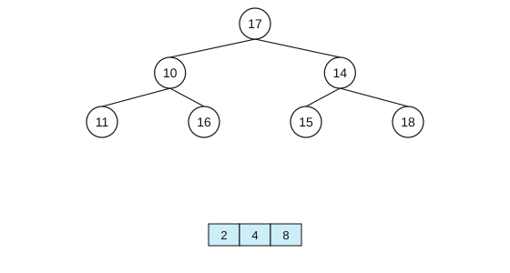{height="14.4em"}
:::

::: {.column width="18%"}
::: {.tag .xs}
Move last to top
:::
:::
::::

## Heapsort: Example

:::: {.columns}
::: {.column width="82%"}
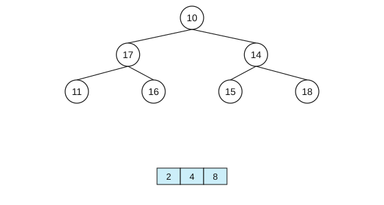{height="14.4em"}
:::

::: {.column width="18%"}
::: {.tag .xs}
Recover min-heap property
:::
:::
::::

## Heapsort: Example

:::: {.columns}
::: {.column width="82%"}
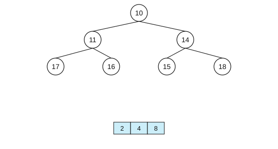{height="14.4em"}
:::

::: {.column width="18%"}
::: {.tag .xs}
Recover min-heap property
:::
:::
::::

## Heapsort: Example

:::: {.columns}
::: {.column width="82%"}
{height="14.4em"}
:::

::: {.column width="18%"}
::: {.tag .xs}
Extract min
:::
:::
::::

## Heapsort: Example

:::: {.columns}
::: {.column width="82%"}
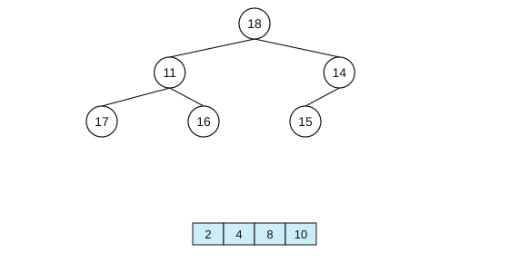{height="14.4em"}
:::

::: {.column width="18%"}
::: {.tag .xs}
Move last to top
:::
:::
::::

## Heapsort: Example

:::: {.columns}
::: {.column width="82%"}
{height="14.4em"}
:::

::: {.column width="18%"}
::: {.tag .xs}
Recover min-heap property
:::
:::
::::

## Heapsort: Example

:::: {.columns}
::: {.column width="82%"}
{height="14.4em"}
:::

::: {.column width="18%"}
::: {.tag .xs}
Recover min-heap property
:::
:::
::::

## Heapsort: Example

:::: {.columns}
::: {.column width="82%"}
{height="14.4em"}
:::

::: {.column width="18%"}
::: {.tag .xs}
Extract min
:::
:::
::::

## Heapsort: Example

:::: {.columns}
::: {.column width="82%"}
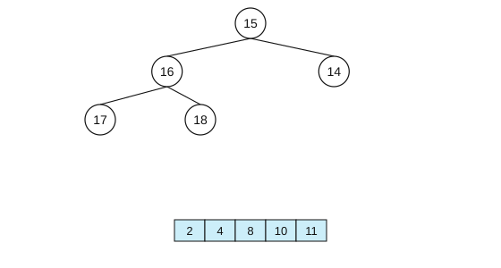{height="14.4em"}
:::

::: {.column width="18%"}
::: {.tag .xs}
Move last to top
:::
:::
::::

## Heapsort: Example

:::: {.columns}
::: {.column width="82%"}
{height="14.4em"}
:::

::: {.column width="18%"}
::: {.tag .xs}
Recover min-heap property
:::
:::
::::

## Heapsort: Example

:::: {.columns}
::: {.column width="82%"}
{height="14.4em"}
:::

::: {.column width="18%"}
::: {.tag .xs}
Extract min
:::
:::
::::

## Heapsort: Example

:::: {.columns}
::: {.column width="82%"}
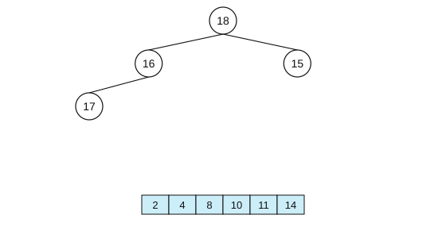{height="14.4em"}
:::

::: {.column width="18%"}
::: {.tag .xs}
Move last to top
:::
:::
::::

## Heapsort: Example

:::: {.columns}
::: {.column width="82%"}
{height="14.4em"}
:::

::: {.column width="18%"}
::: {.tag .xs}
Recover min-heap property
:::
:::
::::

## Heapsort: Example

:::: {.columns}
::: {.column width="82%"}
{height="14.4em"}
:::

::: {.column width="18%"}
::: {.tag .xs}
Extract min
:::
:::
::::

## Heapsort: Example

:::: {.columns}
::: {.column width="82%"}
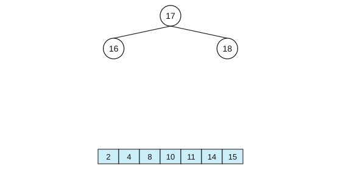{height="14.4em"}
:::

::: {.column width="18%"}
::: {.tag .xs}
Move last to top
:::
:::
::::

## Heapsort: Example

:::: {.columns}
::: {.column width="82%"}
{height="14.4em"}
:::

::: {.column width="18%"}
::: {.tag .xs}
Recover min-heap property
:::
:::
::::

## Heapsort: Example

:::: {.columns}
::: {.column width="82%"}
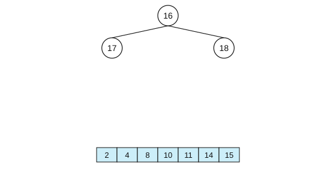{height="14.4em"}
:::

::: {.column width="18%"}
::: {.tag .xs}
Extract min
:::
:::
::::

## Heapsort: Example

:::: {.columns}
::: {.column width="82%"}
{height="14.4em"}
:::

::: {.column width="18%"}
::: {.tag .xs}
Move last to top
:::
:::
::::

## Heapsort: Example

:::: {.columns}
::: {.column width="82%"}
{height="14.4em"}
:::

::: {.column width="18%"}
::: {.tag .xs}
Recover min-heap property
:::
:::
::::

## Heapsort: Example

:::: {.columns}
::: {.column width="82%"}
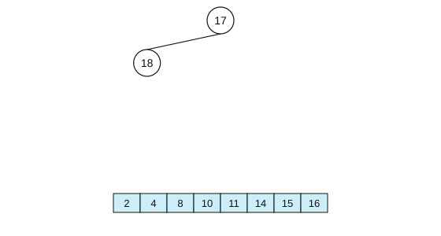{height="14.4em"}
:::

::: {.column width="18%"}
::: {.tag .xs}
Extract min
:::
:::
::::

## Heapsort: Example

:::: {.columns}
::: {.column width="82%"}
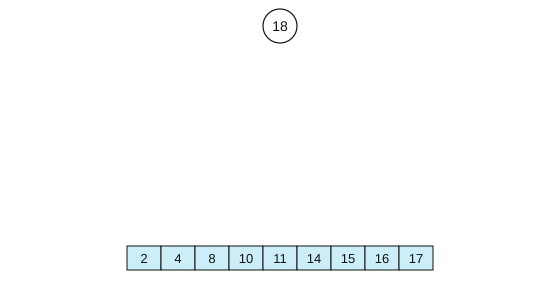{height="14.4em"}
:::

::: {.column width="18%"}
::: {.tag .xs}
Move last to top
:::
:::
::::

## Heapsort: Example

:::: {.columns}
::: {.column width="82%"}
{height="14.4em"}
:::

::: {.column width="18%"}
::: {.tag .xs}
Extract min
:::
:::
::::

## Heapsort: Pseudocode

::: {.center-h}
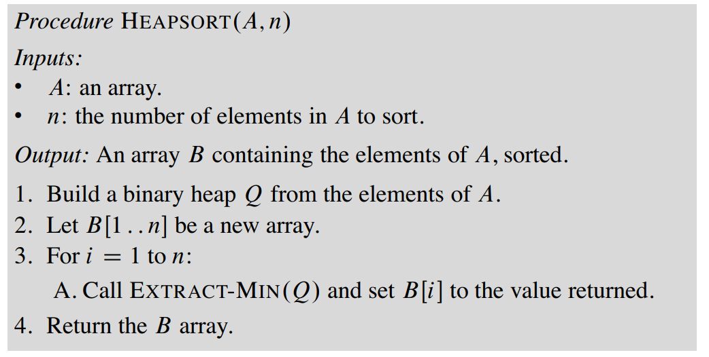{height="9.9em"}
:::

::: {.source}
See *Algorithms Unlocked* (Cormen, 2013, pp. 98&ndash;99)
:::

::: {.refresh}
Exercise: what is the pseudocode to build a heap and of EXTRACT-MIN? Is Heapsort stable?
:::

## To learn more about sorting

:::: {.columns}
::: {.column width="52%"}
::: {.codewrap style="font-size:1.10em"}
<pre class="pseudocode"><b>Procedure</b> I-CANT-BELIEVE-IT-CAN-SORT(<i>A</i>, <i>n</i>)
<i>Inputs:</i>
  <i>A</i>: an array
  <i>n</i>: the number of elements in <i>A</i> to sort
<i>Result:</i> the elements of <i>A</i> are sorted
into nondecreasing order
<b>For</b> <i>i</i> = 1 to <i>n</i>:
      <b>For</b> <i>j</i> = 1 to <i>n</i>:
            <b>If</b> <i>A</i>[<i>i</i>] &lt; <i>A</i>[<i>j</i>]
                  <b>then</b> swap <i>A</i>[<i>i</i>] with <i>A</i>[<i>j</i>]</pre>
:::

::: {.sm}
*Is this the simplest (and most surprising) sorting algorithm ever?* Stanley Fung, 2021
:::
:::

::: {.column width="48%"}
{height="10.6em"}

::: {.source}
<https://www.youtube.com/watch?v=kPRA0W1kECg>
:::
:::
::::

## Summary

- A **stable** sort keeps equal keys in their original order
- **Selection sort** needs about $n^2/2$ comparisons
- **Mergesort** splits in halves and merges: about $n \log_2 n$ comparisons
- **Quicksort** partitions around a pivot: fast on average, $n^2$ at worst
- **Heapsort** extracts the minimum of a **min-heap** $n$ times
- Sorted data can be searched and merged much faster

**Next session:** Time Complexity
