## Course Outline

:::: {.columns}
::: {.column width="50%"}
::: {.sm}
- Session 1: Introduction
- Session 2: Information Coding
- Session 3: Data Structures
- Session 4: Software
- Session 5: Algorithms
- Session 6: Recursion
- Session 7: Sorting Algorithms
:::
:::

::: {.column width="50%"}
::: {.sm}
- Session 8: Time Complexity
- Session 9: Theoretical Computer Science
- Session 10: Machine Learning (8.01)<br><span class="xs">K503, lecture 13:30-15:00, practice 15:15-16:45</span>
- Session 11: Databases
- Session 12: Parallel Programming
- Session 13: Social Science Applications
- Session 14: Exam Review
:::
:::
::::

## Time Complexity

::: {.outline .focus}
1. [Time complexity]{.current}
2. O-notation
:::


<!-- MOTIVATION:M08-A:BEGIN -->
## It ran fine on the pilot

::: {.motivation}
[Motivating example]{.label}
Your script processes the 1 000-row pilot in **four seconds**. The full dataset
has 1 000 000 rows, a thousand times bigger. You start it on Friday expecting it
on Saturday. It is still running three weeks later.
:::

:::: {.figures}
::: {.fq}
[4 s]{.big}[at n = 1 000]{.cap}
:::
::: {.fq}
[~1 hour]{.big}[at n = 10⁶ if the cost is linear]{.cap}
:::
::: {.fq}
[46 days]{.big}[at n = 10⁶ if it is quadratic]{.cap}
:::
::::

[Nothing about the code changed. What property of it decides which of those two numbers you get?]{.ask}
<!-- MOTIVATION:M08-A:END -->

<!-- MOTIVATION:M08-B:BEGIN -->
## Two students, the same answer, 20 000× apart

::: {.motivation}
[Motivating example]{.label}
Both are asked to keep only the posts written by users in a list of 20 000. One
writes a loop inside a loop. The other builds a lookup table first. **Both are
correct and both hand in the same numbers.** On a million posts, one finishes in
about **an hour and a half** and the other in **under a second**.
:::

:::: {.figures}
::: {.fq}
[2 × 10¹⁰]{.big}[operations, nested loops]{.cap}
:::
::: {.fq}
[10⁶]{.big}[operations, with a hash set]{.cap}
:::
::: {.fq}
[20 000×]{.big}[fewer, identical output]{.cap}
:::
::::

[How do you *see* that difference by reading the code, before you run it?]{.ask}
<!-- MOTIVATION:M08-B:END -->

<!-- MOTIVATION:M08-C:BEGIN -->
## Ten billion pages in a third of a second

::: {.motivation}
[Motivating example]{.label}
A web search returns results from an index of well over **10¹⁰ pages** in about
**0.3 seconds**. Looking at each page just once, even at a billion per second,
would take **ten seconds**, and that is only to *look*, before any ranking.
:::

:::: {.figures}
::: {.fq}
[10¹⁰]{.big}[pages indexed]{.cap}
:::
::: {.fq}
[0.3 s]{.big}[to answer]{.cap}
:::
::: {.fq}
[~34]{.big}[steps, if the cost is log n]{.cap}
:::
::::

[No machine is fast enough to brute-force this. What class of procedure makes it possible, and what did it cost up front?]{.ask}
<!-- MOTIVATION:M08-C:END -->

## Recap: Selection sort

<pre class="pseudocode" style="font-size:0.9em;width:fit-content"><b>Procedure</b> SELECTION-SORT(<i>A</i>, <i>n</i>)
<i>Inputs:</i>
  <i>A</i>: an array
  <i>n</i>: the number of elements in <i>A</i> to sort
<i>Result:</i> the elements of <i>A</i> are sorted into nondecreasing order
<b>For</b> <i>i</i> = 1 to <i>n</i> - 1:
      <i>smallest</i> &larr; <i>i</i>
      <b>For</b> <i>j</i> = <i>i</i> + 1 to <i>n</i>:
            <b>If</b> <i>A</i>[<i>j</i>] &lt; <i>A</i>[<i>smallest</i>]
                  <b>then</b> <i>smallest</i> &larr; <i>j</i>
      swap <i>A</i>[<i>i</i>] with <i>A</i>[<i>smallest</i>]</pre>

## Selection sort

::: {.sm}
- Efficiency of selection sort:
  - for a list of length $n$ we have to search $n-1$ times for the minimum on a list of decreasing length
    - first search: $n-1$ elements
    - after first swap: $n-2$ elements
    - after second swap: $n-3$ elements, etc.
    - in total: &nbsp; $\sum_{i=1}^{n-1} i = \dfrac{(n-1)\,n}{2} \simeq \dfrac{n^2}{2}$
  - What does that mean?
    - sorting a list of **double** the size takes **four times** as long
    - sorting a list of **ten times** the size takes **100 times** as long
:::

## Complexity {.fit2}

::: {.sm}
**What do we mean by complexity in Computer Science?**

- **algorithmic complexity**
  - typically, refers to time complexity of a given algorithm
  - depends on a particular implementation
- **memory complexity**
  - required memory during calculation
  - mergesort: stack (due to recursion) and temporary second list
  - quicksort: optimal implementation only requires stack
- **problem complexity**
  - minimal effort needed to solve a problem
  - analyzed for typical cases
  - classification is independent of the specific algorithm &ndash; but depends on the algorithms known to solve a problem (more in Session 9)
:::

## A more general meaning of Complexity

:::: {.columns}
::: {.column width="34%"}
::: {.imgcol}
{height="4.6em"}

{height="4.8em"}
:::
:::

::: {.column width="66%"}
::: {.sm}
- A **complicated** system has many pieces with specific functions and well-defined relationships. It has been carefully engineered or designed
- A **complex** system is composed of many particles that interact following some forces or dynamics. Its behavior follows from natural principles
- A program with lots of lines of code, functions, objects, etc. is *complicated*
- A problem with elements that depend on each other (e.g. a graph) can be *complex* &ndash; the time required to solve a problem depends on its complexity **and** our algorithms to solve it
:::
:::
::::

## Complexity {.fit1}

::: {.sm}
- Why do we care about complexity?
  - problem complexity decides whether we can in principle solve a problem in a reasonable amount of time
  - algorithmic and memory complexity determine whether solutions are feasible to implement with the available memory of computers
    - example: run time estimates (algorithmic complexity)
      - home computer executes $10^8$ operations per second
      - supercomputer executes $10^{12}$ operations per second
:::

:::: {.columns}
::: {.column width="48%"}
::: {.center-h .xs}
**selection sort ($n^2$)**
:::

::: {.tbl-seeblau .xs}
| computer | thousand | million | billion |
|---|---|---|---|
| home | instant | 2.8 hours | 317 years |
| super | instant | 1 second | 1.6 weeks |
:::
:::

::: {.column width="48%"}
::: {.center-h .xs}
**mergesort ($n \log n$)**
:::

::: {.tbl-seeblau .xs}
| computer | thousand | million | billion |
|---|---|---|---|
| home | instant | 0.2 sec | 5 min |
| super | instant | instant | instant |
:::
:::
::::

## Complexity {.fit2}

::: {.sm}
- memory complexity and time complexity could be different
  - tradeoff between memory and time needs is often relevant in practice
- today we focus on *time complexity*
- time complexity varies in how it changes with the number of elements $n$
  - e.g., slowly rising, then sharp increase vs. sharp increase then slowly rising
  - makes certain algorithms more favorable for small $n$ or for large $n$
- depending on data, complexity may vary; distinguish between
  - worst case complexity | average case complexity | best case complexity
- simplified analysis of an algorithm's efficiency
  - **approximate calculation of time complexity in terms of input size $n$**
  - machine independent, it is a property of the algorithm
  - time is measured in number of basic computer steps
:::

## Runtime Analysis

::: {.sm}
- The **runtime** sums up time units needed per instruction
  - **primitive operations**
    - assignments, comparisons, arithmetic operations, …
    - simplified measure as 1 time unit
  - **loops**
    - (number of iterations) × (time units per iteration)
  - **method calls**
    - time units for method
  - **recursive calls**
    - sum of all calls inside the recursion
:::

## Runtime Analysis Example: Selection Sort

:::: {.columns}
::: {.column width="60%"}
**Algorithm in Python**

::: {style="font-size:0.8em"}
```python
def selectionsort(seq):
    for i in range(len(seq) - 1):     # 1
        k = i                         # 2
        for j in range(i+1, len(seq)):# 3
            if seq[j] < seq[k]:       # 4
                k = j                 # 5
        seq[i], seq[k] = seq[k], seq[i]  # 6
    return seq
```
:::
:::

::: {.column width="40%"}
::: {.sm}
1. range, get length & arithmetic operation = 3 time units
2. assignment = 1 time unit
3. range, arithmetic operation, get length = 3 time units
4. comparison = 1 time unit
5. assignment = 1 time unit
6. double assignment = 2 time units
:::
:::
::::

## Runtime Analysis Example: Selection Sort

:::: {.columns}
::: {.column width="60%"}
**Algorithm in Python**

::: {style="font-size:0.8em"}
```python
def selectionsort(seq):
    for i in range(len(seq) - 1):     # 1
        k = i
        for j in range(i+1, len(seq)):# 2
            if seq[j] < seq[k]:
                k = j
        seq[i], seq[k] = seq[k], seq[i]
    return seq
```
:::
:::

::: {.column width="40%"}
::: {.sm}
1. loop with a maximum of $n-1$ iterations
2. nested loop with a maximum of $n-1$ iterations
:::

::: {.tag .xs}
Upper bound approximation
:::
:::
::::

## Runtime Analysis Example: Selection Sort

:::: {.columns}
::: {.column width="60%"}
**Algorithm in Python**

::: {style="font-size:0.8em"}
```python
def selectionsort(seq):
    for i in range(len(seq) - 1):     # 1
        k = i                         # 2
        for j in range(i+1, len(seq)):# 3
            if seq[j] < seq[k]:       # 4
                k = j                 # 5
        seq[i], seq[k] = seq[k], seq[i]  # 6
    return seq
```
:::
:::

::: {.column width="40%"}
::: {.xxs}
1. range, length & arithmetic = 3 time units
2. assignment = 1 time unit
3. range, arithmetic & length = 3 time units
4. comparison = 1 time unit
5. assignment = 1 time unit
6. double assignment = 2 time units

<div style="height:0.3em"></div>

1. loop with a maximum of $n-1$ iterations
2. nested loop with a maximum of $n-1$ iterations
:::
:::
::::

::: {.center-h .sm}
worst-case running time: $(n-1) \times \big(3 + 1 + (n-1) \times (3 + 1 + 1) + 2\big)$
:::

## Runtime Analysis Example: Selection Sort {.fit2}

::: {.xs}
1. range, get length & arithmetic operation = 3 time units
2. assignment = 1 time unit
3. range, arithmetic operation, get length = 3 time units
4. comparison = 1 time unit
5. assignment = 1 time unit
6. double assignment = 2 time units

<div style="height:0.3em"></div>

1. loop with a maximum of $n-1$ iterations
2. nested loop with a maximum of $n-1$ iterations
:::

::: {.center-h .sm}
$(n-1) \times \big(3 + 1 + (n-1) \times (3 + 1 + 1) + 2\big) = 6n - 6 + 5 (n-1)^2 = 5n^2 - 4n - 1$
:::

::: {.sm}
- the asymptotically dominant term is $n^2$
- constant terms and lower order terms asymptotically influence runtime only marginally: **O-Notation**
:::

## Average, best and worst running time {.fit1}

::: {.sm}
- The **average** running time is the mean over all possible problem cases, assuming that they are all equally likely
- **Worst-case** running time: total maximum over any possible problem case
- **Best-case** running time: total minimum over any possible problem case
:::

::: {.example style="width:80%;margin:0.6em auto"}
::: {.sm}
For sorting:

- Problem cases are possible initial orders of the list
- When selecting algorithms: we should have an idea of the distribution of problem cases to measure average running time
- We mostly care about the average but should check that the worst case is not too bad or too frequent
:::
:::

## Example: Insertion sort

:::: {.columns}
::: {.column width="58%"}
<pre class="pseudocode" style="font-size:0.72em"><b>Procedure</b> INSERTION-SORT(<i>A</i>, <i>n</i>)
<i>Inputs:</i>
      <i>A</i>: an array; <i>n</i>: the number of elements in <i>A</i> to sort
<i>Result:</i> the elements of <i>A</i> are sorted into nondecreasing order
<b>For</b> <i>i</i> = 2 to <i>n</i>:
      <i>key</i> &larr; <i>A</i>[<i>i</i>]; <i>j</i> &larr; <i>i</i> - 1
      <b>While</b> <i>j</i> &gt; 0 and <i>A</i>[<i>j</i>] &gt; <i>key</i>:
            <i>A</i>[<i>j</i> + 1] &larr; <i>A</i>[<i>j</i>]
            <i>j</i> &larr; <i>j</i> - 1
      <i>A</i>[<i>j</i> + 1] &larr; <i>key</i></pre>

::: {.sm}
**Rationale:** incrementally sort by pushing value to the position where it belongs
:::
:::

::: {.column width="42%"}
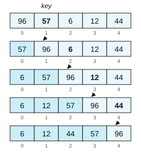{height="11.0em"}
:::
::::

## Insertion sort: worst-case runtime analysis

:::: {.columns}
::: {.column width="58%"}
<pre class="pseudocode" style="font-size:0.72em"><b>Procedure</b> INSERTION-SORT(<i>A</i>, <i>n</i>)
<i>Inputs:</i>
      <i>A</i>: an array; <i>n</i>: the number of elements in <i>A</i> to sort
<i>Result:</i> the elements of <i>A</i> are sorted into nondecreasing order
<b>For</b> <i>i</i> = 2 to <i>n</i>:
      <i>key</i> &larr; <i>A</i>[<i>i</i>]; <i>j</i> &larr; <i>i</i> - 1
      <b>While</b> <i>j</i> &gt; 0 and <i>A</i>[<i>j</i>] &gt; <i>key</i>:
            <i>A</i>[<i>j</i> + 1] &larr; <i>A</i>[<i>j</i>]
            <i>j</i> &larr; <i>j</i> - 1
      <i>A</i>[<i>j</i> + 1] &larr; <i>key</i></pre>
:::

::: {.column width="42%"}
::: {.sm}
Loop $n - 1$ times


Loop backwards potentially until $j = 0$: up to $n - 1$ iterations
:::
:::
::::

::: {.center-h .sm}
worst-case running time: $(n-1) \times \big(2 + (n-1) \times (2 + 2) + 1\big)$ &nbsp;&ndash; grows with $n^2$
:::

## Insertion sort: best case

:::: {.columns}
::: {.column width="58%"}
<pre class="pseudocode" style="font-size:0.72em"><b>Procedure</b> INSERTION-SORT(<i>A</i>, <i>n</i>)
<i>Inputs:</i>
      <i>A</i>: an array; <i>n</i>: the number of elements in <i>A</i> to sort
<i>Result:</i> the elements of <i>A</i> are sorted into nondecreasing order
<b>For</b> <i>i</i> = 2 to <i>n</i>:
      <i>key</i> &larr; <i>A</i>[<i>i</i>]; <i>j</i> &larr; <i>i</i> - 1
      <b>While</b> <i>j</i> &gt; 0 and <i>A</i>[<i>j</i>] &gt; <i>key</i>:
            <i>A</i>[<i>j</i> + 1] &larr; <i>A</i>[<i>j</i>]
            <i>j</i> &larr; <i>j</i> - 1
      <i>A</i>[<i>j</i> + 1] &larr; <i>key</i></pre>
:::

::: {.column width="42%"}
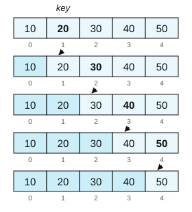{height="11.0em"}
:::
::::

::: {.center-h .sm}
For an already sorted list: inner loop always stops at the first iteration
:::

## Insertion sort: best case

:::: {.columns}
::: {.column width="58%"}
<pre class="pseudocode" style="font-size:0.72em"><b>Procedure</b> INSERTION-SORT(<i>A</i>, <i>n</i>)
<i>Inputs:</i>
      <i>A</i>: an array; <i>n</i>: the number of elements in <i>A</i> to sort
<i>Result:</i> the elements of <i>A</i> are sorted into nondecreasing order
<b>For</b> <i>i</i> = 2 to <i>n</i>:
      <i>key</i> &larr; <i>A</i>[<i>i</i>]; <i>j</i> &larr; <i>i</i> - 1
      <b>While</b> <i>j</i> &gt; 0 and <i>A</i>[<i>j</i>] &gt; <i>key</i>:
            <i>A</i>[<i>j</i> + 1] &larr; <i>A</i>[<i>j</i>]
            <i>j</i> &larr; <i>j</i> - 1
      <i>A</i>[<i>j</i> + 1] &larr; <i>key</i></pre>
:::

::: {.column width="42%"}
::: {.sm}
- Average and worst-case: $n^2$
- Best case: $n$
  - Input is already sorted
:::

::: {.refresh .xs}
Exercise: what is the best and worst-case runtime for quicksort?
:::
:::
::::

## Another example: Complexity of Mergesort

:::: {.columns}
::: {.column width="52%"}
<pre class="pseudocode" style="font-size:0.72em"><b>Procedure</b> MERGE-SORT(<i>A</i>, <i>p</i>, <i>r</i>)
<i>Inputs:</i>
      <i>A</i>: an array
      <i>p</i>, <i>r</i>: the starting and ending index of the subarray
<i>Result:</i> <i>A</i>[<i>p</i>..<i>r</i>] is sorted
<b>If</b> <i>p</i> &ge; <i>r</i>
      <b>then</b> return without doing anything
      <b>else</b> <i>q</i> &larr; ⌊(<i>p</i> + <i>r</i>) / 2⌋
            MERGE-SORT(<i>A</i>, <i>p</i>, <i>q</i>)
            MERGE-SORT(<i>A</i>, <i>q</i> + 1, <i>r</i>)
            MERGE(<i>A</i>, <i>p</i>, <i>q</i>, <i>r</i>)</pre>
:::

::: {.column width="48%"}
::: {.sm}
- $n$ is the length of $A$
- Time for best case: one operation
- Two recursive calls to arrays of length $n/2$
- Call to MERGE with an array of length $n$ takes $c \cdot n$ steps, where $c$ is some constant
:::

::: {.center-h .sm}
$T(n) = T(n/2) + T(n/2) + c \cdot n$<br>$= 2 \cdot T(n/2) + c \cdot n$
:::
:::
::::

## Another example: Complexity of Mergesort

:::: {.columns}
::: {.column width="52%"}
<pre class="pseudocode" style="font-size:0.72em"><b>Procedure</b> MERGE-SORT(<i>A</i>, <i>p</i>, <i>r</i>)
<i>Inputs:</i>
      <i>A</i>: an array
      <i>p</i>, <i>r</i>: the starting and ending index of the subarray
<i>Result:</i> <i>A</i>[<i>p</i>..<i>r</i>] is sorted
<b>If</b> <i>p</i> &ge; <i>r</i>
      <b>then</b> return without doing anything
      <b>else</b> <i>q</i> &larr; ⌊(<i>p</i> + <i>r</i>) / 2⌋
            MERGE-SORT(<i>A</i>, <i>p</i>, <i>q</i>)
            MERGE-SORT(<i>A</i>, <i>q</i> + 1, <i>r</i>)
            MERGE(<i>A</i>, <i>p</i>, <i>q</i>, <i>r</i>)</pre>
:::

::: {.column width="48%"}
::: {style="font-size:0.7em"}
$$
\begin{aligned}
T(n) &= 2 \cdot T(n/2) + c \cdot n \\
     &= 2 \cdot [2 \cdot T(n/4) + c \cdot n/2] + c \cdot n \\
     &= 2^2 \cdot T(n/4) + c \cdot n + c \cdot n \\
     &= 2^2 \cdot [2 \cdot T(n/8) + c \cdot n/4] + 2 c \cdot n \\
     &= 2^3 \cdot T(n/8) + 3 c \cdot n \\
     &\;\;\vdots \\
     &= 2^k \cdot T(n/2^k) + k \cdot c \cdot n
\end{aligned}
$$

If $k$ is enough for $n/2^k = 1$, then $k = \log_2 n$ and

$$T(n) = 2^{\log_2 n} + c \cdot n \log_2 n = n + c \cdot n \log_2 n$$
:::
:::
::::

## Another example: Complexity of BFS

:::: {.columns}
::: {.column width="54%"}
<pre class="pseudocode" style="font-size:0.68em"><b>Procedure</b> BFS(<i>G</i>, <i>s</i>)
<i>Inputs:</i> …
<i>Result:</i> …
INITIALIZE-BFS(<i>G</i>, <i>s</i>)
<i>Q</i> &larr; &empty;
ENQUEUE(<i>Q</i>, <i>s</i>)
<b>While</b> <i>Q</i> &ne; &empty;:
        <i>u</i> &larr; DEQUEUE(<i>Q</i>)
        <b>For</b> each vertex <i>v</i> in neighbors(<i>u</i>):
               <b>If</b> color[<i>v</i>] = WHITE
                      <b>then</b> color[<i>v</i>] &larr; GRAY
                              <i>d</i>[<i>v</i>] &larr; <i>d</i>[<i>u</i>] + 1
                              &pi;[<i>v</i>] &larr; <i>u</i>
                              ENQUEUE(<i>Q</i>, <i>v</i>)
        color[<i>u</i>] &larr; BLACK</pre>
:::

::: {.column width="46%"}
::: {.sm}
The size of a graph is measured by two quantities:

- Number of vertices $|V|$
- Number of edges $|E|$
:::
:::
::::

## Another example: Complexity of BFS

:::: {.columns}
::: {.column width="54%"}
<pre class="pseudocode" style="font-size:0.68em"><b>Procedure</b> BFS(<i>G</i>, <i>s</i>)
<i>Inputs:</i> …
<i>Result:</i> …
INITIALIZE-BFS(<i>G</i>, <i>s</i>)
<i>Q</i> &larr; &empty;
ENQUEUE(<i>Q</i>, <i>s</i>)
<b>While</b> <i>Q</i> &ne; &empty;:
        <i>u</i> &larr; DEQUEUE(<i>Q</i>)
        <b>For</b> each vertex <i>v</i> in neighbors(<i>u</i>):
               <b>If</b> color[<i>v</i>] = WHITE
                      <b>then</b> color[<i>v</i>] &larr; GRAY
                              <i>d</i>[<i>v</i>] &larr; <i>d</i>[<i>u</i>] + 1
                              &pi;[<i>v</i>] &larr; <i>u</i>
                              ENQUEUE(<i>Q</i>, <i>v</i>)
        color[<i>u</i>] &larr; BLACK</pre>
:::

::: {.column width="46%"}
::: {.sm}
The size of a graph is measured by two quantities:

- Number of vertices $|V|$
- Number of edges $|E|$


- We enqueue and dequeue each vertex exactly once
:::
:::
::::

## Another example: Complexity of BFS

:::: {.columns}
::: {.column width="54%"}
<pre class="pseudocode" style="font-size:0.68em"><b>Procedure</b> BFS(<i>G</i>, <i>s</i>)
<i>Inputs:</i> …
<i>Result:</i> …
INITIALIZE-BFS(<i>G</i>, <i>s</i>)
<i>Q</i> &larr; &empty;
ENQUEUE(<i>Q</i>, <i>s</i>)
<b>While</b> <i>Q</i> &ne; &empty;:
        <i>u</i> &larr; DEQUEUE(<i>Q</i>)
        <b>For</b> each vertex <i>v</i> in neighbors(<i>u</i>):
               <b>If</b> color[<i>v</i>] = WHITE
                      <b>then</b> color[<i>v</i>] &larr; GRAY
                              <i>d</i>[<i>v</i>] &larr; <i>d</i>[<i>u</i>] + 1
                              &pi;[<i>v</i>] &larr; <i>u</i>
                              ENQUEUE(<i>Q</i>, <i>v</i>)
        color[<i>u</i>] &larr; BLACK</pre>
:::

::: {.column width="46%"}
::: {.sm}
The size of a graph is measured by two quantities:

- Number of vertices $|V|$
- Number of edges $|E|$


- We enqueue and dequeue each vertex exactly once
- We check the adjacent nodes of each node. Each edge is checked exactly twice
:::
:::
::::

## Another example: Complexity of BFS

:::: {.columns}
::: {.column width="54%"}
<pre class="pseudocode" style="font-size:0.68em"><b>Procedure</b> BFS(<i>G</i>, <i>s</i>)
<i>Inputs:</i> …
<i>Result:</i> …
INITIALIZE-BFS(<i>G</i>, <i>s</i>)
<i>Q</i> &larr; &empty;
ENQUEUE(<i>Q</i>, <i>s</i>)
<b>While</b> <i>Q</i> &ne; &empty;:
        <i>u</i> &larr; DEQUEUE(<i>Q</i>)
        <b>For</b> each vertex <i>v</i> in neighbors(<i>u</i>):
               <b>If</b> color[<i>v</i>] = WHITE
                      <b>then</b> color[<i>v</i>] &larr; GRAY
                              <i>d</i>[<i>v</i>] &larr; <i>d</i>[<i>u</i>] + 1
                              &pi;[<i>v</i>] &larr; <i>u</i>
                              ENQUEUE(<i>Q</i>, <i>v</i>)
        color[<i>u</i>] &larr; BLACK</pre>
:::

::: {.column width="46%"}
::: {.sm}
The size of a graph is measured by two quantities:

- Number of vertices $|V|$
- Number of edges $|E|$


- We enqueue and dequeue each vertex exactly once
- We check the adjacent nodes of each node. Each edge is checked exactly twice
:::

::: {.tag .xs}
Running time of BFS grows with $|V| + 2|E|$
:::
:::
::::

## A mentor on algorithms: Manuel Blum {.fit1}

:::: {.columns}
::: {.column width="34%"}
{height="8.0em"}
:::

::: {.column width="66%"}
::: {.sm}
- Born in Venezuela, 1938
- CS professor at UC Berkeley and, since 2001, at Carnegie Mellon University
- Inventor of the $k$-minimum selection algorithm (and the calculation of its complexity)
- Turing Award for his contributions to the foundations of computational complexity theory and its application to cryptography and program checking
- Inventor of CAPTCHA as a Turing test
:::
:::
::::

::: {.xs}
Known for being the mentor of very influential computer scientists: 3 Turing Awards, various Gödel and Knuth Prizes, 20 CS professors in top US universities
:::

::: {.source}
<https://www.technologyreview.com/2023/10/24/1081478/manuel-blum-theoretical-computer-science-turing-award-academic-advisor/>
:::

## O-notation

::: {.outline .focus}
1. Time complexity
2. [O-notation]{.current}
:::

## Asymptotic behavior of functions {.fit1}

::: {.sm}
The **asymptotic behavior** of a function $f(x)$ describes its value towards infinity

- values of $f(x)$ when $x \rightarrow \infty$ or $x \rightarrow -\infty$
- values of $x$ where $f(x) \rightarrow \infty$ or $f(x) \rightarrow -\infty$
:::

::: {.center-h}
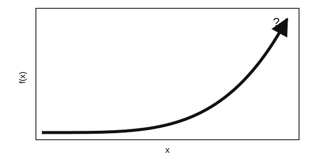{height="11.6em"}
:::

## O-Notation {.fit1}

::: {.sm}
**Definition:**

- O-Notation describes **classes of functions** with specific asymptotic properties
- also referred to as *Big O* notation (pronounced big-oh, Landau's symbol)
- values of a given function are after a given (large) value $n_0$
  - always larger or equal, or
  - always smaller or equal to a given function
- constants are not considered or expressed by an (arbitrary) chosen pre-factor
- separates into three different notations, where $O$ is the most commonly used
  - $O$ refers to the **upper bound**
  - $\Omega$ to the **lower bound**
  - $\Theta$ to the **tight bound**
:::

## Upper Bound: $O$

::: {.center-h}
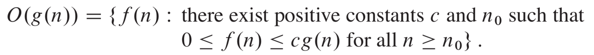{width="88%"}

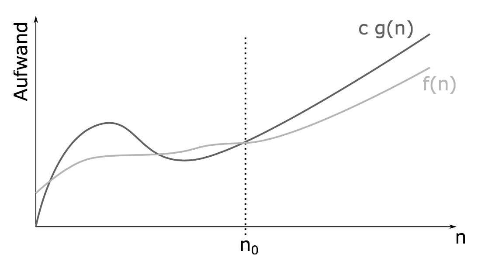{height="10.6em"}
:::

## Lower Bound: $\Omega$

::: {.center-h}
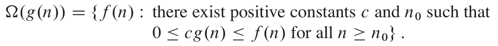{width="88%"}

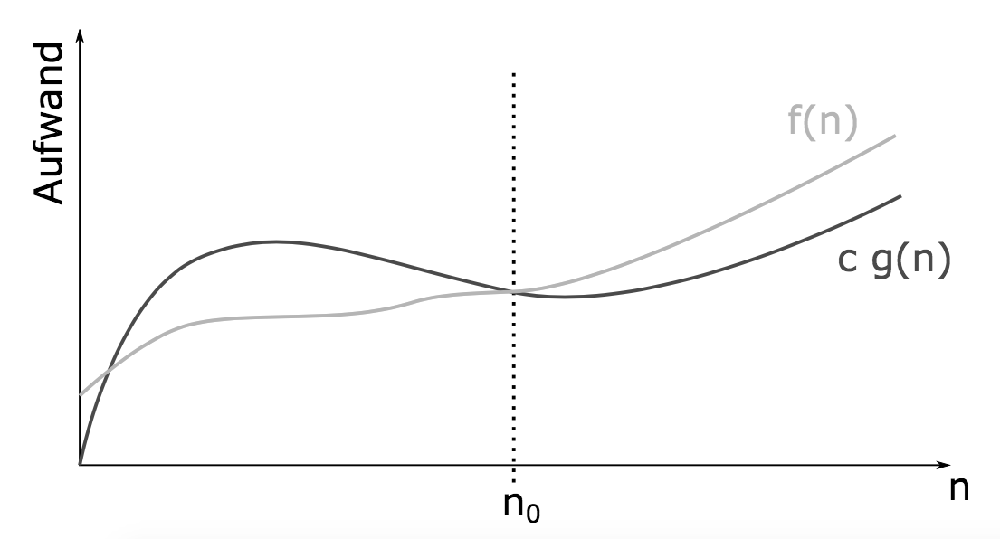{height="10.6em"}
:::

## Exact Bound: $\Theta$

::: {.center-h}
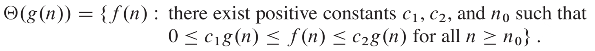{width="88%"}

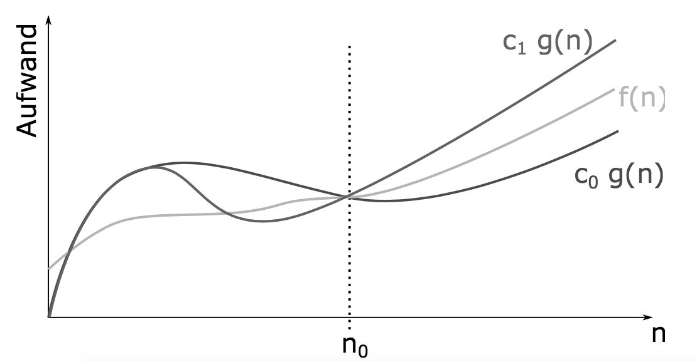{height="10.6em"}
:::

## O-Notation {.fit1}

::: {.sm}
**Use of the O-Notation for classification of functions:**

- people often write $f = O(g)$ instead of $f \in O(g)$
  - this is a tolerated abuse of notation
- describes asymptotic upper, lower and exact bounds of a given function for large values
- interest is in **dominant terms** for large values only
  - more precise analyses are often very cumbersome and unnecessary
  - constant factors may often not be of interest
  - linear acceleration is typically easy to achieve (new hardware, …)
- goal: description of complexity through classes of functions
  - literally: "it can not get worse than $f$" if complexity is $O(f)$
:::

## O-Notation - General rules

:::: {.columns}
::: {.column width="43%"}
::: {.sm}
- Ignore constants
- Certain terms "dominate" others
  - $O(1) \subset O(\log n) \subset O(n)$
  - $O(n) \subset O(n \log n) \subset O(n^2)$
  - $O(n^2) \subset O(2^n) \subset O(n!)$
  - i.e., ignore lower order terms
:::
:::

::: {.column width="57%"}
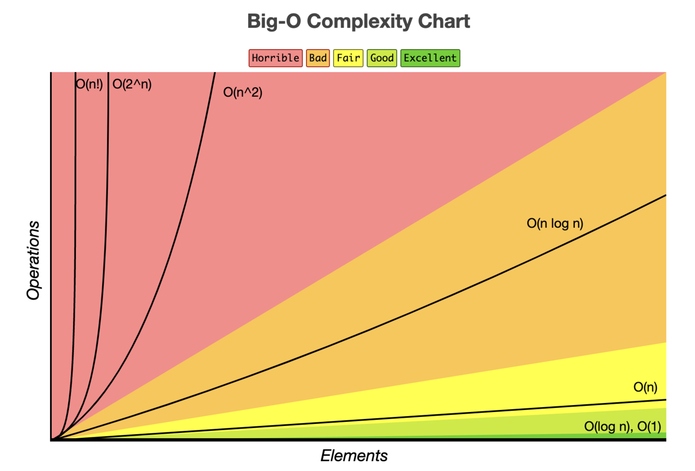{height="13.4em"}
:::
::::

## Growth of Functions

::: {.center-h}
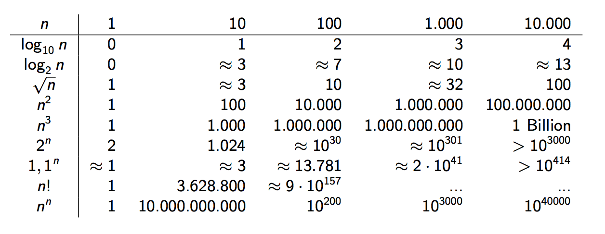{width="100%"}
:::

## O-Notation

::: {.sm}
- What does this imply?
  - remember our earlier examples:
:::

:::: {.columns}
::: {.column width="48%"}
::: {.center-h .xs}
**selection sort $O(n^2)$**
:::

::: {.tbl-seeblau .xs}
| computer | thousand | million | billion |
|---|---|---|---|
| home | instant | 2.8 hours | 317 years |
| super | instant | 1 second | 1.6 weeks |
:::
:::

::: {.column width="48%"}
::: {.center-h .xs}
**mergesort $O(n \log n)$**
:::

::: {.tbl-seeblau .xs}
| computer | thousand | million | billion |
|---|---|---|---|
| home | instant | 0.2 sec | 5 min |
| super | instant | instant | instant |
:::
:::
::::

::: {.refresh}
Using your laptop for an $O(n^2)$ algorithm will be unfeasible for $n$ above a few million
:::

## Common use of O-Notation {.fit1}

::: {.sm}
O-notation is a language to describe **upper bounds** on complexity
:::

:::: {.columns}
::: {.column width="68%"}
::: {.sm}
- The complexity of BFS is $O(|V|+|E|)$ because the runtime of BFS grows with $|V|+2|E|$
- Mergesort is much better than selection sort because mergesort's complexity is $O(n \log n)$ and selection sort's complexity is $O(n^2)$
- Inverting matrices with the method we learn in high school is $O(n^3)$
- Testing if a number $k$ is prime with a brute-force algorithm (dividing by all numbers up to $k-1$) is $O(k)$
- Finding a Hamiltonian path in a graph with a brute-force algorithm (explore all paths) is $O(|V|!)$
:::
:::

::: {.column width="32%"}
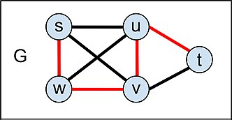{width="100%"}
:::
::::

## Outtake &ndash; Social Science Applications {.fit1}

::: {.sm}
- Why do we care about complexity?
  - **Practical considerations**
    - algorithmic efficiency is often a precondition to doing any kind of data analysis in a reasonable time
    - understanding which implementation choices make an algorithm inefficient is thus basic tradecraft
    - there are often simple problems in day-to-day code that can lead to massive slow-downs
    - constants can matter, be cognizant of best case and average case (vs. worst case)
  - **"Hard" social science problems**
    - there are a number of rather common social science applications that have very high problem complexity
    - many of those examples are related to graphs/networks, e.g., the "traveling salesman" problem, graph isomorphisms
:::

## Summary {.fit1}

- **Time complexity** counts basic steps as a function of the input size $n$; it is a property of the algorithm, not of the machine
- **Runtime analysis** adds up the cost of each instruction, multiplied by how often loops and recursive calls run
- Best, average and **worst case** can differ for the same algorithm (insertion sort: $n$ against $n^2$)
- **O-notation** keeps only the dominant term: $O$ is an upper bound, $\Omega$ a lower bound, $\Theta$ an exact bound
- Selection sort is $O(n^2)$, mergesort $O(n \log n)$, BFS $O(|V| + |E|)$: the growth rate decides what is feasible on large data

**Next session:** Theoretical Computer Science

## ICSS (Theory and Practice) student feedback

:::: {.columns}
::: {.column width="50%"}
::: {.center-h .sm}
**ICSS (Theory) student feedback**
:::

{height="8.4em"}
:::

::: {.column width="50%"}
::: {.center-h .sm}
**ICSS (Practice) student feedback**
:::

{height="8.4em"}
:::
::::

## Appendix: About Practice Final Projects

## Registering for exams

::: {.sm}
- Exam registration period: 01.12.2025 - 15.01.2026<br>(deregistration possible until 31.01.2026)
- You need to register separately for ICSS (Theory) and ICSS (Practice)
- You also have to register for the Python Block Course to get the credits!
- Each year, you have one chance for ICSS (Practice)
  - The standard number of tries is two (thus two years)
- In ICSS (Theory) you will have to register for the resit if you need to take it
  - 2nd exam period: check university website
- Note for ICSS (Theory): if you pass the first try, you cannot go to the resit to improve your grade
:::

## Grading of ICSS (Practice)

::: {.sm}
ICSS (Theory) and ICSS (Practice) are graded separately and it is possible to pass one and not the other.

You do not need to pass both parts the same year but we strongly recommend that you focus on passing both in the first semester.
:::

::: {.example style="width:86%"}
::: {.sm}
**Grading parts of ICSS (Practice):**

- **Mandatory assignments:** To be allowed to submit a final project, you need to pass each of the four assignments
- **Final practical project.** The final grade of ICSS (Practice) is the grade of the final project
:::
:::

## ICSS (Practice) final projects

::: {.sm}
**General aim of the final projects:** individual students showcase their practical learning through a programming project of their own choice.

The **first aim** is to *build something* &ndash; the final product is the software, not the report. You will write papers in other courses.

The **second aim** is to *learn by doing*. You should go out of what is covered in the practical part and learn something new on your own. For example an API, a new library, another algorithm, a method…

The **third aim** is to develop the skill of *planning a project*. This is an iterative project, not a final exam. There will be plenty of chances to get feedback from lecturers and tutors, to discuss your ideas, feasibility, resources, etc.
:::

## Final project code

::: {.sm}
- Will be audited as part of the grading process
- Grading criteria
  - **Code readability:** variable names, structure, good programming practices…
  - **Code organization:** separation of project into files that structure the code and tasks
  - No redundancy, unnecessary functions or repeated code
  - Meaningful comments and justification/explanations
  - **Code execution**
    - Your code will be locally executed and inspected for bugs or unstable behavior
    - You have to include documentation on how to run it, dependencies, etc.
    - Target: a fellow student can install and run with 10 minutes of work
:::

## Final project report

::: {.sm}
- Written report to complement code
- It should cover the following:
  - Brief motivation of the project: why should this be built?
  - Outline of design approach: structure, tasks, parts of the project
  - Detail on new algorithms, software, etc. Focus on what you learned and why it matters for the project
  - Demo, results, or outcomes of the project
  - Report on challenges, issues, further ideas
  - Not a research paper but it has to give context, motivation, and interpretation of the result/product of the project
:::

## Final project video

::: {.sm}
- Short video where you answer a few questions and show your code
- Designed not to invest a lot of time on production
- Think about it as an asynchronous interview
- Offers a channel for you to show insights that are not captured well in code, comments, or the report
- Instructions on what to show and questions will be released soon
- Questions are designed to show critical understanding of the project; if you abuse AI, it will be clear in the video
- Video has only pass/fail grade
  - Final grade is composed of code and report, weighting of each depends on project task and aims
:::

## Honor code and authorship statement

::: {.sm}
- A project has to be your own, nobody else should write a single line of code, report text, or content for the video
- You are not allowed to copy code from online or offline resources for the project, including AI coding assistants
- You will have to submit an authorship statement with your final project and abuse of AI coding assistants can lead to plagiarism investigations
- If you abuse AI or help from others, this will be visible in the quality of your code and of your video explanation
:::

## Final project submission {.fit1}

::: {.sm}
A final project submission is composed of:

1. project code
2. report
3. short video explanation
4. signed authorship statement

The deadline for the final project submission is **22.03, 23:59**

- Submission will be over github similarly as assignments
- If the video is too heavy as a file, it can be linked to the uni cloud

**Timing:** the last assignment deadline is 25.01. You have two months for exams and project work. Don't underestimate the project, calculate a total of 90 hours of work on the project along the whole semester.
:::

## Random project ideas {.fit2}

::: {.sm}
Some (barely tested) examples of what you could do:

- A recommender website to choose where to live based on your interests and Facebook advertising data
  - Data collected with `pysocialwatcher`
  - Interactive website that collects user input and matches it to cities
- AWESOME-O: A program that generates movie arguments from a starting sentence and data from the Internet Movie DataBase
  - Training a simple language model with IMDB text
  - Program chatbot and experiment distinguishing real from fake
- Data collection and visualization of the Bluesky accounts of politicians of a country
  - Scraping a list of accounts from official sites
  - Using the Bluesky API
  - Network visualization and analysis
:::

## Random project ideas

::: {.sm}
Substantially extending an assignment:

- Training a model that identifies from a script whether the movie passes or not the Bechdel test
- Measuring polarization with Eurovision data and correlating that with interest rates of sovereign bonds
- Visualizing the correlation between voting results for US presidential candidates and Google trends across US states
:::

::: {.refresh}
Start thinking, talking, and asking questions soon! Do use the forum for random shower ideas, get our input soon and often!
:::
