## Course Outline

:::: {.columns}
::: {.column width="50%"}
::: {.sm}
- Session 1: Introduction
- Session 2: Information Coding
- Session 3: Data Structures
- Session 4: Software
- Session 5: Algorithms
- Session 6: Recursion
- Session 7: Sorting Algorithms
:::
:::

::: {.column width="50%"}
::: {.sm}
- Session 8: Time Complexity
- Session 9: Theoretical Computer Science
- Session 10: Machine Learning (8.01)
- Session 11: Databases
- Session 12: Parallel Programming
- Session 13: Social Science Applications
- Session 14: Exam Review
:::
:::
::::

## Outline

::: {.outline}
1. Finite-state Automata
2. Formal Languages and Grammars
3. Turing Machines
4. Computability
5. Complexity Classes
:::


<!-- MOTIVATION:M09-A:BEGIN -->
## The regular expression that took down a large part of the web {.fit1}

::: {.motivation}
[Motivating example]{.label}
On 2 July 2019 Cloudflare deployed **one line**: a pattern meant to spot
malicious JavaScript. On some inputs it made the matcher try an **exponentially
growing** number of possibilities. CPU across the global network went to 100%,
and a large share of the web was unreachable for **27 minutes**.
:::

:::: {.figures}
::: {.fq}
[1 line]{.big}[of pattern deployed]{.cap}
:::
::: {.fq}
[100%]{.big}[CPU, worldwide, within seconds]{.cap}
:::
::: {.fq}
[27 min]{.big}[global outage]{.cap}
:::
::::

[A pattern matcher is a machine with a precise definition. What can it do, what can it not, and what makes it explode?]{.ask}

::: {.source}
Cloudflare, "Details of the Cloudflare outage on July 2, 2019"
:::
<!-- MOTIVATION:M09-A:END -->

<!-- MOTIVATION:M09-B:BEGIN -->
## 300 students, 40 seminars, and no schedule {.fit1}

::: {.motivation}
[Motivating example]{.label}
Every student ranks the seminars; every seminar has a cap; some combinations
clash. You want an assignment that satisfies the constraints. The department has
done this by hand for years. Written down properly, the number of possible
assignments exceeds the number of atoms in the observable universe.
:::

- Trying harder does not help. Buying a faster computer does not help.
- There is a **mathematical reason**, and it is one of the seven Millennium Prize
  Problems.

[How can we *prove* a problem is hard, rather than concluding that we were not clever enough?]{.ask}
<!-- MOTIVATION:M09-B:END -->

<!-- MOTIVATION:M09-C:BEGIN -->
## Can a program check your program? {.fit1}

::: {.motivation}
[Motivating example]{.label}
A marking system receives 300 student submissions and would like to reject the
ones that loop forever, before running them. This sounds like a matter of
engineering effort. In **1936** Turing proved that **no program can do this**,
for any programming language, ever.
:::

- Not "too slow". Not "not yet". **Impossible**, and provably so.
- The proof is one page, and assumes only that the checker exists.

[What are the limits of computation itself, and how would you prove something *cannot* be done?]{.ask}

::: {.source}
Turing, "On Computable Numbers, with an Application to the Entscheidungsproblem", *Proc. London Math. Soc.* (1936)
:::
<!-- MOTIVATION:M09-C:END -->

## Motivation

::: {.sm}
**Theoretical computer science questions:**

- what can we compute?
- what are the principles of computing machines?
- how does a computing machine have to be structured to perform (any) computing task?

**Topics of theoretical computer science:**

- formal definitions of languages and their classification
- ways of formalizing computation as an abstract process of transition between states of a computer program independent of its implementation
- proofs of computability based on these theoretical constructs
:::

## Modeling computation through automata

::: {.xs}
Fundamental understanding of the theory of computing is important:<br>
**How do we model computing? How do we abstract this process?**

- modeling **input**: breaks down to accepting a finite sequence of bits
- modeling **output**: from a finite sequence of bits we can, in principle, constitute any output (numbers, graphics, sound etc.)
- modeling **processing**:
  - in principle, bit-by-bit operations but we need memory to keep track of intermediate steps
  - "power" of computing models ultimately changes with their ability to memorize intermediate steps
  - and we need rules that define how we transition from one operation to the next, e.g. calculating machines are based on arithmetic operations
  - more generally, a computing machine must have rules to transition between a finite number of internal states
:::

## Pac-Man ghosts as automata {.fit2}

:::: {.columns}
::: {.column width="66%"}
::: {.xs}
- Pac-Man ghosts have actions depending on their **state**:
  - Wander around the maze
  - Chase Pac-Man
  - Flee from Pac-Man
  - Go to base and resurrect
- Their actions depend on the **input** produced by Pac-Man and the game, for example:
  - Pac-Man gets close to a ghost
  - Pac-Man goes far from a ghost
  - Pac-Man eats a special pellet
  - Pac-Man touches ghost (losing)
  - Pac-Man eats ghost (with special pellet)
  - special pellet expires
  - Pac-Man eats all pellets
:::
:::

::: {.column width="34%"}
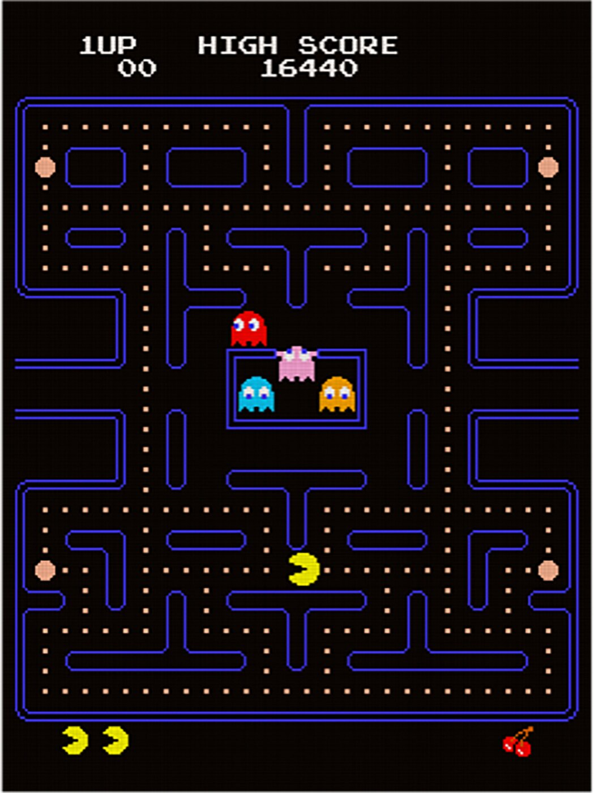{height="9.4em"}
:::
::::

::: {.sm}
Ghosts are **automata**: they have states and transitions between states that depend on the input
:::

## Finite-state automaton

::: {.definition}
[Definition: deterministic finite state automaton (DFA)]{.label}

::: {.sm}
A deterministic finite state automaton is defined by a 5-tuple $M = (Q, \Sigma, \delta, q_0, X)$ consisting of:

- $Q$, a finite set of **states**
- $\Sigma$, a finite set of input symbols called the **alphabet**, $Q \cap \Sigma = \emptyset$
- $\delta: Q \times \Sigma \rightarrow Q$, a **transition function**
- $q_0 \in Q$, an **initial** or start state
- $X \subseteq Q$, a set of **accept states**
:::
:::

## Finite-state automaton

::: {.sm}
**Functioning of automaton:**

- is initially in start state $q_0$
- input word is read character-by-character (or command-by-command)
- automaton transitions from state to state according to each character input
- if automaton ends up in an accept state, the word (or command sequence) is part of the language
- if not, it is not part of the language
- Convention: if a transition is not defined for a state and character input, then the automaton goes to a non-terminal reject state
:::

## Finite-state automaton: example {.fit1}

:::: {.columns}
::: {.column width="34%"}
::: {.xs}
- $Q = \{z_0, z_1, z_2, z_3\}$
- $\Sigma = \{a, b\}$
- $q_0 = z_0$
- $X = \{z_3\}$
- $\delta$:
  - $\delta(z_0, a) = z_1$
  - $\delta(z_0, b) = z_3$
  - $\delta(z_1, a) = z_2$
  - $\delta(z_1, b) = z_0$
  - $\delta(z_2, a) = z_3$
  - $\delta(z_2, b) = z_1$
  - $\delta(z_3, a) = z_0$
  - $\delta(z_3, b) = z_2$
:::
:::

::: {.column width="38%"}
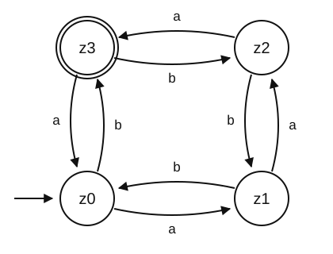{height="13.2em"}
:::

::: {.column width="28%"}
::: {.xs}
**Examples:**

| | |
|---|---|
| `aaa` | finished |
| `aaaab` | finished |
| `bbaaabaaa` | finished |
| `aa` | not finished |
| `abba` | not finished |
| `bbb` | not finished |

(number of *a*'s in *y*) &minus; (number of *b*'s in *y*) $\equiv 3 \pmod 4$
:::
:::
::::

## Finite-state automaton: example

:::: {.columns}
::: {.column width="40%"}
::: {.sm}
**Input:** &nbsp; `abb`
:::
:::

::: {.column width="60%"}
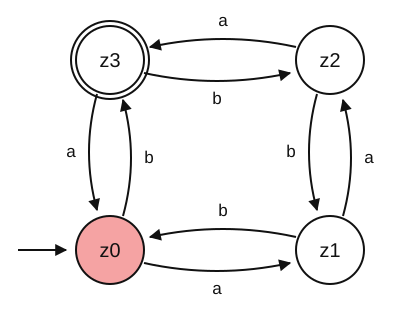{height="14.0em"}
:::
::::

## Finite-state automaton: example

:::: {.columns}
::: {.column width="40%"}
::: {.sm}
**Input:** &nbsp; `abb`
:::
:::

::: {.column width="60%"}
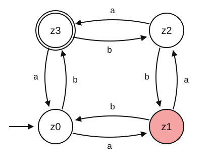{height="14.0em"}
:::
::::

## Finite-state automaton: example

:::: {.columns}
::: {.column width="40%"}
::: {.sm}
**Input:** &nbsp; `abb`
:::
:::

::: {.column width="60%"}
{height="14.0em"}
:::
::::

## Finite-state automaton: example

:::: {.columns}
::: {.column width="40%"}
::: {.sm}
**Input:** &nbsp; `abb`
:::

::: {.sm}
**z3 is an accept state: input is recognized**<br>(`abb` is part of the language recognized by the DFA)
:::
:::

::: {.column width="60%"}
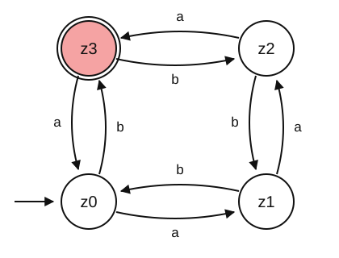{height="14.0em"}
:::
::::

## Finite-state automaton: example 2

:::: {.columns}
::: {.column width="40%"}
::: {.sm}
**Input:** &nbsp; `aab`
:::
:::

::: {.column width="60%"}
{height="14.0em"}
:::
::::

## Finite-state automaton: example 2

:::: {.columns}
::: {.column width="40%"}
::: {.sm}
**Input:** &nbsp; `aab`
:::
:::

::: {.column width="60%"}
{height="14.0em"}
:::
::::

## Finite-state automaton: example 2

:::: {.columns}
::: {.column width="40%"}
::: {.sm}
**Input:** &nbsp; `aab`
:::
:::

::: {.column width="60%"}
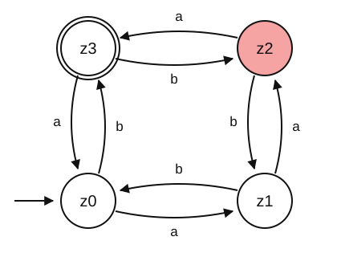{height="14.0em"}
:::
::::

## Finite-state automaton: example 2

:::: {.columns}
::: {.column width="40%"}
::: {.sm}
**Input:** &nbsp; `aab`
:::

::: {.sm}
**z1 is not an accept state: input is not recognized**<br>(`aab` is not part of the language recognized by the DFA)
:::
:::

::: {.column width="60%"}
{height="14.0em"}
:::
::::

## Nondeterministic finite-state automata

:::: {.columns}
::: {.column width="58%"}
::: {.sm}
- So far we have considered **deterministic** state changes:
  - every input character (or command) has maximally one state change
- A **nondeterministic** automaton can "select" among transitions
- accepts any word that has **at least one path** from the start state $q_0$ to an accept state $X$
:::
:::

::: {.column width="42%"}
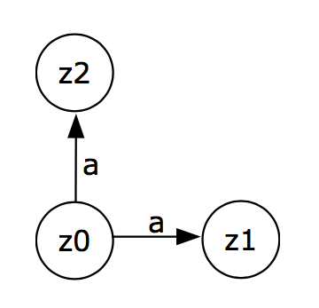{height="11.1em"}
:::
::::

## Nondeterministic finite-state automaton {.fit2}

::: {.definition}
[Definition: non-deterministic finite state automaton (NFA)]{.label}

::: {.xs}
A non-deterministic finite state automaton is defined by a 5-tuple $M = (Q, \Sigma, \delta, q_0, X)$ consisting of:

- $Q$, a finite set of states
- $\Sigma$, a finite set of input symbols called the alphabet, $Q \cap \Sigma = \emptyset$
- $\delta: Q \times \Sigma \rightarrow \mathcal{P}(Q)$, a transition function, where $\mathcal{P}(Q)$ is the power set of $Q$ (the set of all subsets of $Q$)
- $q_0 \in Q$, an initial or start state
- $X \subseteq Q$, a set of accept states
:::
:::

::: {.tag .xs}
An NFA can also have $\varepsilon$-transitions, taken without reading any input symbol
:::

::: {.sm}
**Theorem (Rabin, Scott):** any NFA can be simulated by a DFA

- in other words, NFAs and DFAs are equivalent
- a DFA might have many more states; it is easier to write and reason with NFAs
:::

## Formal Languages and Grammars

::: {.outline .focus}
1. Finite-state Automata
2. [Formal Languages and Grammars]{.current}
3. Turing Machines
4. Computability
5. Complexity Classes
:::

## Grammar

::: {.sm}
- Initial motivation: How do we ensure that a command (or input) is a syntactically correct part of a given language?
- Gave rise to the field of **automata theory** in theoretical computer science
  - informally: an automaton is a state space representation of a program, i.e., the description of program flow through incremental transitions between some (elementary) program states
- Grammars help us to answer the question:
  - **What can be computed with a finite-state automaton?**
:::

::: {.example style="width:88%;margin:0.6em auto"}
::: {.sm}
A grammar is a formal set of rules from which you can derive all inputs that the automaton accepts and no input that it does not accept
:::
:::

## Nomenclature about formal languages

::: {.xs}
- **Kleene star operator** $*$
  - operation on a given set $V$
  - amounts to the concatenation of $V$ on itself, i.e., any finite combination of the elements of $V$
  - example: $V = \{+, 1, 2\}$ then $V^* = \{\varepsilon, +, 1, 2, +1, +2, 2+, 12, 1{+}2, {+}12, {+}{+}{+}{+}, \text{etc.}\}$
  - $V^+$ is $V^*$ without the empty word $\varepsilon$
- **Formal Language** $L$
  - set of strings of symbols formed from its alphabet $\Sigma$
  - formally: $L \subseteq \Sigma^*$
  - abstract definition: in practice, a well-formed (programming) language further requires the definition of an appropriate grammar $G$ that limits which words are syntactically permitted
:::

## Grammar {.fit1}

::: {.sm}
A finite set of formal rules for generating syntactically correct sentences.
:::

::: {.definition}
[Definition: Grammar]{.label}

::: {.xs}
A Grammar is a 4-tuple $G = (N, \Sigma, P, S)$ that satisfies the following conditions:

- $N$ is a finite set of all **variables** (or nonterminal symbols), symbols which take part in the generation of the sentence but are not a component of the sentence (denoted by capital letters)
- $\Sigma$ is a finite set: the alphabet of **terminal symbols** such that $N \cap \Sigma = \emptyset$. Symbols which are the components of the sentences generated using a grammar (denoted by small letters)
- $P$ is the finite set of **production rules**, $P \subseteq (N \cup \Sigma)^+ \times (N \cup \Sigma)^*$, that map one string of symbols to another (denoted by "$\rightarrow$")
- $S \in N$ is the **start variable**
:::
:::

## Grammar: example {.fit3}

::: {.sm}
- Grammar that generates proper bracketed arithmetic expressions:
  - $N = \{\textit{Expr}, \textit{Term}, \textit{Fact}\}$
  - $\Sigma = \{(, ), a, +, *\}$
  - $S = \textit{Expr}$
:::

::: {.example style="width:56%;margin:0.4em 0 0.4em 3em"}
::: {.xs}
$P = \{$

1. $\textit{Expr} \rightarrow \textit{Term}$
2. $\textit{Expr} \rightarrow \textit{Expr} + \textit{Term}$
3. $\textit{Term} \rightarrow \textit{Fact}$
4. $\textit{Term} \rightarrow \textit{Term} * \textit{Fact}$
5. $\textit{Fact} \rightarrow a$
6. $\textit{Fact} \rightarrow (\textit{Expr})$ &nbsp; $\}$
:::
:::

::: {.sm}
- This grammar produces correct arithmetic expressions with parentheses
  - for example: $a * (a + a) + a$
:::

## Grammar: derivation example

:::: {.columns}
::: {.column width="52%"}
::: {.xs}
- $N = \{\textit{Expr}, \textit{Term}, \textit{Fact}\}$, &nbsp; $\Sigma = \{(, ), a, +, *\}$, &nbsp; $S = \textit{Expr}$

$P = \{$

1. $\textit{Expr} \rightarrow \textit{Term}$
2. $\textit{Expr} \rightarrow \textit{Expr} + \textit{Term}$
3. $\textit{Term} \rightarrow \textit{Fact}$
4. $\textit{Term} \rightarrow \textit{Term} * \textit{Fact}$
5. $\textit{Fact} \rightarrow a$
6. $\textit{Fact} \rightarrow (\textit{Expr})$ &nbsp; $\}$
:::
:::

::: {.column width="48%"}
::: {.xs}
**Derivation of $a * (a + a) + a$**

| rule | |
|---|---|
| | $S = \textit{Expr}$ |
| (2) | $\textit{Expr} + \textit{Term}$ |
| (1) | $\textit{Term} + \textit{Term}$ |
| (4)(3) | $\textit{Term} * \textit{Fact} + \textit{Fact}$ |
| (3)(6)(5) | $\textit{Fact} * (\textit{Expr}) + a$ |
| (5)(2) | $a * (\textit{Expr} + \textit{Term}) + a$ |
| (1)(3) | $a * (\textit{Term} + \textit{Fact}) + a$ |
| (3)(5) | $a * (\textit{Fact} + a) + a$ |
| (5) | $a * (a + a) + a$ |
:::
:::
::::

## Grammar $\equiv$ Automaton

::: {.xs}
A grammar $G = (N, \Sigma, P, S)$ whose rules have the form $A \rightarrow aB$ or $A \rightarrow a$ (a *regular* grammar) is equivalent to an automaton $M = (Q, \Sigma, \delta, q_0, \{X\})$ with the following mapping:

- the automaton uses the same input alphabet $\Sigma$
- $Q = N \cup \{X\}$, where $X \notin N$, i.e., the states of the automaton correspond to the variables of the grammar plus an additional state $X$
- $q_0 = S$, i.e., the initial state derives from the start variable
- the set of accept states is $\{X\}$, i.e., the only accept state is the new state $X$
- $\delta(A, a) \ni B$ if $A \rightarrow aB \in P$, i.e., there exists a transition from state $A$ to state $B$ if the input is $a$
- $\delta(A, a) \ni X$ if $A \rightarrow a \in P$, i.e., there exists a transition from state $A$ to the final state $X$ if the input is $a$
:::

## Grammar $\equiv$ Automaton: example

:::: {.columns}
::: {.column width="52%"}
::: {.sm}
- Example transformation for grammar $G$ with:
  - $N = \{S, A, B\}$
  - $\Sigma = \{a, b\}$
  - $P = \{\,S \rightarrow aB,$<br>$\phantom{P = \{\,}B \rightarrow bA,$<br>$\phantom{P = \{\,}A \rightarrow b,$<br>$\phantom{P = \{\,}A \rightarrow bS\,\}$
:::
:::

::: {.column width="48%"}
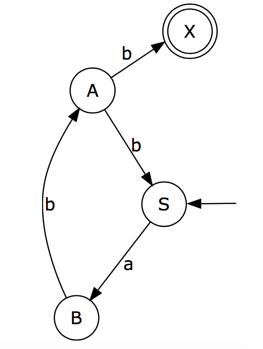{height="13.0em"}
:::
::::

## Formal Languages {.fit1}

::: {.definition}
[Definition: Formal Language]{.label}

::: {.sm}
The language $L$ defined by $G$ is $L(G) = \{\, w \in \Sigma^* \mid S \Rightarrow_G^* w \,\}$, i.e., $G$ derives $w$ in zero or more steps from the start symbol $S$.
:::
:::

:::: {.columns}
::: {.column width="66%"}
::: {.sm}
For example, the grammar with

- $N = \{S, A, B\}$
- $\Sigma = \{a, b\}$
- $P = \{S \rightarrow aB,\; B \rightarrow bA,\; A \rightarrow b,\; A \rightarrow bS\}$

defines the language:

$$L(G) = \{(abb)^n \mid n \geq 1\}$$
:::
:::

::: {.column width="34%"}
{height="10.4em"}
:::
::::

## Regular Languages

::: {.definition}
[Theorem]{.label}
Every language recognizable by finite automata is a **regular language**.
:::

::: {.sm}
**Regular Expressions (RE):** $R$ is a regular expression if $R$ is:

1. $a$, such that $a \in \Sigma$ &nbsp;&nbsp; (just a single character in the alphabet)
2. $\varepsilon$ &nbsp;&nbsp; (the empty word)
3. $\emptyset$ &nbsp;&nbsp; (the empty set)
4. $R_1 \mid R_2$, where $R_1$ and $R_2$ are regular expressions &nbsp;&nbsp; (alternative RE)
5. $R_1 R_2$, where $R_1$ and $R_2$ are regular expressions &nbsp;&nbsp; (concatenation of RE)
6. $R_1^*$, where $R_1$ is a regular expression &nbsp;&nbsp; (repetition of RE)
:::

## Pac-Man ghosts DFA

::: {.center-h}
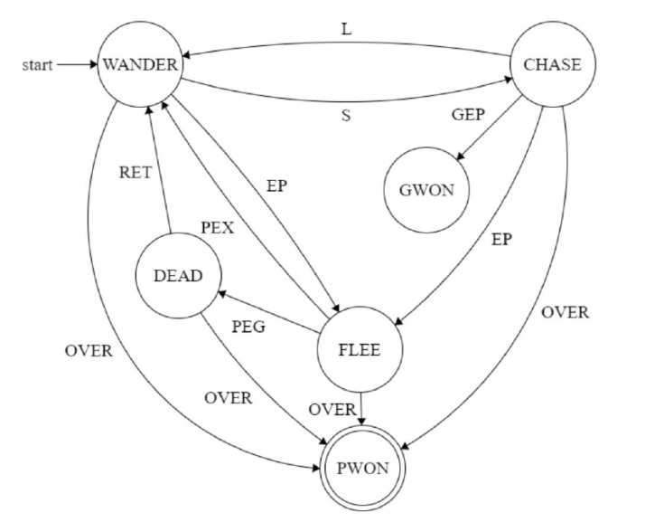{height="13.6em"}
:::

::: {.source}
Emulating Pac-Man using Finite State Machines. Soumyabrata Bairagi, Bachelor Thesis, Indian Institute of Information Technology, Ranchi.
:::

## Outtake &ndash; Social Science Applications

::: {.center-h}
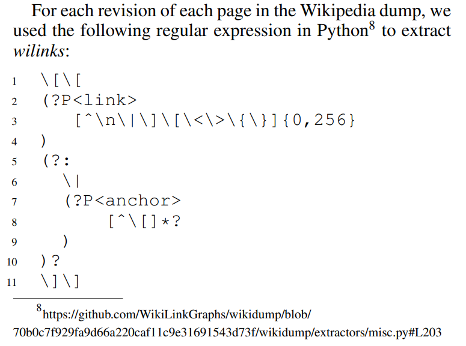{height="12.8em"}
:::

::: {.source}
WikiLinkGraphs: A Complete, Longitudinal and Multi-Language Dataset of the Wikipedia Link Networks. Cristian Consonni, David Laniado, Alberto Montresor. *Proceedings of the International Conference on the Web and Social Media* (2019)
:::

## Outtake &ndash; Social Science Applications

::: {.center-h}
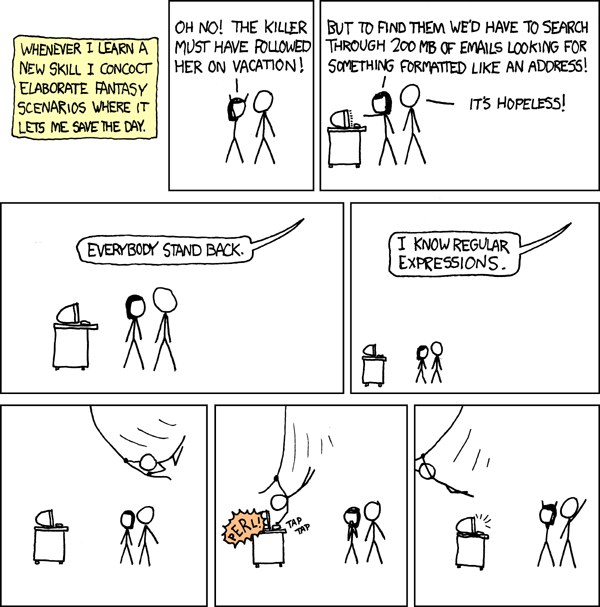{height="13.0em"}
:::

::: {.source}
XKCD: Regular Expressions &nbsp; <https://xkcd.com/208/>
:::

## Outtake &ndash; Social Science Applications

::: {.center-h}
{height="13.0em"}
:::

::: {.source}
XKCD: Regular Expressions &nbsp; <https://xkcd.com/208/>
:::

## Outtake &ndash; Social Science Applications

::: {.center-h}
{height="13.0em"}
:::

::: {.source}
XKCD: Regular Expressions &nbsp; <https://xkcd.com/208/>
:::

## Further Readings

:::: {.columns}
::: {.column width="68%"}
::: {.sm}
Chapters 1 & 2 of<br>
***Introduction to the Theory of Computation***,<br>
by Michael Sipser

<br>

Chapters contain additional proofs and lemmas, but also everything else seen here
:::
:::

::: {.column width="32%"}
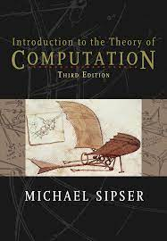{height="9.0em"}
:::
::::

## Turing Machines

::: {.outline .focus}
1. Finite-state Automata
2. Formal Languages and Grammars
3. [Turing Machines]{.current}
4. Computability
5. Complexity Classes
:::

## The problem with DFA and the Chomsky Hierarchy {.fit1}

::: {.center-h .sm}
A simple language that a DFA cannot recognize:
:::

::: {.example style="width:44%;margin:0.3em auto"}
::: {.center-h .sm}
$L = \{a^n b^n \mid n \geq 1\}$: &nbsp;&nbsp; $S \rightarrow ab \mid aSb$
:::
:::

::: {.tbl-grid .xxs}
| Type | Type | Automaton | Rules | Rule | Recognizes |
|---|---|---|---|---|---|
| 0 | Recursively enumerable | Turing machine, infinite memory | $\alpha, \beta$ arbitrary; left at least one non-terminal | $\alpha \rightarrow \beta$ | all |
| 1 | Context sensitive language | Linear bounded Turing machine | left at least one non-terminal; left shorter | $\alpha A \beta \rightarrow \alpha \gamma \beta$ | $a^n b^n c^n$ |
| 2 | Context free language | Pushdown automaton, stack | left only one non-terminal | $A \rightarrow \alpha$ ($\alpha$ string of terminals and non-terminals) | $a^n b^n$ |
| 3 | Regular language | Finite state automaton | left only one non-terminal | $A \rightarrow aB$ or $A \rightarrow Ba$ | $a^n$ |
:::

## Turing Machines {.fit2}

:::: {.columns}
::: {.column width="58%"}
::: {.sm}
- Turing Machines (TM) have a **tape** consisting of infinite cells on which each cell either contains an input symbol or a special symbol called *blank*
- The machine can read and write those symbols, one at a time
- The machine has a **head** pointer which points to the cell currently being read and it can move in both directions
- The tape head can move left and right
- The **state register** stores the current state of the machine
- Set of states is finite
- Table of (finite) instructions describing how the machine reads, writes and changes state
:::
:::

::: {.column width="42%"}
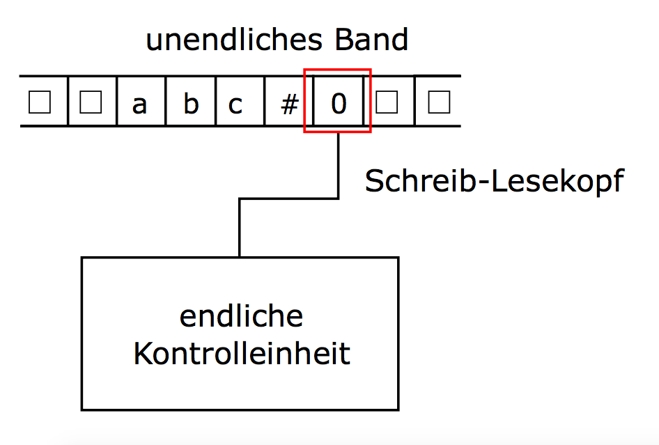{height="9.6em"}
:::
::::

## Turing Machines: Recommended Readings

:::: {.columns}
::: {.column width="52%"}
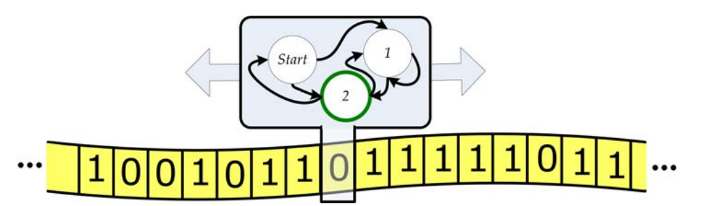{height="3.6em"}

::: {.sm}
- Illustration of Turing Machine from *Introduction to Computing* by Evans (2011)
- Recommended readings:
  - Chapter 6 for Turing Machines
  - Chapter 12 for Computability
- Sipser (2012) Ch. 7 for Complexity Classes
:::
:::

::: {.column width="48%"}
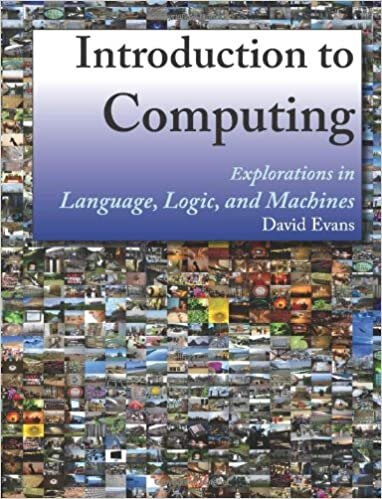{height="9.6em"}
:::
::::

## Turing Machines: Formalization {.fit1}

::: {.definition}
[Definition: Turing machine]{.label}

::: {.xxs}
A Turing machine is defined by a 7-tuple $TM = (Q, \Sigma, \Gamma, \delta, q_0, \square, F)$ consisting of

- $Q$: a finite set of **states**
- $\Sigma$: a finite set of symbols called the **input alphabet**, $Q \cap \Sigma = \emptyset$ (symbols which are part of the input alphabet)
- $\Gamma$: a finite set of symbols called the **working alphabet**, $\Sigma \subset \Gamma$ (symbols which can be written on the tape)
- $\delta: Q \times \Gamma \rightarrow Q \times \Gamma \times \{L, R, N\}$, the **transition function** in the deterministic case;<br>$\delta: Q \times \Gamma \rightarrow \mathcal{P}(Q \times \Gamma \times \{L, R, N\})$ in the nondeterministic case
- $q_0 \in Q$: an initial or **start state**
- $\square \in \Gamma$: the **blank symbol** (initially, tape is filled with $\square$ except the input)
- $F \subseteq Q$: the set of **final states** (if any state of $F$ is reached, input is accepted)
:::
:::

## Turing Machines: Formalization {.fit1}

::: {.definition}
[Definition: Turing machine]{.label}

::: {.xxs}
A Turing machine is defined by a 7-tuple $TM = (Q, \Sigma, \Gamma, \delta, q_0, \square, F)$ consisting of

- $Q$: a finite set of **states**
- $\Sigma$: a finite set of symbols called the **input alphabet**, $Q \cap \Sigma = \emptyset$ (symbols which are part of the input alphabet)
- $\Gamma$: a finite set of symbols called the **working alphabet**, $\Sigma \subset \Gamma$ (symbols which can be written on the tape)
- $\delta: Q \times \Gamma \rightarrow Q \times \Gamma \times \{L, R, N\}$, the **transition function** in the deterministic case;<br>$\delta: Q \times \Gamma \rightarrow \mathcal{P}(Q \times \Gamma \times \{L, R, N\})$ in the nondeterministic case
- $q_0 \in Q$: an initial or **start state**
- $\square \in \Gamma$: the **blank symbol** (initially, tape is filled with $\square$ except the input)
- $F \subseteq Q$: the set of **final states** (if any state of $F$ is reached, input is accepted)
:::
:::

::: {.tag .xxs}
From (state, tape symbol read) to (next state, tape symbol written, movement of head).
Movements are Left, Right, None. It can have special operations like Halt and Error.
:::

## Functioning of Turing Machines {.fit1}

:::: {.columns}
::: {.column width="60%"}
::: {.sm}
- Transition example: $\delta(z, a) = (z', b, x)$
  - TM is in state $z$, and
  - $a$ is underneath the tape head
  - TM transitions to state $z'$, writes $b$ in the cell under the head
  - and after that moves the head according to $x \in \{R, L, N\}$
- **initial state**
  - only the input is written on the tape
  - tape head on first input symbol/element
  - all unused places are marked with $\square$. `#` is an alternative notation for this
:::
:::

::: {.column width="40%"}
{height="9.1em"}
:::
::::

## Turing Machine example: checking parentheses {.fit1}

::: {.sm}
- **Problem:** Check that parentheses in the input are balanced
  - e.g. `()(())(()())` is balanced but `((()()` is not
- **Input:** tape contains the string of parentheses with `#` at the beginning and end to mark limits
- **Output:** there is a `1` on the tape if the input is balanced, or a `0` otherwise
  - Only what is written on the cell of the head matters
- **Strategy:**
  - look for a closing parenthesis and replace with `X`
    - then find its matching opening parenthesis and replace with `X`
    - if you find `#` instead of a matching opening parenthesis: write `0`
  - Repeat until you reach `#` when looking for a closing parenthesis
  - If tape is all `X` between `#`, write `1`
:::

## Turing Machine example: checking parentheses

::: {.center-h}
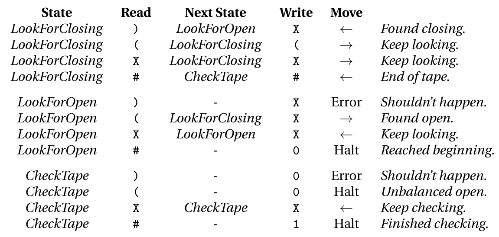{height="13.7em"}
:::

::: {.source}
From *Introduction to Computing* by Evans (2011)
:::

## Turing Machine example: checking parentheses

::: {.center-h}
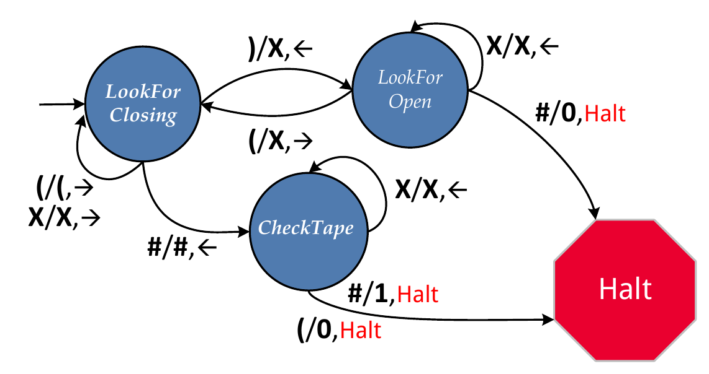{height="13.7em"}
:::

::: {.source}
From *Introduction to Computing* by Evans (2011)
:::

## Turing Machine tape trace example

:::: {.columns}
::: {.column width="48%"}
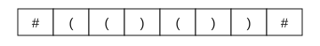{height="2.0em"}
:::

::: {.column width="52%"}
{height="6.6em"}

::: {.xs}
- Input string to process
- TM starts in leftmost cell of input
- TM starts in state `LookForClosing`
- TM moves without rewriting until first `)`
:::
:::
::::

## Turing Machine tape trace example

:::: {.columns}
::: {.column width="48%"}
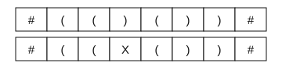{height="3.3em"}
:::

::: {.column width="52%"}
{height="6.6em"}

::: {.xs}
- When `)` is under the head:
- &nbsp;&nbsp;change to `LookForOpen`
- &nbsp;&nbsp;write `X`
- &nbsp;&nbsp;move head to the left
- TM keeps on moving to the left while it sees `X` under its head
:::
:::
::::

## Turing Machine tape trace example

:::: {.columns}
::: {.column width="48%"}
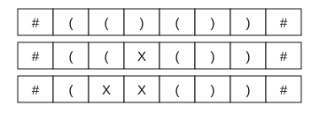{height="4.7em"}
:::

::: {.column width="52%"}
{height="6.6em"}

::: {.xs}
- When `(` is under the head:
- &nbsp;&nbsp;change to `LookForClosing`
- &nbsp;&nbsp;write `X`
- &nbsp;&nbsp;move head to the right
- TM keeps on moving to the right while it sees `X` or `)` under its head
:::
:::
::::

## Turing Machine tape trace example

:::: {.columns}
::: {.column width="48%"}
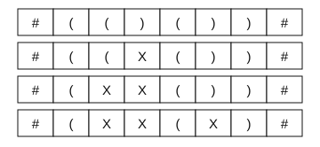{height="6.0em"}
:::

::: {.column width="52%"}
{height="6.6em"}

::: {.xs}
- The process continues matching parentheses and switching between states `LookForClosing` and `LookForOpen`
:::
:::
::::

## Turing Machine tape trace example

:::: {.columns}
::: {.column width="48%"}
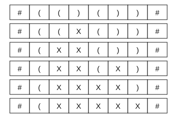{height="8.7em"}
:::

::: {.column width="52%"}
{height="6.6em"}

::: {.xs}
- The process continues matching parentheses and switching between states `LookForClosing` and `LookForOpen`
:::
:::
::::

## Turing Machine tape trace example

:::: {.columns}
::: {.column width="48%"}
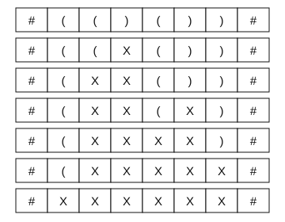{height="10.1em"}
:::

::: {.column width="52%"}
{height="6.6em"}

::: {.xs}
- After the last `(` is rewritten, TM is in `LookForClosing` state
- TM goes to the right until it finds `#`
- &nbsp;&nbsp;TM changes to `CheckTape` state
- &nbsp;&nbsp;head starts moving to the left while it sees `X`
:::
:::
::::

## Turing Machine tape trace example

:::: {.columns}
::: {.column width="48%"}
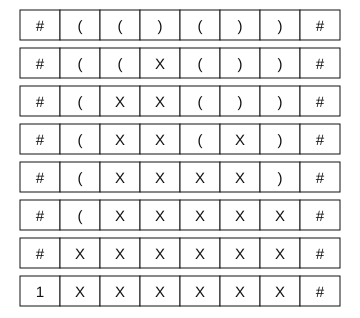{height="11.4em"}
:::

::: {.column width="52%"}
{height="6.6em"}

::: {.xs}
- TM finds `#` while in `CheckTape` state
- &nbsp;&nbsp;overwrites it with a `1` (accept)
- &nbsp;&nbsp;TM halts
:::
:::
::::

## Nondeterministic Turing Machines {.fit1}

:::: {.columns}
::: {.column width="56%"}
::: {.sm}
- Transition function<br>$\delta: Q \times \Gamma \rightarrow \mathcal{P}(Q \times \Gamma \times \{L, R, N\})$
- A combination of state and tape symbol can go to more than one other state, symbol, and action triplet
- All paths happen **in parallel**
  - alternative: TM takes the "smartest path" towards accept
- Input is **accepted** if any path leads to an accepting state
- Input is **rejected** if all paths lead to a rejecting state or are infinite (loops)
:::
:::

::: {.column width="44%"}
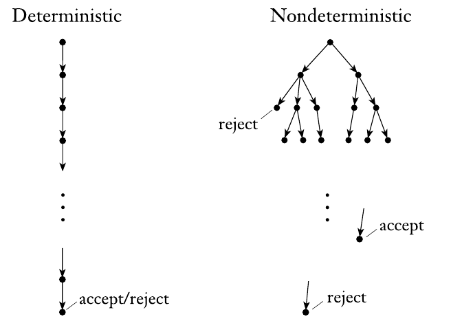{height="10.9em"}
:::
::::

## Alan Turing: the father of computation {.fit1}

:::: {.columns}
::: {.column width="70%"}
::: {.sm}
- Alan Mathison Turing (UK 1912 - 1954)
- Designed the TM to formalize algorithms
- Defined computation as problems that can be solved by algorithms and found examples of problems that cannot be computed
- Famous for his work during WWII to crack the Enigma code with an electromechanical machine called the *Bombe*
- Among the first to work on AI: the Turing test
  - AI as machines able to pass as human a given % of the time when chatting with people
- Died in 1954, by suicide according to the inquest, two years after being prosecuted for his homosexuality and forced to undergo hormone treatment
:::
:::

::: {.column width="30%"}
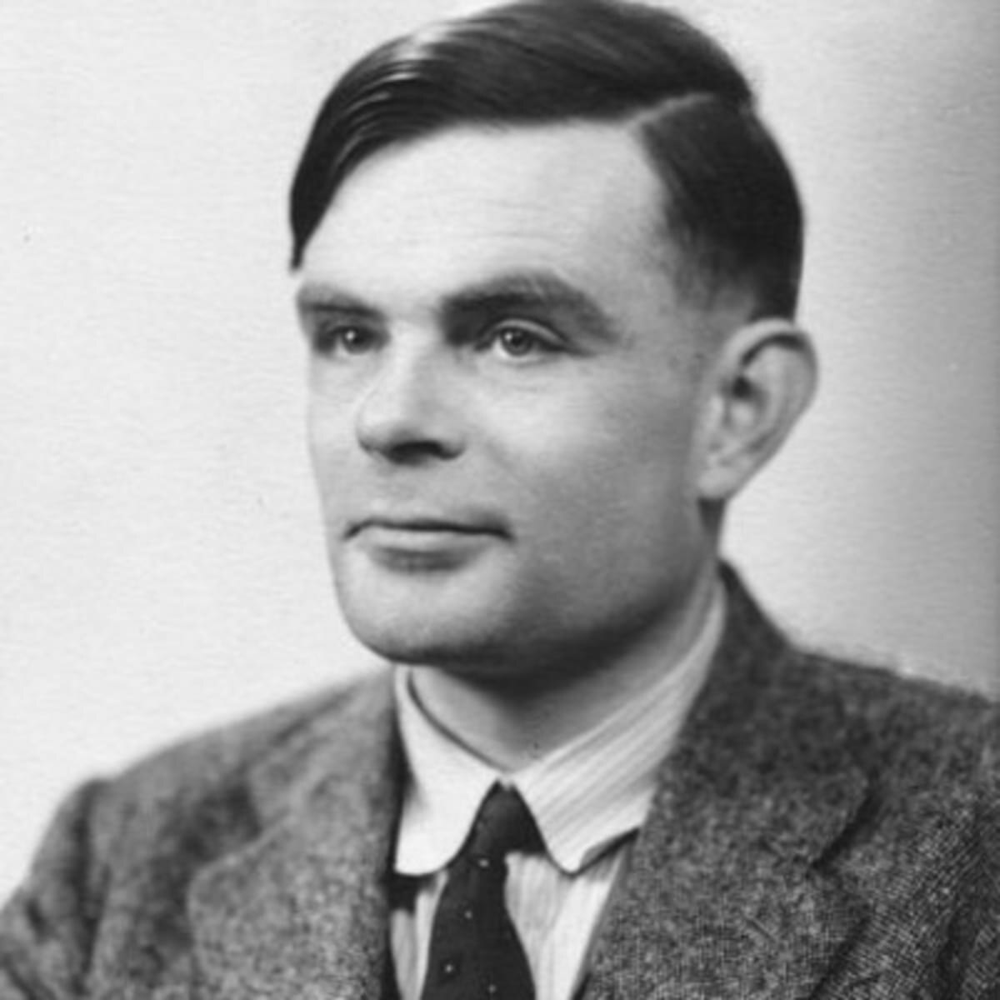{height="9.4em"}
:::
::::

## Computability

::: {.outline .focus}
1. Finite-state Automata
2. Formal Languages and Grammars
3. Turing Machines
4. [Computability]{.current}
5. Complexity Classes
:::

## Computability

::: {.definition}
[Definition of algorithm]{.label}

::: {.sm}
An algorithm is a self-contained step-by-step set of operations to solve a given problem. Algorithms perform calculation, data processing, and/or automated reasoning tasks.
:::
:::

::: {.sm}
- Remember: algorithms always **terminate**. For correct inputs, the algorithm must always terminate in a finite number of steps.
- A problem is **computable** if there exists an algorithm that solves the problem.
- If we can prove that no algorithm can solve a problem in finite time, then the problem is **noncomputable**.
:::

## The Church-Turing thesis

::: {.definition style="width:82%;margin:0.4em auto"}
::: {.center-h .sm}
**Church-Turing thesis:** intuitive notion of algorithms = Turing Machines
:::
:::

::: {.sm}
- Up to now, our definition of algorithms is intuitive: we can tell what is an algorithm and what is not, but we lack a mathematical definition
- Alonzo Church and Alan Turing worked in parallel to formally define algorithms and reached equivalent definitions: **an algorithm is what can be computed by a Turing Machine**
- It is a *thesis*: a statement from which the rest of Computer Science is derived but that has no formal proof; its support is that every other model of computation proposed so far is equivalent to a TM or weaker
:::

## A noncomputable problem: The halting problem {.fit1}

::: {.definition}
[The Halting Problem]{.label}

::: {.sm}
**Input:** A string representing a program (e.g. in Python)<br>
**Output:** If evaluating the input program would ever finish, output `True`. Otherwise, output `False`.
:::
:::

::: {.sm}
- Assume that `halts(X)` is an algorithm that solves the halting problem, where `X` is the Python code that is the input
- `halts(X)` returns `True` if the evaluation of `X` would finish in finite time, `False` otherwise
:::

::: {.sm}
- For example:
  - `halts('(2 + 3)') = True`
  - `halts('while True: pass') = False`
:::

## A noncomputable problem: The halting problem {.fit1}

::: {.definition}
[The Halting Problem]{.label}

::: {.sm}
**Input:** A string representing a program (e.g. in Python)<br>
**Output:** If evaluating the input program would ever finish, output `True`. Otherwise, output `False`.
:::
:::

::: {.sm}
- Assume that `halts(X)` is an algorithm that solves the halting problem, where `X` is the Python code that is the input
- `halts(X)` returns `True` if the evaluation of `X` would finish in finite time, `False` otherwise
:::

:::: {.columns}
::: {.column width="50%"}
::: {.sm}
- For example:
  - `halts('(2 + 3)') = True`
  - `halts('while True: pass') = False`
:::
:::

::: {.column width="50%"}
::: {.xs}
```python
halts('n = 4;
       while sumOfTwoPrimes(n):
           n = n + 2') = ?
```
:::
:::
::::

## Proof of non-computability {.fit1}

:::: {.columns}
::: {.column width="55%"}
::: {.sm}
- **Proof by reduction to absurdity:**
  - if we assume that `halts(X)` exists, do we reach a contradiction?
- If `halts(X)` exists, then the following is a recursive algorithm:
:::
:::

::: {.column width="45%"}
::: {style="font-size:0.9em"}
```python
def paradox():
    if halts('paradox()'):
        while True:
            pass
```
:::
:::
::::

::: {.sm}
- if `halts('paradox()') = True`, the algorithm goes into an infinite loop, so `halts('paradox()')` cannot be `True`
- if `halts('paradox()') = False`, the algorithm skips the loop and terminates, so `halts('paradox()')` cannot be `False`
- Since it has to be either `True` or `False`, **`halts(X)` cannot exist**
:::

## Proof of non-computability {.fit1}

:::: {.columns}
::: {.column width="55%"}
::: {.sm}
- **Proof by reduction to absurdity:**
  - if we assume that `halts(X)` exists, do we reach a contradiction?
- If `halts(X)` exists, then the following is a recursive algorithm:
:::
:::

::: {.column width="45%"}
::: {style="font-size:0.9em"}
```python
def paradox():
    if halts('paradox()'):
        while True:
            pass
```
:::
:::
::::

::: {.sm}
- if `halts('paradox()') = True`, the algorithm goes into an infinite loop, so `halts('paradox()')` cannot be `True`
- if `halts('paradox()') = False`, the algorithm skips the loop and terminates, so `halts('paradox()')` cannot be `False`
- Since it has to be either `True` or `False`, **`halts(X)` cannot exist**
:::

::: {.tag .xs}
Your knowledge of Python is a model of computing! Alan Turing showed this for Turing Machines as a general model of computing
:::

## Universal Turing Machines {.fit1}

::: {.sm}
- TMs can be encoded with finite codes: e.g. state list + transition table + alphabet, etc.
- A **universal Turing Machine** simulates a TM with a code written on the tape, followed by its input
- The universal TM then writes the output of the simulated TM and stops if the simulated TM stops
:::

::: {.center-h}
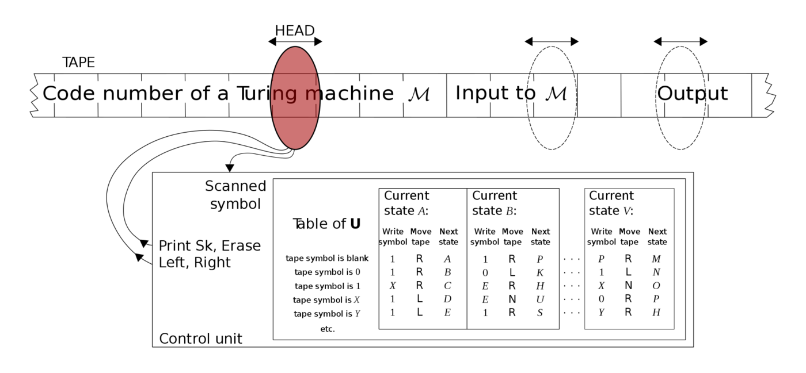{height="8.7em"}
:::

::: {.source}
<https://en.wikipedia.org/wiki/Universal_Turing_machine>
:::

## Turing completeness

::: {.definition}
[Turing completeness]{.label}

::: {.sm}
A model of computation (e.g. model of a machine or programming language) is **Turing complete** if it can be used to simulate a universal Turing Machine. Turing complete models can execute any algorithm.
:::
:::

::: {.sm}
- For example, Python is Turing complete because you can write code in Python that simulates any Turing Machine and thus, by definition, can execute any algorithm
- In practice you can code any algorithm directly in Python without simulating a TM; the point is that you *can* simulate a TM, not that it is easy, understandable, or even efficient
:::

## Examples of Turing complete models

::: {.sm}
- **Cellular automata:** models of computation in which cells change state according to extremely simple rules
  - Structures emerge that, when interacting, can be set up to simulate any TM
  - Examples are Conway's *Game of Life* and *rule 110*
:::

::: {.imgrow .middle}
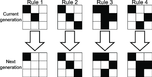{height="8.1em"}
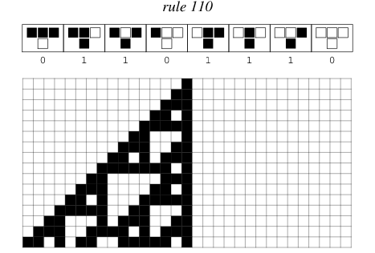{height="8.9em"}
:::

## Examples of Turing complete models

::: {.sm}
- Creative games can be used to build a system that simulates a Universal Turing Machine or other Turing complete models
  - Sokoban (Culberson, 1997: PSPACE-complete, i.e. it simulates any TM with a bounded tape)
  - Minecraft (YouTube video)
  - Magic the Gathering (Churchill, Biderman, & Herrick, 2019)
:::

::: {.imgrow .middle}
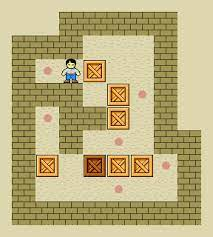{height="7.0em"}
{height="7.0em"}
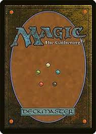{height="7.0em"}
:::

## Complexity Classes

::: {.outline .focus}
1. Finite-state Automata
2. Formal Languages and Grammars
3. Turing Machines
4. Computability
5. [Complexity Classes]{.current}
:::

## Time complexity of nondeterministic TM {.fit1}

:::: {.columns}
::: {.column width="52%"}
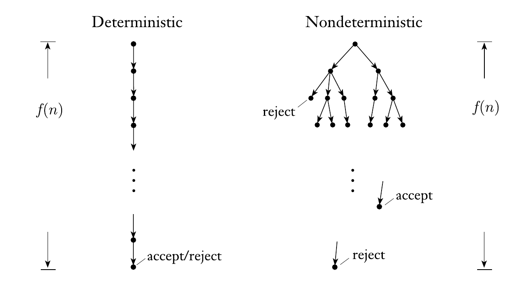{height="9.8em"}
:::

::: {.column width="48%"}
::: {.sm}
O-notation to characterize scaling of time complexity:

- $O(1) \subset O(\log n) \subset O(n)$
- $O(n) \subset O(n \log n) \subset O(n^2)$
- $O(n^2) \subset O(2^n) \subset O(n!)$
- i.e., ignore lower order terms
:::
:::
::::

::: {.sm}
- **Recap:** previously, we talked about the time complexity of algorithms: how running time grows with input size
- In terms of a TM, time complexity can be seen as the number of transitions the TM has to do to reach a final state. For a nondeterministic TM, it is the max depth among all execution branches
:::

## Problem complexity and decision problems {.fit1}

::: {.sm}
- We can talk about the complexity of a **problem** regarding the time complexity of known algorithms to solve it
- This defines a hierarchy: inefficient algorithms with long running time can be implemented for almost any problem, but some problems might not be solvable with faster algorithms
- We can define sets of problems as **complexity classes** that relate the problems to the time complexity of the algorithms that can solve them
:::

::: {.definition}
[Decision problem]{.label}

::: {.sm}
Decision problems have a binary output (true/false) as the solution. Decision problems can be very general, for example determining if a word belongs to a language is a decision problem.
:::
:::

## The P class {.fit1}

::: {.definition}
[Problem class P]{.label}

::: {.sm}
**P** contains all decision problems that can be solved by a **deterministic** Turing Machine using a **polynomial** amount of computation steps (time).
:::
:::

::: {.sm}
- In other words: for each problem in P, there is at least one algorithm that decides its output in a number of steps that grows polynomially with the input size, e.g. $O(n)$, $O(n^2)$, $O(n^{99})$, also subpolynomial $O(\log n) \subset O(n)$
:::

:::: {.columns}
::: {.column width="58%"}
::: {.sm}
- An example of a P problem is deciding if there is a path between two vertices in a graph
- You can run DFS on the graph to find the path and since DFS running time is $O(|V|+|E|)$, then the problem belongs to the P class
:::
:::

::: {.column width="42%"}
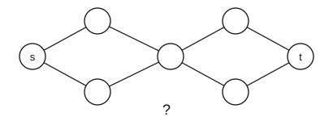{height="6.8em"}
:::
::::

## Problem verifiers {.fit1}

::: {.sm}
- After solving a problem, you can **verify** if the solution is correct
- A **verifier** is an algorithm (i.e. TM) that takes two inputs:
  - A description (encoding) of a problem $p$
  - A candidate solution for the problem $c$
- Verifiers return `True` if $c$ is a solution of $p$ and `False` otherwise
- $c$ is also called *certificate* or *proof* that $p$ has a solution (decision problem)
- However, verifying a solution is always a decision problem
- Example for finding a path between $s$ and $t$ in $G$:
:::

::: {.center-h}
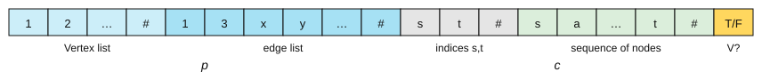{width="100%"}
:::

## The NP class

::: {.definition}
[Problem class NP]{.label}

::: {.sm}
**NP** is the set of decision problems for which positive problem instances (the answer is `True`) have proofs **verifiable in polynomial time** by a deterministic Turing Machine.
:::
:::

::: {.sm}
- An equivalent definition of NP is the set of decision problems solvable in polynomial time by a **nondeterministic** Turing machine
- The nondeterministic TM "guesses" the proof branching and then verifies it deterministically
- NP stands for "**N**ondeterministic **P**olynomial time"
  - It does **not** stand for "Not Polynomial!"
:::

## NP problem example: Hamiltonian path {.fit2}

::: {.definition}
[Hamiltonian path]{.label}
A Hamiltonian path is a path in a graph that visits each vertex exactly once.
:::

:::: {.columns}
::: {.column width="50%"}
::: {.center-h .xs}
$G_1$ has a Hamiltonian path
:::

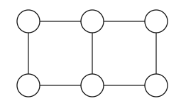{height="5.8em"}
:::

::: {.column width="50%"}
::: {.center-h .xs}
$G_2$ does not have a Hamiltonian path
:::

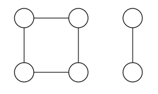{height="5.8em"}
:::
::::

::: {.xs}
- In this definition of path, edges in the path sequence have to be distinct
- Decision problem: we have to decide if $G$ has a Hamiltonian path or not
  - also known as "is $G$ traceable?"
- Verifying that a path is Hamiltonian in $G$ can be done in $O(|V|+|E|)$ (polynomial)
  - Thus, the problem of deciding if a graph has a Hamiltonian path is NP
:::

## NP problem example: Hamiltonian path {.fit1}

::: {.definition}
[Hamiltonian path]{.label}
A Hamiltonian path is a path in a graph that visits each vertex exactly once.
:::

:::: {.columns}
::: {.column width="46%"}
{height="5.8em"}

{height="5.8em"}
:::

::: {.column width="54%"}
::: {.xs}
- Finding a Hamiltonian path in $G$ is not that easy!
- No known algorithm can find a Hamiltonian path in polynomial time
- Known algorithms are pretty much like brute force, e.g. trying all combinations: $O(|V|!)$
:::
:::
::::

## P vs NP

:::: {.columns}
::: {.column width="40%"}
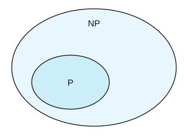{height="11.1em"}
:::

::: {.column width="60%"}
::: {.xs}
- All problems in P are also in NP
  - if you can decide it in polynomial time, you can verify it in polynomial time
- Verifying in polynomial time does not imply deciding in polynomial time
- However, this is based on the algorithms known for each problem; an NP problem becomes P when a polynomial-time algorithm for it is invented
- Proving that P = NP or P $\neq$ NP is arguably the most important question in CS
  - A Clay Millennium Problem: 1,000,000 USD prize for whoever solves it
:::
:::
::::

## Reducing problems {.fit1}

::: {.center-h}
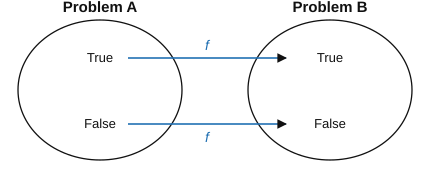{height="7.4em"}
:::

::: {.xs}
- **Reducing** a decision problem A to another decision problem B is
  - to find a function $f$ that maps:
  - all inputs of A that have output `True` to all inputs of B that have output `True`
  - all inputs of A that have output `False` to all inputs of B that have output `False`
- An algorithm that solves problem B can be used to solve problem A
- If $f$ can be applied in polynomial time, we say that A is **polynomial time reducible** to B
  - In this case, if B is in class P, then A is in class P too
:::

## NP-complete problems {.fit1}

:::: {.columns}
::: {.column width="56%"}
::: {.xs}
- Some NP problems can be reduced in polynomial time to other NP problems
- This determines a network between problems: if we find a polynomial time algorithm that solves one problem, we solve all problems that can be reduced to it
- Some special NP problems have the property that any other NP problem can be reduced to them:
:::
:::

::: {.column width="44%"}
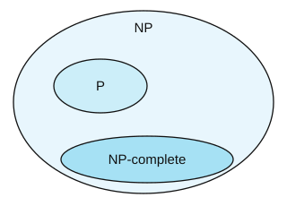{height="8.7em"}
:::
::::

::: {.definition style="width:78%;margin:0.3em auto"}
[Problem class NP-complete]{.label}

::: {.sm}
A problem is **NP-complete** if:

- it belongs to the NP class
- every other NP problem is polynomial time reducible to it
:::
:::

## NP-complete example: boolean satisfiability (SAT) {.fit1}

::: {.xs}
- Boolean formulas in propositional logic use three operations: AND ($\wedge$), OR ($\vee$), and negation ($\bar{x}$)
- Variables are boolean: they can take value True (1) or False (0)
- The **SAT** problem takes a boolean formula as input and returns True if and only if there is some assignment of variables for which the formula is True
- For example:
  - $(x_1 \vee x_2 \vee x_3 \vee \bar{x}_4) \wedge (\bar{x}_3 \vee x_5 \vee \bar{x}_6) \wedge (x_3 \vee \bar{x}_6)$<br>is satisfiable with $x_1 = x_2 = x_4 = x_5 =$ True, $x_3 = x_6 =$ False
  - $(x_1 \vee x_2) \wedge (\bar{x}_1 \vee x_2) \wedge (x_1 \vee \bar{x}_2) \wedge (\bar{x}_1 \vee \bar{x}_2)$ is not satisfiable
- Any NP problem can be reduced to SAT, making it the original NP-complete problem (proof not covered here)
- **Cook-Levin theorem:** finding a halting execution of any nondeterministic TM can be reformulated as satisfying a logical formula, thus SAT is NP-complete
- If you find a polynomial-time algorithm to solve SAT, then P = NP (and earn \$1M)
:::

## NP-hard problems {.fit1}

::: {.definition style="width:70%"}
[Problem class NP-hard]{.label}

::: {.sm}
A problem is **NP-hard** if:

- every NP problem is polynomial time reducible to it
:::
:::

:::: {.columns}
::: {.column width="56%"}
::: {.xs}
- Note that NP-hard problems do not have to be NP
  - they don't even have to be decision problems
- Informally, they are described as: *at least as hard as the hardest problems in NP*
- Often mentioned to convey the lack of polynomial-time algorithms to solve problems that are not decision problems, for example finding a Hamiltonian path in a graph
:::
:::

::: {.column width="44%"}
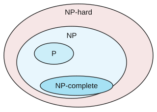{height="9.9em"}
:::
::::

## Summary: TM, Computability, Complexity Classes {.fit3}

::: {.sm}
- **Turing Machines**
  - The most general model of a computer we have seen
  - TMs recognize grammars without restrictions
- **Computability**
  - The Church-Turing thesis: Algorithms = TM
  - Some problems cannot be computed: the halting problem
  - A model of computation that can simulate a TM is Turing complete
- **Complexity classes**
  - Problem class P: decision problems solvable in polynomial time
  - Problem class NP: problems with proofs verifiable in polynomial time
  - Polynomial-time reducibility between problems
  - NP-complete problems and their relationship to P vs NP
  - NP-hard: general problems without known efficient algorithms
:::

**Next session:** Machine Learning

