## Course Outline

:::: {.columns}
::: {.column width="50%"}
::: {.sm}
- Session 1: Introduction
- Session 2: Information Coding
- Session 3: Data Structures
- Session 4: Software
- Session 5: Algorithms
- Session 6: Recursion
- Session 7: Sorting Algorithms
:::
:::

::: {.column width="50%"}
::: {.sm}
- Session 8: Time Complexity
- Session 9: Theoretical Computer Science
- Session 10: Machine Learning
  - Tutorial: Databases (swap)
- Session 11: Databases
- Session 12: Parallel Programming
  - Tutorial: Machine Learning (swap)
- Session 13: Social Science Applications
- Session 14: Exam Review
:::
:::
::::

## Outline

::: {.outline}
1. Brief History of Artificial Intelligence and Machine Learning
2. Supervised Machine Learning
3. Unsupervised Machine Learning
4. Generative AI and ML nowadays
:::

<!-- MOTIVATION:M10-A:BEGIN -->
## Google predicted the flu, until it didn't {.fit1}

::: {.motivation}
[Motivating example]{.label}
In 2009, Google Flu Trends estimated influenza rates from search queries **two
weeks ahead** of the CDC, and it worked. By the 2012–13 season it was predicting
**more than double** the real rate. It had been fitted to millions of queries and
had learned seasonal search patterns, winter, basketball, snow, rather than flu.
:::

:::: {.figures}
::: {.fq}
[2009]{.big}[ahead of the CDC, and celebrated]{.cap}
:::
::: {.fq}
[2×]{.big}[the real rate, 2012–13 season]{.cap}
:::
::: {.fq}
[2015]{.big}[quietly shut down]{.cap}
:::
::::

[The model fitted the past almost perfectly. Why is that not a good sign, and how would you have caught it?]{.ask}

::: {.source}
Ginsberg et al., *Nature* (2009); Lazer, Kennedy, King & Vespignani, "The Parable of Google Flu", *Science* (2014)
:::
<!-- MOTIVATION:M10-A:END -->

<!-- MOTIVATION:M10-B:BEGIN -->
## 93% accurate, and it never finds anyone

::: {.motivation}
[Motivating example]{.label}
A university builds a model to flag students at risk of dropping out. It reports
**93% accuracy** and is approved. Only 7% of students actually drop out, and the
model has learned to answer **"no" every time**. Its accuracy is 93% and it
identifies **nobody**.
:::

:::: {.figures}
::: {.fq}
[93%]{.big}[accuracy]{.cap}
:::
::: {.fq}
[0]{.big}[students identified]{.cap}
:::
::: {.fq}
[0]{.big}[recall, and therefore F₁]{.cap}
:::
::::

[Which number should have been on the report instead, and what does the right answer depend on?]{.ask}
<!-- MOTIVATION:M10-B:END -->

<!-- MOTIVATION:M10-C:BEGIN -->
## A million speeches nobody can read

::: {.motivation}
[Motivating example]{.label}
You have every speech given in the Bundestag since 1949, on the order of a
**million** of them. You want to know how the tone changed. Coding them by hand
at five minutes each would take one person about **forty working years**. Coding
a sample of **2 000** takes a week.
:::

:::: {.figures}
::: {.fq}
[~10⁶]{.big}[speeches]{.cap}
:::
::: {.fq}
[~40 yr]{.big}[to hand-code them all]{.cap}
:::
::: {.fq}
[2 000]{.big}[you can actually code]{.cap}
:::
::::

[How do you turn 2 000 human judgments into a measurement of a million documents, and how do you know whether to believe it?]{.ask}
<!-- MOTIVATION:M10-C:END -->

## Brief History of Artificial Intelligence {.fit1}

:::: {.columns}
::: {.column width="62%"}
::: {.sm}
Alternative definitions of Intelligence:

a) Problem-solving ability of a system
b) "You know it when you see it" &ndash; The Turing Test

- **1950s:** Foundations in the US and Soviet Union
- **1970s:** The Perceptron Problem: first AI Winter
- **1980s:** Expert systems and the return of Neural Networks
- **1990s-2000s:** Second AI Winter
- **2010s:** Deep Learning thanks to compute and data
- **2020s:** The AI Bubble (TBD)
:::
:::

::: {.column width="38%"}
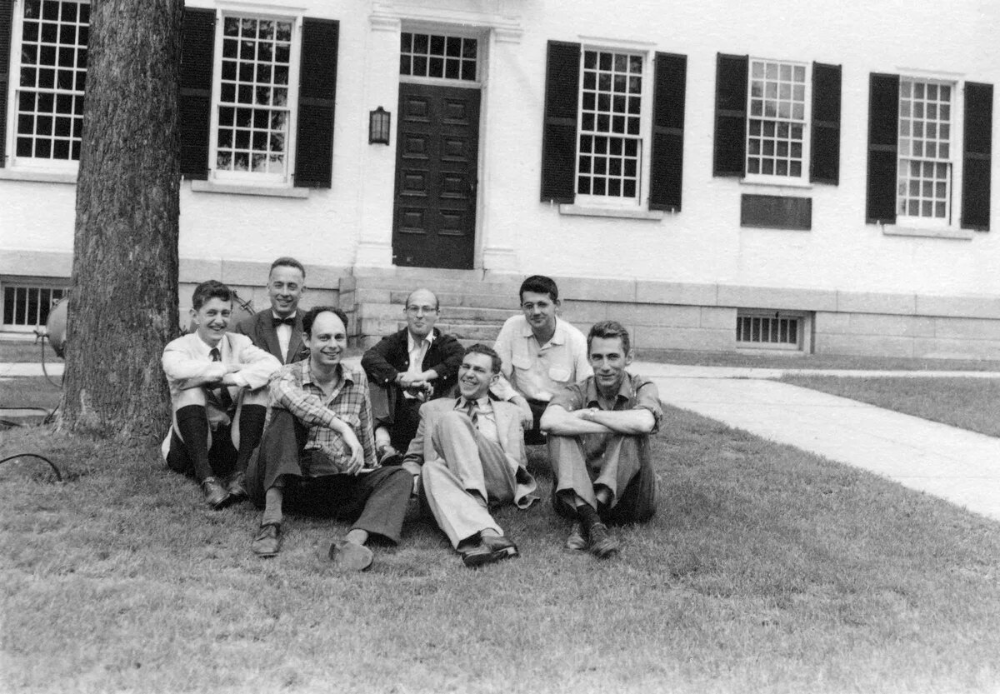{height="4.4em"}

::: {.center-h .xs}
**Artificial Intelligence (US)**
:::

{height="4.4em"}

::: {.center-h .xs}
**Cybernetics (Soviet Union)**
:::
:::
::::

## Machine Learning

::: {.sm}
Two historical approaches to Artificial Intelligence:

**A)** Expert systems that have hand-coded rules to solve one or more problems

**B)** **Machine Learning** to automatically learn how to solve a problem from data

- Expert systems were dominant prior to the 80s and in the early 2000s, but now Machine Learning is the main approach to Artificial Intelligence
- Historically, Machine Learning has also been called "Pattern Recognition" and "Statistical Learning"
- Machine Learning trains a **Model** from data &ndash; the word "algorithm" is often used to refer to the resulting model
- In practice, AI systems might have expert rules but they mainly depend on learning from data
:::

## Readings in AI and Machine Learning

::: {.imgrow .middle}
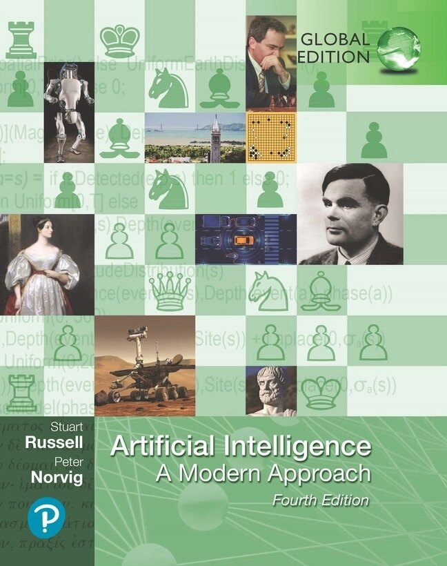{height="8.0em"}
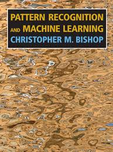{height="8.0em"}
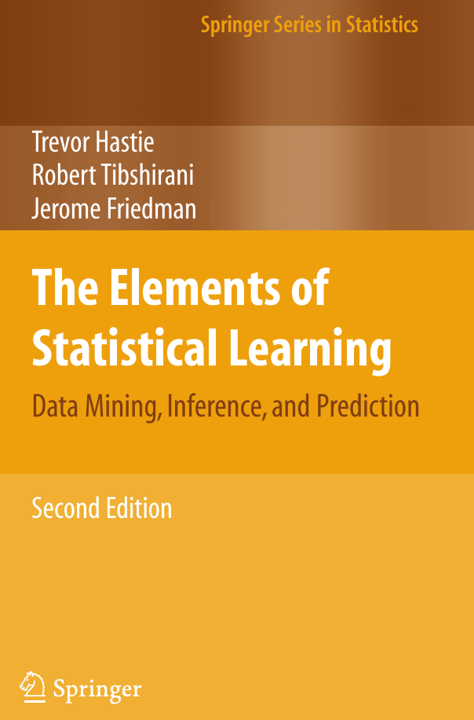{height="8.0em"}
:::

::: {.sm}
Recommended readings:

- [Pattern Recognition and Machine Learning by Bishop](https://www.microsoft.com/en-us/research/publication/pattern-recognition-machine-learning/)
- [The Elements of Statistical Learning by Hastie, Tibshirani and Friedman](https://hastie.su.domains/ElemStatLearn/)
:::

## Machine Learning Approaches {.fit2}

::: {.xs}
- **Supervised Learning: Learning with labeled examples**
  - Model learning from data where the correct answers are already known
  - e.g. predicting election outcomes based on historical voting data and demographics
  - Common tasks: Classification, Regression
- **Unsupervised Learning: Finding hidden patterns**
  - The algorithm explores data without labels to discover structure and relationships
  - e.g. grouping survey respondents into distinct segments based on their attitudes
  - Common tasks: Clustering, Dimensionality reduction
- **Reinforcement Learning: Learning through trial and error** (not covered today)
  - The algorithm learns by receiving rewards or penalties for its actions in an environment
  - e.g. adaptive language teaching or tests based on student performance
  - Common tasks: Sequential decision-making, Optimization
:::

::: {.tag .xs}
Key distinctions: supervised learning needs labeled data, unsupervised learning finds patterns on its own, and reinforcement learning needs access to an environment to learn from feedback
:::

## Supervised Machine Learning

::: {.outline .focus}
1. Brief History of Artificial Intelligence and Machine Learning
2. [Supervised Machine Learning]{.current}
3. Unsupervised Machine Learning
4. Generative AI and ML nowadays
:::

## Supervised Machine Learning {.fit1}

::: {.sm}
**The Goal**

Learn a function $f: X \rightarrow Y$ that maps inputs to outputs, using a dataset of example input-output pairs.
:::

:::: {.columns}
::: {.column width="50%"}
::: {.xs}
**Input Side**

**Features ($X$)**: input variables used to make predictions. 
*Also called:* predictors, independent variables, covariates. 
Example: age, income, education level

**Feature Vector ($x$)**: a single observation with all its features. 
`x = [35, $50k, Bachelor's]`

**Training Data**: collection of $n$ examples: 
$(x_1, y_1), (x_2, y_2), \dots, (x_n, y_n)$
:::
:::

::: {.column width="50%"}
::: {.xs}
**Output Side**

**Target ($Y$)**: the outcome we want to predict. 
*Also called:* label, response, dependent variable. 
Example: voting choice, mortality

**Prediction ($\hat{y}$)**: the model's output for a given input. 
$\hat{y} = f(x)$

**Model ($f$)**: the learned function that makes predictions
:::
:::
::::

## Classification and Regression

::: {.sm}
- **Classification:** $Y$ is categorical, for example True/False or a label
  - Errors are either you get the right class or not
- **Regression:** $Y$ is a continuous number, for example income or probability
  - Errors can be measured with a number
:::

::: {.imgrow .middle}
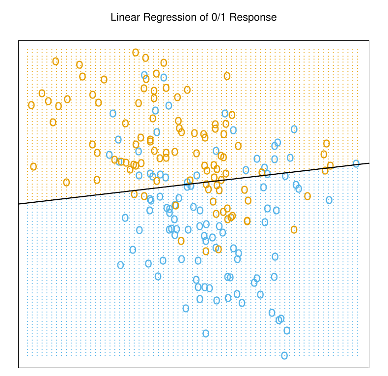{height="7.8em"}
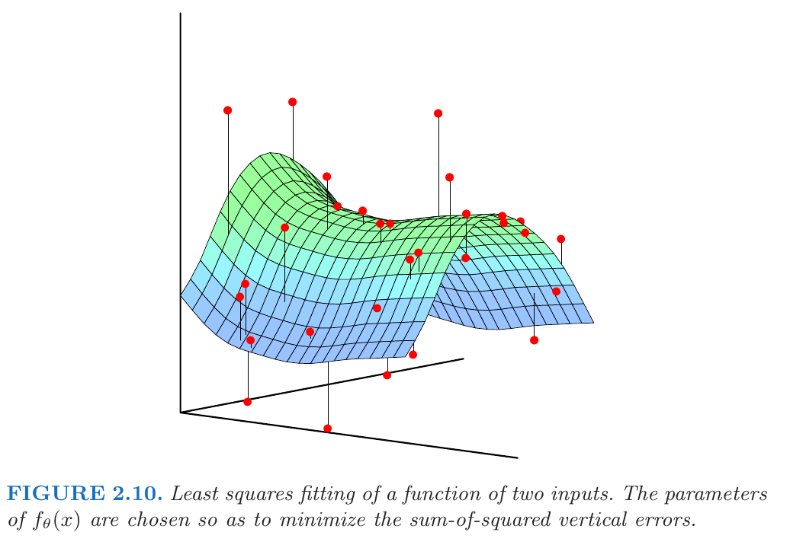{height="7.8em"}
:::

::: {.center-h .xs}
Classification and regression examples from *Elements of Statistical Learning*
:::

## Model Features

::: {.xs}
- **Features** are the measurable properties or characteristics we use to describe our data. They are the input variables that the algorithm uses to learn patterns and make predictions.
- Think of features as the "questions we ask" about each data point. In social science: age, education, income. In text analysis: word counts, sentence length, sentiment scores.
:::

::: {.center-h}
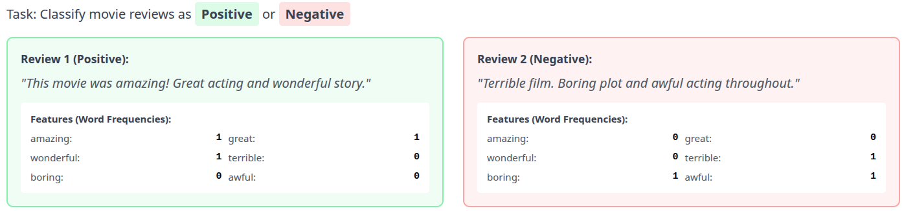{height="6.0em"}
:::

::: {.xxs}
**Feature Engineering:** the process of creating, selecting, and transforming features to improve model performance. It's about deciding *which* features to use and *how* to represent them. Examples: instead of just word counts, we might create features for word combinations (bigrams), the ratio of positive to negative words, or the presence of exclamation marks.
:::

## Features in Text Classification: TF-IDF {.fit3}

::: {.xs}
**The Problem with Simple Word Counts**

Words like "the", "and", "is" appear frequently in every document but tell us nothing about sentiment. Meanwhile, distinctive words like "amazing" or "terrible" are very informative.

**The TF-IDF Solution:** TF-IDF (Term Frequency&ndash;Inverse Document Frequency) gives each word a score that balances how often it appears in a document with how rare it is across all documents.

- **Term Frequency (TF):** how often does the word appear in this document?

  $$\text{TF} = \frac{\text{count of word}}{\text{total words in document}}$$

- **Inverse Document Frequency (IDF):** how rare is the word across all documents?

  $$\text{IDF} = \log \frac{\text{total documents}}{\text{documents with word}}$$

- **TF-IDF score** of each word: &nbsp; $\text{TF-IDF} = \text{TF} \times \text{IDF}$

Words that are frequent in a document BUT rare overall get high scores.
:::

::: {.refresh .xs}
Exercise: guess the highest and lowest TF-IDF scores in the example of the previous slide
:::

## Error and Loss {.fit2}

:::: {.columns}
::: {.column width="50%"}
::: {.xs}
[**Error**]{style="color:#00a9e0;font-weight:700"}

The difference between what the model predicted and the true value for a **single example**.

$$\text{Error} = \text{Prediction} - \text{True Value} \quad \text{or } \hat{y} - y$$
:::
:::

::: {.column width="50%"}
::: {.xs}
[**Loss**]{style="color:#00a9e0;font-weight:700"}

A function that measures the total error across **all examples** in the dataset. The goal of training is to minimize the loss.

$$\text{Loss} = \text{Average of errors (with different formulas)}$$
:::
:::
::::

:::: {.columns}
::: {.column width="62%"}
::: {.tbl-grid .xxs}
| Review | True Label ($y$) | Prediction ($\hat{y}$) | Correct? | Error |
|---|---|---|---|---|
| "Amazing film!" | 1 (Positive) | 1 (Positive) | ✓ Yes | 1&minus;1 = 0 |
| "Terrible movie" | 0 (Negative) | 1 (Positive) | ✗ No | 1&minus;0 = 1 |
| "Loved it!" | 1 (Positive) | 1 (Positive) | ✓ Yes | 1&minus;1 = 0 |
| "Boring film" | 0 (Negative) | 0 (Negative) | ✓ Yes | 0&minus;0 = 0 |
| "Not good" | 0 (Negative) | 1 (Positive) | ✗ No | 1&minus;0 = 1 |
:::
:::

::: {.column width="38%"}
::: {.xxs}
**Examples of Loss calculation:**

Number of Errors: **2 out of 5**

Error Rate (0-1 Loss): **2/5 = 40%**

Accuracy: **60%**

In regression: Mean Squared Error, Mean Absolute Error.
For probabilities: Cross-entropy
:::
:::
::::

## Class imbalance {.fit2}

::: {.xs}
**Class imbalance** occurs when one class appears much more frequently than others in the dataset. This is extremely common in real-world problems.

Examples: fraud detection (99% legitimate, 1% fraud), rare disease diagnosis (95% healthy, 5% sick), hate speech detection (90% normal posts, 10% hate speech)
:::

::: {.center-h .sm}
[**Accuracy is misleading under class imbalance**]{style="color:#00a9e0"}
:::

:::: {.columns}
::: {.column width="52%"}
::: {.xs}
**Example: Hate Speech Detection.**

Dataset: 1,000 social media posts: 900 normal posts, 100 hate speech posts (10% imbalance)

**Naive "Always Predict Normal" Model:**

- Correct on normal posts: **900/900**
- Correct on hate speech: **0/100**
- Accuracy: **90%**

Looks great but detects ZERO hate speech!
:::
:::

::: {.column width="48%"}
::: {.tag .xs}
**The Issue:** Accuracy treats all classes equally. A model can achieve high accuracy by just predicting the majority class every time, completely ignoring the minority class we actually care about!
:::
:::
::::

## The F1 Score {.fit2}

:::: {.columns}
::: {.column width="62%"}
::: {.xs}
- **Precision** 
  Of the posts we flagged as hate speech, how many actually were?

  `True Positives / (True Positives + False Positives)`

- **Recall** 
  Of all actual hate speech, how many did we catch?

  `True Positives / (True Positives + False Negatives)`

- **F1 Score** 
  Harmonic mean of precision and recall

  `2 × (P × R) / (P + R)`

In multi-class problems, the F1 Score can be calculated:

- for each class separately
- **Macro-average F1:** the mean of the F1 Score of each class
- **Micro-average F1:** a single score for all classifications together (larger classes weight more)
:::
:::

::: {.column width="38%"}
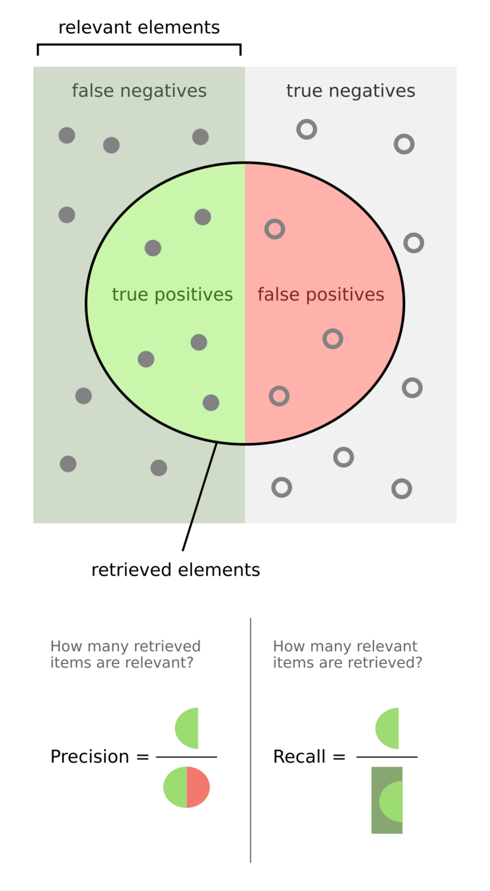{height="16.0em"}

::: {.source}
<http://en.wikipedia.org/wiki/Precision_and_recall>
:::
:::
::::

## Training/Test split - Bias and Variance {.fit1}

::: {.xs}
**The Ultimate Goal of (Machine) Learning: Generalization**

We don't just want a model that memorizes the training data. We want a model that performs well on **new, unseen data** from the real world. Generalization is what makes ML valuable.

To evaluate generalization, we split our data into two separate sets **before** training begins:
:::

:::: {.columns}
::: {.column width="50%"}
::: {.example .xs}
[Training Set (70-80%) 📚]{.label}
Used to train the model. The algorithm learns patterns from this data.

*Like practice exams for students*
:::
:::

::: {.column width="50%"}
::: {.example .xs}
[Test Set (20-30%) 📝]{.label}
Held back from training. Used only to evaluate final performance.

*Like the final exam &ndash; never seen before*
:::
:::
::::

::: {.xxs}
**Critical Rule:** the test set must remain completely separate and unseen during training!

**Information leakage:** when the train/test split is not well separated.
**Typical sources of leakage:** using the test set for feature engineering, or ignoring sample correlations, for example power users or high-activity periods in social media data.

**Cross-validation:** partitioning into many train/test splits and reporting average performance
:::

## Model Example: k Nearest Neighbors

:::: {.columns}
::: {.column width="46%"}
::: {.sm}
Classifying with $k$ nearest neighbors in a 0/1 task:
:::

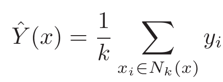{width="100%"}

::: {.sm}
$N_k(x)$: the $k$ nearest neighbors of $x$
:::
:::

::: {.column width="54%"}
::: {.center-h .sm}
Example for $k = 15$:
:::

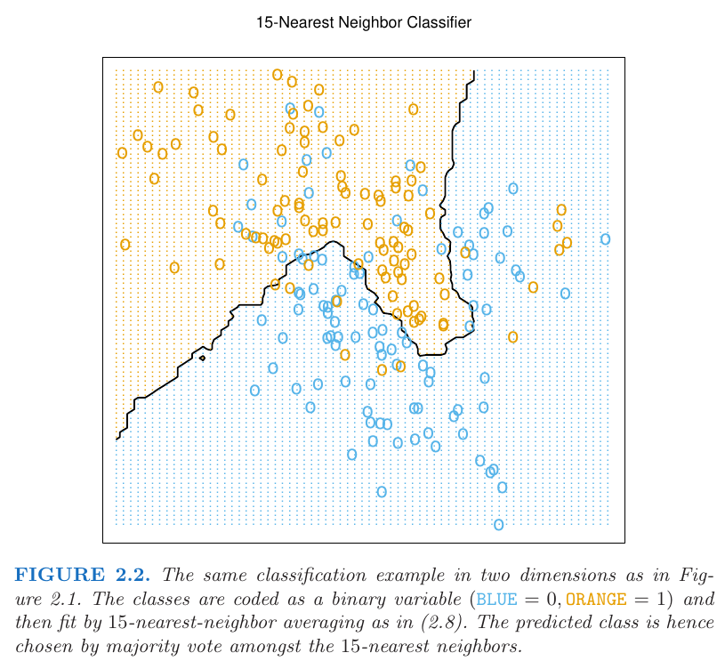{height="13.0em"}
:::
::::

## Model Example: k Nearest Neighbors

:::: {.columns}
::: {.column width="46%"}
::: {.sm}
Classifying with $k$ nearest neighbors in a 0/1 task:
:::

{width="100%"}

::: {.sm}
$N_k(x)$: the $k$ nearest neighbors of $x$
:::

::: {.refresh .xs}
Exercise: extend the model for more classes
:::
:::

::: {.column width="54%"}
::: {.center-h .sm}
Example for $k = 1$:
:::

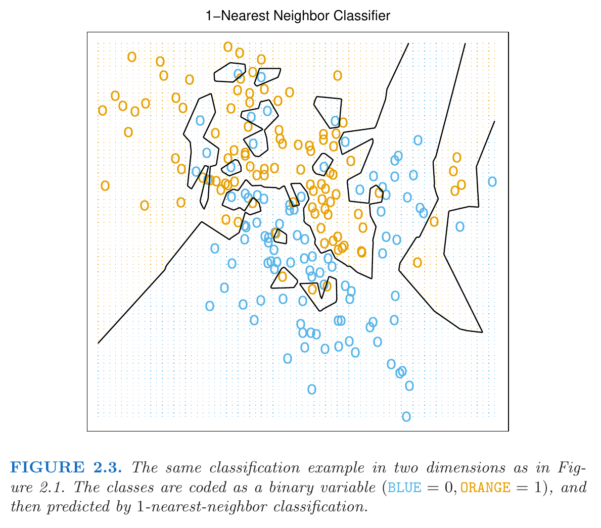{height="12.4em"}
:::
::::

## Overfitting and Underfitting

:::: {.columns}
::: {.column width="50%"}
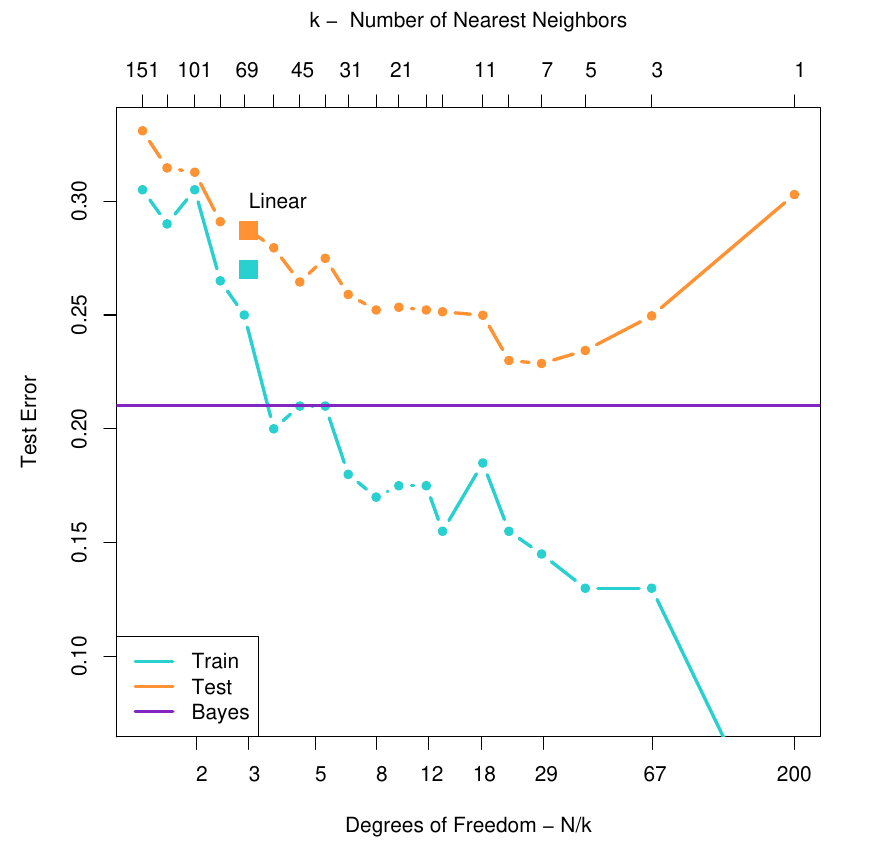{height="14.9em"}
:::

::: {.column width="50%"}
::: {.xs}
- Misclassification curves for kNN
  - Training size: 200
  - Test size: 10000
- **Orange:** test error
- **Blue:** training error

 

- **Bias:** models with very high $k$ (ca. 100) have high train and test errors &ndash; *underfitting!*
- **Variance:** models with very low $k$ (ca. 1) have very low train error but high test error &ndash; *overfitting!*
:::
:::
::::

## The Bias-Variance Tradeoff

:::: {.columns}
::: {.column width="42%"}
::: {.sm}
Consider **model complexity**

- e.g. number of parameters

 

Minimizing training error is a mistake that leads to high variance

 

**Bias-Variance tradeoff:** a middle range of complexity leads to the lowest possible test error
:::
:::

::: {.column width="58%"}
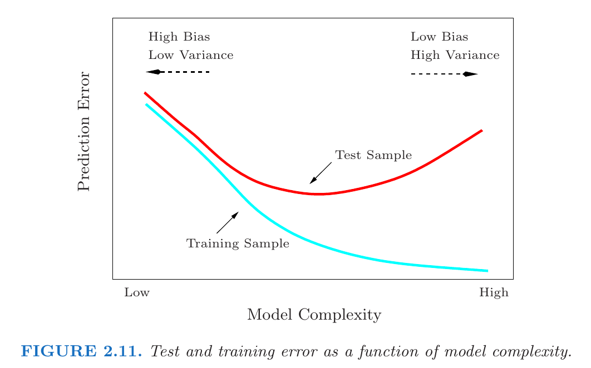{height="12.5em"}
:::
::::

## Linear Model Example: Naive Bayes {.fit2}

::: {.xs}
**Naive independence assumption:** features are independent of each other given the class, allowing us to decompose the joint probability into a product of individual feature probabilities.

**Bayesian classification:** for a feature vector $x = (x_1, x_2, \dots, x_d)$, the predicted class is:
:::

::: {.center-h .sm}
$\hat{y} = \arg\max_{c \in C} P(Y = c \mid X = x)$ &nbsp;&nbsp; applying Bayes' theorem: &nbsp; $\hat{y} = \arg\max_{c \in C} P(X = x \mid Y = c) \cdot P(Y = c)$
:::

::: {.center-h .sm}
Under the naive independence assumption:

$$\hat{y} = \arg\max_{c \in C} P(Y = c) \cdot \prod_{j=1}^{d} P(X_j = x_j \mid Y = c)$$
:::

::: {.xxs}
- $\hat{y}$ = predicted class, $Y$ = class variable, $C$ = set of all possible classes
- $X = (X_1, X_2, \dots, X_d)$ = feature vector with $d$ features
- $P(Y = c)$ = prior probability of class $c$
- $P(X_j = x_j \mid Y = c)$ = likelihood of feature $j$ having value $x_j$ given class $c$

Naive Bayes is a **linear model** because it has a decision boundary that can be written as a hyperplane in the feature space $X$
:::

## Nonlinear Model Example: Multi-Layer Perceptron (MLP) {.fit1}

:::: {.columns}
::: {.column width="54%"}
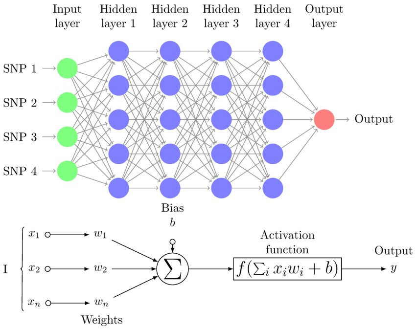{height="14.0em"}
:::

::: {.column width="46%"}
::: {.xs}
- Inspired by how neurons work: linear combination of inputs and nonlinear activation function
- **Features are the inputs of the first layer**
- The final output is a class or probability
- The complexity of the model grows with the number of hidden layers &ndash; more layers, more parameters
- **Fitting:** find connection weights that minimize loss
- **Nonlinear model:** it can fit more than just a hyperplane separating classes
:::
:::
::::

## Unsupervised Machine Learning

::: {.outline .focus}
1. Brief History of Artificial Intelligence and Machine Learning
2. Supervised Machine Learning
3. [Unsupervised Machine Learning]{.current}
4. Generative AI and ML nowadays
:::

## Unsupervised Machine Learning

::: {.sm}
**Unsupervised Learning** finds structures or patterns in data **without a target variable** that we try to predict.

In supervised learning we have pairs of feature vectors ($X$) and output or target values ($Y$), but in unsupervised learning we only have feature vectors ($X$).

Typical tasks for unsupervised learning:

- **Clustering:** partitioning the data into $K$ groups where elements are similar within groups
- **Dimensionality reduction:** transforming $X$ to a low-dimensional space maintaining similarity or variance (e.g. PCA)
- **Density estimation:** learning the underlying distribution of data values
- **Association discovery:** finding correlations or co-occurrence patterns
:::

## Clustering Example: Document Topics

::: {.xs}
**The Problem**

Given a large collection of **unlabeled** documents (articles, tweets, research papers, survey responses), we want to automatically discover the main topics or themes and group similar documents together.

This is **unsupervised** because we don't know in advance what topics exist or which documents belong to which topic.
:::

::: {.center-h}
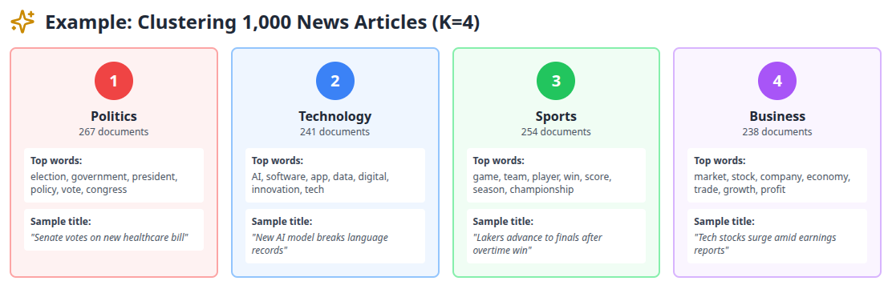{height="8.5em"}
:::

## Clustering with K-Means

::: {.center-h}
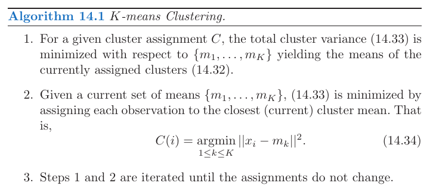{height="9.1em"}
:::

:::: {.columns}
::: {.column width="46%"}
::: {.center-h .sm}
Mean of cluster $S$
:::

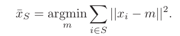{height="2.9em"}
:::

::: {.column width="54%"}
::: {.center-h .sm}
Total cluster variance
:::

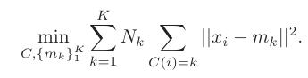{height="3.4em"}
:::
::::

## Clustering with K-Means

::: {.imgrow .middle}
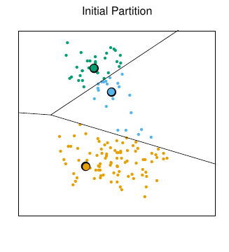{height="10.3em"}
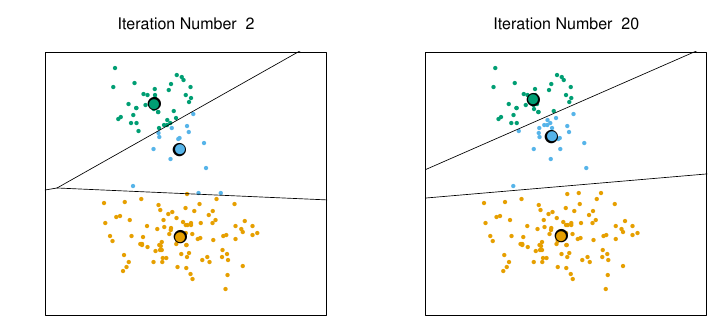{height="10.3em"}
:::

::: {.center-h .sm}
Examples from *Elements of Statistical Learning*
:::

## How to Choose K? The Elbow Method

:::: {.columns}
::: {.column width="38%"}
::: {.sm}
We assume there is a "natural" number of clusters for $K$
:::

::: {.imgrow .middle style="gap:0.6em"}
{height="2.5em"}
:::

::: {.center-h .xs}
$K$ too small
:::

::: {.imgrow .middle style="gap:0.6em"}
{height="2.5em"}
:::

::: {.center-h .xs}
$K$ just right
:::

::: {.imgrow .middle style="gap:0.6em"}
{height="2.5em"}
:::

::: {.center-h .xs}
$K$ too large
:::
:::

::: {.column width="62%"}
::: {.center-h .sm}
Within-Cluster Sum of Squares (WSS):
:::

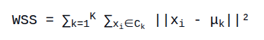{width="92%"}

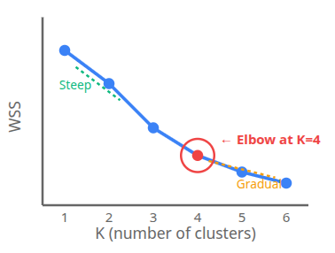{height="7.8em"}

::: {.center-h .xs}
After the elbow, additional clusters barely reduce the WSS
:::
:::
::::

## Generative AI and ML nowadays

::: {.outline .focus}
1. Brief History of Artificial Intelligence and Machine Learning
2. Supervised Machine Learning
3. Unsupervised Machine Learning
4. [Generative AI and ML nowadays]{.current}
:::

## Predictive versus Generative Models

::: {.sm}
**Predictive** models aim to predict just one variable ($Y$), while **generative** models aim to produce new examples of data points ($X$).

Example for text:
:::

:::: {.columns}
::: {.column width="50%"}
::: {.xs}
**Predictive (Discriminative)**

Models the conditional probability of a label given the text:

$$P(y \mid x)$$

where $y$ is the label/class and $x$ is the input text

*Example:* $P(\text{sentiment} = \text{positive} \mid x)$ with $x$ = "I loved this movie"
:::
:::

::: {.column width="50%"}
::: {.xs}
**Generative**

Models the joint probability or the probability of text:

$$P(x) \quad \text{or} \quad P(x_t \mid x_1, \dots, x_{t-1})$$

Predicts the next token given previous tokens (**autoregressive**)

*Example:* $P(x_t = \text{movie} \mid \text{I loved this})$
:::
:::
::::

## Large Language Models {.fit1}

:::: {.columns}
::: {.column width="50%"}
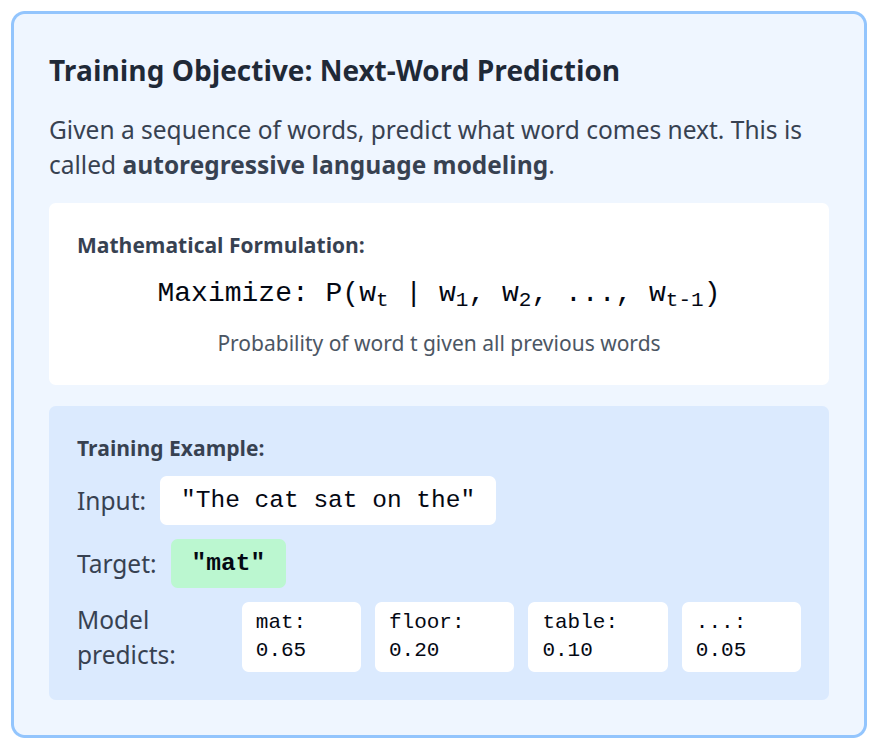{height="13.5em"}
:::

::: {.column width="50%"}
::: {.xs}
**Training Process (Simplified)**

1. **Collect massive text data**
2. **Create training examples** For each position, use previous words as input, next word as target
3. **Train neural network** Update billions of parameters minimizing prediction error
4. **Repeat trillions of times** Process enormous amounts of text until the model learns language patterns
:::

::: {.tag .xs}
Note: some of today's slides were co-created with Claude. But this works thanks to the fact that I already know what Claude should say!
:::
:::
::::

## Geoffrey Hinton: The Godfather of AI {.fit2}

:::: {.columns}
::: {.column width="34%"}
{height="8.0em"}
:::

::: {.column width="66%"}
::: {.sm}
Geoffrey Hinton (born 1947) is a British-Canadian cognitive psychologist and computer scientist whose pioneering work on neural networks laid the foundation for modern AI, including generative models like ChatGPT, DALL-E, and Stable Diffusion.

- **2024 Nobel Prize &ndash; Physics** (for neural networks)
- **2018 Turing Award** &ndash; with Bengio and LeCun
:::
:::
::::

::: {.example .sm}
Hinton describes AI as a kind of **intuition** rather than intelligence. Our intuition discovers patterns we cannot explain and that might not be useful for intervention or design. But it is a very useful tool for creativity and prediction.
:::

## Ethical issues with ML and Responsible AI {.fit1}

::: {.xs}
- **Can we use a model for a prediction?**
  - e.g. historical training data for unemployment benefits
- **What features are allowed for a prediction?**
  - e.g. against human rights to use ethnicity as a predictor for criminality
- **Who are we generalizing for?**
  - e.g. computer vision models not detecting non-white faces
- **Under which conditions was data gathered?**
  - e.g. text authors did not express agreement with it being used to train generative text models (labor loss)
- **Can we trust an AI model?**
  - people have a right to an explanation of a prediction (credit scores)
- **Who is responsible for model mistakes?**
- **Responsible AI:** not just preventing harm, but preventing AI from shifting power to the already powerful. Compels to AI development but safely.
:::

## Summary {.fit1}

::: {.sm}
- **AI and Machine Learning**
  - Machine Learning as finding patterns from data
- **Supervised Machine Learning**
  - Predicting the value of a variable $Y$ from features $X$
  - Bias-Variance Tradeoff, Train-Test split
  - Linear and nonlinear models: Naive Bayes and MLP
- **Unsupervised Machine Learning**
  - Finding patterns and structures in feature space $X$
  - Clustering as example &ndash; K-Means
- **AI nowadays:** Generative models, ML ethics and Responsible AI
:::

**Next session:** Databases

## Appendix: Clever Hans

::: {.center-h}
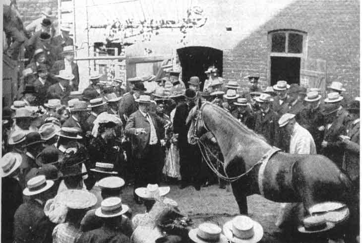{height="11.4em"}
:::

## Appendix: Flocksourcing

::: {.center-h}
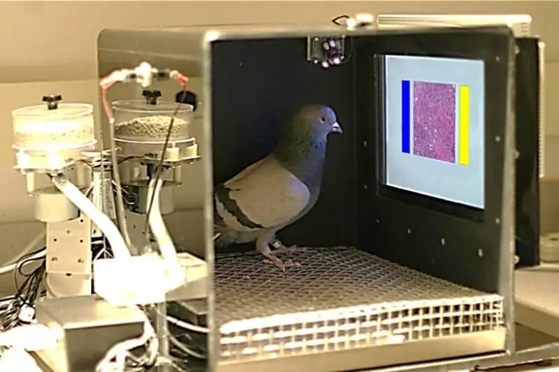{height="11.4em"}
:::

## Appendix: The Double Descent

::: {.center-h}
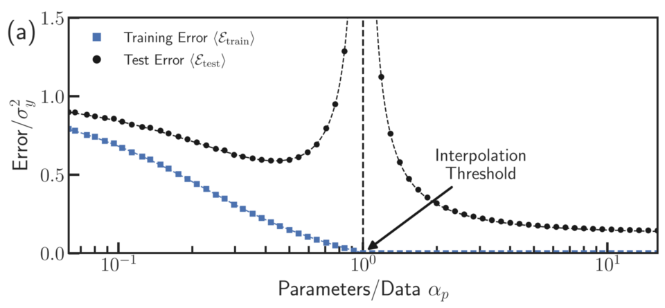{height="13.9em"}
:::

## Appendix: One Parameter is Always Enough

::: {.center-h}
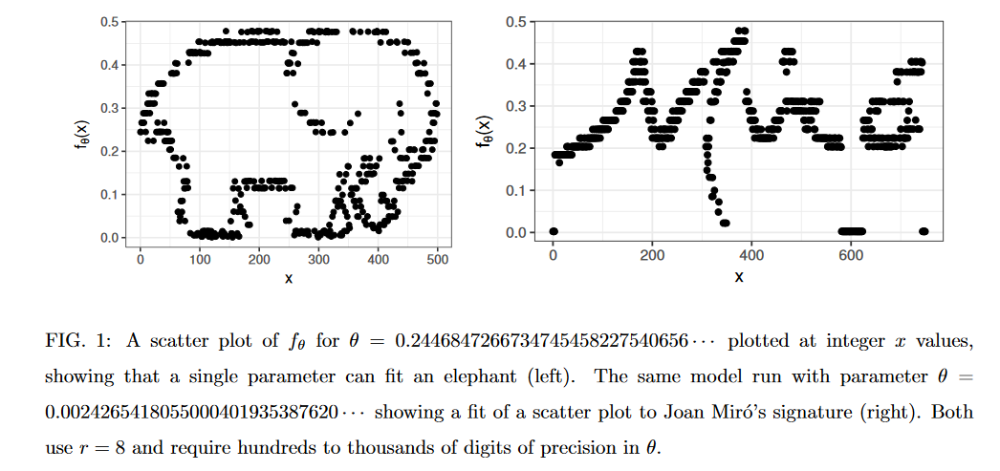{height="15.1em"}
:::

## Appendix: Adversarial 3D-printed Turtle

::: {.center-h}
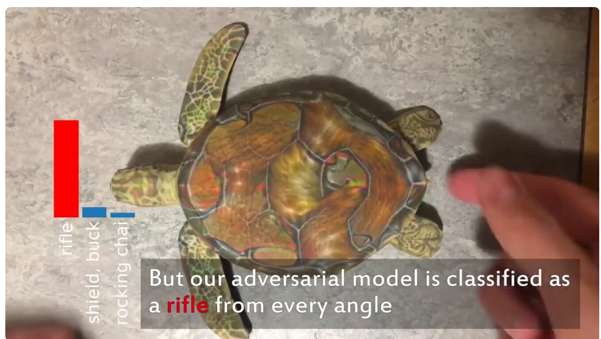{height="11.6em"}
:::

## Appendix: Microsoft Tay

::: {.center-h}
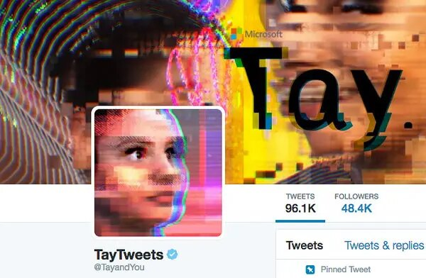{height="11.4em"}
:::

## Appendix: Fooling Gaydars

::: {.center-h}
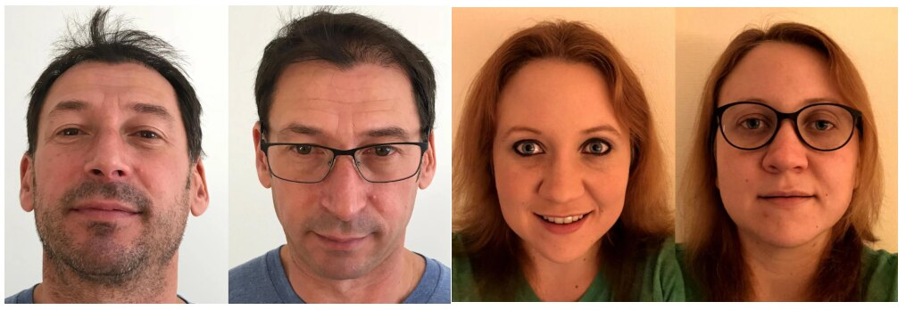{height="9.0em"}
:::

## Appendix: Shadow Profiles

::: {.center-h}
{height="10.4em"}
:::
