## Course Outline

:::: {.columns}
::: {.column width="50%"}
::: {.sm}
- Session 1: Introduction
- Session 2: Information Coding
- Session 3: Data Structures
- Session 4: Software
- Session 5: Algorithms
- Session 6: Recursion
- Session 7: Sorting Algorithms
:::
:::

::: {.column width="50%"}
::: {.sm}
- Session 8: Time Complexity
- Session 9: Theoretical Computer Science
- Session 10: Machine Learning
- Session 11: Databases
  - Tutorial: Databases (swap)
  - Exercise: DB + projects Q&A
- Session 12: Parallel Programming
- Session 13: Social Science Applications
- Session 14: Exam Review
:::
:::
::::

## Overview

::: {.outline}
- Databases
- Relational Databases
- Structured Query Language (SQL)
:::

## Overview {.fit1}

::: {.outline}
- Databases
- Relational Databases
- Structured Query Language (SQL)
- NoSQL databases
:::

:::: {.columns}
::: {.column width="70%"}
:::

::: {.column width="30%"}
::: {.center-h .sm}
Recommended: Chapter 4
:::

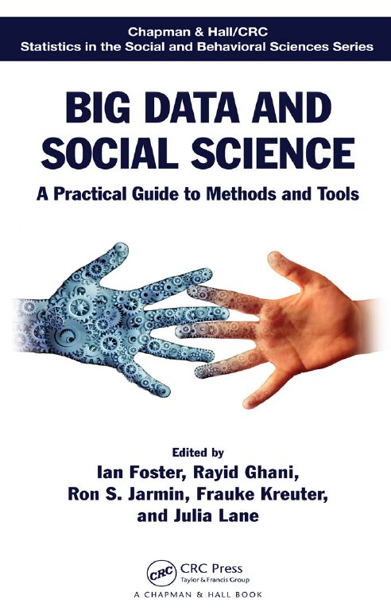{height="7.4em"}
:::
::::


<!-- MOTIVATION:M11-A:BEGIN -->
## The 15 841 cases that fell off the end of a spreadsheet {.fit1}

::: {.motivation}
[Motivating example]{.label}
Between 25 September and 2 October 2020, Public Health England lost **15 841
positive COVID-19 test results**. Labs sent results as CSV; the collating process
used an old spreadsheet format whose worksheets hold **65 536 rows**. When a file
exceeded that, the extra rows were simply not read. **No error appeared.**
:::

:::: {.figures}
::: {.fq}
[15 841]{.big}[positive cases lost]{.cap}
:::
::: {.fq}
[65 536]{.big}[row limit, silently applied]{.cap}
:::
::: {.fq}
[~50 000]{.big}[contacts never traced]{.cap}
:::
::::

[What does a database give you that a file on someone's computer does not?]{.ask}

::: {.source}
BBC News and *The Guardian*, 5 October 2020; Public Health England statement
:::
<!-- MOTIVATION:M11-A:END -->

<!-- MOTIVATION:M11-B:BEGIN -->
## Two seats, one airplane

::: {.motivation}
[Motivating example]{.label}
Two travel agents, in two cities, book the last seat on the same flight in the
**same second**. Each system checked availability, found one seat free, and sold
it. Both passengers have a valid booking and a boarding pass.
:::

- Neither program has a bug. Each is correct **on its own**.
- The failure only exists **between** them.

[What has to be guaranteed for "check, then book" to be safe when thousands of people do it at once?]{.ask}
<!-- MOTIVATION:M11-B:END -->

<!-- MOTIVATION:M11-C:BEGIN -->
## Whose number is right?

::: {.motivation}
[Motivating example]{.label}
Three people in a department each keep a copy of the participant list. One
corrects a misspelled name, one adds the new wave, one removes a withdrawn
respondent. Three months later the three files disagree about how many
participants there are, by **47**.
:::

- Everyone did their job correctly.
- There is **no version that is right**, and no way to reconstruct one.

[Where should a fact live, so that changing it once changes it everywhere?]{.ask}
<!-- MOTIVATION:M11-C:END -->

## Database example: Flight reservations

::: {.center-h}
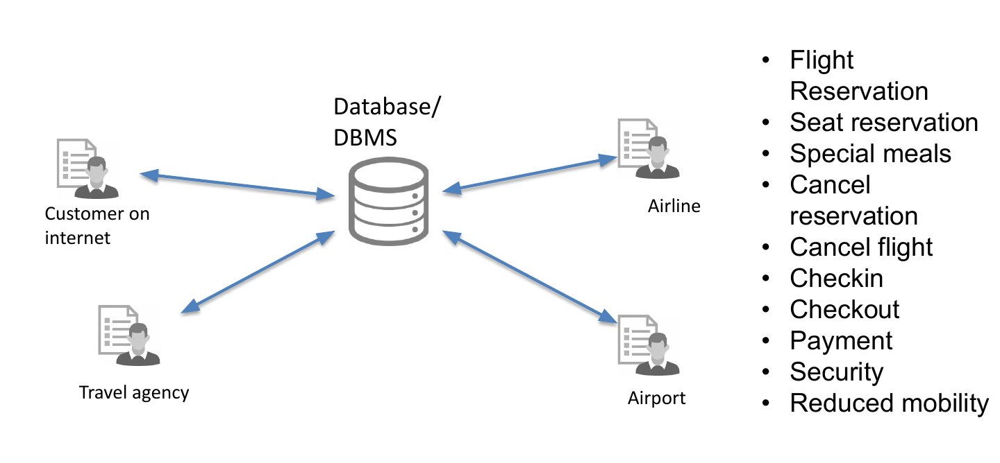{height="14.4em"}
:::

## Database example: Vaccine distribution

::: {.center-h}
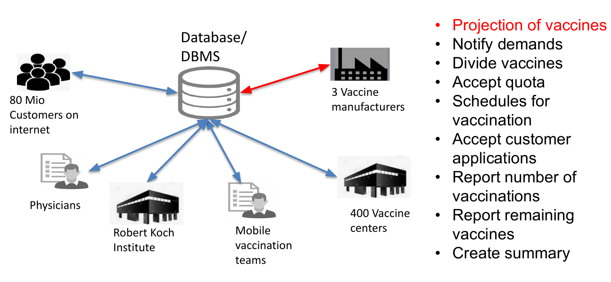{height="14.4em"}
:::

## Database example: Vaccine distribution

::: {.center-h}
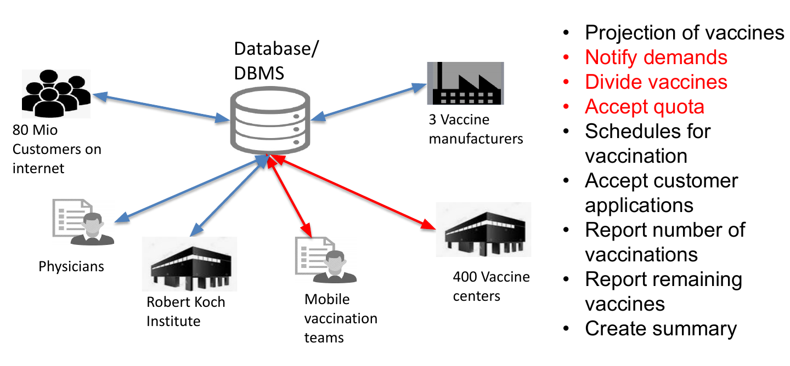{height="14.4em"}
:::

## Database example: Vaccine distribution

::: {.center-h}
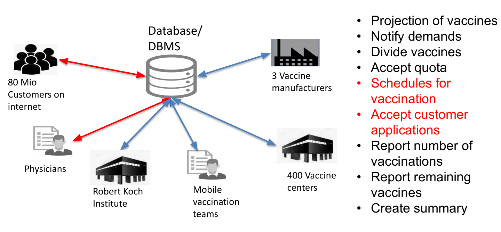{height="14.4em"}
:::

## Database example: Vaccine distribution

::: {.center-h}
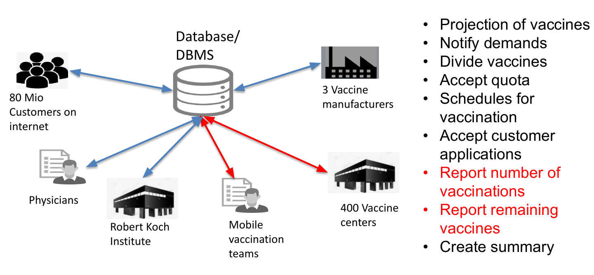{height="14.4em"}
:::

## Database example: Vaccine distribution

::: {.center-h}
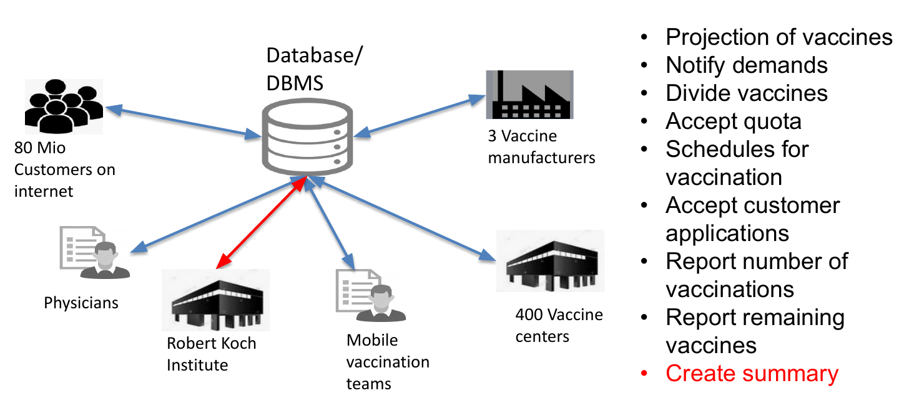{height="14.4em"}
:::

## Databases

::: {.sm}
- **What is a database?**
  - Informal definition: an organized collection of data
    - an Excel table is a (very simple) database
    - enables fast access and the ability to access data in a structured way
- **What is a database management system (DBMS)?**
  - software application that enables interaction between the user and the actual database
  - implements defining, creating, querying, updating and administering a database
  - data may be distributed at different locations
  - examples: MySQL, PostgreSQL, Access, Oracle
:::

## Databases and DBMS

::: {.definition}
[Definition: Database]{.label}

::: {.sm}
A **database (DB)** is a set of related data and the formal organization and interdependence of these data. Access and manipulation of data are provided through a corresponding **database management system (DBMS)**.
:::
:::

:::: {.columns}
::: {.column width="46%"}
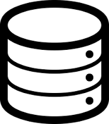{height="5.0em"}
:::

::: {.column width="54%"}
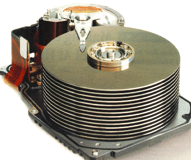{height="5.0em"}
:::
::::

::: {.center-h .xs}
A frequent icon to symbolize a database, represented by a hard drive disk platter
:::

## Characteristics of DBMS

:::: {.columns}
::: {.column width="38%"}
::: {.tbl-grid style="font-size:0.72em"}
| Name | Birth | Class | Product | Num |
|---|---|---|---|---|
| … | … | … | … | … |
| … | … | … | … | … |
| … | … | … | … | … |
| … | … | … | … | … |
| … | … | … | … | … |
| … | … | … | … | … |
| … | … | … | … | … |
| … | … | … | … | … |
:::
:::

::: {.column width="62%"}
::: {.center-h .xs}
**Characteristics of database management systems**
:::

::: {.xs}
- **data definition:** create, modify, delete the definitions defining the organization of data, i.e., the relationship among entries in the database
:::
:::
::::

## Characteristics of DBMS

:::: {.columns}
::: {.column width="38%"}
::: {.tbl-grid style="font-size:0.72em"}
| Name | Birth | Class | Product | Num |
|---|---|---|---|---|
| Hans | 1998 | T1 | Milk | 00111 |
| Fred | 1999 | T1 | Tea | 00222 |
| Hans | 1998 | T1 | Tea | 00222 |
| Anna | 2000 | W1 | Milk | 00111 |
| Pat | 1998 | W1 | Tea | 00222 |
| Hans | 1998 | T1 | Milk | 00111 |
| Anna | 2000 | W1 | Milk | 00111 |
| Fred | 1999 | T1 | Milk | 00111 |
:::
:::

::: {.column width="62%"}
::: {.center-h .xs}
**Characteristics of database management systems**
:::

::: {.xs}
- **data definition:** create, modify, delete the definitions defining the organization of data, i.e., the relationship among entries in the database
- **updating:** insert, modify and delete the actual content, i.e., individual data entries in the database
:::
:::
::::

## Characteristics of DBMS

:::: {.columns}
::: {.column width="38%"}
::: {.tbl-grid style="font-size:0.72em"}
| Name | Birth | Class | Product | Num |
|---|---|---|---|---|
| Hans | 1998 | T1 | Milk | 00111 |
| Fred | 1999 | T1 | Tea | 00222 |
| Hans | 1998 | T1 | Tea | 00222 |
| Anna | 2000 | W1 | Milk | 00111 |
| Pat | 1998 | W1 | Tea | 00222 |
| Hans | 1998 | T1 | Milk | 00111 |
| Anna | 2000 | W1 | Milk | 00111 |
| Fred | 1999 | T1 | Milk | 00111 |
:::

::: {.tag .xs}
Product = Tea and Birth < 1999 ?
:::
:::

::: {.column width="62%"}
::: {.center-h .xs}
**Characteristics of database management systems**
:::

::: {.xs}
- **data definition:** create, modify, delete the definitions defining the organization of data, i.e., the relationship among entries in the database
- **updating:** insert, modify and delete the actual content, i.e., individual data entries in the database
- **retrieval or querying:** return information, given specific query inputs, that can be used by any downstream application
:::
:::
::::

## Characteristics of DBMS

:::: {.columns}
::: {.column width="38%"}
::: {.tbl-grid style="font-size:0.72em"}
| Name | Birth | Class | Product | Num |
|---|---|---|---|---|
| Hans | 1998 | T1 | Milk | 00111 |
| Fred | 1999 | T1 | Tea | 00222 |
| Hans | 1998 | T1 | Tea | 00222 |
| Anna | 2000 | W1 | Milk | 00111 |
| Pat | 1998 | W1 | Tea | 00222 |
| Hans | 1998 | T1 | Milk | 00111 |
| Anna | 2000 | W1 | Milk | 00111 |
| Fred | 1999 | T1 | Milk | 00111 |
:::
:::

::: {.column width="62%"}
::: {.center-h .xs}
**Characteristics of database management systems**
:::

::: {.xs}
- **data definition:** create, modify, delete the definitions defining the organization of data, i.e., the relationship among entries in the database
- **updating:** insert, modify and delete the actual content, i.e., individual data entries in the database
- **retrieval or querying:** return information, given specific query inputs, that can be used by any downstream application
- **administration:** user management, data security, performance, data integrity, concurrency, protection against database corruption and system failure
:::
:::
::::

## Why to use a database? {.fit2}

::: {.sm}
- **data independence:** applications (and users) do not need to worry about how data are structured and stored
  - *logical data independence:* protection from changes to the logical structure of the data, e.g. add a new entity or attribute without affecting usage
  - *physical data independence:* protection from physical layout changes, e.g. the user does not have to care about information coding, disk space, etc.
- **standardization**
  - data formats, methods of accessing data, etc. are platform independent
    - recall: problems parsing a `.csv` file with conflict events in Python
  - flexible output schemas serving different users and purposes
- **concurrency**
  - allows simultaneous usage by many users without the problem of conflicting updates
  - robust protocols that avoid database corruption
:::

## Database Transactions: ACID properties {.fit1}

::: {.sm}
A **transaction** is a series of data manipulations that must not be interrupted. All operations in a transaction have to be fully performed or completely rewound.

Database transactions have the following properties:

- **A**tomicity
  - each transaction stands on its own; a rewind is possible
- **C**onsistency
  - ensures that any transaction that succeeds maintains the validity of the database
- **I**solation
  - ensures that it does not matter whether we execute our transactions serially or concurrently
- **D**urability
  - requires that any transaction that has completed will survive permanently (also on error, crash, loss of power)
:::

## Relational Databases

::: {.outline .focus}
- Databases
- [Relational Databases]{.current}
- Structured Query Language (SQL)
:::

## Database Models {.fit1}

::: {.sm}
**Database models** fundamentally define database structure

- set the logical structure of the database in terms of data storage, organization and manipulation
- ultimately about how the relationship between related information is represented
- examples:
  - **flat model**, a.k.a. spreadsheets:
    - a single, two-dimensional array of data elements
    - members of a row are related, i.e. an "entry"
    - members of a column describe the same property or characteristic
  - **relational model**:
    - representation through sets of linked tables that share a common key
    - intuition: many spreadsheets storing specific pieces of information, linked via a unique key
:::

## Flat model example

::: {.tbl-grid .xs}
| Name | Birth | Class | Product | Productnr | Date |
|---|---|---|---|---|---|
| Hans | 1998 | T1 | Milk | 00111 | 06.03.2020 |
| Fred | 1999 | T1 | Tea | 00222 | 06.03.2020 |
| Hans | 1998 | T1 | Tea | 00222 | 06.03.2020 |
| Anna | 2000 | W1 | Milk | 00111 | 06.03.2020 |
| Verena | 1998 | W1 | Tea | 00222 | 07.03.2020 |
| Hans | 1998 | T1 | Milk | 00111 | 07.03.2020 |
| Anna | 2000 | W1 | Milk | 00111 | 08.03.2020 |
| Fred | 1999 | T1 | Milk | 00111 | 08.03.2020 |
:::

## Flat model example

::: {.tbl-grid .xs}
| Name | Birth | Class | Product | Productnr | Date |
|---|---|---|---|---|---|
| Hans | 1998 | T1 | Milk | 00111 | 06.03.2020 |
| Fred | 1999 | T1 | Tea | 00222 | 06.03.2020 |
| Hans | 1998 | T1 | Tea | 00222 | 06.03.2020 |
| Anna | 2000 | W1 | Milk | 00111 | 06.03.2020 |
| Verena | 1998 | W1 | Tea | 00222 | 07.03.2020 |
| Hans | 1998 | T1 | Milk | 00111 | 07.03.2020 |
| Anna | 2000 | W1 | Milk | 00111 | 08.03.2020 |
| Fred | 1999 | T1 | Milk | 00111 | 08.03.2020 |
:::

::: {.sm}
**Data is repeated across the table**

- Inefficient use of space
- Problems updating: what if the Productnr of Milk is now 00333?
:::

## Building a relational database

:::: {.columns}
::: {.column width="46%"}
::: {.center-h .xs}
**Table purchase**
:::

::: {.tbl-grid .xs}
| Nr | Date | Name | Product |
|---|---|---|---|
| 1 | 06.03.2020 | 1 | 1 |
| 2 | 06.03.2020 | 2 | 2 |
| 3 | 06.03.2020 | 1 | 2 |
| 4 | 06.03.2020 | 3 | 1 |
| 5 | 07.03.2020 | 4 | 2 |
| 6 | 07.03.2020 | 1 | 1 |
| 7 | 08.03.2020 | 3 | 1 |
| 8 | 08.03.2020 | 2 | 1 |
:::

::: {.center-h .xs}
**Primary key**
:::
:::

::: {.column width="54%"}
::: {.center-h .xs}
**Table Names**
:::

::: {.tbl-grid .xs}
| Nr | Name | Birth | Class |
|---|---|---|---|
| 1 | Hans | 1998 | T1 |
| 2 | Fred | 1999 | T1 |
| 3 | Anna | 2000 | W1 |
| 4 | Verena | 1998 | W1 |
:::

::: {.center-h .xs}
**Table Product**
:::

::: {.tbl-grid .xs}
| Nr | Product | Productnr |
|---|---|---|
| 1 | Milk | 00111 |
| 2 | Tea | 00222 |
:::
:::
::::

## Building a relational database

:::: {.columns}
::: {.column width="46%"}
::: {.center-h .xs}
**Table purchase**
:::

::: {.tbl-grid .xs}
| Nr | Date | Name | Product |
|---|---|---|---|
| 1 | 06.03.2020 | 1 | 1 |
| 2 | 06.03.2020 | 2 | 2 |
| 3 | 06.03.2020 | 1 | 2 |
| 4 | 06.03.2020 | 3 | 1 |
| 5 | 07.03.2020 | 4 | 2 |
| 6 | 07.03.2020 | 1 | 1 |
| 7 | 08.03.2020 | 3 | 1 |
| 8 | 08.03.2020 | 2 | 1 |
:::

::: {.center-h .xs}
**Foreign keys** reference primary keys<br>(on another table or the same table)
:::
:::

::: {.column width="54%"}
::: {.center-h .xs}
**Table Names**
:::

::: {.tbl-grid .xs}
| Nr | Name | Birth | Class |
|---|---|---|---|
| 1 | Hans | 1998 | T1 |
| 2 | Fred | 1999 | T1 |
| 3 | Anna | 2000 | W1 |
| 4 | Verena | 1998 | W1 |
:::

::: {.center-h .xs}
**Table Product**
:::

::: {.tbl-grid .xs}
| Nr | Product | Productnr |
|---|---|---|
| 1 | Milk | 00111 |
| 2 | Tea | 00222 |
:::
:::
::::

## Relational database: normal form example

:::: {.columns}
::: {.column width="42%"}
::: {.center-h .xs}
**Table purchase**
:::

::: {.tbl-grid .xs}
| Nr | Date | Name | Product |
|---|---|---|---|
| 1 | 06.03.2020 | 1 | 1 |
| 2 | 06.03.2020 | 2 | 2 |
| 3 | 06.03.2020 | 1 | 2 |
| 4 | 06.03.2020 | 3 | 1 |
| 5 | 07.03.2020 | 4 | 2 |
| 6 | 07.03.2020 | 1 | 1 |
| 7 | 08.03.2020 | 3 | 1 |
| 8 | 08.03.2020 | 2 | 1 |
:::
:::

::: {.column width="34%"}
::: {.center-h .xs}
**Table Names**
:::

::: {.tbl-grid .xs}
| Nr | Name | Birth | Class |
|---|---|---|---|
| 1 | Hans | 1998 | 1 |
| 2 | Fred | 1999 | 1 |
| 3 | Anna | 2000 | 2 |
| 4 | Verena | 1998 | 2 |
:::

::: {.center-h .xs}
**Table Product**
:::

::: {.tbl-grid .xs}
| Nr | Product | Productnr |
|---|---|---|
| 1 | Milk | 00111 |
| 2 | Tea | 00222 |
:::
:::

::: {.column width="24%"}
::: {.center-h .xs}
**Table Classes**
:::

::: {.tbl-grid .xs}
| Nr | Name |
|---|---|
| 1 | T1 |
| 2 | W1 |
:::
:::
::::

::: {.xs}
- Relational database designs can be standardized using **normal forms**
- For example here: Class should be its own table
:::

## Relational database: normal form example

:::: {.columns}
::: {.column width="42%"}
::: {.center-h .xs}
**Table purchase**
:::

::: {.tbl-grid .xs}
| Nr | Date | Name | Product |
|---|---|---|---|
| 1 | 06.03.2020 | 1 | 1 |
| 2 | 06.03.2020 | 2 | 2 |
| 3 | 06.03.2020 | 1 | 2 |
| 4 | 06.03.2020 | 3 | 1 |
| 5 | 07.03.2020 | 4 | 2 |
| 6 | 07.03.2020 | 1 | 1 |
| 7 | 08.03.2020 | 3 | 1 |
| 8 | 08.03.2020 | 2 | 1 |
:::
:::

::: {.column width="34%"}
::: {.center-h .xs}
**Table Names**
:::

::: {.tbl-grid .xs}
| Nr | Name | Birth | Class |
|---|---|---|---|
| 1 | Hans | 1998 | 1 |
| 2 | Fred | 1999 | 1 |
| 3 | Anna | 2000 | 2 |
| 4 | Verena | 1998 | 2 |
:::

::: {.center-h .xs}
**Table Product**
:::

::: {.tbl-grid .xs}
| Nr | Product | Productnr |
|---|---|---|
| 1 | Milk | 00111 |
| 2 | Tea | 00222 |
:::
:::

::: {.column width="24%"}
::: {.center-h .xs}
**Table Classes**
:::

::: {.tbl-grid .xs}
| Nr | Name |
|---|---|
| 1 | T1 |
| 2 | W1 |
:::
:::
::::

::: {.xs}
Now we can update the name of a class to another one without having to edit the purchase table
:::

## Structured Query Language (SQL)

::: {.outline .focus}
- Databases
- Relational Databases
- [Structured Query Language (SQL)]{.current}
:::

## SQL Programming Language {.fit1}

::: {.sm}
- special-purpose language specifically developed for managing data through relational database systems
- consists of three (co-dependent) language definitions
  - **data definition language (DDL)**
    - define relational schemata
    - create / alter / delete tables and their attributes
  - **data manipulation language (DML)**
    - insert / delete / modify entries in tables
    - query one or more tables
  - **data control language (DCL)**
    - control access to data stored in the database
    - grant / revoke / modify user access rights
:::

## SQL Programming Language {.fit1}

::: {.sm}
- SQL is a very **high-level** programming language
  - performance is good because the actual operations are optimized well
  - many different standards, but typical DBMS support all
  - execution is highly parallelizable by construction
- SQL is a **declarative** language
  - You define *what* you want, the DBMS takes care of *how* to do it
  - You can also do "procedural SQL" with special instructions, but it is very inefficient
:::

::: {.center-h}
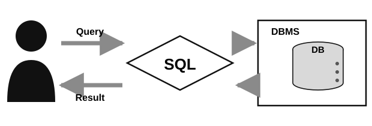{height="6.6em"}
:::

## Tables in SQL

:::: {.columns}
::: {.column width="48%"}
::: {.definition}
[Tables]{.label}
A multiset of tuples coding the attributes specified by the database schema.
:::

::: {.sm}
- Tables are also called **relations**
- Tuples are also called **rows**
- Attributes are also called **columns**
:::
:::

::: {.column width="52%"}
::: {.tbl-name}
Product
:::

::: {.tbl-product}
| PName | Price | Manufacturer |
|---|---|---|
| Gizmo | $19.99 | GizmoWorks |
| Powergizmo | $29.99 | GizmoWorks |
| SingleTouch | $149.99 | Canon |
| MultiTouch | $203.99 | Hitachi |
:::
:::
::::

## Tables in SQL

:::: {.columns}
::: {.column width="48%"}
::: {.definition}
[Tables]{.label}
A multiset of tuples coding the attributes specified by the database schema.
:::

::: {.sm}
- Tables are also called **relations**
- Tuples are also called **rows**
- Attributes are also called **columns**
:::
:::

::: {.column width="52%"}
::: {.tbl-name}
Product
:::

::: {.tbl-product .hl-relation}
| PName | Price | Manufacturer |
|---|---|---|
| Gizmo | $19.99 | GizmoWorks |
| Powergizmo | $29.99 | GizmoWorks |
| SingleTouch | $149.99 | Canon |
| MultiTouch | $203.99 | Hitachi |
:::

::: {.center-h .sm}
**Table (relation)**
:::
:::
::::

## Tables in SQL

:::: {.columns}
::: {.column width="48%"}
::: {.definition}
[Tables]{.label}
A multiset of tuples coding the attributes specified by the database schema.
:::

::: {.sm}
- Tables are also called **relations**
- Tuples are also called **rows**
- Attributes are also called **columns**
:::
:::

::: {.column width="52%"}
::: {.tbl-name}
Product
:::

::: {.tbl-product .hl-row}
| PName | Price | Manufacturer |
|---|---|---|
| Gizmo | $19.99 | GizmoWorks |
| Powergizmo | $29.99 | GizmoWorks |
| SingleTouch | $149.99 | Canon |
| MultiTouch | $203.99 | Hitachi |
:::

::: {.center-h .sm}
**Row (tuple)**
:::
:::
::::

## Tables in SQL

:::: {.columns}
::: {.column width="48%"}
::: {.definition}
[Tables]{.label}
A multiset of tuples coding the attributes specified by the database schema.
:::

::: {.sm}
- Tables are also called **relations**
- Tuples are also called **rows**
- Attributes are also called **columns**
:::

::: {.tag .xs}
Can we have the same row twice?
:::
:::

::: {.column width="52%"}
::: {.tbl-name}
Product
:::

::: {.tbl-product .hl-row}
| PName | Price | Manufacturer |
|---|---|---|
| Gizmo | $19.99 | GizmoWorks |
| Powergizmo | $29.99 | GizmoWorks |
| SingleTouch | $149.99 | Canon |
| MultiTouch | $203.99 | Hitachi |
:::

::: {.center-h .sm}
**Row (tuple)**
:::
:::
::::

## Tables in SQL

:::: {.columns}
::: {.column width="48%"}
::: {.definition}
[Tables]{.label}
A multiset of tuples coding the attributes specified by the database schema.
:::

::: {.sm}
- Tables are also called **relations**
- Tuples are also called **rows**
- Attributes are also called **columns**
:::
:::

::: {.column width="52%"}
::: {.tbl-name}
Product
:::

::: {.tbl-product .hl-col}
| PName | Price | Manufacturer |
|---|---|---|
| Gizmo | $19.99 | GizmoWorks |
| Powergizmo | $29.99 | GizmoWorks |
| SingleTouch | $149.99 | Canon |
| MultiTouch | $203.99 | Hitachi |
:::

::: {.center-h .sm}
**Column (attribute)**
:::
:::
::::

## Tables in SQL

:::: {.columns}
::: {.column width="48%"}
::: {.definition}
[Tables]{.label}
A multiset of tuples coding the attributes specified by the database schema.
:::

::: {.sm}
- Tables are also called **relations**
- Tuples are also called **rows**
- Attributes are also called **columns**
:::
:::

::: {.column width="52%"}
::: {.tbl-name}
Product
:::

::: {.tbl-product .hl-schema}
| PName | Price | Manufacturer |
|---|---|---|
| Gizmo | $19.99 | GizmoWorks |
| Powergizmo | $29.99 | GizmoWorks |
| SingleTouch | $149.99 | Canon |
| MultiTouch | $203.99 | Hitachi |
:::

::: {.center-h .sm}
**Schema**
:::
:::
::::

## SQL Data types

::: {.sm}
- **Data Types**
  - atomic types:
    - characters: `CHAR(20)`, `VARCHAR(50)`
    - numbers: `INT`, `BIGINT`, `SMALLINT`, `FLOAT`
    - others: `MONEY`, `DATETIME`, …
  - every attribute (column) must have an **atomic** type
    - consequently tables in SQL are always **flat**: cells (in principle) should not contain lists or matrices
:::

## SQL Schema

::: {.sm}
- **Table Schema**
  - the schema of a table is its name, attributes and their types
    - in our example:<br>`Product: (PName: string, Price: float, Manufacturer: string)`
  - a **key** is a minimal subset of attributes that acts as a unique identifier for tuples in a relation
    - an implicit constraint on which tuples can be in a relation
      - if two tuples in the same table agree on the values of the key, they must be the same tuple!
    - notation: in the schema the key is <u>underlined</u> &ndash; `PName` in our example
:::

## SQL data definition language

::: {.sm}
- **CREATE:**
:::

::: {style="font-size:0.88em"}
```sql
CREATE TABLE extable(col1 INTEGER, col2 VARCHAR(50), PRIMARY KEY (col1));
```
:::

::: {.center-h style="font-size:1.4em"}
::: {.tbl-name}
extable
:::

::: {.tbl-product}
| col1 | col2 |
|---|---|
| &nbsp; | &nbsp; |
:::
:::

::: {.center-h .sm}
Initializes an empty table with the specified schema: name, attributes and keys
:::

## SQL data manipulation language

::: {.sm}
- **INSERT**
:::

::: {style="font-size:0.92em"}
```sql
INSERT INTO phone_book (name, number) VALUES ('John Doe', '555-1212');
```
:::

:::: {.columns style="font-size:1.1em"}
::: {.column width="50%"}
::: {.tbl-name}
phone_book
:::

::: {.tbl-product}
| name | number |
|---|---|
| Jane Doe | 333-333 |
| Max Mustermann | 4949-4900 |
:::

::: {.center-h .xs}
*before*
:::
:::

::: {.column width="50%"}
::: {.tbl-name}
phone_book
:::

::: {.tbl-product}
| name | number |
|---|---|
| Jane Doe | 333-333 |
| Max Mustermann | 4949-4900 |
| **John Doe** | **555-1212** |
:::

::: {.center-h .xs}
*after*
:::
:::
::::

## SQL data manipulation language

::: {.sm}
- **UPDATE**
:::

::: {style="font-size:1.2em"}
```sql
UPDATE Table1 SET C1 = C1 + 1 WHERE C2 = 'a';
```
:::

:::: {.columns style="font-size:1.1em"}
::: {.column width="44%"}
::: {.tbl-name}
Table1
:::

::: {.tbl-product}
| C1 | C2 |
|---|---|
| 1 | a |
| 2 | b |
| 3 | a |
| 4 | x |
:::

::: {.center-h .xs}
*before*
:::
:::

::: {.column width="44%"}
::: {.tbl-name}
Table1
:::

::: {.tbl-product}
| C1 | C2 |
|---|---|
| **2** | a |
| 2 | b |
| **4** | a |
| 4 | x |
:::

::: {.center-h .xs}
*after*
:::
:::
::::

## SQL data manipulation language

::: {.sm}
- **DELETE**
:::

::: {style="font-size:1.2em"}
```sql
DELETE FROM example WHERE column2 = 'N';
```
:::

::: {.sm}
- **DROP**
:::

::: {style="font-size:1.2em"}
```sql
DROP TABLE table_name;
```
:::

::: {.sm}
  - Many things can be dropped: indices, columns, whole databases…
- **ROLLBACK**
  - Discards all data changes since the last `COMMIT` or `ROLLBACK`
  - By default, a set of manipulations are part of a *transaction* that is executed and finished when we call `COMMIT`
:::

::: {.source}
SQL tutorial: <https://www.w3schools.com/sql/default.asp>
:::

## SQL Queries

::: {.sm}
SQL **queries** allow us to define what data to receive from a database.
:::

::: {.example style="width:94%;margin:0.8em auto"}
[Basic form of a SQL query:]{.label}

::: {style="font-size:0.8em"}
```sql
SELECT <attributes> FROM <one or more relations> WHERE <conditions>
```
:::
:::

## SQL Queries: selection

::: {.sm}
**selection example:**
:::

::: {style="font-size:0.97em"}
```sql
SELECT * FROM Product WHERE Manufacturer = 'GizmoWorks'
```
:::

::: {style="font-size:1.2em"}
::: {.tbl-name}
Product
:::

::: {.tbl-product .hl-select}
| PName | Price | Manufacturer |
|---|---|---|
| Gizmo | $19.99 | GizmoWorks |
| Powergizmo | $29.99 | GizmoWorks |
| SingleTouch | $149.99 | Canon |
| MultiTouch | $203.99 | Hitachi |
:::
:::

## SQL Queries: selection + projection

::: {.sm}
**selection + projection example:**
:::

::: {style="font-size:0.97em"}
```sql
SELECT PName, Price FROM Product WHERE Manufacturer = 'GizmoWorks'
```
:::

::: {style="font-size:1.2em"}
::: {.tbl-name}
Product
:::

::: {.tbl-product .hl-project}
| PName | Price | Manufacturer |
|---|---|---|
| Gizmo | $19.99 | GizmoWorks |
| Powergizmo | $29.99 | GizmoWorks |
| SingleTouch | $149.99 | Canon |
| MultiTouch | $203.99 | Hitachi |
:::
:::

## Aggregation in SQL

::: {style="font-size:1.0em"}
```sql
SELECT AVG(Price) FROM Product WHERE Manufacturer = 'GizmoWorks'
```
:::

:::: {.columns style="font-size:1.15em"}
::: {.column width="62%"}
::: {.tbl-name}
Product
:::

::: {.tbl-product}
| PName | Price | Manufacturer |
|---|---|---|
| Gizmo | $19.99 | GizmoWorks |
| Powergizmo | $29.99 | GizmoWorks |
| SingleTouch | $149.99 | Canon |
| MultiTouch | $203.99 | Hitachi |
:::
:::

::: {.column width="38%"}
<br><br>

::: {.tbl-product}
| AVG(Price) |
|---|
| $24.99 |
:::
:::
::::

## Grouping and aggregating in SQL

::: {style="font-size:0.97em"}
```sql
SELECT Manufacturer, AVG(Price) FROM Product GROUP BY Manufacturer
```
:::

:::: {.columns style="font-size:1.15em"}
::: {.column width="58%"}
::: {.tbl-name}
Product
:::

::: {.tbl-product}
| PName | Price | Manufacturer |
|---|---|---|
| Gizmo | $19.99 | GizmoWorks |
| Powergizmo | $29.99 | GizmoWorks |
| SingleTouch | $149.99 | Canon |
| MultiTouch | $203.99 | Hitachi |
:::
:::

::: {.column width="42%"}
<br><br>

::: {.tbl-product}
| Manufacturer | AVG(Price) |
|---|---|
| GizmoWorks | $24.99 |
| Canon | $149.99 |
| Hitachi | $203.99 |
:::
:::
::::

::: {.center-h .xs}
More about aggregation and grouping in the tutorial sessions
:::

## SQL manual join

::: {.sm}
- A **join** resembles a merge or product operation in other languages
:::

::: {style="font-size:0.95em"}
```sql
SELECT * FROM purchase, Product WHERE purchase.Product = Product.Nr;
```
:::

:::: {.columns}
::: {.column width="52%"}
::: {.tbl-name}
purchase
:::

::: {.tbl-product .xs}
| Nr | Date | Name | Product |
|---|---|---|---|
| 1 | 06.03.2020 | 1 | 1 |
| 2 | 06.03.2020 | 2 | 2 |
| 3 | 06.03.2020 | 1 | 2 |
| 4 | 06.03.2020 | 3 | 1 |
| 5 | 07.03.2020 | 4 | 3 |
| 6 | 07.03.2020 | 1 | 3 |
| 7 | 08.03.2020 | 3 | 4 |
| 8 | 08.03.2020 | 2 | 4 |
:::
:::

::: {.column width="48%"}
::: {.tbl-name}
Product
:::

::: {.tbl-product .xs}
| Nr | Product | Productnr |
|---|---|---|
| 1 | Milk | 00111 |
| 2 | Tea | 00222 |
:::
:::
::::

## SQL manual join

::: {style="font-size:0.95em"}
```sql
SELECT * FROM purchase, Product WHERE purchase.Product = Product.Nr;
```
:::

::: {.sm}
**Result:**
:::

::: {.tbl-product}
| Nr | Date | Name | purchase.Product | Product.Product | Productnr |
|---|---|---|---|---|---|
| 1 | 06.03.2020 | 1 | 1 | Milk | 00111 |
| 2 | 06.03.2020 | 2 | 2 | Tea | 00222 |
| 3 | 06.03.2020 | 1 | 2 | Tea | 00222 |
| 4 | 06.03.2020 | 3 | 1 | Milk | 00111 |
:::

::: {.xs}
- Why are there now only four rows when purchase had 8?
- Why are there new column names?
- How many rows would we get with `SELECT * FROM purchase, Product;`?
:::

## Better naming of columns

:::: {.columns}
::: {.column width="52%"}
::: {.tbl-name}
purchase
:::

::: {.tbl-product .xs}
| ID | Date | Name | ProductID |
|---|---|---|---|
| 1 | 06.03.2020 | 1 | 1 |
| 2 | 06.03.2020 | 2 | 2 |
| 3 | 06.03.2020 | 1 | 2 |
| 4 | 06.03.2020 | 3 | 1 |
| 5 | 07.03.2020 | 4 | 3 |
| 6 | 07.03.2020 | 1 | 3 |
| 7 | 08.03.2020 | 3 | 4 |
| 8 | 08.03.2020 | 2 | 4 |
:::
:::

::: {.column width="48%"}
::: {.tbl-name}
Product
:::

::: {.tbl-product .xs}
| ProductID | Product | Productnr |
|---|---|---|
| 1 | Milk | 00111 |
| 2 | Tea | 00222 |
:::
:::
::::

::: {.xs}
- References to keys of other columns are called **foreign keys**
- Naming can be done in a smart way to simplify expected joins
:::

## SQL INNER JOIN

::: {style="font-size:1.07em"}
```sql
SELECT * FROM purchase INNER JOIN Product USING (ProductID);
```
:::

::: {.sm}
**Result:**
:::

::: {.tbl-product style="font-size:1.25em"}
| ID | Date | Name | ProductID | Product | Productnr |
|---|---|---|---|---|---|
| 1 | 06.03.2020 | 1 | 1 | Milk | 00111 |
| 2 | 06.03.2020 | 2 | 2 | Tea | 00222 |
| 3 | 06.03.2020 | 1 | 2 | Tea | 00222 |
| 4 | 06.03.2020 | 3 | 1 | Milk | 00111 |
:::

## SQL other JOIN operations

::: {.imgrow .middle}
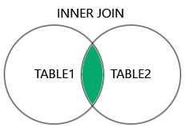{height="7.4em"}
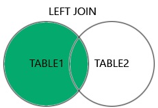{height="7.4em"}
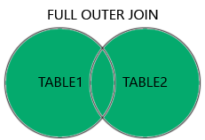{height="7.4em"}
:::

::: {.sm}
- There are different kinds of joins based on **set operations**
- If values are missing from one of the columns, they are set to `NULL`
:::

::: {.source}
More on the SQL tutorial: <https://www.w3schools.com/sql/default.asp>
:::

## SQL injections

::: {.imgrow .middle}
{height="6.4em"}
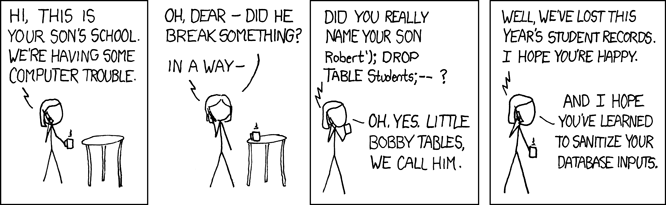{height="6.4em"}
:::

::: {.sm}
- A **SQL injection** is a security attack on a database that inputs SQL code as user input (e.g. a user name)
- If the database permissions are not well set, it could be executed
- It can be used to delete the database, for illicit data export, or to gain access to other parts of the system
:::

::: {.source}
XKCD 327, *Exploits of a Mom*: <https://xkcd.com/327/>
:::

## Summary {.fit1}

::: {.sm}
- **Databases**
  - Technology to centralize, manage and provide access to data
  - A DBMS is software that handles the DB while we just operate with it
  - Transactions are atomic, consistent, isolated and durable (ACID)
- **Relational Databases**
  - Tables linked through primary and foreign keys: each fact is stored once, so updates stay consistent
- **Structured Query Language (SQL)**
  - The most used language for relational databases, and a declarative one
  - Define tables, change their rows, and query them with selection, projection, aggregation and joins
:::

**Next session:** Parallel Programming
