## Course Outline

:::: {.columns}
::: {.column width="50%"}
::: {.sm}
- Session 1: Introduction
- Session 2: Information Coding
- Session 3: Data Structures
- Session 4: Software
- Session 5: Algorithms
- Session 6: Recursion
- Session 7: Sorting Algorithms
:::
:::

::: {.column width="50%"}
::: {.sm}
- Session 8: Time Complexity
- Session 9: Theoretical Computer Science
- Session 10: Machine Learning
- Session 11: Databases
- Session 12: Parallel Programming
  - Exercise: JQ + Parallelization exercises
- Session 13: Social Science Applications
- Session 14: Exam Review
:::
:::
::::

## Install jq for next exercise session

::: {.center-h .sm}
<https://jqlang.org/>
:::

::: {.center-h}
{height="12.0em"}
:::

## Overview

::: {.outline}
- Parallelization
- Hardware Parallelization
- Software Parallelization
- Limitations
:::

<!-- MOTIVATION:M12-A:BEGIN -->
## Your laptop stopped getting faster in 2005 {.fit1}

::: {.motivation}
[Motivating example]{.label}
For thirty years, slow code got faster by waiting: the same program ran twice as
quickly on the hardware of two years later. Then clock speeds flattened, around
**3 GHz, where they still are**, while the transistor count kept doubling. The
extra transistors went into **more cores, not faster ones**.
:::

:::: {.figures}
::: {.fq}
[~3 GHz]{.big}[clock speed, since about 2005]{.cap}
:::
::: {.fq}
[2 → 128+]{.big}[cores per chip in the same period]{.cap}
:::
::: {.fq}
[0×]{.big}[automatic speedup for sequential code]{.cap}
:::
::::

[The free lunch is over. Making the extra cores useful is now a software problem, which means it is yours.]{.ask}
<!-- MOTIVATION:M12-A:END -->

<!-- MOTIVATION:M12-B:BEGIN -->
## Sixteen cores, and 2.5× faster

::: {.motivation}
[Motivating example]{.label}
A simulation takes **40 hours**. You move it to a 16-core machine expecting two
and a half. It takes **16 hours**. You move it to **64 cores**. It takes
**15**.
:::

:::: {.figures}
::: {.fq}
[2.5×]{.big}[faster, on 16 cores]{.cap}
:::
::: {.fq}
[2.7×]{.big}[faster, on 64 cores]{.cap}
:::
::: {.fq}
[2.8×]{.big}[the ceiling, at any number of cores]{.cap}
:::
::::

[Where did the other thirteen cores go? There is an exact formula, and it was written down in 1967.]{.ask}
<!-- MOTIVATION:M12-B:END -->

<!-- MOTIVATION:M12-C:BEGIN -->
## Three billion posts, one million rows of memory

::: {.motivation}
[Motivating example]{.label}
You are asked for the **correlation** between likes and reshares across
**3 billion** posts. Your machine holds **one million** at a time. Computing the
correlation on each chunk and averaging gives a number, and it is **the wrong
number**.
:::

:::: {.figures}
::: {.fq}
[3 × 10⁹]{.big}[posts]{.cap}
:::
::: {.fq}
[10⁶]{.big}[fit in memory at once]{.cap}
:::
::: {.fq}
[6]{.big}[numbers per chunk are enough for the exact answer]{.cap}
:::
::::

[Which statistics can be split across machines and reassembled exactly, and which cannot?]{.ask}
<!-- MOTIVATION:M12-C:END -->

## Moore's law

::: {.center-h}
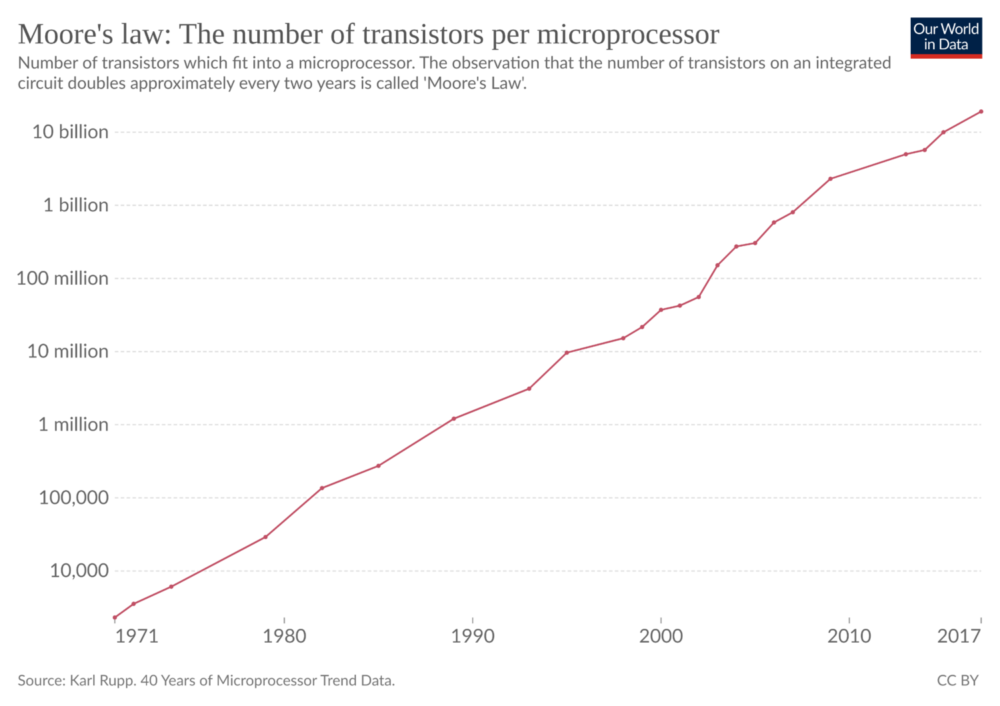{height="14.6em"}
:::

## Moore's law and its limits {.fit1}

:::: {.columns}
::: {.column width="76%"}
::: {.sm}
- **Moore's law** predicts that the number of transistors per microchip doubles every two years &ndash; exponential growth in computing power
- While the increase is still exponential, the rate is slower and doubling takes more than two years
- There is a **physical limit**: a transistor cannot be smaller than an atom
- The limit is expected to be reached in this decade unless radically different models of computation become feasible
- **Parallelization is a workaround to this limit:** using several processors
:::
:::

::: {.column width="24%"}
::: {.imgcol}
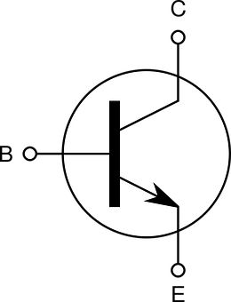{height="4.4em"}

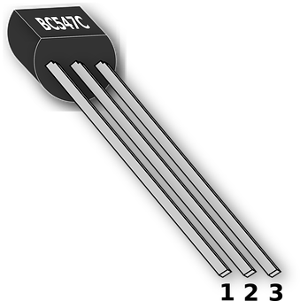{height="4.0em"}
:::
:::
::::

::: {.source}
To learn more about Moore's law: <https://ourworldindata.org/technological-change#advances-in-computational-technology>
:::

## The brain as an inspiration for parallelization

:::: {.columns}
::: {.column width="68%"}
::: {.tbl-grid .xs}
| | Operations/sec | Power [Watts] | Cores | sec/cycle |
|---|---|---|---|---|
| **Brain** | $10^{13}$ | 15&ndash;20 | ? | $10^{-3}$ |
| **Intel Terascale** | $10^{12}$ | 85 | 80 | $10^{-9}$ |
| **Supercomputer Blue Gene** | $3.6 \times 10^{14}$ | $1.2 \times 10^{6}$ | 130 000 | $10^{-9}$ |
:::

::: {.sm}
- Brains work **slowly** but are **massively parallel**
- Example of various regions active at the same time
:::
:::

::: {.column width="32%"}
{height="7.4em"}
:::
::::

::: {.source}
<https://psychcentral.com/lib/what-is-functional-magnetic-resonance-imaging-fmri>
:::

## Parallel computer example: IBM Blue Gene

::: {.center-h}
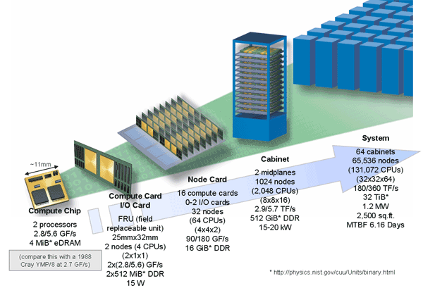{height="13.8em"}
:::

::: {.source}
<https://en.wikipedia.org/wiki/IBM_Blue_Gene>
:::

## Reasons to parallelize

::: {.sm}
- **Save time and/or money**
  - throw compute resources at a problem and shorten compute time
  - can use cheap commodity components to build parallel processors
- **Solve larger, more complex problems**
  - some problems are so large they are infeasible to solve using serial computation, especially with limited memory
  - example: web search engines and databases processing millions of transactions every second
- **Provide concurrency**
  - a single compute resource can only do one thing at a time; multiple compute resources can do many things simultaneously
:::

## Types of parallelization

:::: {.columns}
::: {.column width="56%"}
::: {.sm}
Different ways to "multiply" processing:

- **multiprocessor:** more than one CPU
- **multicore:** one CPU with several cores
- **multithreading:** a single core executes more than one task concurrently
:::

::: {.example .xs style="margin-top:0.6em"}
[Process]{.label}

**CODE** &nbsp;&nbsp; **DATA** &nbsp;&nbsp; **FILE POINTERS**

| thread 1 | thread 2 | thread 3 |
|---|---|---|
| registers · stack | registers · stack | registers · stack |
:::
:::

::: {.column width="44%"}
::: {.imgcol}
{height="4.4em"}

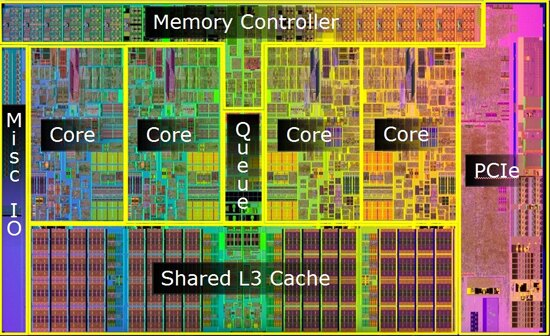{height="5.4em"}
:::
:::
::::

## Single-thread vs Parallel

::: {.center-h}
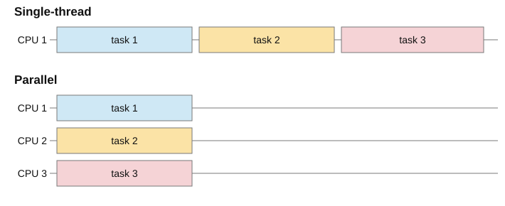{height="12.8em"}
:::

## Concurrent vs Parallel

::: {.center-h}
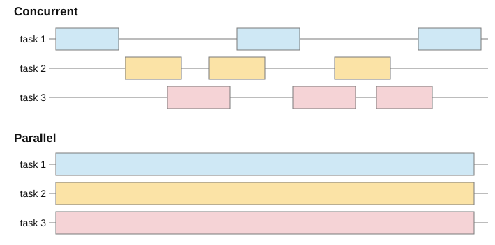{height="14.4em"}
:::

## Concurrent vs Parallel

::: {.sm}
**Concurrency**

- Concurrency means executing multiple tasks **at the same time but not necessarily simultaneously**
- An application is making progress on more than one task at the same time (concurrently). It does not completely finish one task before it begins the next
- Tasks on the **same CPU**, order not completely fixed

**Parallelism**

- Parallelism means that an application splits its tasks into smaller subtasks which can be processed in parallel
- Tasks on **different CPUs**, tasks are at certain times executed in parallel
:::

## Concurrency costs and advantages {.fit1}

::: {.center-h}
{height="2.6em"}
:::

::: {.sm}
- **Switching between tasks takes computing time**
  - e.g. loading data or instructions into memory
  - this is handled by the operating system, using that compute time
- **Concurrency can save time** when using resources that are slower than the CPU. The CPU can change to another process when a slow task starts. For example:
  - access to files on the hard drive
  - access to information over a network
  - access to data from a peripheral device
  - user input
:::

## Hardware Parallelization

::: {.outline .focus}
- Parallelization
- [Hardware Parallelization]{.current}
- Software Parallelization
- Limitations
:::

## Flynn's Taxonomy

::: {.sm}
Multi-processor computer architecture (hardware) classification along two dimensions: **instruction stream** and **data stream**. Both can be single or multiple.
:::

::: {.center-h}
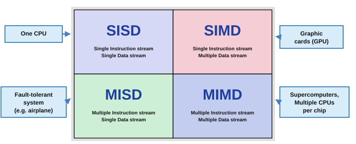{height="12.0em"}
:::

## Flynn's Taxonomy

::: {.sm}
Multi-processor computer architecture (hardware) classification along two dimensions: **instruction stream** and **data stream**. Both can be single or multiple.
:::

::: {.center-h}
{height="12.0em"}
:::

## Instruction-level parallelism {.fit1}

::: {.center-h}
{height="2.0em"}
:::

::: {.sm}
- CPU architectures have instructions that are divided into **microinstructions**
- Each microinstruction takes a hardware clock cycle
- The example is an architecture with five microinstructions
:::

## Instruction-level parallelism {.fit1}

::: {.center-h}
{height="2.0em"}
:::

::: {.sm}
- CPU architectures have instructions that are divided into **microinstructions**
- Each microinstruction takes a hardware clock cycle
- The example is an architecture with five microinstructions
    - **IF:** instruction fetch &ndash; get next instruction code
:::

## Instruction-level parallelism {.fit1}

::: {.center-h}
{height="2.0em"}
:::

::: {.sm}
- CPU architectures have instructions that are divided into **microinstructions**
- Each microinstruction takes a hardware clock cycle
- The example is an architecture with five microinstructions
    - **IF:** instruction fetch &ndash; get next instruction code
    - **ID:** instruction decode &ndash; convert code into hardware activation flags
:::

## Instruction-level parallelism {.fit1}

::: {.center-h}
{height="2.0em"}
:::

::: {.sm}
- CPU architectures have instructions that are divided into **microinstructions**
- Each microinstruction takes a hardware clock cycle
- The example is an architecture with five microinstructions
    - **IF:** instruction fetch &ndash; get next instruction code
    - **ID:** instruction decode &ndash; convert code into hardware activation flags
    - **EX:** execute &ndash; perform calculation based on register contents
:::

## Instruction-level parallelism {.fit1}

::: {.center-h}
{height="2.0em"}
:::

::: {.sm}
- CPU architectures have instructions that are divided into **microinstructions**
- Each microinstruction takes a hardware clock cycle
- The example is an architecture with five microinstructions
    - **IF:** instruction fetch &ndash; get next instruction code
    - **ID:** instruction decode &ndash; convert code into hardware activation flags
    - **EX:** execute &ndash; perform calculation based on register contents
    - **MEM:** memory access &ndash; write results to main memory if necessary
:::

## Instruction-level parallelism {.fit1}

::: {.center-h}
{height="2.0em"}
:::

::: {.sm}
- CPU architectures have instructions that are divided into **microinstructions**
- Each microinstruction takes a hardware clock cycle
- The example is an architecture with five microinstructions
    - **IF:** instruction fetch &ndash; get next instruction code
    - **ID:** instruction decode &ndash; convert code into hardware activation flags
    - **EX:** execute &ndash; perform calculation based on register contents
    - **MEM:** memory access &ndash; write results to main memory if necessary
    - **WB:** register write back &ndash; change registers (e.g. next instruction pointer)
:::

## Instruction-level parallelism {.fit1}

::: {.center-h}
{height="2.0em"}
:::

::: {.sm}
- CPU architectures have instructions that are divided into **microinstructions**
- Each microinstruction takes a hardware clock cycle
- The example is an architecture with five microinstructions
    - **IF:** instruction fetch &ndash; get next instruction code
    - **ID:** instruction decode &ndash; convert code into hardware activation flags
    - **EX:** execute &ndash; perform calculation based on register contents
    - **MEM:** memory access &ndash; write results to main memory if necessary
    - **WB:** register write back &ndash; change registers (e.g. next instruction pointer)
- Not all instructions need all five cycles. Details depend on the architecture
- Different parts of the hardware are used for each microinstruction
:::

## Instruction-level parallelism

::: {.center-h}
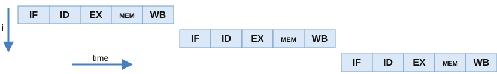{height="4.0em"}
:::

::: {.sm}
- A canonical processor **without** parallelism: takes 5 clock cycles per instruction
:::

:::: {.columns}
::: {.column width="60%"}
{height="6.4em"}
:::

::: {.column width="40%"}
::: {.sm}
- A **pipelined** processor can simultaneously execute five instructions
- It can take up to only **one clock cycle per instruction**
:::
:::
::::

## Instruction-level parallelism: caveats

::: {.center-h}
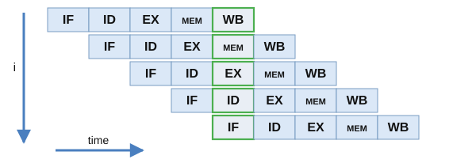{height="6.4em"}
:::

::: {.xs}
- **Speculative execution:** future instructions start before we finish one
  - control flow usually makes the CPU throw away future instructions
  - e.g. an `if` statement changes the next instruction &rarr; need to clean the pipeline
- **Security risks:** speculative execution leaves traces that can be read by other programs
  - the **Spectre** and **Meltdown** vulnerabilities make it possible to read private data of other programs left in the processor cache by speculatively executed instructions
:::

## Multi-core processors: your laptop

::: {.center-h}
{height="8.4em"}
:::

::: {.sm}
- Several cores per processor allow executing multiple threads in parallel
- Most likely in this course, all student laptops and mobile phones are multi-core and many even multi-processor
:::

::: {.source}
<https://superuser.com/questions/584900/how-distinguish-between-multicore-and-multiprocessor-systems>
:::

## Graphics Processing Unit (GPU) {.fit1}

:::: {.columns}
::: {.column width="58%"}
::: {.xs}
- Graphics Processing Units are specialized to calculate what is displayed on a screen
- Designed for **multiplications of matrices** to calculate how to display 3D models
- Performs the same calculation over a large set of data (a vector)
- GPUs have large memories with very high bandwidth
- **Cannot do every operation efficiently!** Designed for matrix operations
- Applications beyond graphics:
  - mining cryptocurrencies: solving modular algebra equations for many possible solutions
  - training machine learning models: applying matrix operations to fit many parameters on large datasets
:::
:::

::: {.column width="42%"}
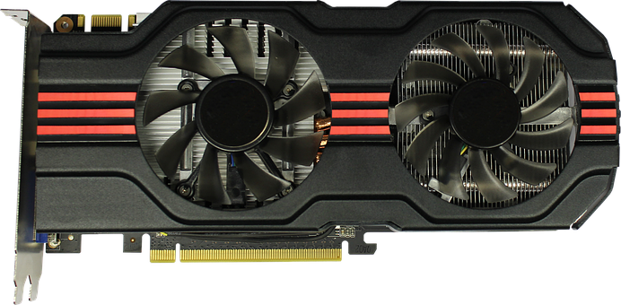{height="5.4em"}
:::
::::

## Computing clusters {.fit1}

::: {.sm}
- **Computing cluster:** linking many computers with very high bandwidth connections
- Example: the Scientific Compute Cluster (SCC) of Uni Konstanz
  - Infiniband: 56 Gbit/s, 0.7 µs latency
  - Intel Broadwell HPC compute nodes
    - 28 cores per node
    - up to 1024 GB RAM
  - large RAID (redundant array of independent disks) memory
- The Politics & Public Administration department is an SCC **shareholder** with 4 compute nodes, i.e. 112 cores
  - part of the larger SCC infrastructure
  - if available, can use compute nodes of other shareholders. Resources might be idle when other departments do not need them
:::

## Software Parallelization

::: {.outline .focus}
- Parallelization
- Hardware Parallelization
- [Software Parallelization]{.current}
- Limitations
:::

## Types of Software Parallelization

::: {.sm}
- **Multiple threads or processes in the same computer**
  - e.g. running mergesort with calls in separate parts of memory
  - *Issues:* coordinating memory access
  - *Solutions:* Inter-Process Communication (IPC) and Message Passing Interfaces (MPI) &ndash; not covered here
- **Multiple machines connected through a network: distributed computing**
  - e.g. splitting parts of mergesort to different machines and merging results in more central machines
  - *Issues:* network communication is the bottleneck for computation
  - *Solutions:* distributed paradigms like **MapReduce**
:::

## MapReduce

::: {.center-h}
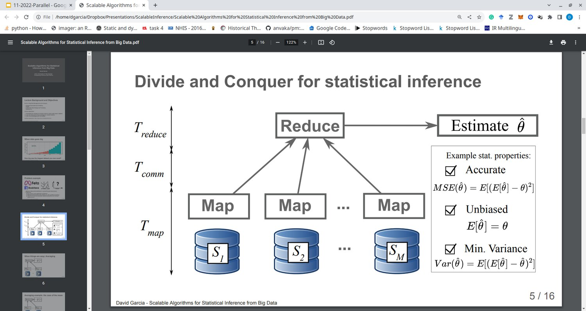{height="13.4em"}
:::

## MapReduce

:::: {.columns}
::: {.column width="52%"}
::: {.sm}
- **Map phase:** compute parts of the solution on partial datasets in each machine
- **Communication phase:** send Map results to the Reducer over the network
- **Reduce phase:** combine Map results into the final solution
- Computations can take several Map-Reduce iterations or hierarchies
- Apache Hadoop and Spark are some of the most popular software solutions for MapReduce
:::
:::

::: {.column width="48%"}
{height="5.6em"}

::: {.imgrow .middle}
{height="2.2em"}
{height="2.6em"}
:::
:::
::::

## Distributed statistical inference example

::: {.center-h}
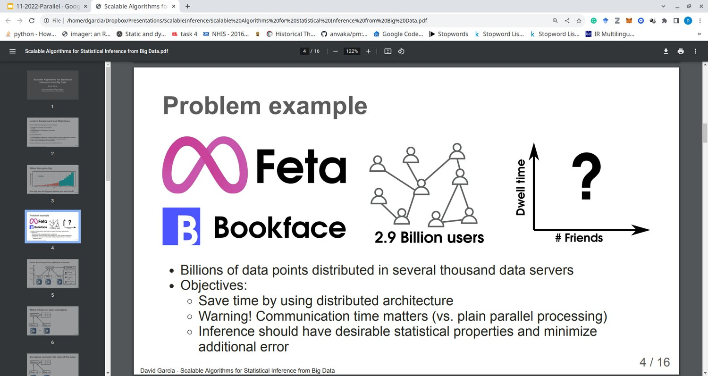{height="6.6em"}
:::

::: {.sm}
- Billions of data points distributed over several thousand data servers
- Objectives:
  - Save time by using a distributed architecture: **bring the code to the data**
  - Warning! Communication time matters (vs. plain parallel processing)
  - Inference should have desirable statistical properties and minimize additional error
:::

## Distributed statistical inference: desired properties

::: {.center-h}
{height="13.4em"}
:::

## When things are easy: averaging

:::: {.columns}
::: {.column width="62%"}
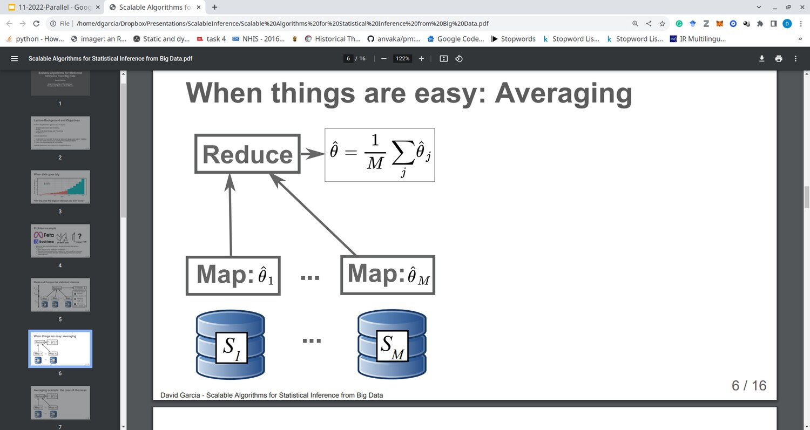{height="10.4em"}
:::

::: {.column width="38%"}
::: {.sm}
- **Map:** compute the same estimator in each local sample
- **Reduce:** aggregate to the final estimator by averaging each Map result
:::
:::
::::

## Averaging: computing a mean

::: {.center-h}
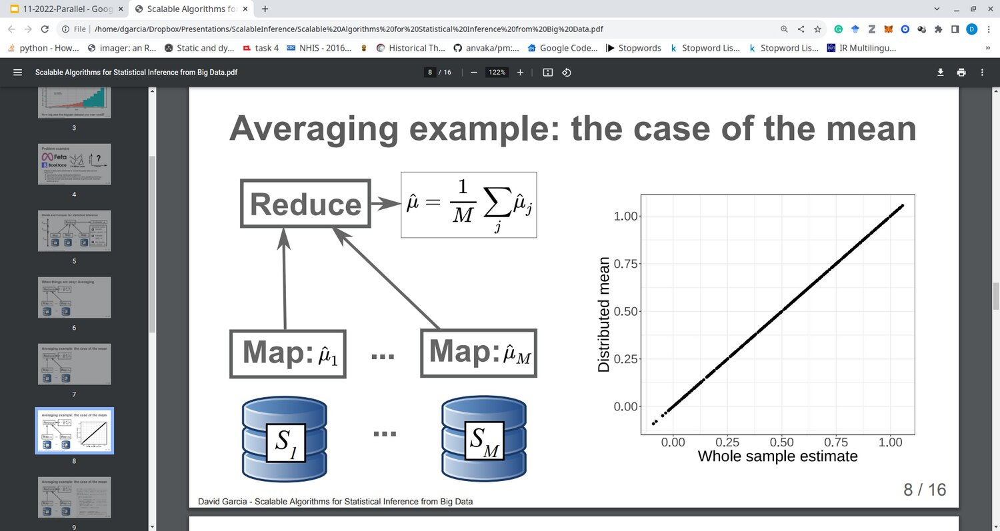{height="13.4em"}
:::

## Averaging: computing a mean

::: {.center-h}
{height="13.4em"}
:::

## Problems with averaging: Pearson's correlation

:::: {.columns}
::: {.column width="60%"}
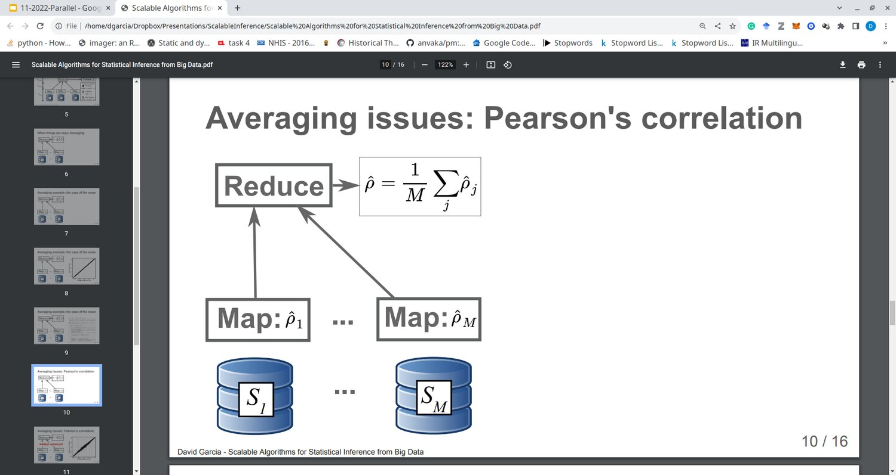{height="10.0em"}
:::

::: {.column width="40%"}
::: {.sm}
- **Map:** compute Pearson's correlation in each local sample
- **Reduce:** aggregate to the final estimator by averaging each Map result
:::

{width="94%"}
:::
::::

## Problems with averaging: Pearson's correlation

::: {.center-h}
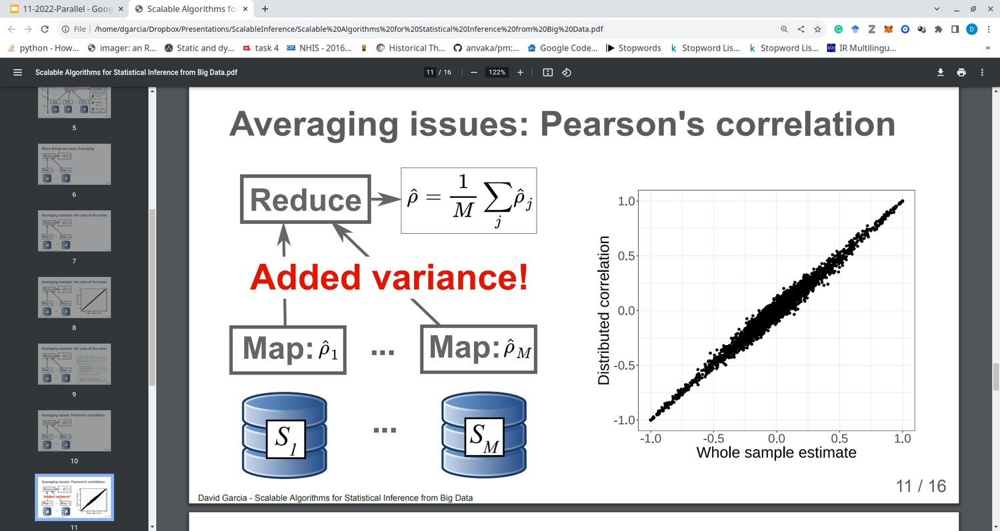{height="13.4em"}
:::

## Smarter distributed calculation of correlations

::: {.center-h}
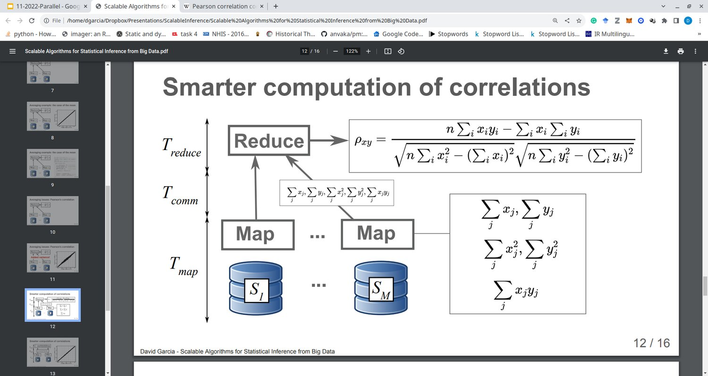{height="13.4em"}
:::

## Smarter distributed calculation of correlations

::: {.center-h}
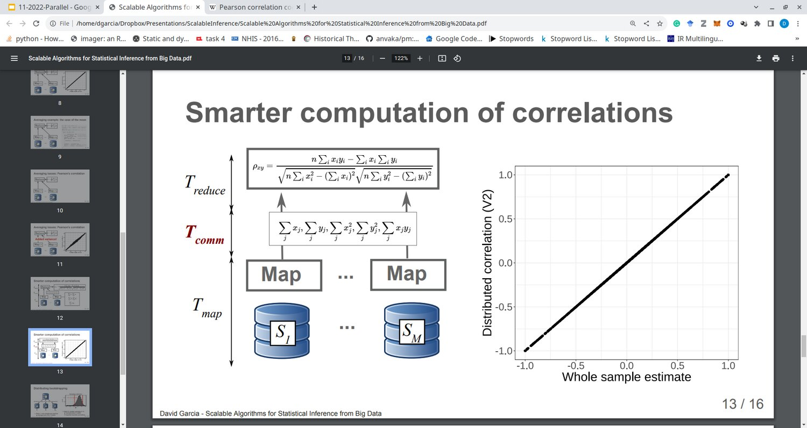{height="13.4em"}
:::

## Smarter distributed calculation of correlations

::: {.center-h}
{height="13.4em"}
:::

::: {.tag .xs}
Added communication time tradeoff to avoid added variance in the estimate
:::

## Limitations

::: {.outline .focus}
- Parallelization
- Hardware Parallelization
- Software Parallelization
- [Limitations]{.current}
:::

## Limits to Parallelization

::: {.sm}
- Can you actually achieve an optimal speedup?
- **Gene Amdahl (1967): there is an upper limit**
- Intuition:
  - there is always a part of the code that **cannot** be parallelized
  - with increasing parallelization, this part dominates the overall runtime of the program
- Maximal speedup depends on two variables:
  - $P$: fraction of the computation that can be parallelized, e.g. 80%
  - $N$: number of processors / threads that can be used in parallel
:::

## Limits to Parallelization: Amdahl's law {.fit1}

:::: {.columns}
::: {.column width="42%"}
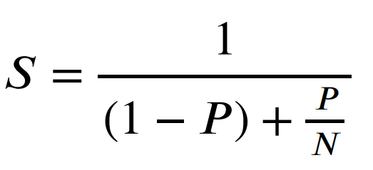{width="92%"}

::: {.sm}
- $S$: speed-up of the execution of the whole task, e.g. 2×
- $P$: fraction of the computation that can be parallelized, e.g. 80%
- $N$: number of processors / threads that can be used in parallel
:::
:::

::: {.column width="58%"}
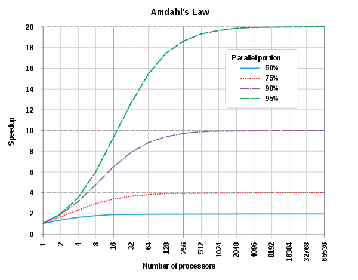{height="13.0em"}
:::
::::

## Summary {.fit1}

:::: {.columns}
::: {.column width="72%"}
::: {.sm}
- **Parallelization**
  - Motivation with Moore's law
  - Example paradigms: multi-core, multi-processor, multi-thread
  - Parallelization vs concurrency
- **Hardware Parallelization**
  - Instruction-level parallelization
  - Multi-core processors, GPUs and clusters
- **Software Parallelization**
  - Distributed computing: MapReduce
- **Limitations:** Amdahl's law
:::

**Next session:** Social Science Applications
:::

::: {.column width="28%"}
::: {.tag .sm}
Now: course surveys!
:::
:::
::::

## Please help us to improve the course!

:::: {.columns}
::: {.column width="58%"}
::: {.sm}
- Survey only for the **Theory** part of ICSS
- <https://evasys.uni-konstanz.de/evasys/online.php?pswd=ATEVY>
- It takes about 5-10 minutes
- Completely anonymous
:::

{height="4.4em"}
:::

::: {.column width="42%"}
{height="8.4em"}
:::
::::

## Please help us to improve the course!

:::: {.columns}
::: {.column width="58%"}
::: {.sm}
- Survey only for the **Practice** part of ICSS
- <https://evasys.uni-konstanz.de/evasys/online.php?pswd=XZ7GC>
- It takes about 5-10 minutes
- Completely anonymous
:::

{height="4.4em"}
:::

::: {.column width="42%"}
{height="8.4em"}
:::
::::
