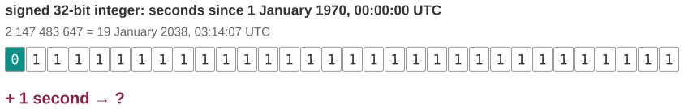
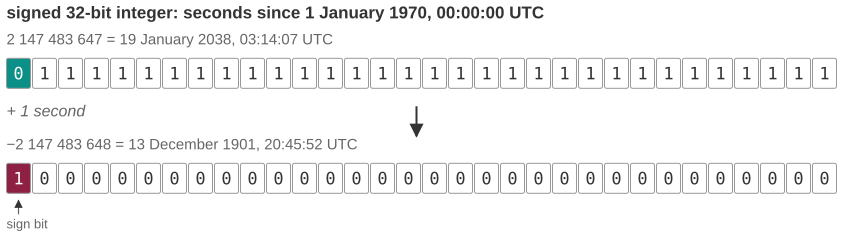
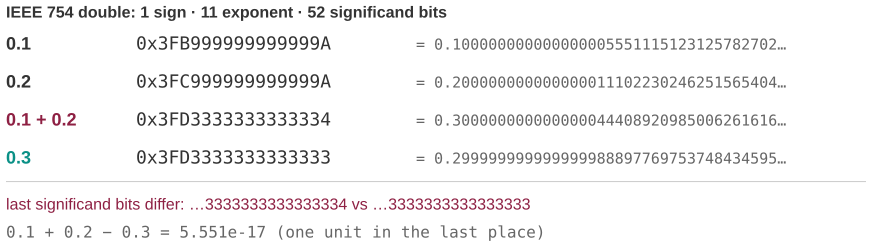
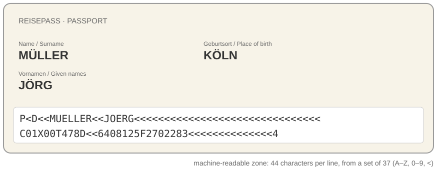

## Three questions for this session

::: {.sm}
Each example is an **opening** question for the start of the lecture and an **answer** for the
end, followed by a notes slide. Copy the slides you want into the main deck.
:::

::: {.xs}
| | Question | Hook | id |
|-|-----------|---------------|---|
| **A** | The clock that ends on 19 January 2038 | Why one specific second breaks a 32-bit counter, and what it wraps to. | `X02-A` |
| **B** | 0.1 + 0.2 is not 0.3 | The most famous wrong answer in computing, resolved bit by bit. | `X02-B` |
| **C** | Why your boarding pass spells you MUELLER | Passports, airlines and ASCII: what happens to a name when the alphabet has 37 symbols. | `X02-C` |
:::

::: {.xs}
Main deck `Slides/02-InformationCoding/` · transcript `Transcripts/02-…md` (the § in the answers)
:::

<!-- EXAMPLE:X02-A:BEGIN -->
## A · The clock that ends on 19 January 2038

[Opening question · place after the Overview slide]{.tag .ex-open}

{width="1150px"}

::: {.sm}
Many systems count time as **the number of seconds since 1 January 1970**,
stored in a **32-bit signed integer**. On **19 January 2038, at 03:14:07 UTC**,
that counter reaches the pattern above, and one second later something goes
badly wrong.

[Why *that* second? And what date will the computer think it is at 03:14:08?]{.ask}
:::

## A · The clock that ends on 19 January 2038 · answer

[The answer · place before the Summary slide]{.tag .ex-close}

{width="1148px"}

## A · The clock that ends on 19 January 2038 · why

[The answer · place before the Summary slide]{.tag .ex-close}

::: {.sm}
- A signed 32-bit integer holds $-2^{31} \ldots 2^{31}-1$; the largest value is
  $2\,147\,483\,647 = 0111\ldots1_2$, which is exactly 03:14:07 UTC on that day.
- Adding 1 carries into the **sign bit**: $1000\ldots0_2$, which in two's
  complement is $-2^{31}$, that is, **20:45:52 UTC on 13 December 1901**.
- The fix is a 64-bit counter: $2^{63}$ seconds is about 292 billion years.
:::

::: {.uses}
**What we used:** §4 positional number systems · §6 negative numbers and two's complement · §10 data types and integer size
:::

## A · The clock that ends on 19 January 2038 · notes {.fit1}

[X02-A]{.tag .ex-id}

::: {.xxs}
**Source.** The Year 2038 problem is documented for every C standard library
and by the Linux kernel, which supports a 64-bit `time_t` on 32-bit
architectures since version 5.6 (2020). The dates are exact:
`datetime.fromtimestamp(2**31 - 1)` and `datetime.fromtimestamp(-2**31)`; the
figure computes them.

**Facts.** $2^{31} - 1 = 2\,147\,483\,647$ seconds is 68.05 years after the
epoch. The wrap goes to the most negative value, so time jumps *backwards* by
136 years. Early cases are documented: AOLserver crashed in May 2006 because a
timeout of one billion seconds pointed past 2038, and any program that computes
a date twenty years ahead has been able to overflow since January 2018.

**How to present.** Open by showing only the bit pattern and the date, and ask
the room to guess what comes next; most guesses are "it resets to 1970". Close
by adding one to the bits on the board: the carry into the sign bit *is* the
whole answer, and it lands the moment two's complement has been taught.

**Where it plugs in.** After the two's-complement slides of the main deck; the
transcript's §6 has the wheel diagram, which makes the wrap visual.

**Self-study:** post `Examples/posts/X02-A-….md` · notebook `Examples/notebooks/X02-A.ipynb`, the problem and the solution in a few cells.
:::

<!-- EXAMPLE:X02-A:END -->
<!-- EXAMPLE:X02-B:BEGIN -->
## B · 0.1 + 0.2 is not 0.3

[Opening question · place after the Overview slide]{.tag .ex-open}

::: {.sm}
```python
>>> 0.1 + 0.2 == 0.3
False
>>> 0.1 + 0.2
0.30000000000000004
```

This is Python, but every language, every calculator app and every spreadsheet
does the same. It is not a bug and it will never be fixed.

[What does the computer actually store when you type `0.1`, and why does the error show up in the 17th decimal, not the 3rd?]{.ask}
:::

## B · 0.1 + 0.2 is not 0.3 · answer

[The answer · place before the Summary slide]{.tag .ex-close}

{width="1147px"}

## B · 0.1 + 0.2 is not 0.3 · why

[The answer · place before the Summary slide]{.tag .ex-close}

::: {.sm}
- A double has **52 significand bits**; $0.1 = 1/10$ has a factor 5 in the
  denominator, so its binary expansion is infinite and it is stored **rounded**,
  slightly above $0.1$.
- $0.2$ is also stored slightly above. Their sum rounds **up**; the stored $0.3$
  rounds **down**. The two differ by **one unit in the last place**: $2^{-54}$.
- Compare floats with a tolerance, never with `==`; keep money and counts in integers.
:::

::: {.uses}
**What we used:** §7 IEEE 754: sign, exponent, significand · §8 when rounding errors matter
:::

## B · 0.1 + 0.2 is not 0.3 · notes

[X02-B]{.tag .ex-id}

::: {.xxs}
**Source.** IEEE 754-2008; the site *0.30000000000000004.com* collects the
same result in about 40 languages. The hex patterns and exact decimal
expansions in the figure are computed with `float.hex` and `decimal`, not typed
in.

**Facts.** `0.1` is stored as `0x3FB999999999999A`, exactly
0.1000000000000000055511151231257827…; `0.3` as `0x3FD3333333333333`; the sum as
`0x3FD3333333333334`. The difference is $2^{-54} \approx 5.55 \times 10^{-17}$.

**How to present.** Open with the three REPL lines and *nothing else*; let it
sit. Ask for hypotheses ("Python is broken", "it is a display issue"). Close
with the figure, walking the last hex digit: `…33` against `…34`. Then the
practical rule (`math.isclose`, `Decimal` for money); students will meet this in
the practical part within weeks.

**Where it plugs in.** Directly after the IEEE 754 slides; pairs with the
$-1\,703\,936$ decoding example already in the deck. The Vancouver Stock
Exchange candidate (M02-C) is the accumulation version of the same point.

**Self-study:** post `Examples/posts/X02-B-….md` · notebook `Examples/notebooks/X02-B.ipynb`, the problem and the solution in a few cells.
:::

<!-- EXAMPLE:X02-B:END -->
<!-- EXAMPLE:X02-C:BEGIN -->
## C · Why your boarding pass spells you MUELLER

[Opening question · place after the Overview slide]{.tag .ex-open}

{width="794px"}

::: {.sm}
The **machine-readable zone** at the bottom of every passport renders *Jörg
Müller* as `MUELLER<<JOERG` and *Çağla* as `CAGLA`. Airlines and border systems
copy that spelling.

[Why can a document made in 2020 not spell an umlaut? And what happens when two systems disagree about the answer?]{.ask}
:::

## C · Why your boarding pass spells you MUELLER · answer

[The answer · place before the Summary slide]{.tag .ex-close}

{width="1148px"}

## C · Why your boarding pass spells you MUELLER · why

[The answer · place before the Summary slide]{.tag .ex-close}

::: {.sm}
- The MRZ is defined by ICAO 9303 over **37 symbols** (A–Z, 0–9, `<`) so that
  *any* reader anywhere decodes it identically: a deliberate, minimal alphabet.
- It is the ASCII problem in miniature: 7 bits gave 128 codes, none for ö, ç or
  ß; the 1980s code pages assigned byte 246 to ö in Germany and to ц in Russia.
- **UTF-8** solved it: ö is the two bytes `C3 B6`, ASCII stays one byte. Systems
  that still assume one byte per character produce `Müller`.
:::

::: {.uses}
**What we used:** §3 storing information digitally · §9 character coding: ASCII, code pages, Unicode and UTF-8
:::

## C · Why your boarding pass spells you MUELLER · notes {.fit1}

[X02-C]{.tag .ex-id}

::: {.xxs}
**Source.** ICAO Doc 9303, Part 3 (transliteration tables: ö → OE, ß → SS,
ç → C, ş → S). The passport shown is a mock-up with an invented number.

**Facts.** The MRZ line is 44 characters; the check digits are computed with
the weights 7, 3, 1. Germany's own convention writes *Müller* as `MUELLER`,
which is why boarding passes and tickets must be booked under that spelling, a
consequence students have usually met personally.

**How to present.** Open by asking who has seen their name "wrong" on a
boarding pass; in a German classroom that is most of the room. Close by
putting the three answers side by side: 37-symbol MRZ (by design), ISO-8859-1
(one byte, national), UTF-8 (variable length, universal). The point to land:
none of these is *the* right encoding; the failure is in *not saying which one*.

**Where it plugs in.** The character-coding block of the main deck (ASCII table,
code pages, UTF-8). Pairs with candidate M02-B (mojibake in survey data).

**Self-study:** post `Examples/posts/X02-C-….md` · notebook `Examples/notebooks/X02-C.ipynb`, the problem and the solution in a few cells.
:::

<!-- EXAMPLE:X02-C:END -->