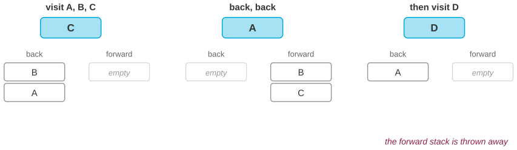
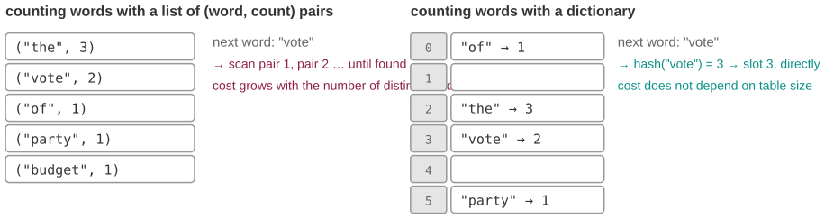
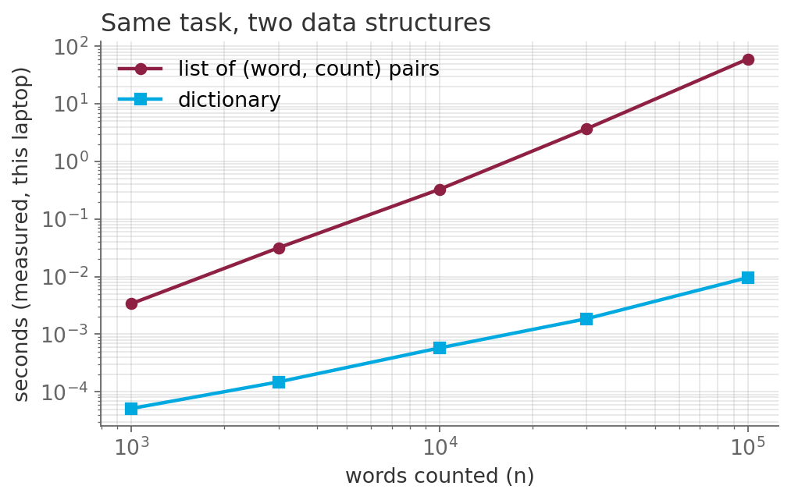
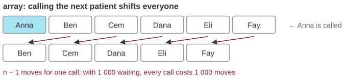
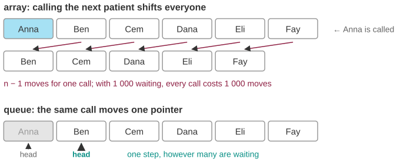

## Three questions for this session

::: {.sm}
Each example is an **opening** question for the start of the lecture and an **answer** for the
end, followed by a notes slide. Copy the slides you want into the main deck.
:::

::: {.xs}
| | Question | Hook | id |
|-|-----------|---------------|---|
| **A** | Where does the Back button keep the pages? | Visit A, B, C, go back twice, then open D. Where did C go? Two stacks explain every browser. | `X03-A` |
| **B** | Count a million words: 49 seconds or 0.01 | The same loop, two containers, a factor of 4,500, measured on this laptop. | `X03-B` |
| **C** | The waiting room that gets slower the fuller it is | Calling the next patient costs 1,000 moves in one structure and one in another. | `X03-C` |
:::

::: {.xs}
Main deck `Slides/03-DataStructures/` · transcript `Transcripts/03-…md` (the § in the answers)
:::

<!-- EXAMPLE:X03-A:BEGIN -->
## A · Where does the Back button keep the pages?

[Opening question · place after the Overview slide]{.tag .ex-open}

::: {.sm}
You open **A**, then **B**, then **C**. You press *Back* twice, so you are on A.
Now you click a link to **D**. Press *Forward*: nothing happens. **C and B are
gone.** Every browser since the first graphical ones behaves exactly like this.

[What structure is the history stored in, and why is throwing C away the *correct* behavior rather than a bug?]{.ask}
:::

## A · Where does the Back button keep the pages? · answer

[The answer · place before the Summary slide]{.tag .ex-close}

{width="1150px"}

## A · Where does the Back button keep the pages? · why

[The answer · place before the Summary slide]{.tag .ex-close}

::: {.sm}
- Two **stacks**: *back* and *forward*. Opening a page **pushes** the current one
  onto *back*; pressing Back **pops** it and pushes the current page onto *forward*.
- Opening a new page from A **clears the forward stack**; otherwise Forward would
  have to choose between C and D, and a stack has no way to hold two futures.
- LIFO is exactly the order you want here: the most recent page is the one you
  return to. The same structure runs Undo, the call stack, and depth-first search.
:::

::: {.uses}
**What we used:** §1 what a data structure is · §3 linked lists (what the stack is built on) · session 5 §6 stacks and queues
:::

## A · Where does the Back button keep the pages? · notes {.fit1}

[X03-A]{.tag .ex-id}

::: {.xxs}
**Source.** The two-stack model is how Mosaic and Netscape implemented history;
modern browsers keep a session-history list with a current index, but the
visible behavior is unchanged. Any browser demonstrates it live.

**Facts.** Push and pop are $O(1)$. The clearing rule is in the HTML standard:
navigating to a new page removes all session-history entries after the current
one.

**How to present.** Open by doing it live on the projector: A, B, C, Back,
Back, click D, Forward is grayed out. Ask *why*. Close with the three-state
figure; the last panel is the punchline. Then contrast with a support
helpline, where LIFO is the *wrong* policy: same structure, opposite verdict,
decided by what the user needs next.

**Where it plugs in.** Stacks and queues are formally introduced in session 5
(§6 of that transcript), but the main deck of session 3 already presents the
linked list they are built on; use this right after linked lists. Depth-first
search, the stack-driven search, comes in session 6.

**Self-study:** post `Examples/posts/X03-A-….md` · notebook `Examples/notebooks/X03-A.ipynb`, the problem and the solution in a few cells.
:::

<!-- EXAMPLE:X03-A:END -->
<!-- EXAMPLE:X03-B:BEGIN -->
## B · Count a million words: 49 seconds or 0.01

[Opening question · place after the Overview slide]{.tag .ex-open}

{width="1007px"}

::: {.sm}
Two students count how often each word appears in a corpus of parliamentary
speeches. One keeps a **list of (word, count) pairs**; the other keeps a
**dictionary**. Both loops are five lines long and both give the same counts.
On 100,000 words, one takes **49 seconds** and the other **0.01**.

[Nothing in the loop changed except the container. Where do the 49 seconds go?]{.ask}
:::

## B · Count a million words: 49 seconds or 0.01 · answer

[The answer · place before the Summary slide]{.tag .ex-close}

:::: {.columns}
::: {.column width="52%"}
{width="598px"}

::: {.source}
measured with `tools/genexamples_figs.py`
:::
:::
::: {.column width="48%"}
::: {.sm}
*The question was:* Nothing in the loop changed except the container. Where do the 49 seconds go?
:::
:::
::::

## B · Count a million words: 49 seconds or 0.01 · why

[The answer · place before the Summary slide]{.tag .ex-close}

::: {.sm}
- The list has to be **searched** for every incoming word: with $m$ distinct
  words that is up to $m$ comparisons per word, so the total grows like $n \cdot m$.
- The dictionary is a **hash table**: the hash of the word says which slot to
  look in, so each update costs the same whether the table holds 10 entries or
  10 million.
- On the log-log plot the list line has **slope 2**, the dictionary line slope 1:
  the gap is not a constant, it keeps widening.
:::

::: {.uses}
**What we used:** §4 the editing-versus-searching trade-off · §8 hashing and hash tables · §9 dictionaries in Python
:::

## B · Count a million words: 49 seconds or 0.01 · notes

[X03-B]{.tag .ex-id}

::: {.xxs}
**Source.** Timings are produced by the figure script on the build machine and
printed to the console; re-run it for fresh numbers before the lecture if you
want to quote today's laptop.

**Facts.** 1,000 words: 0.003 s against 0.0001 s. 100,000 words: about 49 s
against 0.011 s. Half the words in the stream are distinct, which is a
realistic vocabulary ratio for short texts and makes the list version quadratic.

**How to present.** Open with the two code fragments side by side (they are on
the figure) and the two times; ask which is which and why. Close with the
log-log plot and the slope argument; this is also a preview of O-notation in
session 8, so name it as such. Then the caveat: $O(1)$ is an *average*; a bad
hash function degrades to the list case (the exam's $2x \bmod 16$ item).

**Where it plugs in.** Right before the hash-table slides; the transcript's §8
shows the collision handling that makes the average hold.

**Self-study:** post `Examples/posts/X03-B-….md` · notebook `Examples/notebooks/X03-B.ipynb`, the problem and the solution in a few cells.
:::

<!-- EXAMPLE:X03-B:END -->
<!-- EXAMPLE:X03-C:BEGIN -->
## C · The waiting room that gets slower the fuller it is {.fit1}

[Opening question · place after the Overview slide]{.tag .ex-open}

{width="1147px"}

::: {.sm}
A clinic's software keeps the waiting patients in an array, in arrival order.
Calling the next patient removes the first entry, and **every remaining entry
shifts one place forward.** With 1,000 people waiting, each call costs 1,000
moves; the queue gets slower exactly when it is longest.

[What has to change so that 'call the next patient' costs the same whether 6 or 6,000 people are waiting?]{.ask}
:::

## C · The waiting room that gets slower the fuller it is · answer

[The answer · place before the Summary slide]{.tag .ex-close}

{width="1136px"}

## C · The waiting room that gets slower the fuller it is · why

[The answer · place before the Summary slide]{.tag .ex-close}

::: {.sm}
- Removing from the **front of an array** is $O(n)$ by construction: the elements
  are contiguous, so a hole must be closed.
- A **queue** keeps a *head pointer* (or is a linked list): removing the front is
  one pointer move, $O(1)$, regardless of length. Adding at the tail is also $O(1)$.
- The price: you lose $O(1)$ access to the $k$-th waiting patient. Choosing a
  structure is choosing which questions will be cheap.
:::

::: {.uses}
**What we used:** §2 arrays and why contiguity gives indexing · §3 linked lists · §4 the trade-off · session 5 §6 queues
:::

## C · The waiting room that gets slower the fuller it is · notes

[X03-C]{.tag .ex-id}

::: {.xxs}
**Source.** Textbook material: arrays in Cormen, *Algorithms Unlocked*, ch. 2;
stacks and queues in CLRS §10.1. Python's `list.pop(0)` really is $O(n)$ and
`collections.deque.popleft()` is $O(1)$, a one-line change students can time
themselves.

**Facts.** Shifting $n-1$ elements per call; with a circular buffer or a deque
both ends are $O(1)$. The "slower when fuller" symptom is the diagnostic
signature of an $O(n)$ operation inside a loop.

**How to present.** Open with the top half of the figure only (the shift) and
the sentence "the system is slowest when the waiting room is fullest". Close by
revealing the head-pointer version: one arrow moves. Ask what was given up
(random access); that keeps it a trade-off rather than a trick.

**Where it plugs in.** After arrays and linked lists in the main deck; it is the
concrete version of the transcript's §4. Connects forward to BFS in session 5,
which is a queue with a purpose.

**Self-study:** post `Examples/posts/X03-C-….md` · notebook `Examples/notebooks/X03-C.ipynb`, the problem and the solution in a few cells.
:::

<!-- EXAMPLE:X03-C:END -->