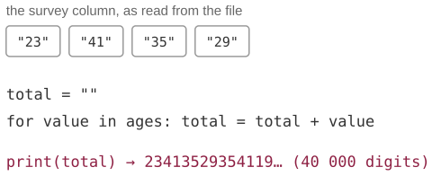
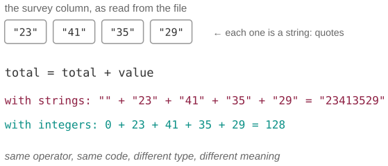
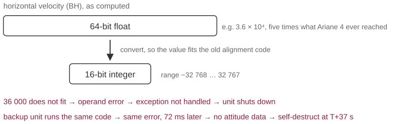
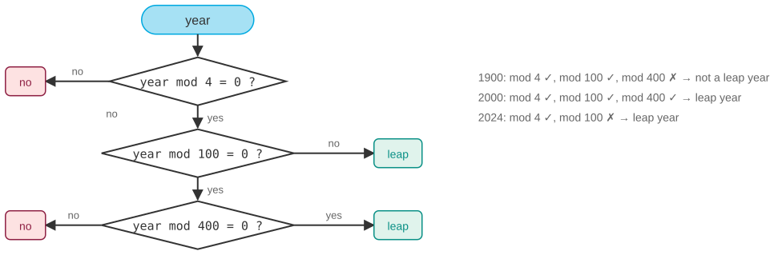

## Three questions for this session

::: {.sm}
Each example is an **opening** question for the start of the lecture and an **answer** for the
end, followed by a notes slide. Copy the slides you want into the main deck.
:::

::: {.xs}
| | Question | Hook | id |
|-|-----------|---------------|---|
| **A** | The survey whose ages summed to a 40,000-digit number | One operator, two types, two meanings: the most common bug in beginner data code. | `X04-A` |
| **B** | The rocket that exploded because a number did not fit | Ariane 5, 4 June 1996: US$370 million, 37 seconds, one integer conversion. | `X04-B` |
| **C** | Was 1900 a leap year? Excel says yes | A three-line rule, a 120-year-old bug, and why control flow has to be written down exactly. | `X04-C` |
:::

::: {.xs}
Main deck `Slides/04-Software/` · transcript `Transcripts/04-…md` (the § in the answers)
:::

<!-- EXAMPLE:X04-A:BEGIN -->
## A · The survey whose ages summed to a 40,000-digit number {.fit2}

[Opening question · place after the Overview slide]{.tag .ex-open}

{width="726px"}

::: {.sm}
A student sums the *age* column of a 20,000-person survey with a four-line
loop. Instead of a number near 800,000, the program prints a **40,000-digit**
value beginning `23413529…`.

No error, no warning, and every line is correct.

[What did the program actually compute, and what one word in the lecture names the mistake?]{.ask}
:::

## A · The survey whose ages summed to a 40,000-digit number · answer

[The answer · place before the Summary slide]{.tag .ex-close}

{width="1078px"}

## A · The survey whose ages summed to a 40,000-digit number · why {.fit1}

[The answer · place before the Summary slide]{.tag .ex-close}

::: {.sm}
- Values read from a file are **strings** until converted. For strings, `+` means
  **concatenation**: `"23" + "41"` is `"2341"`. Twenty thousand ages of two digits
  make a 40,000-character string; the program did exactly what it was told.
- The fix is one call: `total += int(value)`. The lesson is **polymorphism**:
  the same symbol is a different operation for each class of object, and Python
  decides which at run time.
- Statically typed languages would have refused to compile `"" + 23`.
:::

::: {.uses}
**What we used:** §4 objects: the same `+`, a different method for each class · §6 specifications: say what type the input is · §7 testing: one known answer catches it
:::

## A · The survey whose ages summed to a 40,000-digit number · notes {.fit1}

[X04-A]{.tag .ex-id}

::: {.xxs}
**Source.** Composite of a bug seen in essentially every first-year cohort; the
figure is illustrative. In Python, `sum(["23", "41"])` raises `TypeError`
because it starts from the integer 0; the silent version needs an accumulator
that starts as a string, which beginners write, or a pandas column of text, on
which `.sum()` concatenates without a word.

**Facts.** `"1" + "2" == "12"`; `1 + 2 == 3`; `1 + "2"` raises. The silent
version is the dangerous one, and it is silent because both operands are
strings. A CSV reader returns strings for every field unless told otherwise.

**How to present.** Open with the output only, the enormous number, and ask
what went wrong. Someone will spot it fast; the value is in naming *why* the
language allowed it (dynamic typing, operator overloading). Close by running the
four lines with `type(value)` printed, which is also the debugging habit to
teach: inspect the value, not the intention.

**Where it plugs in.** After the slide on objects and strings in the main deck,
or as the lead-in to testing; the transcript's §4 and §7. Recurs in exam item
`DS-14`.

**Self-study:** post `Examples/posts/X04-A-….md` · notebook `Examples/notebooks/X04-A.ipynb`, the problem and the solution in a few cells.
:::

<!-- EXAMPLE:X04-A:END -->
<!-- EXAMPLE:X04-B:BEGIN -->
## B · The rocket that exploded because a number did not fit

[Opening question · place after the Overview slide]{.tag .ex-open}

::: {.sm}
On its maiden flight, **Ariane 5** self-destructed about 37 seconds after
launch. Its guidance software was **reused from Ariane 4**, where it had flown
without fault since 1988. Nothing in the code had changed.

[If the code was correct for eight years, what could possibly have changed? And why did the *backup* computer fail in the same way?]{.ask}
:::

## B · The rocket that exploded because a number did not fit · answer

[The answer · place before the Summary slide]{.tag .ex-close}

{width="1148px"}

## B · The rocket that exploded because a number did not fit · why {.fit1}

[The answer · place before the Summary slide]{.tag .ex-close}

::: {.sm}
- Ariane 5 flies faster: a horizontal-velocity value that always fitted a
  **16-bit integer** on Ariane 4 now exceeded 32,767. The conversion from a 64-bit
  float **overflowed**, raising an exception the code did not handle.
- The backup unit shut down first, as designed. The active unit ran **identical
  code on identical data** and shut down 50 ms later. With no attitude data, the
  rocket steered into aerodynamic breakup.
- The conversion was left unprotected *on purpose*, a decision from an Ariane 4
  analysis that no longer held. Types have ranges; reuse changes the inputs.
:::

::: {.uses}
**What we used:** §5 software engineering: reused code carries old requirements · §6 specifications: the range of a value is part of them · §7 testing: never tested with Ariane 5 data
:::

## B · The rocket that exploded because a number did not fit · notes {.fit2}

[X04-B]{.tag .ex-id}

::: {.xxs}
**Source.** Lions, J.-L. et al. (1996), *Ariane 5 Flight 501 Failure: Report by
the Inquiry Board*, ESA/CNES. Public and short; the numbers here are from it.
The cost estimate (about US$370 million) is from contemporary press; no one was
hurt.

**Facts.** The variable was the horizontal bias (BH). Of seven such
conversions, four were protected and three were not, on the reasoning that the
values were physically bounded, which held for Ariane 4. The alignment function
that failed was not even needed after lift-off; it kept running for 40 s by an
old requirement. The backup failed at 36.7 s after H0, the active unit 0.05 s
later, and the launcher disintegrated at about 39 s. Redundancy did not help
because the failure was deterministic.

**How to present.** Open with the launch story and the paradox "unchanged code,
new failure". Close by drawing the 64-to-16-bit funnel on the board: the number
is too big for the box. The deeper lesson for social scientists: every reused
analysis script carries assumptions about the data's range that nobody wrote
down. Ask them to name one from their own work.

**Where it plugs in.** In the specifications section of the main deck, next to
functional and non-functional requirements; the transcript's §6. Image note: no public-domain photo of Flight 501 exists; the figure
is a diagram deliberately.

**Self-study:** post `Examples/posts/X04-B-….md` · notebook `Examples/notebooks/X04-B.ipynb`, the problem and the solution in a few cells.
:::

<!-- EXAMPLE:X04-B:END -->
<!-- EXAMPLE:X04-C:BEGIN -->
## C · Was 1900 a leap year? Excel says yes

[Opening question · place after the Overview slide]{.tag .ex-open}

::: {.sm}
Type `=DATE(1900,2,29)` into Excel: it accepts it. **29 February 1900 did not
exist**; 1900 was not a leap year. Excel's day count before 1 March 1900 is
off by one, and Microsoft has documented that it will never be fixed.

- 2024 was a leap year. 1900 was not. **2000 was.**

[Write the rule that decides. Why is *divisible by 4* not enough, and why did a 1980s spreadsheet get it wrong on purpose?]{.ask}
:::

## C · Was 1900 a leap year? Excel says yes · answer

[The answer · place before the Summary slide]{.tag .ex-close}

{width="1148px"}

## C · Was 1900 a leap year? Excel says yes · why

[The answer · place before the Summary slide]{.tag .ex-close}

::: {.sm}
- Gregorian rule: a leap year is divisible by 4, **except** century years, **unless**
  divisible by 400. Three nested conditions; the flowchart is the program.
- `year % 4 == 0 and (year % 100 != 0 or year % 400 == 0)`: one line of Python,
  and every parenthesis matters.
- Lotus 1-2-3 (1983) got it wrong; Excel copied the bug in 1987 so spreadsheets
  would stay compatible, and keeps it to this day: **compatibility beat correctness**.
:::

::: {.uses}
**What we used:** §6 specifications: a rule with three clauses · §3 imperative programming: conditions · §7 testing: 1900 and 2000 are the boundary cases · session 5 §5 flowcharts
:::

## C · Was 1900 a leap year? Excel says yes · notes {.fit1}

[X04-C]{.tag .ex-id}

::: {.xxs}
**Source.** Microsoft support article "Excel incorrectly assumes that the year
1900 is a leap year" (KB 214326). The Gregorian rule is from the 1582 papal
bull *Inter gravissimas*.

**Facts.** Excel's serial number 60 is the non-existent 29 February 1900, so
weekdays and day differences that cross that date are off by one. LibreOffice
and Google Sheets count from 30 December 1899 instead: their serial numbers
agree with Excel's from 1 March 1900 on and differ by one before it. Excel for
Mac historically used a 1904 epoch to sidestep the problem.

**How to present.** Open with the three-line quiz (2024 / 1900 / 2000) and get
a show of hands on 1900; then reveal that Excel accepts 29.2.1900. Close by
building the flowchart *with* the room, one diamond at a time; students write
the Python line themselves, and most forget the parentheses the first time,
which is the teaching moment about precedence.

**Where it plugs in.** The imperative programming slide or the test-case slide
of the main deck; it is also a
natural first flowchart for session 5 (§5 of that transcript), so it can be
reused there.

**Self-study:** post `Examples/posts/X04-C-….md` · notebook `Examples/notebooks/X04-C.ipynb`, the problem and the solution in a few cells.
:::

<!-- EXAMPLE:X04-C:END -->