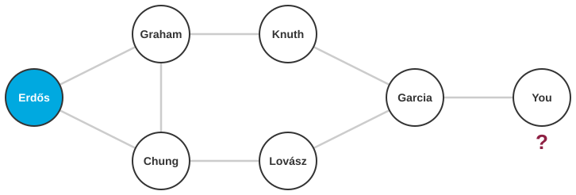
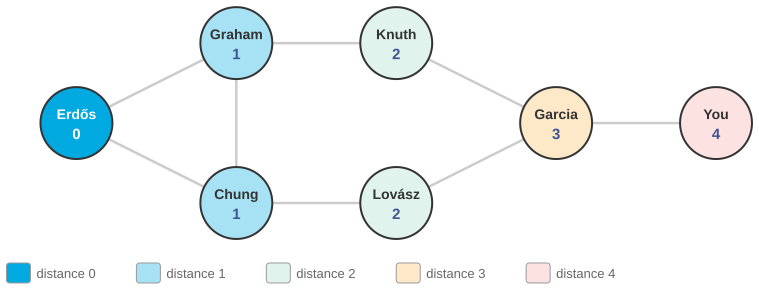
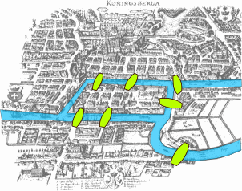
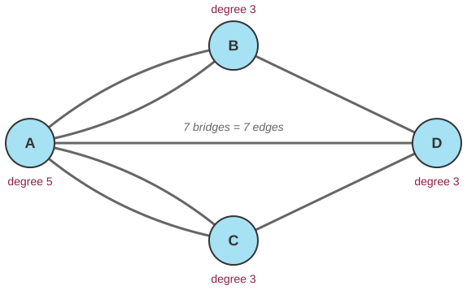
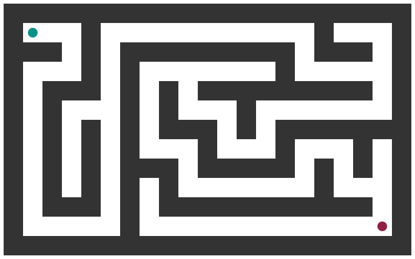
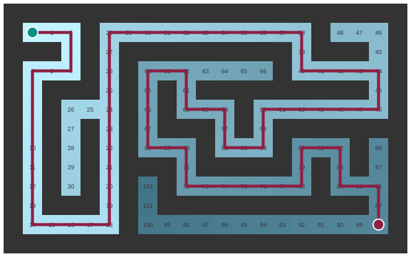

## Three questions for this session

::: {.sm}
Each example is an **opening** question for the start of the lecture and an **answer** for the
end, followed by a notes slide. Copy the slides you want into the main deck.
:::

::: {.xs}
| | Question | Hook | id |
|-|-----------|---------------|---|
| **A** | What is your Erdős number? | Six degrees, measured: how to compute a distance in a graph of two million authors. | `X05-A` |
| **B** | The seven bridges of Königsberg | Euler, 1736: the first graph problem, and the first proof that something cannot be done. | `X05-B` |
| **C** | Solve the maze without luck | A procedure that finds the shortest way out of any maze, and knows when it has. | `X05-C` |
:::

::: {.xs}
Main deck `Slides/05-Algorithms/` · transcript `Transcripts/05-…md` (the § in the answers)
:::

<!-- EXAMPLE:X05-A:BEGIN -->
## A · What is your Erdős number? {.fit1}

[Opening question · place after the Overview slide]{.tag .ex-open}

{width="755px"}

::: {.sm}
Paul Erdős wrote about 1 500 papers with 500 co-authors. Your **Erdős number**
is the length of the shortest co-authorship chain from you to him: co-authors
have 1, their co-authors 2, and so on. Most mathematicians have one below 8.
(Kevin Bacon numbers work the same way for actors.)

[Given the co-authorship graph, two million authors and ten million edges, what exact procedure computes *your* number? And how do you know it is the shortest?]{.ask}
:::

## A · What is your Erdős number? · answer

[The answer · place before the Summary slide]{.tag .ex-close}

{width="1149px"}

## A · What is your Erdős number? · why

[The answer · place before the Summary slide]{.tag .ex-close}

::: {.sm}
- **Breadth-first search** from Erdős: visit all co-authors (distance 1), then
  all *their* unvisited co-authors (distance 2), and so on, using a **queue** so
  that whole layers finish before the next begins.
- The first time BFS reaches you, the distance recorded is the shortest,
  because every shorter path would have been discovered in an earlier layer.
- Cost: each author and each co-authorship looked at once, $O(|V| + |E|)$,
  which is seconds for ten million edges.
:::

::: {.uses}
**What we used:** §7 graphs · §8 representing graphs (adjacency lists) · §9 breadth-first search and why it finds shortest paths · §10 graphs in social science
:::

## A · What is your Erdős number? · notes {.fit1}

[X05-A]{.tag .ex-id}

::: {.xxs}
**Source.** The Erdős Number Project (Oakland University) maintains the data;
Grossman & Ion (1995). The small graph in the figure is illustrative except for
Graham, Chung, Lovász and Knuth, who really do have Erdős numbers 1, 1, 1 and 2;
"Garcia" and "You" are placeholders. BFS in the figure is actually run by the
script.

**Facts.** Median Erdős number among mathematicians with a finite one is about
5; the maximum known is 13. Facebook's 2016 estimate of 3.57 average degrees of
separation among 1.59 billion users (candidate M05-A) used a probabilistic
version of the same layer-by-layer expansion.

**How to present.** Open with the definition and ask for a *procedure*, not an
answer; write the room's suggestions on the board. Most will describe DFS
("follow a chain"), which does *not* give the shortest path. Close by running
BFS on the figure layer by layer, then state the invariant (layer $k$ contains
exactly the vertices at distance $k$). That invariant is the exam question.

**Where it plugs in.** Immediately before the BFS slides; the ten BFS state
figures in the main deck are the formal trace of this.

**Self-study:** post `Examples/posts/X05-A-….md` · notebook `Examples/notebooks/X05-A.ipynb`, the problem and the solution in a few cells.
:::

<!-- EXAMPLE:X05-A:END -->
<!-- EXAMPLE:X05-B:BEGIN -->
## B · The seven bridges of Königsberg {.fit1}

[Opening question · place after the Overview slide]{.tag .ex-open}

:::: {.columns}
::: {.column width="46%"}
{width="539px"}

::: {.source}
Map: Bogdan Giuşcă, Wikimedia Commons, CC BY-SA 3.0
:::
:::
::: {.column width="54%"}
::: {.sm}
Königsberg (now Kaliningrad) had **seven bridges** joining two river banks and
two islands. The townspeople's puzzle: **walk across every bridge exactly once**
and return home.

Nobody managed it. In 1736 Leonhard Euler proved that nobody ever would, and
in doing so invented graph theory.

[How do you *prove* that no route exists, without trying all of them? What is the right way to write the city down?]{.ask}
:::
:::
::::

## B · The seven bridges of Königsberg · answer

[The answer · place before the Summary slide]{.tag .ex-close}

:::: {.columns}
::: {.column width="52%"}
{width="599px"}
:::
::: {.column width="48%"}
::: {.sm}
*The question was:* How do you *prove* that no route exists, without trying all of them? What is the right way to write the city down?
:::
:::
::::

## B · The seven bridges of Königsberg · why

[The answer · place before the Summary slide]{.tag .ex-close}

::: {.sm}
- **Representation is the whole trick.** Land masses become vertices, bridges
  become edges. The geography of the map is irrelevant; only the connections matter.
- On such a walk you *enter* and *leave* each land mass, using two bridges per
  visit. So every vertex except the start and end needs an **even degree**.
- Königsberg's four vertices have degrees **5, 3, 3, 3**, all odd. No such walk
  exists. Euler's theorem: an Eulerian circuit exists iff every degree is even.
:::

::: {.uses}
**What we used:** §7 graphs: vertices, edges, degree · §8 representing graphs · §2 properties of an algorithm; a proof of impossibility is not an exhaustive search
:::

## B · The seven bridges of Königsberg · notes

[X05-B]{.tag .ex-id}

::: {.xxs}
**Source.** Euler, L. (1736), *Solutio problematis ad geometriam situs
pertinentis*. The map image is CC BY-SA 3.0 (Bogdan Giuşcă, Wikimedia Commons);
the credit is on the slide. The multigraph is drawn by the script.

**Facts.** Degrees: A (Kneiphof island) 5; B, C, D 3 each. An Eulerian *path*
(not returning) needs exactly 0 or 2 odd vertices; Königsberg has 4. Two of the
bridges were destroyed in 1944 and two more were later replaced by a highway;
the five that remain allow an Eulerian path, from one island to the other.

**How to present.** Open with the map and the puzzle; give 90 seconds for the
room to try (nobody succeeds, which is the point). Close by redrawing the map as
the four-vertex graph *live*; the moment the geography disappears is the
lesson. Then the degree count. Emphasize that this is a proof, not a search:
trying all $7!$ orderings is an algorithm too, but Euler's argument is a
different kind of thing.

**Where it plugs in.** The introduction of graphs in the main deck; also a
bridge (sic) to session 9's theme that some things can be proven impossible.

**Self-study:** post `Examples/posts/X05-B-….md` · notebook `Examples/notebooks/X05-B.ipynb`, the problem and the solution in a few cells.
:::

<!-- EXAMPLE:X05-B:END -->
<!-- EXAMPLE:X05-C:BEGIN -->
## C · Solve the maze without luck

[Opening question · place after the Overview slide]{.tag .ex-open}

:::: {.columns}
::: {.column width="46%"}
{width="533px"}
:::
::: {.column width="54%"}
::: {.sm}
Green in, red out. A person solves this by looking. A robot, or a program
exploring a network, a state space or a set of possible moves, has to be told
**exactly** what to do at every junction.

[Write the rule. Which cell do you look at next? How do you avoid loops? How do you know the path you found is the *shortest*?]{.ask}
:::
:::
::::

## C · Solve the maze without luck · answer

[The answer · place before the Summary slide]{.tag .ex-close}

:::: {.columns}
::: {.column width="52%"}
{width="599px"}
:::
::: {.column width="48%"}
::: {.sm}
*The question was:* Write the rule. Which cell do you look at next? How do you avoid loops? How do you know the path you found is the *shortest*?
:::
:::
::::

## C · Solve the maze without luck · why

[The answer · place before the Summary slide]{.tag .ex-close}

::: {.sm}
- The maze is a **graph**: open cells are vertices, adjacent open cells share an
  edge. Then it is BFS again.
- The numbers are BFS distances from the entrance; the red line follows the
  **parent pointers** back from the exit. Length **88**, and BFS guarantees that no
  shorter path exists.
- **119** cells explored, every reachable cell once. Depth-first search would
  also find *a* path, but not necessarily this one.
:::

::: {.uses}
**What we used:** §3 representing algorithms · §4 pseudocode · §7–§9 graphs and breadth-first search, including the parent array
:::

## C · Solve the maze · BFS versus DFS

::: {.sm}
Both find *a* path. Only breadth-first search finds the **shortest**, because it explores in order of
distance. Depth-first search commits to a corridor and backtracks only at dead ends: cheaper in memory,
because the stack holds one path, and more expensive in path length.
:::

| | Breadth-first | Depth-first |
|---|---|---|
| next cell | oldest discovered (queue) | newest discovered (stack) |
| finds | shortest path | some path |
| memory | the whole frontier | one path |
| used for | distances, contact tracing, Erdős numbers | recursion, cycle detection, mazes by hand |

::: {.sm}
Session 6 introduces DFS properly; this table is a preview.
:::

## C · Solve the maze without luck · notes

[X05-C]{.tag .ex-id}

::: {.xxs}
**Source.** The maze is generated by the figure script (recursive backtracker,
seed 7) and solved by BFS in the same script; the numbers on the slide are read
from that run, so regenerating changes them together.

**Facts.** Shortest path 88 steps; 119 cells reachable. The distance shading
shows the BFS "wave" expanding from the start. DFS on the same maze explores in
a completely different order and returns a path that is usually longer.

**How to present.** Open with the unsolved maze and the three questions; ask
students to write pseudocode in pairs for five minutes; most produce something
close to DFS. Close with the solved figure: point at the numbers, then ask
which cell was explored *first* at distance 3; the queue makes that a
well-defined question. Good moment to contrast BFS and DFS explicitly, since
session 6 will use DFS for recursion.

**Where it plugs in.** After the eight-node BFS trace in the main deck, as the
"now on something bigger" step.

**Self-study:** post `Examples/posts/X05-C-….md` · notebook `Examples/notebooks/X05-C.ipynb`, the problem and the solution in a few cells.
:::

<!-- EXAMPLE:X05-C:END -->