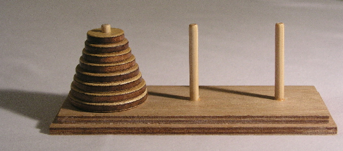
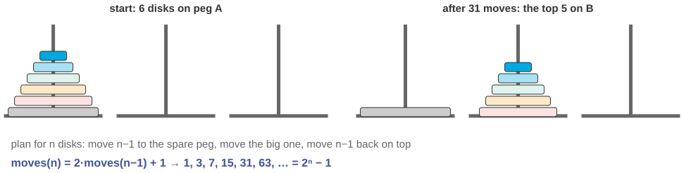
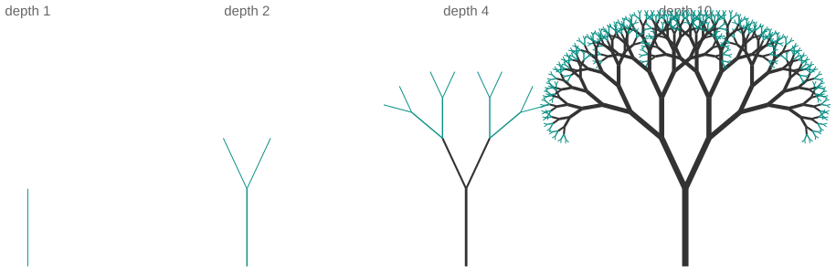
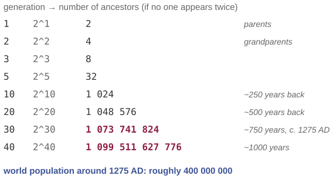

## Three questions for this session

::: {.sm}
Each example is an **opening** question for the start of the lecture and an **answer** for the
end, followed by a notes slide. Copy the slides you want into the main deck.
:::

::: {.xs}
| | Question | Hook | id |
|-|-----------|---------------|---|
| **A** | The monks, the 64 disks, and the end of the world | A legend, a two-line recursive plan, and an exact count of 18 446 744 073 709 551 615 moves. | `X06-A` |
| **B** | Draw this tree in five lines | A picture that is made of smaller copies of itself, and the code that has the same shape. | `X06-B` |
| **C** | You have more ancestors than there were people | Thirty generations back, 2³⁰ ancestors, but the world held 400 million. What gives? | `X06-C` |
:::

::: {.xs}
Main deck `Slides/06-Recursion/` · transcript `Transcripts/06-…md` (the § in the answers)
:::

<!-- EXAMPLE:X06-A:BEGIN -->
## A · The monks, the 64 disks, and the end of the world {.fit1}

[Opening question · place after the Overview slide]{.tag .ex-open}

{width="552px"}

::: {.source}
Photo: Wikimedia Commons, CC BY-SA 3.0
:::

::: {.sm}
The legend: in a temple, monks move **64 golden disks** between three pegs, one
disk at a time, never placing a larger disk on a smaller one. When the last
disk is placed, the world ends.

With 3 disks it takes 7 moves. With 4, 15.

[How many moves for 64? And, the harder question, how do you write down the *procedure* for moving them, for any number of disks?]{.ask}
:::

## A · The monks, the 64 disks, and the end of the world · answer

[The answer · place before the Summary slide]{.tag .ex-close}

{width="1148px"}

::: {.sm}
*The question was:* How many moves for 64? And, the harder question, how do you write down the *procedure* for moving them, for any number of disks?
:::

## A · The monks, the 64 disks, and the end of the world · why

[The answer · place before the Summary slide]{.tag .ex-close}

::: {.sm}
- **Recursive plan:** to move $n$ disks A→C, move $n-1$ disks A→B, move the
  largest A→C, move $n-1$ disks B→C. The base case is zero disks: nothing to do.
- Moves: $M(n) = 2M(n-1) + 1$, so $M(n) = 2^n - 1$. For 64 disks that is
  $2^{64} - 1 \approx 1.8 \times 10^{19}$: **585 billion years** at one move per second.
- The procedure is four lines. The iterative version exists but nobody can read
  it. This is what recursion is *for*: the plan is self-similar.
:::

::: {.uses}
**What we used:** §2 the three parts of a recursive definition · §4 how recursion runs: the program stack · §7 types of recursion (two calls: tree recursion)
:::

## A · The monks, the 64 disks, and the end of the world · notes {.fit2}

[X06-A]{.tag .ex-id}

::: {.xxs}
**Source.** Lucas, É. (1883), who invented the puzzle and the legend. Photo CC
BY-SA 3.0 via Wikimedia Commons; the diagram is generated. Number computed:
$2^{64}-1 = 18\,446\,744\,073\,709\,551\,615$; at $31\,557\,600$ s/year
that is about $5.85 \times 10^{11}$ years.

**Facts.** $M(n) = 2^n - 1$ is also a lower bound: the largest disk can only
move once all others are on one peg. Recursion depth is $n$, so the call stack
holds at most 64 frames, which is trivially fine; it is the *number* of calls
that explodes, not the depth.

**How to present.** Open with the physical puzzle if you have one (or the
photo), do 3 disks live, ask for 64. Guesses range wildly. Close by writing the
four-line procedure and *then* deriving $2^n-1$ from it; the recurrence falls
out of the code. Note the distinction between exponential *work* and linear
*depth*, which the fractal-tree example (X06-B) reinforces.

**Where it plugs in.** After the factorial and program-stack slides; before
"types of recursion". Counting the moves is a natural exercise.

**Self-study:** post `Examples/posts/X06-A-….md` · notebook `Examples/notebooks/X06-A.ipynb`, the problem and the solution in a few cells.
:::

<!-- EXAMPLE:X06-A:END -->
<!-- EXAMPLE:X06-B:BEGIN -->
## B · Draw this tree in five lines

[Opening question · place after the Overview slide]{.tag .ex-open}

{width="820px"}

::: {.sm}
Four drawings. The last one has **512 branch tips**. A loop that draws it needs
to know how many levels there are, where each branch starts, and the angle of
every one of the 1 023 segments.

[What is the *shortest* program that draws the right-hand tree, and why does it look so much like the definition of the tree?]{.ask}
:::

## B · Draw this tree in five lines · answer

[The answer · place before the Summary slide]{.tag .ex-close}

{width="1140px"}

## B · Draw this tree in five lines · why

[The answer · place before the Summary slide]{.tag .ex-close}

::: {.sm}
```
Procedure TREE(x, y, angle, length, depth)
If depth = 0
      then return                                    # base case
draw a segment from (x, y) at angle, of length; its end is tip
TREE(tip, angle − 25°, 0.72 · length, depth − 1)
TREE(tip, angle + 25°, 0.72 · length, depth − 1)
```

- A tree **is** a segment with two smaller trees on top; the code says exactly that.
- Two recursive calls per level give $2^{\text{depth}-1}$ tips, but the **stack** is
  only `depth` frames deep: exponential work, linear memory.
:::

::: {.uses}
**What we used:** §2 base case and recursive case · §4 the program stack · §7 tree recursion versus linear recursion
:::

## B · Draw this tree in five lines · notes

[X06-B]{.tag .ex-id}

::: {.xxs}
**Source.** The classic "fractal tree" (Mandelbrot 1982 popularized the family);
this one is drawn by `tools/genexamples_figs.py` with the procedure shown, so
the picture *is* the program's output.

**Facts.** Depth 10: $2^{9} = 512$ tips, $2^{10} - 1 = 1\,023$ segments. Branch
length factor 0.72, angle ±25°. Change the two constants and you get a
different species, a nice thing to show live in the practical part.

**How to present.** Open with the four panels and the "512 tips" number; ask
for the program. Close with the five lines and run through depth 2 by hand on
the board, drawing the stack beside it: at any moment only `depth` calls are
alive. This is the cleanest place to separate *number of calls* from *depth of
recursion*, which students conflate.

**Where it plugs in.** After factorial (linear recursion) and before or
alongside DFS (§6); DFS on a tree has the same shape.

**Self-study:** post `Examples/posts/X06-B-….md` · notebook `Examples/notebooks/X06-B.ipynb`, the problem and the solution in a few cells.
:::

<!-- EXAMPLE:X06-B:END -->
<!-- EXAMPLE:X06-C:BEGIN -->
## C · You have more ancestors than there were people

[Opening question · place after the Overview slide]{.tag .ex-open}

{width="487px"}

::: {.sm}
Two parents, four grandparents, eight great-grandparents. Thirty generations
back, around the year 1275, that is **$2^{30}$ ≈ 1.07 billion** ancestors.
The world population at the time was about **400 million**.

[Where is the mistake? Write the recursive definition that produced $2^{30}$, and find the assumption that makes it wrong.]{.ask}
:::

## C · You have more ancestors than there were people · answer

[The answer · place before the Summary slide]{.tag .ex-close}

{width="861px"}

## C · You have more ancestors than there were people · why {.fit1}

[The answer · place before the Summary slide]{.tag .ex-close}

::: {.sm}
- The definition: $\text{ancestors}(0) = 1$; $\text{ancestors}(g) = 2 \cdot
  \text{ancestors}(g-1)$. It is a correct recursion, for a **tree**.
- The assumption is that all $2^g$ slots hold *different* people. They do not:
  your family tree is a **directed acyclic graph** where the same person appears
  many times. This is **pedigree collapse**, and it is universal.
- Every recursive definition rests on the shape of its data. Tree recursion on a
  DAG **over-counts**, which is exactly why DFS marks visited nodes.
:::

::: {.uses}
**What we used:** §2 the three parts of a recursive definition · §6 depth-first search and the visited mark · §8 dynamic programming: don't recompute a shared subproblem
:::

## C · You have more ancestors than there were people · notes {.fit1}

[X06-C]{.tag .ex-id}

::: {.xxs}
**Source.** Pedigree collapse: Shoumatoff, *The Mountain of Names* (1985).
Chang (1999) showed that in a randomly mating population the most recent
common ancestor of everyone alive lies only about $\log_2 n$ generations back.
Population around 1275: McEvedy & Jones, *Atlas of World Population History*,
roughly 400 million.

**Facts.** $2^{30} = 1\,073\,741\,824$. Generation length about 25 years, so 30
generations is about 750 years. The recursion is right; the *model* (a tree) is
wrong.

**How to present.** Open with the doubling table and the population line; the
contradiction is obvious and the diagnosis is not. Close by drawing a small
family graph where two cousins marry: one grandparent pair appears twice in the
grandchildren's tree. Then the connection: DFS keeps a *visited* set for this
reason, and dynamic programming (Fibonacci with memoization) is the same idea,
which is to count each shared subproblem once.

**Where it plugs in.** After the DFS slides or as the lead-in to dynamic
programming; it makes "overlapping subproblems" concrete before Fibonacci.

**Self-study:** post `Examples/posts/X06-C-….md` · notebook `Examples/notebooks/X06-C.ipynb`, the problem and the solution in a few cells.
:::

<!-- EXAMPLE:X06-C:END -->