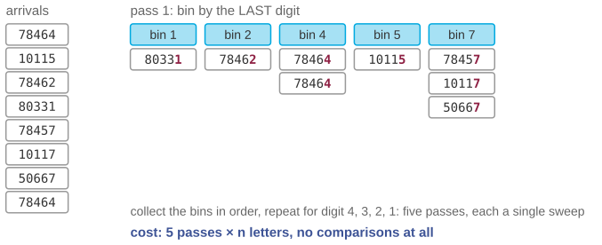
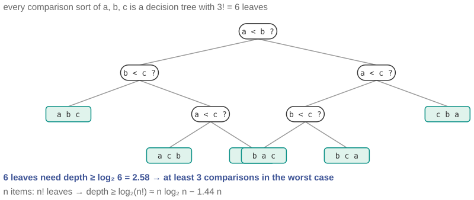
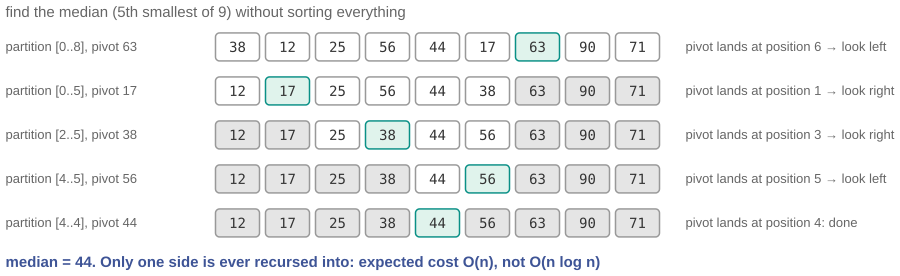

## Three questions for this session

::: {.sm}
Each example is an **opening** question for the start of the lecture and an **answer** for the
end, followed by a notes slide. Copy the slides you want into the main deck.
:::

::: {.xs}
| | Question | Hook | id |
|-|-----------|---------------|---|
| **A** | How the post office sorts 20 million letters a night | No comparisons at all: sorting by postcode, one digit at a time. | `X07-A` |
| **B** | Can you sort 8 things in 10 comparisons? | A colleague claims a sorting algorithm that beats every known one. Prove them wrong without seeing it. | `X07-B` |
| **C** | The median of a billion salaries, without sorting | You only need the middle value; sorting all of them is work you did not ask for. | `X07-C` |
:::

::: {.xs}
Main deck `Slides/07-SortingAlgorithms/` · transcript `Transcripts/07-…md` (the § in the answers)
:::

<!-- EXAMPLE:X07-A:BEGIN -->
## A · How the post office sorts 20 million letters a night

[Opening question · place after the Overview slide]{.tag .ex-open}

::: {.sm}
Deutsche Post sorts on the order of **20 million letters** a night by postcode,
far faster than any comparison between two letters could be made.

[Mergesort needs about $n \log_2 n \approx 5 \times 10^8$ comparisons for 20 million items. The machines do none. How?]{.ask}
:::

## A · How the post office sorts 20 million letters a night · answer

[The answer · place before the Summary slide]{.tag .ex-close}

{width="1136px"}

## A · How the post office sorts 20 million letters a night · why {.fit1}

[The answer · place before the Summary slide]{.tag .ex-close}

::: {.sm}
- **Radix sort:** put each letter in one of ten bins by its *last* digit, collect
  the bins in order, repeat for the next digit. After five passes the pile is
  sorted, and each pass is a **stable** counting sort.
- Cost $O(d \cdot n)$ with $d = 5$: **linear** in $n$. No two letters are ever
  compared; the digit is used directly as a bin index.
- This does not contradict the $n \log n$ lower bound: that bound is for
  *comparison* sorts. Knowing the keys are short digit strings is extra information.
:::

::: {.uses}
**What we used:** §3 stable sorting (each pass must be stable or the previous pass is undone) · §9 why sorting matters · the comparison lower bound
:::

## A · How the post office sorts 20 million letters a night · notes {.fit1}

[X07-A]{.tag .ex-id}

::: {.xxs}
**Source.** Radix sorting predates computers: Hollerith's tabulating equipment
sorted punched cards this way from the 1890 census on. Deutsche Post volumes:
about 50 million letters per working day (DHL Group annual reports); machine
throughput 30 000 to 40 000 per hour. Counting sort is the exam's `AC-09`.

**Facts.** LSD radix sort: $d$ passes of a stable bucket sort; $O(d(n + k))$
with $k = 10$. Stability of each pass is what makes the order of the earlier
digits survive; that is the link to §3.

**How to present.** Open with the volume figure and the lower-bound number;
ask how it can possibly be done. Close with the first pass on the figure, then
ask the room *why the pass must be stable*; let them discover that an unstable
second pass would scramble the first. This is the best available argument for
why stability is not a footnote.

**Where it plugs in.** After the comparison-based sorts and the lower bound
(§9 of the transcript), as the "unless you know more" coda.

**Self-study:** post `Examples/posts/X07-A-….md` · notebook `Examples/notebooks/X07-A.ipynb`, the problem and the solution in a few cells.
:::

<!-- EXAMPLE:X07-A:END -->
<!-- EXAMPLE:X07-B:BEGIN -->
## B · Can you sort 8 things in 10 comparisons?

[Opening question · place after the Overview slide]{.tag .ex-open}

::: {.sm}
Selection sort needs 28 comparisons for 8 elements; mergesort about 17. A
colleague says they have a comparison-based algorithm that sorts **any 8
elements in at most 10 comparisons**.

You have not seen the code. You do not need to.

[What is the smallest number of comparisons that *any* algorithm needs in the worst case for 8 elements, and how can you know that about algorithms nobody has written yet?]{.ask}
:::

## B · Can you sort 8 things in 10 comparisons? · answer

[The answer · place before the Summary slide]{.tag .ex-close}

{width="1148px"}

## B · Can you sort 8 things in 10 comparisons? · why

[The answer · place before the Summary slide]{.tag .ex-close}

::: {.sm}
- A comparison sort is a **decision tree**: each comparison is a branch, each
  leaf a final ordering. To sort correctly it needs a leaf for **every** one of
  the $n!$ possible orderings.
- A binary tree with $n!$ leaves has depth at least $\log_2 n!$. For $n = 8$:
  $\log_2 40\,320 = 15.3$, so **at least 16 comparisons** in the worst case.
- Ten is impossible; **16 is achievable** (it is the known optimum for $n = 8$).
  In general $\log_2 n! \approx n \log_2 n$: mergesort is within a constant of optimal.
:::

::: {.uses}
**What we used:** §2 the formal sorting problem · §5 divide and conquer · §6 mergesort · the comparison lower bound argument in §9
:::

## B · Can you sort 8 things in 10 comparisons? · notes

[X07-B]{.tag .ex-id}

::: {.xxs}
**Source.** Knuth, *TAOCP* vol. 3, §5.3.1 (minimum-comparison sorting). The
optimum $S(8) = 16$ is known exactly; the Ford–Johnson algorithm achieves it.
The figure draws the full decision tree for $n = 3$ (six leaves, depth 3), which
is small enough to see the argument.

**Facts.** $8! = 40\,320$; $\lceil \log_2 40\,320 \rceil = 16$. For $n = 3$:
$\lceil \log_2 6 \rceil = 3$. Stirling: $\log_2 n! = n\log_2 n - 1.44n + O(\log n)$.

**How to present.** Open with the claim; someone will say "you'd have to test
it". Close with the decision tree for three elements on the board, count leaves,
and generalize. The rhetorical point is strong and worth stating: this is a
statement about *every algorithm that could ever be written*, proved on one
slide. Session 9 builds a whole theory of such statements.

**Where it plugs in.** After mergesort, at the lower-bound slide of the main
deck; pairs with X07-A, which shows how the bound is *escaped*.

**Self-study:** post `Examples/posts/X07-B-….md` · notebook `Examples/notebooks/X07-B.ipynb`, the problem and the solution in a few cells.
:::

<!-- EXAMPLE:X07-B:END -->
<!-- EXAMPLE:X07-C:BEGIN -->
## C · The median of a billion salaries, without sorting

[Opening question · place after the Overview slide]{.tag .ex-open}

::: {.sm}
A ministry wants the **median** income across a billion records. The obvious
plan: sort, take the middle element. On one machine that is roughly $10^9 \times
30 = 3 \times 10^{10}$ comparisons and a full copy of the data.

But the median is *one number*. The other 999 999 999 sorted positions are
thrown away.

[Is there a way to find the $k$-th smallest element without putting all the others in order? What in this session's toolkit gets you halfway?]{.ask}
:::

## C · The median of a billion salaries, without sorting · answer

[The answer · place before the Summary slide]{.tag .ex-close}

{width="1150px"}

## C · The median of a billion salaries, without sorting · why

[The answer · place before the Summary slide]{.tag .ex-close}

::: {.sm}
- **Quicksort's PARTITION** puts the pivot in its final position $q$ and every
  smaller element to its left. If $q$ is the position you want, you are done.
- Otherwise recurse into **only the side that contains position $k$**; the
  other side never needs sorting. This is **Quickselect** (Hoare, 1961).
- Expected cost $n + n/2 + n/4 + \cdots = O(n)$: one pass's worth, not
  $n \log n$. Worst case is still $O(n^2)$, from the same bad pivots as quicksort.
:::

::: {.uses}
**What we used:** §5 divide and conquer · §7 quicksort and the PARTITION procedure · session 8: the geometric series that makes it linear
:::

## C · The median of a billion salaries, without sorting · notes {.fit1}

[X07-C]{.tag .ex-id}

::: {.xxs}
**Source.** Hoare, C. A. R. (1961), "Algorithm 65: Find". CLRS §9.2. The trace
in the figure is produced by running Lomuto partition on `[38, 12, 71, 25, 56,
90, 44, 17, 63]`; the median found is 44 in five partitions.

**Facts.** Expected comparisons about $3.4n$ for the median. The worst case is
avoidable with median-of-medians (Blum et al. 1973), which is $O(n)$
deterministically; mention it, do not teach it.

**How to present.** Open with the "one number, a billion sorted for nothing"
framing. Close by pointing at the PARTITION slide of the main deck and asking
what happens if you *only recurse on one side*; the figure then shows the
shrinking active region. The geometric-series argument is a preview of session
8 and worth doing on the board: $n(1 + 1/2 + 1/4 + \ldots) < 2n$.

**Where it plugs in.** Immediately after the quicksort slides; it is
quicksort with one recursive call removed, which is also a good exercise.

**Self-study:** post `Examples/posts/X07-C-….md` · notebook `Examples/notebooks/X07-C.ipynb`, the problem and the solution in a few cells.
:::

<!-- EXAMPLE:X07-C:END -->