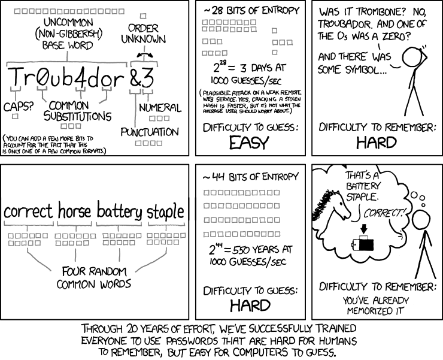
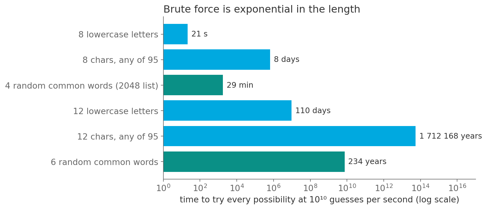
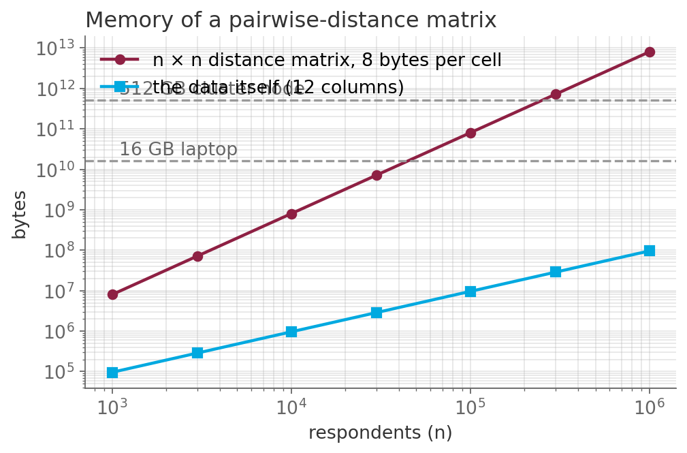
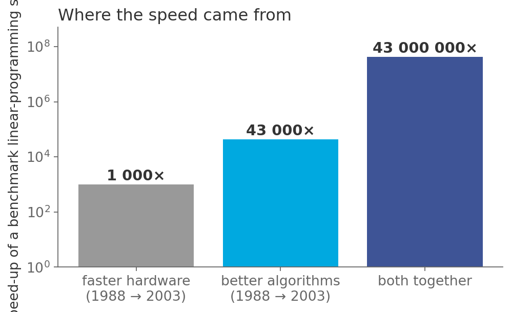

## Three questions for this session

::: {.sm}
Each example is an **opening** question for the start of the lecture and an **answer** for the
end, followed by a notes slide. Copy the slides you want into the main deck.
:::

::: {.xs}
| | Question | Hook | id |
|-|-----------|---------------|---|
| **A** | Tr0ub4dor&3 or correct horse battery staple? | Which password is safer, and why the answer is a growth rate. | `X08-A` |
| **B** | The clustering script that ran out of memory at 100 000 | It worked on 10 000 respondents. Ten times more data, one hundred times more memory. | `X08-B` |
| **C** | Computers got 1 000× faster. Solving got 43 000 000× faster. | Where did the other 43 000× come from? Not from hardware. | `X08-C` |
:::

::: {.xs}
Main deck `Slides/08-TimeComplexity/` · transcript `Transcripts/08-…md` (the § in the answers)
:::

<!-- EXAMPLE:X08-A:BEGIN -->
## A · Tr0ub4dor&3 or correct horse battery staple?

[Opening question · place after the Overview slide]{.tag .ex-open}

:::: {.columns}
::: {.column width="46%"}
{width="513px"}

::: {.source}
XKCD 936, Randall Munroe, CC BY-NC 2.5, xkcd.com/936
:::
:::
::: {.column width="54%"}
::: {.sm}
Two passwords. One is eleven characters with a capital, a digit and a symbol.
The other is four common words.

The comic's claim: the second is **stronger**, and easier to remember.

[Is that true? What does 'strong' even measure, and why does adding *one more word* do more than adding a symbol?]{.ask}
:::
:::
::::

## A · Tr0ub4dor&3 or correct horse battery staple? · answer

[The answer · place before the Summary slide]{.tag .ex-close}

{width="1077px"}

## A · Tr0ub4dor&3 or correct horse battery staple? · why

[The answer · place before the Summary slide]{.tag .ex-close}

::: {.sm}
- Guessing is a search with cost $|A|^L$: alphabet size to the power of the
  **length**. Length is the exponent, and that is where the leverage is.
- $26^8 \approx 2 \times 10^{11}$: 21 seconds at $10^{10}$ guesses/s. $2048^4 =
  2^{44}$: 29 minutes. $2048^6 = 2^{66}$: **234 years**. Two more words beat
  every symbol you could add.
- **Exponential** growth: each extra character multiplies the work; each extra
  order of magnitude of hardware only divides it once.
:::

::: {.uses}
**What we used:** §3 why it matters: some numbers · §8 asymptotic behavior: polynomial versus exponential · §9 using O-notation
:::

## A · Tr0ub4dor&3 or correct horse battery staple? · notes {.fit1}

[X08-A]{.tag .ex-id}

::: {.xxs}
**Source.** XKCD 936 (CC BY-NC 2.5; used here in an educational context with
attribution). A guess rate of $10^{10}$/s is a realistic offline GPU attack on
a weak hash (Hashcat benchmarks); against a properly slow hash it is $10^4$/s
and every bar moves six orders of magnitude to the right, which is worth saying.

**Facts.** Bars are computed in the figure script: 8 lowercase letters 21 s; 8
from 95 symbols 7.7 days; 4 words 29 min; 12 lowercase 110 days; 12 from 95
symbols 1.7 million years; 6 words 234 years. The comic's own numbers assume
$10^3$/s (online guessing).

**How to present.** Open with the comic and a vote. Close with the bar chart on
a log axis and the formula $|A|^L$; then ask what a 100× faster attacker does to
each bar (shifts it by 2 on the log axis) against what one more word does
(multiplies by 2048). That contrast *is* the session's message about growth
rates.

**Where it plugs in.** With the growth-rate table of the main deck; it gives
the $2^n$ row a face.

**Self-study:** post `Examples/posts/X08-A-….md` · notebook `Examples/notebooks/X08-A.ipynb`, the problem and the solution in a few cells.
:::

<!-- EXAMPLE:X08-A:END -->
<!-- EXAMPLE:X08-B:BEGIN -->
## B · The clustering script that ran out of memory at 100 000

[Opening question · place after the Overview slide]{.tag .ex-open}

::: {.sm}
A student clusters survey respondents by computing the **distance between every
pair** and feeding the matrix to a clustering routine. On the 10 000-respondent
pilot it takes a minute. On the full 100 000 it crashes:

```
MemoryError: Unable to allocate 74.5 GiB for an array
with shape (100000, 100000) and data type float64
```

[Ten times the data asked for a hundred times the memory. Which number in the code decides that, and what does the full 1 000 000-respondent panel need?]{.ask}
:::

## B · The clustering script that ran out of memory at 100 000 · answer

[The answer · place before the Summary slide]{.tag .ex-close}

:::: {.columns}
::: {.column width="52%"}
{width="599px"}
:::
::: {.column width="48%"}
::: {.sm}
*The question was:* Ten times the data asked for a hundred times the memory. Which number in the code decides that, and what does the full 1 000 000-respondent panel need?
:::
:::
::::

## B · The clustering script that ran out of memory at 100 000 · why

[The answer · place before the Summary slide]{.tag .ex-close}

::: {.sm}
- $n$ respondents have $n^2$ pairs; at 8 bytes each the matrix is $8n^2$ bytes:
  0.8 GB at $10^4$, **80 GB at $10^5$**, **8 TB at $10^6$**. The data itself is
  linear and stays small.
- This is **memory complexity** $O(n^2)$, and it fails harder than time
  complexity: a slow job finishes late, an oversized allocation never starts.
- Escapes: algorithms that never form the matrix (K-means is $O(nK)$ per step),
  or approximate neighbor search. Check the exponent *before* the pilot.
:::

::: {.uses}
**What we used:** §2 three kinds of complexity: time, memory · §8 O-notation · §9 using it: read the $n^2$ off the code before running it
:::

## B · The clustering script that ran out of memory at 100 000 · notes {.fit1}

[X08-B]{.tag .ex-id}

::: {.xxs}
**Source.** The error message is verbatim NumPy for a $10^5 \times 10^5$
float64 array (74.5 GiB). Hierarchical clustering via `scipy.cluster.hierarchy`
and `sklearn.metrics.pairwise_distances` both materialize this matrix.

**Facts.** $8n^2$ bytes: $n=10^4$ gives 800 MB; $10^5$ gives 80 GB; $10^6$ gives
8 TB. Even a 512 GB cluster node fails at $n \approx 250\,000$. The dashed
lines in the figure are a 16 GB laptop and a 512 GB node.

**How to present.** Open with the error message; it is a real one and students
recognize the genre. Ask what "ten times the data, a hundred times the memory"
implies about the exponent. Close with the log-log plot: two lines, slopes 1 and
2, and the horizontal machine limits. The lesson: a pilot on a subsample cannot
reveal a quadratic term; only reading the code can.

**Where it plugs in.** With the memory-complexity slides of the main deck
(§2 and §8 of the transcript); connects to K-means in session 10, which is the
linear-memory alternative.

**Self-study:** post `Examples/posts/X08-B-….md` · notebook `Examples/notebooks/X08-B.ipynb`, the problem and the solution in a few cells.
:::

<!-- EXAMPLE:X08-B:END -->
<!-- EXAMPLE:X08-C:BEGIN -->
## C · Computers got 1 000× faster. Solving got 43 000 000× faster.

[Opening question · place after the Overview slide]{.tag .ex-open}

::: {.sm}
A 2010 report to the US President compared how long a benchmark optimization
problem took to solve in **1988** and in **2003**.

- Processors in 2003 were about **1 000 times faster**.
- The problem was solved about **43 000 000 times faster**.

The same kind of problem, on the same kind of machine, in the same field.

[Where did the missing factor of 43 000 come from, and why is it, not Moore's law, the reason today's models fit at all?]{.ask}
:::

## C · Computers got 1 000× faster. Solving got 43 000 000× faster. · answer

[The answer · place before the Summary slide]{.tag .ex-close}

:::: {.columns}
::: {.column width="52%"}
{width="599px"}
:::
::: {.column width="48%"}
::: {.sm}
*The question was:* Where did the missing factor of 43 000 come from, and why is it, not Moore's law, the reason today's models fit at all?
:::
:::
::::

## C · Computers got 1 000× faster. Solving got 43 000 000× faster. · why {.fit1}

[The answer · place before the Summary slide]{.tag .ex-close}

::: {.sm}
- The rest came from **algorithms**: better linear-programming solvers, better
  data structures inside them, better numerical methods. Improvements in the
  *growth rate* and its constants, not in the clock speed.
- Hardware improves everything by a constant factor. An algorithmic improvement
  from $O(n^2)$ to $O(n \log n)$ improves *more* the bigger the problem gets.
- The report's conclusion: in many fields, **algorithms have contributed more
  than Moore's law**, and they are the part a researcher can choose.
:::

::: {.uses}
**What we used:** §3 why it matters · §8 asymptotic behavior: why a better growth rate beats a faster machine · §10 why this matters for us
:::

## C · Computers got 1 000× faster. Solving got 43 000 000× faster. · notes {.fit1}

[X08-C]{.tag .ex-id}

::: {.xxs}
**Source.** PCAST (2010), *Report to the President and Congress: Designing a
Digital Future*, p. 71, quoting Martin Grötschel on a production-planning LP:
1988 solve time about 82 years, 2003 about 1 minute; 43 million× in total, of
which about 1000× hardware and about 43 000× algorithms. Bixby (2002,
*Operations Research*) gives a detailed history for LP.

**Facts.** The numbers are for one benchmark family and should be quoted as
such; the *shape* of the claim, algorithmic gains exceeding hardware gains,
holds across sorting, FFT, linear algebra and SAT solving.

**How to present.** Open with the two numbers and let the room compute the
ratio. Close with the bar chart on a log axis; the point to land is the one in
the third bullet: a constant factor is a one-off gift, a better exponent keeps
giving. Tie back to the sorting speedup of session 7 (25 000× at $n = 10^6$) as
the worked case they have already seen.

**Where it plugs in.** As the closing argument of the session, right before
"why this matters for us".

**Self-study:** post `Examples/posts/X08-C-….md` · notebook `Examples/notebooks/X08-C.ipynb`, the problem and the solution in a few cells.
:::

<!-- EXAMPLE:X08-C:END -->