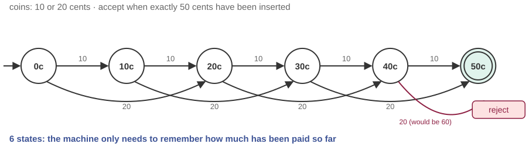
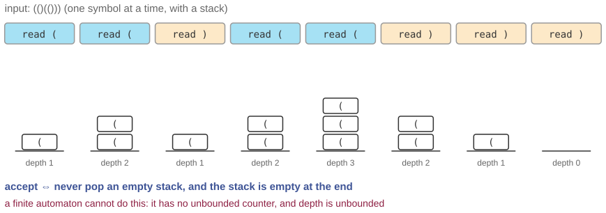
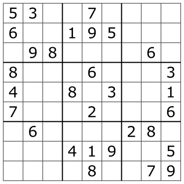

## Three questions for this session

::: {.sm}
Each example is an **opening** question for the start of the lecture and an **answer** for the
end, followed by a notes slide. Copy the slides you want into the main deck.
:::

::: {.xs}
| | Question | Hook | id |
|-|-----------|---------------|---|
| **A** | Design a coffee machine that cannot be cheated | 10-cent and 20-cent coins, a 50-cent coffee, and the smallest machine that gets it right every time. | `X09-A` |
| **B** | Can a finite machine check your brackets? | Every editor flags a missing parenthesis. What kind of machine does it take? | `X09-B` |
| **C** | Is there a fast way to solve any Sudoku? | A newspaper puzzle, a million-dollar question, and why they are the same thing. | `X09-C` |
:::

::: {.xs}
Main deck `Slides/09-TheoreticalCS/` · transcript `Transcripts/09-…md` (the § in the answers)
:::

<!-- EXAMPLE:X09-A:BEGIN -->
## A · Design a coffee machine that cannot be cheated

[Opening question · place after the Overview slide]{.tag .ex-open}

::: {.sm}
A coffee machine accepts **10-cent and 20-cent coins**. A coffee costs exactly
**50 cents**; overpaying is not allowed and there is no change. The machine
must accept `10 20 20`, `20 20 10`, `10 10 10 10 10`, and reject `20 20 20`
the moment the third coin lands.

It has no memory of what you did, other than *what state it is in*.

[How many states does the machine need? Draw it. Is there any sequence of coins your drawing gets wrong?]{.ask}
:::

## A · Design a coffee machine that cannot be cheated · answer

[The answer · place before the Summary slide]{.tag .ex-close}

{width="1146px"}

## A · Design a coffee machine that cannot be cheated · why {.fit1}

[The answer · place before the Summary slide]{.tag .ex-close}

::: {.sm}
- A **deterministic finite automaton** with one state per amount paid so far,
  0, 10, 20, 30, 40, **50** (accepting), plus a reject state for any coin that
  would exceed 50. Each coin is a transition.
- The 5-tuple: $Q = \{0,10,20,30,40,50,\text{reject}\}$, $\Sigma = \{10, 20\}$,
  $\delta$ the arrows, $q_0 = 0$, $X = \{50\}$. The transition table is the program.
- The machine is *complete*: every state has an arrow for every coin. That, plus
  determinism, is what makes "cannot be cheated" a theorem rather than a hope.
:::

::: {.uses}
**What we used:** §2 finite-state automata: the 5-tuple and transition diagrams · §3 why determinism matters · §5 regular languages
:::

## A · Design a coffee machine that cannot be cheated · notes {.fit1}

[X09-A]{.tag .ex-id}

::: {.xxs}
**Source.** Standard introductory automaton; Sipser ch. 1 opens with an
automatic-door controller built the same way. The diagram is generated; a
20-cent coin from state 40 goes to reject.

**Facts.** Seven states is minimal for a complete machine: any two amounts paid
so far are distinguishable by some future coin sequence, so no two can be
merged, and the reject state accepts nothing. Adding a 5-cent coin roughly
doubles the states; adding *change* needs an output, a Mealy machine, which is
a good stretch question.

**How to present.** Open with the spec and give the room five minutes in pairs
to draw it; collect two drawings on the board. Most forget the reject arrows
(incomplete automaton) or add a "memory". Close with the figure and write the
5-tuple next to it explicitly; the exam asks for exactly this. Then ask: what
if coffee cost *any* multiple of 10? (Still finite.) What if the machine had to
accept "as many 10s as 20s"? (Not finite; see X09-B.)

**Where it plugs in.** Right after the definition of a DFA, before the z0–z3
automaton of the main deck.

**Self-study:** post `Examples/posts/X09-A-….md` · notebook `Examples/notebooks/X09-A.ipynb`, the problem and the solution in a few cells.
:::

<!-- EXAMPLE:X09-A:END -->
<!-- EXAMPLE:X09-B:BEGIN -->
## B · Can a finite machine check your brackets?

[Opening question · place after the Overview slide]{.tag .ex-open}

::: {.sm}
Your editor knows instantly that `((a + b) * (c − d)` is missing a bracket, and
that `(()(()))` is fine. A JSON file with 40 000 nested objects is validated in
milliseconds.

Session 9 has just given you a machine with finitely many states.

[Can a finite-state automaton decide whether the brackets in a string are balanced? If not, what is the *smallest* addition that makes it possible?]{.ask}
:::

## B · Can a finite machine check your brackets? · answer

[The answer · place before the Summary slide]{.tag .ex-close}

{width="1148px"}

## B · Can a finite machine check your brackets? · why {.fit1}

[The answer · place before the Summary slide]{.tag .ex-close}

::: {.sm}
- **No.** Balanced strings can be nested arbitrarily deep, so the machine must
  *count* open brackets without bound, and a finite automaton with $k$ states
  cannot distinguish depth $k$ from depth $k+1$. (The formal version: $a^n b^n$
  is not regular.)
- **A stack** is the smallest addition: push on `(`, pop on `)`, accept if the
  stack is empty at the end and never underflows. That is a **push-down automaton**,
  and balanced brackets are a **context-free** language.
- Nested structures, JSON, HTML, arithmetic and code, all live one level up the
  Chomsky hierarchy from what a regex can handle. That is why "parse HTML with a
  regex" is a famous mistake.
:::

::: {.uses}
**What we used:** §2 finite-state automata and their limit · §4 formal languages and grammars · §5 regular languages: what they cannot express · the Chomsky hierarchy
:::

## B · Can a finite machine check your brackets? · notes

[X09-B]{.tag .ex-id}

::: {.xxs}
**Source.** Sipser ch. 1–2; the pumping lemma gives the formal proof that
$a^n b^n$ is not regular. The trace in the figure runs the stack on
`(()(()))`.

**Facts.** The grammar is $S \to (S)S \mid \varepsilon$. A PDA with one stack
suffices; two stacks give a Turing machine. Real parsers (for JSON, Python)
are push-down machines in disguise, since recursive descent uses the *call* stack.

**How to present.** Open by asking for a DFA; let the room try for three
minutes and fail. The failure is instructive because every attempt has a
fixed maximum depth. Close with the stack trace and the one-line grammar. Then
name the hierarchy explicitly, regular ⊂ context-free ⊂ …, and place the coffee
machine (X09-A) and the brackets side by side as the boundary.

**Where it plugs in.** Between the DFA material and the push-down automaton of
the exercise sheet; sets up the Chomsky-hierarchy slide of the main deck.

**Self-study:** post `Examples/posts/X09-B-….md` · notebook `Examples/notebooks/X09-B.ipynb`, the problem and the solution in a few cells.
:::

<!-- EXAMPLE:X09-B:END -->
<!-- EXAMPLE:X09-C:BEGIN -->
## C · Is there a fast way to solve any Sudoku?

[Opening question · place after the Overview slide]{.tag .ex-open}

:::: {.columns}
::: {.column width="46%"}
{width="449px"}

::: {.source}
Puzzle: Wikimedia Commons (public domain)
:::
:::
::: {.column width="54%"}
::: {.sm}
You can check a finished Sudoku in seconds: every row, column and box has 1–9.
**Solving** one is another matter, and a $9 \times 9$ grid is only the newspaper
size. On an $n^2 \times n^2$ grid, does the solving time stay reasonable?

[Is there an algorithm that solves *any* Sudoku in time polynomial in the grid size? What would it mean if you found one, and why has nobody?]{.ask}
:::
:::
::::

## C · Is there a fast way to solve any Sudoku? · answer

[The answer · place before the Summary slide]{.tag .ex-close}

:::: {.columns}
::: {.column width="52%"}
{width="449px"}

::: {.source}
Puzzle: Wikimedia Commons (public domain)
:::
:::
::: {.column width="48%"}
::: {.sm}
*The question was:* Is there an algorithm that solves *any* Sudoku in time polynomial in the grid size? What would it mean if you found one, and why has nobody?
:::
:::
::::

## C · Is there a fast way to solve any Sudoku? · why {.fit1}

[The answer · place before the Summary slide]{.tag .ex-close}

::: {.sm}
- **Checking** a filled grid is polynomial: that puts Sudoku in **NP**.
- Yato & Seta (2003) showed generalized Sudoku is **NP-complete**: every problem
  in NP can be translated into a Sudoku in polynomial time.
- So a polynomial-time Sudoku solver would give one for satisfiability,
  timetabling, protein folding and the rest: **P = NP**, and a million-dollar
  Clay prize. Nobody has one; the working assumption is that none exists.
- Newspaper Sudokus are solved by **backtracking search**, exponential in the
  worst case and fine at $9 \times 9$.
:::

::: {.uses}
**What we used:** §7 computability versus complexity · §9 complexity classes: P, NP, NP-completeness and reduction
:::

## C · Is there a fast way to solve any Sudoku? · notes

[X09-C]{.tag .ex-id}

::: {.xxs}
**Source.** Yato, T. & Seta, T. (2003), "Complexity and completeness of finding
another solution and its application to puzzles", *IEICE Trans. Fundamentals*
E86-A(5). The puzzle image is public domain (Wikimedia Commons). The Clay
Millennium Prize for P vs NP: claymath.org.

**Facts.** NP-completeness is for the $n^2 \times n^2$ generalization; the
$9 \times 9$ case is a fixed finite problem and technically $O(1)$. The
hardest known 9×9 puzzles still fall to backtracking in milliseconds. A 17-clue
minimum for a unique solution was proved in 2012 by exhaustive computation.

**How to present.** Open with the puzzle and the check/solve asymmetry;
"verify fast, find slow" is the whole of NP in one sentence. Close with the
chain: in NP (verifier), NP-complete (reduction), a fast solver collapses
everything. The exam's `TC-10` and `TC-11` ask exactly this; the
seminar-assignment candidate (M09-B) is the same story with a scheduling face.

**Where it plugs in.** With the P/NP Venn diagrams at the end of the main deck.

**Self-study:** post `Examples/posts/X09-C-….md` · notebook `Examples/notebooks/X09-C.ipynb`, the problem and the solution in a few cells.
:::

<!-- EXAMPLE:X09-C:END -->