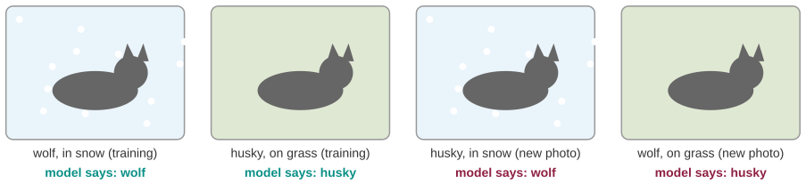
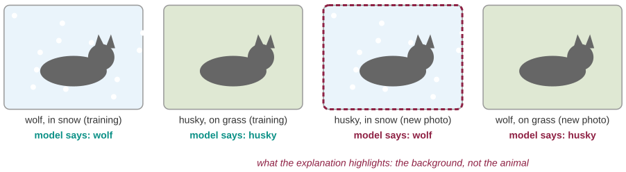
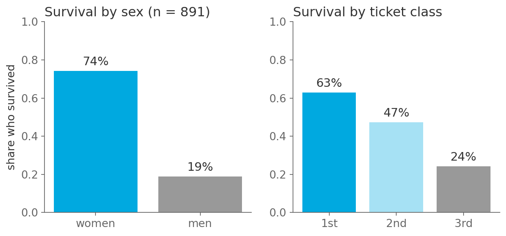
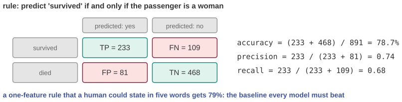
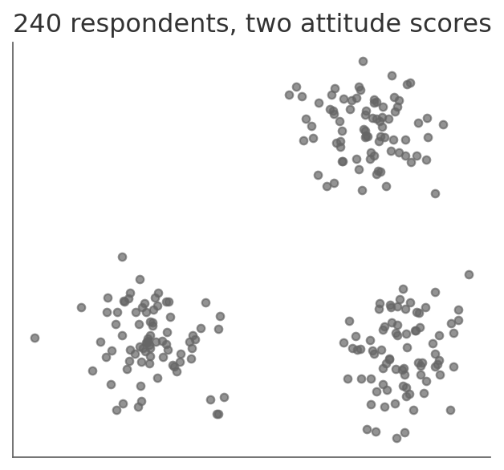
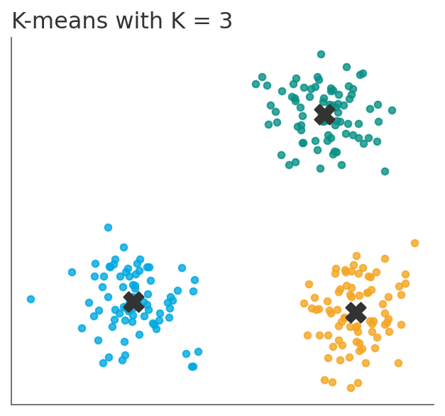
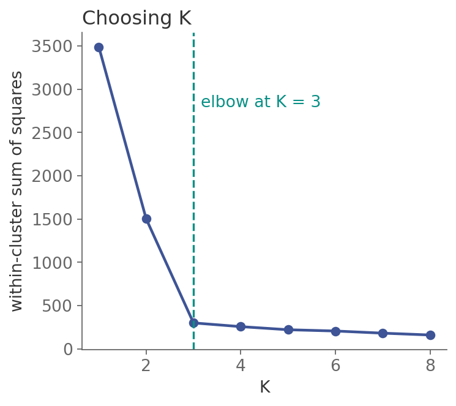
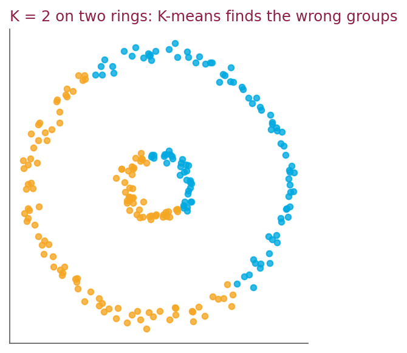

## Three questions for this session

::: {.sm}
Each example is an **opening** question for the start of the lecture and an **answer** for the
end, followed by a notes slide. Copy the slides you want into the main deck.
:::

::: {.xs}
| | Question | Hook | id |
|-|-----------|---------------|---|
| **A** | The wolf detector that only saw snow | Right on eight test images out of ten, useless at the zoo, and how to find out why. | `X10-A` |
| **B** | Predict who survived the Titanic in five words | A one-feature rule gets 79%. Every model you build must beat it. | `X10-B` |
| **C** | How many groups are there? | 240 survey respondents, two scores, no labels, and the algorithm that finds groups even when there are none. | `X10-C` |
:::

::: {.xs}
Main deck `Slides/10-MachineLearning/` · transcript `Transcripts/10-…md` (the § in the answers)
:::

<!-- EXAMPLE:X10-A:BEGIN -->
## A · The wolf detector that only saw snow

[Opening question · place after the Overview slide]{.tag .ex-open}

{width="1150px"}

::: {.sm}
Researchers trained a classifier to tell **wolves from huskies** from photos. On
the held-out test images it got eight out of ten right. Then it failed on the
obvious ones: a husky in a snowy garden was a wolf, a wolf on grass was a husky.

[The model passed its test. What did it actually learn, and what question would have caught it before deployment?]{.ask}
:::

## A · The wolf detector that only saw snow · answer

[The answer · place before the Summary slide]{.tag .ex-close}

{width="1145px"}

## A · The wolf detector that only saw snow · why

[The answer · place before the Summary slide]{.tag .ex-close}

::: {.sm}
- In the training photos, wolves were mostly **in snow** and huskies mostly not.
  Snow was a cheaper feature than fur or ears, so the model learned **snow**.
- An explanation method (LIME) that highlights the pixels driving each decision
  showed the **background**, never the animal.
- The test set had the same bias, so the test score was honest *and* useless. The
  question to ask: **does the feature the model uses exist in the world where the
  model will be used?** Otherwise the model has learned a correlation, not the concept.
:::

::: {.uses}
**What we used:** §4 features and what the model can see · §6 generalization and why a test set can lie · §8 overfitting to spurious structure · §12 trust and explanation
:::

## A · The wolf detector that only saw snow · notes {.fit1}

[X10-A]{.tag .ex-id}

::: {.xxs}
**Source.** Ribeiro, Singh & Guestrin (2016), "Why Should I Trust You?
Explaining the Predictions of Any Classifier", *KDD*; the husky/wolf experiment
is §6.4, with the figure of LIME highlighting snow. The diagram here is
schematic; the paper's actual images are copyrighted.

**Facts.** 20 wolf and husky images, hand-picked so that the wolves had snow
behind them, a logistic regression on image features; 10 test images, of which
one husky in snow and one wolf without snow were misclassified. Shown to
graduate students, 10 of 27 trusted the model before seeing the explanations
and 3 of 27 after.

**How to present.** Open with the four-panel figure but *without* the dashed
box, and ask what the model learned. Close with the box: the explanation looks
at the background. Then the generalization, which is the real content: the
Clever Hans horse, Google Flu's basketball season (M10-A), a dropout model that
learned the campus wifi log. The check is always the same: interrogate the
feature, not the score.

**Where it plugs in.** Between the features slides and the train/test material;
it motivates §12's "right to an explanation" concretely.

**Self-study:** post `Examples/posts/X10-A-….md` · notebook `Examples/notebooks/X10-A.ipynb`, the problem and the solution in a few cells.
:::

<!-- EXAMPLE:X10-A:END -->
<!-- EXAMPLE:X10-B:BEGIN -->
## B · Predict who survived the Titanic in five words

[Opening question · place after the Overview slide]{.tag .ex-open}

{width="546px"}

::: {.sm}
The Titanic passenger list is the standard first dataset in machine learning:
891 passengers, with sex, age, class, fare, and whether they survived.

Before any model: the survival rates by sex and by class, above.

[State a prediction rule in **five words**. What accuracy does it get, and how would you know whether a neural network with 10 000 parameters is actually better?]{.ask}
:::

## B · Predict who survived the Titanic in five words · answer

[The answer · place before the Summary slide]{.tag .ex-close}

{width="1149px"}

::: {.sm}
*The question was:* State a prediction rule in **five words**. What accuracy does it get, and how would you know whether a neural network with 10 000 parameters is actually better?
:::

## B · Predict who survived the Titanic in five words · why

[The answer · place before the Summary slide]{.tag .ex-close}

::: {.sm}
- "**Women survive, men do not.**" Accuracy $(233 + 468)/891 = \mathbf{78.7\%}$,
  precision 0.74, recall 0.68 on the survivors.
- That is the **baseline**. A model that reports 80% has added one point over a
  rule anyone could state; a model that reports 78% has learned nothing.
- Always compute the trivial rule first: majority class, one feature, a domain
  fact. Then the confusion matrix, so that the errors have names.
:::

::: {.uses}
**What we used:** §3 the supervised setup: features, target, prediction · §5 error, loss, precision and recall · §6 test performance means nothing without a baseline
:::

## B · Predict who survived the Titanic in five words · notes {.fit1}

[X10-B]{.tag .ex-id}

::: {.xxs}
**Source.** Kaggle "Titanic: Machine Learning from Disaster" training set,
891 rows; counts by sex: women 314 (233 survived), men 577 (109 survived); by
class: 1st 136/216, 2nd 87/184, 3rd 119/491. Confusion matrix and metrics are
computed in the figure script from those counts.

**Facts.** The rule "survived iff female" has accuracy 0.787. Adding
"or a child in 1st or 2nd class" reaches about 0.80. Good published models
reach about 0.82 to 0.84; the ceiling is low because the outcome is genuinely
noisy.

**How to present.** Open with the two bar charts and ask for a five-word rule.
Close by filling the confusion matrix on the board from the counts (they are on
the slide) and computing accuracy, precision and recall live: three exam
formulas, one dataset. Then the framing: this number is what the models of the
practical part have to beat, and most first attempts will not.

**Where it plugs in.** With the error/loss slides; use again in session 13 when
representation and base rates return.

**Self-study:** post `Examples/posts/X10-B-….md` · notebook `Examples/notebooks/X10-B.ipynb`, the problem and the solution in a few cells.
:::

<!-- EXAMPLE:X10-B:END -->
<!-- EXAMPLE:X10-C:BEGIN -->
## C · How many groups are there?

[Opening question · place after the Overview slide]{.tag .ex-open}

:::: {.columns}
::: {.column width="46%"}
{width="528px"}
:::
::: {.column width="54%"}
::: {.sm}
Two attitude scores for 240 respondents. No labels: nobody has said how many
"types" of respondent there are, or which respondent is which.

Look at it. Now imagine it had 12 dimensions instead of 2, and 24 000 points.

[Write the procedure that finds the groups. How do you choose how many? And what does it do when the data has no groups at all?]{.ask}
:::
:::
::::

## C · How many groups are there? · answer

[The answer · place before the Summary slide]{.tag .ex-close}

:::: {.columns}
::: {.column width="52%"}
{width="527px"}
:::
::: {.column width="48%"}
::: {.sm}
*The question was:* Write the procedure that finds the groups. How do you choose how many? And what does it do when the data has no groups at all?
:::
:::
::::

## C · How many groups are there? · why

[The answer · place before the Summary slide]{.tag .ex-close}

::: {.sm}
- **K-means**: pick $K$ centers; assign each point to the nearest; move each
  center to the mean of its points; repeat until nothing changes. Unsupervised:
  there is no $Y$.
- **Choosing $K$**: the within-cluster sum of squares falls with every extra
  cluster, to zero at $K = n$. The **elbow** is where it stops falling steeply:
  here $K = 3$.
- **The warning**: K-means always returns $K$ clusters. On two concentric rings
  it confidently splits them in half. A clustering is a *hypothesis*, not a finding.
:::

::: {.uses}
**What we used:** §2 the three families: unsupervised learning · §10 clustering, K-means and the elbow method · §12 what a model's output is evidence of
:::

## C · How many groups? · choosing K, and when K-means is wrong {.fit1}

:::: {.columns}
::: {.column width="50%"}
{height="10.4em"}
:::
::: {.column width="50%"}
{height="10.4em"}
:::
::::

::: {.sm}
Left: within-cluster sum of squares for $K = 1 \ldots 8$; the elbow is at 3. Right: two rings with $K = 2$: K-means
splits them down the middle because it can only make convex, roughly round clusters. It returned two clusters
because it was asked for two, not because there are two.
:::

## C · How many groups are there? · notes

[X10-C]{.tag .ex-id}

::: {.xxs}
**Source.** Synthetic data generated in the figure script (three Gaussian
blobs; two rings), K-means implemented there so that the elbow values are real
(WSS: 3489, 1503, 299, 256, …). MacQueen (1967) for K-means; Hastie et al.
§14.3.

**Facts.** The elbow at $K = 3$ is unambiguous on this data by design; on real
survey data it rarely is, and that ambiguity is honest information. K-means
assumes spherical clusters of similar size; the ring figure shows the failure.

**How to present.** Open with the unlabeled scatter; ask for a number of
groups and a procedure. Close with the colored result and the elbow plot
(both on the extra slide of this deck), then the rings as a final beat. The
sentence to land: the algorithm never says "there are no groups". That is the
researcher's job.

**Where it plugs in.** With the K-means slides of the main deck; the elbow and
ring figures are supplementary and can be dropped into the main deck directly.

**Self-study:** post `Examples/posts/X10-C-….md` · notebook `Examples/notebooks/X10-C.ipynb`, the problem and the solution in a few cells.
:::

<!-- EXAMPLE:X10-C:END -->