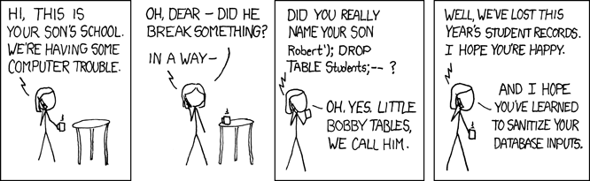
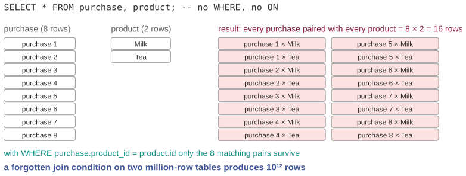
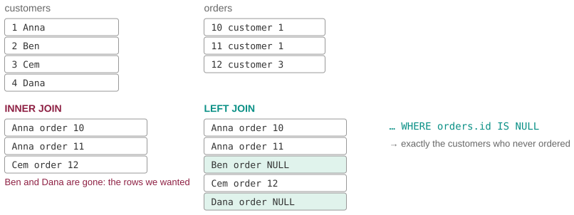

## Three questions for this session

::: {.sm}
Each example is an **opening** question for the start of the lecture and an **answer** for the
end, followed by a notes slide. Copy the slides you want into the main deck.
:::

::: {.xs}
| | Question | Hook | id |
|-|-----------|---------------|---|
| **A** | Little Bobby Tables | A boy's name deletes a school's records. The bug is in one line, and it is a lesson about data versus code. | `X11-A` |
| **B** | The join that returned more rows than the table | Eight purchases, two products, sixteen rows. Nothing crashed. The report is wrong. | `X11-B` |
| **C** | Find the customers who never ordered | The query returned zero, but marketing knows there are hundreds. The rows were dropped before you could count them. | `X11-C` |
:::

::: {.xs}
Main deck `Slides/11-Databases/` · transcript `Transcripts/11-…md` (the § in the answers)
:::

<!-- EXAMPLE:X11-A:BEGIN -->
## A · Little Bobby Tables

[Opening question · place after the Overview slide]{.tag .ex-open}

{width="860px"}

::: {.source}
XKCD 327, Randall Munroe, CC BY-NC 2.5, xkcd.com/327
:::

::: {.sm}
A school enrolls a child whose registered name is
`Robert'); DROP TABLE Students;--`. Shortly afterwards, the school has no
student records.

[What did the school's software do with that name? Which single line was wrong, and what is the correct version?]{.ask}
:::

## A · Little Bobby Tables · answer {.fit2}

[The answer · place before the Summary slide]{.tag .ex-close}

::: {.sm}
The school built its query by pasting the name into a string:

```python
query = "INSERT INTO Students (name) VALUES ('" + name + "')"
```

With the boy's name that string becomes **two statements**:

```sql
INSERT INTO Students (name) VALUES ('Robert'); DROP TABLE Students;--')
```

- The name was **data**; concatenation turned it into **code**. This is SQL
  injection, and it is still in the top three web vulnerabilities.
- The fix is to keep data and code separate: a **parameterized query**
  `cursor.execute("INSERT INTO Students (name) VALUES (?)", (name,))`.
  The database never parses the value as SQL, whatever it contains.
:::

::: {.uses}
**What we used:** §8 SQL is a language: text can be executed · §10 data manipulation: INSERT, DROP · §13 SQL injection and parameterized queries
:::

## A · Little Bobby Tables · notes {.fit1}

[X11-A]{.tag .ex-id}

::: {.xxs}
**Source.** XKCD 327, "Exploits of a Mom" (CC BY-NC 2.5, attribution on the
slide). The OWASP Top 10 lists injection in every edition. The comic's own
line, "I hope you've learned to sanitize your database inputs", is slightly
wrong advice: the robust answer is parameterization, not sanitization.

**Facts.** `--` starts a comment in SQL, which swallows the trailing `')`.
Whether two statements execute in one call depends on the driver (SQLite's
`execute` refuses; `executescript` and many web stacks allow it). Exercise A5
of the exercise sheet has the `' OR '1'='1` variant that needs no `DROP`.

**How to present.** Open with the comic; it is the best-known joke in
computing and half the room has seen it, which does not matter. Ask what the
code must have looked like. Close by writing the concatenation line and the
resulting SQL on the board, then the `?` version. Connect to sessions 2 and 4:
the same "data interpreted as instructions" failure as encoding bugs and
`eval`.

**Where it plugs in.** The SQL-injection slide of the main deck already uses
the comic; this deck supplies the question-then-code structure around it.

**Self-study:** post `Examples/posts/X11-A-….md` · notebook `Examples/notebooks/X11-A.ipynb`, the problem and the solution in a few cells.
:::

<!-- EXAMPLE:X11-A:END -->
<!-- EXAMPLE:X11-B:BEGIN -->
## B · The join that returned more rows than the table

[Opening question · place after the Overview slide]{.tag .ex-open}

::: {.sm}
An analyst joins the `purchase` table (8 rows) with the `product` table (2 rows)
to add product names to the report. The result has **16 rows**, and total sales
in the report have **doubled**.

```sql
SELECT * FROM purchase, product;
```

The query ran without error. The numbers went to the board meeting.

[Where did the extra rows come from? Why is this *correct* behavior for the query as written, and what did the analyst forget?]{.ask}
:::

## B · The join that returned more rows than the table · answer

[The answer · place before the Summary slide]{.tag .ex-close}

{width="1150px"}

## B · The join that returned more rows than the table · why {.fit1}

[The answer · place before the Summary slide]{.tag .ex-close}

::: {.sm}
- Two tables in `FROM` with no condition is the **Cartesian product**: every row
  of one paired with every row of the other, $8 \times 2 = 16$.
- The missing piece is the **join condition**: `WHERE purchase.product_id =
  product.id`, or better `INNER JOIN product ON …`, which keeps only matching pairs.
- Prefer the explicit `JOIN … ON` syntax: a forgotten `WHERE` silently multiplies,
  a forgotten `ON` is a syntax error. **Check the row count of every join** against
  what it should be; a join can never *silently* be wrong if you do that.
:::

::: {.uses}
**What we used:** §9 tables as sets of tuples · §11 selection · §12 joins: manual joins, INNER JOIN, and what happens without a condition
:::

## B · The join that returned more rows than the table · notes {.fit1}

[X11-B]{.tag .ex-id}

::: {.xxs}
**Source.** The `purchase`/`product` tables are the ones in the main deck; the
exam's `DB-03` and `DB-04` restructure a similar purchases table. The figure
enumerates the product. The doubled total is what happens when you `SUM` a
column after a two-row Cartesian join.

**Facts.** $|A \times B| = |A| \cdot |B|$; two million-row tables give
$10^{12}$ rows, which is how a forgotten join condition takes down a database
server. The other direction, *fewer* rows than expected, is the inner join
dropping unmatched rows (X11-C).

**How to present.** Open with the query, the 16, and the doubled total; the
"went to the board meeting" line is the hook. Close with the figure, then the
`ON` syntax, then the habit: print the row count before and after every join.
That habit is worth more than any SQL feature.

**Where it plugs in.** At the manual-join slide of the main deck, whose three
questions ("why four rows? why new column names? how many with no WHERE?") this
answers.

**Self-study:** post `Examples/posts/X11-B-….md` · notebook `Examples/notebooks/X11-B.ipynb`, the problem and the solution in a few cells.
:::

<!-- EXAMPLE:X11-B:END -->
<!-- EXAMPLE:X11-C:BEGIN -->
## C · Find the customers who never ordered

[Opening question · place after the Overview slide]{.tag .ex-open}

::: {.sm}
```sql
SELECT c.name
FROM customers c JOIN orders o ON o.customer_id = c.id
WHERE o.id IS NULL;
```

"Customers with no orders": the query is short, reads correctly, and returns
**zero rows**. The marketing team is certain there are hundreds of inactive
customers.

[Why can this query *never* return a row, no matter what the data contains? What kind of join does the question actually need?]{.ask}
:::

## C · Find the customers who never ordered · answer

[The answer · place before the Summary slide]{.tag .ex-close}

{width="1149px"}

## C · Find the customers who never ordered · why

[The answer · place before the Summary slide]{.tag .ex-close}

::: {.sm}
- An `INNER JOIN` keeps only rows that **match** in both tables. A customer with
  no orders has nothing to match, so the row is gone before `WHERE` ever sees it.
  `o.id IS NULL` is then checked on a set that cannot contain such rows.
- A **`LEFT JOIN`** keeps every customer and fills the order columns with **NULL**
  where there is no match. Now `WHERE o.id IS NULL` selects exactly the inactive ones.
- `NULL` is not a value; it means *absent*. It matches nothing, not even itself,
  which is why `= NULL` is always false and `IS NULL` exists.
:::

::: {.uses}
**What we used:** §12 joins: INNER versus LEFT, and NULL for missing matches · §11 selection happens *after* the join · exam item DB-09a (COUNT with a LEFT JOIN)
:::

## C · Find the customers who never ordered · notes

[X11-C]{.tag .ex-id}

::: {.xxs}
**Source.** Standard SQL semantics (SQL-92 onward); the "anti-join" pattern
`LEFT JOIN … WHERE right.key IS NULL` is the idiomatic answer, with `NOT EXISTS`
as the alternative. The tables in the figure are illustrative.

**Facts.** Evaluation order: `FROM`/`JOIN` first, then `WHERE`, then `SELECT`.
`COUNT(*)` after a left join counts the NULL row as 1; `COUNT(o.id)` counts it
as 0, which is the trap in the exam's `DB-09a`.

**How to present.** Open with the query and "zero rows"; ask why. Many students
will say "there must be no such customers". Close with the two result tables of
the figure side by side; the highlighted NULL rows are the answer. Then state
the evaluation order; it explains both this bug and X11-B.

**Where it plugs in.** With the join-types slide of the main deck ("if values
are missing, they are set to NULL"); this is that sentence turned into a bug.

**Self-study:** post `Examples/posts/X11-C-….md` · notebook `Examples/notebooks/X11-C.ipynb`, the problem and the solution in a few cells.
:::

<!-- EXAMPLE:X11-C:END -->