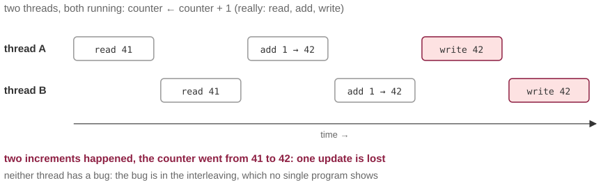
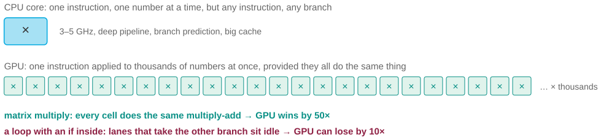
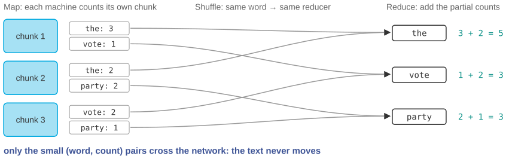

## Three questions for this session

::: {.sm}
Each example is an **opening** question for the start of the lecture and an **answer** for the
end, followed by a notes slide. Copy the slides you want into the main deck.
:::

::: {.xs}
| | Question | Hook | id |
|-|-----------|---------------|---|
| **A** | One million increments, and the counter says 712 431 | Four threads, each adding one to a shared counter 250 000 times. No error. A quarter of the additions vanished. | `X12-A` |
| **B** | Why is the GPU 50× faster, and 10× slower? | The same graphics card trains the model in an hour and runs your for-loop in a week. | `X12-B` |
| **C** | Count every word in Wikipedia in two minutes | 20 GB of text, 100 machines, and the reason it is not 100× faster. | `X12-C` |
:::

::: {.xs}
Main deck `Slides/12-ParallelProgramming/` · transcript `Transcripts/12-…md` (the § in the answers)
:::

<!-- EXAMPLE:X12-A:BEGIN -->
## A · One million increments, and the counter says 712 431

[Opening question · place after the Overview slide]{.tag .ex-open}

::: {.sm}
A program counts events in a stream. To make it faster, four threads each
process a quarter of the stream, adding one to a **shared counter** for each
event. One million events go in.

The counter reads **712 431**. Run it again: **698 202**. Every run is different;
every run is too low.

[No thread has a bug. Where did 288 000 increments go, and why does the answer change every time?]{.ask}
:::

## A · One million increments, and the counter says 712 431 · answer

[The answer · place before the Summary slide]{.tag .ex-close}

{width="1149px"}

## A · One million increments, and the counter says 712 431 · why {.fit1}

[The answer · place before the Summary slide]{.tag .ex-close}

::: {.sm}
- `counter ← counter + 1` is **three machine steps**: read, add, write. If thread
  B reads between A's read and A's write, both write the same value and one
  increment is **lost**. This is a **race condition**.
- The bug lives in the **interleaving**: no single thread's code shows it, and
  the interleaving differs each run, so the result does too.
- Fixes: a **lock** around the three steps (which serializes them, so Amdahl's
  law applies), or **no shared state**: each thread keeps its own count and the
  four are added at the end. The second is why MapReduce works.
:::

::: {.uses}
**What we used:** §4 types of parallelization: threads share memory · §5 concurrency: interleaving is not under your control · §9 software parallelization: why Map keeps state local · §11 Amdahl's law
:::

## A · One million increments, and the counter says 712 431 · notes {.fit1}

[X12-A]{.tag .ex-id}

::: {.xxs}
**Source.** Textbook race condition; the numbers are illustrative (in CPython
the GIL hides it for pure-Python `+=` but not for C extensions or other
languages). A demonstration in Java, Go or C shows losses of 20 to 40% on a
4-core laptop.

**Facts.** The three-step decomposition is what the hardware does; on some
architectures even a 64-bit write is not atomic. Locks make the increment
correct and make that section serial; the atomic-counter instruction
(`fetch-and-add`) is the hardware fix. Per-thread counters combined at the end
is the pattern with *no* shared mutable state, and it is exactly Map + Reduce.

**How to present.** Open with the two runs and the question; let the room
argue. Close with the timeline figure, then the two fixes, and make the second
one the bridge to MapReduce: the entire design of that framework is "avoid
this figure". Connects back to the two-seats booking example (M11-B), which is
the same race at the database level.

**Where it plugs in.** With the multithreading slides; before MapReduce.

**Self-study:** post `Examples/posts/X12-A-….md` · notebook `Examples/notebooks/X12-A.ipynb`, the problem and the solution in a few cells.
:::

<!-- EXAMPLE:X12-A:END -->
<!-- EXAMPLE:X12-B:BEGIN -->
## B · Why is the GPU 50× faster, and 10× slower?

[Opening question · place after the Overview slide]{.tag .ex-open}

::: {.sm}
A colleague moves a model-training script to the department's GPU: **50 times
faster**. Encouraged, they move their agent-based simulation, a loop over
agents with an `if` inside, to the same GPU. It runs **10 times slower** than
on the laptop.

Same card, same afternoon.

[What is a GPU actually good at, and what is the property of the second program that makes it a bad fit?]{.ask}
:::

## B · Why is the GPU 50× faster, and 10× slower? · answer

[The answer · place before the Summary slide]{.tag .ex-close}

{width="1146px"}

::: {.sm}
*The question was:* What is a GPU actually good at, and what is the property of the second program that makes it a bad fit?
:::

## B · Why is the GPU 50× faster, and 10× slower? · why

[The answer · place before the Summary slide]{.tag .ex-close}

::: {.sm}
- A GPU is **SIMD** in Flynn's taxonomy: one instruction stream applied to
  thousands of data items at once. Matrix multiplication, the whole of model
  training, is exactly that: every cell does the same multiply-add.
- A loop with a branch is **MIMD** work: different agents take different paths.
  On a GPU the lanes that took the other branch **wait**, and a 3 GHz core with
  branch prediction beats a 1.5 GHz lane every time.
- The rule: GPUs for *the same operation on a lot of data*; CPUs for *different
  operations on different data*. Most social-science code is the second kind.
:::

::: {.uses}
**What we used:** §6 Flynn's taxonomy: SISD, SIMD, MIMD · §7 instruction-level parallelism and why branches hurt · §8 multi-core, GPUs and clusters
:::

## B · Why is the GPU 50× faster, and 10× slower? · notes {.fit1}

[X12-B]{.tag .ex-id}

::: {.xxs}
**Source.** GPU architecture basics (Hennessy & Patterson, *Computer
Architecture: A Quantitative Approach*, ch. 4). The 50× and 10× numbers are
typical rather than measured; the sign is what matters. Branch divergence
within a "warp" of 32 lanes is documented in every CUDA guide.

**Facts.** A modern GPU has thousands of lanes at about 1.5 GHz with a shared
instruction stream per warp; a CPU core has 3 to 5 GHz, deep pipelines and
speculative execution (session 12 §7). Memory transfer to and from the GPU is
another fixed cost that small tasks never amortize.

**How to present.** Open with the two results; the paradox is real and students
who have used Colab have met it. Close with the Flynn quadrant of the main deck
and place each program in its cell. Then the practical advice: vectorize
(NumPy, array operations) *before* buying hardware; vectorized code is SIMD
code even on a CPU.

**Where it plugs in.** With the Flynn's-taxonomy and GPU slides.

**Self-study:** post `Examples/posts/X12-B-….md` · notebook `Examples/notebooks/X12-B.ipynb`, the problem and the solution in a few cells.
:::

<!-- EXAMPLE:X12-B:END -->
<!-- EXAMPLE:X12-C:BEGIN -->
## C · Count every word in Wikipedia in two minutes

[Opening question · place after the Overview slide]{.tag .ex-open}

::: {.sm}
English Wikipedia is about **20 GB** of text. Counting how often every word
occurs takes a laptop around **three hours**: one pass, one dictionary (session
3). A cluster of **100 machines** does it in about **two minutes**.

Three hours divided by 100 is under two minutes, but not by much, and adding
100 more machines barely helps.

[How do 100 machines share one counting job without a shared dictionary? And where does the missing time go?]{.ask}
:::

## C · Count every word in Wikipedia in two minutes · answer

[The answer · place before the Summary slide]{.tag .ex-close}

{width="1148px"}

## C · Count every word in Wikipedia in two minutes · why {.fit1}

[The answer · place before the Summary slide]{.tag .ex-close}

::: {.sm}
- **MapReduce.** *Map*: each machine counts words in its own chunk, locally, with
  its own dictionary; no shared state, no race. *Shuffle*: pairs for the same
  word are sent to the same reducer. *Reduce*: add the partial counts.
- Only the small `(word, count)` pairs cross the network; the text never moves.
  **Bring the code to the data.**
- The missing time: the shuffle is network communication, the reduce is partly
  serial, and the slowest machine sets the finish line. **Amdahl's law** with a
  communication term: more machines shrink the map phase and nothing else.
:::

::: {.uses}
**What we used:** §9 software parallelization and MapReduce · §10 distributed inference: which computations split cleanly · §11 Amdahl's law and the serial fraction
:::

## C · Count every word in Wikipedia in two minutes · notes {.fit2}

[X12-C]{.tag .ex-id}

::: {.xxs}
**Source.** Dean & Ghemawat (2008), whose worked example is exactly word count.
Wikipedia size: about 20 GB of article text uncompressed (dumps.wikimedia.org).
Timings are order-of-magnitude estimates, not measurements; say so.

**Facts.** Word count is the canonical MapReduce program because its Reduce
(addition) is associative and commutative, so partial counts combine in any
order. The same property is what makes the mean distribute exactly and the
median not (session 12 §10, exam `GP-17`).

**How to present.** Open with the numbers and the "not by much" remark. Close
with the figure, following one word ("the") from two chunks to one reducer.
Then the connection to X12-A: Map keeps state private *precisely* to avoid the
race; and to Amdahl: shuffle + reduce are the serial fraction, so the ceiling is
real. Ask what would break if the task were "find the median word length".

**Where it plugs in.** The MapReduce slides of the main deck; the word-count
example is a callback to the dictionary of session 3.

**Self-study:** post `Examples/posts/X12-C-….md` · notebook `Examples/notebooks/X12-C.ipynb`, the problem and the solution in a few cells.
:::

<!-- EXAMPLE:X12-C:END -->