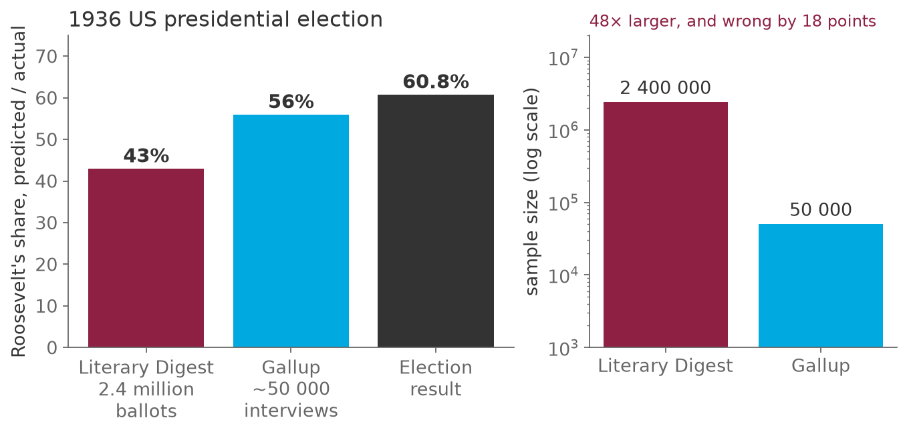
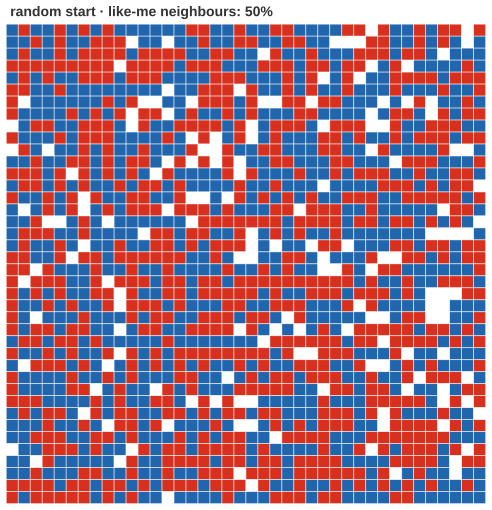
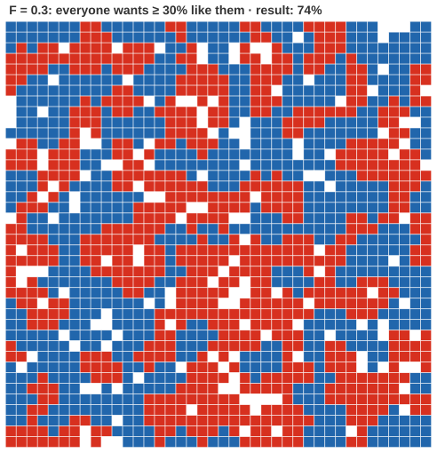
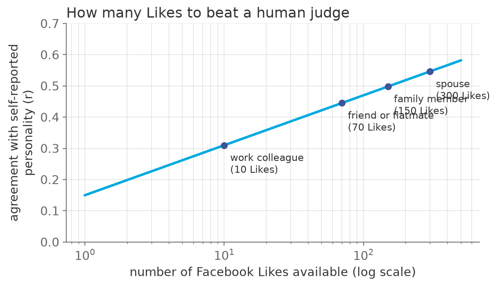

## Three questions for this session

::: {.sm}
Each example is an **opening** question for the start of the lecture and an **answer** for the
end, followed by a notes slide. Copy the slides you want into the main deck.
:::

::: {.xs}
| | Question | Hook | id |
|-|-----------|---------------|---|
| **A** | Two point four million ballots, and the wrong president | The Literary Digest, 1936: the biggest poll in history, and why size did not save it. | `X13-A` |
| **B** | Is every segregated city full of racists? | A grid, a rule, and a result that separates outcomes from motives. | `X13-B` |
| **C** | How many Likes does it take to know you better than your spouse? | A number, a method, and a privacy problem that consent cannot fix. | `X13-C` |
:::

::: {.xs}
Main deck `Slides/13-SocialScienceApplications/` · transcript `Transcripts/13-…md` (the § in the answers)
:::

<!-- EXAMPLE:X13-A:BEGIN -->
## A · Two point four million ballots, and the wrong president {.fit3}

[Opening question · place after the Overview slide]{.tag .ex-open}

{width="527px"}

::: {.sm}
In 1936 the *Literary Digest* mailed 10 million ballots and received **2.4
million** back, the largest poll ever taken. It predicted **Landon 57%,
Roosevelt 43%**. A young pollster named George Gallup, with about **50 000**
interviews, predicted Roosevelt.

Roosevelt won with **61%**. The *Digest* folded within two years.

[How can 2.4 million responses be wrong by 18 points while 50 000 are right? And what does that say about a study of 500 million tweets?]{.ask}
:::

## A · Two point four million ballots, and the wrong president · answer

[The answer · place before the Summary slide]{.tag .ex-close}

{width="965px"}

## A · Two point four million ballots, and the wrong president · why {.fit1}

[The answer · place before the Summary slide]{.tag .ex-close}

::: {.sm}
- The *Digest* mailed to **its subscribers, telephone owners and car owners**,
  in 1936 the affluent. **Coverage error**: the sampling frame was not the
  electorate. The 24% who answered were also the most motivated: **non-response bias**.
- Gallup's sample was small but **designed to represent** the population.
- Size reduces **variance**, never **bias**. Digital trace data is the *Digest*
  again: a huge, self-selected, platform-shaped sample. The question is always
  *who is in the frame*, not *how many*.
:::

::: {.uses}
**What we used:** §6 digital behavioral data · §8 issues with representation: coverage, behavioral distortion, algorithmic confounding · §12 why data does not replace theory
:::

## A · Two point four million ballots, and the wrong president · notes {.fit1}

[X13-A]{.tag .ex-id}

::: {.xxs}
**Source.** Squire, P. (1988), "Why the 1936 Literary Digest Poll Failed",
*Public Opinion Quarterly* 52(1), which shows that non-response mattered at
least as much as the frame. Actual result: Roosevelt 60.8%, Landon 36.5%.
Gallup's sample size varies by account (50 000 is the commonly cited figure).

**Facts.** 10 million ballots mailed, about 2.4 million returned (24%). The
*Digest* had correctly predicted every election since 1916. Squire's
re-analysis: even among the mailed frame, respondents leaned Landon more than
non-respondents.

**How to present.** Open with the three bars and "which do you believe?"; the
room will pick the big one. Close with the two mechanisms named and separated
(frame against response), then the transfer to platforms: the Pew age-gap
table from the main deck is the modern coverage error. The line to land: **a
biased sample of a billion is a biased sample**.

**Where it plugs in.** Before the "Issues with digital behavioral data:
representation" slide of the main deck.

**Self-study:** post `Examples/posts/X13-A-….md` · notebook `Examples/notebooks/X13-A.ipynb`, the problem and the solution in a few cells.
:::

<!-- EXAMPLE:X13-A:END -->
<!-- EXAMPLE:X13-B:BEGIN -->
## B · Is every segregated city full of racists? {.fit1}

[Opening question · place after the Overview slide]{.tag .ex-open}

:::: {.columns}
::: {.column width="46%"}
{width="441px"}

::: {.source}
simulated with `tools/genexamples_figs.py`
:::
:::
::: {.column width="54%"}
::: {.sm}
1 440 agents of two kinds, placed at random on a 40×40 grid with 10% of cells
empty. Each agent wants **at least 30% of its neighbors** to be like itself;
it is content to be in a **70% minority**.

Unsatisfied agents move to a free cell where they would be satisfied.

[What does the grid look like when everyone is satisfied? And if you saw only the end state, what would you conclude about the agents' preferences?]{.ask}
:::
:::
::::

## B · Is every segregated city full of racists? · answer

[The answer · place before the Summary slide]{.tag .ex-close}

:::: {.columns}
::: {.column width="52%"}
{width="432px"}

::: {.source}
simulated with `tools/genexamples_figs.py`
:::
:::
::: {.column width="48%"}
::: {.sm}
*The question was:* What does the grid look like when everyone is satisfied? And if you saw only the end state, what would you conclude about the agents' preferences?
:::
:::
::::

## B · Is every segregated city full of racists? · why

[The answer · place before the Summary slide]{.tag .ex-close}

::: {.sm}
- After **8 rounds** and 384 moves everyone is satisfied, and the grid is
  strongly segregated: the neighborhood of the average agent went from **50%**
  to **74%** like itself, far above the 30% anyone asked for.
- Each move changes the neighborhoods of the cells left and joined, tipping
  others below threshold. Mild local preferences **compound** into global sorting.
- **Generative sufficiency**: a segregated outcome does not imply intolerant
  preferences. You cannot read motives off aggregates. This is the model's point,
  and the reason agent-based modeling belongs in the toolkit.
:::

::: {.uses}
**What we used:** §13 agent-based modeling and generative sufficiency · §14 Schelling's segregation model · §3 the 'generative' meaning of computational
:::

## B · Is every segregated city full of racists? · notes {.fit1}

[X13-B]{.tag .ex-id}

::: {.xxs}
**Source.** Schelling, T. C. (1971), "Dynamic Models of Segregation", *J. Math.
Sociology* 1(2). The two grids are produced by a real run of the model in the
figure script (seed 11, $F = 0.3$, 10% empty, 40×40); the 50% to 74% and "8
rounds" figures are read from that run and change together if regenerated.

**Facts.** Schelling's original threshold examples are 1/3 and 1/2; the CMSS
course slides run the full sweep. At $F = 0.3$ the result is already clear; at
$F = 0.5$ it is stark. The measure shown is the mean share of same-kind
neighbors among occupied neighboring cells.

**How to present.** Open with the random grid and the rule; ask for a sketch of
the end state (most draw it *less* clustered than it turns out). Close with the
after-grid and the two numbers; then the inference question. The exam item
`DB-14` asks about the same model, with $F = 0.5$ in its part (e). Add: this is
also the answer to *"why simulate?"*; the result is not derivable from the rule
by inspection.

**Where it plugs in.** With the Schelling slides of the main deck (properties,
F = 0.2 simulation, tolerance results).

**Self-study:** post `Examples/posts/X13-B-….md` · notebook `Examples/notebooks/X13-B.ipynb`, the problem and the solution in a few cells.
:::

<!-- EXAMPLE:X13-B:END -->
<!-- EXAMPLE:X13-C:BEGIN -->
## C · How many Likes does it take to know you better than your spouse?

[Opening question · place after the Overview slide]{.tag .ex-open}

::: {.sm}
Personality, the Big Five, is normally measured with a 100-item questionnaire.
In 2015 researchers built a model that predicts it from a person's **Facebook
Likes** alone, and compared its accuracy to that of the person's friends,
family and spouse, who each rated the same person.

The judges knew the person for years. The model had a list of Likes.

[How many Likes did the model need to be as accurate as a work colleague? A friend? A spouse? And what follows for privacy, even for people who post nothing?]{.ask}
:::

## C · How many Likes does it take to know you better than your spouse? · answer

[The answer · place before the Summary slide]{.tag .ex-close}

{width="724px"}

::: {.source}
schematic after Youyou, Kosinski & Stillwell (2015)
:::

## C · How many Likes does it take to know you better than your spouse? · why {.fit1}

[The answer · place before the Summary slide]{.tag .ex-close}

::: {.sm}
- **10 Likes** to match a work colleague, **70** a friend, **150** a family member,
  **300** to match the spouse. The average user then had about 227.
- Each Like is innocuous; the **pattern** is not. Kosinski et al. (2013) predicted
  sexual orientation, religion, politics and substance use from Likes at high accuracy.
- **Shadow profiles**: your friends' Likes predict *you*. Privacy is **collective**;
  no individual opt-out removes the information others' data carries about you.
:::

::: {.uses}
**What we used:** §10 method examples: personality from Likes · §11 issues with methods: privacy and shadow profiles · §7 digital traces as measurement · session 10 §3 supervised learning
:::

## C · How many Likes does it take to know you better than your spouse? · notes {.fit1}

[X13-C]{.tag .ex-id}

::: {.xxs}
**Source.** Youyou, W., Kosinski, M. & Stillwell, D. (2015), "Computer-based
personality judgments are more accurate than those made by humans", *PNAS*
112(4): 86 220 participants; thresholds 10/70/150/300 from the paper. Kosinski,
Stillwell & Graepel (2013), *PNAS* 110(15). Garcia et al. (2018), *EPJ Data
Science* 7:3, for shadow profiles. The curve in the figure is **schematic**:
the anchors are from the paper, the line between them is drawn, and the slide
says so.

**Facts.** Human judges: self-other agreement $r \approx 0.49$; computer with
the average number of Likes $r \approx 0.56$. The model was a linear regression
on the Like matrix, nothing exotic.

**How to present.** Open with the setup and ask for the four numbers; guesses
are usually far too high for the colleague and too low for the spouse. Close
with the anchored curve, then the two implications in the last two bullets;
the second is the one students have not thought about. Connect to session 10
(this is plain supervised learning) and to the ethics list of session 10.

**Where it plugs in.** With the "Personality and Facebook likes" and "New
privacy risks" slides of the main deck.

**Self-study:** post `Examples/posts/X13-C-….md` · notebook `Examples/notebooks/X13-C.ipynb`, the problem and the solution in a few cells.
:::

<!-- EXAMPLE:X13-C:END -->