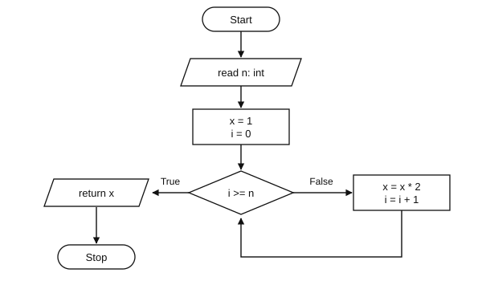

# Exercise Sheet 5: Algorithms

*Introduction to Computing for the Social Sciences · Prof. Dr. David Garcia*

> Exercises 1–3 are worked through in the exercise session. The *Additional
> practice* section is for self-study. Worked solutions to every exercise, with
> pointers to the slides and the handout sections that cover the material, are
> in [`Solutions/Exercise05-Solutions.md`](Solutions/Exercise05-Solutions.md); try before you open them.
> Notation: [course conventions](../Transcripts/00-Conventions.md).

---

## Exercise 1: Flow charts

The flowchart below represents the method `unknown(n)`.



a) Based on the flowchart, briefly describe in your own words what the method
   `unknown(n)` does.

b) Write down a pseudocode for the method `unknown(n)`.

---

## Exercise 2: Graphs and algorithms

Given the following adjacency matrix:

| | A | B | C | D | E | F |
|---|---|---|---|---|---|---|
| **A** | 0 | 1 | 0 | 1 | 0 | 0 |
| **B** | 1 | 0 | 0 | 0 | 1 | 0 |
| **C** | 0 | 0 | 0 | 0 | 1 | 1 |
| **D** | 1 | 0 | 0 | 0 | 0 | 0 |
| **E** | 0 | 1 | 1 | 0 | 0 | 1 |
| **F** | 0 | 0 | 1 | 0 | 1 | 0 |

a) Draw its corresponding graph.

b) Write how it can be encoded with adjacency lists.

c) Starting from node **B**, show how Breadth-First Search would process the
   graph. Indicate the states of the queue during the execution of the
   algorithm, and the resulting distances and parent relationships on the graph.
   When introducing nodes into the queue, do it in alphabetical order.

---

## Exercise 3: More about graphs and algorithms

Given the following adjacency matrix for a **directed, weighted** graph:

| from \ to | A | B | C | D | E |
|---|---|---|---|---|---|
| **A** | 0 | 6 | 0 | 7 | 0 |
| **B** | 0 | 0 | 5 | 8 | −4 |
| **C** | 0 | −2 | 0 | 0 | 0 |
| **D** | 0 | 0 | −3 | 0 | 9 |
| **E** | 3 | 0 | 7 | 0 | 0 |

a) Draw its corresponding graph with the weight of each edge.

Consider the **Bellman-Ford** algorithm below. It calculates the weighted
shortest paths from a source node $s$ in a graph $G$, where `G.V` are its
vertices, `G.E` its edges, and $w(u,v)$ the weight of the edge from $u$ to $v$.
Weights in this graph can be negative. There is no weight value from $u$ to $v$
if no edge connects them.

```
 1  BELLMAN-FORD(G, s, w)
 2      For each vertex v in G.V:
 3            v.distance ← INFINITY
 4            v.parent ← NIL
 5      s.distance ← 0
 6      For i = 1 to |G.V| - 1:
 7            For each (u,v) in G.E:
 8                  If v.distance > u.distance + w(u,v)
 9                        then v.distance ← u.distance + w(u,v)
10                             v.parent ← u
```

b) Show the final result of running Bellman-Ford on the graph of question (a),
   starting from node **A**.
   When iterating over edges in the loop starting on line 7, do it
   alphabetically with priority on $u$ and then on $v$, i.e. $(x,y)$ goes right
   before $(x,z)$, and that right before $(y,a)$.

c) Consider the case in which the weight of the edge from C to B is **−4**
   instead of −2. Describe in your own words how the algorithm would behave and
   how this influences the result.

> Compare Bellman-Ford with BFS from the lecture. BFS assigns each distance
> exactly once; Bellman-Ford **relaxes** the same edge over and over. Ask
> yourself why the difference exists, and (c) will make sense.

---

## Additional practice

### A1. Properties of algorithms

For each "procedure", say which of the required properties (finiteness,
definiteness, transferability, deterministic/stochastic, correctness) it
satisfies and which it fails.

a) "While the list is not sorted, shuffle it randomly." (Bogosort)
b) "Return 4.", as an algorithm for computing the length of the list `[a,b,c,d]`.
c) "Compute $\pi$ to full precision by summing the Leibniz series."
d) "Ask the user for a number and return double it."

### A2. Reading and writing flowcharts

a) Draw a flowchart for: read a number $n$; if $n$ is even print "even",
   otherwise print "odd"; stop.
b) Draw a flowchart for the pseudocode below and say what it computes.

```
Procedure MYSTERY(n)
r ← 0
i ← 1
While i ≤ n:
      r ← r + i
      i ← i + 2
return r
```

### A3. Queues and stacks

You process the sequence `A B C D` through a container, interleaving insertions
and removals as: insert A, insert B, remove, insert C, remove, insert D, remove,
remove.

a) What is the output order if the container is a **queue**?
b) What is it if the container is a **stack**?
c) Give one real task where the queue order is the required behavior, and one
   where the stack order is.

### A4. Graph representations

A directed graph has vertices $\{1,2,3,4\}$ and edges
$(1,2), (2,3), (3,1), (3,4)$.

a) Write the adjacency matrix.
b) Write the adjacency lists.
c) Is the matrix symmetric? What would it mean if it were?
d) How would you store edge weights in each representation?

### A5. BFS by hand

Run BFS from vertex **A** on the undirected graph with edges
$\{A,B\}, \{A,C\}, \{B,D\}, \{C,D\}, \{D,E\}, \{E,F\}$.

a) Give the queue contents after each dequeue.
b) Give the final distances and parents.
c) Give a shortest path from A to F, and its length.
d) Is that shortest path unique?

### A6. Sparse graphs and memory

The Twitter follower graph in 2012 had about $2 \times 10^8$ users and
$2 \times 10^{10}$ follow relations.

a) How many bits does the adjacency matrix need, at one bit per cell?
b) How many entries does the adjacency list need?
c) What is the ratio?
d) At what edge density would the matrix become competitive?

### A7. Choosing an algorithm

For each task, say whether BFS is appropriate, and if not what you would need
instead.

a) Find the smallest number of retweets separating two accounts.
b) Find the cheapest flight route where each leg has a price.
c) Check whether a network is connected.
d) Find all accounts within three steps of a given account.
e) Find the shortest route on a road network where some roads have negative
   "cost" because of a subsidy.

---

## Sources

- Exercises 1–3 are adapted from the 2023/24 sheet 5 of this course; the
  flowchart has been redrawn.
- **Cormen, T. H. (2013).** *Algorithms Unlocked*, MIT Press, ch. 1 and 6.,
  Reading for this session; Bellman-Ford is his chapter 6.
- **Cormen, T. H., Leiserson, C. E., Rivest, R. L. & Stein, C. (2009).**
  *Introduction to Algorithms*, 3rd ed., ch. 22 (BFS) and ch. 24 (Bellman-Ford,
  Dijkstra).: Source of the pseudocode conventions used in exercise 3.
- **Newman, M. E. J. (2018).** *Networks*, 2nd ed., Oxford University Press.,
  Background for A6; chapter 6 discusses matrix versus list representation with
  the same density argument.
- Twitter graph size in A6 from **Gabielkov, M. & Legout, A. (2012).** "The
  complete picture of the Twitter social graph." *CoNEXT Student Workshop*.
