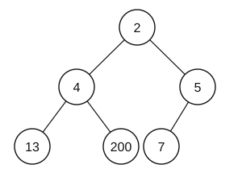

# Exercise Sheet 6: Recursion

*Introduction to Computing for the Social Sciences · Prof. Dr. David Garcia*

> Exercises 1–3 are worked through in the exercise session. The *Additional
> practice* section is for self-study. Worked solutions to every exercise, with
> pointers to the slides and the handout sections that cover the material, are
> in [`Solutions/Exercise06-Solutions.md`](Solutions/Exercise06-Solutions.md); try before you open them.
> Notation: [course conventions](../Transcripts/00-Conventions.md).

---

## Exercise 1: Recursive algorithms

A **min-heap** is a data structure similar to a binary search tree but simpler.
Min-heaps take the form of a nearly-complete binary tree, all levels are full
except the last one, which may be partly filled and is filled from the leftmost
leaf, with the condition that **each node contains a key that is smaller than
or equal to the keys of its children**. Below is an example:

Min-heaps can be implemented in arrays such that the levels of the tree are
stored sequentially in the array positions between 1 and $N$, where $N$ is the
total size of the min-heap. This way you can calculate the left child, right
child and parent of a node in position $x$ as:

$$\text{left-child}(x) = 2x \qquad \text{right-child}(x) = 2x+1 \qquad \text{parent}(x) = \lfloor x/2 \rfloor$$

a) Write the pseudocode of an **iterative** function `reduce(H, x, y)` that takes
   a min-heap $H$ and reduces the value of the node in position $x$ to the value
   $y$, assuming $y$ is lower than the current value stored in position $x$. The
   function has to change the min-heap so the result is still a min-heap. Use and
   manipulate $H$ with indices as you would with an array.

b) Write the **recursive** version of your code above. Which type of recursion
   have you implemented?

c) Show how `reduce(H, x, y)` can be applied to the min-heap of the example to
   reduce the value of the last node (the one that contains 7) to the value 1.
   Indicate any swaps or value changes and the final state of the min-heap.

> Careful with the direction: reducing a value can only break the heap property
> **upwards**, between the node and its parent. Convince yourself of that before
> you write any pseudocode.

---

## Exercise 2: Depth-First Search

Given the following adjacency matrix:

| | A | B | C | D | E | F |
|---|---|---|---|---|---|---|
| **A** | 0 | 1 | 1 | 0 | 0 | 0 |
| **B** | 1 | 0 | 1 | 0 | 0 | 0 |
| **C** | 1 | 1 | 0 | 1 | 1 | 0 |
| **D** | 0 | 0 | 1 | 0 | 0 | 1 |
| **E** | 0 | 0 | 1 | 0 | 0 | 1 |
| **F** | 0 | 0 | 0 | 1 | 1 | 0 |

a) Draw its corresponding graph.

b) Starting from node **B**, show the result of running Depth-First Search on the
   graph. Indicate the resulting discovery and finishing times for each node and
   the parent relationships on the graph. When processing the neighbors of a
   node, do it in alphabetical order.

---

## Exercise 3: Euclid's algorithm

a) Write the **recursive** version of Euclid's algorithm and a **non-recursive**
   version. *(Hint: remember that Euclid's algorithm is based on the equation
   $\gcd(a,b) = \gcd(b, a \bmod b)$.)* Explain the kind of recursion of Euclid's
   algorithm.

b) Show how the recursive version of Euclid's algorithm finds the gcd of 210 and
   45. How many calls to the algorithm happen in this case?

---

## Additional practice

### A1. Base cases and abort cases

For each recursive definition, identify the base case(s) and say whether the
recursion terminates for all valid inputs. If not, add an abort case.

a) $f(n) = f(n-1) + 2$, with $f(0) = 0$. Called with $n = 5$. With $n = -3$.
b) "The number of files in a directory is the number of files directly in it,
   plus the number of files in each of its subdirectories."
c) $g(n) = g(n/2)$ if $n$ is even, $g(3n+1)$ if $n$ is odd, with $g(1) = 1$.

### A2. Recursive to iterative

Convert each recursive procedure to an iterative one, and say whether the
conversion was mechanical (tail recursion) or required a stack or an accumulator.

a) `SUM(A, n)`: returns $A[1] + \dots + A[n]$.
b) `POWER(x, n)`: returns $x^n$.
c) `REVERSE(list)`: returns the list reversed.

### A3. Fibonacci and memoization

a) Draw the call tree of the naive `fib(5)`, with `fib(0) = 0` and
   `fib(1) = 1` as base cases (as in the lecture). How many calls in total? How
   many distinct sub-problems?
b) With memoization, how many calls compute something new?
c) The naive version makes roughly $1.6^n$ calls. How long would `fib(100)` take
   at one billion calls per second?

### A4. Reading a DFS trace

For a DFS on a directed graph you obtain these timestamps:

| node | d | f |
|---|---|---|
| A | 1 | 8 |
| B | 2 | 7 |
| C | 3 | 4 |
| D | 5 | 6 |

a) Which node is the root of the DFS tree?
b) Is C a descendant of B? Is D a descendant of C?
c) Sketch the DFS tree.
d) The graph also contains an edge D → A. What kind of edge is it, and what does
   it tell you?

### A5. Stack depth

a) A recursive function processes a list of $n$ elements one at a time. How deep
   does the stack get? What is the largest $n$ that works with Python's default
   limit of about 1000 frames?
b) A recursive function halves its input each call. How deep does the stack get
   for $n = 10^9$?
c) Why is (b) safe in practice while (a) is not?

### A6. Divide and conquer, or dynamic programming?

For each problem, say which of the two strategies fits, and why.

a) Sorting a list by splitting it in half and sorting each half.
b) Computing the number of distinct paths through a grid from the top-left to the
   bottom-right, moving only right or down.
c) Finding an element in a sorted array.
d) Computing the edit distance between two strings.

### A7. Min-heaps, more practice

Using the array representation with $\text{left}(x)=2x$, $\text{right}(x)=2x+1$,
$\text{parent}(x)=\lfloor x/2 \rfloor$:

a) Write the array for the min-heap of exercise 1.
b) Is `[1, 3, 2, 7, 4, 5, 6]` a valid min-heap? Is `[1, 2, 3, 4, 5, 6, 7]`?
   Is `[1, 5, 2, 7, 8, 3]`?
c) Write the pseudocode of `insert(H, v)`: add a value at the end and restore the
   heap property.
d) How does `insert` relate to `reduce` from exercise 1?

---

## Sources

- Exercises 1–3 are adapted from the 2023/24 sheet 6 of this course; the min-heap
  figure has been redrawn.
- **Zelle, J. M. (2016).** *Python Programming*, 3rd ed., ch. 13.: Reading for
  this session.
- **Cormen, T. H., Leiserson, C. E., Rivest, R. L. & Stein, C. (2009).**
  *Introduction to Algorithms*, 3rd ed., ch. 6 (heaps), ch. 15 (dynamic
  programming), ch. 22.3 (DFS).: Source of the heap index formulas in
  exercise 1 and the DFS conventions in exercise 2.
- **Bellman, R. (1957).** *Dynamic Programming*. Princeton University Press.,
  Background for A6.
- **Lagarias, J. C. (2010).** *The Ultimate Challenge: The 3x+1 Problem*. AMS.,
  The Collatz conjecture in A1(c).
- **Python recursion limit** (A5):
  <https://docs.python.org/3/library/sys.html#sys.setrecursionlimit>
