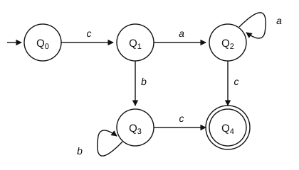
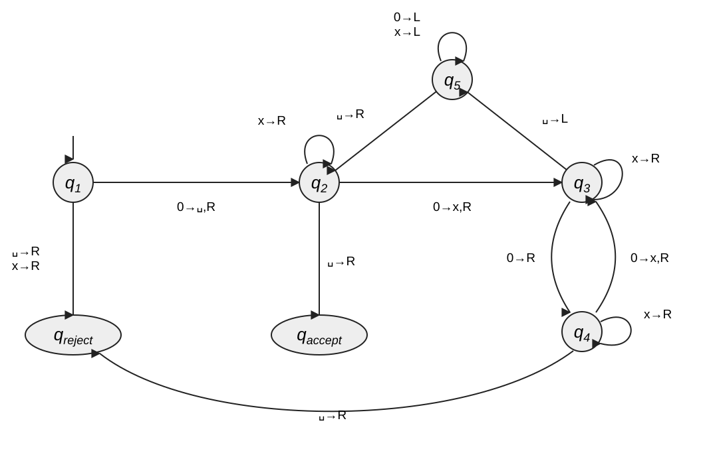
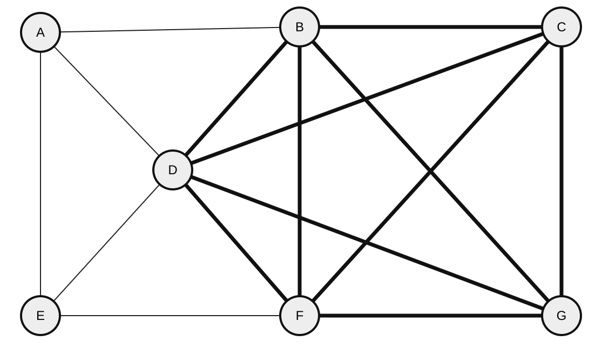

# Exercise Sheet 9: Theoretical Computer Science

*Introduction to Computing for the Social Sciences · Prof. Dr. David Garcia*

> Exercises 1–4 are worked through in the exercise session. The *Additional
> practice* section is for self-study. Worked solutions to every exercise, with
> pointers to the slides and the handout sections that cover the material, are
> in [`Solutions/Exercise09-Solutions.md`](Solutions/Exercise09-Solutions.md); try before you open them.
> Notation: [course conventions](../Transcripts/00-Conventions.md).

---

## Exercise 1: Finite-State Automata

Consider the following finite-state automaton.

a) A finite state automaton is defined by the 5-tuple
   $(Q, \Sigma, \delta, q_0, X)$. For the automaton depicted above, describe what
   each element of the 5-tuple consists of.

b) Which of the following input sequences are accepted by the above finite state
   automaton? Show the sequence of states that justifies your answer.

   i) `caaac`
   ii) `cbbbbbbc`

c) What language is accepted by the finite state automaton depicted above?
   *(Hint: you do not have to give a formal definition; describing the language
   in your own words is enough.)*

d) Is the automaton above a **non-deterministic** finite state automaton? Explain
   your answer.

e) Design a **deterministic** finite state automaton that recognizes strings
   containing the substring `ICSS` in an alphabet composed of `{I, C, S, X}`.
   Show a diagram with its states and transitions.

> For (e), think about what the automaton has to *remember*. It cannot store the
> input, it can only be in one of finitely many states. What is the minimum it
> needs to know at each point?

---

## Exercise 2: Push-Down Automata

Consider the following push-down automaton with three states, $Q_0$, $Q_1$ and
$Q_D$:

| Input | State | Stack top | Stack action | Next state |
|---|---|---|---|---|
| 1 | $Q_0$ | any | Push A | $Q_0$ |
| 0 | $Q_0$ | any | Push B | $Q_0$ |
| X | $Q_0$ | any | nothing | $Q_1$ |
| □ | $Q_0$ | any | nothing | $Q_D$ |
| 1 | $Q_1$ | A | Pop | $Q_1$ |
| 0 | $Q_1$ | B | Pop | $Q_1$ |
| □ | $Q_1$ | # | Pop | $Q_1$ |
| 1 | $Q_1$ | B or # | nothing | $Q_D$ |
| 0 | $Q_1$ | A or # | nothing | $Q_D$ |
| □ | $Q_1$ | A or B | nothing | $Q_D$ |
| X | $Q_1$ | any | nothing | $Q_D$ |
| any | $Q_D$ | any | nothing | $Q_D$ |

The input alphabet is composed of the symbols `0`, `1`, `X`, and `□` as the
symbol that marks the end of the input. The stack alphabet is `A`, `B`, and `#`
as the symbol that starts as the bottom of the stack. An input string is
**accepted** if `#` is popped from the stack when reaching `□`; otherwise it is
rejected.

a) Show how the above push-down automaton runs for the input `0111X1110□` by
   writing down the state of the automaton and of the stack after each input
   symbol has been read. Show clearly whether the input is accepted or not.

b) Describe in your own words the language recognized by the above push-down
   automaton.

c) Write a formal definition of the above language as a **grammar**. Is it a
   type 3 grammar? Justify your answer.

> The push-down automaton is the machine of **type 2** in the Chomsky hierarchy
> from the lecture: a finite automaton plus a stack. Part (c) asks you to notice
> what that extra stack buys, and why no type 3 grammar can do the same job.

---

## Exercise 3: Turing Machines

Consider the Turing machine defined by
$M = (Q, \Sigma, \Gamma, \delta, q_1, q_{accept}, q_{reject})$, where:

- $Q = \{q_1, q_2, q_3, q_4, q_5, q_{accept}, q_{reject}\}$
- $\Sigma = \{\texttt{0}\}$
- $\Gamma = \{\texttt{0}, \texttt{x}, \texttt{␣}\}$
- $\delta$ is depicted in the figure below
- $q_1$ is the start state
- $q_{accept}$ is the accept state
- $q_{reject}$ is the reject state

Notation on the arrows: `0→␣,R` means "on reading `0`, write `␣` and move
right"; `x→R` means "on reading `x`, leave it and move right" (no write).

a) Show how the Turing machine processes the string `0000`.

b) Show how the Turing machine processes the string `000`.

c) Describe in your own words what language is recognized by the Turing machine.

> For (a) and (b), write one line per step: the tape contents, the position of
> the head, and the current state. The machine is not long, but it is easy to
> lose track, so be systematic.

---

## Exercise 4: Computability

A **$k$-clique** is a fully connected graph of $k$ vertices, i.e. there is an
edge between each pair of vertices. Consider the **CLIQUE** problem, which is the
decision problem of determining whether a graph $G$ contains a $k$-clique of a
given size $k$. The example below (Sipser, 2012) is a graph that contains a
5-clique but not a 6-clique, the edges of the 5-clique are drawn thick.

a) Write the pseudocode of an algorithm to **verify** that a given solution $c$
   is a proof that a given graph $G$ contains a $k$-clique of a given size $k$.

b) Based on your algorithm above, what can you say about the complexity classes
   that the CLIQUE problem belongs to?

c) Determine the satisfiability of the following formulas and reason your
   answers:

   i) $(\bar{x}_1 \vee \bar{x}_2 \vee x_3 \vee \bar{x}_4) \wedge (\bar{x}_3 \vee x_5 \vee \bar{x}_6) \wedge (x_3 \vee x_6)$

   ii) $\bar{x}_1 \wedge (x_1 \vee x_2) \wedge (x_1 \vee \bar{x}_2)$

> Part (a) asks for a **verifier**, not a solver: you are given the candidate
> clique and only have to check it. Keep that distinction sharp, it is exactly
> the difference between NP and P.

---

## Additional practice

### A1. Building automata

Design a DFA over the alphabet $\{0, 1\}$ for each language. Give the diagram and
say how many states you needed.

a) Strings that end in `0`.
b) Strings with an even number of `1`s.
c) Strings that contain `101` as a substring.
d) Strings whose value read as a binary number is divisible by 3.

### A2. What automata cannot do

For each language, say whether a DFA can recognize it. If not, say what kind of
machine can.

a) $\{a^n \mid n \ge 0\}$
b) $\{a^n b^n \mid n \ge 1\}$
c) $\{a^n b^n c^n \mid n \ge 1\}$
d) Balanced parentheses of arbitrary depth.
e) Strings of even length.

### A3. Grammars

Given the grammar $N = \{S, A\}$, $\Sigma = \{a, b\}$, start symbol $S$, and
$P = \{S \rightarrow aA,\; A \rightarrow bS,\; A \rightarrow b\}$:

a) Derive three strings in the language.
b) Describe $L(G)$ in words and in set notation.
c) Convert the grammar to an automaton using the mapping from the lecture.
d) Is this a type 3 (regular) grammar? Why?

### A4. Turing machines

a) Describe, in words, a Turing machine that decides whether its input (a string
   of `a`s) has even length.
b) Describe a Turing machine that adds 1 to a binary number written on its tape.
c) Why is a TM more powerful than a push-down automaton, given that both have
   unbounded memory?

### A5. Computability

Decide whether each problem is computable. Justify.

a) Given a Python program, does it contain a syntax error?
b) Given a Python program, will it ever print the word "hello"?
c) Given a Python program and an input, will it terminate within 1000 steps?
d) Given two Python programs, do they compute the same function?

### A6. Complexity classes

For each problem, say whether it is in P, in NP, NP-complete, or NP-hard, and
say what you would need to know to be sure.

a) Sorting a list.
b) Deciding whether a graph has a path between $s$ and $t$.
c) Deciding whether a graph has a Hamiltonian path.
d) Finding the shortest Hamiltonian path (the traveling salesman problem).
e) Deciding whether a boolean formula is satisfiable.

### A7. Reductions

a) You have an algorithm that solves SAT. Explain informally how you could use it
   to decide whether a graph has a Hamiltonian path.
b) You discover a polynomial-time algorithm for the Hamiltonian path problem.
   What follows?
c) Why is reduction the standard tool for proving hardness rather than for
   proving easiness?

---

## Sources

- Exercises 1–2 are adapted from the 2023/24 sheet 9 of this course and
  exercises 3–4 from the 2024 sheet 10; all diagrams have been redrawn as
  vector graphics.
- **Sipser, M. (2012).** *Introduction to the Theory of Computation*, 3rd ed.,
  Cengage. Ch. 1 (automata and regular languages, source for exercise 1 and A1),
  ch. 2 (context-free languages and push-down automata, exercise 2 and A2),
  ch. 3–5 (Turing machines and undecidability: A4, A5), ch. 7 (P, NP,
  NP-completeness: A6, A7).
- **Evans, D. (2011).** *Introduction to Computing*, ch. 6 and 12.
  <https://computingbook.org/>
- **Cormen, T. H. (2013).** *Algorithms Unlocked*, ch. 10.
- **Turing, A. M. (1936).** "On Computable Numbers…". *Proc. London Math. Soc.*
  2(42), 230–265.: The undecidability results in A5.
- **Cook, S. A. (1971).** "The complexity of theorem-proving procedures".
  *STOC '71*.: SAT's NP-completeness, used in A6 and A7.
- **Karp, R. M. (1972).** "Reducibility Among Combinatorial Problems". In
  *Complexity of Computer Computations*, 85–103.: The paper that reduced 21
  problems to each other and made reduction the standard technique of A7.
