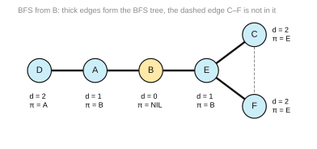
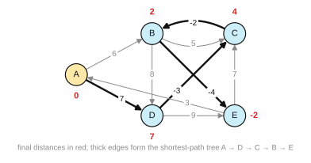

# Solutions to Exercise Sheet 5: Algorithms

*Introduction to Computing for the Social Sciences · Prof. Dr. David Garcia*

> Solutions to [Exercise Sheet 5](../Exercise05.md). Each solution
> starts with where the material is in the slides and in the handout (the
> lecture transcript). Slide numbers count the title slide as 1 and refer to
> `Slides/05-Algorithms/ICSS-2026-05-Algorithms.qmd`.

---

## Exercise 1: Flow charts

**Where to look.** Slides 21 to 25 (*Flowcharts*, *Flowchart example*, *Exercise: write pseudocode as a flowchart*). Handout: [05 §5 Flowcharts](../../Transcripts/05-Algorithms.md#5-flowcharts), [05 §4 Pseudocode](../../Transcripts/05-Algorithms.md#4-pseudocode).

a) The method reads an integer $n$, starts with $x = 1$ and a counter $i = 0$,
and as long as $i$ is smaller than $n$ it doubles $x$ and increases $i$ by one;
when $i$ reaches $n$ it returns $x$. After $n$ doublings $x$ is $2^n$, so
`unknown(n)` computes **$2^n$**. For $n \le 0$ the loop never runs and the
method returns 1, which is $2^0$ and is the usual convention for negative
inputs as well.

b) Reading the diamond as the condition of a loop:

```
Procedure UNKNOWN(n)
Inputs:
      n: an integer
Result: 2^n (and 1 when n ≤ 0)
x ← 1
i ← 0
While i < n:
      x ← x · 2
      i ← i + 1
return x
```

The diamond in the flowchart tests `i ≥ n` and leaves the loop on *true*, so
the `While` condition is its negation, `i < n`.

## Exercise 2: Graphs and algorithms

**Where to look.** Slides 32 to 37 (*Graphs*, *Graphs: formalization*, *Adjacency matrix*, *Adjacency list*) and 39 to 50 (*Example: finding distances*, *Algorithm: breadth-first search*). Handout: [05 §7 Graphs](../../Transcripts/05-Algorithms.md#7-graphs), [05 §8 Representing graphs](../../Transcripts/05-Algorithms.md#8-representing-graphs), [05 §9 Breadth-First Search](../../Transcripts/05-Algorithms.md#9-breadth-first-search).

a) The matrix is symmetric, so the graph is undirected. A 1 in row $u$ and
column $v$ is an edge between $u$ and $v$; there are six of them:

$$\{A,B\},\ \{A,D\},\ \{B,E\},\ \{C,E\},\ \{C,F\},\ \{E,F\}.$$

Drawn, it is a path D – A – B – E with a triangle C, E, F hanging off E.

b) One list per vertex with its neighbors:

```
A → [B, D]
B → [A, E]
C → [E, F]
D → [A]
E → [B, C, F]
F → [C, E]
```

Twelve entries for six edges, since each undirected edge appears in the lists
of both endpoints.

c) Breadth-first search from B, with the queue written after each step and
neighbors enqueued in alphabetical order:

| step | dequeue | discovered (gray) | queue after |
|---|---|---|---|
| 0 | – | B ($d = 0$) | `[B]` |
| 1 | B | A ($d=1$, $\pi=B$), E ($d=1$, $\pi=B$) | `[A, E]` |
| 2 | A | D ($d=2$, $\pi=A$); B is already seen | `[E, D]` |
| 3 | E | C ($d=2$, $\pi=E$), F ($d=2$, $\pi=E$); B is already seen | `[D, C, F]` |
| 4 | D | nothing new | `[C, F]` |
| 5 | C | nothing new (E and F are seen) | `[F]` |
| 6 | F | nothing new | `[ ]` |

Final distances and parents:

| vertex | A | B | C | D | E | F |
|---|---|---|---|---|---|---|
| $d$ | 1 | **0** | 2 | 2 | 1 | 2 |
| $\pi$ | B | NIL | E | A | B | E |



The BFS tree has the edges B–A, B–E, A–D, E–C and E–F; the edge C–F is not in
the tree, because F was discovered from E before C was dequeued.

## Exercise 3: More about graphs and algorithms

**Where to look.** Slides 34 to 37 (*Graphs: formalization*, *Adjacency matrix*) and 38 to 39 (*Examples of graph problems*, *Example: finding distances*). Handout: [05 §8 Representing graphs](../../Transcripts/05-Algorithms.md#8-representing-graphs), [05 §9 Breadth-First Search](../../Transcripts/05-Algorithms.md#9-breadth-first-search). Bellman-Ford itself is not in the slides; the reference is Cormen (2013), *Algorithms Unlocked*, chapter 6.

a) A non-zero entry in row $u$ and column $v$ is a directed edge $u \to v$
with that weight, ten in all:

$$A \xrightarrow{6} B,\ A \xrightarrow{7} D,\ B \xrightarrow{5} C,\ B \xrightarrow{8} D,\ B \xrightarrow{-4} E,\ C \xrightarrow{-2} B,\ D \xrightarrow{-3} C,\ D \xrightarrow{9} E,\ E \xrightarrow{3} A,\ E \xrightarrow{7} C.$$

The matrix is not symmetric ($B \to C$ has weight 5, $C \to B$ has weight
$-2$), which is what makes the graph directed. A zero means "no edge", not an
edge of weight zero.

b) The edges are taken in the order $(A,B), (A,D), (B,C), (B,D), (B,E), (C,B),
(D,C), (D,E), (E,A), (E,C)$. Initially $A = 0$ and every other distance is
$\infty$.

*Iteration 1.* $(A,B)$: $\infty > 0 + 6$, so $B \leftarrow 6$, $\pi_B = A$.
$(A,D)$: $D \leftarrow 7$, $\pi_D = A$. $(B,C)$: $C \leftarrow 11$, $\pi_C = B$.
$(B,D)$: $7 > 14$? no. $(B,E)$: $E \leftarrow 2$, $\pi_E = B$. $(C,B)$:
$6 > 9$? no. $(D,C)$: $11 > 4$, so $C \leftarrow 4$, $\pi_C = D$. $(D,E)$:
$2 > 16$? no. $(E,A)$: $0 > 5$? no. $(E,C)$: $4 > 9$? no.
After iteration 1: $A = 0$, $B = 6$, $C = 4$, $D = 7$, $E = 2$.

*Iteration 2.* Only $(C,B)$ relaxes: $6 > 4 - 2 = 2$, so $B \leftarrow 2$,
$\pi_B = C$. After iteration 2: $A = 0$, $B = 2$, $C = 4$, $D = 7$, $E = 2$.

*Iteration 3.* Only $(B,E)$ relaxes: $2 > 2 - 4 = -2$, so $E \leftarrow -2$,
$\pi_E = B$. After iteration 3: $A = 0$, $B = 2$, $C = 4$, $D = 7$, $E = -2$.

*Iteration 4.* No relaxation succeeds.

| vertex | A | B | C | D | E |
|---|---|---|---|---|---|
| distance | **0** | 2 | 4 | 7 | −2 |
| parent | NIL | C | D | A | B |



The shortest-path tree is the single path $A \to D \to C \to B \to E$, which is
why three iterations were needed: each pass extends the path by one more edge.

c) With $C \to B$ at $-4$ the cycle $B \to E \to C \to B$ has weight
$-4 + 7 - 4 = -1$ (with $-2$ it had weight $+1$). A negative cycle means that
there is no shortest path at all: going around it once more always makes the
path cheaper, so the distances of every vertex on or reachable from the cycle
have no lower bound. The algorithm does not notice. It still stops after
$|V| - 1 = 4$ passes, because line 6 fixes the number of iterations, but the
relaxations do not converge: in the trace, iteration 2 lowers $B$ to 0,
iteration 3 lowers $E$ to $-4$, $A$ to $-1$ and $C$ to 3, and iteration 4 still
lowers $D$ to 6 and $B$ to $-1$. The values it returns are not the lengths of
any simple path, and the parent pointers contain a cycle instead of forming a
tree. The remedy is one extra pass over the edges after the loop: if any
relaxation still succeeds, a negative cycle is reachable from the source and
the result must be reported as invalid. That is also why BFS assigns each
distance exactly once while Bellman-Ford relaxes the same edge again and again:
with unit weights a vertex cannot be reached more cheaply later, whereas with
arbitrary weights a longer path in edges can be shorter in weight.

## Additional practice

### A1. Properties of algorithms

**Where to look.** Slides 11 to 15 (*Algorithms: properties*). Handout: [05 §2 The properties an algorithm must have](../../Transcripts/05-Algorithms.md#2-the-properties-an-algorithm-must-have).

a) Definite (each step is clear), **stochastic**, and correct if it terminates.
It terminates with probability 1 but has no finite bound, so most people would
say that it fails finiteness in any useful sense. It is a legitimate randomized
algorithm and a terrible one.
b) Definite, finite and deterministic, but it fails **transferability**: it
works for one input only. It is an answer, not an algorithm.
c) It fails **finiteness**: the series is infinite and $\pi$ has no finite
decimal expansion. "To $k$ digits" would be an algorithm; "to full precision"
is not.
d) All satisfied. Having input from a user does not make it stochastic: for a
given input the output is the same every time.

### A2. Reading and writing flowcharts

**Where to look.** Slides 21 to 25. Handout: [05 §5 Flowcharts](../../Transcripts/05-Algorithms.md#5-flowcharts).

a) Start → parallelogram "read n" → diamond `n mod 2 = 0` → true branch:
"print even"; false branch: "print odd" → both rejoin → Stop.
b) Start → "read n" → rectangle `r = 0, i = 1` → diamond `i ≤ n` → false:
parallelogram "return r" → Stop; true: rectangle `r = r + i, i = i + 2` →
arrow back to the diamond. It sums the **odd numbers** up to $n$:
$1 + 3 + 5 + \dots$. A pleasant fact: that sum is always a perfect square,
$1 + 3 + 5 + 7 = 16$.

### A3. Queues and stacks

**Where to look.** Slides 26 to 29 (*Abstract data structures*, *Queues*, *Stacks*). Handout: [05 §6 Abstract data structures: queues and stacks](../../Transcripts/05-Algorithms.md#6-abstract-data-structures-queues-and-stacks).

a) Queue (FIFO): the removals give A, then B, then C, then D: **A B C D**.
b) Stack (LIFO): after insert A, insert B, the removal gives **B**; insert C,
removal gives **C**; insert D, removal gives **D**; the last removal gives
**A**: **B C D A**.
c) Queue: serving requests to a web server in arrival order; printing jobs.
Stack: the call stack of nested function calls (you must finish the innermost
call first); undo history; matching brackets in an expression.

### A4. Graph representations

**Where to look.** Slides 34 to 37. Handout: [05 §8 Representing graphs](../../Transcripts/05-Algorithms.md#8-representing-graphs).

a)
$$\begin{array}{c|cccc} & 1&2&3&4\\\hline 1&0&1&0&0\\ 2&0&0&1&0\\ 3&1&0&0&1\\ 4&0&0&0&0\end{array}$$
b) $1 \rightarrow 2$; $2 \rightarrow 3$; $3 \rightarrow 1 \rightarrow 4$;
$4 \rightarrow$ (empty).
c) No. A symmetric adjacency matrix means that the graph is **undirected**:
every edge goes both ways.
d) Matrix: store $w(u,v)$ in the cell instead of 1, with a sentinel (0, or
$\infty$) for "no edge"; note that 0 is a bad sentinel if 0 is a valid weight.
List: store pairs (neighbor, weight) in each list.

### A5. BFS by hand

**Where to look.** Slides 39 to 50. Handout: [05 §9 Breadth-First Search](../../Transcripts/05-Algorithms.md#9-breadth-first-search).

a) Enqueue A. Dequeue A → enqueue B, C; queue `[B, C]`. Dequeue B → enqueue D;
queue `[C, D]`. Dequeue C → D is already discovered; queue `[D]`. Dequeue D →
enqueue E; queue `[E]`. Dequeue E → enqueue F; queue `[F]`. Dequeue F →
nothing; queue empty.
b) $d$: A 0, B 1, C 1, D 2, E 3, F 4.
$\pi$: A NIL, B A, C A, D **B** (discovered from B first, in alphabetical
order), E D, F E.
c) A → B → D → E → F, length 4.
d) The length is unique, but not the path: A → C → D → E → F also has length
4. BFS returns one shortest path per node, determined by the order in which
neighbors are examined, which is why the sheet fixes alphabetical order.

### A6. Sparse graphs and memory

**Where to look.** Slide 37 (*Adjacency matrix vs adjacency list*). Handout: [05 §8 Representing graphs](../../Transcripts/05-Algorithms.md#8-representing-graphs), [05 §10 Graphs in social science](../../Transcripts/05-Algorithms.md#10-graphs-in-social-science).

a) $(2\times10^8)^2 = 4\times10^{16}$ bits $= 5\times10^{15}$ bytes, that is,
**5 petabytes**.
b) About $|V| + |E| = 2\times10^8 + 2\times10^{10} \approx 2\times10^{10}$
entries. At, say, 8 bytes per entry that is 160 GB: large, but it fits on a
disk.
c) About $3 \times 10^{4}$ in favor of the list: 5 PB against 160 GB. Counting
bits against entries instead, $4\times10^{16}$ against $2\times10^{10}$, the
ratio is $2 \times 10^{6}$; either way the matrix is out of the question.
d) The matrix costs $|V|^2$ and the list roughly $|V| + |E|$, so the matrix
wins only when $|E|$ approaches $|V|^2$, that is, when a large fraction of all
possible pairs are connected. Social networks are nowhere near: here the
density is $|E|/|V|^2 = 5 \times 10^{-7}$.

### A7. Choosing an algorithm

**Where to look.** Slides 38 to 39. Handout: [05 §9 Breadth-First Search](../../Transcripts/05-Algorithms.md#9-breadth-first-search), [05 §10 Graphs in social science](../../Transcripts/05-Algorithms.md#10-graphs-in-social-science).

a) **Yes.** An unweighted shortest path is exactly what BFS computes.
b) **No.** Edges have weights, so the fewest legs is not the cheapest route.
Use **Dijkstra's algorithm** (non-negative weights).
c) **Yes.** Run BFS from any node; the graph is connected if and only if every
node ends up discovered.
d) **Yes.** Run BFS and stop when $d[u] > 3$; this is exactly how "friends of
friends of friends" is computed.
e) Neither BFS nor Dijkstra, since Dijkstra assumes non-negative weights. Use
**Bellman-Ford**, which handles negative weights and detects negative cycles,
which is exactly the point of exercise 3(c) on this sheet.
