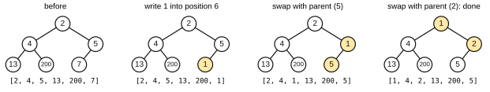
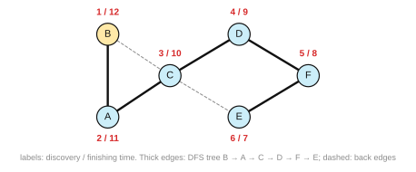

# Solutions to Exercise Sheet 6: Recursion

*Introduction to Computing for the Social Sciences · Prof. Dr. David Garcia*

---

## Exercise 1: Recursive algorithms

Lowering a value can only break the heap property between the node and its
parent and never between the node and its children, because the children were
already larger than the old value, so they are also larger than the new one.
The node therefore has to move up, swapping with its parent as long as the
parent is larger.

a) Iterative version:

```
Procedure REDUCE(H, x, y)
Inputs:
      H: a min-heap stored in an array, positions 1 to N
      x: the position of the node to change
      y: the new value, with y < H[x]
Result: H[x] holds y and H is again a min-heap
H[x] ← y
While x > 1 and H[⌊x/2⌋] > H[x]:
      swap H[x] with H[⌊x/2⌋]
      x ← ⌊x/2⌋
```

The loop stops at the root ($x = 1$) or as soon as the parent is not larger.
It runs at most as many times as the tree is deep, i.e. about $\log_2 N$ times.

b) Recursive version, with the comparison against the parent as the recursive
case and "at the root, or the parent is smaller" as the base case:

```
Procedure REDUCE-REC(H, x, y)
Inputs:
      H, x, y as above
Result: H[x] holds y and H is again a min-heap
H[x] ← y
SIFT-UP(H, x)

Procedure SIFT-UP(H, x)
Inputs:
      H: a min-heap, except possibly between position x and its parent
      x: a position in H
Result: the heap property holds everywhere
If x > 1 and H[⌊x/2⌋] > H[x]
      then swap H[x] with H[⌊x/2⌋]
           SIFT-UP(H, ⌊x/2⌋)
```

This is **linear recursion** and in particular **tail recursion**, because
there is a single recursive call, it is the last thing the procedure does, and
nothing is left to compute when it returns. That is why the iterative version
of (a) is a mechanical translation of it.

c) The heap of the figure as an array, level by level, is
`[2, 4, 5, 13, 200, 7]`. The node with 7 is at position 6, which is the left
child of position 3. Calling `reduce(H, 6, 1)` runs these steps:

| step | action | array |
|---|---|---|
| 0 | write $y = 1$ into position 6 | `[2, 4, 5, 13, 200, 1]` |
| 1 | parent of 6 is position 3, value 5; $5 > 1$, swap | `[2, 4, 1, 13, 200, 5]` |
| 2 | parent of 3 is position 1, value 2; $2 > 1$, swap | `[1, 4, 2, 13, 200, 5]` |
| 3 | $x = 1$ is the root, stop | |



The final min-heap has 1 at the root, children 4 and 2, and below them 13 and
200 under 4 and 5 under 2. Every node is smaller than its children, and the
tree is still nearly complete because only values were changed and not the
shape of the tree.

## Exercise 2: Depth-First Search

a) The matrix is symmetric, so the graph is undirected, with seven edges:
$\{A,B\}, \{A,C\}, \{B,C\}, \{C,D\}, \{C,E\}, \{D,F\}, \{E,F\}$. It is a
triangle A, B, C joined through C to a square C, D, F, E.

b) DFS from B, taking neighbors in alphabetical order, with discovery time $d$
and finishing time $f$:

- Visit **B** ($d = 1$). Its neighbors are A and C, and A is white.
  - Visit **A** ($d = 2$, $\pi = B$). Neighbors B (gray) and C (white).
    - Visit **C** ($d = 3$, $\pi = A$). Neighbors A (gray), B (gray), D (white).
      - Visit **D** ($d = 4$, $\pi = C$). Neighbors C (gray), F (white).
        - Visit **F** ($d = 5$, $\pi = D$). Neighbors D (gray), E (white).
          - Visit **E** ($d = 6$, $\pi = F$). Neighbors C (gray), F (gray), so
            nothing is white. Finish E ($f = 7$).
          Finish F ($f = 8$).
        Finish D ($f = 9$).
      Back in C, E is now black. Finish C ($f = 10$).
    Finish A ($f = 11$).
  Back in B, C is black. Finish B ($f = 12$).

| vertex | A | B | C | D | E | F |
|---|---|---|---|---|---|---|
| $d$ | 2 | **1** | 3 | 4 | 6 | 5 |
| $f$ | 11 | 12 | 10 | 9 | 7 | 8 |
| $\pi$ | B | NIL | A | C | F | D |



The DFS tree is the single path B → A → C → D → F → E, because depth-first
search commits to one neighbor and goes as deep as it can, so on this graph it
never branches. The two edges not in the tree, B–C and C–E, are back edges.
When C looks at B and when E looks at C, the other vertex is still gray, so
each back edge reveals a cycle, namely B–A–C–B and C–D–F–E–C.

## Exercise 3: Euclid's algorithm

a) The recursive version follows directly from $\gcd(a, b) = \gcd(b, a \bmod b)$
with $\gcd(a, 0) = a$ as the base case:

```
Procedure GCD(a, b)
Inputs:
      a, b: non-negative integers, not both zero
Result: the greatest common divisor of a and b
If b = 0
      then return a
      else return GCD(b, a mod b)
```

Iterative version:

```
Procedure GCD-ITER(a, b)
Inputs:
      a, b: non-negative integers, not both zero
Result: the greatest common divisor of a and b
While b ≠ 0:
      r ← a mod b
      a ← b
      b ← r
return a
```

The recursion is **linear** and, more precisely, **tail recursion**, because
there is one recursive call per invocation, it is in the last position, and no
work is pending when it returns. The iterative version simply overwrites $a$
and $b$ with the arguments of the next call.

b) $\gcd(210, 45) \to \gcd(45, 210 \bmod 45) = \gcd(45, 30) \to \gcd(30, 45
\bmod 30) = \gcd(30, 15) \to \gcd(15, 30 \bmod 15) = \gcd(15, 0) = 15$.

There are **four calls** in total, counting the initial one and the base case
$\gcd(15, 0)$, and three of them are recursive calls. The remainders 30, 15 and
0 shrink quickly, which is why the algorithm needs so few calls.

## Additional practice

### A1. Base cases and abort cases

a) The base case is $f(0) = 0$. The recursion terminates for $n \ge 0$, so it
terminates for $n = 5$. For $n = -3$ it runs forever ($-3, -4, -5, \ldots$), so
we add an abort case, for example `if n < 0 then error`.
b) The base case is a directory with no subdirectories. The recursion
terminates if the filesystem is a tree. Real filesystems have symbolic links,
which can create cycles, so you need an abort case that tracks visited
directories. This is the same idea as the WHITE/GRAY/BLACK coloring of DFS.
c) This is the **Collatz conjecture**. Nobody knows whether it terminates for
all $n$. It has been verified for enormous ranges but it has no proof. It shows
that the question "does this recursion terminate?" can be an open research
problem, which is related to the halting problem that we will learn in the
Theoretical Computer Science session.

### A2. Recursive to iterative

a)
```
Procedure SUM-ITER(A, n)
Inputs:
      A: an array; n: how many of its elements to add
Result: A[1] + … + A[n]
s ← 0
For i = 1 to n:
      s ← s + A[i]
return s
```
This required an **accumulator**, because the recursive version is not
tail-recursive, since `return A[n] + SUM(A, n-1)` does work after the call
returns.

b)
```
Procedure POWER-ITER(x, n)
Inputs:
      x: a number; n: a non-negative integer
Result: x^n
r ← 1
For i = 1 to n:
      r ← r · x
return r
```
This is the same situation as in (a). The recursive version can be made
tail-recursive by carrying
the accumulator as a parameter, `POWER(x, n, acc)`.

c) Iteratively, you can walk from the end and append, or swap ends inwards. The
recursive version (`REVERSE(rest) + [first]`) is not tail-recursive, while the
iterative version needs no stack because a list gives random access.

### A3. Fibonacci and memoization

a) In the tree, fib(5) calls fib(4) and fib(3), fib(4) calls fib(3) and fib(2),
and so on. There are **15** calls in total. The distinct subproblems are fib(0)
to fib(5), so there are **6**. Already at $n = 5$ we are doing 2.5 times more
work than necessary, and the ratio grows with $n$.
b) Exactly $n + 1$ calls compute something new, i.e. one per distinct
subproblem. Everything else is a table lookup.
c) $1.6^{100} \approx 2.6 \times 10^{20}$ calls, so about $2.6 \times 10^{11}$
seconds, which is roughly **8,000 years**. The memoized version takes 100
additions. This difference is a strong argument for dynamic programming.

### A4. Reading a DFS trace

a) The root is A, because it has the smallest discovery time and the largest
finishing time, so its interval $[1, 8]$ contains all the others.
b) C is a descendant of B, since $[3,4] \subset [2,7]$. D is **not** a
descendant of C, because $[5,6]$ and $[3,4]$ are disjoint, so C and D are
siblings under B.
c) The tree is A → B → {C, D}.
d) When DFS explores D → A, A is **gray** (discovered at 1, not finished until
8). An edge to a gray vertex is a **back edge**, and a back edge means that the
graph contains a **cycle**: A → B → D → A.

### A5. Stack depth

a) The depth is $n$. Python's default limit fails at roughly $n \approx 1000$,
which is very small for real data. Any recursion whose depth is proportional to
the data size is therefore a risk.
b) The stack gets about $\log_2(10^9) \approx 30$ frames deep.
c) It is safe because logarithmic depth stays very small even for extremely
large inputs. This is why divide-and-conquer recursion, for example mergesort
and binary search, is safe while linear recursion over a dataset is not. It is
also why the iterative version of a linear recursion is usually the right
choice.

### A6. Divide and conquer, or dynamic programming?

a) **Divide and conquer** (mergesort). The halves are disjoint, so no
subproblem is ever solved twice.
b) **Dynamic programming.** The number of paths to a cell depends on the cells
above and to the left, and those subproblems are shared by many cells, so we
fill a table.
c) **Divide and conquer** (binary search). Each step discards half the array
and there is exactly one subproblem.
d) **Dynamic programming.** This is the classic case, because the distance
between prefixes is reused constantly and the standard algorithm fills an
$m \times n$ table.

In all four cases, the test is whether the subproblems overlap.
