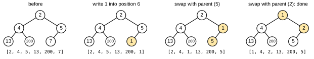
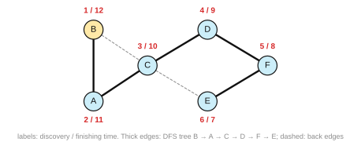

# Solutions to Exercise Sheet 6: Recursion

*Introduction to Computing for the Social Sciences · Prof. Dr. David Garcia*

> Solutions to [Exercise Sheet 6](../Exercise06.md). Each solution
> starts with where the material is in the slides and in the handout (the
> lecture transcript). Slide numbers count the title slide as 1 and refer to
> `Slides/06-Recursion/ICSS-2026-06-Recursion.qmd` unless another session is named.

---

## Exercise 1: Recursive algorithms

**Where to look.** Slides: session 7, slides 41 to 46 (*Data structures for sorting*, *Heaps*, *Min-heaps*), in `Slides/07-SortingAlgorithms/ICSS-2026-07-SortingAlgorithms.qmd`; session 6, slides 13 to 17 (*Components of recursion*, *Recursion*, *Issues with recursion*) and 77 (*Types of recursive algorithms*). Handout: [07 §8 Heaps and heapsort](../../Transcripts/07-SortingAlgorithms.md#8-heaps-and-heapsort), [06 §2 The three parts of a recursive definition](../../Transcripts/06-Recursion.md#2-the-three-parts-of-a-recursive-definition), [06 §7 Types of recursion](../../Transcripts/06-Recursion.md#7-types-of-recursion).

Lowering a value can only break the heap property between the node and its
parent, never between the node and its children (they were already larger than
the old value, so they are larger than the new one). The node therefore has to
move up, swapping with its parent as long as the parent is larger.

a) Iterative version:

```
Procedure REDUCE(H, x, y)
Inputs:
      H: a min-heap stored in an array, positions 1 to N
      x: the position of the node to change
      y: the new value, with y < H[x]
Result: H[x] holds y and H is again a min-heap
H[x] ← y
While x > 1 and H[⌊x/2⌋] > H[x]:
      swap H[x] with H[⌊x/2⌋]
      x ← ⌊x/2⌋
```

The loop stops at the root ($x = 1$) or as soon as the parent is not larger,
and it runs at most as many times as the tree is deep, about $\log_2 N$.

b) Recursive version, with the comparison against the parent as the recursive
case and "at the root, or the parent is smaller" as the base case:

```
Procedure REDUCE-REC(H, x, y)
Inputs:
      H, x, y as above
Result: H[x] holds y and H is again a min-heap
H[x] ← y
SIFT-UP(H, x)

Procedure SIFT-UP(H, x)
Inputs:
      H: a min-heap, except possibly between position x and its parent
      x: a position in H
Result: the heap property holds everywhere
If x > 1 and H[⌊x/2⌋] > H[x]
      then swap H[x] with H[⌊x/2⌋]
           SIFT-UP(H, ⌊x/2⌋)
```

This is **linear recursion**, and in particular **tail recursion**: there is a
single recursive call, it is the last thing the procedure does, and nothing is
left to compute when it returns. That is why the iterative version of (a) is a
mechanical translation of it.

c) The heap of the figure as an array, level by level, is
`[2, 4, 5, 13, 200, 7]`; the node with 7 is at position 6, the left child of
position 3. Calling `reduce(H, 6, 1)`:

| step | action | array |
|---|---|---|
| 0 | write $y = 1$ into position 6 | `[2, 4, 5, 13, 200, 1]` |
| 1 | parent of 6 is position 3, value 5; $5 > 1$, swap | `[2, 4, 1, 13, 200, 5]` |
| 2 | parent of 3 is position 1, value 2; $2 > 1$, swap | `[1, 4, 2, 13, 200, 5]` |
| 3 | $x = 1$ is the root, stop | |



The final min-heap has 1 at the root, children 4 and 2, and below them 13 and
200 under 4 and 5 under 2. Every node is smaller than its children, and the
tree is still nearly complete because no shape was changed, only values.

## Exercise 2: Depth-First Search

**Where to look.** Slides 54 to 76 (*Depth-first search in directed graphs*, *Depth-first search*). Handout: [06 §6 Depth-First Search](../../Transcripts/06-Recursion.md#6-depth-first-search).

a) The matrix is symmetric, so the graph is undirected, with seven edges:
$\{A,B\}, \{A,C\}, \{B,C\}, \{C,D\}, \{C,E\}, \{D,F\}, \{E,F\}$. It is a
triangle A, B, C joined through C to a square C, D, F, E.

b) DFS from B, taking neighbors in alphabetical order, with discovery time $d$
and finishing time $f$:

- Visit **B** ($d = 1$). Its neighbors are A and C; A is white.
  - Visit **A** ($d = 2$, $\pi = B$). Neighbors B (gray) and C (white).
    - Visit **C** ($d = 3$, $\pi = A$). Neighbors A (gray), B (gray), D (white).
      - Visit **D** ($d = 4$, $\pi = C$). Neighbors C (gray), F (white).
        - Visit **F** ($d = 5$, $\pi = D$). Neighbors D (gray), E (white).
          - Visit **E** ($d = 6$, $\pi = F$). Neighbors C (gray), F (gray);
            nothing white. Finish E ($f = 7$).
          Finish F ($f = 8$).
        Finish D ($f = 9$).
      Back in C, E is now black. Finish C ($f = 10$).
    Finish A ($f = 11$).
  Back in B, C is black. Finish B ($f = 12$).

| vertex | A | B | C | D | E | F |
|---|---|---|---|---|---|---|
| $d$ | 2 | **1** | 3 | 4 | 6 | 5 |
| $f$ | 11 | 12 | 10 | 9 | 7 | 8 |
| $\pi$ | B | NIL | A | C | F | D |



The DFS tree is the single path B → A → C → D → F → E: depth-first search
commits to one neighbor and goes as deep as it can, so on this graph it never
branches. The two edges not in the tree, B–C and C–E, are back edges: when C
looks at B and when E looks at C, the other vertex is still gray, and each
back edge reveals a cycle (B–A–C–B and C–D–F–E–C).

## Exercise 3: Euclid's algorithm

**Where to look.** Slides 50 to 53 (*The greatest common divisor*, *Euclid's algorithm*, *Euclid and the GCD*). Handout: [06 §5 Euclid's algorithm](../../Transcripts/06-Recursion.md#5-euclids-algorithm).

a) Recursive version, straight from $\gcd(a, b) = \gcd(b, a \bmod b)$ with
$\gcd(a, 0) = a$ as the base case:

```
Procedure GCD(a, b)
Inputs:
      a, b: non-negative integers, not both zero
Result: the greatest common divisor of a and b
If b = 0
      then return a
      else return GCD(b, a mod b)
```

Iterative version:

```
Procedure GCD-ITER(a, b)
Inputs:
      a, b: non-negative integers, not both zero
Result: the greatest common divisor of a and b
While b ≠ 0:
      r ← a mod b
      a ← b
      b ← r
return a
```

The recursion is **linear** and, more precisely, **tail recursion**: one
recursive call per invocation, in the last position, with no work pending when
it returns. The iterative version simply overwrites $a$ and $b$ with the
arguments of the next call.

b) $\gcd(210, 45) \to \gcd(45, 210 \bmod 45) = \gcd(45, 30) \to \gcd(30, 45
\bmod 30) = \gcd(30, 15) \to \gcd(15, 30 \bmod 15) = \gcd(15, 0) = 15$.

**Four calls** in total, counting the initial one and the base case
$\gcd(15, 0)$; three of them are recursive calls. The remainders 30, 15, 0
shrink quickly, which is the point of the algorithm.

## Additional practice

### A1. Base cases and abort cases

**Where to look.** Slides 13 to 17. Handout: [06 §2 The three parts of a recursive definition](../../Transcripts/06-Recursion.md#2-the-three-parts-of-a-recursive-definition).

a) Base case $f(0) = 0$. Terminates for $n \ge 0$. For $n = -3$ it runs
forever ($-3, -4, -5, \ldots$). Add an abort case: `if n < 0 then error`.
b) Base case: a directory with no subdirectories. It terminates if the
filesystem is a tree. Real filesystems have symbolic links, which can create
cycles, so you need an abort case that tracks visited directories. This is
exactly the WHITE/GRAY/BLACK coloring of DFS.
c) This is the **Collatz conjecture**. Nobody knows whether it terminates for
all $n$; it has been verified for enormous ranges but has no proof. A beautiful
illustration that "does this recursion terminate?" can be an open research
problem, and a preview of the halting problem in session 9.

### A2. Recursive to iterative

**Where to look.** Slides 24 to 25 (*Factorial: iterative and recursive implementation*) and 77 (*Types of recursive algorithms*). Handout: [06 §3 Factorial](../../Transcripts/06-Recursion.md#3-factorial), [06 §7 Types of recursion](../../Transcripts/06-Recursion.md#7-types-of-recursion).

a)
```
Procedure SUM-ITER(A, n)
Inputs:
      A: an array; n: how many of its elements to add
Result: A[1] + … + A[n]
s ← 0
For i = 1 to n:
      s ← s + A[i]
return s
```
This required an **accumulator**: the recursive version is not tail-recursive,
since `return A[n] + SUM(A, n-1)` does work after the call returns.

b)
```
Procedure POWER-ITER(x, n)
Inputs:
      x: a number; n: a non-negative integer
Result: x^n
r ← 1
For i = 1 to n:
      r ← r · x
return r
```
Same situation. The recursive version can be made tail-recursive by carrying
the accumulator as a parameter, `POWER(x, n, acc)`.

c) Iteratively, walk from the end and append, or swap ends inwards. The
recursive version (`REVERSE(rest) + [first]`) is not tail-recursive; the
iterative version needs no stack because a list gives random access.

### A3. Fibonacci and memoization

**Where to look.** Slides 79 to 85 (*Optimization problems*, *Dynamic programming*, *Example: Fibonacci numbers*). Handout: [06 §8 Dynamic programming](../../Transcripts/06-Recursion.md#8-dynamic-programming).

a) The tree: fib(5) → fib(4), fib(3); fib(4) → fib(3), fib(2); and so on.
**15** calls in total. Distinct subproblems: fib(0) to fib(5), so **6**.
Already at $n = 5$ we are doing 2.5 times more work than necessary, and the
ratio grows with $n$.
b) Exactly $n + 1$, one per distinct subproblem. Everything else is a table
lookup.
c) $1.6^{100} \approx 2.6 \times 10^{20}$ calls, so about $2.6 \times 10^{11}$
seconds, which is roughly **8 000 years**. The memoized version takes 100
additions. This is the single most persuasive argument for dynamic programming.

### A4. Reading a DFS trace

**Where to look.** Slides 54 to 76. Handout: [06 §6 Depth-First Search](../../Transcripts/06-Recursion.md#6-depth-first-search).

a) A: it has the smallest discovery time and the largest finishing time, so its
interval $[1, 8]$ contains all the others.
b) C is a descendant of B, since $[3,4] \subset [2,7]$. D is **not** a
descendant of C: $[5,6]$ and $[3,4]$ are disjoint, so they are siblings under B.
c) A → B → {C, D}.
d) When DFS explores D → A, A is **gray** (discovered at 1, not finished until
8). An edge to a gray vertex is a **back edge**, and a back edge means that the
graph contains a **cycle**: A → B → D → A.

### A5. Stack depth

**Where to look.** Slides 43 to 48 (*Memory of a running program*, *Recursion: implementation in memory*). Handout: [06 §4 How recursion runs: the program stack](../../Transcripts/06-Recursion.md#4-how-recursion-runs-the-program-stack).

a) Depth $n$. Python's default fails at roughly $n \approx 1000$, which is
nothing for real data. Any recursion whose depth is proportional to the data
size is a liability.
b) $\log_2(10^9) \approx 30$ frames.
c) Because logarithmic depth stays tiny even for astronomically large inputs.
This is why divide-and-conquer recursion (mergesort, binary search) is safe
while linear recursion over a dataset is not, and why the iterative version of
a linear recursion is usually the right choice.

### A6. Divide and conquer, or dynamic programming?

**Where to look.** Slides: session 7, slides 22 to 24 (*Divide and conquer*), in `Slides/07-SortingAlgorithms/ICSS-2026-07-SortingAlgorithms.qmd`; session 6, slides 79 to 81 and 86 (*Dynamic programming*, *Outtake: types of algorithms*). Handout: [07 §5 Divide and conquer](../../Transcripts/07-SortingAlgorithms.md#5-divide-and-conquer), [06 §8 Dynamic programming](../../Transcripts/06-Recursion.md#8-dynamic-programming), [06 §9 Families of algorithm design](../../Transcripts/06-Recursion.md#9-families-of-algorithm-design).

a) **Divide and conquer** (mergesort). The halves are disjoint; no subproblem
is ever solved twice.
b) **Dynamic programming.** The number of paths to a cell depends on the cells
above and to the left, and those subproblems are shared by many cells. Fill a
table.
c) **Divide and conquer** (binary search). Each step discards half the array
and there is exactly one subproblem.
d) **Dynamic programming.** The classic case: the distance between prefixes is
reused constantly, and the standard algorithm fills an $m \times n$ table.

The test is always whether the subproblems overlap.

### A7. Min-heaps, more practice

**Where to look.** Slides: session 7, slides 41 to 46, in `Slides/07-SortingAlgorithms/ICSS-2026-07-SortingAlgorithms.qmd`. Handout: [07 §8 Heaps and heapsort](../../Transcripts/07-SortingAlgorithms.md#8-heaps-and-heapsort).

a) Reading the tree level by level: `[2, 4, 5, 13, 200, 7]`.
b) `[1,3,2,7,4,5,6]`: check each node against its children: $1 \le 3, 2$;
$3 \le 7, 4$; $2 \le 5, 6$. **Valid.**
`[1,2,3,4,5,6,7]`: a sorted array is always a valid min-heap. **Valid.**
`[1,5,2,7,8,3]`: node 2 (value 5) has children 7 and 8; node 3 (value 2) has
the child at position 6 (value 3); the root $1 \le 5, 2$. **Valid** too. A
min-heap is much weaker than a sorted array, which is why it is cheaper to
maintain.
c)
```
Procedure INSERT(H, v)
Inputs:
      H: a min-heap stored in an array, with N elements
      v: the value to insert
Result: H holds v as well and is again a min-heap, with N + 1 elements
N ← N + 1
H[N] ← v
i ← N
While i > 1 and H[⌊i/2⌋] > H[i]:
      swap H[i] with H[⌊i/2⌋]
      i ← ⌊i/2⌋
```
d) It is the same sift-up loop. `insert` is `reduce` applied to a node placed
at the end with the new value, which is why writing one gives you the other.
The opposite operation, sift-down, is what heapsort uses in session 7.
