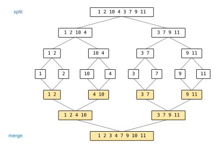

# Solutions to Exercise Sheet 7: Sorting Algorithms

*Introduction to Computing for the Social Sciences · Prof. Dr. David Garcia*

> Solutions to [Exercise Sheet 7](../Exercise07.md). Each solution
> starts with where the material is in the slides and in the handout (the
> lecture transcript). Slide numbers count the title slide as 1 and refer to
> `Slides/07-SortingAlgorithms/ICSS-2026-07-SortingAlgorithms.qmd`.

---

## Exercise 1: Selection sort

**Where to look.** Slides 14 to 20 (*Iterative sorting*, *Repeated minimum search*, *Selection sort*, *Selection sort example*, *Repeated minimum search vs selection sort*) and 13 (*Stable vs. unstable sorting*). Handout: [07 §4 Iterative sorting](../../Transcripts/07-SortingAlgorithms.md#4-iterative-sorting), [07 §3 Stable and unstable sorting](../../Transcripts/07-SortingAlgorithms.md#3-stable-and-unstable-sorting).

a) In iteration $i$ the inner loop compares the current minimum with every
element of positions $i+1$ to 8, then the minimum is swapped into position $i$.

| $i$ | compared | minimum | swap | array after |
|---|---|---|---|---|
| 1 | positions 2 to 8 | 1 at position 1 | none | `[1, 2, 10, 4, 3, 7, 9, 11]` |
| 2 | positions 3 to 8 | 2 at position 2 | none | `[1, 2, 10, 4, 3, 7, 9, 11]` |
| 3 | positions 4 to 8 | **3** at position 5 | 3 ↔ 5 | `[1, 2, 3, 4, 10, 7, 9, 11]` |
| 4 | positions 5 to 8 | 4 at position 4 | none | `[1, 2, 3, 4, 10, 7, 9, 11]` |
| 5 | positions 6 to 8 | **7** at position 6 | 5 ↔ 6 | `[1, 2, 3, 4, 7, 10, 9, 11]` |
| 6 | positions 7 to 8 | **9** at position 7 | 6 ↔ 7 | `[1, 2, 3, 4, 7, 9, 10, 11]` |
| 7 | position 8 | 10 at position 7 | none | `[1, 2, 3, 4, 7, 9, 10, 11]` |

Three swaps and $7 + 6 + 5 + 4 + 3 + 2 + 1 = 28$ comparisons, the same 28 as
on any array of eight elements.

b) Repeated minimum search finds the minimum of the input, removes it and
appends it to a new output array, and repeats. Selection sort does the same
search but swaps the minimum into place inside the same array.

- **Advantage of selection sort.** It works **in place**: it needs only one
  extra variable, whereas repeated minimum search needs a second array of the
  same size and, in an array, removing an element from the middle means
  shifting everything behind it. Both are $O(n^2)$ in comparisons, but
  selection sort does much less copying.
- **Disadvantage.** It is **not stable**: the swap moves the element that was
  in position $i$ to the far position of the minimum, jumping over the
  elements in between, which can reverse the order of two equal keys. Repeated
  minimum search appends elements in the order it finds them and keeps equal
  keys in their original order. The in-place swap also makes selection sort a
  little harder to read.

## Exercise 2: Mergesort

**Where to look.** Slides 22 to 36 (*Divide and conquer*, *Mergesort*, *The MERGE function*, *MERGE example*). Handout: [07 §5 Divide and conquer](../../Transcripts/07-SortingAlgorithms.md#5-divide-and-conquer), [07 §6 Mergesort](../../Transcripts/07-SortingAlgorithms.md#6-mergesort), [08 §6 Recursive algorithms: mergesort](../../Transcripts/08-TimeComplexity.md#6-recursive-algorithms-mergesort).

a) Split at the middle until every piece has one element, then merge upwards:



In the last merge the two runs are compared head to head: 1 and 3 give 1; 2
and 3 give 2; 4 and 3 give 3; 4 and 7 give 4; 10 and 7 give 7; 10 and 9 give
9; 10 and 11 give 10; then 11 is copied.

b) Mergesort needs about $n \log_2 n$ comparisons, selection sort $n^2/2$.
The reason is in the shape of the recursion: mergesort halves the array, so
there are $\log_2 n$ levels of splitting, and merging all the pieces of one
level touches each of the $n$ elements once. Selection sort scans the whole
remaining array to find each minimum and throws that scan away before the
next one. For eight elements the difference is small (15 comparisons against
28); for a million it is about $2 \times 10^7$ against $5 \times 10^{11}$.
Mergesort is also stable and its two halves can be sorted in parallel. Its
price is the extra array used by MERGE, whereas selection sort sorts in place.

## Exercise 3: More sorting algorithms

**Where to look.** Slides 7 to 13 (*Sorting*, *Stable vs. unstable sorting*). Handout: [07 §2 The formal problem](../../Transcripts/07-SortingAlgorithms.md#2-the-formal-problem), [07 §3 Stable and unstable sorting](../../Transcripts/07-SortingAlgorithms.md#3-stable-and-unstable-sorting). Bubblesort is problem 2-2 of Cormen, Leiserson, Rivest and Stein (2009).

a) In pass $i$ the inner loop runs $j$ from 8 down to $i + 1$ and exchanges
neighbors that are out of order, so the smallest element of the unsorted part
bubbles to position $i$. The array after each pass:

| pass $i$ | exchanges during the pass | array after |
|---|---|---|
| 1 | $4 \leftrightarrow 3$ (at $j = 5$), then $10 \leftrightarrow 3$ (at $j = 4$) | `[1, 2, 3, 10, 4, 7, 9, 11]` |
| 2 | $10 \leftrightarrow 4$ | `[1, 2, 3, 4, 10, 7, 9, 11]` |
| 3 | $10 \leftrightarrow 7$ | `[1, 2, 3, 4, 7, 10, 9, 11]` |
| 4 | $10 \leftrightarrow 9$ | `[1, 2, 3, 4, 7, 9, 10, 11]` |
| 5 to 7 | none | `[1, 2, 3, 4, 7, 9, 10, 11]` |

Pass 1 in detail: $j = 8$: $11 < 9$? no. $j = 7$: $9 < 7$? no. $j = 6$:
$7 < 3$? no. $j = 5$: $3 < 4$? yes, exchange → `[1, 2, 10, 3, 4, …]`. $j = 4$:
$3 < 10$? yes, exchange → `[1, 2, 3, 10, 4, …]`. $j = 3$: $3 < 2$? no. $j = 2$:
$2 < 1$? no. The array is sorted after pass 4, but the algorithm has no way to
notice and runs the remaining passes making $28$ comparisons in total.

b) **Yes, bubblesort is stable.** The line that decides it is the comparison
`If A[j] < A[j - 1]`: two neighbors are exchanged only when the right one is
strictly smaller, so two equal keys are never exchanged with each other, and
an element can only move past elements that are strictly larger or strictly
smaller than it. The relative order of equal keys therefore never changes.
Example with two records with the same key, $2_a$ before $2_b$:
`[2a, 2b, 1]`. Pass 1: $j = 3$: $1 < 2_b$, exchange → `[2a, 1, 2b]`; $j = 2$:
$1 < 2_a$, exchange → `[1, 2a, 2b]`. $2_a$ is still before $2_b$, and no
later pass touches them. With `≤` instead of `<`, pass 2 would test
$2_b \le 2_a$ at $j = 3$, exchange them, and end with `[1, 2b, 2a]`: the
algorithm would be unstable.

## Additional practice

### A1. Stability in practice

**Where to look.** Slide 13 (*Stable vs. unstable sorting*). Handout: [07 §3 Stable and unstable sorting](../../Transcripts/07-SortingAlgorithms.md#3-stable-and-unstable-sorting).

a) Sort by `timestamp` first, then by `user`, and the second sort must be
**stable** so that it does not disturb the chronological order inside each
block of one user. The general rule is to sort by the least significant key
first.
b) Sort once by a **composite key**, the tuple `(user, timestamp)`, so that
ties on `user` are broken by `timestamp` inside a single comparison. Stability
then becomes irrelevant.
c)
```python
posts.sort(key=lambda p: p["timestamp"])
posts.sort(key=lambda p: p["user"])
```
or, in one pass, `posts.sort(key=lambda p: (p["user"], p["timestamp"]))`.

### A2. Counting operations

**Where to look.** Slides 15 to 20 and 30 to 35. Handout: [07 §4 Iterative sorting](../../Transcripts/07-SortingAlgorithms.md#4-iterative-sorting), [07 §6 Mergesort](../../Transcripts/07-SortingAlgorithms.md#6-mergesort), [08 §4 Runtime analysis](../../Transcripts/08-TimeComplexity.md#4-runtime-analysis).

a) $\sum_{i=1}^{n-1}(n-i) = n(n-1)/2$, and it does **not** depend on the
input: the loops run to completion regardless.
b) Exactly $n-1$, one per outer iteration (some may swap an element with
itself).
c) The same $n(n-1)/2$: the loop bounds are fixed. Improvement: add a flag
that records whether any exchange happened during a pass, and stop if none
did. On an already sorted array that turns $n^2/2$ comparisons into $n$, a
best case that selection sort does not have.
d) Merging at one level touches all $n$ elements, so about $n$ comparisons per
level. Each level halves the sublist size, so there are $\log_2 n$ levels.
Total about $n \log_2 n$, worked out properly in session 8.

### A3. Mergesort by hand

**Where to look.** Slides 25 to 35. Handout: [07 §6 Mergesort](../../Transcripts/07-SortingAlgorithms.md#6-mergesort).

a) `[38,27,43,3,9,82,10]` → `[38,27,43,3]` + `[9,82,10]` → `[38,27]` +
`[43,3]` and `[9,82]` + `[10]` → singletons.
b) `[38] + [27]` → `[27,38]`; `[43] + [3]` → `[3,43]`; `[27,38] + [3,43]` →
`[3,27,38,43]`. `[9] + [82]` → `[9,82]`; `[9,82] + [10]` → `[9,10,82]`.
Finally `[3,27,38,43] + [9,10,82]` → `[3,9,10,27,38,43,82]`.
c) $q = \lfloor (p+r)/2 \rfloor$ puts the extra element in the **left** half
(4 and 3 here). It does not matter for correctness, and it changes the number
of comparisons only marginally; the depth is $\lceil \log_2 n \rceil$ either
way.

### A4. Quicksort and the pivot

**Where to look.** Slides 37 to 40 (*Quicksort*, *The PARTITION function*, *Quicksort: properties*). Handout: [07 §7 Quicksort](../../Transcripts/07-SortingAlgorithms.md#7-quicksort).

a) Pivot 6: everything smaller goes left, so 6 lands in position 7 and the
array is `[3, 1, 4, 1, 5, 2, 6, 9]`; recurse on `[3,1,4,1,5,2]` with pivot 2,
which gives `[1, 1, 2, 3, 5, 4]`, then on `[1,1]` (pivot 1) and `[3,5,4]`
(pivot 4), and so on.
b) Every pivot is the largest remaining element, so each partition splits the
array into "everything" and "nothing". The recursion goes $n$ levels deep and
the work is $n + (n-1) + \dots = n^2/2$, quicksort's **worst case**, and it is
triggered by already sorted input, which is common in practice.
c) Bad because sorted or reverse-sorted input is exactly what you often have,
and because deep recursion risks a stack overflow (session 6). Real
implementations choose the pivot as the **median of three** elements, or at
random, or fall back to heapsort when the recursion gets too deep (introsort).

### A5. Heaps

**Where to look.** Slides 41 to 79 (*Heaps*, *Min-heaps*, *Heapsort*). Handout: [07 §8 Heaps and heapsort](../../Transcripts/07-SortingAlgorithms.md#8-heaps-and-heapsort).

a) With 1-based indices: node 1 (3) has children 9 and 5; node 2 (9) has
children 10 and 12; node 3 (5) has child 6. **Valid.**
b) Append 2 at position 7, the child of node 3 (value 5). $2 < 5$, swap →
`[3, 9, 2, 10, 12, 6, 5]`. Now node 3 is 2, whose parent is 3; $2 < 3$, swap →
`[2, 9, 3, 10, 12, 6, 5]`. Check: valid.
c) Remove the root 2; move the last element (5) to the root →
`[5, 9, 3, 10, 12, 6]`. Sift down: the children of 5 are 9 and 3; the smaller
is 3 and $3 < 5$, swap → `[3, 9, 5, 10, 12, 6]`. Node 3 (value 5) has the child
6; $5 < 6$, done. We are back at the heap from (a), as expected.
d) Because a heap is **complete** by definition: every level except possibly
the last is full, so $n$ nodes force a depth of $\lceil \log_2(n+1)\rceil$. A
BST has no such requirement, so inserting sorted keys produces a chain.

### A6. Choosing an algorithm

**Where to look.** Slides 6 (*Why sort at all?*) and 80 (*To learn more about sorting*). Handout: [07 §1 Why sorting](../../Transcripts/07-SortingAlgorithms.md#1-why-sorting), [07 §9 Why sorting matters for us](../../Transcripts/07-SortingAlgorithms.md#9-why-sorting-matters-for-us).

a) Anything simple: selection or insertion sort. Correctness under exam
conditions beats asymptotics at $n = 20$.
b) **Mergesort.** It is the basis of *external* sorting: sort chunks that fit
in memory, write them out, then merge the sorted runs with a streaming pass.
The merge only needs to hold one element per run in memory.
c) **Insertion sort** or **Timsort**. Both are near-linear on nearly sorted
input, and Timsort explicitly detects existing runs. Quicksort with a naive
pivot would be at its worst here.
d) **Selection sort**, which makes only $n - 1$ swaps, the minimum possible.
e) **Heapsort**: in place, no extra memory, and no worst case to speak of.
Quicksort is in place too but its recursion uses stack.

### A7. Reasoning about lower bounds

**Where to look.** Slide 80. Handout: [07 §9 Why sorting matters for us](../../Transcripts/07-SortingAlgorithms.md#9-why-sorting-matters-for-us), [02 §2 Measuring information in bits](../../Transcripts/02-InformationCoding.md#2-measuring-information-in-bits).

a) There are $n!$ possible orderings, and the algorithm must be able to
distinguish all of them. Each comparison is a yes/no question, so it gives at
most **one bit** (session 2). To distinguish $n!$ possibilities you need at
least $\log_2(n!)$ bits, and $\log_2(n!) \approx n \log_2 n$ by Stirling's
approximation. So no comparison-based sort can beat $n \log_2 n$.
b) No. Counting sort does not **compare** elements; it uses their values
directly as array indices. The bound in (a) applies only to comparison-based
sorting. This is a nice example of how a lower-bound proof always comes with a
model, and changing the model changes the bound.
