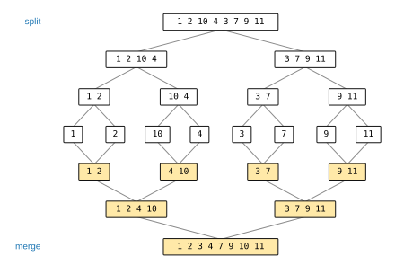

# Solutions to Exercise Sheet 7: Sorting Algorithms

*Introduction to Computing for the Social Sciences · Prof. Dr. David Garcia*

---

## Exercise 1: Selection sort

a) In iteration $i$ the inner loop compares the current minimum with every
element of positions $i+1$ to 8, then the minimum is swapped into position $i$.

| $i$ | compared | minimum | swap | array after |
|---|---|---|---|---|
| 1 | positions 2 to 8 | 1 at position 1 | none | `[1, 2, 10, 4, 3, 7, 9, 11]` |
| 2 | positions 3 to 8 | 2 at position 2 | none | `[1, 2, 10, 4, 3, 7, 9, 11]` |
| 3 | positions 4 to 8 | **3** at position 5 | 3 ↔ 5 | `[1, 2, 3, 4, 10, 7, 9, 11]` |
| 4 | positions 5 to 8 | 4 at position 4 | none | `[1, 2, 3, 4, 10, 7, 9, 11]` |
| 5 | positions 6 to 8 | **7** at position 6 | 5 ↔ 6 | `[1, 2, 3, 4, 7, 10, 9, 11]` |
| 6 | positions 7 to 8 | **9** at position 7 | 6 ↔ 7 | `[1, 2, 3, 4, 7, 9, 10, 11]` |
| 7 | position 8 | 10 at position 7 | none | `[1, 2, 3, 4, 7, 9, 10, 11]` |

Selection sort makes three swaps and $7 + 6 + 5 + 4 + 3 + 2 + 1 = 28$
comparisons, which are the same 28 as on any array of eight elements.

b) Repeated minimum search finds the minimum of the input, removes it and
appends it to a new output array, and repeats. Selection sort does the same
search but swaps the minimum into place inside the same array.

- **Advantage of selection sort.** It works **in place**, i.e. it needs only
  one extra variable, whereas repeated minimum search needs a second array of
  the same size. In addition, removing an element from the middle of an array
  means shifting everything behind it. Both are $O(n^2)$ in comparisons, but
  selection sort does much less copying.
- **Disadvantage.** It is **not stable**, because the swap moves the element
  that was in position $i$ to the far position of the minimum and past the
  elements in between, which can reverse the order of two equal keys. Repeated
  minimum search appends elements in the order it finds them and keeps equal
  keys in their original order. The in-place swap also makes selection sort a
  little harder to read.

## Exercise 2: Mergesort

a) We split at the middle until every piece has one element and then merge upwards.



In the last merge the first elements of the two runs are compared. First, 1
and 3 give 1, 2 and 3 give 2, 4 and 3 give 3, and 4 and 7 give 4. Then 10 and
7 give 7, 10 and 9 give 9, and 10 and 11 give 10. Finally, 11 is copied.

b) Mergesort needs about $n \log_2 n$ comparisons, while selection sort needs
$n^2/2$. The reason is the structure of the recursion. Mergesort halves the
array, so there are $\log_2 n$ levels of splitting, and merging all the pieces
of one level touches each of the $n$ elements once. Selection sort scans the
whole remaining array to find each minimum and does not reuse that scan for
the next one. For eight elements the difference is small (15 comparisons
against 28), but for a million it is about $2 \times 10^7$ against
$5 \times 10^{11}$. Mergesort is also stable and its two halves can be sorted
in parallel. Its cost is the extra array used by MERGE, whereas selection sort
sorts in place.

## Exercise 3: More sorting algorithms

a) In pass $i$ the inner loop runs $j$ from 8 down to $i + 1$ and exchanges
neighbors that are out of order, so the smallest element of the unsorted part
moves to position $i$. The table shows the array after each pass.

| pass $i$ | exchanges during the pass | array after |
|---|---|---|
| 1 | $4 \leftrightarrow 3$ (at $j = 5$), then $10 \leftrightarrow 3$ (at $j = 4$) | `[1, 2, 3, 10, 4, 7, 9, 11]` |
| 2 | $10 \leftrightarrow 4$ | `[1, 2, 3, 4, 10, 7, 9, 11]` |
| 3 | $10 \leftrightarrow 7$ | `[1, 2, 3, 4, 7, 10, 9, 11]` |
| 4 | $10 \leftrightarrow 9$ | `[1, 2, 3, 4, 7, 9, 10, 11]` |
| 5 to 7 | none | `[1, 2, 3, 4, 7, 9, 10, 11]` |

Pass 1 in detail:

- $j = 8$: $11 < 9$? no.
- $j = 7$: $9 < 7$? no.
- $j = 6$: $7 < 3$? no.
- $j = 5$: $3 < 4$? yes, exchange → `[1, 2, 10, 3, 4, …]`.
- $j = 4$: $3 < 10$? yes, exchange → `[1, 2, 3, 10, 4, …]`.
- $j = 3$: $3 < 2$? no.
- $j = 2$: $2 < 1$? no.

The array is sorted after pass 4, but the algorithm has no way to notice it
and runs the remaining passes, making $28$ comparisons in total.

b) **Yes, bubblesort is stable.** The line that decides it is the comparison
`If A[j] < A[j - 1]`. Two neighbors are exchanged only when the right one is
strictly smaller, so two equal keys are never exchanged with each other and
an element can only move past elements that are strictly larger or strictly
smaller than it. Therefore the relative order of equal keys never changes.
As an example, take two records with the same key, $2_a$ before $2_b$, in
`[2a, 2b, 1]`. In pass 1, at $j = 3$ we have $1 < 2_b$ and exchange →
`[2a, 1, 2b]`, and at $j = 2$ we have $1 < 2_a$ and exchange → `[1, 2a, 2b]`.
$2_a$ is still before $2_b$ and no later pass touches them. With `≤` instead
of `<`, pass 2 would test $2_b \le 2_a$ at $j = 3$, exchange them and end
with `[1, 2b, 2a]`, so the algorithm would be unstable.

## Additional practice

### A1. Stability in practice

a) Sort by `timestamp` first, then by `user`, and the second sort must be
**stable** so that it does not disturb the chronological order inside each
block of one user. The general rule is to sort by the least significant key
first.
b) Sort once by a **composite key**, the tuple `(user, timestamp)`, so that
ties on `user` are broken by `timestamp` inside a single comparison. Stability
then becomes irrelevant.
c)
```python
posts.sort(key=lambda p: p["timestamp"])
posts.sort(key=lambda p: p["user"])
```
or, in one pass, `posts.sort(key=lambda p: (p["user"], p["timestamp"]))`.

### A2. Counting operations

a) $\sum_{i=1}^{n-1}(n-i) = n(n-1)/2$, and it does **not** depend on the
input, because the loops run to completion regardless.
b) Exactly $n-1$, one per outer iteration (some may swap an element with
itself).
c) The same $n(n-1)/2$, because the loop bounds are fixed. To improve it, add
a flag that records whether any exchange happened during a pass and stop if
none did. On an already sorted array this turns $n^2/2$ comparisons into $n$,
which is a best case that selection sort does not have.
d) Merging at one level touches all $n$ elements, so about $n$ comparisons per
level. Each level halves the sublist size, so there are $\log_2 n$ levels.
The total is about $n \log_2 n$, which we will calculate properly in the Time
Complexity session.

### A3. Mergesort with pen and paper

a) `[38,27,43,3,9,82,10]` → `[38,27,43,3]` + `[9,82,10]` → `[38,27]` +
`[43,3]` and `[9,82]` + `[10]` → singletons.
b) In the left half, `[38] + [27]` → `[27,38]`, `[43] + [3]` → `[3,43]` and
`[27,38] + [3,43]` → `[3,27,38,43]`. In the right half, `[9] + [82]` →
`[9,82]` and `[9,82] + [10]` → `[9,10,82]`.
Finally `[3,27,38,43] + [9,10,82]` → `[3,9,10,27,38,43,82]`.
c) $q = \lfloor (p+r)/2 \rfloor$ puts the extra element in the **left** half
(4 and 3 here). It does not matter for correctness and it changes the number
of comparisons only marginally, because the depth is $\lceil \log_2 n \rceil$
either way.

### A4. Quicksort and the pivot

a) The first pivot is 6. Everything smaller goes left, so 6 ends in position 7
and the array is `[3, 1, 4, 1, 5, 2, 6, 9]`. Then we recurse on
`[3,1,4,1,5,2]` with pivot 2, which gives `[1, 1, 2, 3, 5, 4]`, then on
`[1,1]` (pivot 1) and `[3,5,4]` (pivot 4), and so on.
b) Every pivot is the largest remaining element, so each partition splits the
array into "everything" and "nothing". The recursion goes $n$ levels deep and
the work is $n + (n-1) + \dots = n^2/2$, quicksort's **worst case**, and it is
triggered by already sorted input, which is common in practice.
c) It is bad because input is often already sorted or reverse-sorted, and
because deep recursion risks a stack overflow (the Recursion session). Real
implementations choose the pivot as the **median of three** elements, or at
random, or fall back to heapsort when the recursion gets too deep (introsort).

### A5. Heaps

a) With 1-based indices, node 1 (3) has children 9 and 5, node 2 (9) has
children 10 and 12, and node 3 (5) has child 6. The min-heap is **valid.**
b) Append 2 at position 7, as a child of node 3 (value 5). Because $2 < 5$,
swap → `[3, 9, 2, 10, 12, 6, 5]`. Now node 3 is 2 and its parent is 3. Because
$2 < 3$, swap → `[2, 9, 3, 10, 12, 6, 5]`, which is a valid min-heap.
c) Remove the root 2 and move the last element (5) to the root →
`[5, 9, 3, 10, 12, 6]`. Then sift down. The children of 5 are 9 and 3, the
smaller is 3 and $3 < 5$, so swap → `[3, 9, 5, 10, 12, 6]`. Node 3 (value 5)
has the child 6 and $5 < 6$, so we are done. We are back at the heap from (a),
as expected.
d) Because a heap is **complete** by definition, i.e. every level except
possibly the last is full, so $n$ nodes force a depth of $\lceil \log_2(n+1)\rceil$. A
BST has no such requirement, so inserting sorted keys produces a chain.

### A6. Choosing an algorithm

a) Anything simple, for example selection or insertion sort. At $n = 20$,
correctness under exam conditions is more important than the number of steps.
b) **Mergesort.** It is the basis of *external* sorting, in which we sort
chunks that fit in memory, write them out and then merge the sorted runs with
a streaming pass.
The merge only needs to hold one element per run in memory.
c) **Insertion sort** or **Timsort**. Both are near-linear on nearly sorted
input, and Timsort explicitly detects existing runs. Quicksort with a naive
pivot would be at its worst here.
d) **Selection sort**, which makes only $n - 1$ swaps, the minimum possible.
e) **Heapsort**, because it works in place with no extra memory and its worst
case is as good as its average case. Quicksort is in place too, but its
recursion uses the stack.
