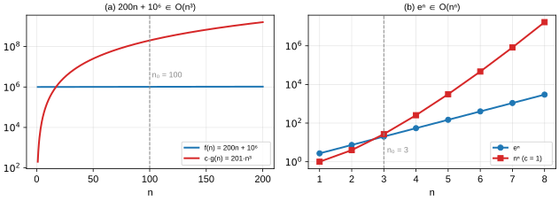

# Solutions to Exercise Sheet 8: Time Complexity

*Introduction to Computing for the Social Sciences · Prof. Dr. David Garcia*

> Solutions to [Exercise Sheet 8](../Exercise08.md). Each solution
> starts with where the material is in the slides and in the handout (the
> lecture transcript). Slide numbers count the title slide as 1 and refer to
> `Slides/08-TimeComplexity/ICSS-2026-08-TimeComplexity.qmd`.

---

## Exercise 1: Algorithmic complexity

**Where to look.** Slides 7 to 17 (*Recap: selection sort*, *Runtime analysis*, *Runtime analysis example: selection sort*) and 25 to 28 (*Complexity of BFS*). Handout: [08 §4 Runtime analysis](../../Transcripts/08-TimeComplexity.md#4-runtime-analysis), [08 §7 Graph algorithms: BFS](../../Transcripts/08-TimeComplexity.md#7-graph-algorithms-bfs), [07 §4 Iterative sorting](../../Transcripts/07-SortingAlgorithms.md#4-iterative-sorting).

a) Repeated minimum search is

```
Procedure REPEATED-MINIMUM-SEARCH(A, n)
Inputs:
      A: an array of n elements
Result: a new array B with the elements of A in nondecreasing order
For i = 1 to n:
      find the position m of the smallest element of A
      B[i] ← A[m]
      remove A[m] from A
return B
```

The outer loop runs $n$ times. In iteration $i$ the array still holds
$n - i + 1$ elements, so finding the minimum costs $n - i$ comparisons, and
removing the element from an array shifts the elements behind it, up to
$n - i$ moves. Adding the comparisons over all iterations gives
$(n-1) + (n-2) + \dots + 1 + 0 = n(n-1)/2$, and the same order for the moves.
So the running time is $\mathbf{O(n^2)}$: the two nested passes over the data
are what produce the square, and it is the same on every input because the
loops never stop early.

b) Bellman-Ford (sheet 5, exercise 3) initializes every vertex (lines 2 to 4),
which costs $O(|V|)$, and then runs the loop of line 6 exactly $|V| - 1$
times; each of those iterations runs the loop of line 7 over **every** edge,
doing a constant amount of work (one comparison and at most two assignments)
per edge. The nested loops therefore cost $(|V| - 1) \cdot |E|$ operations,
and the total is $\mathbf{O(|V| \cdot |E|)}$; the initialization is dominated.
Compare BFS, which is $O(|V| + |E|)$ because it looks at each edge once: the
price of allowing negative weights is a full extra factor of $|V|$.

## Exercise 2: A complexity example

**Where to look.** Slides 13 to 17 and 30 to 40 (*O-notation*, *Asymptotic behavior of functions*, *Upper bound: O*, *O-notation: general rules*, *Common use of O-notation*). Handout: [08 §4 Runtime analysis](../../Transcripts/08-TimeComplexity.md#4-runtime-analysis), [08 §8 Asymptotic behavior and O-notation](../../Transcripts/08-TimeComplexity.md#8-asymptotic-behavior-and-o-notation), [08 §9 Using O-notation](../../Transcripts/08-TimeComplexity.md#9-using-o-notation).

a)
```
Procedure K-SMALLEST-ELEMENT(L, k)
Inputs:
      L: a list of N comparable elements
      k: an integer with 1 ≤ k ≤ N
Result: the k-th smallest element of L
For t = 1 to k:
      m ← 1
      For j = 2 to length(L):
            If L[j] < L[m]
                  then m ← j
      smallest ← L[m]
      If t < k
            then remove L[m] from L
return smallest
```

Each pass finds the current minimum and removes it, so after $k - 1$ removals
the minimum of what is left is the $k$-th smallest element of the original
list.

b) **Yes.** With $k = 1$ the outer loop runs once and the inner loop makes
$N - 1$ comparisons, so the running time is $f(N) = N - 1 + c'$ for some
constant $c'$ of bookkeeping. By definition, $f \in O(N^2)$ if there are
constants $c > 0$ and $n_0$ such that $f(N) \le c N^2$ for all $N \ge n_0$.
Take $c = 1$ and $n_0 = c' + 2$: for all $N \ge n_0$ we have $c' \le N - 2$,
so $N - 1 + c' \le 2N - 3 \le 2N \le N^2$ (the last step because $N \ge 2$).
So $f(N) \in O(N^2)$. The point is that $O$ gives an **upper** bound,
not a tight one: $f(N)$ is also in $O(N)$, and $O(N)$ is the tight bound
($f \in \Theta(N)$), but membership in $O(N^2)$ is a true statement. Answering
"no, it is $O(N)$" confuses $O$ with $\Theta$.

c) With $k$ growing like $\sqrt{N}$ the algorithm costs about $k \cdot N =
N^{1.5}$ comparisons, which grows faster than $N \log N$. So sort the list
once, with mergesort in $O(N \log N)$, and read off the element at position
$k$ in constant time: the total $O(N \log N)$ beats $N^{1.5}$ for large $N$,
and every further query about any position costs nothing more. A leaner
alternative is to scan the list once keeping the $k$ smallest elements seen so
far in a max-heap of size $k$, which costs $O(N \log k)$ time and only $O(k)$
memory; and Quickselect (session 7) finds the $k$-th smallest in $O(N)$ on
average without sorting at all. The rationale in every case is the same:
$k$ searches each pay the full price of a pass over the data, whereas one
organized pass, or one sort, pays it once.

## Exercise 3: O-notation

**Where to look.** Slides 30 to 40. Handout: [08 §8 Asymptotic behavior and O-notation](../../Transcripts/08-TimeComplexity.md#8-asymptotic-behavior-and-o-notation), [08 §9 Using O-notation](../../Transcripts/08-TimeComplexity.md#9-using-o-notation).

a) **Yes.** We need $c$ and $n_0$ with $200n + 1\,000\,000 \le c\,n^3$ for all
$n \ge n_0$. For $n \ge 100$ we have $n^3 \ge 1\,000\,000$, so the constant
term is at most $n^3$, and $200n \le 200n^3$ for every $n \ge 1$. Hence
$200n + 1\,000\,000 \le 200n^3 + n^3 = 201\,n^3$ for all $n \ge 100$: the
definition holds with $c = 201$ and $n_0 = 100$. The bound is valid although
very loose; the tight statement is $f \in \Theta(n)$.

b) **Yes.** For $n \ge 3$ we have $e < 3 \le n$, so $e^n \le n^n$. The
definition holds with $c = 1$ and $n_0 = 3$ (or with $c = 3$ and $n_0 = 1$,
since $e^1 \le 3 \cdot 1$ and $e^2 \approx 7.4 \le 3 \cdot 4$). Note that
$n^n$ grows much faster than $e^n$, since their ratio $(n/e)^n$ goes to
infinity, so $e^n \in O(n^n)$ is true but far from tight; the reverse,
$n^n \in O(e^n)$, is false.



## Additional practice

### A1. From code to complexity

**Where to look.** Slides 13 to 17 and 36 to 40. Handout: [08 §4 Runtime analysis](../../Transcripts/08-TimeComplexity.md#4-runtime-analysis), [08 §9 Using O-notation](../../Transcripts/08-TimeComplexity.md#9-using-o-notation).

a) $O(n)$: one pass, constant work per element.
b) $O(n^2)$: nested loops, each over $n$ elements.
c) $O(n^2)$: the outer loop is $n$ and `x in list` is a linear scan, $O(n)$.
d) $O(n)$: `x in set` is a hash lookup, $O(1)$ on average. Same code, one
word changed, one order of magnitude in $n$.
e) $O(\log n)$: halving $n$ until it reaches 1 takes $\log_2 n$ steps.

### A2. Formal proofs

**Where to look.** Slides 32 to 36 (*O-Notation*, *Upper bound*, *Lower bound*, *Exact bound*). Handout: [08 §8 Asymptotic behavior and O-notation](../../Transcripts/08-TimeComplexity.md#8-asymptotic-behavior-and-o-notation).

a) **True.** For $n \ge 1$: $3n^2 + 5n + 2 \le 3n^2 + 5n^2 + 2n^2 = 10n^2$.
Take $c = 10$, $n_0 = 1$.
b) **False.** Suppose $n^3 \le c n^2$ for all $n \ge n_0$. Dividing by $n^2$
gives $n \le c$, which fails for $n > c$. No constant works.
c) **True.** $\log n \le n$ for $n \ge 1$, so $n \log n \le n^2$. Take $c = 1$,
$n_0 = 1$.
d) **True.** $2^{n+1} = 2 \cdot 2^n$, so take $c = 2$, $n_0 = 1$. A constant
offset in the exponent is just a constant factor.
e) **False.** $2^{2n} = (2^n)^2$, and $(2^n)^2 \le c\,2^n$ would require
$2^n \le c$, which fails for large $n$. A constant multiplier in the exponent
is not a constant factor.

Compare (d) and (e) carefully; the difference trips people up in exams.

### A3. Best, average, worst

**Where to look.** Slides 18 to 22 (*Average, best and worst running time*, *Insertion sort*). Handout: [08 §5 Best, average and worst case](../../Transcripts/08-TimeComplexity.md#5-best-average-and-worst-case).

| | best | average | worst | worst-case input |
|---|---|---|---|---|
| a) linear search | $O(1)$ | $O(n)$ | $O(n)$ | target absent or last |
| b) binary search | $O(1)$ | $O(\log n)$ | $O(\log n)$ | target absent |
| c) insertion sort | $O(n)$ | $O(n^2)$ | $O(n^2)$ | reverse-sorted |
| d) selection sort | $O(n^2)$ | $O(n^2)$ | $O(n^2)$ | any; no best case |
| e) quicksort | $O(n\log n)$ | $O(n\log n)$ | $O(n^2)$ | already sorted |

The best case for (a) and (b) is finding the target immediately. The
interesting rows are (c) against (d), the same asymptotic worst case and
completely different behavior on nearly sorted data, and (e), whose worst case
is triggered by the most ordinary input imaginable.

### A4. Recurrences

**Where to look.** Slides 23 to 24 (*Another example: complexity of mergesort*). Handout: [08 §6 Recursive algorithms: mergesort](../../Transcripts/08-TimeComplexity.md#6-recursive-algorithms-mergesort).

a) Each step removes a constant and halves $n$; after $\log_2 n$ steps we reach
the base case. $T(n) = c\log_2 n + c = O(\log n)$.
b) Each of the $\log_2 n$ levels does $cn$ work in total:
$T(n) = cn\log_2 n + cn = O(n\log n)$.
c) $T(n) = cn + c(n-1) + \dots + c = c \cdot n(n+1)/2 = O(n^2)$.
d) The number of calls doubles at each level and there are $n$ levels:
$T(n) = c(2^n - 1) = O(2^n)$.

Note the pattern: **halving** the problem gives logarithmic factors,
**removing one element** gives linear factors, and **doubling the calls** gives
exponentials.

### A5. Reasoning about real code

**Where to look.** Slides 9 to 12 (*Complexity*, *A more general meaning of complexity*). Handout: [08 §3 Why it matters: some numbers](../../Transcripts/08-TimeComplexity.md#3-why-it-matters-some-numbers).

a) $100 \times 3$ min = 5 hours.
b) $100^2 \times 3$ min = 30 000 min, about **21 days**.
c) Doubling $n$ multiplies the time by 4, which is $O(n^2)$. From 10 000 rows
(3 min) to 1 000 000 rows is a factor of 100 in $n$, so $100^2 = 10\,000$ in
time: about **21 days**, matching (b).
d) It would bring 21 days down to 2 days, still unusable, and it costs money
every time you run it. Finding the quadratic step and making it linear brings
it to minutes, once, for free. This is exactly the point of the two tables in
the lecture: fix the algorithm before you buy the machine.

### A6. Complexity of the algorithms in this course

**Where to look.** The whole session; handout: [08 §10 Why this matters for us](../../Transcripts/08-TimeComplexity.md#10-why-this-matters-for-us).

| Algorithm | Time complexity |
|---|---|
| Binary search | $O(\log n)$ |
| Search in a balanced BST | $O(\log n)$, but $O(n)$ if unbalanced |
| Search in a hash table | $O(1)$ average, $O(n)$ worst |
| BFS | $O(\|V\| + \|E\|)$ |
| DFS | $O(\|V\| + \|E\|)$ |
| Naive recursive Fibonacci | $O(2^n)$ (more precisely $O(1.618^n)$) |
| Memoized Fibonacci | $O(n)$ |
| Selection sort | $O(n^2)$ in all cases |
| Mergesort | $O(n\log n)$ in all cases |
| Quicksort | $O(n\log n)$ average, $O(n^2)$ worst |
| Heapsort | $O(n\log n)$ in all cases |

### A7. Memory complexity

**Where to look.** Slides 9 to 12. Handout: [08 §2 Three kinds of complexity](../../Transcripts/08-TimeComplexity.md#2-three-kinds-of-complexity).

a) Mergesort $O(n)$: it needs the temporary arrays $B$ and $C$. Quicksort
$O(\log n)$: only the recursion stack, if implemented in place. Heapsort
$O(1)$: fully in place.
b) $O(n)$, because the memo array holds $n$ entries. You can do better: since
`fib(i)` only needs the previous two values, keep two variables and the memory
drops to $O(1)$ while the time stays $O(n)$. A good illustration that
memoization is a means, not the goal.
c) **Mergesort**, in its external form: sort chunks that fit in RAM, write each
sorted run to disk, then merge the runs in a streaming pass that only holds
one element per run in memory. This is why database systems and Unix `sort`
use mergesort; quicksort's random access pattern is disastrous on disk.
