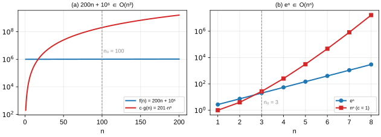

# Solutions to Exercise Sheet 8: Time Complexity

*Introduction to Computing for the Social Sciences · Prof. Dr. David Garcia*

---

## Exercise 1: Algorithmic complexity

a) Repeated minimum search is

```
Procedure REPEATED-MINIMUM-SEARCH(A, n)
Inputs:
      A: an array of n elements
Result: a new array B with the elements of A in nondecreasing order
For i = 1 to n:
      find the position m of the smallest element of A
      B[i] ← A[m]
      remove A[m] from A
return B
```

The outer loop runs $n$ times. In iteration $i$ the array still holds
$n - i + 1$ elements, so finding the minimum costs $n - i$ comparisons.
Removing the element from an array shifts the elements behind it, which takes
up to $n - i$ moves. Adding the comparisons over all iterations gives
$(n-1) + (n-2) + \dots + 1 + 0 = n(n-1)/2$ and the moves are of the same
order. The running time is therefore $\mathbf{O(n^2)}$, because there are two
nested passes over the data. It is the same on every input because the loops
never stop early.

b) Bellman-Ford (exercise 3 of the Algorithms sheet) initializes every vertex
(lines 2 to 4), which costs $O(|V|)$. Then it runs the loop of line 6 exactly
$|V| - 1$ times. Each of those iterations runs the loop of line 7 over
**every** edge and does a constant amount of work per edge, namely one
comparison and at most two assignments. The nested loops therefore cost
$(|V| - 1) \cdot |E|$ operations and the total is
$\mathbf{O(|V| \cdot |E|)}$, because the initialization is dominated. In
comparison, BFS is $O(|V| + |E|)$ because it looks at each edge once, so
allowing negative weights costs an extra factor of $|V|$.

## Exercise 2: A complexity example

a)
```
Procedure K-SMALLEST-ELEMENT(L, k)
Inputs:
      L: a list of N comparable elements
      k: an integer with 1 ≤ k ≤ N
Result: the k-th smallest element of L
For t = 1 to k:
      m ← 1
      For j = 2 to length(L):
            If L[j] < L[m]
                  then m ← j
      smallest ← L[m]
      If t < k
            then remove L[m] from L
return smallest
```

Each pass finds the current minimum and removes it, so after $k - 1$ removals
the minimum of what is left is the $k$-th smallest element of the original
list.

b) **Yes.** With $k = 1$ the outer loop runs once and the inner loop makes
$N - 1$ comparisons, so the running time is $f(N) = N - 1 + c'$ for some
constant $c'$ of bookkeeping. By definition, $f \in O(N^2)$ if there are
constants $c > 0$ and $n_0$ such that $f(N) \le c N^2$ for all $N \ge n_0$.
Take $c = 1$ and $n_0 = c' + 2$. Then for all $N \ge n_0$ we have
$c' \le N - 2$, so $N - 1 + c' \le 2N - 3 \le 2N \le N^2$, where the last
step holds because $N \ge 2$. Therefore $f(N) \in O(N^2)$. $O$ gives an
**upper** bound that does not have to be tight. $f(N)$ is also in $O(N)$ and
$O(N)$ is the tight bound ($f \in \Theta(N)$), but membership in $O(N^2)$ is
still a true statement. Answering "no, it is $O(N)$" confuses $O$ with
$\Theta$.

c) With $k$ growing like $\sqrt{N}$ the algorithm costs about $k \cdot N =
N^{1.5}$ comparisons, which grows faster than $N \log N$. We can therefore
sort the list once with mergesort in $O(N \log N)$ and read the element at
position $k$ in constant time. The total of $O(N \log N)$ is lower than
$N^{1.5}$ for large $N$ and every further query about any position costs
nothing more. An alternative that needs less memory is to scan the list once
while keeping the $k$ smallest elements seen so far in a max-heap of size $k$,
which costs $O(N \log k)$ time and only $O(k)$ memory. Quickselect (the
Sorting Algorithms session) finds the $k$-th smallest element in $O(N)$ on
average without sorting at all. The rationale is the same in every case,
because each of the $k$ searches costs a full pass over the data while one
organized pass or one sort costs it only once.

## Exercise 3: O-notation

a) **Yes.** We need $c$ and $n_0$ with $200n + 1{,}000{,}000 \le c\,n^3$ for all
$n \ge n_0$. For $n \ge 100$ we have $n^3 \ge 1{,}000{,}000$, so the constant
term is at most $n^3$, and $200n \le 200n^3$ for every $n \ge 1$. Hence
$200n + 1{,}000{,}000 \le 200n^3 + n^3 = 201\,n^3$ for all $n \ge 100$, so the
definition holds with $c = 201$ and $n_0 = 100$. The bound is valid although
it is very loose, and the tight statement is $f \in \Theta(n)$.

b) **Yes.** For $n \ge 3$ we have $e < 3 \le n$, so $e^n \le n^n$. The
definition holds with $c = 1$ and $n_0 = 3$ (or with $c = 3$ and $n_0 = 1$,
since $e^1 \le 3 \cdot 1$ and $e^2 \approx 7.4 \le 3 \cdot 4$). Note that
$n^n$ grows much faster than $e^n$, since their ratio $(n/e)^n$ goes to
infinity. Therefore $e^n \in O(n^n)$ is true but far from tight, while the
reverse claim $n^n \in O(e^n)$ is false.



## Additional practice

### A1. From code to complexity

a) $O(n)$, because there is one pass with constant work per element.
b) $O(n^2)$, because there are two nested loops, each over $n$ elements.
c) $O(n^2)$, because the outer loop runs $n$ times and `x in list` is a linear
scan of $O(n)$.
d) $O(n)$, because `x in set` is a hash lookup of $O(1)$ on average. The code
is the same as in (c) with one word changed, and the complexity drops by a
factor of $n$.
e) $O(\log n)$, because halving $n$ until it reaches 1 takes $\log_2 n$ steps.

### A2. Formal proofs

a) **True.** For $n \ge 1$ we have $3n^2 + 5n + 2 \le 3n^2 + 5n^2 + 2n^2 = 10n^2$,
so we can take $c = 10$ and $n_0 = 1$.
b) **False.** Suppose $n^3 \le c n^2$ for all $n \ge n_0$. Dividing by $n^2$
gives $n \le c$, which fails for $n > c$, so no constant works.
c) **True.** $\log n \le n$ for $n \ge 1$, so $n \log n \le n^2$ and we can
take $c = 1$ and $n_0 = 1$.
d) **True.** $2^{n+1} = 2 \cdot 2^n$, so we can take $c = 2$ and $n_0 = 1$. A
constant offset in the exponent is just a constant factor.
e) **False.** $2^{2n} = (2^n)^2$, and $(2^n)^2 \le c\,2^n$ would require
$2^n \le c$, which fails for large $n$. A constant multiplier in the exponent
is not a constant factor.

Compare (d) and (e) carefully, because they look similar but have opposite answers.

### A3. Best, average, worst

| | best | average | worst | worst-case input |
|---|---|---|---|---|
| a) linear search | $O(1)$ | $O(n)$ | $O(n)$ | target absent or last |
| b) binary search | $O(1)$ | $O(\log n)$ | $O(\log n)$ | target absent |
| c) insertion sort | $O(n)$ | $O(n^2)$ | $O(n^2)$ | reverse-sorted |
| d) selection sort | $O(n^2)$ | $O(n^2)$ | $O(n^2)$ | any input (no best case) |
| e) quicksort | $O(n\log n)$ | $O(n\log n)$ | $O(n^2)$ | already sorted |

The best case for (a) and (b) is finding the target immediately. Compare rows
(c) and (d), which have the same asymptotic worst case but behave very
differently on nearly sorted data. Note also that the worst case of (e) is
triggered by a very common input, namely an already sorted list.

### A4. Recurrences

a) Each step costs a constant and halves $n$, so after $\log_2 n$ steps we reach
the base case and $T(n) = c\log_2 n + c = O(\log n)$.
b) Each of the $\log_2 n$ levels does $cn$ work in total, so
$T(n) = cn\log_2 n + cn = O(n\log n)$.
c) $T(n) = cn + c(n-1) + \dots + c = c \cdot n(n+1)/2 = O(n^2)$.
d) The number of calls doubles at each level and there are $n$ levels, so
$T(n) = c(2^n - 1) = O(2^n)$.

Note the pattern in these results. **Halving** the problem gives logarithmic
factors, **removing one element** gives linear factors, and **doubling the
calls** gives exponentials.

### A5. Reasoning about real code

a) $100 \times 3$ min = 5 hours.
b) $100^2 \times 3$ min = 30,000 min, which is about **21 days**.
c) Doubling $n$ multiplies the time by 4, which is $O(n^2)$. Going from 10,000
rows (3 min) to 1,000,000 rows is a factor of 100 in $n$ and therefore a
factor of $100^2 = 10{,}000$ in time, which is about **21 days** as in (b).
d) It would bring 21 days down to 2 days, which is still unusable, and it
costs money every time you run it. Finding the quadratic step and making it
linear brings the runtime down to minutes and you only have to do it once.
The two tables of running times for selection sort and mergesort show the
same thing, so fix the algorithm before you buy the machine.

### A6. Complexity of the algorithms in this course

| Algorithm | Time complexity |
|---|---|
| Binary search | $O(\log n)$ |
| Search in a balanced BST | $O(\log n)$, but $O(n)$ if unbalanced |
| Search in a hash table | $O(1)$ average, $O(n)$ worst |
| BFS | $O(\|V\| + \|E\|)$ |
| DFS | $O(\|V\| + \|E\|)$ |
| Naive recursive Fibonacci | $O(2^n)$ (more precisely $O(1.618^n)$) |
| Memoized Fibonacci | $O(n)$ |
| Selection sort | $O(n^2)$ in all cases |
| Mergesort | $O(n\log n)$ in all cases |
| Quicksort | $O(n\log n)$ average, $O(n^2)$ worst |
| Heapsort | $O(n\log n)$ in all cases |
