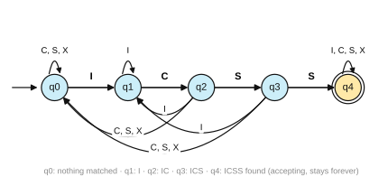
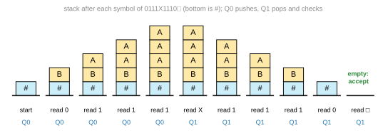

# Solutions to Exercise Sheet 9: Theoretical Computer Science

*Introduction to Computing for the Social Sciences · Prof. Dr. David Garcia*

> Solutions to [Exercise Sheet 9](../Exercise09.md). Each solution
> starts with where the material is in the slides and in the handout (the
> lecture transcript). Slide numbers count the title slide as 1 and refer to
> `Slides/09-TheoreticalCS/ICSS-2026-09-TheoreticalCS.qmd`.

---

## Exercise 1: Finite-State Automata

**Where to look.** Slides 10 to 22 (*Finite-state automaton*, the two worked examples, *Nondeterministic finite-state automata*) and 33 (*Pac-Man ghosts DFA*). Handout: [09 §2 Finite-state automata](../../Transcripts/09-TheoreticalCS.md#2-finite-state-automata), [09 §3 Nondeterministic automata](../../Transcripts/09-TheoreticalCS.md#3-nondeterministic-automata).

a) Reading the diagram:

- $Q = \{Q_0, Q_1, Q_2, Q_3, Q_4\}$, the set of states.
- $\Sigma = \{a, b, c\}$, the input alphabet, the symbols on the arrows.
- $\delta$, the transition function, given by the arrows:

  | $\delta$ | $a$ | $b$ | $c$ |
  |---|---|---|---|
  | $Q_0$ | – | – | $Q_1$ |
  | $Q_1$ | $Q_2$ | $Q_3$ | – |
  | $Q_2$ | $Q_2$ | – | $Q_4$ |
  | $Q_3$ | – | $Q_3$ | $Q_4$ |
  | $Q_4$ | – | – | – |

  A dash means that there is no arrow; an input that needs one is rejected.
- $q_0 = Q_0$, the start state, marked by the arrow coming from nowhere.
- $X = \{Q_4\}$, the set of accepting states, drawn with a double circle.

b) i) `caaac`: $Q_0 \xrightarrow{c} Q_1 \xrightarrow{a} Q_2 \xrightarrow{a} Q_2
\xrightarrow{a} Q_2 \xrightarrow{c} Q_4$. The input ends in the accepting state
$Q_4$, so it is **accepted**.
ii) `cbbbbbbc`: $Q_0 \xrightarrow{c} Q_1 \xrightarrow{b} Q_3 \xrightarrow{b}
Q_3 \xrightarrow{b} Q_3 \xrightarrow{b} Q_3 \xrightarrow{b} Q_3 \xrightarrow{b}
Q_3 \xrightarrow{c} Q_4$. **Accepted.**

c) Strings that start with `c`, continue with one or more `a`s or one or more
`b`s (all the same letter), and end with `c`:
$L = \{c\,a^n\,c \mid n \ge 1\} \cup \{c\,b^n\,c \mid n \ge 1\}$. The second
symbol decides the branch and it cannot be changed afterwards; `cc`, `cabc`
and `caa` are rejected.

d) No, it is **deterministic**: every state has at most one arrow per symbol
and there are no $\varepsilon$-transitions. It is not *complete*, since some
state and symbol pairs have no arrow, but a missing arrow only means that the
input is rejected on the spot (or, equivalently, goes to a trap state that is
not drawn). Incomplete is not the same as nondeterministic.

e) The automaton has to remember one thing: how much of `ICSS` it has matched
so far. Five states suffice, one per length of the matched prefix.

| state | meaning | `I` | `C` | `S` | `X` |
|---|---|---|---|---|---|
| $q_0$ | nothing matched | $q_1$ | $q_0$ | $q_0$ | $q_0$ |
| $q_1$ | matched `I` | $q_1$ | $q_2$ | $q_0$ | $q_0$ |
| $q_2$ | matched `IC` | $q_1$ | $q_0$ | $q_3$ | $q_0$ |
| $q_3$ | matched `ICS` | $q_1$ | $q_0$ | $q_4$ | $q_0$ |
| $q_4$ | found `ICSS`, accepting | $q_4$ | $q_4$ | $q_4$ | $q_4$ |



Start $q_0$, accept $\{q_4\}$. Once `ICSS` has appeared it cannot disappear,
so $q_4$ loops on every symbol. The arrows on `I` back to $q_1$ are the ones
most often forgotten: after `II` or `ICI` the last `I` is again a matched
first symbol.

## Exercise 2: Push-Down Automata

**Where to look.** Slides 23 to 32 (*Formal languages and grammars*, *Grammar*, *Grammar ≡ automaton*, *Formal languages*, *Regular languages*) and 40 (*The problem with DFA and the Chomsky hierarchy*). Handout: [09 §4 Formal languages and grammars](../../Transcripts/09-TheoreticalCS.md#4-formal-languages-and-grammars), [09 §5 Regular languages](../../Transcripts/09-TheoreticalCS.md#5-regular-languages), [09 §6 Turing machines](../../Transcripts/09-TheoreticalCS.md#6-turing-machines) (the hierarchy).

a) The stack is written bottom to top, starting with `#`.

| read | state after | stack after | rule used |
|---|---|---|---|
| – | $Q_0$ | `#` | start |
| `0` | $Q_0$ | `#B` | 0 in $Q_0$: push B |
| `1` | $Q_0$ | `#BA` | 1 in $Q_0$: push A |
| `1` | $Q_0$ | `#BAA` | push A |
| `1` | $Q_0$ | `#BAAA` | push A |
| `X` | $Q_1$ | `#BAAA` | X: switch phase |
| `1` | $Q_1$ | `#BAA` | 1 with A on top: pop |
| `1` | $Q_1$ | `#BA` | pop |
| `1` | $Q_1$ | `#B` | pop |
| `0` | $Q_1$ | `#` | 0 with B on top: pop |
| `□` | $Q_1$ | (empty) | □ with # on top: pop |



`#` is popped when `□` is read, so the input is **accepted**.

b) Before the `X` the automaton pushes one symbol per input symbol (`A` for
`1`, `B` for `0`), so the stack holds the first half in reverse order. After
the `X` each input symbol must match the stack top (`1` finds `A`, `0` finds
`B`) and pops it. The stack empties exactly when the second half is the first
half read backwards:
$$L = \{\, w\,X\,w^R \mid w \in \{0,1\}^* \,\},$$
for example `X`, `1X1`, `01X10`, `0111X1110`. A mismatch, a second `X` or
a wrong length leads to the dead state $Q_D$.

c) $N = \{S\}$, $\Sigma = \{0, 1, X\}$, start symbol $S$, productions
$$S \to 0\,S\,0 \quad\mid\quad 1\,S\,1 \quad\mid\quad X .$$
The first two rules add one symbol on each side of $S$, so the string grows
symmetrically, and the last one puts the `X` in the middle. It is **type 2
(context-free)**, since every left-hand side is a single non-terminal, and
**not type 3**: a regular grammar only allows $A \to aB$ and $A \to a$, with
the non-terminal at one end, and no regular grammar generates this language.
A finite automaton would have to remember an arbitrarily long $w$ to check
the mirror image, which needs unbounded memory; the stack is that memory,
and it is what the step from type 3 to type 2 buys.

## Exercise 3: Turing Machines

**Where to look.** Slides 41 to 56 (*Turing machines*, *Formalization*, *Functioning of Turing machines*, *Turing machine example: checking parentheses*, *Tape trace example*). Handout: [09 §6 Turing machines](../../Transcripts/09-TheoreticalCS.md#6-turing-machines).

The machine is Sipser's example that recognizes strings of `0`s whose length
is a power of two. Each configuration is written as the tape, the position of
the head and the state.

a) `0000`:

| step | tape | head | state | action |
|---|---|---|---|---|
| 0 | `0000␣` | 1 | $q_1$ | read `0`, write `␣`, move R |
| 1 | `␣000␣` | 2 | $q_2$ | read `0`, write `x`, move R |
| 2 | `␣x00␣` | 3 | $q_3$ | read `0`, move R (this 0 is skipped) |
| 3 | `␣x00␣` | 4 | $q_4$ | read `0`, write `x`, move R |
| 4 | `␣x0x␣` | 5 | $q_3$ | read `␣`, move L |
| 5 to 8 | `␣x0x␣` | 4 → 1 | $q_5$ | walk left over `x`, `0`, `x` to the first `␣` |
| 9 | `␣x0x␣` | 2 | $q_2$ | read `x`, move R |
| 10 | `␣x0x␣` | 3 | $q_2$ | read `0`, write `x`, move R |
| 11 | `␣xxx␣` | 4 | $q_3$ | read `x`, move R |
| 12 | `␣xxx␣` | 5 | $q_3$ | read `␣`, move L |
| 13 to 16 | `␣xxx␣` | 4 → 1 | $q_5$ | walk left to the first `␣` |
| 17 to 20 | `␣xxx␣` | 2 → 5 | $q_2$ | skip the three `x` |
| 21 | `␣xxx␣` | 5 | $q_{accept}$ | read `␣` in $q_2$: **accept** |

b) `000`:

| step | tape | head | state | action |
|---|---|---|---|---|
| 0 | `000␣` | 1 | $q_1$ | read `0`, write `␣`, move R |
| 1 | `␣00␣` | 2 | $q_2$ | read `0`, write `x`, move R |
| 2 | `␣x0␣` | 3 | $q_3$ | read `0`, move R (skipped) |
| 3 | `␣x0␣` | 4 | $q_4$ | read `␣`: **reject** |

Reaching a blank in $q_4$ means that an odd number of unmarked `0`s was left,
so the count could not be halved evenly.

c) The strings of `0`s whose length is a power of two:
$$L = \{\, 0^{2^n} \mid n \ge 0 \,\} = \{\texttt{0}, \texttt{00}, \texttt{0000}, \texttt{00000000}, \ldots\}.$$
Every sweep from left to right crosses off every second remaining `0`,
alternating between $q_3$ and $q_4$. A sweep that finds an odd number of
unmarked `0`s ends in $q_4$ on the blank and rejects; a sweep that finds a
single one ($q_2$ reads only `x`s, then the blank) accepts. A number can be
halved down to 1 without remainder exactly when it is a power of two. The
language is neither regular nor context-free: the halving rereads and
rewrites the tape many times, which neither a finite automaton nor one stack
can do.

## Exercise 4: Computability

**Where to look.** Slides 69 to 81 (*Complexity classes*, *Problem complexity and decision problems*, *The P class*, *Problem verifiers*, *The NP class*, *NP problem example: Hamiltonian path*, *P vs NP*, *Reducing problems*, *NP-complete problems*, *SAT*). Handout: [09 §9 Complexity classes](../../Transcripts/09-TheoreticalCS.md#9-complexity-classes).

a) A verifier is given the candidate clique and only has to check it:

```
Procedure VERIFY-CLIQUE(G, k, c)
Inputs:
      G = (V, E): a graph
      k: the size of the clique looked for
      c: a candidate set of vertices
Result: TRUE if c is a k-clique of G, FALSE otherwise
If |c| ≠ k
      then return FALSE
For each vertex v in c:
      If v ∉ V
            then return FALSE
For each pair of distinct vertices u, v in c:
      If {u, v} ∉ E
            then return FALSE
return TRUE
```

On the graph of the figure with $k = 5$ and $c = \{B, C, D, F, G\}$ it checks
the ten pairs, all of which are edges, and returns TRUE; with $c = \{A, B, C,
D, E\}$ it fails at the first missing edge, $\{A, C\}$.

b) The verifier checks $\binom{k}{2} = k(k-1)/2$ pairs in constant time each,
so it runs in $O(k^2)$, polynomial in the input since $k \le |V|$. A problem
whose "yes" instances have a certificate checkable in polynomial time is by
definition in **NP**, so CLIQUE $\in$ NP. This says nothing about **P**:
finding a clique is a different problem from checking one, and the obvious
search tries all $\binom{|V|}{k}$ subsets. CLIQUE is in fact NP-complete, but
that needs a reduction from a known NP-complete problem such as SAT, which
the verifier does not provide.

c) i) **Satisfiable.** One witness suffices: $x_1 = \text{F}$, $x_3 = \text{F}$,
$x_6 = \text{T}$, the rest arbitrary. The three clauses are true through
$\bar{x}_1$, $\bar{x}_3$ and $x_6$. One assignment is a complete proof, far
cheaper than a truth table with $2^6 = 64$ rows.

ii) **Unsatisfiable.** $\bar{x}_1$ forces $x_1 = \text{F}$; then
$(x_1 \vee x_2)$ forces $x_2 = \text{T}$ and $(x_1 \vee \bar{x}_2)$ forces
$x_2 = \text{F}$, which cannot both hold. Note the asymmetry: satisfiability
needs one witness, unsatisfiability needs an argument that rules out every
assignment.

## Additional practice

### A1. Building automata

**Where to look.** Slides 10 to 20. Handout: [09 §2 Finite-state automata](../../Transcripts/09-TheoreticalCS.md#2-finite-state-automata).

a) **2 states.** $q_0$ (the last symbol was 1, or nothing was read) and $q_1$
(the last symbol was 0, accepting). On `0` go to $q_1$, on `1` go to $q_0$.
b) **2 states.** Even (accepting) and odd. Reading `1` flips, reading `0` stays.
c) **4 states**, tracking how much of `101` has been matched: nothing, `1`,
`10`, `101` (accepting, and it stays there forever). Careful with the
backtracking: from state `10`, reading `0` returns to "nothing", but reading
`1` goes to `101`; from state `1`, reading `1` stays in `1`.
d) **3 states**, one per remainder 0, 1, 2. Reading a bit $b$ takes remainder
$r$ to $(2r + b) \bmod 3$. Accept in state 0. A lovely example of an automaton
doing arithmetic with only three states, because remainders modulo 3 are all
it needs to remember.

### A2. What automata cannot do

**Where to look.** Slide 40. Handout: [09 §4 Formal languages and grammars](../../Transcripts/09-TheoreticalCS.md#4-formal-languages-and-grammars), [09 §5 Regular languages](../../Transcripts/09-TheoreticalCS.md#5-regular-languages).

a) **Yes**, regular (type 3). One state suffices.
b) **No.** It requires counting $n$ without bound; a **push-down automaton**
(type 2, context-free) handles it with a stack.
c) **No**, not even a push-down automaton: after matching the $a$s against the
$b$s the stack is empty and the count is gone. It needs a **linear bounded
Turing machine** (type 1, context-sensitive).
d) **No** for a DFA, **yes** for a push-down automaton: push on `(`, pop on
`)`. This is exercise 2 of this sheet in another form, and also the Turing
machine example of the lecture.
e) **Yes**, two states alternating. Note the contrast with (b): "even length"
is one bit of memory, "$n$ then $n$" is unbounded memory.

### A3. Grammars

**Where to look.** Slides 24 to 30 (*Grammar*, *Grammar: example*, *Grammar: derivation example*, *Grammar ≡ automaton*). Handout: [09 §4 Formal languages and grammars](../../Transcripts/09-TheoreticalCS.md#4-formal-languages-and-grammars).

a) $S \Rightarrow aA \Rightarrow ab$. $S \Rightarrow aA \Rightarrow abS
\Rightarrow abaA \Rightarrow abab$. And once more: $ababab$.
b) Repetitions of `ab`: $L(G) = \{(ab)^n \mid n \ge 1\}$.
c) States $\{S, A, X\}$, start $S$, accept $X$. $\delta(S, a) = A$ (from
$S \rightarrow aA$); $\delta(A, b) = S$ (from $A \rightarrow bS$);
$\delta(A, b) = X$ (from $A \rightarrow b$). Note that $\delta(A, b)$ has two
targets, so the direct translation gives an **NFA**, which by Rabin and Scott
can be made deterministic.
d) Yes. Every rule has a single non-terminal on the left and a right-hand side
of the form $aB$ or $a$, exactly the type 3 restriction. Hence the language is
regular, consistent with (c).

### A4. Turing machines

**Where to look.** Slides 41 to 49. Handout: [09 §6 Turing machines](../../Transcripts/09-TheoreticalCS.md#6-turing-machines).

a) Two states, `Even` and `Odd`; start in `Even`; on reading `a` move right
and switch state; on reading `□` halt and accept if in `Even`. Note that it
never writes: a TM that never writes is exactly a DFA, which is why this
language is regular.
b) Move right to the end of the number. Then move left: while the symbol is
`1`, write `0` and keep moving left (that is the carry); when you reach a `0`,
write `1` and halt; if you reach the start with a carry still pending, write a
new leading `1`. This is binary addition as taught in session 2, mechanized.
c) Because a stack only gives last-in-first-out access: to look at the bottom
you must destroy everything above it. The tape of a TM allows arbitrary access
in both directions, so it can revisit and rewrite information. That is exactly
what lets it recognize $a^n b^n c^n$, which a PDA cannot.

### A5. Computability

**Where to look.** Slides 58 to 64 (*Computability*, *The Church-Turing thesis*, *The halting problem*, *Proof of non-computability*). Handout: [09 §7 Computability](../../Transcripts/09-TheoreticalCS.md#7-computability).

a) **Computable.** Syntax is decided by a parser in finite time; that is
exactly what a grammar is for (section 4 of the transcript).
b) **Not computable.** Reduce the halting problem to it: given a program $X$,
build $X'$ that runs $X$ and then prints "hello". $X'$ prints "hello" exactly
when $X$ halts, so a solver for (b) would solve the halting problem.
c) **Computable.** Just simulate it for 1000 steps and see. The bound is what
makes it decidable, an instance of the general principle that bounded versions
of undecidable problems are decidable (and often still expensive).
d) **Not computable.** Program equivalence is undecidable, again by reduction
from halting. This is why no compiler can perfectly verify an optimization in
general.

### A6. Complexity classes

**Where to look.** Slides 69 to 81. Handout: [09 §9 Complexity classes](../../Transcripts/09-TheoreticalCS.md#9-complexity-classes).

a) Not a decision problem as stated, but "is this list sorted?" and "can this
list be sorted with fewer than $k$ swaps?" are, and both are in **P**.
b) **P**: BFS or DFS in $O(|V| + |E|)$.
c) **NP-complete.** It is in NP (a candidate path is verified in polynomial
time) and every NP problem reduces to it.
d) **NP-hard.** It is an optimization problem, not a decision problem, so it is
not in NP as usually stated; its decision version ("is there a tour shorter
than $k$?") is NP-complete.
e) **NP-complete**: this is SAT, the original NP-complete problem (Cook-Levin).

The thing to be sure about: membership in NP needs a polynomial-time
verifier; NP-completeness needs, in addition, a reduction from a known
NP-complete problem.

### A7. Reductions

**Where to look.** Slides 78 to 81 (*Reducing problems*, *NP-complete problems*, *SAT*, *NP-hard problems*). Handout: [09 §9 Complexity classes](../../Transcripts/09-TheoreticalCS.md#9-complexity-classes).

a) Encode the question "does $G$ have a Hamiltonian path?" as a boolean
formula: variables $x_{v,i}$ meaning "vertex $v$ is in position $i$ of the
path", with clauses saying that each position holds exactly one vertex, that
each vertex appears exactly once, and that consecutive positions are joined by
an edge. The formula is satisfiable exactly when a Hamiltonian path exists.
This is a polynomial-time reduction from Hamiltonian path to SAT.
b) Since Hamiltonian path is NP-complete, **every** NP problem reduces to it
in polynomial time, so all of them would be solvable in polynomial time:
**P = NP**.
c) Reductions transfer difficulty in one direction. "A reduces to B" means
that B is at least as hard as A, so if A is known to be hard, B is hard. To
prove B easy you need an actual algorithm, not a reduction. This asymmetry is
why almost every hardness proof in the literature is a reduction, and why P
vs NP has stayed open: nobody has produced either the algorithm or the
impossibility proof.
