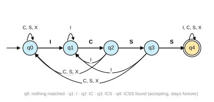
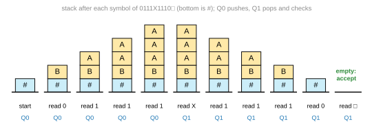

# Solutions to Exercise Sheet 9: Theoretical Computer Science

*Introduction to Computing for the Social Sciences · Prof. Dr. David Garcia*

---

## Exercise 1: Finite-State Automata

a) Reading the diagram:

- $Q = \{Q_0, Q_1, Q_2, Q_3, Q_4\}$, the set of states.
- $\Sigma = \{a, b, c\}$, the input alphabet, the symbols on the arrows.
- $\delta$, the transition function, given by the arrows:

  | $\delta$ | $a$ | $b$ | $c$ |
  |---|---|---|---|
  | $Q_0$ | – | – | $Q_1$ |
  | $Q_1$ | $Q_2$ | $Q_3$ | – |
  | $Q_2$ | $Q_2$ | – | $Q_4$ |
  | $Q_3$ | – | $Q_3$ | $Q_4$ |
  | $Q_4$ | – | – | – |

  A dash means that there is no arrow, and an input that needs one is rejected.
- $q_0 = Q_0$, the start state, marked by the arrow coming from nowhere.
- $X = \{Q_4\}$, the set of accepting states, drawn with a double circle.

b) i) `caaac`: $Q_0 \xrightarrow{c} Q_1 \xrightarrow{a} Q_2 \xrightarrow{a} Q_2
\xrightarrow{a} Q_2 \xrightarrow{c} Q_4$. The input ends in the accepting state
$Q_4$, so it is **accepted**.
ii) `cbbbbbbc`: $Q_0 \xrightarrow{c} Q_1 \xrightarrow{b} Q_3 \xrightarrow{b}
Q_3 \xrightarrow{b} Q_3 \xrightarrow{b} Q_3 \xrightarrow{b} Q_3 \xrightarrow{b}
Q_3 \xrightarrow{c} Q_4$. **Accepted.**

c) The language contains the strings that start with `c`, continue with one or
more `a`s or one or more `b`s (all the same letter), and end with `c`, i.e.
$L = \{c\,a^n\,c \mid n \ge 1\} \cup \{c\,b^n\,c \mid n \ge 1\}$. The second
symbol decides the branch and it cannot be changed afterwards, so for example
`cc`, `cabc` and `caa` are rejected.

d) No, it is **deterministic**, because every state has at most one arrow per
symbol and there are no $\varepsilon$-transitions. It is not *complete*, since
some state and symbol pairs have no arrow, but a missing arrow only means that
the input is rejected on the spot (or, equivalently, goes to a trap state that
is not drawn). An incomplete automaton can therefore still be deterministic.

e) The automaton only has to remember how much of `ICSS` it has matched so
far. Five states are enough, with one state per length of the matched prefix.

| state | meaning | `I` | `C` | `S` | `X` |
|---|---|---|---|---|---|
| $q_0$ | nothing matched | $q_1$ | $q_0$ | $q_0$ | $q_0$ |
| $q_1$ | matched `I` | $q_1$ | $q_2$ | $q_0$ | $q_0$ |
| $q_2$ | matched `IC` | $q_1$ | $q_0$ | $q_3$ | $q_0$ |
| $q_3$ | matched `ICS` | $q_1$ | $q_0$ | $q_4$ | $q_0$ |
| $q_4$ | found `ICSS`, accepting | $q_4$ | $q_4$ | $q_4$ | $q_4$ |



The start state is $q_0$ and the set of accept states is $\{q_4\}$. Once
`ICSS` has appeared it cannot disappear, so $q_4$ loops on every symbol. The
arrows on `I` back to $q_1$ are the ones most often forgotten. They are needed
because after `II` or `ICI` the last `I` is again a matched first symbol.

## Exercise 2: Push-Down Automata

a) The stack is written bottom to top, starting with `#`.

| read | state after | stack after | rule used |
|---|---|---|---|
| – | $Q_0$ | `#` | start |
| `0` | $Q_0$ | `#B` | 0 in $Q_0$: push B |
| `1` | $Q_0$ | `#BA` | 1 in $Q_0$: push A |
| `1` | $Q_0$ | `#BAA` | push A |
| `1` | $Q_0$ | `#BAAA` | push A |
| `X` | $Q_1$ | `#BAAA` | X: switch phase |
| `1` | $Q_1$ | `#BAA` | 1 with A on top: pop |
| `1` | $Q_1$ | `#BA` | pop |
| `1` | $Q_1$ | `#B` | pop |
| `0` | $Q_1$ | `#` | 0 with B on top: pop |
| `□` | $Q_1$ | (empty) | □ with # on top: pop |



`#` is popped when `□` is read, so the input is **accepted**.

b) Before the `X` the automaton pushes one symbol per input symbol (`A` for
`1`, `B` for `0`), so the stack holds the first half in reverse order. After
the `X` each input symbol must match the stack top (`1` finds `A`, `0` finds
`B`) and pops it. The stack empties exactly when the second half is the first
half read backwards:
$$L = \{\, w\,X\,w^R \mid w \in \{0,1\}^* \,\},$$
for example `X`, `1X1`, `01X10`, `0111X1110`. A mismatch, a second `X` or
a wrong length leads to the dead state $Q_D$.

c) $N = \{S\}$, $\Sigma = \{0, 1, X\}$, start symbol $S$, productions
$$S \to 0\,S\,0 \quad\mid\quad 1\,S\,1 \quad\mid\quad X .$$
The first two rules add one symbol on each side of $S$, so the string grows
symmetrically, and the last one puts the `X` in the middle. It is **type 2
(context-free)**, since every left-hand side is a single non-terminal. It is
**not type 3**, because a regular grammar only allows $A \to aB$ and $A \to a$
with the non-terminal at one end, and no regular grammar generates this
language. A finite automaton would have to remember an arbitrarily long $w$ to
check the mirror image, which needs unbounded memory. The stack provides that
memory, which is what a type 2 machine adds to a type 3 machine.

## Exercise 3: Turing Machines

The machine is Sipser's example that recognizes strings of `0`s whose length
is a power of two. Each configuration is written as the tape, the position of
the head and the state.

a) `0000`:

| step | tape | head | state | action |
|---|---|---|---|---|
| 0 | `0000␣` | 1 | $q_1$ | read `0`, write `␣`, move R |
| 1 | `␣000␣` | 2 | $q_2$ | read `0`, write `x`, move R |
| 2 | `␣x00␣` | 3 | $q_3$ | read `0`, move R (this 0 is skipped) |
| 3 | `␣x00␣` | 4 | $q_4$ | read `0`, write `x`, move R |
| 4 | `␣x0x␣` | 5 | $q_3$ | read `␣`, move L |
| 5 to 8 | `␣x0x␣` | 4 → 1 | $q_5$ | walk left over `x`, `0`, `x` to the first `␣` |
| 9 | `␣x0x␣` | 2 | $q_2$ | read `x`, move R |
| 10 | `␣x0x␣` | 3 | $q_2$ | read `0`, write `x`, move R |
| 11 | `␣xxx␣` | 4 | $q_3$ | read `x`, move R |
| 12 | `␣xxx␣` | 5 | $q_3$ | read `␣`, move L |
| 13 to 16 | `␣xxx␣` | 4 → 1 | $q_5$ | walk left to the first `␣` |
| 17 to 20 | `␣xxx␣` | 2 → 5 | $q_2$ | skip the three `x` |
| 21 | `␣xxx␣` | 5 | $q_{accept}$ | read `␣` in $q_2$: **accept** |

b) `000`:

| step | tape | head | state | action |
|---|---|---|---|---|
| 0 | `000␣` | 1 | $q_1$ | read `0`, write `␣`, move R |
| 1 | `␣00␣` | 2 | $q_2$ | read `0`, write `x`, move R |
| 2 | `␣x0␣` | 3 | $q_3$ | read `0`, move R (skipped) |
| 3 | `␣x0␣` | 4 | $q_4$ | read `␣`: **reject** |

Reaching a blank in $q_4$ means that an odd number of unmarked `0`s was left,
so the count could not be halved evenly.

c) The machine recognizes the strings of `0`s whose length is a power of two:
$$L = \{\, 0^{2^n} \mid n \ge 0 \,\} = \{\texttt{0}, \texttt{00}, \texttt{0000}, \texttt{00000000}, \ldots\}.$$
Every sweep from left to right crosses off every second remaining `0`,
alternating between $q_3$ and $q_4$. A sweep that finds an odd number of
unmarked `0`s ends in $q_4$ on the blank and rejects, while a sweep that finds
a single one ($q_2$ reads only `x`s, then the blank) accepts. A number can be
halved down to 1 without remainder exactly when it is a power of two. The
language is neither regular nor context-free, because the halving rereads and
rewrites the tape many times, which neither a finite automaton nor one stack
can do.

## Exercise 4: Computability

a) A verifier is given the candidate clique and only has to check it:

```
Procedure VERIFY-CLIQUE(G, k, c)
Inputs:
      G = (V, E): a graph
      k: the size of the clique looked for
      c: a candidate set of vertices
Result: TRUE if c is a k-clique of G, FALSE otherwise
If |c| ≠ k
      then return FALSE
For each vertex v in c:
      If v ∉ V
            then return FALSE
For each pair of distinct vertices u, v in c:
      If {u, v} ∉ E
            then return FALSE
return TRUE
```

On the graph of the figure with $k = 5$ and $c = \{B, C, D, F, G\}$ it checks
the ten pairs, all of which are edges, and returns TRUE. With $c = \{A, B, C,
D, E\}$ it fails at the first missing edge, which is $\{A, C\}$.

b) The verifier checks $\binom{k}{2} = k(k-1)/2$ pairs in constant time each,
so it runs in $O(k^2)$, which is polynomial in the input since $k \le |V|$. A problem
whose "yes" instances have a certificate checkable in polynomial time is by
definition in **NP**, so CLIQUE $\in$ NP. This says nothing about **P**,
because finding a clique is a different problem from checking one, and the
obvious search tries all $\binom{|V|}{k}$ subsets. CLIQUE is in fact
NP-complete, but proving that needs a reduction from a known NP-complete
problem such as SAT, which the verifier does not provide.

c) i) **Satisfiable.** One witness is enough, for example $x_1 = \text{F}$,
$x_3 = \text{F}$ and $x_6 = \text{T}$ with the rest arbitrary. The three
clauses are true through $\bar{x}_1$, $\bar{x}_3$ and $x_6$. One assignment is
a complete proof, which is much cheaper than a truth table with $2^6 = 64$
rows.

ii) **Unsatisfiable.** First, $\bar{x}_1$ forces $x_1 = \text{F}$. Then
$(x_1 \vee x_2)$ forces $x_2 = \text{T}$ and $(x_1 \vee \bar{x}_2)$ forces
$x_2 = \text{F}$, which cannot both hold. Note the asymmetry between the two
cases. Satisfiability needs one witness, while unsatisfiability needs an
argument that rules out every assignment.

## Additional practice

### A1. Building automata

a) **2 states**, namely $q_0$ (the last symbol was 1, or nothing was read) and
$q_1$ (the last symbol was 0, accepting). On `0` the automaton goes to $q_1$
and on `1` it goes to $q_0$.
b) **2 states**, namely even (accepting) and odd. Reading `1` changes the state
and reading `0` keeps it.
c) **4 states**, which track how much of `101` has been matched, i.e. nothing,
`1`, `10` and `101` (accepting, and the automaton stays there forever). Be
careful with the transitions that go back. From state `10`, reading `0`
returns to "nothing" but reading `1` goes to `101`. From state `1`, reading
`1` stays in `1`.
d) **3 states**, one per remainder 0, 1 and 2. Reading a bit $b$ takes
remainder $r$ to $(2r + b) \bmod 3$, and the automaton accepts in state 0.
This is an example of an automaton doing arithmetic with only three states,
because remainders modulo 3 are all it needs to remember.

### A2. What automata cannot do

a) **Yes**, it is regular (type 3). One state is enough.
b) **No.** It requires counting $n$ without bound. A **push-down automaton**
(type 2, context-free) can do it with a stack.
c) **No**, and not even a push-down automaton can, because after matching the
$a$s against the $b$s the stack is empty and the count is lost. It needs a
**linear bounded Turing machine** (type 1, context-sensitive).
d) **No** for a DFA but **yes** for a push-down automaton, which pushes on `(`
and pops on `)`. This is exercise 2 of this sheet in another form, and also
the Turing machine example of this session.
e) **Yes**, with two states that alternate. Note the contrast with (b), where
"even length" needs one bit of memory while "$n$ then $n$" needs unbounded
memory.

### A3. Grammars

a) $S \Rightarrow aA \Rightarrow ab$. $S \Rightarrow aA \Rightarrow abS
\Rightarrow abaA \Rightarrow abab$. One more repetition gives $ababab$.
b) The language contains the repetitions of `ab`, i.e.
$L(G) = \{(ab)^n \mid n \ge 1\}$.
c) The states are $\{S, A, X\}$, the start state is $S$ and the accept state
is $X$. The transitions are $\delta(S, a) = A$ (from $S \rightarrow aA$),
$\delta(A, b) = S$ (from $A \rightarrow bS$) and $\delta(A, b) = X$ (from
$A \rightarrow b$). Note that $\delta(A, b)$ has two targets, so the direct
translation gives an **NFA**, which by the theorem of Rabin and Scott can be
made deterministic.
d) Yes. Every rule has a single non-terminal on the left and a right-hand side
of the form $aB$ or $a$, which is the type 3 restriction. Hence the language
is regular, consistent with (c).

### A4. Turing machines

a) The machine has two states, `Even` and `Odd`, and starts in `Even`. On
reading `a` it moves right and switches state. On reading `□` it halts, and it
accepts if it is in `Even`. Note that it never writes. A TM that never writes
is exactly a DFA, which is why this language is regular.
b) Move right to the end of the number and then move left. While the symbol is
`1`, write `0` and keep moving left, which is the carry. When you reach a `0`,
write `1` and halt. If you reach the start with a carry still pending, write a
new leading `1`. This is binary addition as taught in the Information Coding
session, done by a machine.
c) A TM is more powerful because a stack only gives last-in-first-out access,
so to look at the bottom you must remove everything above it. The tape of a TM
allows access in both directions, so the machine can revisit and rewrite
information. This lets it recognize $a^n b^n c^n$, which a PDA cannot.

### A5. Computability

a) **Computable.** Syntax is decided by a parser in finite time, which is what
a grammar is for.
b) **Not computable.** We can reduce the halting problem to it. Given a program
$X$, build $X'$ that runs $X$ and then prints "hello". Then $X'$ prints
"hello" exactly when $X$ halts, so a solver for (b) would solve the halting
problem.
c) **Computable.** Just simulate it for 1,000 steps and check. The bound makes
it decidable, which is an instance of the general principle that bounded
versions of undecidable problems are decidable (and often still expensive).
d) **Not computable.** Program equivalence is undecidable, again by reduction
from the halting problem. This is why no compiler can perfectly verify an
optimization in general.

### A6. Complexity classes

a) Sorting is not a decision problem as stated, but "is this list sorted?" and
"can this list be sorted with fewer than $k$ swaps?" are decision problems,
and both are in **P**.
b) **P**, because BFS or DFS decide it in $O(|V| + |E|)$.
c) **NP-complete.** It is in NP because a candidate path is verified in
polynomial time, and every NP problem reduces to it.
d) **NP-hard.** It is an optimization problem and not a decision problem, so
it is not in NP as usually stated. Its decision version ("is there a tour
shorter than $k$?") is NP-complete.
e) **NP-complete.** This is SAT, the original NP-complete problem (Cook-Levin).

To be sure, membership in NP needs a polynomial-time verifier, and
NP-completeness needs in addition a reduction from a known NP-complete
problem.
