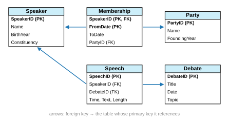

# Solutions to Exercise Sheet 10: Databases

*Introduction to Computing for the Social Sciences · Prof. Dr. David Garcia*

---

## Exercise 1: From a flat table to a relational database

a) **(UserNumber, PurchaseTime)** is a primary key if we assume that a user
makes at most one purchase per second. This assumption fails if a user can
buy milk and coffee in one checkout. In that case
**(UserNumber, PurchaseTime, ProductID)** is needed, assuming that the same
product bought twice in the same second is one row with a larger `N`. Other
candidates do not work:

- `PurchaseTime` alone is unique in these five rows, but two users can buy in
  the same second and a key must hold for every possible content of the
  table.
- `UserNumber` alone is not unique, because 011011 appears twice.
- `UserName` is not unique either. In addition, Hans appears with two
  different numbers, 011011 and 012311, which means that there are two people
  called Hans or that the data is inconsistent. This is worth pointing out.

b)
```sql
SELECT * FROM Purchases
WHERE Delivered = TRUE AND N > 1;
```
It returns two rows, namely the purchase of 2 Milk by Hans (2020.04.07) and
the purchase of 4 Coffee by Peter (2021.03.06). The 45 Coffee of Marie are
excluded because they were not delivered, so both conditions are needed.

c) The product name is repeated once per purchase, so renaming a product means
updating every row that mentions it, and missing one row leaves the table
contradicting itself. The solution is to store the name once in its own
table.

**`Products`**, with primary key `ProductID`:

| **ProductID** | ProductName |
|---|---|
| 011011 | Milk |
| 215511 | Coffee |

**`Purchases`**, with `ProductName` removed and `ProductID` as a foreign key
that references `Products`:

| UserNumber | UserName | PurchaseTime | N | ProductID (FK) | Delivered |
|---|---|---|---|---|---|
| 011011 | Hans | 2020.03.06 11:15:55 | 1 | 011011 | True |
| … | | | | | |

Renaming a product is now an `UPDATE` of a single row that cannot be done
inconsistently, and the database can enforce that no purchase refers to a
product that does not exist. The same argument gives users a
`Users(UserID, UserName)` table.

d) The name is now in one table and the delivery status in the other, so the
query needs a join on the key that they share:

```sql
SELECT p.PurchaseTime, p.UserNumber, p.Delivered
FROM Purchases p
INNER JOIN Products pr ON p.ProductID = pr.ProductID
WHERE pr.ProductName = 'Milk';
```

This is the trade-off of the restructuring, i.e. updates are cheaper and
safer but reading needs one more join.

## Exercise 2: Designing a schema

a) There are five tables, with primary keys in bold and foreign keys marked
with an arrow.

| table | attributes |
|---|---|
| `Speaker` | **SpeakerID** INTEGER, Name VARCHAR, BirthYear INTEGER, Constituency VARCHAR |
| `Party` | **PartyID** INTEGER, Name VARCHAR, FoundingYear INTEGER |
| `Debate` | **DebateID** INTEGER, Title VARCHAR, Date DATE, Topic VARCHAR |
| `Speech` | **SpeechID** INTEGER, SpeakerID → `Speaker`, DebateID → `Debate`, Time TIMESTAMP, Text TEXT, Length INTEGER |
| `Membership` | **SpeakerID** → `Speaker`, **FromDate** DATE, ToDate DATE, PartyID → `Party` |



Every speech points to its speaker and its debate, so who gave it, when and
where are stored once each. The key of `Membership` is (SpeakerID, FromDate),
because a speaker can have several memberships but not two that start on the
same day. An open-ended membership has `ToDate = NULL`.

b) Storing the party name in `Speech` repeats it in every speech of every
member, so the fact "this speaker belongs to this party" is stored in
thousands of rows and a change has to touch all of them. For example, the
party *Bündnis 90* renames itself *Bündnis 90/Die Grünen*. An `UPDATE` that
misses a few rows, or that runs while new speeches arrive with the old name,
leaves two spellings of the same party, and every count per party is wrong
from then on. This is the update anomaly that we learned about in this
session, which is avoided when a fact is stored in one place.

c) The party of a speaker is a fact about a period of time. A speaker who
changed party in 2015 gave speeches for one party before and for the other
party after. A single `Party` column can only hold the current party, so
every earlier speech would be attributed to the wrong party without any
warning. The fact belongs to the pair (speaker, period), so it gets its own
table, namely `Membership` above, with a start date and an end date. The
party of a speech is then the membership of its speaker whose period contains
the time of the speech. This is the same step as in exercise 1(c), i.e. we
find what the fact is about and give it a table.

d) i) The number of speeches per party, where each speech is attributed to the
party of its speaker at that time:
```sql
SELECT p.Name, COUNT(*) AS n_speeches
FROM Speech s
JOIN Membership m ON m.SpeakerID = s.SpeakerID
                 AND s.Time >= m.FromDate
                 AND (m.ToDate IS NULL OR s.Time <= m.ToDate)
JOIN Party p ON p.PartyID = m.PartyID
GROUP BY p.Name;
```
ii) The speeches on the topic climate by speakers born after 1970:
```sql
SELECT s.*
FROM Speech s
JOIN Debate d ON d.DebateID = s.DebateID
JOIN Speaker sp ON sp.SpeakerID = s.SpeakerID
WHERE d.Topic = 'climate' AND sp.BirthYear > 1970;
```
iii) The average speech length per party from longest to shortest, with the
same membership join as in (i):
```sql
SELECT p.Name, AVG(s.Length) AS avg_length
FROM Speech s
JOIN Membership m ON m.SpeakerID = s.SpeakerID
                 AND s.Time >= m.FromDate
                 AND (m.ToDate IS NULL OR s.Time <= m.ToDate)
JOIN Party p ON p.PartyID = m.PartyID
GROUP BY p.Name
ORDER BY avg_length DESC;
```
With the current party stored in `Speaker`, (i) and (iii) would join `Speech`
to `Speaker` to `Party` directly and be shorter, but they would have the
problem described in (c).

## Additional practice

### A1. ACID in practice

a) **Atomicity.** The transaction must be performed completely or not at all,
so the partial state is rolled back. Without atomicity, the money disappears.
b) **Isolation.** Concurrent transactions must produce a result equivalent to
some serial order, so only one of the two sales can succeed. Without
isolation, the seat is sold twice.
c) **Durability.** Once committed, the booking must survive a crash. Without
durability, confirmed bookings can be lost.
d) **Consistency.** The transaction must leave the database valid, which
includes the referential integrity of the foreign key. Without consistency,
the database contains a purchase of a product that does not exist.

### A2. Normalizing

a) The email of the student is repeated for every enrollment of that student.
The name and the office of the lecturer are repeated for every enrollment in
that course.
b) **Update anomaly:** If Garcia moves office, you must change every ICSS row,
and any missed row makes the table contradict itself. **Insert anomaly:** You
cannot record a new course that has no students yet, because there is no row
to put it in without a student. **Delete anomaly:** Deleting the Statistics
enrollment of Anna, which is the only one, destroys all record that the
Statistics course and the office of Meier exist.
c) There are four tables:
- `Student(StudentID, Name, Email)`, key `StudentID`
- `Lecturer(LecturerID, Name, Office)`, key `LecturerID`
- `Course(CourseID, Title, LecturerID → Lecturer)`, key `CourseID`
- `Enrollment(StudentID → Student, CourseID → Course, Grade)`, key
  `(StudentID, CourseID)`

Now each fact is stored in exactly one place and all three anomalies are
impossible.

### A3. Reading joins

a) $3 \times 4 = 12$ rows, which is the Cartesian product because there is no
condition.
b) **3 rows** (papers 10, 11, 12). Paper 13 is lost because its `AuthorID` is
`NULL` and `NULL` matches nothing, not even `NULL`. Schelling is also lost,
because he has no papers.
c) `SELECT * FROM Author LEFT JOIN Paper USING (AuthorID);` keeps Schelling
with `NULL` values in the paper columns. It still does not keep paper 13, for
which you need a `FULL OUTER JOIN`.
d)
```sql
SELECT Author.Name, COUNT(Paper.PaperID) AS n
FROM Author LEFT JOIN Paper USING (AuthorID)
GROUP BY Author.Name;
```
Use `COUNT(Paper.PaperID)` and not `COUNT(*)`, because the latter counts the
row produced by the left join and would report 1 for Schelling instead of 0.

### A4. Writing queries

a) `SELECT * FROM Product WHERE Price > 50;`
b) `SELECT PName FROM Product WHERE Manufacturer IN ('Canon', 'Hitachi');`
c) `SELECT Manufacturer, COUNT(*) FROM Product GROUP BY Manufacturer;`
d) `SELECT PName, Price FROM Product ORDER BY Price DESC LIMIT 1;` or
`SELECT * FROM Product WHERE Price = (SELECT MAX(Price) FROM Product);`, which
correctly returns all products if several tie for the maximum.
e)
```sql
SELECT Manufacturer, AVG(Price) FROM Product
GROUP BY Manufacturer HAVING AVG(Price) > 100;
```
Note that we need `HAVING` and not `WHERE`, because `WHERE` filters rows
before grouping while `HAVING` filters groups after aggregating.

### A5. SQL injection

a) The string becomes
`SELECT * FROM Students WHERE name = 'Robert'; DROP TABLE Students;--'`.
The quote typed by the user closes the string and the semicolon ends the
first statement. If the driver executes several statements at once, the
second one destroys the table. The `--` comments out the trailing quote so
that no syntax error remains. This is the example of XKCD 327, whose input
has a `)` because the query there was an `INSERT ... VALUES ('...')`.
b) `' OR '1'='1` gives `... WHERE name = '' OR '1'='1'`, whose condition is
true for every row.
c)
```python
cursor.execute("SELECT * FROM Students WHERE name = ?", (name,))
```
The query text and the value are sent separately. The DBMS first parses the
query with a placeholder and then binds the value, so the value can never be
interpreted as SQL syntax, whatever it contains.
d) **No.** It stops destructive statements like `DROP`, but it does not stop
(b), which is a pure `SELECT` and can be used to export the whole table or to
read other tables through a `UNION`. Restricting permissions is a valuable
second line of defense, but it does not replace parameterized queries.

### A6. Declarative vs procedural

a) You state a property of the result, i.e. which rows, which columns and how
they are grouped, instead of a sequence of steps that computes it. Your code
has no order of operations, no loop variable and no accumulator.
b) The query planner of the DBMS chooses the execution strategy using
statistics that you do not have, for example which index exists, how
selective a condition is, how large each table is, and whether to sort or to
hash. It can also change that choice as the data grows, without you rewriting
anything.
c) Because you never committed to an order. A `WHERE` clause says which rows
qualify but it does not say that they must be tested from first to last, so
the system is free to split the table across cores and combine the results.
d) You would prefer Python when the computation cannot be expressed
relationally (for example a simulation, a recursive model or a machine
learning fit), when it needs a library that the DBMS does not have, or when
the data is small enough that the round trip to the database dominates. The
opposite mistake is more common, namely pulling a million rows into Python to
filter them there when a `WHERE` clause would have moved a hundred.
