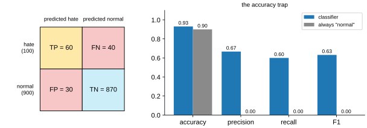
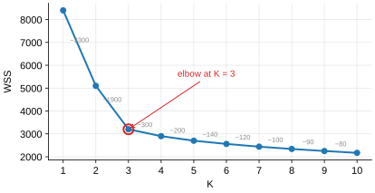

# Solutions to Exercise Sheet 10: Machine Learning

*Introduction to Computing for the Social Sciences · Prof. Dr. David Garcia*

> Solutions to [Exercise Sheet 10](../Exercise10.md). Each
> solution starts with where the material is in the slides and in the handout
> (the lecture transcript). Slide numbers count the title slide as 1 and refer
> to `Slides/10-MachineLearning/ICSS-2026-10-MachineLearning.qmd`.

---

## Exercise 1: Evaluating a classifier

**Where to look.** Slides 16 to 18 (*Error and loss*, *Class imbalance*, *The F1 score*). Handout: [10 §5 Error, loss and the traps of accuracy](../../Transcripts/10-MachineLearning.md#5-error-loss-and-the-traps-of-accuracy).

a) From the table, $TP = 60$, $FN = 40$, $FP = 30$, $TN = 870$.

- Accuracy $= (TP + TN)/1000 = 930/1000 = \mathbf{0.93}$.
- Precision $= TP/(TP + FP) = 60/90 = \mathbf{0.667}$.
- Recall $= TP/(TP + FN) = 60/100 = \mathbf{0.60}$.
- $F_1 = 2PR/(P + R) = 2 \cdot 0.667 \cdot 0.60 / 1.267 = \mathbf{0.632}$.



b) Always "normal" gives $TP = 0$, $FP = 0$, $FN = 100$, $TN = 900$: accuracy
$0.90$, only three points below the real classifier; precision $0/0$, taken
as 0; recall $0$; $F_1 = 0$. Accuracy weights every post equally and 90% of
them are normal, so the useless classifier looks almost as good (the **class
imbalance** problem). Recall and $F_1$ are computed on the minority class,
the one we care about, and there the difference is total: 0.60 against 0.

c) **Automatic deletion: precision.** A false positive silently removes a
legitimate post, a serious and invisible harm; a false negative leaves one
bad post up that can still be caught later. **Flagging for a moderator:
recall.** A false positive costs a few seconds of a moderator's time, a false
negative never reaches a human at all. The metric follows from the cost of
each kind of error in the deployment, so the same model can be right for one
use and wrong for the other.

d) "Only one post in ten in the test set is hate speech, so a program that
never flags anything would already be right 90% of the time; the 93% says
almost nothing. What matters is that it catches 60 of the 100 hateful posts
and that two of every three posts it flags really are hateful."

## Exercise 2: Training, testing and overfitting

**Where to look.** Slides 19 to 23 (*Training/test split: bias and variance*, *k nearest neighbors*, *Overfitting and underfitting*, *The bias-variance tradeoff*). Handout: [10 §6 Generalization: the train/test split](../../Transcripts/10-MachineLearning.md#6-generalization-the-traintest-split), [10 §7 A first model: k nearest neighbors](../../Transcripts/10-MachineLearning.md#7-a-first-model-k-nearest-neighbors), [10 §8 Overfitting, underfitting, bias and variance](../../Transcripts/10-MachineLearning.md#8-overfitting-underfitting-bias-and-variance).

a) Split the 5000 tweets at random into a training set and a test set (say
80% and 20%) before doing anything else, and tune features or hyperparameters
on a validation set carved out of the training part, or by cross-validation
on it. The test set exists to estimate performance on unseen data, which is
what generalization means; any use of it during training makes it seen, and
the estimate becomes optimistic.

b) **Information leakage.** Selecting the features with the labels of the
whole dataset lets information about the test tweets into the model before it
is evaluated on them, so the reported performance is optimistically biased,
sometimes dramatically. Select the features inside the training part only,
and inside each fold if cross-validation is used.

c) A random split puts tweets of the same user in both sets. The model can
then learn to recognize users (vocabulary, topics, punctuation) rather than
sentiment, and the test score measures user recognition. Use a **grouped
split**: whole users go to the training set or to the test set, never both.
The rule is to split by the unit of dependence, not by the row; for social
media data that is usually the user, sometimes the period or the thread.

d) With $k = 1$ each training tweet is its own nearest neighbor, so the
training error is zero by construction and the model follows every accident
of the training data: **low bias, high variance**, overfitting, visible in the
gap between 0% and 31%. With $k = 50$ each prediction averages fifty
neighbors: the model fits the training data less closely (24%, higher bias)
but generalizes better (26%, lower variance). Choose $k = 50$, and ideally
tune $k$ on a validation set rather than on the test set.

## Exercise 3: Clustering

**Where to look.** Slides 26 to 31 (*Unsupervised machine learning*, *Clustering example: document topics*, *Clustering with K-means*, *How to choose K? The elbow method*). Handout: [10 §10 Unsupervised learning and clustering](../../Transcripts/10-MachineLearning.md#10-unsupervised-learning-and-clustering), [10 §2 What machine learning is](../../Transcripts/10-MachineLearning.md#2-what-machine-learning-is).

a) **Unsupervised.** $X$ is the matrix of 2000 respondents by 12 attitude
items. There is no $Y$: nobody has labeled the respondents with a group, and
the groups are what the method has to produce. In supervised learning the
labels are the input; here they are the output.

b) In the notation of the lecture, $C(i)$ is the cluster of point $i$ and
$m_k$ the mean of cluster $k$:

```
Procedure K-MEANS(X, K)
Inputs:
      X: the n points x_1 … x_n
      K: the number of clusters
Result: a cluster C(i) for every point i, and K centers m_1 … m_K
choose K of the points as the initial centers m_1 … m_K
changed ← TRUE
While changed:
      changed ← FALSE
      For i = 1 to n:
            k ← the index of the center m_k closest to x_i
            If C(i) ≠ k
                  then C(i) ← k
                       changed ← TRUE
      For k = 1 to K:
            m_k ← the mean of the points with C(i) = k
return C, m_1 … m_K
```

The stopping condition is that no point changed cluster during a full pass.
The procedure always terminates: each of the two steps can only lower the
total within-cluster sum of squares, and there are finitely many assignments.

c) **$K = 3$**, by the elbow method. The successive drops of WSS are 3300,
1900, 300, 200, 140, 120, 100, 90 and 80: large up to $K = 3$, then flat.
Every further cluster removes little variance, which means that it splits a
group that is already homogeneous.



The lowest WSS is not an option because WSS decreases with every extra cluster
by construction and reaches zero at $K = n$, every respondent in a cluster of
their own. The elbow looks at where the rate of decrease changes, not at the
level. It is a heuristic: on real data the bend is often less clear, and no
plot replaces asking whether the clusters mean anything.

d) K-means starts from random initial centers and converges to a **local**
minimum of the WSS; different starts can end in different local minima, both
stable fixed points of the procedure. Run it several times and keep the
result with the lowest WSS, use a smarter initialization such as k-means++,
and report which clusters are stable across runs: a group that appears in
only some runs is not a finding.

## Additional practice

### A1. Features and TF-IDF

**Where to look.** Slides 14 to 15 (*Model features*, *Features in text classification: TF-IDF*). Handout: [10 §4 Features](../../Transcripts/10-MachineLearning.md#4-features).

a) For *crisis*: $\text{TF} = 3/100 = 0.03$, $\text{IDF} = \ln(4/2) = \ln 2
\approx 0.693$, so $\text{TF-IDF} \approx 0.0208$. For *the*:
$\text{TF} = 6/100 = 0.06$, $\text{IDF} = \ln(4/4) = \ln 1 = 0$, so
$\text{TF-IDF} = 0$.
b) *The* is twice as frequent as *crisis* but scores zero, because appearing
in every document makes a word useless for distinguishing between them;
representing the same text differently makes it far more learnable.
c) Examples: the ratio of positive words to negative words in the same tweet
(a mismatch between the words and the context is a sarcasm cue); the presence
of an exclamation mark or of scare quotes; the count of ALL-CAPS words; the
presence of a hashtag like `#not`. Each targets a surface signal that plain
word counts destroy.

### A2. Naive Bayes by hand

**Where to look.** Slide 24 (*Linear model example: Naive Bayes*). Handout: [10 §9 Two more models: Naive Bayes and the MLP](../../Transcripts/10-MachineLearning.md#9-two-more-models-naive-bayes-and-the-mlp).

a) $P(\text{spam}) = 0.4$, $P(\neg\text{spam}) = 0.6$;
$P(\text{free} \mid \text{spam}) = 24/40 = 0.6$,
$P(\text{meeting} \mid \text{spam}) = 2/40 = 0.05$,
$P(\text{free} \mid \neg\text{spam}) = 6/60 = 0.1$,
$P(\text{meeting} \mid \neg\text{spam}) = 30/60 = 0.5$.
b) Spam score: $0.4 \times 0.6 \times 0.05 = 0.012$. Not-spam score:
$0.6 \times 0.1 \times 0.5 = 0.030$. Since $0.030 > 0.012$, classify as **not
spam**. Note how *meeting* outweighs *free* here.
c) **Conditional independence of the features given the class**: we
multiplied the two likelihoods. It is questionable because words co-occur
systematically; an email containing *free* is more likely also to contain
*offer* or *click*. The assumption is false, and Naive Bayes usually works
anyway, because the errors tend to affect both classes similarly and cancel in
the $\arg\max$.
d) The likelihood would be 0 and the whole product would be 0 regardless of
every other word: one unseen word vetoes the classification. The standard fix
is **Laplace (add-one) smoothing**: add 1 to every count and adjust the
denominator accordingly.

### A3. Bias and variance

**Where to look.** Slides 22 to 23. Handout: [10 §8 Overfitting, underfitting, bias and variance](../../Transcripts/10-MachineLearning.md#8-overfitting-underfitting-bias-and-variance).

a) **Overfitting**: the gap is the symptom. Reduce complexity, add
regularization, or get more data.
b) **Underfitting**: both errors are high and close. Increase complexity or
find better features.
c) **Overfitting** by construction: the training error is zero and the tree
has memorized noise. Prune it, or set a minimum leaf size.
d) **Underfitting**: the model class cannot represent the pattern. Add a
quadratic term or use a nonlinear model.
e) **Overfitting** is overwhelmingly likely, with 20 000 parameters per
example. Get more data, use a much smaller network, or use regularization and
early stopping.

### A4. kNN by hand

**Where to look.** Slides 20 to 21 (*Model example: k nearest neighbors*). Handout: [10 §7 A first model: k nearest neighbors](../../Transcripts/10-MachineLearning.md#7-a-first-model-k-nearest-neighbors).

a) Distances from 5: to 1 → 4, to 2 → 3, to 4 → 1, to 7 → 2, to 8 → 3, to
10 → 5.
- $k = 1$: the nearest is $x = 4$ (B) → **B**.
- $k = 3$: the nearest three are 4 (B), 7 (A), and then 2 or 8, both at
  distance 3. Taking $x = 8$ (B) gives B, A, B → **B**; taking $x = 2$ (A)
  gives B, A, A → **A**. The tie must be broken by a stated rule, and this is
  a good illustration of why ties matter.
- $k = 5$: the five nearest are 4 (B), 7 (A), 2 (A), 8 (B), 1 (A): three A,
  two B → **A**.
b) Large $k$: each prediction averages more neighbors, so single noisy points
cannot move the boundary. The extreme, $k = n$, predicts the majority class
everywhere.
c) **Zero**: the nearest neighbor of each point is itself. This is exactly why
the training error is a useless measure of a kNN model.
d) The cost moves to **prediction time**: every prediction requires computing
the distance to all $n$ training points, so it is $O(n \cdot d)$ per query. It
also requires storing the entire training set. kNN trades training cost for
prediction cost and memory.

### A5. Macro vs micro F1

**Where to look.** Slides 16 to 18. Handout: [10 §5 Error, loss and the traps of accuracy](../../Transcripts/10-MachineLearning.md#5-error-loss-and-the-traps-of-accuracy).

a) $F_1 = 2PR/(P+R)$: Politics $= 2(0.90)(0.95)/1.85 \approx 0.924$; Economy
$= 2(0.70)(0.60)/1.30 \approx 0.646$; Culture $= 2(0.40)(0.30)/0.70 \approx
0.343$.
b) Macro $= (0.924 + 0.646 + 0.343)/3 \approx 0.638$.
c) A micro-average pools the counts of all classes (the true positives, false
positives and false negatives of the 1000 articles together), so each article
counts equally rather than each class. Politics has 800 of the 1000 articles
and is classified well, so it dominates: the micro-average is about 0.86
against a macro-average of 0.64. If all three
topics matter equally, report the **macro** average, and report the per-class
numbers, which show that Culture is barely working at all.

### A6. Supervised, unsupervised, or neither

**Where to look.** Slides 10 to 13 and 26 to 27. Handout: [10 §2 What machine learning is](../../Transcripts/10-MachineLearning.md#2-what-machine-learning-is), [10 §3 Supervised learning: the setup](../../Transcripts/10-MachineLearning.md#3-supervised-learning-the-setup).

a) **Supervised, regression.** $Y$ is continuous, and past years supply
labeled examples.
b) **Unsupervised, clustering.** There is no $Y$; the themes are to be
discovered.
c) **Supervised, classification.** $Y$ is categorical and labels exist.
d) **Unsupervised, dimensionality reduction** (for example PCA or factor
analysis).
e) **Reinforcement learning**: learning from rewards in an environment,
neither of the first two families.

### A7. Ethics of prediction

**Where to look.** Slide 36 (*Ethical issues with ML and responsible AI*). Handout: [10 §12 Ethics and responsible AI](../../Transcripts/10-MachineLearning.md#12-ethics-and-responsible-ai).

a) **Can we use a model for this prediction at all?** Arrest records encode
past policing decisions, including discriminatory ones, so the model learns
who gets arrested, not who offends. Ask: what is the target variable actually
measuring, and what would a fairness audit by group show?
b) **Who are we generalizing for?** Public photo datasets have documented
demographic skew, and error rates differ sharply by skin tone and gender. Ask:
what are the per-group error rates, and what happens to a person the system
fails on?
c) **Can we trust an AI model, and who is responsible for its mistakes?** A
week-2 prediction risks becoming self-fulfilling, and students have a right to
an explanation. Ask: is the assignment reversible, is it disclosed, and is
there a human appeal?
d) **Under which conditions was the data gathered?** The authors did not
consent and the model may substitute for their labor. Ask: what is the
license, is there compensation, and does the output reproduce protected text?
