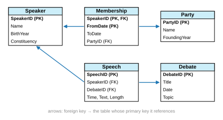

# Solutions to Exercise Sheet 11: Databases

*Introduction to Computing for the Social Sciences · Prof. Dr. David Garcia*

> Solutions to [Exercise Sheet 11](../Exercise11.md). Each
> solution starts with where the material is in the slides and in the handout
> (the lecture transcript). Slide numbers count the title slide as 1 and refer
> to `Slides/11-Databases/ICSS-2026-11-Databases.qmd`.

---

## Exercise 1: From a flat table to a relational database

**Where to look.** Slides 22 to 29 (*Relational databases*, *Database models*, *Flat model example*, *Building a relational database*, *Normal form example*) and 45 to 54 (*SQL queries*, *Selection and projection*, *Manual join*, *INNER JOIN*). Handout: [11 §6 Database models: flat and relational](../../Transcripts/11-Databases.md#6-database-models-flat-and-relational), [11 §7 Keys and normal forms](../../Transcripts/11-Databases.md#7-keys-and-normal-forms), [11 §11 Queries: selection, projection, aggregation](../../Transcripts/11-Databases.md#11-queries-selection-projection-aggregation), [11 §12 Joins](../../Transcripts/11-Databases.md#12-joins).

a) **(UserNumber, PurchaseTime)**, assuming that a user makes at most one
purchase per second. If a user can buy milk and coffee in one checkout, that
fails, and **(UserNumber, PurchaseTime, ProductID)** is needed, assuming that
the same product bought twice in the same second is one row with a larger
`N`. What does not work: `PurchaseTime` alone is unique in these five rows,
but two users can buy in the same second, and a key must hold for every
possible content of the table; `UserNumber` alone, since Hans appears twice
with 011011; and `UserName`, since Hans appears with two different numbers,
011011 and 012311, which means two people called Hans or inconsistent data,
and is worth pointing out.

b)
```sql
SELECT * FROM Purchases
WHERE Delivered = TRUE AND N > 1;
```
It returns two rows: Hans's purchase of 2 Milk (2020.04.07) and Peter's
purchase of 4 Coffee (2021.03.06). Marie's 45 Coffee is excluded because it
was not delivered. Both conditions are needed.

c) The product name is repeated once per purchase, so renaming a product means
updating every row that mentions it, and missing one leaves the table
contradicting itself. Store the name once, in its own table:

**`Products`**, primary key `ProductID`:

| **ProductID** | ProductName |
|---|---|
| 011011 | Milk |
| 215511 | Coffee |

**`Purchases`**, with `ProductName` removed and `ProductID` as a foreign key
that references `Products`:

| UserNumber | UserName | PurchaseTime | N | ProductID (FK) | Delivered |
|---|---|---|---|---|---|
| 011011 | Hans | 2020.03.06 11:15:55 | 1 | 011011 | True |
| … | | | | | |

Renaming a product is now a single-row `UPDATE` that cannot be done
inconsistently, and the database can enforce that no purchase refers to a
product that does not exist. The same argument gives users a
`Users(UserID, UserName)` table.

d) The name is now in one table and the delivery status in the other, so the
query needs a join on the key they share:

```sql
SELECT p.PurchaseTime, p.UserNumber, p.Delivered
FROM Purchases p
INNER JOIN Products pr ON p.ProductID = pr.ProductID
WHERE pr.ProductName = 'Milk';
```

That is the trade-off of the restructuring: cheaper and safer updates, one
more join on reading.

## Exercise 2: Designing a schema

**Where to look.** Slides 22 to 29 and 40 to 41 (*SQL schema*, *SQL data definition language*), 45 to 54. Handout: [11 §6 Database models: flat and relational](../../Transcripts/11-Databases.md#6-database-models-flat-and-relational), [11 §7 Keys and normal forms](../../Transcripts/11-Databases.md#7-keys-and-normal-forms), [11 §9 Tables, types, schemas and keys in SQL](../../Transcripts/11-Databases.md#9-tables-types-schemas-and-keys-in-sql), [11 §11 Queries: selection, projection, aggregation](../../Transcripts/11-Databases.md#11-queries-selection-projection-aggregation), [11 §12 Joins](../../Transcripts/11-Databases.md#12-joins).

a) Five tables; primary keys in bold, foreign keys marked with an arrow.

| table | attributes |
|---|---|
| `Speaker` | **SpeakerID** INTEGER, Name VARCHAR, BirthYear INTEGER, Constituency VARCHAR |
| `Party` | **PartyID** INTEGER, Name VARCHAR, FoundingYear INTEGER |
| `Debate` | **DebateID** INTEGER, Title VARCHAR, Date DATE, Topic VARCHAR |
| `Speech` | **SpeechID** INTEGER, SpeakerID → `Speaker`, DebateID → `Debate`, Time TIMESTAMP, Text TEXT, Length INTEGER |
| `Membership` | **SpeakerID** → `Speaker`, **FromDate** DATE, ToDate DATE, PartyID → `Party` |



Every speech points to its speaker and its debate, so who gave it, when and
where are stored once each. The key of `Membership` is (SpeakerID, FromDate):
a speaker can have several memberships, but not two starting on the same day;
an open-ended one has `ToDate = NULL`.

b) Storing the party name in `Speech` repeats it in every speech of every
member, so the fact "this speaker belongs to this party" lives in thousands
of rows and a change has to touch all of them. Concrete failure: the party
*Bündnis 90* renames itself *Bündnis 90/Die Grünen*; an `UPDATE` that misses
a few rows, or runs while new speeches arrive with the old name, leaves two
spellings of the same party, and every count per party is wrong from then on.
This is the update anomaly of the lecture: a fact should live in one place.

c) The party of a speaker is a fact about a period of time. A speaker who
changed party in 2015 gave speeches for one party before and for the other
after, and a single `Party` column can only hold the current party, which
silently misattributes every earlier speech. The fact belongs to the pair
(speaker, period), so it gets its own table, `Membership` above, with a start
and an end date; the party of a speech is the membership of its speaker whose
period contains the time of the speech. Same move as in exercise 1(c): find
where the fact lives and give it a table.

d) i) Speeches per party, attributing each speech to the party of its speaker
at the time:
```sql
SELECT p.Name, COUNT(*) AS n_speeches
FROM Speech s
JOIN Membership m ON m.SpeakerID = s.SpeakerID
                 AND s.Time >= m.FromDate
                 AND (m.ToDate IS NULL OR s.Time <= m.ToDate)
JOIN Party p ON p.PartyID = m.PartyID
GROUP BY p.Name;
```
ii) Speeches on climate by speakers born after 1970:
```sql
SELECT s.*
FROM Speech s
JOIN Debate d ON d.DebateID = s.DebateID
JOIN Speaker sp ON sp.SpeakerID = s.SpeakerID
WHERE d.Topic = 'climate' AND sp.BirthYear > 1970;
```
iii) Average speech length per party, longest first, with the same membership
join as in (i):
```sql
SELECT p.Name, AVG(s.Length) AS avg_length
FROM Speech s
JOIN Membership m ON m.SpeakerID = s.SpeakerID
                 AND s.Time >= m.FromDate
                 AND (m.ToDate IS NULL OR s.Time <= m.ToDate)
JOIN Party p ON p.PartyID = m.PartyID
GROUP BY p.Name
ORDER BY avg_length DESC;
```
With the current party stored in `Speaker`, (i) and (iii) would join `Speech`
to `Speaker` to `Party` directly and be shorter, at the price described in (c).

## Additional practice

### A1. ACID in practice

**Where to look.** Slide 21 (*Database transactions: ACID properties*). Handout: [11 §5 Transactions and ACID](../../Transcripts/11-Databases.md#5-transactions-and-acid).

a) **Atomicity**: the transaction must be all or nothing, so the partial state
is rolled back. Without it, money disappears.
b) **Isolation**: concurrent transactions must produce a result equivalent to
some serial order, so only one of the two sales can succeed. Without it, the
seat is sold twice.
c) **Durability**: once committed, the booking must survive a crash. Without
it, confirmed bookings can vanish.
d) **Consistency**: the transaction must leave the database valid, which
includes the referential integrity of the foreign key. Without it, the
database contains a purchase of nothing.

### A2. Normalizing

**Where to look.** Slides 26 to 29. Handout: [11 §7 Keys and normal forms](../../Transcripts/11-Databases.md#7-keys-and-normal-forms).

a) The email of the student is repeated for every enrollment of that student;
the name and office of the lecturer are repeated for every enrollment in that
course.
b) **Update anomaly:** Garcia moves office; you must change every ICSS row, and
any missed row makes the table contradict itself. **Insert anomaly:** you
cannot record a new course that has no students yet, because there is no row
to put it in without a student. **Delete anomaly:** deleting Anna's Statistics
enrollment, the only one, destroys all record that the Statistics course and
Meier's office exist.
c) Four tables:
- `Student(StudentID, Name, Email)`, key `StudentID`
- `Lecturer(LecturerID, Name, Office)`, key `LecturerID`
- `Course(CourseID, Title, LecturerID → Lecturer)`, key `CourseID`
- `Enrollment(StudentID → Student, CourseID → Course, Grade)`, key
  `(StudentID, CourseID)`

Now each fact lives in exactly one place and all three anomalies are
impossible.

### A3. Reading joins

**Where to look.** Slides 50 to 54. Handout: [11 §12 Joins](../../Transcripts/11-Databases.md#12-joins).

a) $3 \times 4 = 12$: the Cartesian product, since there is no condition.
b) **3 rows** (papers 10, 11, 12). Paper 13 is lost because its `AuthorID` is
`NULL` and `NULL` matches nothing, not even `NULL`. Schelling is also lost,
because he has no papers.
c) `SELECT * FROM Author LEFT JOIN Paper USING (AuthorID);` keeps Schelling
with `NULL`s in the paper columns. It still does not keep paper 13; for that
you need a `FULL OUTER JOIN`.
d)
```sql
SELECT Author.Name, COUNT(Paper.PaperID) AS n
FROM Author LEFT JOIN Paper USING (AuthorID)
GROUP BY Author.Name;
```
Use `COUNT(Paper.PaperID)`, not `COUNT(*)`: the latter counts the row produced
by the left join and would report 1 for Schelling instead of 0.

### A4. Writing queries

**Where to look.** Slides 45 to 49 (*SQL queries*, *Selection and projection*, *Aggregation*, *Grouping and aggregating*). Handout: [11 §11 Queries: selection, projection, aggregation](../../Transcripts/11-Databases.md#11-queries-selection-projection-aggregation).

a) `SELECT * FROM Product WHERE Price > 50;`
b) `SELECT PName FROM Product WHERE Manufacturer IN ('Canon', 'Hitachi');`
c) `SELECT Manufacturer, COUNT(*) FROM Product GROUP BY Manufacturer;`
d) `SELECT PName, Price FROM Product ORDER BY Price DESC LIMIT 1;` or
`SELECT * FROM Product WHERE Price = (SELECT MAX(Price) FROM Product);`, which
correctly returns all products if several tie for the maximum.
e)
```sql
SELECT Manufacturer, AVG(Price) FROM Product
GROUP BY Manufacturer HAVING AVG(Price) > 100;
```
Note `HAVING`, not `WHERE`: `WHERE` filters rows before grouping, `HAVING`
filters groups after aggregating.

### A5. SQL injection

**Where to look.** Slide 55 (*SQL injections*). Handout: [11 §13 SQL injection](../../Transcripts/11-Databases.md#13-sql-injection).

a) The string becomes
`SELECT * FROM Students WHERE name = 'Robert'; DROP TABLE Students;--'`.
The quote typed by the user closes the string, the semicolon ends the first
statement, and if the driver executes several statements at once the second
one destroys the table; `--` comments out the trailing quote so that nothing
is left dangling. This is XKCD 327, whose input has a `)` because the query
there was an `INSERT ... VALUES ('...')`.
b) `' OR '1'='1` gives `... WHERE name = '' OR '1'='1'`, whose condition is
true for every row.
c)
```python
cursor.execute("SELECT * FROM Students WHERE name = ?", (name,))
```
The query text and the value travel separately. The DBMS parses the query
first, with a placeholder, and then binds the value, so the value can never be
interpreted as SQL syntax, whatever it contains.
d) **No.** It stops destructive statements like `DROP`, but not (b), which is
pure `SELECT` and can be used to exfiltrate the whole table, or to read other
tables through a `UNION`. Least privilege is a valuable second line of
defense, not a substitute for parameterized queries.

### A6. Declarative vs procedural

**Where to look.** Slides 30 to 32 (*Structured Query Language*, *SQL programming language*). Handout: [11 §8 SQL: what kind of language it is](../../Transcripts/11-Databases.md#8-sql-what-kind-of-language-it-is), [04 §2 Programming paradigms](../../Transcripts/04-Software.md#2-programming-paradigms).

a) You state a property of the result, which rows, which columns, grouped how,
rather than a sequence of steps that computes it. There is no order of
operations in your code, no loop variable, no accumulator.
b) Because the query planner of the DBMS chooses the execution strategy using
statistics you do not have: which index exists, how selective a condition is,
how large each table is, whether to sort or to hash. It can also change that
choice as the data grows, without you rewriting anything.
c) Because you never committed to an order. A `WHERE` clause says which rows
qualify, not that they must be tested first to last, so the system is free to
split the table across cores and combine the results.
d) When the computation is not expressible relationally (a simulation, a
recursive model, a machine learning fit), when it needs a library the DBMS
does not have, or when the data is small enough that the round trip dominates.
The mistake to avoid is the opposite one: pulling a million rows into Python
to filter them there, when a `WHERE` clause would have moved a hundred.
