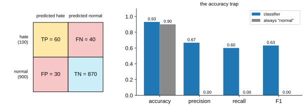
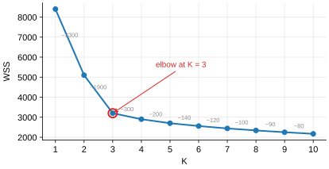

# Solutions to Exercise Sheet 11: Machine Learning

*Introduction to Computing for the Social Sciences · Prof. Dr. David Garcia*

---

## Exercise 1: Evaluating a classifier

a) From the table, $TP = 60$, $FN = 40$, $FP = 30$, $TN = 870$.

- Accuracy $= (TP + TN)/1000 = 930/1000 = \mathbf{0.93}$.
- Precision $= TP/(TP + FP) = 60/90 = \mathbf{0.667}$.
- Recall $= TP/(TP + FN) = 60/100 = \mathbf{0.60}$.
- $F_1 = 2PR/(P + R) = 2 \cdot 0.667 \cdot 0.60 / 1.267 = \mathbf{0.632}$.



b) The classifier that always predicts "normal" gives $TP = 0$, $FP = 0$,
$FN = 100$ and $TN = 900$. Its accuracy is $0.90$, which is only three points
below the real classifier. Its precision is $0/0$, which is not defined
because the classifier never predicts hate speech, and it is usually taken as
0. Its recall is $0$ and therefore $F_1 = 0$. Accuracy weights every post
equally and 90% of them are normal, so the useless classifier looks almost as
good under accuracy. This is the **class imbalance** problem. Recall and $F_1$
are computed on the minority class, which is the one we care about, and there
the real classifier is clearly better with a recall of 0.60 against 0.

c) **For automatic deletion, optimize precision.** A false positive silently
removes a legitimate post, which is a serious and invisible harm, while a
false negative leaves one bad post up that can still be caught later. **For
flagging posts for a moderator, optimize recall.** A false positive costs a
few seconds of a moderator's time, while a false negative never reaches a
human at all. The metric follows from the cost of
each kind of error in the deployment, so the same model can be right for one
use and wrong for the other.

d) "Only one post in ten in the test set is hate speech, which means that a
program that never flags anything would already be right 90% of the time, so
the 93% tells us almost nothing. What matters is that it catches 60 of the 100 hateful posts
and that two of every three posts it flags really are hateful."

## Exercise 2: Training, testing and overfitting

a) Split the 5,000 tweets at random into a training set and a test set (for
example 80% and 20%) before doing anything else, and tune features or
hyperparameters on a validation set taken from the training part or by
cross-validation on it. The test set exists to estimate performance on unseen
data, which is what generalization means. Any use of the test set during
training means that it is no longer unseen, and then the estimate becomes too
optimistic.

b) **This is information leakage.** Selecting the features with the labels of the
whole dataset lets information about the test tweets into the model before it
is evaluated on them, so the reported performance is optimistically biased,
sometimes dramatically. The features should be selected inside the training
part only, and inside each fold if cross-validation is used.

c) A random split puts tweets of the same user in both sets. The model can
then learn to recognize users (vocabulary, topics, punctuation) rather than
sentiment, and the test score measures user recognition. A better strategy
is a **grouped split**, in which all the tweets of a user go either to the
training set or to the test set but never to both. The rule is to split by
the unit of dependence instead of by row. For social media data that unit is
usually the user and sometimes the period or the thread.

d) With $k = 1$ each training tweet is its own nearest neighbor, so the
training error is zero by construction and the model follows every accident
of the training data. This is **low bias and high variance**, i.e.
overfitting, which is visible in the gap between 0% and 31%. With $k = 50$
each prediction averages fifty neighbors, so the model fits the training data
less closely (24%, higher bias) but generalizes better (26%, lower variance).
We would choose $k = 50$ and ideally tune $k$ on a validation set rather than
on the test set.

## Exercise 3: Clustering

a) **This is unsupervised learning.** $X$ is the matrix of 2,000 respondents
by 12 attitude items. There is no $Y$, because nobody has labeled the
respondents with a group and the groups are what the method has to produce.
In supervised learning the labels are part of the input, while here they are
the output.

b) In the notation of the slides, $C(i)$ is the cluster of point $i$ and
$m_k$ the mean of cluster $k$:

```
Procedure K-MEANS(X, K)
Inputs:
      X: the n points x_1 … x_n
      K: the number of clusters
Result: a cluster C(i) for every point i, and K centers m_1 … m_K
choose K of the points as the initial centers m_1 … m_K
changed ← TRUE
While changed:
      changed ← FALSE
      For i = 1 to n:
            k ← the index of the center m_k closest to x_i
            If C(i) ≠ k
                  then C(i) ← k
                       changed ← TRUE
      For k = 1 to K:
            m_k ← the mean of the points with C(i) = k
return C, m_1 … m_K
```

The stopping condition is that no point changed cluster during a full pass.
The procedure always terminates, because each of the two steps can only
lower the total within-cluster sum of squares and there are finitely many
assignments.

c) We would choose **$K = 3$** by the elbow method. The successive drops of
WSS are 3300, 1900, 300, 200, 140, 120, 100, 90 and 80, so they are large up
to $K = 3$ and small afterwards.
Every further cluster removes little variance, which means that it splits a
group that is already homogeneous.



The lowest WSS is not an option because WSS decreases with every extra cluster
by construction and reaches zero at $K = n$, i.e. when every respondent is in
a cluster of their own. The elbow method looks at where the rate of decrease
changes instead of at the level of WSS. It is a heuristic, because on real
data the bend is often less clear, and you still have to ask whether the
clusters mean anything.

d) K-means starts from random initial centers and converges to a **local**
minimum of the WSS. Different starts can end in different local minima, and
both are stable results of the procedure. The solution is to run K-means
several times and keep the result with the lowest WSS, to use a smarter
initialization such as k-means++, and to report which clusters are stable
across runs, because a group that appears in only some runs is not a reliable
finding.

## Additional practice

### A1. Features and TF-IDF

a) For *crisis*: $\text{TF} = 3/100 = 0.03$, $\text{IDF} = \ln(4/2) = \ln 2
\approx 0.693$, so $\text{TF-IDF} \approx 0.0208$. For *the*:
$\text{TF} = 6/100 = 0.06$, $\text{IDF} = \ln(4/4) = \ln 1 = 0$, so
$\text{TF-IDF} = 0$.
b) *The* is twice as frequent as *crisis* but scores zero, because appearing
in every document makes a word useless for distinguishing between them.
Feature engineering is for this, because representing the same text
differently makes it much easier to learn from.
c) Examples are the ratio of positive words to negative words in the same
tweet, because a mismatch between the words and the context is a sarcasm cue,
the presence of an exclamation mark or of scare quotes, the count of ALL-CAPS
words, and the presence of a hashtag like `#not`. Each of them captures a
surface signal that plain word counts lose.

### A2. Naive Bayes with pen and paper

a) $P(\text{spam}) = 0.4$, $P(\neg\text{spam}) = 0.6$,
$P(\text{free} \mid \text{spam}) = 24/40 = 0.6$,
$P(\text{meeting} \mid \text{spam}) = 2/40 = 0.05$,
$P(\text{free} \mid \neg\text{spam}) = 6/60 = 0.1$,
$P(\text{meeting} \mid \neg\text{spam}) = 30/60 = 0.5$.
b) Spam score: $0.4 \times 0.6 \times 0.05 = 0.012$. Not-spam score:
$0.6 \times 0.1 \times 0.5 = 0.030$. Since $0.030 > 0.012$, classify as **not
spam**. Note how *meeting* outweighs *free* here.
c) We used the **conditional independence of the features given the class**
when we multiplied the two likelihoods. It is questionable because words
co-occur systematically, for example an email containing *free* is more
likely to also contain *offer* or *click*. The assumption is false, but Naive
Bayes usually works anyway, because the errors tend to affect both classes similarly and cancel in
the $\arg\max$.
d) The likelihood would be 0 and the whole product would be 0 regardless of
every other word, so one unseen word would decide the classification alone.
The standard fix is **Laplace (add-one) smoothing**, i.e. adding 1 to every
count and adjusting the denominator accordingly.

### A3. Bias and variance

a) **Overfitting**, because of the large gap between the training and the
test error. Reduce complexity, add
regularization, or get more data.
b) **Underfitting**, because both errors are high and close. Increase complexity or
find better features.
c) **Overfitting** by construction, because the training error is zero and
the tree has memorized noise. Prune it or set a minimum leaf size.
d) **Underfitting**, because the model class cannot represent the pattern. Add a
quadratic term or use a nonlinear model.
e) **Overfitting** is overwhelmingly likely, with 20,000 parameters per
example. Get more data, use a much smaller network, or use regularization and
early stopping.

### A4. kNN with pen and paper

a) Distances from 5: to 1 → 4, to 2 → 3, to 4 → 1, to 7 → 2, to 8 → 3, to
10 → 5.
- $k = 1$: the nearest is $x = 4$ (B) → **B**.
- $k = 3$: the nearest three are 4 (B), 7 (A), and then 2 or 8, both at
  distance 3. Taking $x = 8$ (B) gives B, A, B → **B**, while taking $x = 2$ (A)
  gives B, A, A → **A**. The tie must be broken by a stated rule, and this is
  a good illustration of why ties matter.
- $k = 5$: the five nearest are 4 (B), 7 (A), 2 (A), 8 (B), 1 (A): three A,
  two B → **A**.
b) A large $k$, because each prediction averages more neighbors and single
noisy points cannot move the boundary. In the extreme case of $k = n$, the
model predicts the majority class everywhere.
c) **Zero**, because the nearest neighbor of each point is itself. For this
reason the training error is not a useful measure of a kNN model.
d) The cost moves to **prediction time**, because every prediction requires
computing the distance to all $n$ training points, i.e. $O(n \cdot d)$ per
query. It also requires storing the entire training set. kNN therefore trades
training cost for prediction cost and memory.

### A5. Supervised, unsupervised, or neither

a) **Supervised, regression.** $Y$ is continuous, and past years supply
labeled examples.
b) **Unsupervised, clustering.** There is no $Y$ and the themes are to be
discovered.
c) **Supervised, classification.** $Y$ is categorical and labels exist.
d) **Unsupervised, dimensionality reduction** (for example PCA or factor
analysis).
e) **Reinforcement learning**, i.e. learning from rewards in an environment,
which is neither of the first two families.

### A6. Ethics of prediction

a) **Can we use a model for this prediction at all?** Arrest records encode
past policing decisions, including discriminatory ones, so the model learns
who gets arrested rather than who offends. We would ask what the target
variable actually measures and what a fairness audit by group would show.
b) **Who are we generalizing for?** Public photo datasets have documented
demographic skew, and error rates differ sharply by skin tone and gender. We
would ask what the per-group error rates are and what happens to a person the
system fails on.
c) **Can we trust an AI model, and who is responsible for its mistakes?** A
week-2 prediction risks becoming self-fulfilling, and students have a right to
an explanation. We would ask whether the assignment is reversible, whether it
is disclosed and whether there is a human appeal.
d) **Under which conditions was the data gathered?** The authors did not
consent and the model may substitute for their labor. We would ask what the
license is, whether there is compensation and whether the output reproduces
protected text.
