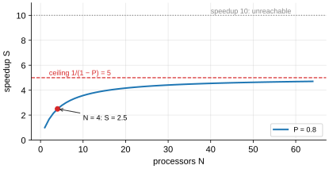
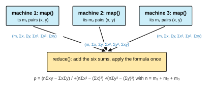

# Solutions to Exercise Sheet 12: Parallel Programming

*Introduction to Computing for the Social Sciences · Prof. Dr. David Garcia*

---

## Exercise 1: Parallelization

Amdahl's law gives the speedup of a program of which a fraction $P$ can be
parallelized when it runs on $N$ processors:
$$S = \frac{1}{(1 - P) + \dfrac{P}{N}} .$$
The serial fraction $1 - P$ takes the same time regardless of the number of
processors, while only the parallel fraction is divided by $N$.

a) With $P = 0.8$ and $N = 4$:
$$S = \frac{1}{0.2 + \dfrac{0.8}{4}} = \frac{1}{0.2 + 0.2} = \mathbf{2.5} .$$
Four processors give only two and a half times the speed, because the serial
20% already costs as much time as the whole parallel part.

b) **No number of processors gives a speedup of 10.** As $N$ grows, $P/N$ goes
to zero and the speedup approaches the ceiling $1/(1 - P) = 5$. Solving
$0.2 + 0.8/N = 0.1$ gives $0.8/N = -0.1$, i.e. a negative $N$, which means
that it cannot be done. To reach a speedup of 10 you would have to reduce the
serial fraction to 10% or less instead of adding hardware.



## Exercise 2: Distributed computation

a) On one machine, one pass over the data accumulates the five sums that the
formula needs, and the formula is evaluated once at the end:

```
Procedure PEARSON(x, y, n)
Inputs:
      x, y: two arrays of n numbers
Result: the Pearson correlation of x and y
sx ← 0;  sy ← 0;  sxx ← 0;  syy ← 0;  sxy ← 0
For i = 1 to n:
      sx ← sx + x[i]
      sy ← sy + y[i]
      sxx ← sxx + x[i]²
      syy ← syy + y[i]²
      sxy ← sxy + x[i] · y[i]
return (n · sxy − sx · sy) / ( sqrt(n · sxx − sx²) · sqrt(n · syy − sy²) )
```

b) The main question of the exercise is what `map()` sends. Correlations of
subsets cannot be combined into the correlation of the whole, because $\rho$
is not additive. However, every term of the formula is a sum over the data,
and sums are additive. Therefore, each mapper sends the six numbers that the
formula is made of, and the reducer adds them and evaluates the formula once.



```
Procedure MAP(x, y, m)
Inputs:
      x, y: the m pairs of values held by this machine
Result: the six partial sums of this subset are sent to the reducer
sx ← 0;  sy ← 0;  sxx ← 0;  syy ← 0;  sxy ← 0
For i = 1 to m:
      sx ← sx + x[i]
      sy ← sy + y[i]
      sxx ← sxx + x[i]²
      syy ← syy + y[i]²
      sxy ← sxy + x[i] · y[i]
yield(m, sx, sy, sxx, syy, sxy)
```

```
Procedure REDUCE(results)
Inputs:
      results: a list of the tuples (m, sx, sy, sxx, syy, sxy) sent by the mappers
Result: the Pearson correlation of all the data
n ← 0;  Sx ← 0;  Sy ← 0;  Sxx ← 0;  Syy ← 0;  Sxy ← 0
For each (m, sx, sy, sxx, syy, sxy) in results:
      n ← n + m
      Sx ← Sx + sx
      Sy ← Sy + sy
      Sxx ← Sxx + sxx
      Syy ← Syy + syy
      Sxy ← Sxy + sxy
return (n · Sxy − Sx · Sy) / ( sqrt(n · Sxx − Sx²) · sqrt(n · Syy − Sy²) )
```

The result is exactly the correlation of the whole data set, and only six
numbers per machine cross the network. The reduction is cheap but serial, so
it belongs to the part of the computation that limits the speedup in Amdahl's
law.

## Exercise 3: Conceptual questions

a) Moore's law (Gordon Moore, 1965) is the observation that the number of
transistors on a chip doubles about every two years, which for decades meant
that the same program ran faster on the next generation of processors without
changing a line. The limit is physical, because transistors are a few atoms
wide and cannot shrink much further. In addition, packing more of them at
higher clock speeds produces heat that cannot be removed, which is why clock
speeds have stayed at a few gigahertz. The workaround is parallelization,
i.e. the extra transistors are used for more cores, processors and machines,
and the program has to be written to use them.

b) **Concurrency** means that a program makes progress on several tasks in
the same period by interleaving them, for example on one core that switches
between them. **Parallelism** means that tasks execute at the same instant on
different cores. Concurrency is about how the program is structured, while
parallelism is about how it is executed. Concurrency has two advantages.
First, the processor is not idle while a task waits for the disk or the
network, so I/O-bound work finishes much sooner. Second, the program stays
responsive, for example an editor can save a file while you keep typing. One
disadvantage is that switching between tasks costs time for saving registers
and refilling caches, so on purely CPU-bound work a concurrent program on one
core is slower than a sequential one. In addition, the interleaving
introduces race conditions that are hard to reason about.

c) A pipelined processor starts the next instructions before the current one
has finished. At a branch it does not yet know which instruction comes next,
so it **guesses** and keeps executing along the guessed path. After a wrong
guess, the speculative results are thrown away and the pipeline restarts. The
security risk is that throwing the results away does not undo their side
effects, because the speculative instructions have loaded data into the cache
and the cache state can be observed by timing memory accesses. Spectre and
Meltdown exploit this to read memory that a program is not allowed to read,
because the check that would have stopped the access had not completed when
the speculative load ran.

d) Split the data into blocks of at most one million posts. For the **mean**,
each block returns the sum of its likes and its number of posts. Adding the
sums and the counts and dividing gives exactly the mean of the 3 billion
posts, because sums are additive. Averaging the block means would only be
right if all blocks had the same size. For the **standard deviation**, each
block also returns the sum of the squared likes, and
$\text{Var} = \frac{1}{n}\sum x_i^2 - \left(\frac{1}{n}\sum x_i\right)^2$ is
computed once from the three totals, which needs one more accumulator and
still a single pass. The standard deviation itself is not additive, so block
standard deviations cannot be averaged. Instead, each block sends the sums
that the statistic is made of. One caveat is that with $10^9$ squared values
this formula subtracts two large, nearly equal numbers, so a numerically
stable update (Welford's) or extra precision is advisable.

## Additional practice

### A1. Amdahl's law

Use $S = 1 / \left[(1-P) + P/N\right]$.

a) $S_{max} = 1/(1-0.95) = \mathbf{20\times}$.
b) $P = 0.5$: $1/(0.5 + 0.0625) = 1.78$. $P = 0.9$: $1/(0.1 + 0.1125) =
4.71$. $P = 0.99$: $1/(0.01 + 0.12375) = 7.48$.
c) $3 = 1/[(1-P) + P/4]$, so $(1-P) + P/4 = 1/3$, that is, $1 - 0.75P =
0.3333$, giving $P = 0.889$, about **89%**.
d) $N = 16$: $S = 1/(0.1 + 0.05625) = 6.40$. $N = 64$: $S = 1/(0.1 + 0.014)
= 8.77$. Four times the hardware buys **1.37×** more speed, and the ceiling is
10×. It is almost certainly not worth it, because the money is better spent
on reducing the 10% serial fraction.

### A2. Which distributes exactly?

a) **Yes.** Each machine sends $\sum x_i$ and the reducer adds them.
b) **Yes.** Each machine sends $\sum x_i$ and $n_j$, and the reducer computes
$\sum_j \sum x_i / \sum_j n_j$. Sending only local means is wrong unless all
machines hold equally many points.
c) **Yes.** Each machine sends $n_j$, $\sum x_i$ and $\sum x_i^2$, and the
reducer uses
$\mathrm{Var} = \frac{1}{n}\sum x_i^2 - \left(\frac{1}{n}\sum x_i\right)^2$.
In practice this form loses precision when the mean is large. A numerically
stable alternative combines means and sums of squared deviations pairwise.
d) **Yes.** Each machine sends its local maximum and the reducer takes the
maximum of those. This works because the maximum is associative.
e) **No.** The median is not determined by any fixed-size set of additive
summaries, because a value in the middle of the global order can be anywhere
in any local order. Exact computation needs either the full data or several
communication rounds, for example a binary search on the value that counts
how many points fall below a candidate at each round.
f) **No**, not exactly with a fixed budget, because two machines can hold the
same value and you cannot detect that from counts alone. You would have to
send the sets themselves. In practice one uses an approximate sketch
(HyperLogLog) with a stated error bound.

### A3. Threads, processes and shared state

a) Anywhere from **1000 to 2000**. It is 2000 only if no increment is lost.
b) One line of source is three machine operations, namely **read** `counter`,
**add** 1 and **write** it back. If thread A reads 41 and thread B reads 41
before A writes 42, both write 42 and one increment is lost. This is a **race
condition**.
c) A **lock** (mutex) fixes it. Each thread acquires the lock before the
read-modify-write and releases it after, which makes the three operations
atomic. The cost is that threads now wait for each other at that point. The
locked region is effectively serial code, and by Amdahl's law it limits your
speedup.
d) Because there is no shared mutable state, i.e. each thread writes only to
its own variable and the combination happens once after both have finished.
This is the same principle as the disjoint subarrays of parallel mergesort,
and it is why the Map phase of MapReduce is safe.

### A4. Concurrency or parallelism?

a) **Concurrency.** The work is I/O-bound, because nearly all the time is
spent waiting for responses and one core can issue hundreds of requests.
Extra cores add almost nothing.
b) **Parallelism.** The work is CPU-bound and highly regular, which is the
classic SIMD or GPU workload.
c) **Neither helps much.** The bottleneck is disk throughput and extra cores
do not make the disk faster. Parallel parsing may help slightly once the data
is in memory.
d) **Concurrency.** The goal is responsiveness rather than throughput,
because the editor must stay usable while the save waits on the disk.
e) **Parallelism** in principle, since the two recursive calls are
independent, but the right answer is to fix the algorithm instead.
Memoization turns it from exponential to linear, which is better than any
number of processors. Amdahl's law only applies once you have the right
algorithm.

### A5. Flynn's taxonomy

a) **SISD**, because there is one instruction stream over one data stream.
b) **SIMD**, because one instruction is applied to many data items.
c) **MIMD**, because there are many instruction streams over many data
streams.
d) **MISD**, because several different computations run over the same data.
The goal is fault tolerance rather than speed. This is the rarest of the four
categories and this is essentially its only common example.

### A6. Pipelining

a) **5 cycles**, because its latency is unchanged.
b) $100 \times 5 = \mathbf{500}$ cycles.
c) $5 + 99 = \mathbf{104}$ cycles, i.e. 5 to fill the pipeline and then one
instruction completes per cycle. The speedup is about 4.8×, close to the
ideal 5×.
d) 5 mispredictions per 100 instructions × 4 cycles = 20 extra cycles, so
**124** cycles. The speedup drops to about 4.0×.
e) Pipelining improves **throughput** (instructions completed per cycle) but
not **latency** (the time for any one instruction).
