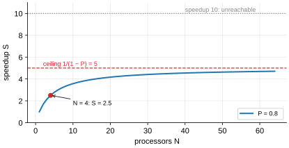
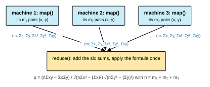

# Solutions to Exercise Sheet 12: Parallel Programming

*Introduction to Computing for the Social Sciences · Prof. Dr. David Garcia*

> Solutions to [Exercise Sheet 12](../Exercise12.md). Each
> solution starts with where the material is in the slides and in the handout
> (the lecture transcript). Slide numbers count the title slide as 1 and refer
> to `Slides/12-ParallelProgramming/ICSS-2026-12-ParallelProgramming.qmd`.

---

## Exercise 1: Parallelization

**Where to look.** Slides 48 to 49 (*Limits to parallelization*, *Amdahl's law*). Handout: [12 §11 Amdahl's law](../../Transcripts/12-ParallelProgramming.md#11-amdahls-law).

Amdahl's law gives the speedup of a program of which a fraction $P$ can be
parallelized when it runs on $N$ processors:
$$S = \frac{1}{(1 - P) + \dfrac{P}{N}} .$$
The serial fraction $1 - P$ takes the same time however many processors there
are; only the parallel fraction is divided by $N$.

a) With $P = 0.8$ and $N = 4$:
$$S = \frac{1}{0.2 + \dfrac{0.8}{4}} = \frac{1}{0.2 + 0.2} = \mathbf{2.5} .$$
Four processors, two and a half times the speed: the serial 20% already costs
as much time as the whole parallel part.

b) **No number of processors gives a speedup of 10.** As $N$ grows, $P/N$ goes
to zero and the speedup approaches the ceiling $1/(1 - P) = 5$. Solving
$0.2 + 0.8/N = 0.1$ gives $0.8/N = -0.1$, a negative $N$: the algebra's way of
saying that it cannot be done. To reach 10 you would have to cut the serial
fraction to 10% or less, not add hardware.



## Exercise 2: Distributed computation

**Where to look.** Slides 33 to 46 (*Software parallelization*, *MapReduce*, *Distributed statistical inference*, *Averaging*, *Problems with averaging: Pearson's correlation*, *Smarter distributed calculation of correlations*). Handout: [12 §9 Software parallelization and MapReduce](../../Transcripts/12-ParallelProgramming.md#9-software-parallelization-and-mapreduce), [12 §10 Distributed statistical inference](../../Transcripts/12-ParallelProgramming.md#10-distributed-statistical-inference).

a) On one machine, one pass over the data accumulates the five sums that the
formula needs, and the formula is evaluated once at the end:

```
Procedure PEARSON(x, y, n)
Inputs:
      x, y: two arrays of n numbers
Result: the Pearson correlation of x and y
sx ← 0;  sy ← 0;  sxx ← 0;  syy ← 0;  sxy ← 0
For i = 1 to n:
      sx ← sx + x[i]
      sy ← sy + y[i]
      sxx ← sxx + x[i]²
      syy ← syy + y[i]²
      sxy ← sxy + x[i] · y[i]
return (n · sxy − sx · sy) / ( sqrt(n · sxx − sx²) · sqrt(n · syy − sy²) )
```

b) The exercise turns on what `map()` sends. Correlations of subsets cannot
be combined into the correlation of the whole, because $\rho$ is not additive;
but every term of the formula is a sum over the data, and sums are additive.
So each mapper sends the six numbers the formula is made of, and the reducer
adds them and evaluates the formula once.



```
Procedure MAP(x, y, m)
Inputs:
      x, y: the m pairs of values held by this machine
Result: the six partial sums of this subset are sent to the reducer
sx ← 0;  sy ← 0;  sxx ← 0;  syy ← 0;  sxy ← 0
For i = 1 to m:
      sx ← sx + x[i]
      sy ← sy + y[i]
      sxx ← sxx + x[i]²
      syy ← syy + y[i]²
      sxy ← sxy + x[i] · y[i]
yield(m, sx, sy, sxx, syy, sxy)
```

```
Procedure REDUCE(results)
Inputs:
      results: a list of the tuples (m, sx, sy, sxx, syy, sxy) sent by the mappers
Result: the Pearson correlation of all the data
n ← 0;  Sx ← 0;  Sy ← 0;  Sxx ← 0;  Syy ← 0;  Sxy ← 0
For each (m, sx, sy, sxx, syy, sxy) in results:
      n ← n + m
      Sx ← Sx + sx
      Sy ← Sy + sy
      Sxx ← Sxx + sxx
      Syy ← Syy + syy
      Sxy ← Sxy + sxy
return (n · Sxy − Sx · Sy) / ( sqrt(n · Sxx − Sx²) · sqrt(n · Syy − Sy²) )
```

The result is exactly the correlation of the whole data set, and only six
numbers per machine cross the network. The reduction is cheap but serial: that
is the part Amdahl's law charges for.

## Exercise 3: Conceptual questions

**Where to look.** Slides 8 to 9 (*Moore's law and its limits*), 15 to 17 (*Concurrent vs parallel*, *Concurrency costs and advantages*), 21 to 29 (*Instruction-level parallelism* and its caveats), 37 to 47 (*Distributed statistical inference*). Handout: [12 §1 Moore's law and why it is running out](../../Transcripts/12-ParallelProgramming.md#1-moores-law-and-why-it-is-running-out), [12 §5 Concurrency vs parallelism](../../Transcripts/12-ParallelProgramming.md#5-concurrency-vs-parallelism), [12 §7 Instruction-level parallelism](../../Transcripts/12-ParallelProgramming.md#7-instruction-level-parallelism), [12 §10 Distributed statistical inference](../../Transcripts/12-ParallelProgramming.md#10-distributed-statistical-inference).

a) Moore's law (Gordon Moore, 1965) is the observation that the number of
transistors on a chip doubles about every two years, which for decades meant
that the same program ran faster on the next generation of processors without
changing a line. The limit is physical: transistors are a few atoms wide and
cannot shrink much further, and packing more of them at higher clock speeds
produces heat that cannot be removed, which is why clock speeds have stalled
at a few gigahertz. The workaround is parallelization: the extra transistors
go into more cores, processors and machines, and the program has to be
written to use them.

b) **Concurrency** means that a program makes progress on several tasks in
the same period, interleaving them, for example on one core that switches
between them; **parallelism** means that tasks execute at the same instant on
different cores. Concurrency is about how the program is structured,
parallelism about how it is executed. Two advantages of concurrency: the
processor does not sit idle while a task waits for the disk or the network,
so I/O-bound work finishes much sooner; and the program stays responsive, an
editor can save a file while you keep typing. One disadvantage: switching
between tasks costs time (saving registers, refilling caches), so on purely
CPU-bound work a concurrent program on one core is slower than a sequential
one, and the interleaving introduces race conditions that are hard to reason
about.

c) A pipelined processor starts the next instructions before the current one
has finished. At a branch it does not yet know which instruction comes next,
so it **guesses** and keeps executing along the guessed path; a wrong guess
throws the speculative results away and restarts the pipeline. The security
risk is that throwing the results away does not undo their side effects: the
speculative instructions have loaded data into the cache, and the cache state
can be observed by timing memory accesses. Spectre and Meltdown exploit this
to read memory a program is not allowed to read, because the check that would
have stopped the access had not completed when the speculative load ran.

d) Split the data into blocks of at most one million posts. For the **mean**,
each block returns the sum of its likes and its number of posts; adding the
sums and the counts and dividing gives exactly the mean of the 3 billion
posts, because sums are additive (averaging the block means would only be
right if all blocks had the same size). For the **standard deviation**, each
block also returns the sum of the squared likes, and
$\text{Var} = \frac{1}{n}\sum x_i^2 - \left(\frac{1}{n}\sum x_i\right)^2$ is
computed once from the three totals: one more accumulator, still a single
pass. The standard deviation itself is not additive, so block standard
deviations cannot be averaged; what is sent are the sums the statistic is
made of. Caveat: with $10^9$ squared values this formula subtracts two large,
nearly equal numbers, so a numerically stable update (Welford's) or extra
precision is advisable.

## Additional practice

### A1. Amdahl's law

**Where to look.** Slides 48 to 49. Handout: [12 §11 Amdahl's law](../../Transcripts/12-ParallelProgramming.md#11-amdahls-law).

Use $S = 1 / \left[(1-P) + P/N\right]$.

a) $S_{max} = 1/(1-0.95) = \mathbf{20\times}$.
b) $P = 0.5$: $1/(0.5 + 0.0625) = 1.78$. $P = 0.9$: $1/(0.1 + 0.1125) =
4.71$. $P = 0.99$: $1/(0.01 + 0.12375) = 7.48$.
c) $3 = 1/[(1-P) + P/4]$, so $(1-P) + P/4 = 1/3$, that is, $1 - 0.75P =
0.3333$, giving $P = 0.889$, about **89%**.
d) $N = 16$: $S = 1/(0.1 + 0.05625) = 6.40$. $N = 64$: $S = 1/(0.1 + 0.014)
= 8.77$. Four times the hardware buys **1.37×** more speed, and the ceiling is
10×. Almost certainly not worth it; the money is better spent on reducing the
10% serial fraction.

### A2. Which distributes exactly?

**Where to look.** Slides 37 to 47. Handout: [12 §10 Distributed statistical inference](../../Transcripts/12-ParallelProgramming.md#10-distributed-statistical-inference).

a) **Yes**: each machine sends $\sum x_i$; the reducer adds.
b) **Yes**: send $\sum x_i$ and $n_j$; the reducer computes
$\sum_j \sum x_i / \sum_j n_j$. Sending only local means is wrong unless all
machines hold equally many points.
c) **Yes**: send $n_j$, $\sum x_i$ and $\sum x_i^2$; the reducer uses
$\mathrm{Var} = \frac{1}{n}\sum x_i^2 - \left(\frac{1}{n}\sum x_i\right)^2$.
In practice this form loses precision when the mean is large; a numerically
stable alternative combines means and sums of squared deviations pairwise.
d) **Yes**: each machine sends its local maximum; the reducer takes the
maximum of those. Max is associative, which is the property that matters.
e) **No.** The median is not determined by any fixed-size set of additive
summaries; a value in the middle of the global order can sit anywhere in any
local order. Exact computation needs either the full data or several
communication rounds (for example a binary search on the value, counting how
many points fall below a candidate at each round).
f) **No**, not exactly with a fixed budget: two machines can hold the same
value and you cannot detect that from counts alone. You would have to send
the sets themselves. In practice one uses an approximate sketch (HyperLogLog)
with a stated error bound.

### A3. Threads, processes and shared state

**Where to look.** Slides 13 to 17 (*Types of parallelization*, *Single-thread vs parallel*, *Concurrent vs parallel*). Handout: [12 §4 Types of parallelization](../../Transcripts/12-ParallelProgramming.md#4-types-of-parallelization), [12 §5 Concurrency vs parallelism](../../Transcripts/12-ParallelProgramming.md#5-concurrency-vs-parallelism).

a) Anywhere from **1000 to 2000**. It is 2000 only if no increment is lost.
b) One line of source is three machine operations: **read** `counter`, **add**
1, **write** it back. If thread A reads 41 and thread B reads 41 before A
writes 42, both write 42 and one increment is lost. This is a **race
condition**.
c) A **lock** (mutex): each thread acquires it before the read-modify-write
and releases it after, making the three operations atomic. The cost is that
threads now wait for each other at that point; the locked region is
effectively serial code, and by Amdahl's law it caps your speedup.
d) Because there is no shared mutable state: each thread writes only to its
own variable, and the combination happens once, after both have finished. This
is the same principle as the disjoint subarrays of parallel mergesort, and it
is why the Map phase of MapReduce is safe by construction.

### A4. Concurrency or parallelism?

**Where to look.** Slides 15 to 17. Handout: [12 §5 Concurrency vs parallelism](../../Transcripts/12-ParallelProgramming.md#5-concurrency-vs-parallelism).

a) **Concurrency.** The work is I/O-bound: nearly all the time is waiting for
responses, and one core can issue hundreds of requests. Extra cores add almost
nothing.
b) **Parallelism.** CPU-bound and highly regular, the classic SIMD or GPU
workload.
c) **Neither, much.** The bottleneck is disk throughput; extra cores do not
make the disk faster. Parallel parsing may help slightly once the data is in
memory.
d) **Concurrency.** The point is responsiveness, not throughput: the editor
must stay usable while the save waits on the disk.
e) **Parallelism** in principle, since the two recursive calls are
independent, but the right answer is to fix the algorithm instead.
Memoization turns it from exponential to linear, which beats any number of
processors. Amdahl only applies once you have the right algorithm.

### A5. Flynn's taxonomy

**Where to look.** Slides 19 to 20 (*Flynn's taxonomy*). Handout: [12 §6 Flynn's taxonomy](../../Transcripts/12-ParallelProgramming.md#6-flynns-taxonomy).

a) **SISD**: one instruction stream over one data stream.
b) **SIMD**: one instruction, many data items.
c) **MIMD**: many instruction streams over many data streams.
d) **MISD**: several different computations over the same data; the goal is
fault tolerance rather than speed. This is the rarest of the four categories
and this is essentially its only common example.

### A6. Pipelining

**Where to look.** Slides 21 to 29. Handout: [12 §7 Instruction-level parallelism](../../Transcripts/12-ParallelProgramming.md#7-instruction-level-parallelism).

a) **5 cycles**: its latency is unchanged.
b) $100 \times 5 = \mathbf{500}$ cycles.
c) $5 + 99 = \mathbf{104}$ cycles: 5 to fill the pipeline, then one
instruction completes per cycle. Speedup about 4.8×, approaching the ideal 5×.
d) 5 mispredictions per 100 instructions × 4 cycles = 20 extra cycles, so
**124** cycles. The speedup drops to about 4.0×.
e) Pipelining improves **throughput** (instructions completed per cycle), not
**latency** (the time for any one instruction).

### A7. Designing a distributed analysis

**Where to look.** Slides 33 to 36 (*Software parallelization*, *Types of software parallelization*, *MapReduce*). Handout: [12 §9 Software parallelization and MapReduce](../../Transcripts/12-ParallelProgramming.md#9-software-parallelization-and-mapreduce).

a) **Map:** for each post, for each topic it mentions, `yield(topic, (score,
1))`, or better, accumulate locally and yield one `(topic, (sum, count))` pair
per topic per machine. **Reduce:** for each topic, add the sums and the counts
across machines and divide.
b) With local accumulation, **50 pairs of numbers per machine**, a few
kilobytes in total, against terabytes of input. That is the whole point of
"bring the code to the data": the input never moves, only the summaries.
c) **Load imbalance and stragglers.** One reducer receives far more work than
the others, and the job finishes only when the slowest reducer does. Fixes: a
*combiner* that pre-aggregates on each mapper (which here already solves it,
since each machine sends one pair regardless of volume), or splitting the hot
key into `election_0 … election_9` and doing a second, tiny reduction.
d) The mean has additive sufficient statistics and the median does not (A2e).
You would need multiple communication rounds, or an approximate answer: have
each machine send a **histogram** of scores over fixed bins, add the
histograms, and read off the bin containing the median, exact to the bin width
and with the error bound stated.
