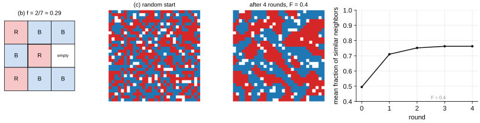

# Solutions to Exercise Sheet 13: Social Science Applications

*Introduction to Computing for the Social Sciences · Prof. Dr. David Garcia*

---

## Exercise 1: Designing a study with digital traces

a) The study uses the **digital** meaning, because it is based on a large
dataset of human behavior produced by a platform. The **computerized** meaning
would make the measurement automated, tractable, repeatable and extensible.
For example, a classifier or dictionary that scores every post for climate
content could be released as code, so that the next flood or another country
can be analyzed with the same instrument. The **generative** meaning would
build an agent-based model of attention, in which agents post with a
probability that depends on the event and on what their neighbors post. The
model would show which mechanisms, such as direct exposure, media coverage or
social contagion, are sufficient to produce a rise of the observed shape and
duration.

b) Three threats and the spurious increase that each can produce are the
following:

- **Coverage error.** Platform users are younger, more urban and more
  politically engaged than the German public. If the flood brought new,
  engaged users to the platform or made climate activists more active, the
  count rises while the attention of the population need not have changed.
- **Behavioral distortion.** Posting is a public performance. After a
  catastrophe, mentioning climate change becomes socially expected, so people
  who already paid attention now say so in public and people who disagree
  stay quiet. The count measures what is said on the platform and not what
  people think.
- **Algorithmic confounding.** The ranking decides what users see and a
  flood is the kind of event that makes the algorithm show more related
  content, which is then replied to and reposted. Part of the increase is
  therefore produced by the software of the company, and so is the effect of
  any platform change in those eight weeks.

Two other threats are also acceptable. One is the **keyword**, because
denials of "Klimawandel" count as attention while posts about the
"Hochwasser" without the word do not. The other is **bots and media
accounts**, which can produce a large share of the mentions.

c) "In the four weeks after the flood, the number of posts on [platform]
containing the word 'Klimawandel' was 40% higher than in the four weeks
before." The original claim makes three unsupported steps. It goes from
posts to people, while one user posting ten times is not ten people. It goes
from platform users to the public, and it goes from mentioning a word to
paying attention. It also assumes that the four
weeks before were a normal baseline, which only a comparison with the same
weeks a year earlier can establish.

d) The **data source** could be a representative survey, for example a panel
that asks the same respondents before and after the flood how much they worry
about climate change, or the monthly "most important problem" questions of
polling institutes. The **validation** would be to correlate the platform
series with the survey series over a longer period and show that they track
each other, which turns the trace into an instrument of public attention
rather than a count of a word. In the methodological cycle the study only
uses "digital traces". The survey adds "survey validation" and the model of
(a) would add "computational modeling". A controlled experiment on a flood is
impossible,
but comparing flooded regions with similar regions that were not flooded is
the closest observational analogue.

## Exercise 2: Schelling's model

a) The loop is shown below with the stopping condition made explicit, i.e.
the simulation ends when a full pass over the agents moves nobody, which
happens when every agent is satisfied.

```
Procedure SCHELLING(grid, F)
Inputs:
      grid: a grid with agents of two kinds and some empty cells
      F: the satisfaction threshold, 0 ≤ F ≤ 1
Result: the grid evolved until no agent is unsatisfied
moved ← TRUE
While moved:
      moved ← FALSE
      For each agent a in random order:
            f ← fraction of the occupied neighbors of a that are of the kind of a
            If f < F
                  then move a to the closest empty cell where its f would be ≥ F
                       moved ← TRUE
return grid
```

Two details are worth stating. First, if no empty cell satisfies the agent,
it stays where it is, because otherwise the loop might never end. Second, the
random order matters, because the outcome depends on who moves first. A
variant that moves the agent to a random empty cell rather than to the
closest satisfying one is also common and it also segregates.

b) The central agent is `R`. Seven of its eight surrounding cells are
occupied and one, the middle right, is empty. Of the seven neighbors, 2 are
`R` and 5 are `B`.

- **Excluding empty cells**, which is the convention of the pseudocode
  ("fraction of the *occupied* neighbors"), gives $f = 2/7 \approx 0.29$.
  With $F = 0.4$ the agent is **unsatisfied** and moves, while with $F = 0.2$
  it is **satisfied** and stays.
- **Including empty cells** gives $f = 2/8 = 0.25$. The conclusions are the
  same here, but for a threshold between 0.25 and 0.29 the two conventions
  would disagree.

The occupied-only convention is the justified one, because an empty cell is
not a neighbor of either kind. Counting it as "unlike me" would make agents
in sparse areas unsatisfied for a reason that has nothing to do with the
other group. Whichever convention you use, you should state it.



c) Segregation emerges from many small moves and not because anyone wishes
to be segregated. With $F = 0.4$ an agent is happy in the minority as long as
it is not almost alone. However, the random start leaves some agents below
the threshold by chance, and each of them moves to a place with enough
similar neighbors. Every move changes two neighborhoods. The place left
behind has one fewer agent of that kind, which can push a remaining neighbor
of that kind below the threshold. The destination has one more, which can
push a neighbor of the *other* kind below theirs. Unsatisfied agents
therefore create more unsatisfied agents and every move makes the destination
a little more homogeneous. The process only stops when nobody is below the
threshold, and large single-color blocks are the stable configurations,
because an agent deep inside a block has $f = 1$. The threshold is a minimum
and not a preferred value, i.e. an agent with $F = 0.4$ does not mind
$f = 0.9$, so nothing moves the system back toward mixing once blocks form.
In the simulation of the figure the mean fraction of
similar neighbors goes from about 0.5 to about 0.75 in four rounds.

d) The model is a **counterexample** to the inference, because a population
in which every individual is tolerant and content to be in the minority still
ends up segregated. A segregated outcome is therefore compatible with
tolerant preferences, and observing segregation does not tell you which
preferences produced it. The politician infers an individual property, namely
prejudice, from an aggregate pattern, namely residential segregation. This
error is the **ecological fallacy** and the model demonstrates it
computationally. More generally, a model that reproduces a pattern proves
**generative sufficiency**, i.e. that a mechanism can produce the outcome but
not that it is the mechanism that did. This also rules out the opposite
inference that segregation proves tolerance. The model only supports a claim
about what cannot be concluded from the pattern.

## Exercise 3: Methods and their risks

a) The three generations are the following:

1. **Adapted classical methods**, for example dictionaries in text analysis.
   A dictionary is a hand-built list of words scored for a construct and the
   measure is the count. It is transparent and cheap, but only as good as the
   list.
2. **Machine learning to generalize measurements**, for example sentiment
   analysis with a classifier trained on a few thousand labeled texts, which
   reproduces the labeling on millions more, as in the Machine Learning
   session.
3. **Large models for high-dimensional data**, for example word embeddings
   and language models, which represent meaning as vectors learned from
   enormous corpora.

From the first to the second generation one gains coverage and patterns that
no list anticipates, such as negation, context and domain vocabulary. One
loses transparency, because the measure can no longer be read but only
validated, and it needs labeled data. From the second to the third one gains
nuance and a
representation of meaning beyond word identity, for many constructs and
languages without task-specific labels, and loses even more interpretability
and all control over the training data, at a much higher computational cost.
At each step the burden moves from reading the instrument to validating it.

b) There are two reasons why a positive/negative dictionary goes wrong on
parliamentary speeches:

- **Domain vocabulary.** "Debt", "crisis", "conflict", "opposition" and "tax"
  are the ordinary content of a budget debate, and "support", "agreement" and
  "honorable" are formulaic. A speech about poverty reads as extremely
  negative whatever its stance.
- **Rhetoric.** "Nobody could call this budget a success" contains
  "success", "the minister's so-called reform" is negative with positive
  words, and a speaker who quotes the promises of the other side to attack
  them scores positive. These are the kind of constructions that VADER had to
  add rules for.

Two other reasons are also acceptable. The quantity of interest is usually
stance, i.e. being for or against a bill, which sentiment words do not
capture, and long speeches average out to near zero.

Before trusting the measure, the researchers should **validate it against
human judgment**. They can have two or more coders rate a random sample of a few hundred passages for the construct the
study needs, and check the agreement between the dictionary score and the
coders. If it is weak, they can adapt the dictionary to the domain or train
a second-generation classifier on those labels. This is the "survey
validation" arrow of the methodological cycle applied to a text instrument.

c) Kosinski, Stillwell and Graepel (2013) showed that Facebook likes, each
harmless on its own, predict sensitive attributes with high accuracy, such as
sexual orientation, ethnicity, religious and political views, personality,
intelligence, substance use and parental separation. Nobody disclosed those
attributes. Instead, they were inferred from the pattern of likes across
thousands of users. Consent cannot solve this because it is given to the collection of
specific data, and nobody can know at that moment what the data will predict
in a model trained on everybody else, possibly years later. Refusing does not
protect you either, because Garcia et al. (2018) showed that the data of your
friends predicts your attributes whether or not you are on the platform,
which is the shadow-profile problem. Privacy is a collective property, so the
consent of one individual cannot protect it.

d) Three questions from the list, answered for a study that predicts
political attitudes from public social media activity, are the following:

- **Can we use a model for this prediction at all?** Political attitude is a
  sensitive attribute, and inferring it from traces is the inference of (c)
  about people who never stated it. Aggregate inference, for example of the
  distribution of attitudes in a region or over time, is defensible. However,
  individual-level predictions should be neither published nor stored with
  identifiers.
- **Who are we generalizing for?** We generalize for platform users, who are
  younger and more engaged than the population, and among them only for
  those who post about politics.
  The study has to say so and must not present its results as attitudes of
  the public.
- **Under which conditions was the data gathered?** The posts are public but
  were written for followers and not for research, and training labels taken
  from self-declared attitudes were not given for this purpose either. The
  study should collect through sanctioned access, store without identifiers,
  and report so that nobody can be re-identified.

Three other questions are also relevant. **What features are allowed?** The
study should exclude names, locations and photos that proxy ethnicity or
religion. **Can the model be trusted?** The study should report per-group
accuracy, because a model that works for one camp and fails on the other is
itself a political instrument. **Who is responsible for its mistakes?**

## Additional practice

### A1. Representation

a) **Facebook**, because it has the smallest age gap (20 points) and high
absolute coverage in both groups. It is still not the population, because
coverage differs by education, income, country and urbanity, users differ
from non-users in ways that correlate with most outcomes of interest, and the
platform decides what is visible.
b) "Among TikTok users who posted about housing, a population that is
substantially younger than the adult public, the share of posts expressing
concern about housing costs rose over the period studied." Note that this also
fixes a second unsupported step, namely from *posts* to *people*.
c) More data reduces **variance** but not **bias**. The 65+ group is absent
at any $n$, so the result is a precisely estimated wrong number. The 1936
*Literary Digest* poll shows the same point, because it had 2.4 million
responses and got the election wrong.
d) **Coverage error** means that whole groups are absent, for example the 65+
on Snapchat. **Behavioral distortion** means that people behave differently
depending on the platform, for example on LinkedIn and on Twitter, so neither
shows "their" behavior. **Algorithmic confounding** means that a rise in
observed engagement may be a change in the ranking algorithm of the platform
and not in people.

### A2. Agent-based modeling

a) It demonstrates **generative sufficiency**, i.e. this set of micro-rules is
*enough* to produce the pattern. It does not demonstrate that these are the rules people
follow, and it is not empirical evidence.
b) First, writing the model **forces every assumption to be explicit**, because
a verbal theory can stay ambiguous indefinitely while code cannot. Second, the
model often admits **analytical results** about its equilibria or limits that
need no simulation.
c) The interventions cannot be randomized, because you cannot assign half of a
university to "no masks" during a wave for ethical and practical reasons. The
model provides comparable counterfactuals with its assumptions written down
where they can be challenged.
d) This is called **equifinality** or underdetermination. It implies that you
must report your model as *one* sufficient mechanism among possibly several
and state its assumptions explicitly. Ideally, you also identify a prediction
on which the competing models differ, so that data can distinguish them.

### A3. The end of theory

a) Datasets have become large enough that patterns can be found without any
prior hypothesis. Systems built this way, such as search, translation and
recommendation, outperform anything built from domain theory. Therefore the
hypothesis-driven scientific method is obsolete for practical purposes.
b) **From the Machine Learning session:** prediction is not explanation,
because a model that predicts well has found a pattern but not a mechanism,
and only a mechanism licenses intervention. **From this session:** sampling
bias does not shrink with $n$, so a biased dataset yields confidently wrong
conclusions at any scale. **From the Time Complexity or the Algorithms
session:** which patterns you can even search for is constrained by what is
computationally feasible, and *which* of the astronomically many correlations
in a large dataset you look at is a theoretical choice that you cannot avoid
making.
c) Anderson is closest to right where the goal is **pure prediction on data
drawn from the same distribution as the training data**, for example machine
translation, autocomplete and image labeling. Social science differs because the goal is usually
explanation and intervention, the target population is rarely the one that
generated the data, and a policy is by definition a change to the
distribution.

### A4. Reading a CSS paper

The following is an answer sketch for Garcia et al. (2018).

a) The question is how large the gender gap is in different countries and
whether it can be measured at higher frequency than existing indices allow.
The trace is the audience size estimates that the advertising interface of
Facebook reports by gender, age and country.
b) The claim is that the ratio of women to men *on Facebook* in a country
reflects the broader gender gap in access to resources and technology in that
country.
c) The assumption is validated by correlating the derived index against
established offline indicators of gender inequality, namely economic, health
and education indices, and showing that they agree. This is the "survey
validation" arrow of the methodological cycle and it is the step that makes
the trace an *instrument* rather than a curiosity.
d) The result generalizes to countries and not to individuals, because it is an
aggregate, population-level measure. It is weakest where Facebook penetration
is very low or very high, due to floor and ceiling effects, and where access
is mediated by shared accounts.

The same four questions are worth asking of any CSS paper you read, including
your own.

### A5. Privacy

a) Disclosure means that you state the attribute. Inference means that a model
derives it from traces that individually reveal nothing, such as likes,
timings and network position. You can control disclosure but you cannot
control inference, because you cannot know in advance what your data predicts.
b) A shadow profile is a profile of a person built from *other people's* data,
such as their contact lists, their photos and the structure of their network,
and it can exist for people who are not on the platform. It makes privacy collective because your friends' sharing
decisions determine what can be inferred about you, and you were never asked.
c) Deleting your account removes very little. Your past data may be retained
and the shadow-profile mechanism operates entirely on other people's
accounts. Deleting is an individual action, while the problem is collective.
d) **Research practice:** evaluate what your model can *infer* in addition to
what your dataset *contains*, and do not publish individual-level inferences
of sensitive attributes even when you can make them. **Policy:** consent
frameworks inherited from survey research are insufficient, so protections
must be collective, for example limits on inference and on data linkage in
addition to limits on collection.

### A6. Vocabulary

- **Computational Social Science:** quantitative testing of social science theory
  at unprecedented breadth, depth and scale, with the theory first.
- **Social Data Science:** the same tools with the emphasis on developing methods
  rather than testing theory.
- **Web Science:** the study of the Web itself as a socio-technical system.
- **Digital Sociology:** the sociology of digital transformation, i.e.
  digitalization as the object of study rather than the instrument.
- **Generative modeling:** the third meaning of "computational", i.e. building
  agent-based models whose micro-rules produce macro-phenomena.
- **Generative sufficiency:** what such a model establishes, i.e. that the
  rules are *enough* to produce the pattern but not that they are the ones
  that operate in the world.

Note two pairs that are easily confused. The first is *generative modeling*,
which is a method, versus a *generative model* in the sense of the Machine
Learning session, which is a model of $P(x)$. The second is *Social Data
Science* versus *Computational Social Science*, which differ in emphasis
rather than in tools.
