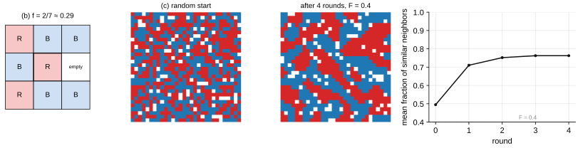

# Solutions to Exercise Sheet 13: Social Science Applications

*Introduction to Computing for the Social Sciences · Prof. Dr. David Garcia*

> Solutions to [Exercise Sheet 13](../Exercise13.md). Each
> solution starts with where the material is in the slides and in the handout
> (the lecture transcript). Slide numbers count the title slide as 1 and refer
> to `Slides/13-SocialScienceApplications/ICSS-2026-13-SocialScienceApplications.qmd`. The exercises of this
> sheet are discursive: the answers below are model answers, not the only
> defensible ones, and what is graded is the reasoning.

---

## Exercise 1: Designing a study with digital traces

**Where to look.** Slides 6 (*Computational in Computational Social Science*), 10 to 11 (*Combining Disciplines and Methods in CSS*), 12 to 14 (*Digital Behavioral Data in the Social Sciences*) and 19 (*Issues with Digital Behavioral Data: Representation*). Handout: [13 §3 The three meanings of "computational"](../../Transcripts/13-SocialScienceApplications.md#3-the-three-meanings-of-computational), [13 §5 Combining disciplines and methods](../../Transcripts/13-SocialScienceApplications.md#5-combining-disciplines-and-methods), [13 §6 Digital behavioral data](../../Transcripts/13-SocialScienceApplications.md#6-digital-behavioral-data), [13 §8 Issues with digital data: representation](../../Transcripts/13-SocialScienceApplications.md#8-issues-with-digital-data-representation).

a) The **digital** meaning: a large dataset of human behavior produced by a
platform. The **computerized** meaning would make the measurement automated,
tractable, repeatable and extensible: a classifier or dictionary that scores
every post for climate content, released as code, so that the next flood or
another country can be analyzed with the same instrument. The **generative**
meaning would build an agent-based model of attention, agents who post with a
probability that depends on the event and on what their neighbors post, to
see which mechanisms (direct exposure, media coverage, social contagion) are
sufficient to produce a rise of the observed shape and duration.

b) Three threats and the spurious increase each can produce:

- **Coverage error.** Platform users are younger, more urban and more
  politically engaged than the German public. If the flood brought new,
  engaged users to the platform or made climate activists more active, the
  count rises while the attention of the population need not have changed.
- **Behavioral distortion.** Posting is public performance. After a
  catastrophe, mentioning climate change becomes socially expected, so people
  who already paid attention now say so out loud and people who disagree stay
  quiet. The count measures what is said on the platform, not what is thought.
- **Algorithmic confounding.** The ranking decides what users see, and a
  flood is exactly the kind of event that makes the algorithm push related
  content, which is then replied to and reposted. Part of the increase is the
  software of the company, as is any platform change in those eight weeks.

Also acceptable: the **keyword** (denials of "Klimawandel" count as
attention, posts about the "Hochwasser" without the word do not) and **bots
and media accounts**, which can produce a large share of the mentions.

c) "In the four weeks after the flood, the number of posts on [platform]
containing the word 'Klimawandel' was 40% higher than in the four weeks
before." The original claim slips three times: from posts to people (one
user posting ten times is not ten people), from platform users to the public,
and from mentioning a word to paying attention. It also assumes that the four
weeks before were a normal baseline, which only a comparison with the same
weeks a year earlier can establish.

d) **Data source:** a representative survey, for example a panel that asks
the same respondents before and after the flood how much they worry about
climate change, or the monthly "most important problem" questions of polling
institutes. **Validation:** correlate the platform series with the survey
series over a longer period and show that they track each other, which turns
the trace into an instrument of public attention rather than a count of a
word. In the cycle of the lecture the study sits only at the "digital traces"
corner; the survey adds "survey validation", and the model of (a) would add
"computational modeling". A controlled experiment on a flood is impossible,
but comparing flooded regions with similar regions that were not flooded is
the closest observational analogue.

## Exercise 2: Schelling's model

**Where to look.** Slides 30 to 33 (*Agent-Based Modeling: Computing and Social Theory*, *Modeling Segregation: Schelling's Model*, *More on Schelling's model*, *Segregation Under Tolerance in Schelling's Model*). Handout: [13 §13 Agent-based modeling](../../Transcripts/13-SocialScienceApplications.md#13-agent-based-modeling), [13 §14 Schelling's segregation model](../../Transcripts/13-SocialScienceApplications.md#14-schellings-segregation-model).

a) The loop of the handout, with the stopping condition made explicit: the
simulation ends when a full pass over the agents moves nobody, that is, when
every agent is satisfied.

```
Procedure SCHELLING(grid, F)
Inputs:
      grid: a grid with agents of two kinds and some empty cells
      F: the satisfaction threshold, 0 ≤ F ≤ 1
Result: the grid evolved until no agent is unsatisfied
moved ← TRUE
While moved:
      moved ← FALSE
      For each agent a in random order:
            f ← fraction of the occupied neighbors of a that are of the kind of a
            If f < F
                  then move a to the closest empty cell where its f would be ≥ F
                       moved ← TRUE
return grid
```

Two details worth stating. If no empty cell satisfies the agent, it stays
where it is (otherwise the loop might never end); and the random order
matters, because the outcome depends on who moves first. A variant that
moves the agent to a random empty cell rather than to the closest satisfying
one is also common, and also segregates.

b) The central agent is `R`. Seven of its eight surrounding cells are
occupied, one (middle right) is empty; of the seven neighbors, 2 are `R` and
5 are `B`.

- **Excluding empty cells**, the convention of the lecture ("fraction of the
  *occupied* neighbors"): $f = 2/7 \approx 0.29$. With $F = 0.4$ the agent is
  **unsatisfied** and moves; with $F = 0.2$ it is **satisfied** and stays.
- **Including empty cells**: $f = 2/8 = 0.25$, same conclusions here, but for
  a threshold between 0.25 and 0.29 the two conventions would disagree.

The occupied-only convention is the justified one: an empty lot is not a
neighbor of either kind, and counting it as "unlike me" would make agents in
sparse areas unsatisfied for a reason that has nothing to do with the other
group. Whichever convention you use, state it.



c) Segregation emerges from many small moves, not from anyone's wish to be
segregated. With $F = 0.4$ an agent is happy in the minority as long as it is
not almost alone, but the random start has, by chance, some agents below the
threshold, and each of them moves to a place with enough similar neighbors.
Every move changes two neighborhoods: the place left behind has one fewer
agent of that kind, which can push a remaining neighbor of that kind below
the threshold, and the destination has one more, which can push a neighbor
of the *other* kind below theirs. Unsatisfied agents create more unsatisfied
agents, and every move makes the destination a little more homogeneous. The
process only stops where nobody is below the threshold, and large
single-color blocks are the stable configurations, since an agent deep inside
a block has $f = 1$. The threshold is a floor, not a preference: an agent with
$F = 0.4$ does not mind $f = 0.9$, so nothing pulls the system back toward
mixing once blocks form. In the simulation of the figure the mean fraction of
similar neighbors goes from about 0.5 to about 0.75 in four rounds.

d) The model is a **counterexample** to the inference: a population in which
every individual is tolerant, content to be in the minority, still ends up
segregated. A segregated outcome is therefore compatible with tolerant
preferences, and observing segregation does not tell you which preferences
produced it. The politician reads an individual property, prejudice, off an
aggregate pattern, residential segregation: the **ecological fallacy**, of
which the model is the computational demonstration. More generally, a model
that reproduces a pattern proves **generative sufficiency**, that a mechanism
can produce the outcome, not that it is the mechanism that did; that also
rules out the opposite inference, that segregation proves tolerance. What the
model licenses is a claim about what cannot be concluded.

## Exercise 3: Methods and their risks

**Where to look.** Slides 20 to 26 (*New Methods in the Social Sciences*, *The Challenge of New Unstructured Data*, *Heterogenous Data Sources and Methods*, *Research Example: VADER sentiment analysis*, *Research Example: Social Media and Emotion Surveys*, *Research Example: Personality and Facebook Likes*, *Issues with Methods: New Privacy Risks*), and slide 36 of session 10 (*Ethical issues with ML and responsible AI*, in `Slides/10-MachineLearning/ICSS-2026-10-MachineLearning.qmd`). Handout: [13 §9 New methods: three generations](../../Transcripts/13-SocialScienceApplications.md#9-new-methods-three-generations), [13 §10 Method examples](../../Transcripts/13-SocialScienceApplications.md#10-method-examples), [13 §11 Issues with methods: privacy](../../Transcripts/13-SocialScienceApplications.md#11-issues-with-methods-privacy), [10 §12 Ethics and responsible AI](../../Transcripts/10-MachineLearning.md#12-ethics-and-responsible-ai).

a) The three generations:

1. **Adapted classical methods**, for example dictionaries in text analysis:
   a hand-built list of words scored for a construct, and the measure is the
   count. Transparent, cheap, and exactly as good as the list.
2. **Machine learning to generalize measurements**, for example sentiment
   analysis with a classifier trained on a few thousand labeled texts, which
   reproduces the labeling on millions more (session 10).
3. **Large models for high-dimensional data**, for example word embeddings
   and language models, which represent meaning as vectors learned from
   enormous corpora.

From the first to the second generation one gains coverage and patterns no
list anticipates (negation, context, domain vocabulary) and loses
transparency: the measure can no longer be read, only validated, and it needs
labeled data. From the second to the third one gains nuance and a
representation of meaning beyond word identity, for many constructs and
languages without task-specific labels, and loses even more interpretability
and all control over the training data, at a much higher computational cost.
At each step the burden moves from reading the instrument to validating it.

b) Two reasons a positive/negative dictionary goes wrong on parliamentary
speeches:

- **Domain vocabulary.** "Debt", "crisis", "conflict", "opposition" and "tax"
  are the ordinary content of a budget debate, and "support", "agreement" and
  "honorable" are formulaic. A speech about poverty reads as extremely
  negative whatever its stance.
- **Rhetoric.** "Nobody could call this budget a success" contains "success";
  "the minister's so-called reform" is negative with positive words; a
  speaker quoting the other side's promises to attack them scores positive.
  These are exactly the constructions VADER had to add rules for.

Also acceptable: the quantity of interest is usually stance (for or against
a bill), which sentiment words do not capture; and long speeches average out
to near zero.

Before trusting it: **validate against human judgment**. Have two or more
coders rate a random sample of a few hundred passages for the construct the
study needs, and check the agreement between the dictionary score and the
coders. If it is weak, adapt the dictionary to the domain or train a
second-generation classifier on those labels. This is the "survey validation"
arrow of the cycle applied to a text instrument.

c) Kosinski, Stillwell and Graepel (2013) showed that Facebook likes, each
harmless on its own, predict sensitive attributes with high accuracy: sexual
orientation, ethnicity, religious and political views, personality,
intelligence, substance use, parental separation. Nobody disclosed those
attributes; they were inferred from the pattern of likes across thousands of
users. Consent cannot solve this because it is given to the collection of
specific data, and nobody can know at that moment what the data will predict
in a model trained on everybody else, possibly years later. Refusing does not
protect you either: Garcia et al. (2018) showed that the data of your friends
predicts your attributes whether or not you are on the platform, the
shadow-profile problem. Privacy is a collective property, and individual
consent is the wrong unit.

d) Three questions from the list, for a study that predicts political
attitudes from public social media activity:

- **Can we use a model for this prediction at all?** Political attitude is a
  sensitive attribute, and inferring it from traces is exactly the inference
  of (c) about people who never stated it. Aggregate inference, the
  distribution of attitudes in a region or over time, is defensible;
  individual-level predictions should be neither published nor stored with
  identifiers.
- **Who are we generalizing for?** Platform users, younger and more engaged
  than the population, and among them only those who post about politics.
  The study has to say so and must not present its results as attitudes of
  the public.
- **Under which conditions was the data gathered?** The posts are public but
  were written for followers, not for research, and training labels taken
  from self-declared attitudes were not given for this purpose either.
  Collect through sanctioned access, store without identifiers, and report
  so that nobody can be re-identified.

Also relevant: **what features are allowed** (exclude names, locations and
photos that proxy ethnicity or religion), **can the model be trusted** (report
per-group accuracy; a model that works for one camp and fails on the other is
itself a political instrument) and **who is responsible for its mistakes**.

## Additional practice

### A1. Representation

**Where to look.** Slide 19 (*Issues with Digital Behavioral Data: Representation*). Handout: [13 §8 Issues with digital data: representation](../../Transcripts/13-SocialScienceApplications.md#8-issues-with-digital-data-representation).

a) **Facebook**, the smallest age gap (20 points) and high absolute coverage in
both groups. It is still not the population: coverage differs by education,
income, country and urbanity, users differ from non-users in ways that
correlate with most outcomes of interest, and the platform decides what is
visible.
b) "Among TikTok users who posted about housing, a population that is
substantially younger than the adult public, the share of posts expressing
concern about housing costs rose over the period studied." Note that this also
fixes a second slippage: from *posts* to *people*.
c) Because more data reduces **variance**, not **bias**. The 65+ group is absent
at any $n$; a precisely estimated wrong number is still wrong. This is the
same point as the 1936 *Literary Digest* poll, which had 2.4 million responses
and got the election wrong.
d) **Coverage error** (whole groups absent, the 65+ on Snapchat);
**behavioral distortion** (people perform differently on LinkedIn than on
Twitter, so neither shows "their" behavior);
**algorithmic confounding** (a rise in observed engagement may be a change in
the platform's ranking algorithm, not in people).

### A2. Agent-based modeling

**Where to look.** Slides 30 to 34. Handout: [13 §13 Agent-based modeling](../../Transcripts/13-SocialScienceApplications.md#13-agent-based-modeling), [13 §15 Simulating anti-COVID policies](../../Transcripts/13-SocialScienceApplications.md#15-simulating-anti-covid-policies).

a) It demonstrates **generative sufficiency**: this set of micro-rules is *enough*
to produce the pattern. It does not demonstrate that these are the rules people
follow, and it is not empirical evidence.
b) First, writing the model **forces every assumption to be explicit**, a verbal
theory can stay ambiguous indefinitely, code cannot. Second, the model often
admits **analytical results** about its equilibria or limits that no simulation
is needed for.
c) Because the interventions cannot be randomized: you cannot assign half of a
university to "no masks" during a wave, for ethical and practical reasons. The
model provides comparable counterfactuals with its assumptions written down
where they can be challenged.
d) **Equifinality** (or underdetermination). It implies you must report your model
as *one* sufficient mechanism among possibly several, state its assumptions
explicitly, and, ideally, identify a prediction on which the competing models
differ, so that data can distinguish them.

### A3. The end of theory

**Where to look.** Slides 27 to 29 (*Computational Analysis of Social Science Theory*, *The End of Theory?*). Handout: [13 §12 The end of theory?](../../Transcripts/13-SocialScienceApplications.md#12-the-end-of-theory).

a) Datasets have become large enough that patterns can be found without any prior
hypothesis; systems built this way (search, translation, recommendation)
outperform anything built from domain theory; therefore the hypothesis-driven
scientific method is obsolete for practical purposes.
b) **From session 10:** prediction is not explanation, a model that predicts well
has found a pattern, not a mechanism, and only a mechanism licenses
intervention. **From this session:** sampling bias does not shrink with $n$, so
a biased dataset yields confidently wrong conclusions at any scale. **From
session 8 or 5:** which patterns you can even search for is constrained by what
is computationally feasible, and *which* of the astronomically many
correlations in a large dataset you look at is a theoretical choice you cannot
avoid making.
c) Closest to right where the goal is **pure prediction on data drawn from the
same distribution as the training data**, machine translation, autocomplete,
image labeling. Social science differs because the goal is usually
explanation and intervention, the target population is rarely the one that
generated the data, and a policy is by definition a change to the
distribution.

### A4. Reading a CSS paper

**Where to look.** Slides 15 to 18 (*Research example: Earthquakes on Twitter*, *Trading and Google trends*, *Gender Inequality with Facebook*) and 10 to 11. Handout: [13 §7 Four research examples](../../Transcripts/13-SocialScienceApplications.md#7-four-research-examples), [13 §5 Combining disciplines and methods](../../Transcripts/13-SocialScienceApplications.md#5-combining-disciplines-and-methods).

Answer sketch, for Garcia et al. (2018):

a) Question: how large is the gender gap in different countries, and can it be
measured at higher frequency than existing indices allow? Trace: the audience
size estimates that Facebook's advertising interface reports by gender, age and
country.
b) Claim: the ratio of women to men *on Facebook* in a country reflects the
broader gender gap in access to resources and technology in that country.
c) By correlating the derived index against established offline indicators of
gender inequality, economic, health and education indices, and showing that
they agree. This is the "survey validation" arrow of the methodological cycle,
and it is the step that makes the trace an *instrument* rather than a
curiosity.
d) To countries, not to individuals: it is an aggregate, population-level measure.
It is weakest where Facebook penetration is very low or very high (floor and
ceiling effects) and where access is mediated by shared accounts.

The same four questions are worth asking of any CSS paper you read, including
your own.

### A5. Privacy

**Where to look.** Slides 25 to 26. Handout: [13 §11 Issues with methods: privacy](../../Transcripts/13-SocialScienceApplications.md#11-issues-with-methods-privacy).

a) Disclosure is you stating the attribute. Inference is a model deriving it from
traces that individually reveal nothing, likes, timings, network position. You
can control disclosure; you cannot control inference, because you cannot know
in advance what your data predicts.
b) A profile of a person built from *other people's* data, their contact lists,
their photos, the structure of their network, including for people who are not
on the platform. It makes privacy collective because your friends' sharing
decisions determine what can be inferred about you, and you were never asked.
c) It removes very little. Your past data may be retained, and the shadow-profile
mechanism operates entirely on other people's accounts. Deleting is an
individual action against a collective problem.
d) **Research practice:** evaluate what your model can *infer*, not only what your
dataset *contains*; do not publish individual-level inferences of sensitive
attributes even when you can make them. **Policy:** consent frameworks
inherited from survey research are insufficient, so protections must be
collective, limits on inference and on data linkage, not only on collection.

### A6. Vocabulary

**Where to look.** Slides 4 to 6 (*Computational Social Science (CSS)*, *Buzzwords related to Computational Social Science*, *Computational in Computational Social Science*) and 30. Handout: [13 §1 What Computational Social Science is](../../Transcripts/13-SocialScienceApplications.md#1-what-computational-social-science-is), [13 §2 Neighboring labels](../../Transcripts/13-SocialScienceApplications.md#2-neighboring-labels), [13 §3 The three meanings of "computational"](../../Transcripts/13-SocialScienceApplications.md#3-the-three-meanings-of-computational), [13 §13 Agent-based modeling](../../Transcripts/13-SocialScienceApplications.md#13-agent-based-modeling).

- **Computational Social Science:** quantitative testing of social science theory
  at unprecedented breadth, depth and scale, theory-first.
- **Social Data Science:** the same tools with the emphasis on developing methods
  rather than testing theory.
- **Web Science:** the study of the Web itself as a socio-technical system.
- **Digital Sociology:** the sociology of digital transformation, digitalization
  as the object of study rather than the instrument.
- **Generative modeling:** the third meaning of "computational", building
  agent-based models whose micro-rules produce macro-phenomena.
- **Generative sufficiency:** what such a model establishes, that the rules are
  *enough* to produce the pattern, not that they are the operating ones.

Note the two easily confused pairs: *generative modeling* (a method) versus
*generative model* in the machine learning sense of session 10 (a model of
$P(x)$); and *Social Data Science* versus *Computational Social Science*, which
differ in emphasis rather than in tools.
