# Session 5: Algorithms

<style>
figure, .figure, .float { margin: 1.4em 0 1.8em 0; }
figure img, .float img { display: block; max-width: 100%; }
figcaption, .figcaption, .figure p.caption { margin-top: 0.3em; font-size: 0.88em; color: #555; }
</style>

*Introduction to Computing for the Social Sciences · lecture transcript*

**Reading for this session:** Chapter 1 of Cormen, *Algorithms Unlocked*
(2013). References at the end.

---

## Contents

1. [Algorithms](#algorithms)
2. [Representation of algorithms](#representation)
3. [Abstract data structures: queues, stacks and graphs](#abstract-data-structures)

---

<!-- MOTIVATION-SECTION:BEGIN -->
## Motivating examples

Three candidate openings for this session, each a real situation the
material is the answer to. **One of these will be used in the lecture**,
while the others are kept here because they are worth reading anyway.

<!-- MOTIVATION:M05-A:BEGIN -->
### A · Six handshakes, and how you would check

In 1967 Stanley Milgram gave letters to volunteers in Nebraska and Kansas
addressed to a stockbroker in Boston, with one rule, namely that you may only forward the
letter to someone you know personally, on a first-name basis. Of 296 chains
started, 64 arrived, with a mean length of 5.2 intermediaries and a median of
about five. "Six degrees of separation" comes from this, by way of a later
play. The experiment is famous, and it is also a fairly desperate way to
measure a graph. It is slow, it is expensive, and it observes only the chains
that completed, a severe selection problem, since a chain is more likely to
arrive when the path is short. In 2016 the question was answered a different
way. Given the Facebook friendship graph, 1.59 billion people and hundreds of
billions of edges, the average distance between two randomly chosen people
was computed directly, and it was 3.57.

Nothing about the second study is conceptually harder than the first. What
changed is that instead of asking people to walk the network, we walked it
ourselves. We start at a person, look at all their friends, who are at distance
1, look at all of their friends who have not been seen yet, who are at
distance 2, and continue until everyone reachable has been seen. That is
breadth-first search, and this session builds it up properly. It is worth
noticing what has to be pinned down before it is an algorithm at all. First,
what exactly a step is, namely to look at all the friends of the current
person. Second, which person we look at next, where the answer is a queue, and
choosing a stack instead gives a different algorithm with a different answer.
Third, how we avoid going round in circles, by marking what has been seen. And
fourth, when we stop, and how we know that we stop at all. Answering those four questions is the
difference between a good idea and a procedure you can hand to a machine.

Section 2 of this session defines the properties an algorithm must have, and
shows why finiteness and definiteness are not pedantry, since each rules out a
specific way of writing something that looks like a procedure but is not.
Sections 3 to 5 cover pseudocode and flowcharts, that is, how to write a
procedure down so that another person, and eventually a machine, can execute
it identically. Sections 7 to 9 develop graphs, their representation and
breadth-first search, ending with exactly the computation described above.
The transferable point is that a research question becomes computable at the
moment you can say, without ambiguity, what to do next. Most of the work is
in getting to that sentence.
<!-- MOTIVATION:M05-A:END -->
<!-- MOTIVATION:M05-B:BEGIN -->
### B · Whose contacts, within two steps?

Contact tracing is a graph problem with a deadline. People are vertices, a
recorded contact is an edge, a case is confirmed, and the question is who is
within one step and who is within two. Stated in English this sounds
finished, but it is not, because handing "find everyone within two steps" to
a machine requires answering questions that the English sentence hides. Which
person do you examine next? If you take the most recently discovered person
each time, you dive down one long chain of contacts before ever looking at
the second friend of the original case, and you will report people at
distance 5 before people at distance 2. If you take the earliest discovered
person, you finish all of distance 1 before starting distance 2. Same graph,
same edges, and completely different behavior, since the first is depth-first, the
second is breadth-first, and only the second answers the question asked. How
do you avoid loops? Contact graphs are full of cycles, since A met B, B met C
and C met A, and without marking who has already been seen the procedure
never terminates. How do you know the distance? Not by looking at a person,
but by recording it when you first reach them, because each newly discovered person
is at one more step than the person who led you to them. And when do you
stop? Either when the queue is empty, or, here, as soon as you would move
beyond distance 2, which is what makes this fast enough to be useful. The
graph may have millions of vertices, and you touch only the neighborhood you
need. That the answer arrives in seconds rather than hours is a property of
the procedure, not of the hardware, since breadth-first search examines each vertex
once and each edge once, so the cost is proportional to the part of the
network you actually reach.

Section 2 of this session is about what makes something an algorithm.
Definiteness, that no step may be ambiguous, and finiteness, that it must
stop, are exactly the two properties that the English sentence lacked.
Section 8 is about representing a network so that "who did this person
meet?" is a cheap question, because the representation decides whether the
procedure is fast. Section 9 is about breadth-first search itself, i.e. the
queue, the colors that mark what has been seen, the distance and parent
records, and why it is correct. The exercise sheet and the exam both ask you
to run this by hand on a small graph, and doing so once is the fastest way to
see why each part of the recipe is there.
<!-- MOTIVATION:M05-B:END -->
<!-- MOTIVATION:M05-C:BEGIN -->
### C · The network that would not fit

Suppose you want to study the friendship network of Germany, with 84 million
people, each with perhaps a couple of hundred friends. The most obvious
representation is a table with one row and one column per person, holding a 1
where two people are friends. This is an adjacency matrix, and it has a fatal
property, i.e. its size depends only on the number of people, never on the number
of friendships. For 84 million people that is $84\,000\,000^2 \approx 7 \times
10^{15}$ cells. At one bit each, an impossibly generous assumption, that is
roughly 875 terabytes, and the study is over before it starts. Now store, for
each person, only a list of the people they are actually friends with. This
is an adjacency list, and its size depends on the number of friendships,
about $84 \times 10^6 \times 200 / 2 \approx 8 \times 10^9$ of them, each
stored in the lists of its two endpoints. Large, but perfectly ordinary, and
it fits on a single machine. A factor of a million, from writing the same
facts down differently. The reason is that real social networks are sparse.
People have hundreds of friends, not eighty million, so the matrix is more
than 99.999% zeros and almost all of that storage records the absence of a
relationship, while the list records only what is there.

There is a genuine trade-off, and this is what makes it a design question
rather than an obvious choice. To ask whether $u$ and $v$ are friends, the
matrix looks at one cell, $O(1)$, while the lists scan the list of $u$,
$O(\deg u)$. To ask who the friends of $u$ are, the matrix scans a whole row,
$O(|V|)$, while the lists just read the list, $O(\deg u)$. And the space is
$O(|V|^2)$ for the matrix against $O(|V| + |E|)$ for the lists. The matrix
wins on the first question and loses on everything else, and the algorithms
of this session, breadth-first search, and depth-first search in the next,
need the second question over and over. So for the work we actually do, lists
win twice.

Section 8 of this session covers both representations, adjacency matrix and
adjacency list, with exactly this comparison. Section 9 shows why it matters
operationally, because breadth-first search is $O(|V| + |E|)$ with lists and
$O(|V|^2)$ with a matrix, because finding the neighbors of a vertex is the
inner operation. The habit to take away, and it generalizes well beyond
graphs, is to ask how something is written down before asking how to compute
it. A surprising number of "this is computationally infeasible" conclusions
are really conclusions about a badly chosen representation.
<!-- MOTIVATION:M05-C:END -->
---

<!-- MOTIVATION-SECTION:END -->
## 1. What is an algorithm? {#algorithms}
An *algorithm* is a self-contained, step-by-step set of operations to solve a
given problem. Algorithms perform calculation, data processing and automated
reasoning tasks. The word comes from Muhammad ibn Musa abu Djafar al-Khwarizmi
(c. 780–850), who was born in Khwarazm, in present-day Uzbekistan, and worked in
Baghdad. He popularized algebra and published the first systematic way to
solve linear and quadratic equations, and his book on calculating with
Hindu-Arabic numerals was translated into Latin as *Algoritmi de Numero
Indorum*. "Algoritmi" later became "algorithmus", blended with the Greek
*arithmos*, number. Algorithms clearly predate him, since Babylon, Egypt,
India and Greece all had them. What he popularized was the idea of a
systematic treatment of data, and of doing it in as few steps as possible,
which is why he preferred pen-and-paper decimal arithmetic to an abacus with
Roman numerals.

You should also know that the word is used with slightly different meanings in
public debate and in artificial intelligence research, and the difference
causes real confusion. One meaning is the algorithm as the method that fits a
predictive model, which can be as simple as least squares for a linear
regression or as complicated as distributed stochastic gradient descent for a
neural network. The other meaning is the algorithm as the model after
training, which focuses on the fitted model as a program whose behavior was
not carefully designed but learned from empirical data. Terms like
*algorithmic bias*, *algorithmic media*, *machine behavior*, *algorithm
auditing* and *algorithmic decision-making* use the word in one of these two
senses. In this course, unless we say otherwise, an algorithm is a designed,
step-by-step method in the sense of the definition above.

---

## 2. The properties an algorithm must have

The lecture uses a running example to define the properties of an algorithm,
namely finding the $k$-th smallest element of a list. In pseudocode and in Python it
reads as follows.

```
Procedure K-SMALLEST-ELEMENT(M, n, k)
Inputs:
      M: an array
      n: the number of elements in M
      k: which smallest element to find (k = 1 is the minimum)
Result: the k-th smallest element of M
For i = 1 to k:
      smallest ← i
      For j = i + 1 to n:
            If M[j] < M[smallest]
                  then smallest ← j
      swap M[i] with M[smallest]
return M[k]
```

```python
def min_k(M, k):
    for i in range(0, k):
        m = i
        min_val = M[i]
        for j in range(i + 1, len(M)):
            if M[j] < min_val:
                m = j
                min_val = M[j]
        M[i], M[m] = M[m], M[i]
    return M[k-1]
```

Note that this is selection sort stopped after $k$ rounds, and that the
pseudocode counts from 1 while the Python counts from 0, so `M[k-1]` in Python
is $M[k]$ in the pseudocode. The observation that one algorithm is another
one truncated or specialized is useful in itself, because many algorithms are.

The first property is the *specification*. The input specification states the
input required so that a given output can be produced, and there can be many
inputs or none. The output specification states the result to be produced by
the algorithm. In the example, the input is a list $M$ of length $n$ and an
index $k$, and the output is the $k$-th smallest element. The second property
is *transferability*, which means that the input should be parameterizable, so that different
instances of the problem are allowed as inputs. Our example accepts lists of
any length, not just one length, and any $k$, not just one $k$. A procedure
that only works for one specific list is not an algorithm, but an answer.
The third property concerns the *description*. An algorithm must have
finiteness, meaning that it terminates after a finite number of steps, and
definiteness, meaning that each step is clear, well-defined and precise, with
no ambiguity.

Regarding execution and return, an algorithm can be *deterministic*, giving
the same output for the same inputs, or *stochastic*, when a random component
makes the output vary for the same inputs. Both are legitimate, and randomized
algorithms such as randomized quicksort or Monte Carlo methods are genuinely
useful, but you must know which kind you have, because it changes how you test
it. An algorithm also has a *time complexity*, the effort it needs for
completion, which depends on the specific implementation and is measured by
counting key operations such as the comparisons in a sorting algorithm, and a
*memory complexity*, the memory required during execution, measured by the
maximum memory space the algorithm needs. Session 8 is entirely about this.
Finally, *correctness* has two parts. The first is partial correctness, meaning that
whenever the algorithm terminates its output is correct, and the second is termination,
meaning that for correct inputs the algorithm always terminates in a finite
number of steps. An algorithm can fail either test, and a loop that computes
the right thing but never stops is not correct.

---

## 3. Representing algorithms {#representation}
How do you create a new program? The lecture gives a three-step recipe. First,
evaluate your requirements. Second, define a structure for the program with a
method of representation for its algorithm, which can be pseudocode, a
structogram, a flow diagram or the Unified Modeling Language (UML). Third, and
only then, start programming. The two representations we use in this course
are pseudocode and flowcharts. Programming comes last on purpose, because writing the
algorithm down before you write code is not bureaucracy, it is how you find
out whether you have understood the problem.

---

## 4. Pseudocode

*Pseudocode* is a representation of the steps of an algorithm as a combination
of natural language and mathematical notation. It often uses the structural
conventions of a programming language, but it is not meant for machine
interpretation. Instead, it is for illustration among humans. In this course every
procedure has a header with a name, its inputs, any auxiliary data it uses,
and its result, followed by the steps, with blocks marked by indentation:

```
Procedure NAME(inputs)
Inputs: input variables
Data: auxiliary variables
Result: output variables
preparation
While not the trivial case:
      work
bookkeeping
```

Good pseudocode specifies the input and the output if they are not clear from
the problem. If it uses auxiliary data structures, it comments how they are
accessed and edited. And it makes loops and conditional scopes unambiguous,
which is what the indentation is for. The bottom line, and also the marking
criterion in the exam, is that another human has to be able to follow the
instructions of your pseudocode to solve the problem with pen and paper, and
later to program it. Pseudocode that only you can follow does not pass.

---

## 5. Flowcharts

A *flowchart* is a graphical representation of the execution of an algorithm
using symbols and transitions. It shows the steps as boxes and their order by
connecting the boxes with arrows. Four symbols are enough for this course. A
rounded box marks the start and the end of a program or sub-process. A
parallelogram marks data, that is, the input of data by entering it and the
output of data by displaying it. A rectangle marks the execution of operations,
a set of operations that changes the value, form or location of data. And a
diamond marks a conditional split, a conditional operation that determines the
program path, commonly a yes/no question or a true/false test.

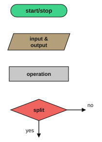

The worked example of the lecture computes the profit or loss of a sale. The
program starts and reads the selling price as `SP`, then reads the cost price
as `CP`, and tests whether `SP` is larger than or equal to `CP`. If the
condition is true, it takes the right path, where it calculates the profit as `SP -
CP` and outputs it. If the condition is false, it takes the bottom path, where it
calculates the loss as `CP - SP` and outputs it. Then the program ends. Notice
that the two paths reconverge before the stop symbol. A flowchart with paths
that never rejoin usually indicates a program with several exits, which is
legal but harder to reason about, and harder to test, since each exit is a
separate case to check (session 4).

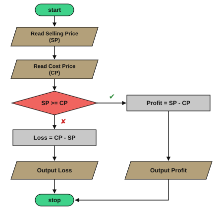

Pseudocode and flowcharts express the same thing, and translating between them
is a standard exercise and a standard exam question. A statement becomes a
rectangle, and an `If … then … else` becomes a diamond with two outgoing arrows.
A `While` becomes a diamond whose false branch exits and whose true branch loops
back. A `For i = 1 to n` becomes the initialization of a counter, a diamond
testing the counter, and an increment inside the loop. And a `return` becomes
a parallelogram followed by the stop symbol. The `For` row is worth
internalizing, because a `For` loop is a `While` loop with the counter bookkeeping made
implicit, so when you convert a flowchart with a counter back into pseudocode,
you can almost always write it as a `For`.

---

## 6. Abstract data structures: queues and stacks {#abstract-data-structures}
*Abstract data structures* represent data in the way best suited to our
algorithmic needs, so the arrangement, the coding and the links among the data
all matter. They allow the administration of and access to data in an
efficient way, and their exact specification depends on the implementation
and the use case. We have already seen arrays, linked lists, binary search
trees and associative arrays, that is, dictionaries, and we have seen that the
choice of data structure matters a lot for the performance of specific
algorithms. Two more structures, both simple, are essential for what follows.

A *queue* is a linear data structure following the FIFO principle, first in,
first out. It has two operations. ENQUEUE($Q$, $v$) adds the element $v$ to
the rear of the queue $Q$, and DEQUEUE($Q$) removes and returns the element at
the front of $Q$. Queues are used to process requests in order, and several
queues can be combined to implement priorities.

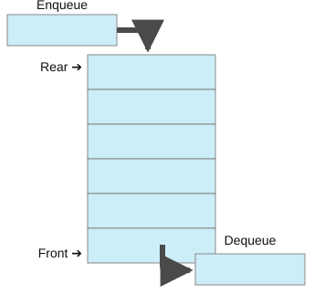

A *stack* is a linear data structure following the LIFO principle, last in,
first out. It also has two operations. PUSH($S$, $v$) adds the element $v$ to
the top of the stack $S$, and POP($S$) removes and returns the most recently
added element, that is, the top of the stack. Stacks are used in the stack
segment of memory, which manages the layered execution of subroutines, and in
recursion, which is the topic of session 6.

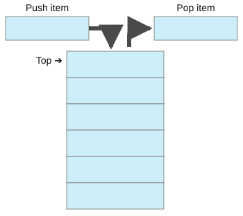

The reason why exactly these two structures matter here is that the order in
which you take things out of a container determines the shape of the search
you perform. Breadth-first search, below, uses a queue and explores level by
level, while depth-first search, in session 6, uses a stack and dives as deep as it
can. Same graph, same skeleton of the algorithm, different container, and a
completely different traversal.

---

## 7. Graphs

The lecture motivates graphs with the seven bridges of Königsberg. Leonhard
Euler asked whether there is a path that uses every bridge of the city exactly
once and ends where it started. He proved that there is not, and the argument
he used, counting how many bridges meet at each land mass, created graph
theory. The move that made it work was abstraction, that is, to throw away the geography
and keep only which land masses are connected by how many bridges. That is
what a graph is for. Many real-world structures can be represented as graphs,
among them road maps, the ownership relations between companies, the Internet,
the Web, word associations and social relations.

A graph consists of *vertices* and *edges*, and it is especially suitable for
representing interdependencies between data points. Vertices represent any
kind of object, such as cities, physical states, atoms, steps in a process or
persons, and they can be labeled or not. Edges represent the relationship
between vertices, such as roads between cities, transitions between physical
states or atomic bonds. Edges can have labels and variables, for example a
physical distance such as 2 km on a map, a type of connection such as friends
or enemies, or a weight such as strong versus weak, and they can be directed
or undirected. Formally, a graph $G$ is a tuple $G = (V, E)$, where $V$ is the
set of all vertices and $E$ is the set of all edges. For directed graphs, $E$
consists of ordered pairs $(v_1, v_2)$, meaning that the edge goes from $v_1$
to $v_2$. For undirected graphs, $E$ consists of unordered pairs $\{v_1,
v_2\}$.

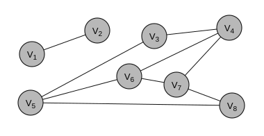

---

## 8. Representing graphs

The formal definition does not tell a computer how to store a graph, and there
are two standard answers. If $G = (V, E)$ is a graph, two vertices $v, w \in V$
are *adjacent* if they are connected by an edge $\{v, w\} \in E$, and the
*adjacency matrix* $A(G)$ is the matrix with $a_{v,w} = 1$ when $\{v, w\} \in
E$ and $a_{v,w} = 0$ otherwise. For the example graph of the lecture,

$$A(G) = \begin{array}{c|cccccccc}
 & v_1 & v_2 & v_3 & v_4 & v_5 & v_6 & v_7 & v_8\\\hline
v_1 & 0&1&0&0&0&0&0&0\\
v_2 & 1&0&0&0&0&0&0&0\\
v_3 & 0&0&0&1&1&0&0&0\\
v_4 & 0&0&1&0&0&1&1&0\\
v_5 & 0&0&1&0&0&1&0&1\\
v_6 & 0&0&0&1&1&0&1&0\\
v_7 & 0&0&0&1&0&1&0&1\\
v_8 & 0&0&0&0&1&0&1&0
\end{array}$$

For an undirected graph the matrix is symmetric. For a directed graph it is
not, and for a weighted graph the weight is stored instead of 1. The
alternative is the *adjacency list*, which is an array of vertices in which all the
neighbors of each vertex are stored as a linear list. It is a compressed
representation of the adjacency matrix in which all the zeros have been
eliminated, and it is more memory-efficient for *sparse* graphs, that is,
graphs with few edges per vertex.

| vertex | neighbors |
|---|---|
| $v_1$ | $\rightarrow v_2$ |
| $v_2$ | $\rightarrow v_1$ |
| $v_3$ | $\rightarrow v_4 \rightarrow v_5$ |
| $v_4$ | $\rightarrow v_3 \rightarrow v_6 \rightarrow v_7$ |
| $v_5$ | $\rightarrow v_3 \rightarrow v_6 \rightarrow v_8$ |
| $v_6$ | $\rightarrow v_4 \rightarrow v_5 \rightarrow v_7$ |
| $v_7$ | $\rightarrow v_4 \rightarrow v_6 \rightarrow v_8$ |
| $v_8$ | $\rightarrow v_5 \rightarrow v_7$ |

Which representation to use depends on the questions you ask most, and on how
dense the graph is. To decide whether an edge exists between $v_i$ and $v_j$,
the adjacency matrix gives direct access to one cell, while the adjacency list
requires iterating through all the neighbors of $v_i$. To count how many edges
a vertex $v_i$ has, the adjacency matrix requires iterating through all the
vertices of its row, while the adjacency list only iterates through the
neighbors. The memory argument is decisive at scale. If Facebook stored the
friendship network of 2.7 billion users as an adjacency matrix with one bit
per entry, storing the upper half of the symmetric matrix would take 455
petabytes, that is, 455 000 terabytes, just to record the presence or absence
of friendships between users. The reason is that the matrix grows with
$|V|^2$ while the list grows with $|V| + |E|$, and social networks are
extremely sparse. An average person has a few hundred friends out of billions,
so almost every bit of that matrix would be a zero.

Once a graph is stored, many problems can be posed on it. Examples are finding distances
between nodes and shortest paths, finding connected subgraphs, in which there
is a path between every two nodes, and coloring nodes so that two neighbors never
have the same color. Others are finding the nodes with the shortest average distance to
all others, ranking nodes by the number of shortest paths that pass through
them, and finding a tree that connects all nodes with the fewest edges. Still others are finding a
path that connects all nodes using each edge at most once, which is Euler's
problem, and deciding whether two graphs can be mapped onto each other, which
is the isomorphism problem. Several of these have efficient algorithms and
several do not, a distinction we make precise in session 9.

---

## 9. Breadth-First Search

The problem is, given a source node $s$, also called the starting node, to
find all the nodes reachable from it, and find a shortest path from $s$ to
each of them. The example graph of the lecture is undirected, with $V =
\{a,b,c,d,e,f,g\}$ and $E = \{\{a,e\}, \{e,b\}, \{b,c\}, \{c,f\}, \{c,g\},
\{d,g\}, \{e,f\}\}$, and the algorithm that solves the problem is
*breadth-first search* (BFS). It uses three pieces of information per vertex,
which the conventions page describes. The first is a color, which is WHITE for vertices
not seen yet, GRAY for vertices seen but not finished, and BLACK for finished
vertices. The second is the distance $d[u]$ from the source, and the third is the parent $\pi[u]$ in the
search tree. The first step initializes them.

```
Procedure INITIALIZE-BFS(G, s)
Inputs:
      G: an undirected graph
      s: the starting node
Result: the graph is initialized for a breadth-first search starting at s
For each vertex u in G.V \ {s}:
      color[u] ← WHITE
      d[u] ← ∞                  # distance
      π[u] ← NIL                # parent
color[s] ← GRAY
d[s] ← 0
π[s] ← NIL
```

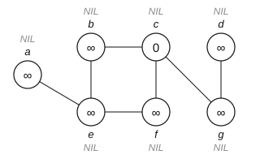

In the diagrams, the distance is written inside the node, the name of the node
is just outside it, and the parent is the gray capital letter beyond that. The
algorithm itself keeps a queue of the vertices that have been seen but whose
neighbors have not been examined yet.

```
Procedure BFS(G, s)
Inputs:
      G: an undirected graph
      s: the starting node
Result: every node reachable from s stores its distance d to s
        and its parent π
INITIALIZE-BFS(G, s)
Q ← ∅
ENQUEUE(Q, s)                              # put s in the queue Q
While Q ≠ ∅:
      u ← DEQUEUE(Q)                       # take the next element from Q
      For each vertex v in neighbors(u):   # check all neighbors of u
            If color[v] = WHITE            # only continue if v has not been seen yet
                  then color[v] ← GRAY     # mark v as seen
                       d[v] ← d[u] + 1     # one step further than u
                       π[v] ← u            # u is the parent of v
                       ENQUEUE(Q, v)       # put v in the queue
      color[u] ← BLACK                     # all neighbors of u processed
```

Three details make the algorithm work. The color prevents visiting a vertex
twice, since without it an undirected edge would send the search straight back
where it came from, forever. The queue is what makes the search breadth-first,
because vertices come out in the order they went in, so everything at distance 1 is
processed before anything at distance 2. And the assignment $d[v] \leftarrow
d[u] + 1$ is only ever executed once per vertex, the first time it is
discovered, and because of the queue that first discovery happens along a
shortest path.

### Full trace, starting from $s = c$

In the figures the queue is drawn below the graph, and a crossed cell has just
been dequeued. After the initialization, $c$ is enqueued.

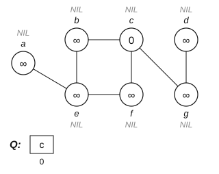

We dequeue $c$. Its white neighbors, taken in alphabetical order as the
conventions require, are $b$, $f$ and $g$. All three get distance 1 and parent
$C$, and are enqueued.

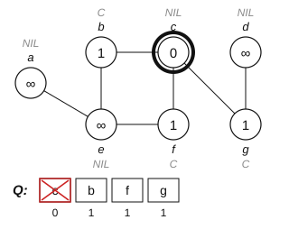

We dequeue $b$, which is next in the queue because the queue is FIFO. Its only
white neighbor is $e$, which gets distance 2 and parent $B$.

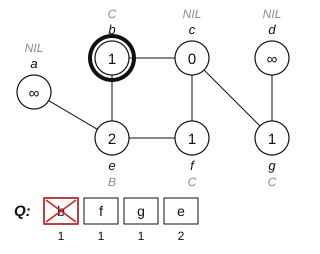

We dequeue $f$. Its neighbors $c$ and $e$ have already been seen, so nothing
changes.


We dequeue $g$. Its white neighbor $d$ gets distance 2 and parent $G$.

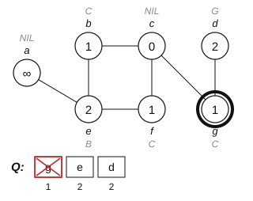

We dequeue $e$. Its white neighbor $a$ gets distance 3 and parent $E$.

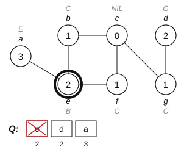

We dequeue $d$ and then $a$. Neither has white neighbors.

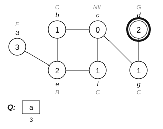

The queue is empty, so the algorithm stops.

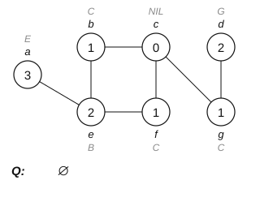

The final distances from $c$ are $b=1$, $f=1$, $g=1$, $e=2$, $d=2$ and $a=3$.
Following the parent pointers backwards from any node gives a shortest path to
$c$, for example $a \rightarrow e \rightarrow b \rightarrow c$, of length 3. A
common exam mistake is to update $d[v]$ every time $v$ is seen. Do not, because the
test `If color[v] = WHITE` means that each node is assigned a distance exactly
once. If you find yourself lowering a distance, you have either made an error
or you are solving a weighted shortest-path problem, which needs a different
algorithm, such as the Bellman-Ford algorithm of exercise sheet 5.

---

## 10. Graphs in social science

Social networks can be represented as graphs, which is classical work in
sociology, later also in political science, economics and other fields, and
research on this topic has boomed again with data from online social
networks. Many other real-world structures are graphs as well, such as road
networks, flight routes, trade connections and treaty networks, and a whole
suite of tools is available from mathematics, computer science and political
methodology to analyze them. That is exactly why it is worth learning the
vocabulary of this session, since centrality, shortest paths, components and
communities are all computed with algorithms of the kind we are studying.

---

## 11. Check yourself

**1.** Why does BFS find shortest paths, while a search that used a stack would not?

<details><summary>Answer</summary>

Because a queue processes nodes in the order they were discovered, so all
nodes at distance $k$ are finished before any node at distance $k+1$ is
dequeued. The first time a node is discovered is therefore along a shortest
path. A stack dives down one branch first, so the first time it reaches a node
may be by a long detour.

</details>

**2.** A graph has 1000 vertices and 3000 edges. How much memory does the adjacency matrix need compared with the adjacency list?

<details><summary>Answer</summary>

The matrix has $1000^2 = 10^6$ entries, regardless of the number of edges. The
lists have about $|V| + 2|E| = 1000 + 6000 = 7000$ entries, because each
undirected edge appears in two lists. That is more than two orders of magnitude
apart, and the gap grows with $|V|$.

</details>

**3.** Is "sort this list" an algorithm? Is selection sort a problem?

<details><summary>Answer</summary>

Neither. "Sort this list" is a problem, that is, a specification of what must
hold of the output. Selection sort is an algorithm, a method that achieves it.
Keeping the two apart is one of the most useful habits in this course, because a
problem can have many algorithms, and the complexity classes of session 9
classify problems, not algorithms.

</details>

**4.** Convert this flowchart to pseudocode. The flowchart reads n, sets s = 0 and i = 1, and while i ≤ n adds i to s and increments i, then outputs s.

<details><summary>Answer</summary>

```
Procedure SUM-TO-N(n)
Inputs:
      n: a positive integer
Result: the sum 1 + 2 + … + n
s ← 0
i ← 1
While i ≤ n:
      s ← s + i
      i ← i + 1
return s
```
Or, with the counter bookkeeping implicit, `For i = 1 to n: s ← s + i`.

</details>

**5.** In BFS, what would go wrong if you removed the color and instead checked `if d[v] = ∞`?

<details><summary>Answer</summary>

Nothing, because that is an equivalent test, i.e. a node has infinite distance
exactly when it has not been discovered. The colors carry more information
than BFS needs, although they matter in DFS (session 6), where GRAY and BLACK must be
distinguished to detect cycles. Using colors in both keeps the two algorithms
comparable, which is why we do it.

</details>

---

## 12. References

- **Cormen, T. H. (2013).** *Algorithms Unlocked*, MIT Press, chapter 1. The
  reading for this session; source of the framing of the properties of an
  algorithm and of the pseudocode style.
- **Cormen, T. H., Leiserson, C. E., Rivest, R. L. & Stein, C. (2009).**
  *Introduction to Algorithms*, 3rd ed., MIT Press, chapter 22 (elementary
  graph algorithms). The BFS pseudocode, the colors and the $\pi$ notation are
  theirs.
- **Euler, L. (1736).** "Solutio problematis ad geometriam situs pertinentis".
  *Commentarii academiae scientiarum Petropolitanae* 8, 128–140. The
  Königsberg bridges, and the founding paper of graph theory.
- **Berger, P.** *Einführung in die Graphentheorie.* Source of the Königsberg
  illustration used in the slides.
- **Newman, M. E. J. (2018).** *Networks*, 2nd ed., Oxford University Press.
  The standard bridge between graph algorithms and social network analysis;
  chapters 6 and 8 cover representation and BFS-based measures.
- **Wasserman, S. & Faust, K. (1994).** *Social Network Analysis: Methods and
  Applications*. Cambridge University Press. The classic sociological
  reference for section 10.
