# Session 6: Recursion

*Introduction to Computing for the Social Sciences · lecture transcript*

> Companion text for lecture 6. Notation follows
> [the course conventions](00-Conventions.md).
>
> **Reading for this session:** Chapter 13 of Zelle, *Python Programming*
> (2016). References at the end.

---

## Contents

<!-- MOTIVATION-TOC:BEGIN -->
0. [Motivating examples](#motivating-examples)
<!-- MOTIVATION-TOC:END -->
1. [Recursion, starting from an example](#1-recursion-starting-from-an-example)
2. [The three parts of a recursive definition](#2-the-three-parts-of-a-recursive-definition)
3. [Factorial](#3-factorial)
4. [How recursion runs: the program stack](#4-how-recursion-runs-the-program-stack)
5. [Euclid's algorithm](#5-euclids-algorithm)
6. [Depth-First Search](#6-depth-first-search)
7. [Types of recursion](#7-types-of-recursion)
8. [Dynamic programming](#8-dynamic-programming)
9. [Families of algorithm design](#9-families-of-algorithm-design)
10. [Check yourself](#10-check-yourself)
11. [References](#11-references)

---

<!-- MOTIVATION-SECTION:BEGIN -->
## Motivating examples

Three candidate openings for this session, each a real situation the
material is the answer to. **One of these will be used in the lecture**;
the others are kept here because they are worth reading anyway.

<!-- MOTIVATION:M06-A:BEGIN -->
### A · How many people report to her?

Take an ordinary organizational chart. There is a chief executive; below her,
division heads; below them, departments, teams and staff. In some divisions
that is four levels, in others seven, and after the next reorganization
something else. Now answer a simple question: how many people in total sit
below a given manager? The instinct from session 4 is a loop. Add up the
direct reports, then add up their reports, then theirs, and written out it
becomes:

```
total ← direct reports
For each direct report:
      total ← total + their direct reports
      For each of those:
            total ← total + their direct reports
                  ...
```

The `...` is the problem. The nesting depth of the code has to match the
depth of the chart, which you do not know when you write the code, and which
is not even the same across the organization. You could write ten levels of
nesting and hope; it would be wrong for the eleventh, and unreadable at the
third. The way out is to notice something about the structure, not about the
code. The subtree of a manager is the manager plus the subtree of each direct
report, so the description of the whole refers to the same kind of thing as
its parts:

```
Procedure HEADCOUNT-BELOW(person)
Inputs:
      person: a node of the organizational chart
Result: the number of people below person
total ← 0
For each direct report r of person:
      total ← total + 1 + HEADCOUNT-BELOW(r)
return total
```

Four lines, no assumption about depth, and it is obviously correct once you
read it as a sentence: the number below me is, for each of my reports, that
person plus the number below them. The base case is hidden in plain sight,
because a person with no direct reports never enters the loop and returns 0,
and that is what stops the whole thing.

Section 2 of this session is about the parts of any recursive definition, a
base case that returns without recursing and a recursion case that moves
strictly closer to it; get either wrong and you get an infinite descent.
Section 4 is about the call stack, what the machine actually keeps while
those nested calls are outstanding, and why "recursion depth exceeded" is a
real limit rather than a theoretical one. Section 7 is about the types of
recursion, and tree recursion is exactly the shape above: one call per child
rather than one call in total. The reframing to take away is that recursion
is not a trick for writing loops differently. It is what you reach for when
the data is defined in terms of itself, and organizations, family trees, file
systems, comment threads and grammatical sentences all are.
<!-- MOTIVATION:M06-A:END -->
<!-- MOTIVATION:M06-B:BEGIN -->
### B · The comment thread with no bottom

Online discussion is a standard object of study in computational social
science, and it has an awkward shape. A thread is not a list of posts. It is a
tree: a top-level post has replies, those replies have replies, and there is
no fixed limit. A heated exchange between two people can run forty levels
deep while the rest of the thread is flat. Look at how you would have to
define the data type: a comment consists of an author, a timestamp, some
text, and a list of comments. The definition uses the word it is defining.
That is not sloppiness; it is the honest description, and it is exactly why
loops sit badly on this data. Any question you want to ask has the same
self-referential shape. How many posts are in this thread? One, plus the
count in each reply. How deep does it go? One, plus the deepest of its
replies. How many distinct people are involved? This author, together with
the people involved in each reply. When did the argument end? The latest
timestamp among this post and all its replies. Each of these is a short
recursive procedure and a genuinely awkward loop. For example:

```
Procedure THREAD-DEPTH(comment)
Inputs:
      comment: a comment with a (possibly empty) list of replies
Result: the number of levels in the subtree rooted at this comment
If comment has no replies
      then return 1
best ← 0
For each reply r of comment:
      best ← max(best, THREAD-DEPTH(r))
return 1 + best
```

The principle worth generalizing is that when the structure of the data is
recursive, the procedure that walks it should be recursive too. The code then
has the same shape as the thing it describes, which is why recursive
solutions to recursive data are usually shorter and easier to convince
yourself are correct.

Section 2 of this session is about the base case and the recursion case.
Here the base case is a comment with no replies, and it is what guarantees
termination, provided that the thread really is a tree and not a cycle.
Section 4 is about the call stack and the practical limit it imposes: a
thread 40 000 levels deep would exhaust Python's default recursion limit of
about 1 000, which is a real constraint on real data. Section 7 distinguishes
tree recursion, one call per child, from linear recursion. The exercise sheet
asks you to write several of these procedures; do them by writing the
definition of the data first, and the procedure follows from it almost
mechanically.
<!-- MOTIVATION:M06-B:END -->
<!-- MOTIVATION:M06-C:BEGIN -->
### C · The algorithm that is 2 300 years old

The oldest algorithm still in everyday use is about 2 300 years old. Euclid
gives it in Book VII of the *Elements*, in geometric language: to find the
greatest common measure of two magnitudes, repeatedly subtract the smaller
from the larger. In modern form, using remainders instead of repeated
subtraction,

$$\gcd(a, b) = \gcd(b,\ a \bmod b), \qquad \gcd(a, 0) = a.$$

Two lines, and they do something genuinely non-obvious: they find the largest
number dividing both, without factoring either. Run it on 270 and 192:

| Call | $a$ | $b$ | $a \bmod b$ |
|---|---|---|---|
| 1 | 270 | 192 | 78 |
| 2 | 192 | 78 | 36 |
| 3 | 78 | 36 | 6 |
| 4 | 36 | 6 | 0 |
| 5 | 6 | 0 | base case, return 6 |

Five calls, and the numbers collapse fast: 270, 192, 78, 36, 6. That speed is
not luck. Taking a remainder against $b$ produces something strictly less
than $b$, and it can be shown that two steps at least halve the larger
number, so the number of calls is logarithmic in the input, not linear. This
is the cleanest example in the course of the two things a recursion needs,
and it is worth naming them against this table. The first is a base case,
line 5 of the table: when $b = 0$, the procedure returns without calling
itself, and without it the recursion never ends. The second is progress
towards the base case: each call replaces $(a, b)$ with $(b, a \bmod b)$, and
$a \bmod b < b$, so the second argument strictly decreases and is never
negative. A strictly decreasing sequence of non-negative integers cannot go
on forever, so the base case is reached. That is a proof of termination, and
it is the argument you should be able to make for any recursion you write.
Drop either half and the failure is dramatic rather than subtle. A missing
base case, or a recursive call that does not shrink the problem, gives
infinite descent: each call pushes a frame onto the call stack, the stack
fills, and the program dies with `RecursionError: maximum recursion depth
exceeded`, which in Python happens after about 1 000 frames.

Section 2 of this session develops the base case and the recursion case as
the two obligations, with termination arguments like the one above. Section
4 explains the call stack, why 1 000 is the number, what a stack frame
contains, and why it is the same stack you met in session 5. Section 7
covers linear recursion, of which Euclid is the textbook case, and its
conversion to a loop. Euclid returns in the exercise sheet and has been a
full exam question. Being able to run it by hand and to say why it stops is
the whole of what is asked.
<!-- MOTIVATION:M06-C:END -->
---

<!-- MOTIVATION-SECTION:END -->
## 1. Recursion, starting from an example

The lecture starts with a country called Simpleland and its citizenship law: a
person P is a citizen of Simpleland if P was born in Simpleland, or if either
of P's parents is a citizen of Simpleland. Now ask whether a given person P is
a citizen. The rule does not answer directly. To apply the second clause you
have to ask the same question about P's mother and father, and to answer that
you have to ask about P's grandparents, so the question keeps referring back
to itself. This is *recursion*: a definition that is stated in terms of
itself. It is not circular, and understanding why it is not circular is the
point of the whole lecture.

---

## 2. The three parts of a recursive definition

The first clause of the law, that P was born in Simpleland, does not refer to
the rule again. It can be checked directly, and that is the *base case*.
Without a base case the recursion never bottoms out, so every recursive
definition needs at least one. The second clause, that either of P's parents is
a citizen, reduces the question to the same question about a different input,
and that is the *recursion case*. Two conditions make it work: the sub-problem
must be of the same kind as the original, so that the same rule applies, and
it must be closer to the base case, so that the process terminates.

There is also a practical problem: what if we do not know all of P's
ancestors? Real records run out, and the recursion would keep asking questions
that cannot be answered. The fix is to add a clause that says that if we do
not know P's parents, then P is not a citizen of Simpleland. That is an *abort
case*, a condition that stops the recursion when it cannot proceed, even
though it is not the natural base case. In programs, abort cases guard against
inputs that would otherwise recurse forever.

Formally, recursion is a technique in mathematics, logic and computer science
to specify a function through itself, which is called a *recursive
definition*. The fundamental principle of recursion is to define the value of
a function $f$ through previously calculated values of the same function,
$f(n)$, $f(n-1)$, and so on. As long as the start value of $f$ is known for
sufficiently many arguments, which are the base cases, any value of $f$ can be
calculated, and a recursive call of $f$ keeps calling itself until either the
function converges to a target value or a predefined abort condition is met.
Once you look for it, recursion is everywhere. A binary tree is defined in
terms of binary trees (session 3), a directory contains files and
directories, a sentence can contain a clause that is itself a sentence, and
fractals are pictures defined in terms of themselves; the site
<http://recursivedrawing.com/> lets you draw some and is worth five minutes of
your time.

---

## 3. Factorial

How many different ways are there to seat four diners? For the first slot
there are 4 choices; having used one person, the second slot has 3 choices,
then 2, then 1, so there are $4! = 4 \cdot 3 \cdot 2 \cdot 1 = 24$
arrangements.


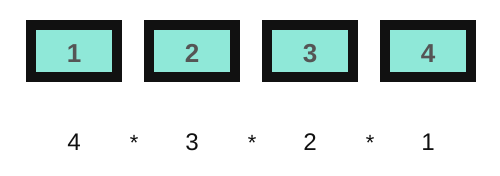

The factorial has an iterative definition, $n! = n \, (n-1) \, (n-2) \cdots
(1)$, and a recursive one:

$$n! = \begin{cases} 1 & \text{if } n = 1 \quad \text{(base case)}\\ n \cdot (n-1)! & \text{if } n > 1 \quad \text{(recursion case)}\end{cases}$$

The recursive definition is shorter, and it is also a better description of
the structure of the problem: the number of ways to seat $n$ people is $n$
choices for the first seat times the number of ways to seat the remaining
$n-1$. Each definition gives an implementation.

```
Procedure ITERATIVE-FACTORIAL(n)
Inputs:
      n: a positive integer
Result: the factorial of n
result ← 1
While n > 1:
      result ← result · n
      n ← n - 1
return result
```

```
Procedure RECURSIVE-FACTORIAL(n)
Inputs:
      n: a positive integer
Result: the factorial of n
If n = 1
      then return 1
      else return n · RECURSIVE-FACTORIAL(n - 1)
```

```python
def recursive_factorial(n):
    if n == 1:
        return 1
    else:
        return n * recursive_factorial(n - 1)
```

Notice how directly the recursive version transcribes the mathematical
definition. That is typical: when a problem has a recursive structure, the
recursive program is often the shortest correct one. The calculation can be
drawn as a tree. Tracing `fac(4)`, the call cannot return yet because it
needs `fac(3)`, which needs `fac(2)`, which needs `fac(1)`. The calls go down
until they reach the base case, `fac(1)` returns 1 without calling anything,
and only then do the values come back up: $1$, then $2 \cdot 1 = 2$, then $3
\cdot 2 = 6$, then $4 \cdot 6 = 24$.

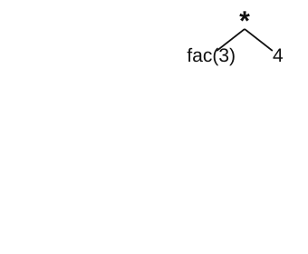
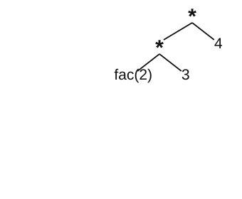
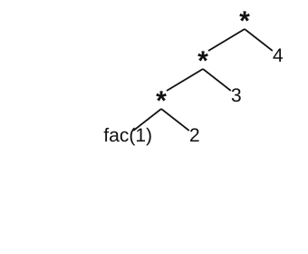
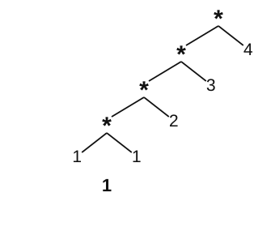
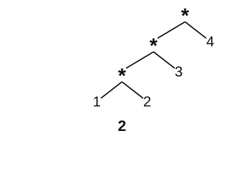
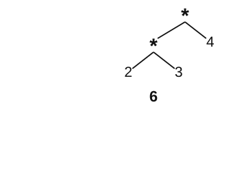
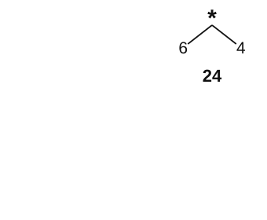

The shape of that trace, all the way down and then all the way back up, is the
most important picture in this lecture. Nothing is computed on the way down;
everything is computed on the way back.

---

## 4. How recursion runs: the program stack

To understand why recursion behaves like that, and why it can fail, we need
to look at how a running program uses memory. A program being run on a
machine is called a *process*, and a process requires memory that is organized
in three segments. The code segment (CS) contains the executable instructions,
that is, the program loaded from disk; it is typically read-only and of fixed
size. The stack segment (SS) contains local variables, parameters and return
addresses; it is typically not executable (NX) and it is limited in size, for
example 8 MB on Linux and 1 MB on Windows and in Java. The data segment or
heap (DS) contains global data, and Python manages all its objects in a
private heap; it is typically not executable and its size is limited by the
main memory or by an explicit parameter given when the program is run.

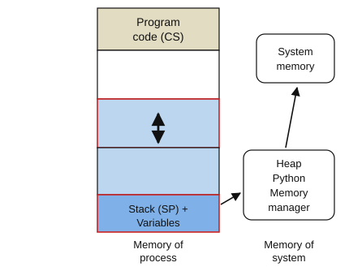

Recursion uses the program stack. For each call, the stack stores the
parameters, the return address, the local variables and the return value, and
it grows and shrinks automatically with every call: a push on the call, a pop
on the return. That is exactly the LIFO behavior of the stack of session 5,
and it is why the innermost call must finish first. But the stack has a
maximum size, so stack overflows are possible, and recursion in functions
leads to stack overflow very easily: a missing base case, or an input that is
simply too large, and the process dies. Python sets a limit of about 1000
frames by default precisely so that you get a clean error rather than a
crash:

```python
>>> recursive_factorial(10000)
RecursionError: maximum recursion depth exceeded
```

The joke on the slide, "three steps to being a good programmer: 1. avoid
recursion, 2. repeat steps 1 and 2, 3. always have an exit condition, 4.
beware of being off by one", is a real rule of thumb. Step 2 is the joke, and
steps 3 and 4 are the actual advice, because they are the two ways in which
recursive code goes wrong.

---

## 5. Euclid's algorithm

The *greatest common divisor* $\gcd(a,b)$ of two numbers is the largest number
that divides both exactly. For 8 and 6, 1 divides both, 2 divides both, and 3
does not divide 8, so $\gcd(8,6) = 2$. Euclid's algorithm rests on one
mathematical property,

$$\gcd(a,b) = \gcd(b,\; a \bmod b),$$

and that single equation is the recursion case: it replaces the problem with
a smaller instance of the same problem, because $a \bmod b < b$. The base
case is $b = 0$, since the greatest common divisor of $a$ and 0 is $a$.

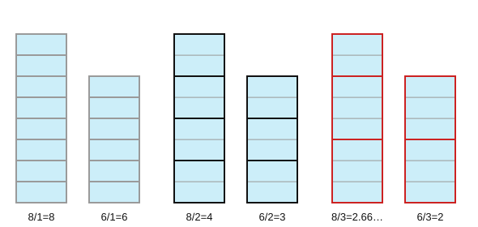

```
Procedure GCD(a, b)
Inputs:
      a, b: natural numbers (a, b ∈ ℕ) with a ≥ b
Result: the greatest common divisor of a and b
If b = 0
      then return a
      else return GCD(b, a mod b)
```

The worked trace of the lecture computes $\gcd(270, 192)$. Since $270 \bmod
192 = 78$, the call becomes $\gcd(192, 78)$; since $192 \bmod 78 = 36$, it
becomes $\gcd(78, 36)$; since $78 \bmod 36 = 6$, it becomes $\gcd(36, 6)$; and
since $36 \bmod 6 = 0$, it becomes $\gcd(6, 0)$, which returns 6. Five calls,
and the numbers shrink fast. That speed is not an accident: the remainder $a
\bmod b$ is always less than $a/2$, so the larger argument at least halves
every two calls, and the number of calls is logarithmic in the input.

Euclid (c. 300 BC) was a Greek mathematician, and "Euclid of Alexandria" is
about all we know of him: neither his birth year nor his birthplace is
recorded. He is commonly called the father of geometry, and his most
influential book, the *Elements*, contains this algorithm in Book VII. The
original version used subtraction rather than the modulo operation; it was
still recursive, but it needed more steps. One of his lesser-known books is
titled *Data* (Δεδομένα), on how to study given information geometrically.
That the same algorithm has been running unchanged for 2300 years is a good
argument for the claim of session 1 that computer science is not about
computers.

---

## 6. Depth-First Search

Breadth-first search (session 5) used a queue and explored level by level.
*Depth-first search* (DFS) explores as deep as it can before backtracking,
and the natural way to write it is recursively, because the recursion is the
stack. Several problems can be solved with it: whether a node $x$ is included
in the graph, whether the graph has a cycle, and whether the graph has a
strongly connected component. The algorithm has two procedures. The outer one
initializes every vertex and then visits every vertex that is still white,
and the inner one does the actual recursive visit.

```
Procedure DFS(G)
Inputs:
      G: a graph
Result: every vertex stores its discovery time d, its finishing time f
        and its parent π
For each vertex u in G.V:
      color[u] ← WHITE
      π[u] ← NIL                # parent
time ← 0                        # global counter
For each vertex u in G.V:
      If color[u] = WHITE
            then DFS-VISIT(G, u)
```

```
Procedure DFS-VISIT(G, u)
Inputs:
      G: a graph
      u: the vertex to be processed
Result: u and every vertex reachable from it are visited
time ← time + 1
d[u] ← time                     # discovered
color[u] ← GRAY
For each vertex v in neighbors(u):
      If color[v] = WHITE
            then π[v] ← u
                 DFS-VISIT(G, v)
color[u] ← BLACK
time ← time + 1
f[u] ← time                     # finished
```

Each vertex gets two timestamps: $d[u]$ when it is first discovered, and
$f[u]$ when all its descendants are finished. In the figures they are written
inside the node as `d/f`, the parent is the gray capital letter, and the
graph is directed, with edges $c \to b$, $c \to f$, $c \to g$, $b \to e$, $e
\to a$, $e \to f$ and $g \to d$. The For loop of DFS takes $c$ first, and
neighbors are taken in alphabetical order, as the conventions require.

### Full trace

In the initial state all times are empty.


We call DFS-VISIT($c$), and the time becomes 1. The first white neighbor of
$c$ is $b$, so we set $\pi[b] = C$ and recurse.


We call DFS-VISIT($b$) at time 2; its white neighbor is $e$.


We call DFS-VISIT($e$) at time 3; its first white neighbor is $a$.


We call DFS-VISIT($a$) at time 4. Since $a$ has no white neighbors, it
finishes immediately at time 5, so $a$ gets $4/5$, and we return to the loop
of $e$.


Back in the loop of $e$, the next white neighbor is $f$. We call
DFS-VISIT($f$) at time 6; it has no white neighbors and finishes at time 7.


Back in the loop of $e$ nothing white is left, so $e$ finishes at time 8, and
back in the loop of $b$ nothing is white either, so $b$ finishes at time 9.

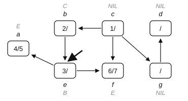


Back in the loop of $c$, the next white neighbor is $g$, because $f$ is black
by now. We call DFS-VISIT($g$) at time 10, and its white neighbor is $d$.


We call DFS-VISIT($d$) at time 11; it has no white neighbors and finishes at
time 12. Back in the loop of $g$ nothing is white, so $g$ finishes at time
13, and back in the loop of $c$ nothing is white, so $c$ finishes at time 14.
All nodes are finished and the algorithm is done.


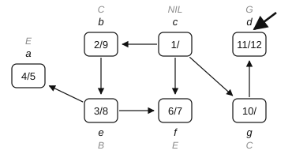


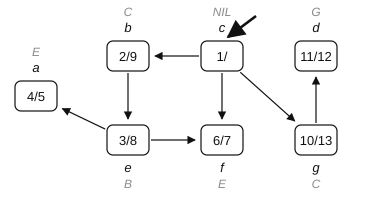


The `d/f` pairs are not decoration. Because DFS-VISIT is recursive, the
intervals $[d[u], f[u]]$ are properly nested: for any two vertices, their
intervals are either disjoint or one contains the other. That structure is
what lets DFS answer questions that BFS cannot. Any traversal can tell
whether a node is in the graph. But if DFS ever finds a neighbor that is
GRAY, that is, discovered but not finished, that neighbor is an ancestor on
the current path, so there is a cycle; this is why we keep three colors and
not two. And the strongly connected components of a directed graph are
computed from the finishing times $f$, with an algorithm you can find in
Cormen et al. (2009).

---

## 7. Types of recursion

The lecture distinguishes four types of recursive algorithms. In *linear*
recursion the method calls itself once, as in factorial and gcd. In *tree* or
*cascade* recursion the method calls itself multiple times, as in DFS and in
the Fibonacci numbers of the next section. In *tail-end* recursion the return
value of the function is computed as a call to itself and nothing else, so
that the result of the last recursive call is the final return value. The gcd
is tail-recursive, because it returns `GCD(b, a mod b)` and nothing more,
while factorial is not, because after the call returns you still have to
multiply by $n$. This distinction is practical: a tail-recursive function can
be turned into a loop mechanically, and some compilers do it automatically,
which is called tail-call optimization and removes the risk of stack overflow.
Finally, in *nested* recursion the parameters of the method themselves
contain recursive calls. The standard example is the Ackermann function,

$$\begin{aligned}
ack(0, m) &= m + 1\\
ack(n+1, 0) &= ack(n, 1)\\
ack(n+1, m+1) &= ack(n, ack(n+1, m)),
\end{aligned}$$

which is computable but grows so fast that $ack(4,3)$ has 19 729 digits. It
is used in theory as an example of a function that is computable but not
primitive recursive.

---

## 8. Dynamic programming

An *optimization problem* consists of maximizing or minimizing a real function
by systematically choosing input values from within an allowed set and
computing the value of the function, that is, finding the best available
values of some objective function given a defined domain. Many problems in
applied social science research have this structure: optimizing a statistical
model, optimizing the parameters of a simulation model, or calculating the
shortest geographical path. *Dynamic programming* refers to simplifying a
complicated problem by breaking it down into simpler sub-problems and saving
the result, so that we do not have to compute the same sub-problem again.
While some problems cannot be taken apart this way, problems that span several
points in time often do break apart recursively. Dynamic programming is both a
mathematical optimization method and an algorithm design principle, it is a
common technique in engineering and economics, and it goes back to the ideas
of Richard Bellman in the 1950s. Its key requirement is *optimal
substructure*: the problem can be solved optimally by breaking it into
sub-problems and recursively finding optimal solutions to them.

The idea behind dynamic programming is to use recursion but also to save and
reuse intermediate solutions. The problem is broken down into simpler
sub-problems and the solution to each sub-problem is stored, which is called
*memoization*, so that each sub-problem is only solved once; then the
overlapping partial solutions are put together step by step to form the
overall solution. A typical implementation iteratively fills up an array or a
matrix, and the method makes code faster by reducing the time complexity at
the cost of space.

### Worked example: Fibonacci

The naive recursive version computes the Fibonacci numbers directly from
their definition:

```
Procedure FIB(n)                  # recursive version
Inputs:
      n: a natural number (n ∈ ℕ)
Result: the n-th Fibonacci number
If n = 0 then return 0
If n = 1 then return 1
return FIB(n - 1) + FIB(n - 2)
```

This is tree recursion, and it is catastrophically wasteful. To compute
`FIB(5)` you compute `FIB(3)` twice, `FIB(2)` three times and `FIB(1)` five
times, and the number of calls grows exponentially with $n$. Now add a memo:

```
Procedure FIB(n)                  # recursive, with memoization
Inputs:
      n: a natural number (n ∈ ℕ)
Data: memo: an array indexed from 0 to n, initially all NIL
Result: the n-th Fibonacci number
If n = 0 then return 0
If n = 1 then return 1
If memo[n] ≠ NIL then return memo[n]      # previously calculated
memo[n] ← FIB(n - 1) + FIB(n - 2)
return memo[n]
```

Each value is now computed once and looked up thereafter, and the running time
drops from exponential to linear, one of the largest improvements you will
see from a three-line change. Finally, we can drop the recursion entirely and
fill the table directly:

```
Procedure FIB(n)                  # fully iterative
Inputs:
      n: a natural number (n ∈ ℕ)
Data: memo: an array indexed from 0 to n
Result: the n-th Fibonacci number
memo[0] ← 0
memo[1] ← 1
For i = 2 to n:
      memo[i] ← memo[i - 1] + memo[i - 2]
return memo[n]
```

This does the same work with no stack frames and no risk of overflow, and it
is the usual endpoint of a dynamic programming design: recognize the
recursion, memoize it, then notice that the recursion was only ever filling a
table and fill the table directly.

---

## 9. Families of algorithm design

The lecture closes with the most common problem-solving heuristics you will
meet. *Recursion* solves a problem through recursive function calls, as in
DFS, and requires sensible abort conditions. *Greedy* algorithms extend
partial solutions successively, as in the construction of a Huffman code,
where the two least likely symbols are merged at every step; they determine
the locally optimal choice at each step and then move on, and they are only
correct if the local optimum also leads to a globally optimal solution, which
is the thing you must check and which is false surprisingly often. *Divide
and conquer* separates the problem into decoupled, non-overlapping smaller
sub-problems, solves the sub-problems independently and, if necessary,
collapses the sub-results into the global result; mergesort and quicksort in
the next session are the examples. The difference between divide and conquer
and dynamic programming is whether the sub-problems overlap. In mergesort the
two halves are disjoint, so there is nothing to reuse, while in Fibonacci the
sub-problems overlap enormously, so caching pays.

---

## 10. Check yourself

**1.** What happens if you call `recursive_factorial(0)`?

<details><summary>Answer</summary>

Infinite recursion, then a `RecursionError`. The base case tests `n == 1`,
and 0 never reaches it: 0, −1, −2, and so on. This is the "always have an
exit condition" rule. A correct implementation tests `n <= 1`, or defines
$0! = 1$ explicitly.

</details>

**2.** Write the recursive definition of the sum of a list.

<details><summary>Answer</summary>

The base case is that the sum of an empty list is 0, and the recursion case
is that the sum of a list is its last element plus the sum of the rest.

```
Procedure SUM(A, n)
If n = 0
      then return 0
      else return A[n] + SUM(A, n - 1)
```

It is not tail-recursive, because you still add `A[n]` after the call
returns.

</details>

**3.** BFS and DFS on the same graph from the same start: will they always discover the same set of nodes?

<details><summary>Answer</summary>

Yes, both discover exactly the nodes reachable from the start. They differ in
the order of discovery and in the tree they build, that is, in the $\pi$
pointers, not in the reachable set. That is why either works to decide whether
a graph is connected, but only BFS gives shortest paths.

</details>

**4.** Why does memoizing Fibonacci help so much, but memoizing factorial not at all?

<details><summary>Answer</summary>

Because `FIB` calls itself twice and the two call trees overlap massively, so
the same sub-problems recur. Factorial calls itself once, so every
sub-problem is computed exactly once already and there is nothing to cache.
Memoization pays exactly when sub-problems overlap.

</details>

**5.** During a DFS you encounter a neighbor that is GRAY. What have you found, and why does WHITE/BLACK not tell you?

<details><summary>Answer</summary>

A cycle. GRAY means discovered but not finished, that is, still on the current
recursion path, so an edge to it closes a loop. WHITE means undiscovered, a
new branch, and BLACK means finished, an edge to an already completed subtree,
which is not a cycle in a directed graph. This is why DFS uses three colors
where BFS could get away with two.

</details>

---

## 11. References

- **Zelle, J. M. (2016).** *Python Programming: An Introduction to Computer
  Science*, 3rd ed., chapter 13 (algorithm design and recursion). The reading
  for this session.
- **Cormen, T. H., Leiserson, C. E., Rivest, R. L. & Stein, C. (2009).**
  *Introduction to Algorithms*, 3rd ed., MIT Press, section 22.3 (depth-first
  search) and chapter 15 (dynamic programming). Source of the DFS pseudocode,
  the colors and the discovery/finishing-time notation.
- **Cormen, T. H. (2013).** *Algorithms Unlocked*, MIT Press, chapter 2, pp.
  21–23, on recursion in pseudocode.
- **Bellman, R. (1957).** *Dynamic Programming*. Princeton University Press.
  Where the term and the method come from; Bellman tells in his autobiography
  that the name was chosen partly because it would not offend a funding
  agency.
- **Euclid** (c. 300 BC). *Elements*, Book VII, Propositions 1–2. The gcd
  algorithm, in its subtraction form.
- **Ackermann, W. (1928).** "Zum Hilbertschen Aufbau der reellen Zahlen".
  *Mathematische Annalen* 99, 118–133.
- **Recursive Drawing**, an interactive toy for the fractal intuition of
  section 2: <http://recursivedrawing.com/>
- **Python's recursion limit:** `sys.setrecursionlimit`,
  <https://docs.python.org/3/library/sys.html#sys.setrecursionlimit>
