# Session 6: Recursion

<style>
figure, .figure, .float { margin: 1.4em 0 1.8em 0; }
figure img, .float img { display: block; max-width: 100%; }
figcaption, .figcaption, .figure p.caption { margin-top: 0.3em; font-size: 0.88em; color: #555; }
details { margin: -0.5em 0 2.2em 0; }
</style>

*Introduction to Computing for the Social Sciences · lecture transcript*

**Reading for this session:** Chapter 13 of Zelle, *Python Programming*
(2016). References at the end.

---

## Contents

1. [Recursion](#recursion)
2. [Recursive algorithms](#recursive-algorithms)
3. [Dynamic programming](#dynamic-programming)

---

<!-- MOTIVATION-SECTION:BEGIN -->
## Motivating examples

<!-- MOTIVATION:M06-A:BEGIN -->
### A · How many people report to her?

An ordinary organizational chart has a chief executive, division heads below
her, and departments, teams and staff below them. Some
divisions have four levels, others have seven, and the number can change with
the next reorganization. How many people in total work below a given manager?
With what we learned in the Software session, the first idea is a loop that
adds up the direct reports, then their reports, then the reports of those.
Written out, the loop becomes:

```
total ← direct reports
For each direct report:
      total ← total + their direct reports
      For each of those:
            total ← total + their direct reports
                  ...
```

The problem is the `...` at the end. The nesting depth of the code has to
match the depth of the chart, but you do not know that depth when you write
the code and it is not even the same across the organization. You could write
ten levels of nesting, but the code would be wrong for a chart with eleven
levels and it would already be hard to read at the third. The solution comes
from looking at the structure of the data instead of the code. The subtree of
a manager is the manager plus the subtree of each direct report, so the
description of the whole chart refers to the same kind of thing as its parts.
We can write a procedure that follows that description:

```
Procedure HEADCOUNT-BELOW(person)
Inputs:
      person: a node of the organizational chart
Result: the number of people below person
total ← 0
For each direct report r of person:
      total ← total + 1 + HEADCOUNT-BELOW(r)
return total
```

The procedure has four lines and makes no assumption about the depth of the
chart. You can check that it is correct by reading it as a sentence, namely
that the number of people below me is, for each of my direct reports, that
person plus the number of people below them. The procedure also stops without
an explicit test, because a person with no direct reports never enters the
loop and returns 0.

In this session you will learn about the parts of a recursive definition,
namely a base case that returns without recursing and a recursion case that
moves closer to the base case. If either of them is wrong, the procedure never
stops. We will also learn about the call stack, i.e. what the machine keeps in
memory while those nested calls are waiting, and why "recursion depth
exceeded" is a limit that you can reach in practice. Finally, we will learn
about the types of recursion, including tree recursion, which is the type of
the procedure above because it makes one call per direct report. Recursion is
useful when the data is defined in terms of itself, which is the case for
organizations, family trees, file systems, comment threads and grammatical
sentences. If you work with data like these, a recursive procedure is often
the shortest correct way to process them.

<!-- MOTIVATION:M06-A:END -->
<!-- MOTIVATION:M06-B:BEGIN -->
### B · The comment thread with no bottom

Online discussion is a standard object of study in computational social
science, but its data has a structure that is not easy to process. A thread is
a tree and not a list of posts, because a top-level post has replies, those
replies have replies, and there is no fixed limit to the depth. A heated
exchange between two people can run forty levels deep while the rest of the
thread is flat. Think about how you would define the data type. A comment
consists of an author, a timestamp, some text and a list of comments, so the
definition uses the word that it is defining. This is the correct description
of the data and it is the reason why loops are hard to write for it. Any
question that you want to ask about a thread refers to itself in the same way:

- **How many posts are in this thread?** The answer is one plus the number of
  posts in each reply.
- **How deep does it go?** The depth is one plus the depth of the deepest
  reply.
- **How many distinct people are involved?** They are the author of this post
  together with the people involved in each reply.
- **When did the argument end?** It ended at the latest timestamp among this
  post and all its replies.

Each of these questions is answered by a short recursive procedure, while the
corresponding loop is much harder to write. For example, the depth of a thread
can be computed like this:

```
Procedure THREAD-DEPTH(comment)
Inputs:
      comment: a comment with a (possibly empty) list of replies
Result: the number of levels in the subtree rooted at this comment
If comment has no replies
      then return 1
best ← 0
For each reply r of comment:
      best ← max(best, THREAD-DEPTH(r))
return 1 + best
```

When the structure of the data is recursive, the procedure that goes through
it should usually be recursive too. The code then has the same structure as
the data it describes, so recursive solutions for recursive data are usually
shorter and it is easier to check that they are correct.

In this session you will learn about the base case and the recursion case of a
recursive definition. Here the base case is a comment with no replies, and it
guarantees that the procedure terminates as long as the thread really is a
tree and has no cycle. We will also learn about the call stack and the
practical limit that it imposes. For example, a thread 40,000 levels deep
would exceed Python's default recursion limit of about 1,000 calls. Finally,
we will learn to distinguish tree recursion, which makes one call per child,
from linear recursion. When you write a procedure like these for your own
data, write the definition of the data first, because the procedure follows
from it almost mechanically.

<!-- MOTIVATION:M06-B:END -->
<!-- MOTIVATION:M06-C:BEGIN -->
### C · The algorithm that is 2,300 years old

The oldest algorithm still in everyday use is about 2,300 years old. Euclid
gives it in Book VII of the *Elements* in geometric language. To find the
greatest common measure of two magnitudes, you repeatedly subtract the smaller
from the larger. In modern form, using remainders instead of repeated
subtraction, the algorithm is written as follows:

$$\gcd(a, b) = \gcd(b,\ a \bmod b), \qquad \gcd(a, 0) = a.$$

These two equations find the largest number that divides both $a$ and $b$
without factoring either of them, which is not obvious at first sight. Let's
run the algorithm on 270 and 192.

| Call | $a$ | $b$ | $a \bmod b$ |
|---|---|---|---|
| 1 | 270 | 192 | 78 |
| 2 | 192 | 78 | 36 |
| 3 | 78 | 36 | 6 |
| 4 | 36 | 6 | 0 |
| 5 | 6 | 0 | base case, return 6 |

The algorithm needs only five calls because the numbers decrease fast, from
270 to 192, 78, 36 and 6. This speed has an explanation, namely that taking a
remainder against $b$ produces a number strictly less than $b$. It can be
shown that two steps at least halve the larger number, so the number of calls
is logarithmic in the input instead of linear. The table also shows the two
things that a recursion needs:

1. **A base case.** In line 5 of the table, $b = 0$ and the procedure returns
   without calling itself. Without the base case the recursion would never
   end.
2. **Progress towards the base case.** Each call replaces $(a, b)$ with
   $(b, a \bmod b)$ and $a \bmod b < b$, so the second argument strictly
   decreases and is never negative. A strictly decreasing sequence of
   non-negative integers cannot go on forever, so the base case is eventually
   reached.

The second point is a proof of termination, and you should be able to make an
argument like it for any recursion you write. If the base case is missing or
the recursive call does not shrink the problem, the calls never stop. Each
call pushes a frame onto the call stack until the stack is full, and the
program stops with the error `RecursionError: maximum recursion depth
exceeded`, which in Python happens after about 1,000 frames.

In this session you will learn about the base case and the recursion case as
the two requirements of a recursive definition, with termination arguments
like the one above. We will also learn about the call stack, what a stack
frame contains, and why Python stops at about 1,000 frames. Finally, we will
learn about linear recursion, of which Euclid's algorithm is the standard
example, and how it can be converted into a loop. After this session you
should be able to run Euclid's algorithm with pen and paper and to explain why
it stops.

<!-- MOTIVATION:M06-C:END -->

---

<!-- MOTIVATION-SECTION:END -->
## 1. Recursion, starting from an example {#recursion}
Let's start with a country called Simpleland and its citizenship law, which
says that a person P is a citizen of Simpleland if P was born in Simpleland,
or if either of P's parents is a citizen of Simpleland. Is a given person P a
citizen of Simpleland? The rule does not always answer the question directly.
To apply the second clause you have to ask the same question about P's mother
and father, and to answer that you have to ask about P's grandparents, so the
question keeps referring back to itself. This is *recursion*, i.e. a
definition that is stated in terms of itself. The definition is not circular,
and in this session we will learn why.

---

## 2. The three parts of a recursive definition

The first clause of the law, that P was born in Simpleland, does not refer to
the rule again. It can be checked directly, so we call it the *base case*.
Every recursive definition needs at least one base case, because without it
the recursion never ends. The second clause, that either of P's parents is a
citizen, reduces the question to the same question about a different input, so
we call it the *recursion case*. The recursion case works under two
conditions. First, the sub-problem must be of the same kind as the original,
so that the same rule applies. Second, the sub-problem must be closer to the
base case, so that the process terminates.

There is also a practical problem. What if we do not know all of P's
ancestors? Real records are incomplete, and the recursion would keep asking
questions that cannot be answered. The solution is to add a clause that says
that if we do not know P's parents, then P is not a citizen of Simpleland.
This clause is an *abort case*, i.e. a condition that stops the recursion when
it cannot proceed, even though it is not the natural base case. In programs,
abort cases protect against inputs that would otherwise make the recursion run
forever, for example a negative number given to a function that counts down to
zero.

Formally, recursion is a technique in mathematics, logic and computer science
to specify a function through itself, which is called a *recursive
definition*. The fundamental principle of recursion is to define the value of
a function $f$ through previously calculated values of the same function, i.e.
$f(n)$, $f(n-1)$, and so on. As long as the start value of $f$ is known for
sufficiently many arguments, which are the base cases, any value of $f$ can be
calculated. A recursive call of $f$ keeps calling itself until either the
function converges to a target value or a predefined abort condition is met.

Recursion appears in many places besides laws and mathematical functions. For
example, a binary tree is defined in terms of binary trees, as we learned in
the Data Structures session. A directory contains
files and directories, a sentence can contain a clause that is itself a
sentence, and fractals are pictures defined in terms of themselves. You can
draw some fractals yourself on the site <http://recursivedrawing.com/>.

---

## 3. Factorial

How many different ways are there to seat four diners? For the first slot
there are 4 choices. After using one person, the second slot has 3 choices,
the third has 2 and the last has 1, so there are $4! = 4 \cdot 3 \cdot 2
\cdot 1 = 24$ arrangements.


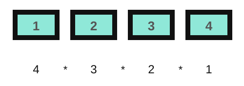

The factorial has an iterative definition, $n! = n \, (n-1) \, (n-2) \cdots
(1)$, and a recursive one:

$$n! = \begin{cases} 1 & \text{if } n = 1 \quad \text{(base case)}\\ n \cdot (n-1)! & \text{if } n > 1 \quad \text{(recursion case)}\end{cases}$$

The recursive definition is shorter and it also describes the structure of the
problem better, because the number of ways to seat $n$ people is $n$ choices
for the first seat times the number of ways to seat the remaining $n-1$
people. Each definition gives an implementation, and below you can see the
iterative procedure, the recursive procedure, and the recursive procedure
written in Python.

```
Procedure ITERATIVE-FACTORIAL(n)
Inputs:
      n: a positive integer
Result: the factorial of n
result ← 1
While n > 1:
      result ← result · n
      n ← n - 1
return result
```

```
Procedure RECURSIVE-FACTORIAL(n)
Inputs:
      n: a positive integer
Result: the factorial of n
If n = 1
      then return 1
      else return n · RECURSIVE-FACTORIAL(n - 1)
```

```python
def recursive_factorial(n):
    if n == 1:
        return 1
    else:
        return n * recursive_factorial(n - 1)
```

Notice how directly the recursive version follows the mathematical definition.
This is typical, because when a problem has a recursive structure, the
recursive program is often the shortest correct one. The calculation can be
drawn as a tree. When we trace `fac(4)`, the call cannot return yet because it
needs `fac(3)`, which needs `fac(2)`, which needs `fac(1)`. The calls go down
until they reach the base case, where `fac(1)` returns 1 without calling
anything. Only then do the values come back up, first $1$, then $2 \cdot 1 =
2$, then $3 \cdot 2 = 6$ and finally $4 \cdot 6 = 24$.


The trace goes all the way down and then all the way back up, and this is the
most important picture of this session. Nothing is computed on the way down
and all the multiplications happen on the way back up.

---

## 4. How recursion runs: the program stack

To understand why recursion behaves like that and why it can fail, we need to
look at how a running program uses memory. A program being run on a machine is
called a *process*, and a process requires memory that is organized in three
segments:

- The **code segment** (CS) contains the executable instructions, i.e. the
  program loaded from disk. It is typically read-only and of fixed size.
- The **stack segment** (SS) contains local variables, parameters and return
  addresses. It is typically not executable (NX) and it is limited in size,
  for example 8 MB on Linux and 1 MB on Windows and in Java.
- The **data segment** or **heap** (DS) contains global data, and Python
  manages all its objects in a private heap. It is typically not executable
  and its size is limited by the main memory or by an explicit parameter given
  when the program is run.

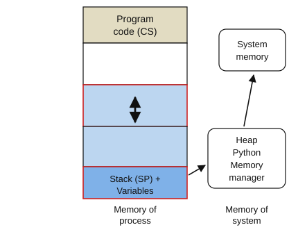

Recursion uses the program stack. For each call, the stack stores the
parameters, the return address, the local variables and the return value. The
stack grows and shrinks automatically with every call, with a push on the call
and a pop on the return. This is the LIFO behavior of the stack that we
learned in the Algorithms session, and it is the reason why the innermost call
must finish first. However, the stack has a maximum size, so stack overflows
are possible and recursive functions can cause them easily. If the base case
is missing or the input is simply too large, the stack fills up and the
process is terminated. Python sets a limit of about 1,000 frames by default so
that you get a clean error instead of a crash:

```python
>>> recursive_factorial(10000)
RecursionError: maximum recursion depth exceeded
```

You can see this limit at work in section 2 of the [Python examples notebook
of this session](https://github.com/dgarcia-eu/ICSS/blob/main/PythonExamples/Examples06-Recursion.ipynb),
where a recursive depth-first search fails on a chain of 5,000 nodes while an
iterative version with its own stack finishes.

A popular joke lists the "three steps to being a good programmer" as 1. avoid
recursion, 2. repeat steps 1 and 2, 3. always have an exit condition, 4.
beware of being off by one. The joke contains a real rule of thumb. Step 2 is
the joke itself, while steps 3 and 4 are actual advice, because a missing exit
condition and an off-by-one error are two common ways in which recursive code
goes wrong.

---

## 5. Euclid's algorithm {#recursive-algorithms}
The *greatest common divisor* $\gcd(a,b)$ of two numbers is the largest number
that divides both exactly. For example, 1 and 2 divide both 8 and 6 but no
larger number does, so $\gcd(8,6) = 2$. Euclid's algorithm is based on one
mathematical property:

$$\gcd(a,b) = \gcd(b,\; a \bmod b)$$

This equation is the recursion case. It replaces the problem with a smaller
instance of the same problem, because $a \bmod b < b$. The base case is
$b = 0$, because the greatest common divisor of $a$ and 0 is $a$.

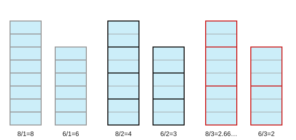

```
Procedure GCD(a, b)
Inputs:
      a, b: natural numbers (a, b ∈ ℕ) with a ≥ b
Result: the greatest common divisor of a and b
If b = 0
      then return a
      else return GCD(b, a mod b)
```

As an example, let's compute $\gcd(270, 192)$. Since $270 \bmod 192 = 78$, the
call becomes $\gcd(192, 78)$. Since $192 \bmod 78 = 36$, it becomes
$\gcd(78, 36)$, and since $78 \bmod 36 = 6$, it becomes $\gcd(36, 6)$. Finally,
since $36 \bmod 6 = 0$, it becomes $\gcd(6, 0)$, which returns 6. The algorithm
needs only five calls because the numbers shrink fast. The reason is that the
remainder $a \bmod b$ is always less than $a/2$, so the larger argument at
least halves every two calls and the number of calls is logarithmic in the
input. Section 3 of the [Python examples notebook of this session](https://github.com/dgarcia-eu/ICSS/blob/main/PythonExamples/Examples06-Recursion.ipynb)
counts the calls for two 18-digit numbers and compares them with the time
needed to try every candidate divisor.

Euclid (c. 300 BC) was a Greek mathematician. He is known as "Euclid of
Alexandria" but little else is known about his life, since neither his birth
year nor his birthplace is recorded. He is commonly called the father of
geometry, and his most influential book, the *Elements*, contains this
algorithm in Book VII. The original version used subtraction instead of the
modulo operation. It was still recursive but it needed more steps. One of his
lesser-known books is titled *Data* (Δεδομένα) and is about how to study given
information geometrically. The same algorithm has been used unchanged for
2,300 years, which supports the claim of the Introduction session that
computer science is not about computers.

---

## 6. Depth-First Search

Breadth-first search, which we learned in the Algorithms session, uses a queue
and explores the graph level by level. *Depth-first search* (DFS) explores as
deep as it can before backtracking. The natural way to write it is
recursively, because the program stack of the recursive calls does the work of
the stack that the search needs. Several problems can be solved with DFS, for
example whether a node $x$ is included in the graph, whether the graph has a
cycle, and whether the graph has a strongly connected component. The algorithm
has two procedures, namely an outer one that initializes every vertex and then
visits every vertex that is still white, and an inner one that does the actual
recursive visit.

```
Procedure DFS(G)
Inputs:
      G: a graph
Result: every vertex stores its discovery time d, its finishing time f
        and its parent π
For each vertex u in G.V:
      color[u] ← WHITE
      π[u] ← NIL                # parent
time ← 0                        # global counter
For each vertex u in G.V:
      If color[u] = WHITE
            then DFS-VISIT(G, u)
```

```
Procedure DFS-VISIT(G, u)
Inputs:
      G: a graph
      u: the vertex to be processed
Result: u and every vertex reachable from it are visited
time ← time + 1
d[u] ← time                     # discovered
color[u] ← GRAY
For each vertex v in neighbors(u):
      If color[v] = WHITE
            then π[v] ← u
                 DFS-VISIT(G, v)
color[u] ← BLACK
time ← time + 1
f[u] ← time                     # finished
```

Each vertex gets two timestamps, namely $d[u]$ when it is first discovered and
$f[u]$ when all its descendants are finished. In the figures they are written
inside the node as `d/f` and the parent is the gray capital letter. The graph
is directed, with edges $c \to b$, $c \to f$, $c \to g$, $b \to e$, $e \to a$,
$e \to f$ and $g \to d$. The For loop of DFS takes $c$ first and neighbors are
taken in alphabetical order, as the conventions require.

### Full trace

In the initial state all times are empty.

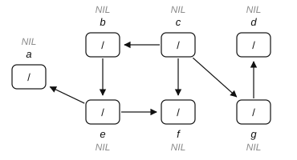

We call DFS-VISIT($c$), and the time becomes 1. The first white neighbor of
$c$ is $b$, so we set $\pi[b] = C$ and recurse.

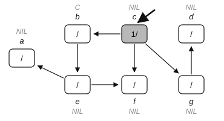

We call DFS-VISIT($b$) at time 2, and its white neighbor is $e$.

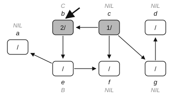

We call DFS-VISIT($e$) at time 3, and its first white neighbor is $a$.

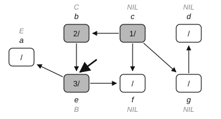

We call DFS-VISIT($a$) at time 4. Since $a$ has no white neighbors, it
finishes immediately at time 5, so $a$ gets $4/5$, and we return to the loop
of $e$.

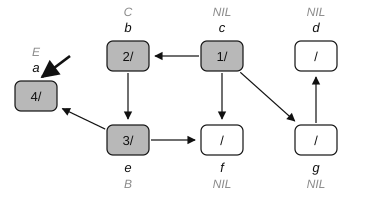

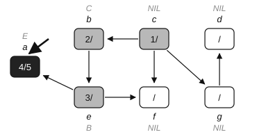

Back in the loop of $e$, the next white neighbor is $f$. We call
DFS-VISIT($f$) at time 6. It has no white neighbors and finishes at time 7.

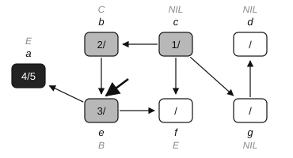

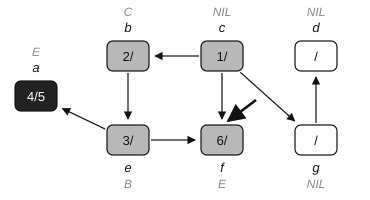

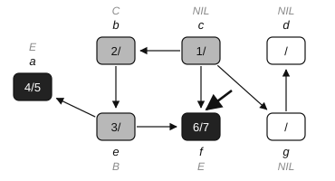

Back in the loop of $e$ nothing white is left, so $e$ finishes at time 8, and
back in the loop of $b$ nothing is white either, so $b$ finishes at time 9.

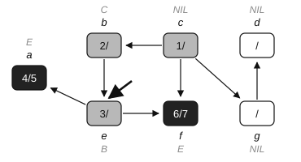

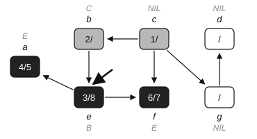


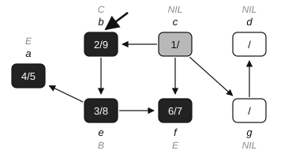

Back in the loop of $c$, the next white neighbor is $g$, because $f$ is black
by now. We call DFS-VISIT($g$) at time 10, and its white neighbor is $d$.

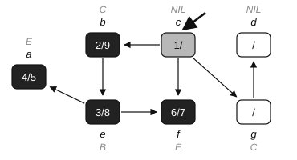

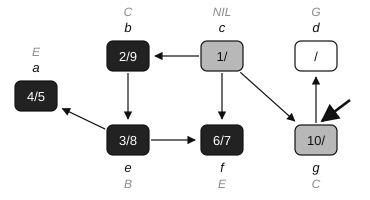

We call DFS-VISIT($d$) at time 11. It has no white neighbors and finishes at
time 12. Back in the loop of $g$ nothing is white, so $g$ finishes at time
13, and back in the loop of $c$ nothing is white, so $c$ finishes at time 14.
All nodes are finished and the algorithm is done.

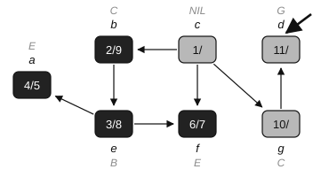


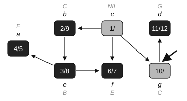

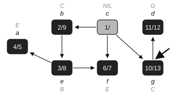

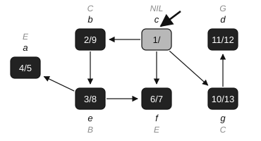

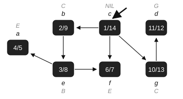

The `d/f` pairs carry useful information. Because DFS-VISIT is recursive, the
intervals $[d[u], f[u]]$ are properly nested, i.e. for any two vertices, their
intervals are either disjoint or one contains the other. This structure allows
DFS to answer questions that BFS cannot answer. Any traversal can tell whether
a node is in the graph. However, if DFS finds a neighbor that is GRAY, i.e.
discovered but not finished, then that neighbor is an ancestor on the current
path and therefore the graph has a cycle. This is the reason why we keep three
colors instead of two. The strongly connected components of a directed graph
can also be computed from the finishing times $f$, with an algorithm that you
can find in Cormen et al. (2009).

---

## 7. Types of recursion

There are four types of recursive algorithms:

- In **linear** recursion the method calls itself once, as in factorial and
  gcd.
- In **tree** or **cascade** recursion the method calls itself multiple times,
  as in DFS and in the Fibonacci numbers that we will see below.
- In **tail-end** recursion the return value of the function is computed as a
  call to itself and nothing else, so that the result of the last recursive
  call is the final return value. The gcd is tail-recursive because it returns
  `GCD(b, a mod b)` and nothing more, while factorial is not, because after
  the call returns you still have to multiply by $n$.
- In **nested** recursion the parameters of the method themselves contain
  recursive calls. The standard example is the Ackermann function defined
  below.

Recognizing tail-end recursion is useful in practice, because a tail-recursive
function can be turned into a loop mechanically. Some compilers do it
automatically, which is called tail-call optimization and removes the risk of
stack overflow.

The Ackermann function is defined by three equations:

$$\begin{aligned}
ack(0, m) &= m + 1\\
ack(n+1, 0) &= ack(n, 1)\\
ack(n+1, m+1) &= ack(n, ack(n+1, m))
\end{aligned}$$

It is computable but it grows so fast that $ack(4,3)$ has 19,729 digits. It is
used in theory as an example of a function that is computable but not
primitive recursive.

---

## 8. Dynamic programming {#dynamic-programming}
An *optimization problem* consists of maximizing or minimizing a real function
by systematically choosing input values from within an allowed set and
computing the value of the function. In other words, we look for the best
available values of some objective function given a defined domain. Many
problems in applied social science research have this structure, for example
optimizing a statistical model, optimizing the parameters of a simulation
model, or calculating the shortest geographical path.

*Dynamic programming* refers to simplifying a complicated problem by breaking
it down into simpler sub-problems and saving the result, so that we do not
have to compute the same sub-problem again. Some problems cannot be taken
apart this way, but problems that span several points in time often do break
apart recursively. Dynamic programming is both a mathematical optimization
method and an algorithm design principle. It is a common technique in
engineering and economics and it goes back to the ideas of Richard Bellman in
the 1950s. Its key requirement is *optimal substructure*, which means that the
problem can be solved optimally by breaking it into sub-problems and
recursively finding optimal solutions to them.

The idea behind dynamic programming is to use recursion but also to save and
reuse intermediate solutions. The problem is broken down into simpler
sub-problems and the solution to each sub-problem is stored, which is called
*memoization*, so that each sub-problem is only solved once. Then the
overlapping partial solutions are put together step by step to form the
overall solution. A typical implementation iteratively fills up an array or a
matrix. The method makes code faster by reducing the time complexity at the
cost of using more memory.

### Worked example: Fibonacci

The naive recursive version computes the Fibonacci numbers directly from
their definition:

```
Procedure FIB(n)                  # recursive version
Inputs:
      n: a natural number (n ∈ ℕ)
Result: the n-th Fibonacci number
If n = 0
      then return 0
If n = 1
      then return 1
return FIB(n - 1) + FIB(n - 2)
```

This is tree recursion and it repeats a lot of work. To compute `FIB(5)` you
compute `FIB(3)` twice, `FIB(2)` three times and `FIB(1)` five times, and the
number of calls grows exponentially with $n$. We can avoid the repeated work
by adding a memo:

```
Procedure FIB(n)                  # recursive, with memoization
Inputs:
      n: a natural number (n ∈ ℕ)
Data: memo: an array indexed from 0 to n, initially all NIL
Result: the n-th Fibonacci number
If n = 0
      then return 0
If n = 1
      then return 1
If memo[n] ≠ NIL
      then return memo[n]      # previously calculated
memo[n] ← FIB(n - 1) + FIB(n - 2)
return memo[n]
```

Each value is now computed once and looked up afterwards, so the running time
drops from exponential to linear with a change of three lines. Section 1 of
the [Python examples notebook of this session](https://github.com/dgarcia-eu/ICSS/blob/main/PythonExamples/Examples06-Recursion.ipynb)
counts the calls of both versions, and for $n = 30$ the version without memo
makes about 2.7 million calls while the version with memo makes 59. Finally,
we can drop the recursion entirely and fill the table directly:

```
Procedure FIB(n)                  # fully iterative
Inputs:
      n: a natural number (n ∈ ℕ)
Data: memo: an array indexed from 0 to n
Result: the n-th Fibonacci number
memo[0] ← 0
memo[1] ← 1
For i = 2 to n:
      memo[i] ← memo[i - 1] + memo[i - 2]
return memo[n]
```

This version does the same work with no stack frames and no risk of overflow.
It is the usual result of a dynamic programming design, in which you first
recognize the recursion, then memoize it, and finally notice that the
recursion was only filling a table, so you fill the table directly.

---

## 9. Families of algorithm design

These are the most common problem-solving heuristics that you will encounter:

- **Recursion** solves a problem through recursive function calls, as in DFS,
  and requires sensible abort conditions.
- **Greedy** algorithms extend partial solutions successively, as in the
  construction of a Huffman code, where the two least likely symbols are
  merged at every step. They determine the locally optimal choice at each step
  and then move on. They are only correct if the local optimum also leads to a
  globally optimal solution, which you must check because it is often not the
  case.
- **Divide and conquer** separates the problem into decoupled, non-overlapping
  smaller sub-problems, solves the sub-problems independently and, if
  necessary, combines the sub-results into the global result. We will learn
  mergesort and quicksort as examples in the Sorting Algorithms session.

The difference between divide and conquer and dynamic programming is whether
the sub-problems overlap. In mergesort the two halves are disjoint, so there
is nothing to reuse, while in Fibonacci the sub-problems overlap a lot, so
saving their results saves most of the work.

---

## 10. Why does this matter? Practical Python examples

Check the [practical Python examples in this Jupyter notebook](https://github.com/dgarcia-eu/ICSS/blob/main/PythonExamples/Examples06-Recursion.ipynb).
There, you will see a recursive Fibonacci function make millions of calls
where the same function with a memo makes 59, a recursive depth-first search
fail on a chain of 5,000 nodes because of Python's recursion limit, and
Euclid's algorithm find the gcd of two 18-digit numbers in 16 calls.

---

## 11. Check yourself

**1.** What happens if you call `recursive_factorial(0)`?

<details><summary>Answer</summary>

The calls never reach the base case, so the recursion is infinite and Python
stops it with a `RecursionError`. The base case tests `n == 1` and 0 never
reaches it, because the calls go 0, −1, −2, and so on. This is an example of
the rule "always have an exit condition". A correct implementation tests
`n <= 1` or defines $0! = 1$ explicitly.

</details>

**2.** Write the recursive definition of the sum of a list.

<details><summary>Answer</summary>

The base case is that the sum of an empty list is 0, and the recursion case
is that the sum of a list is its last element plus the sum of the rest.

```
Procedure SUM(A, n)
If n = 0
      then return 0
      else return A[n] + SUM(A, n - 1)
```

The procedure is not tail-recursive, because you still add `A[n]` after the
call returns.

</details>

**3.** If you run BFS and DFS on the same graph from the same start, will they always discover the same set of nodes?

<details><summary>Answer</summary>

Yes, both discover exactly the nodes reachable from the start. They differ in
the order of discovery and in the tree they build, i.e. in the $\pi$ pointers,
but the set of reachable nodes is the same. Therefore either of them can
decide whether a graph is connected, but only BFS gives shortest paths.

</details>

**4.** Why does memoizing Fibonacci help so much, but memoizing factorial not at all?

<details><summary>Answer</summary>

Memoizing helps because `FIB` calls itself twice and the two call trees overlap
heavily, so the same sub-problems appear many times. Factorial calls itself
once, so every sub-problem is already computed exactly once and there is
nothing to save. Memoization only helps when sub-problems overlap.

</details>

**5.** During a DFS you encounter a neighbor that is GRAY. What have you found, and why does WHITE/BLACK not tell you?

<details><summary>Answer</summary>

You have found a cycle. GRAY means discovered but not finished, i.e. still on
the current recursion path, so an edge to a GRAY vertex closes a loop. WHITE
means undiscovered, so the edge leads to a new branch. BLACK means finished,
so the edge leads to an already completed subtree, which is not a cycle in a
directed graph. This is why DFS uses three colors while BFS could work with
two.

</details>

---

## 12. References

- **Zelle, J. M. (2016).** *Python Programming: An Introduction to Computer
  Science*, 3rd ed., chapter 13 (algorithm design and recursion). The reading
  for this session.
- **Cormen, T. H., Leiserson, C. E., Rivest, R. L. & Stein, C. (2009).**
  *Introduction to Algorithms*, 3rd ed., MIT Press, section 22.3 (depth-first
  search) and chapter 15 (dynamic programming). Source of the DFS pseudocode,
  the colors and the discovery/finishing-time notation.
- **Cormen, T. H. (2013).** *Algorithms Unlocked*, MIT Press, chapter 2, pp.
  21–23, on recursion in pseudocode.
- **Bellman, R. (1957).** *Dynamic Programming*. Princeton University Press.
  Where the term and the method come from. Bellman tells in his autobiography
  that the name was chosen partly because it would not offend a funding
  agency.
- **Euclid** (c. 300 BC). *Elements*, Book VII, Propositions 1–2. The gcd
  algorithm, in its subtraction form.
- **Ackermann, W. (1928).** "Zum Hilbertschen Aufbau der reellen Zahlen".
  *Mathematische Annalen* 99, 118–133.
- **Recursive Drawing**, an interactive toy for the fractal intuition of
  recursive definitions: <http://recursivedrawing.com/>
- **Python's recursion limit:** `sys.setrecursionlimit`,
  <https://docs.python.org/3/library/sys.html#sys.setrecursionlimit>
