# Session 7: Sorting Algorithms

<style>
figure, .figure, .float { margin: 1.4em 0 1.8em 0; }
figure img, .float img { display: block; max-width: 100%; }
figcaption, .figcaption, .figure p.caption { margin-top: 0.3em; font-size: 0.88em; color: #555; }
details { margin: -0.5em 0 2.2em 0; }
</style>

*Introduction to Computing for the Social Sciences · lecture transcript*

**Reading for this session:** Chapters 2 and 3 of Cormen, *Algorithms Unlocked*
(2013). References at the end.

---

## Contents

1. [Sorting](#sorting)
2. [Iterative sorting: selection sort](#iterative-sorting)
3. [Divide and conquer: mergesort and quicksort](#divide-and-conquer)
4. [Data structures for sorting: heapsort](#heapsort)

---

<!-- MOTIVATION-SECTION:BEGIN -->
## Motivating examples

<!-- MOTIVATION:M07-A:BEGIN -->
### A · Sorted by region, then by age, and the regions came apart

Here is a bug that produces no error, no warning and a table that looks
plausible. You have a respondent file and you sort it by region because the
report is organized that way. Then you sort the same table by age to look at
the age distribution. You expect that within each age the regions are still in
the order you put them, but they come back scrambled. Both sorts were correct
and the table really is sorted by age. The difference is a property called
*stability*. A sorting algorithm is stable if elements that compare equal keep
their original relative order. When we sort by age, every 34-year-old compares
equal to every other 34-year-old. A stable algorithm leaves them in the order
in which they arrived, which is the region order after the first sort. An
unstable algorithm is free to put them in any order and it usually does.
Stability is what makes a standard technique work, namely sorting by several
keys one at a time from the least important to the most important. If you sort
by region and then by age with a stable sort, you get a table ordered by age
and, within each age, by region, and you never have to write a comparison that
combines both columns. With an unstable sort, the result of the first sort is
lost without any warning.

Which of the algorithms of this session are stable? Selection sort is not
stable, because swapping a distant minimum into place moves another element
past elements with the same key. Mergesort is stable, because on a tie the
merge step takes from the left half first. Quicksort is not stable, because
partitioning swaps elements across the array. Heapsort is not stable either,
because moving the last element to the top of the heap reorders equal keys. An
algorithm is stable only if somebody designed it to be stable. In the case of
mergesort, stability depends on a single character, the $\le$ in the
comparison of the merge step, so it can be lost by a change that looks purely
cosmetic.

In this session you will learn how selection sort, mergesort, quicksort and
heapsort work, and we will follow them step by step so that you can see where
each element moves and why stability holds or fails. When a library offers you
a `sort` function, find out whether it is stable before you rely on a previous
sort surviving it. Python's `sorted()` is stable and guarantees it, but many
other sorting functions are not stable and most of them do not say so.

<!-- MOTIVATION:M07-A:END -->
<!-- MOTIVATION:M07-B:BEGIN -->
### B · Two seconds, or fourteen hours

Imagine that you have to sort a million records and that you can choose
between two algorithms that are both correct and both easy to write. Selection
sort finds the smallest element and puts it first, then finds the smallest of
the rest and puts it second, and so on. Finding each minimum means scanning
everything that is left, so the total number of comparisons is

$$(n-1) + (n-2) + \cdots + 1 = \frac{n(n-1)}{2} \approx 5 \times 10^{11}
\quad \text{for } n = 10^6.$$

Mergesort splits the array in half, sorts each half and merges the two sorted
halves. Halving $10^6$ takes about 20 steps to reach single elements, and each
of those 20 levels does about $10^6$ units of merging work, so the total is

$$n \log_2 n \approx 10^6 \times 20 = 2 \times 10^7.$$

At ten million comparisons a second, selection sort takes about fourteen hours
while mergesort takes about two seconds. The difference does not come from one
algorithm being written more carefully than the other, because both do simple
work in their inner loop. Instead, the difference comes from the structure of
the two algorithms. Selection sort does not reuse what it learns. After
scanning the entire array to find the minimum, it has seen a lot about the
relative order of the remaining elements, but it discards all of it and scans
again. Mergesort, in contrast, reuses its work. Once two halves are sorted,
merging them uses that order and never compares two elements whose relative
position is already known. For this reason the gap grows with $n$ instead of
staying constant. At $n = 100$ the ratio is about 7, at $n = 10^6$ it is
25,000, and at $n = 10^9$ it is 17 million. A difference between algorithms
like this one cannot be closed by buying a faster computer, because the ratio
keeps growing with the size of the data.

In this session you will learn selection sort and where the sum above comes
from, and mergesort with the divide-and-conquer idea behind it. Halving gives
$\log n$ levels, and $\log n$ is a very small number, for example $\log_2$ of
a billion is about 30. We will learn how to count the steps of both algorithms
with a proper notation in the Time Complexity session. For now, when you
choose an algorithm for your own data, ask what happens when the data gets ten
times bigger and not only how fast the algorithm runs today.

<!-- MOTIVATION:M07-B:END -->
<!-- MOTIVATION:M07-C:BEGIN -->
### C · Why sort at all?

Sorting is rarely the goal by itself. We sort so that the next operation is
cheap, for example searching, merging, removing duplicates, finding a median
or detecting a range. Therefore the question is whether the sort costs less
than what it saves, and we can calculate it. Take a codebook of $m = 6{,}000$
entries and $q$ lookups against it. If the codebook is unsorted, each lookup
scans it at a cost of about $m/2 = 3{,}000$ comparisons, for a total of about
$3{,}000\,q$. If we sort the codebook first, the sort costs about $m \log_2 m
\approx 6{,}000 \times 12.6 \approx 76{,}000$ comparisons once, and each
lookup then costs $\log_2 m \approx 13$, for a total of about $76{,}000 +
13q$. Sorting wins when $76{,}000 + 13q < 3{,}000q$, i.e. when $q$ is larger
than about 25. After only twenty-five lookups, sorting has paid for itself. At
$q = 40$ million the sorted version does about $5 \times 10^8$ comparisons
against $1.2 \times 10^{11}$, which is a factor of 240.

This break-even calculation applies well beyond sorting. Any preprocessing
step, for example sorting, building an index, building a hash table or caching
a result, has the same structure, namely a fixed cost up front and a lower
cost per query afterwards. If you plot the total cost against the number of
queries, you are choosing between two lines with different intercepts and
different slopes, and you need to know where they cross and on which side of
the crossing your workload is. There are also cases in which sorting does not
pay:

- **One query.** A single linear scan is $O(m)$ while sorting first is $O(m \log m)$, so you pay a $\log m$ factor for nothing.
- **Data that changes constantly.** Keeping a sorted array sorted costs $O(m)$ per insertion, and if the codebook is rebuilt daily you pay the sort daily.
- **Streaming data.** You cannot sort what has not arrived yet.
- **Data that does not fit in memory.** Sorting becomes a much more expensive external operation.

In this session you will learn what each sorting algorithm costs and why about
$n \log n$ comparisons are achievable, which is the cost of sorting in the
calculation above. The cost of each lookup comes from binary search, which we
learned in the Data Structures session. When you wonder whether to sort your
own data before processing it, there is no general rule, but you can decide
with the break-even calculation.

<!-- MOTIVATION:M07-C:END -->

---

<!-- MOTIVATION-SECTION:END -->
## 1. Why sorting {#sorting}
Let's start with two questions that you can answer by eye. Which numbers are
duplicates in a pile of scattered number tiles? This is hard to answer,
because you have to compare every tile against every other. When the same
tiles are laid out in order, duplicates are next to each other and you spot
them immediately. The second question is similar. Are two sets of numbers
different? If the tiles are scattered, you must check every element of one set
against all elements of the other, while if both sets are sorted, you go
through both lists in parallel once. Sorting does not create any new
information, but it rearranges data so that questions which needed about $n^2$
comparisons need about $n$, or $\log n$ with binary search. This is why we
sort and why sorting is one of the most studied problems in computer science.

---

## 2. The formal problem

Formally, we operate on a set of objects $U$, a set of keys $S$ with a linear
order relation $\le$ (i.e. a linearly ordered set), and a sorting function $s:
U \rightarrow S$ that maps every object to its key. We are searching for a
permutation $i_1, \dots, i_n$ of the indices of the objects in $U$ such that

$$\forall\, 1 \leq k \leq n-1: \; s(u_{i_k}) \leq s(u_{i_{k+1}}).$$

In words, we look for a rearrangement of the objects in which each key is no
larger than the next. This formal definition makes two things explicit. First,
the objects and the keys are different. For example, when you sort survey
respondents by age, the respondent is the object and the age is the key.
Second, the order relation must be linear, which means that any two keys can
be compared. If your order is only partial, for example "is an ancestor of"
between people, some pairs cannot be compared and sorting in this sense is not
defined.

---

## 3. Stable and unstable sorting

Different objects can have the same key value, for example students with
exactly the same name or respondents of exactly the same age. A sorting
algorithm is called *stable* if it does not change the relative sequence of
items with equal keys, and otherwise it is called *unstable*. Stability
matters because it lets you sort by several criteria in sequence. If objects
with the same value for a sorting function $s_1$ have different values for
another function $s_2$, then a stable sort by $s_1$ after a sort by $s_2$
leaves the $s_2$ order intact within each $s_1$ group. In the example below,
four students identified by a number are sorted by first name.

| original | | stable result | | unstable result | |
|---|---|---|---|---|---|
| 123456 | Christina | 456789 | Carl | 456789 | Carl |
| 234567 | Sandra | 123456 | Christina | 123456 | Christina |
| 345678 | Sandra | 234567 | Sandra | **345678** | Sandra |
| 456789 | Carl | 345678 | Sandra | **234567** | Sandra |

Both outputs are sorted by first name, but only the stable one keeps 234567
before 345678 as they were in the input. In practice, if you want a table
sorted by country and, within each country, by date, you sort by date first
and then by country with a stable sort. With an unstable sort, the second pass
can destroy the order of the first one. The practical Python examples of this
session show this with a ranking of survey respondents who have the same age.

---

## 4. Iterative sorting {#iterative-sorting}
The fundamental principle of iterative sorting is selection. The intuitive
strategy is to find the minimum (or the maximum) of a set, move it to the
front and apply the same logic to the remaining set. The algorithmic strategy
is called *repeated minimum search*. It splits the list into two parts, namely
a sorted part $L$ on the left and an unsorted part $R$ on the right. At the
start $L$ is empty and $R$ is the entire list. In each round, the minimum of
$R$ is found and appended to $L$, and the process stops when $R$ has length 1.
In the figure below, each row shows one round in which the smallest remaining
element is identified and moved to the end of the sorted part, while the other
elements shift along.

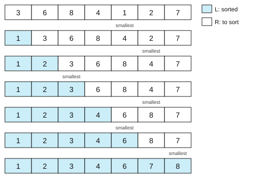

*Selection sort* implements the same idea with swaps instead of insertions.
The pseudocode is the one that we saw in the Introduction session, taken from
Cormen (2013, pp. 32–34):

```
Procedure SELECTION-SORT(A, n)
Inputs:
      A: an array
      n: the number of elements in A to sort
Result: the elements of A are sorted into nondecreasing order
For i = 1 to n - 1:
      smallest ← i                        # find the smallest in R
      For j = i + 1 to n:
            If A[j] < A[smallest]
                  then smallest ← j
      swap A[i] with A[smallest]           # swap it to be the last of L
```

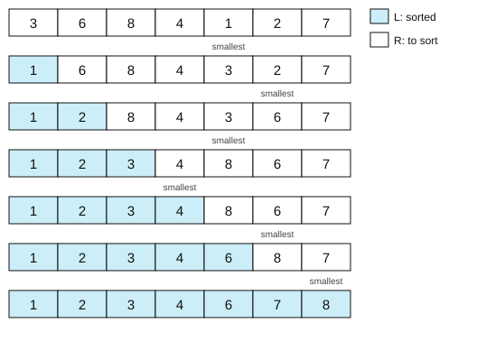

Compare the two figures carefully. Both end with a sorted list but they reach
it differently, because repeated minimum search preserves the relative order
of the elements that it does not move, while selection sort changes that order
by swapping. The two algorithms share two properties and differ in two others:

- **Partial correctness.** Both algorithms are partially correct, because at every step any element still in $R$ is larger than or equal to any element in $L$, and $L$ is sorted.
- **Termination.** Both algorithms terminate, because $R$ shrinks in every step and eventually has length 1.
- **Data structure.** Repeated minimum search inserts in the middle of the list, so it is better for linked lists, where insertion is cheap and index access is expensive. Selection sort uses swaps, so it is better for arrays, where index access is cheap and insertion is expensive.
- **Stability.** Repeated minimum search is stable, because in case of a tie it takes the first minimum in $R$, which preserves any other ordering. Selection sort is unstable, because a swap moves the element that was at the front of $R$ into the position of the minimum, where it can end up behind another element with the same key.

As a concrete example, let's sort `[2a, 2b, 1]`, where `2a` and `2b` are two
records with key 2. Selection sort swaps position 1 with the minimum, which is
the 1, and produces `[1, 2b, 2a]`, so the two 2s have changed places. Repeated
minimum search produces `[1, 2a, 2b]` instead.

Why should we care about sorting at all? We sort data more often than we
think, especially in data science, where complex data often has to be sorted
to be analyzed or shown, and in practice the speed of sorting matters for
analysts and users. Sorting is also healthy because it helps us to notice
issues in the data. In addition, many search algorithms require sorted data to
work, for example binary search, because it is much easier to find items in an
ordered list than in an unordered one. The practical Python examples of this
session measure how much faster lookups become once a list is sorted.

---

## 5. Divide and conquer {#divide-and-conquer}
*Divide and conquer* is a fundamental algorithmic principle named after the
military maxim *divide et impera*. The idea is to split a problem into
separate sub-problems, to continue until those sub-problems are solvable, and
then to recombine the partial results into the full solution. Divide and
conquer is not the same as recursion, i.e. recursive calls of the same
function. Recursion is a natural implementation strategy for
divide-and-conquer algorithms, because by definition the sub-problems are
self-similar and the overall solution is generated by combining the solutions
of the sub-problems. However, a divide-and-conquer strategy can also be
implemented iteratively. Thinking in terms of divide and conquer is useful
because it tells you where to look when an algorithm is slow, namely at the
split, at the sub-problems or at the combination.

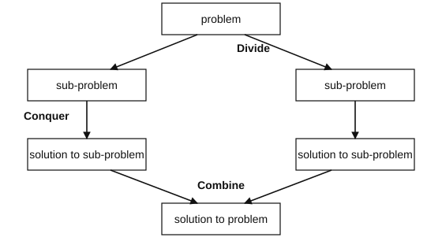

---

## 6. Mergesort

*Mergesort* first divides the list into equal halves and then combines them in
a sorted manner, so it sorts by merging sublists. The principle is that a list
with one element is trivially sorted and that merging two sorted lists is
simple. To merge, you compare the first element of each sublist, append the
smaller of the two to the merged list, remove it from its sublist and continue
with the remaining sublists. The algorithmic strategy is to divide the list
repeatedly until one element remains per list, and then to merge sorted
sublists repeatedly until only one sorted list remains. The pseudocode, from
Cormen (2013, pp. 40–47), uses two procedures.

```
Procedure MERGE-SORT(A, p, r)
Inputs:
      A: an array
      p, r: the starting and ending index of the subarray
Result: the elements of the subarray A[p..r] are sorted into
        nondecreasing order
If p ≥ r
      then return without doing anything    # A[p..r] has at most one element
      else q ← ⌊(p + r) / 2⌋
            MERGE-SORT(A, p, q)             # sort the left half recursively
            MERGE-SORT(A, q + 1, r)         # sort the right half recursively
            MERGE(A, p, q, r)               # merge the two sorted halves
```

```
Procedure MERGE(A, p, q, r)
Inputs:
      A: an array
      p, q, r: indices such that A[p..q] and A[q+1..r] are sorted
Result: A[p..r] contains the elements of both subarrays, sorted
n1 ← q - p + 1; n2 ← r - q
B[1..n1] ← copy of A[p..q]; C[1..n2] ← copy of A[q+1..r]
B[n1 + 1] ← ∞; C[n2 + 1] ← ∞          # sentinels, never copied
i ← 1; j ← 1
For k = p to r:
      If B[i] ≤ C[j]
            then A[k] ← B[i]; i ← i + 1
            else A[k] ← C[j]; j ← j + 1
```

The two sentinels at the end of $B$ and $C$ make the loop simple. When one of
the two copies is exhausted, its next element is $\infty$, which is never
smaller than anything, so the loop keeps copying from the other array without
a special case. The example of the figures below merges $B = [2,3,4,6]$ with
$C = [1,5,7,8]$. First, comparing 2 and 1 takes 1. Then comparing 2 and 5
takes 2, comparing 3 and 5 takes 3, and comparing 4 and 5 takes 4. After that,
comparing 6 and 5 takes 5, comparing 6 and 7 takes 6, and finally 7 and 8
follow.

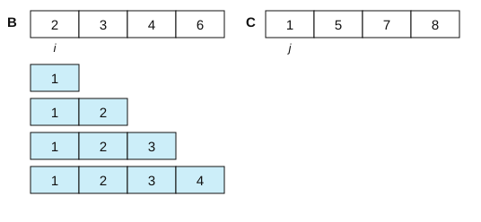

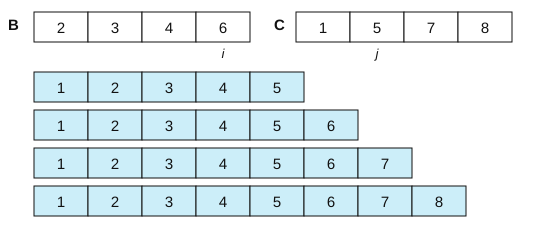

Note that the test `B[i] ≤ C[j]` uses $\le$ and not $<$. This single character
makes mergesort stable, because on a tie the element from the left half goes
first, and the left half was earlier in the original list. Seen as a whole,
the split step divides the list repeatedly into equal halves without changing
the sequence of the items until single elements are reached, and the merge
step then combines them back in sorted order.

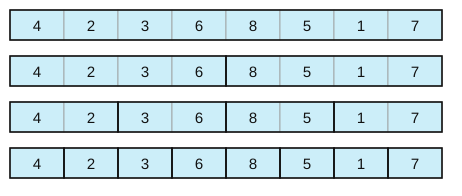

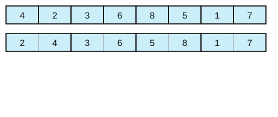

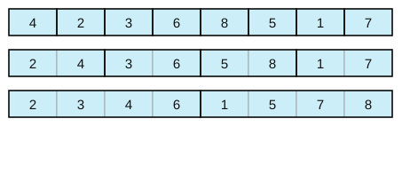

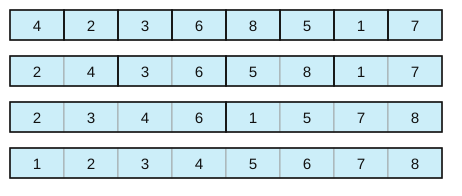

As a divide-and-conquer strategy, mergesort has two steps:

- **Divide.** The list is split into two sublists of half the size, which are sorted recursively by calling mergesort on itself. We assume that the output of each recursive call is a sorted list, and we rely on a well-defined base case, which is the list with one element.
- **Combine.** Two sorted lists are merged while preserving their order, which is a systematic and efficient way to turn partial lists into one large sorted list.

Note that all of the work happens in the combine step, while the divide step
is just arithmetic on indices. Regarding correctness, the merge steps sort
correctly, no order is changed outside merging, all elements end up sorted and
the algorithm terminates. Regarding memory, mergesort needs additional memory
beyond the list itself to handle the sublists, i.e. the copies $B$ and $C$.
Regarding stability, mergesort is a stable algorithm because merging preserves
the order of equal elements. You can compare the running times of selection
sort and mergesort on lists of growing size in the practical Python examples
of this session.

Mergesort was invented in 1945 by John von Neumann (Neumann János Lajos,
Budapest 1903–1957), one of the most influential figures in computer science,
mathematics and physics of the 20th century. Besides inventing mergesort, he
was among the first to discuss the time complexity of algorithms in the 1950s.
He popularized the modern computer architecture with main memory, arithmetic
logic unit and registers, which still bears his name. He also proposed
self-replicating cellular automata and warned about anthropogenic global
warming as early as 1955.

---

## 7. Quicksort

*Quicksort* follows a divide-and-conquer logic similar to mergesort, but the
division into sublists is not necessarily regular. The idea is to pick a
*pivot* element from the list and to rearrange the list so that all elements
to the left of the pivot are smaller than its value and all elements to the
right are larger. After this *partition* operation the pivot is already in its
final sorted position, so sorting only has to happen to its left and to its
right. Therefore the list is split at the pivot and the same logic is applied
recursively to each side.

```
Procedure QUICK-SORT(A, p, r)
Inputs and Result: same as MERGE-SORT
If p ≥ r
      then return without doing anything
      else q ← PARTITION(A, p, r)      # A[q] is now in its final place
            QUICK-SORT(A, p, q - 1)
            QUICK-SORT(A, q + 1, r)
```

PARTITION is the procedure that rearranges the elements and returns the final
position of the pivot. Its pseudocode is in Cormen (2013, ch. 3, pp. 50–53).
As an exercise, run quicksort with pen and paper on the same example as
mergesort. Quicksort is very memory efficient because it is an in-place
procedure, and it is usually faster than mergesort in practice. Its
disadvantage is that its efficiency depends on the choice of the pivot and on
the partition scheme, as we will learn in the Time Complexity session. For
example, a bad pivot choice such as always taking the first element of an
already sorted list makes quicksort much slower. Quicksort and mergesort are
the two most important sorting algorithms and they differ in where they do
their work. In quicksort all the work is done while dividing the array into
subarrays and the combine step does absolutely nothing, while in mergesort all
the real work happens while merging the subarrays.

---

## 8. Heaps and heapsort {#heapsort}
Sorting algorithms can use data structures for help, and heapsort is an
example in which the data structure does the sorting. A *heap* is a partially
ordered binary tree without gaps or holes. This means that the children of any
node are not larger than the node, all levels are filled, and the last level
is filled from the left. A heap is not a binary search tree, because we only
require local ordering between a node and its children. Does the tree of the
figure below satisfy the heap property? It does not, because node 4 has the
child 8 and $8 > 4$. However, the property can be efficiently recovered by
swapping the offending node with its largest child and repeating the swap
downwards.


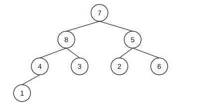

Two things distinguish a heap from a binary search tree. First, the heap
condition is local, i.e. it only relates a parent and its children, so it is
much cheaper to maintain. Second, the heap is complete, so its depth is always
about $\log_2 n$ and it can never degenerate into a long chain as an
unbalanced BST does. A *min-heap* is the same structure but with the children
of any node not smaller than the node, so the smallest element is at the top.
Because a heap is complete, we can store it in a plain array with no pointers
at all by writing the levels one after the other. With 1-based indices, the
children and the parent of the node at position $x$ are found with the
following arithmetic.

$$\text{left}(x) = 2x, \qquad \text{right}(x) = 2x+1, \qquad \text{parent}(x) = \lfloor x/2 \rfloor.$$

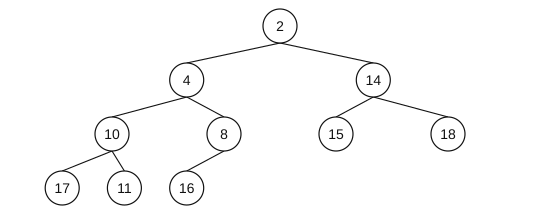

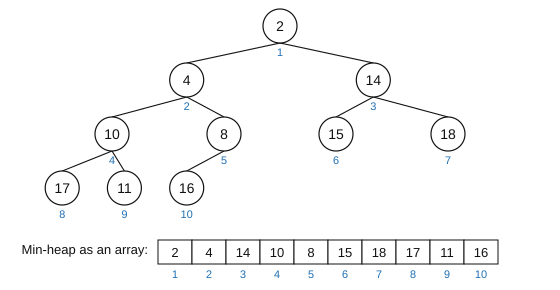

The conceptual foundation of *heapsort* is that in a min-heap the smallest
element is on top, the children are not smaller because of the heap property,
and the same is recursively true for the entire tree. Therefore we can start
by building a heap out of the list. The idea is then to remove the top, i.e.
the smallest element, to replace it with the last element of the tree, and to
recover the heap property by permuting elements downwards. If we repeat this
until the heap is empty, the removed elements come out in sorted order. The
example of the figures below starts from the min-heap `[2, 4, 14, 10, 8, 15,
18, 17, 11, 16]`, and the sorted output grows below the tree. First, the top,
2, is extracted and placed first in the output. Then the last element, 16, is
moved to the top and the min-heap property is recovered by moving 16 down.
Finally, the new minimum, 4, is extracted, and the process continues in the
same way.

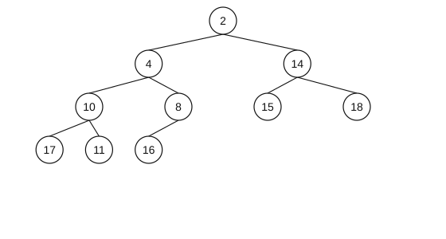

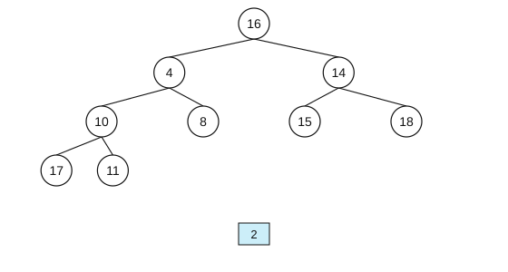

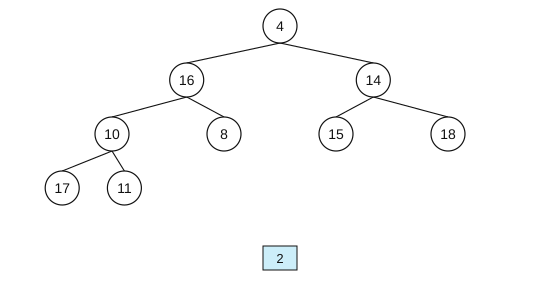

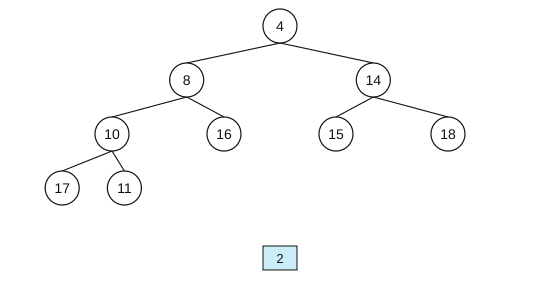


Each round consists of the same three steps, namely extracting the minimum,
moving the last element to the top and moving it down, until the heap is empty
and the output is sorted.

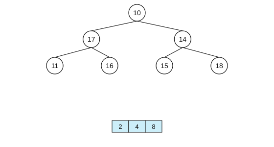

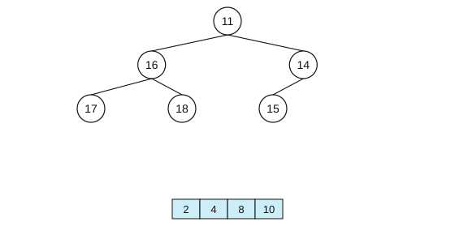

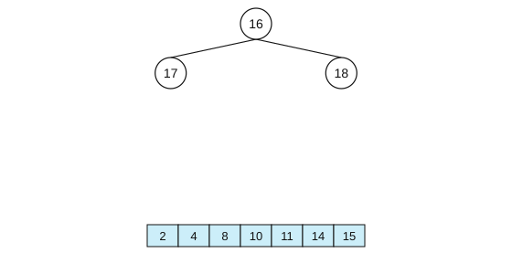

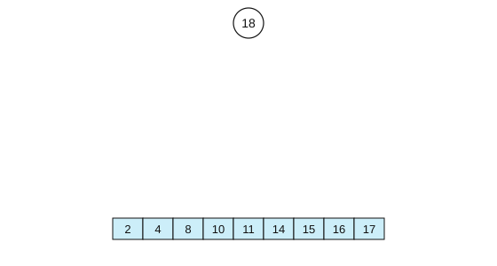

Each extraction costs about $\log_2 n$ swaps, which is the depth of the heap,
and there are $n$ extractions. We will learn in the Time Complexity session
that this cost is written as $O(n \log n)$. The pseudocode of heapsort and of
the heap operations is in Cormen (2013, pp. 98–99). As an exercise, write the
pseudocode to build a heap and to extract the minimum, and decide whether
heapsort is stable. The 31 states of the example were produced by running the
algorithm and not by drawing them one by one, so the tree and the output array
agree with each other and you can use them to check your own pen-and-paper
trace.

---

## 9. Why sorting matters for us

A 2021 paper by Stanley Fung with the title "Is this the simplest (and most
surprising) sorting algorithm ever?" presents the following algorithm:

```
Procedure I-CANT-BELIEVE-IT-CAN-SORT(A, n)
Inputs:
      A: an array
      n: the number of elements in A to sort
Result: the elements of A are sorted into nondecreasing order
For i = 1 to n:
      For j = 1 to n:
            If A[i] < A[j]
                  then swap A[i] with A[j]
```

Look at the comparison in the innermost line. The algorithm swaps when `A[i] <
A[j]`, which is the opposite of what you would expect from selection sort, and
both loops run over the whole array. It looks like it should be wrong, but it
sorts correctly, and the proof is short although it is not obvious. This
example shows that an algorithm that looks wrong can be correct, so the
correctness of an algorithm has to be shown and cannot be judged from its
appearance. If you want to build intuition for how the algorithms of this
session move data around, the sorting visualizations linked in the references
are worth fifteen minutes of your time.

---

## 10. Why does this matter? Practical Python examples

Check the [practical Python examples in this Jupyter
notebook](https://github.com/dgarcia-eu/ICSS/blob/main/PythonExamples/Examples07-SortingAlgorithms.ipynb).
There, you will see selection sort, mergesort and Python's built-in `sorted`
timed on lists of growing size, a ranking with ties that an unstable sort
reorders, and ten thousand lookups that become much faster once the list is
sorted.

---

## 11. Check yourself

**1.** You have a table of survey responses and you want it ordered by region,
and within each region by date. What do you sort by first?

<details><summary>Answer</summary>

You sort by date first and then by region, and the second sort must be stable.
Sorting by region first and by date second would destroy the region grouping.
The general rule is to sort by the least significant key first.

</details>

**2.** Is selection sort ever the right choice?

<details><summary>Answer</summary>

Rarely, but it can be. Selection sort makes at most $n-1$ swaps, which is the
minimum possible number. This matters if writing is far more expensive than
reading, for example on flash memory with limited write cycles or with records
so large that moving them dominates the cost. It is also simple enough to get
right on paper, which is why we used it as the first algorithm of the course.

</details>

**3.** Mergesort needs extra memory, while quicksort does not. Why is
mergesort still used?

<details><summary>Answer</summary>

Mergesort is still used because it is stable and its worst case is as good as
its average case, while quicksort becomes much slower with an unlucky pivot.
Real libraries often use hybrids. For example, Python's `sorted` uses Timsort,
a stable variant of mergesort that exploits runs already present in the data.

</details>

**4.** A heap is not sorted. So how can heapsort be a sorting algorithm?

<details><summary>Answer</summary>

The heap property only guarantees that the root is the minimum, but heapsort
needs nothing more. Repeatedly taking the minimum yields a sorted sequence.
Because the heap property is weak and local, restoring it after each
extraction is cheap and costs about $\log n$ steps instead of $n$.

</details>

**5.** Selection sort and mergesort on an already-sorted list of a million
elements. Which is faster, and by roughly how much?

<details><summary>Answer</summary>

Mergesort is faster by a factor of about $n / (2 \log_2 n) = 10^6/40 =
25{,}000$. Selection sort does the same $n^2/2 \approx 5 \times 10^{11}$
comparisons regardless of the input, while mergesort does about $n \log_2 n
\approx 2 \times 10^7$. We will learn how to make this precise in the Time
Complexity session.

</details>

---

## 12. References

- **Cormen, T. H. (2013).** *Algorithms Unlocked*, MIT Press. Chapter 2 (how to
  describe and evaluate algorithms) and chapter 3 (selection sort pp. 32–34,
  insertion sort pp. 35–39, merge sort pp. 40–48, quicksort pp. 49–56) are the
  reading for this session and the source of all the pseudocode here. Chapter
  4 gives the lower bound for comparison sorting, and pp. 98–99 the heap
  operations and heapsort.
- **Cormen, T. H., Leiserson, C. E., Rivest, R. L. & Stein, C. (2009).**
  *Introduction to Algorithms*, 3rd ed., chapters 2, 6 and 7. The full
  treatment, including the correctness proofs we skip.
- **Knuth, D. E. (1998).** *The Art of Computer Programming, Vol. 3: Sorting
  and Searching*, 2nd ed. Addison-Wesley. The exhaustive reference, in which
  von Neumann's 1945 mergesort is documented.
- **Fung, S. P. Y. (2021).** "Is this the simplest (and most surprising)
  sorting algorithm ever?" *arXiv:2110.01111*. <https://arxiv.org/abs/2110.01111>
- **Peters, T.** *Timsort*, the algorithm behind Python's `sorted`.
  <https://github.com/python/cpython/blob/main/Objects/listsort.txt>
- **Sorting algorithm visualizations**, useful for building intuition.
  <https://www.youtube.com/watch?v=kPRA0W1kECg>
