# Session 7: Sorting Algorithms

<style>
figure, .figure, .float { margin: 1.4em 0 1.8em 0; }
figure img, .float img { display: block; max-width: 100%; }
figcaption, .figcaption, .figure p.caption { margin-top: 0.3em; font-size: 0.88em; color: #555; }
</style>

*Introduction to Computing for the Social Sciences · lecture transcript*

**Reading for this session:** Chapters 2 and 3 of Cormen, *Algorithms Unlocked*
(2013). References at the end.

---

## Contents

1. [Sorting](#sorting)
2. [Iterative sorting: selection sort](#iterative-sorting)
3. [Divide and conquer: mergesort and quicksort](#divide-and-conquer)
4. [Data structures for sorting: heapsort](#heapsort)

---

<!-- MOTIVATION-SECTION:BEGIN -->
## Motivating examples

Three candidate openings for this session, each a real situation the
material is the answer to. **One of these will be used in the lecture**,
while the others are kept here because they are worth reading anyway.

<!-- MOTIVATION:M07-A:BEGIN -->
### A · Sorted by region, then by age, and the regions came apart

Here is a bug that produces no error, no warning and a plausible-looking
table. You have a respondent file. You sort it by region, because the report
is organized that way. Then you sort the same table by age, to look at the age
distribution. You expect that within each age the regions are still in the
order you put them, but they are not, because they come back scrambled. Both sorts
were correct, and the table really is sorted by age. The difference is a
property called stability. A sorting algorithm is stable if elements that
compare equal keep their original relative order. Sorting by age, every
34-year-old compares equal to every other 34-year-old. A stable algorithm
leaves them in the order they arrived, which, after the first sort, is region
order, while an unstable algorithm is free to put them in any order, and generally
does. This is not a curiosity. It is the mechanism behind a standard
technique, sorting by several keys one at a time, from the least important to
the most important. Sort by region, then by age, and with a stable sort you
have a table ordered by age and, within age, by region, without ever writing a
compound comparison. With an unstable sort you have silently thrown the first
sort away.

Which algorithms are which, among those of this session? Selection sort is
not stable, because swapping a distant minimum into place jumps it over equal
elements. Mergesort is stable, because on a tie the merge step takes from the
left half first. Quicksort is not stable, because partitioning swaps across
the array. Heapsort is not stable either, because moving the last element to
the top of the heap reorders equal keys. Stability is not a property that an
algorithm advertises. It is a property that someone had to design in, and in
the case of mergesort it hangs on a single character, the $\le$ in the merge
comparison, so it can be lost by a change that looks purely cosmetic.

Section 4 of this session traces selection sort by hand, sections 6 and 7
mergesort and quicksort, and section 8 heapsort, so that you can see where an
element moves and why stability holds or fails. The habit to build is that
when a library offers you a `sort`, you find out whether it is stable before
relying on a previous sort surviving it. Python's `sorted()` is stable and
guarantees it. However, many others are not, and most do not say.
<!-- MOTIVATION:M07-A:END -->
<!-- MOTIVATION:M07-B:BEGIN -->
### B · Two seconds, or fourteen hours

Sorting a million records. Two algorithms, both correct, both easy to write.
Selection sort finds the smallest element, puts it first, finds the smallest
of the rest, puts it second, and so on. Finding each minimum means scanning
everything that is left, so the total number of comparisons is

$$(n-1) + (n-2) + \cdots + 1 = \frac{n(n-1)}{2} \approx 5 \times 10^{11}
\quad \text{for } n = 10^6.$$

Mergesort splits the array in half, sorts each half, and merges the two
sorted halves. Halving $10^6$ takes about 20 steps to reach single elements,
and each of those 20 levels does about $10^6$ units of merging work, so the
total is

$$n \log_2 n \approx 10^6 \times 20 = 2 \times 10^7.$$

At ten million comparisons a second, that is about fourteen hours against two
seconds. What is worth noticing is where the difference comes from, because it
is not about efficiency in any ordinary sense. Both algorithms do simple work
in their inner loop, and neither is written badly. The difference is
structural. Selection sort throws away everything it learns. Having scanned
the entire array to find the minimum, it knows a great deal about the relative
order of the remaining elements, and then discards all of it and scans again.
Mergesort, in contrast, keeps its work. Once two halves are sorted, merging them uses that
order, and it never compares two elements whose relative position is already
implied. That is why the gap widens with $n$ rather than staying constant. At
$n = 100$ the ratio is about 7, at $n = 10^6$ it is 25 000, and at $n = 10^9$
it is 17 million. An algorithmic difference is not a constant factor you can
buy your way out of, since no amount of faster hardware closes it, and session 12
shows that no amount of parallelism does either.

Section 4 of this session covers selection sort and the summation above,
whose arithmetic is worth doing once by hand. Section 6 covers mergesort and
the divide-and-conquer idea. Halving gives $\log n$ levels, and $\log n$ is a
very small number, since $\log_2$ of a billion is 30. Session 8 turns this
comparison into notation and shows how to count the steps of both algorithms.
For now the point is the intuition, i.e. the question is never how fast an
algorithm is on your data, but what happens when the data gets ten times
bigger.
<!-- MOTIVATION:M07-B:END -->
<!-- MOTIVATION:M07-C:BEGIN -->
### C · Why sort at all?

Sorting is almost never the goal. It is something you do so that the next
operation is cheap, for example searching, merging, deduplicating, finding a median,
detecting a range. So the question is never whether something should be
sorted in the abstract. It is whether the sort costs less than what it saves,
and we can put numbers on it. Take a codebook of $m = 6\,000$ entries and $q$
lookups against it. Unsorted, each lookup scans, costing about $m/2 = 3\,000$
comparisons, for a total of about $3\,000\,q$. Sorted, the sort costs about
$m \log_2 m \approx 6\,000 \times 12.6 \approx 76\,000$ comparisons, once, and
each lookup then costs $\log_2 m \approx 13$, for a total of about $76\,000 +
13q$. Sorting wins when $76\,000 + 13q < 3\,000q$, that is, when $q > 25$ or
so. Twenty-five lookups. After that, sorting is free money, and at $q = 40$
million the sorted version does about $5 \times 10^8$ comparisons against
$1.2 \times 10^{11}$, a factor of 240.

The break-even calculation is the transferable skill here, and it
generalizes well past sorting. Any preprocessing step, whether sorting,
building an index, building a hash table or caching a result, has the same
structure, namely a fixed cost up front and a lower cost per query afterwards. You
are choosing between two lines with different intercepts and different
slopes, and the only question is where they cross and on which side of the
crossing your workload sits. The cases where sorting does not pay are worth
knowing too. With one query, a single linear scan is $O(m)$ while sorting
first is $O(m \log m)$, so you have paid a $\log m$ factor for nothing. When
the data changes constantly, keeping a sorted array sorted costs $O(m)$ per
insertion, and if the codebook is rebuilt daily you pay the sort daily. With
streaming data you cannot sort what has not arrived yet. And when the data
does not fit in memory, sorting becomes a much more expensive external
operation.

Sections 4 to 8 of this session give the costs on the left-hand side of that
inequality, what each sorting algorithm actually costs and why $n \log n$ is
achievable. The binary search of session 3 gives the right-hand side, and
session 8 gives the notation for reasoning about both at once. The exam has
asked a version of this question, when sorting is less efficient than
processing unsorted data, and the answer is always the break-even argument,
not a rule.
<!-- MOTIVATION:M07-C:END -->
---

<!-- MOTIVATION-SECTION:END -->
## 1. Why sorting {#sorting}
The lecture starts with two questions you can answer by eye. Which numbers are
duplicates? Given a pile of scattered number tiles, this is hard, because you
have to compare every tile against every other, while given the same tiles
laid out in order, duplicates are adjacent and you spot them instantly. Are
these two sets of numbers different? Scattered, you must check every element
of one set against all of the other, while sorted, you walk both lists in
parallel once. Sorting does not create information. It rearranges data so
that questions which needed $n^2$ comparisons need $n$, or, with binary
search, $\log n$. That is the whole justification, and it is why sorting is
one of the most studied problems in computer science.

---

## 2. The formal problem

Formally, we operate on a set of objects $U$, a set of keys $S$ with a linear
order relation $\le$, that is, a linearly ordered set, and a sorting function
$s: U \rightarrow S$ that maps every object to its key. We are searching for a
permutation $i_1, \dots, i_n$ of the indices of the objects in $U$ such that

$$\forall\, 1 \leq k \leq n-1: \; s(u_{i_k}) \leq s(u_{i_{k+1}}),$$

in words, a rearrangement of the objects in which each key is no larger than
the next. This formalism buys two things. First, the objects and the keys are
different. For example, you sort survey respondents by age, and the respondent is not the
age. Second, the order relation must be linear, so that any two keys are
comparable. If your order is only partial, as with "is an ancestor of",
sorting in this sense is not defined.

---

## 3. Stable and unstable sorting

Different objects can have the same key value, such as students with exactly
the same name or respondents of exactly the same age. If a sorting algorithm,
after sorting, does not change the relative sequence of items with equal keys,
it is called *stable*, and otherwise it is *unstable*. Stability matters
because it lets you sort by several criteria in sequence. If objects with the same
value for a sorting function $s_1$ have different values for another function
$s_2$, then a stable sort by $s_1$ after a sort by $s_2$ leaves the $s_2$ order
intact within each $s_1$ group. In the example of the lecture, four students
identified by a number are sorted by first name.

| original | | stable result | | unstable result | |
|---|---|---|---|---|---|
| 123456 | Christina | 456789 | Carl | 456789 | Carl |
| 234567 | Sandra | 123456 | Christina | 123456 | Christina |
| 345678 | Sandra | 234567 | Sandra | **345678** | Sandra |
| 456789 | Carl | 345678 | Sandra | **234567** | Sandra |

Both outputs are sorted by first name, but only the stable one keeps 234567
before 345678, as they were in the input. In practice, if you want a table
sorted by country and, within each country, by date, you sort by date first
and then by country with a stable sort. With an unstable sort the second pass
destroys the first.

---

## 4. Iterative sorting {#iterative-sorting}
The fundamental principle of iterative sorting is selection. The intuitive
strategy is to find the minimum (or the maximum) of a set, move it to the
front, and apply the same logic to the remaining set. The algorithmic
strategy, called *repeated minimum search*, splits the list into two parts, a
sorted part $L$ on the left and an unsorted part $R$ on the right. At the
start $L$ is empty and $R$ is the entire list. In each round the minimum of
$R$ is found and appended to $L$, and the process stops when $R$ has length 1.
In the figure, each row shows one round, in which the smallest remaining element is
identified and moved to the end of the sorted prefix, shifting the others
along.

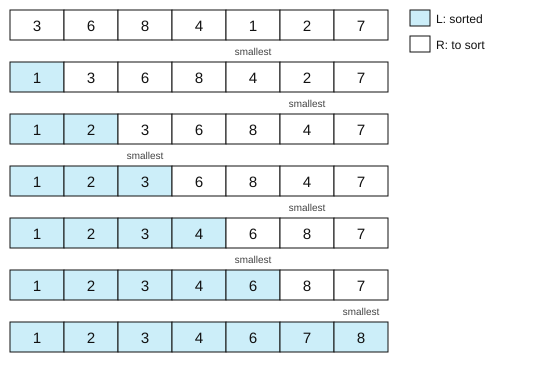

*Selection sort* implements the same idea with swaps instead of insertions.
The pseudocode is the one of session 1, taken from Cormen (2013, pp. 32–34):

```
Procedure SELECTION-SORT(A, n)
Inputs:
      A: an array
      n: the number of elements in A to sort
Result: the elements of A are sorted into nondecreasing order
For i = 1 to n - 1:
      smallest ← i                        # find the smallest in R
      For j = i + 1 to n:
            If A[j] < A[smallest]
                  then smallest ← j
      swap A[i] with A[smallest]           # swap it to be the last of L
```

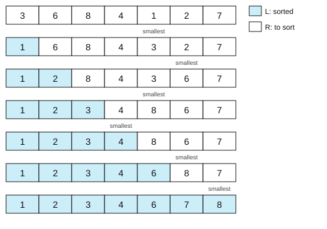

Compare the two figures carefully. Both end sorted, but they get there
differently, because repeated minimum search preserves the relative order of the
untouched elements, and selection sort scrambles them by swapping. Both
algorithms are partially correct, because at every step any element still in
$R$ is larger than or equal to any element in $L$, and $L$ is sorted. Both also
terminate, because $R$ shrinks in every step and eventually has length 1. They
differ in the data structure they suit. Repeated minimum search inserts in the
middle of the list, so it is better for linked lists, where insertion is cheap
and index access is expensive, while selection sort uses swaps, so it is
better for arrays, where index access is cheap and insertion is expensive.
They also differ in stability. Repeated minimum search is stable, because in
case of a tie it takes the first minimum in $R$, which preserves any other
ordering, while selection sort is unstable, because a swap moves an arbitrary
element into the vacated slot. As a concrete example, sort `[2a, 2b, 1]`,
where `2a` and `2b` are two records with key 2. Selection sort swaps position
1 with the minimum, the 1, and produces `[1, 2b, 2a]`, so the two 2s have
changed places, while repeated minimum search produces `[1, 2a, 2b]`.

Why should we care about sorting at all? We sort data more often than we
think, especially in data science, where complex data often has to be sorted
to be analyzed or shown, and in practice speed matters for analysts and
users. Sorting is also healthy, because it helps to notice data issues. And
many search algorithms require sorted data to work, as binary search does, since it
is simply much easier to find items in an ordered list than in an unordered
one.

---

## 5. Divide and conquer {#divide-and-conquer}
*Divide and conquer* is a fundamental algorithmic principle named after the
military maxim *divide et impera*. The idea is to separate a problem into separate
sub-problems, continue until those sub-problems are solvable, and then
recombine the partial results into the full solution. Divide and conquer is
not the same as recursion, that is, as recursive calls of the same function.
Recursion is a natural implementation strategy for divide-and-conquer
algorithms, because by definition the sub-problems are self-similar and the
overall solution is generated by combining the solutions of the sub-problems,
but a divide-and-conquer strategy can also be implemented iteratively. The
distinction matters because it tells you where to look when an algorithm is
slow, i.e. at the split, at the sub-problems, or at the combination.

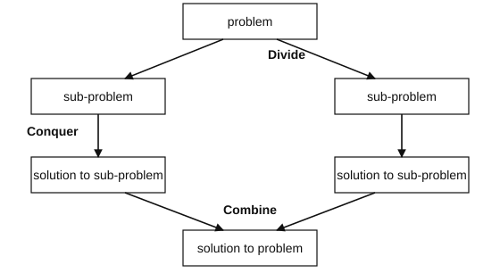

---

## 6. Mergesort

*Mergesort* first divides the list into equal halves and then combines them
in a sorted manner, so it sorts by merging sublists. The principle is that a
list with one element is trivially sorted, and that merging two sorted lists
is simple. You compare the first element of each sublist, append the smaller of
the two to the merged list and remove it from its sublist, and continue with
the remaining sublists. The algorithmic strategy is to divide the list
repeatedly until one element remains per list, and then to merge sorted
sublists repeatedly until only one sorted list remains. The pseudocode, from
Cormen (2013, pp. 40–47), uses two procedures.

```
Procedure MERGE-SORT(A, p, r)
Inputs:
      A: an array
      p, r: the starting and ending index of the subarray
Result: the elements of the subarray A[p..r] are sorted into
        nondecreasing order
If p ≥ r
      then return without doing anything    # A[p..r] has at most one element
      else q ← ⌊(p + r) / 2⌋
            MERGE-SORT(A, p, q)             # sort the left half recursively
            MERGE-SORT(A, q + 1, r)         # sort the right half recursively
            MERGE(A, p, q, r)               # merge the two sorted halves
```

```
Procedure MERGE(A, p, q, r)
Inputs:
      A: an array
      p, q, r: indices such that A[p..q] and A[q+1..r] are sorted
Result: A[p..r] contains the elements of both subarrays, sorted
n1 ← q - p + 1; n2 ← r - q
B[1..n1] ← copy of A[p..q]; C[1..n2] ← copy of A[q+1..r]
B[n1 + 1] ← ∞; C[n2 + 1] ← ∞          # sentinels, never copied
i ← 1; j ← 1
For k = p to r:
      If B[i] ≤ C[j]
            then A[k] ← B[i]; i ← i + 1
            else A[k] ← C[j]; j ← j + 1
```

The two sentinels at the end of $B$ and $C$ are the detail that makes the loop
simple. When one of the two copies is exhausted, its next element is $\infty$,
which is never smaller than anything, so the loop keeps copying from the
other array without a special case. The example of the lecture merges $B =
[2,3,4,6]$ with $C = [1,5,7,8]$. Comparing 2 and 1 takes 1, comparing 2 and 5
takes 2, comparing 3 and 5 takes 3, and comparing 4 and 5 takes 4. Then
comparing 6 and 5 takes 5, comparing 6 and 7 takes 6, and 7 and 8 follow.

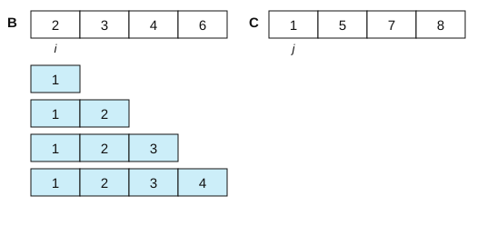

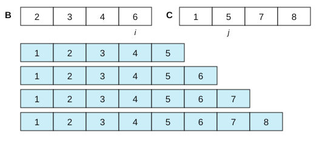

Note that the test `B[i] ≤ C[j]` uses $\le$ and not $<$. That single character
is what makes mergesort stable, because on a tie the element from the left half goes
first, and the left half was earlier in the original. Seen as a whole, the
split step divides the list iteratively into equal halves without changing
the sequence of the items until single elements are reached, and the merge
step combines them back in sorted order.

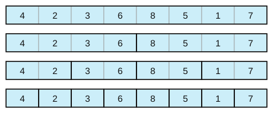

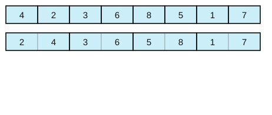

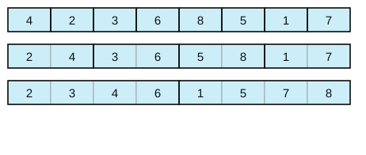

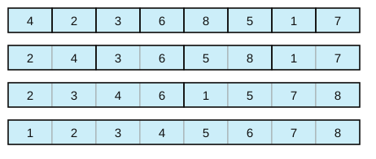

As a divide-and-conquer strategy, the divide step splits the list into two
sublists of half the size and sorts them recursively, calling mergesort on
itself, assuming that the output is a sorted list at each recursion step, and
relying on a well-defined base case, the list with one element. The combine
step merges two lists while preserving their order, a systematic and
efficient merger of partial lists into one large sorted list. Note where the
work is. All of it is in the combine step, and the divide step is just
arithmetic on indices. Regarding correctness, the merge steps sort correctly,
no order is changed outside merging, all elements are sorted and the algorithm
terminates. Regarding memory and stability, mergesort needs additional memory
beyond the list itself to handle the sublists, the copies $B$ and $C$, and it
is a stable algorithm because merging preserves the order of equal elements.

Mergesort was invented in 1945 by John von Neumann (Neumann János Lajos,
Budapest 1903–1957), one of the most influential figures in computer science,
mathematics and physics of the 20th century. Besides mergesort, he was among
the first to discuss the time complexity of algorithms in the 1950s, he
popularized the modern computer architecture with main memory, arithmetic
logic unit and registers that still bears his name, he proposed
self-replicating cellular automata, which we will meet in session 9, and he
warned about anthropogenic global warming as early as 1955.

---

## 7. Quicksort

*Quicksort* follows a divide-and-conquer logic similar to mergesort, but the
division into sublists is not necessarily regular. The rationale is to pick a
*pivot* element from the list and to rearrange the list so that all elements
to the left of the pivot are smaller than its value and all elements to the
right are larger. After this *partition* operation the pivot is already in
its final sorted position, so sorting now only has to happen to its left and
to its right, and the list is split at the pivot and the logic is applied
recursively to each side.

```
Procedure QUICK-SORT(A, p, r)
Inputs and Result: same as MERGE-SORT
If p ≥ r
      then return without doing anything
      else q ← PARTITION(A, p, r)      # A[q] is now in its final place
            QUICK-SORT(A, p, q - 1)
            QUICK-SORT(A, q + 1, r)
```

PARTITION is the procedure that does the rearranging and returns the final
position of the pivot. Its pseudocode is in Cormen (2013, ch. 3, pp. 50–53),
and the exercise of the lecture is to run quicksort by hand on the same
example as mergesort. Quicksort is very memory efficient, because it is an
in-place procedure, and it is usually faster than mergesort in practice. Its
disadvantage is that its efficiency depends on the choice of the pivot and on
the partition scheme, as we will see in session 8. For example, a bad pivot, such as
always the first element of an already sorted list, makes it degenerate. The
difference from mergesort is worth remembering, because the two most
important sorting algorithms are mirror images. In quicksort all the heavy
lifting is done while dividing the array into subarrays, and the combine step
does absolutely nothing, while in mergesort all the real work happens while merging
the subarrays.

---

## 8. Heaps and heapsort {#heapsort}
Sorting algorithms can use data structures for help, and heapsort is the
example where the data structure does the sorting. A *heap* is a partially
ordered binary tree without gaps or holes. The children of any node are not
larger than the node, all levels are filled, and the last level is filled
from the left. It is not a binary search tree, because we only require local
ordering between a node and its children. Does the tree of the lecture
satisfy the heap property? No, because node 4 has the child 8, and $8 > 4$. But the
property can be efficiently recovered by swapping the offending node with its
largest child and repeating the swap downwards.


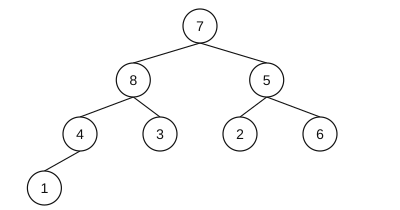

Two things distinguish a heap from a binary search tree, and both matter. The
heap condition is local, between a parent and its children, so it is much
cheaper to maintain. And the heap is complete, so its depth is always about
$\log_2 n$, and it can never degenerate the way an unbalanced BST does. A
*min-heap* is the same structure with the children of any node not smaller
than the node, so the smallest element is at the top. Completeness lets us
store a heap in a plain array with no pointers at all, by writing the levels
one after the other. With 1-based indices, the children and the parent of the
node at position $x$ are found by arithmetic:

$$\text{left}(x) = 2x, \qquad \text{right}(x) = 2x+1, \qquad \text{parent}(x) = \lfloor x/2 \rfloor.$$

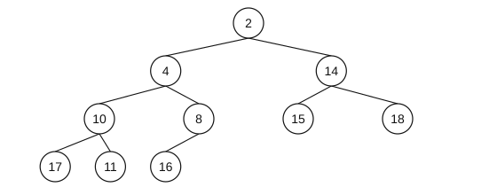

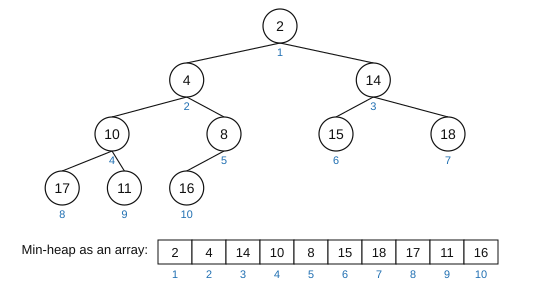

The conceptual foundation of *heapsort* is that in a min-heap the smallest
element is on top, the children are not smaller because of the heap property,
and the same is recursively true for the entire tree, so we can start by
building a heap out of the list. The idea is then to remove the top, that is,
the smallest element, to replace it with the last element of the tree, and to
recover the heap property by permuting elements downwards. Repeated until the
heap is empty, the removed elements come out in sorted order. The trace of the
lecture starts from the min-heap `[2, 4, 14, 10, 8, 15, 18, 17, 11, 16]`, and
the sorted output grows below the tree. First the top, 2, is extracted and
placed first in the output. Then the last element, 16, is moved to the top,
the min-heap property is recovered by sifting 16 down, and then the new
minimum, 4, is extracted, and so on.

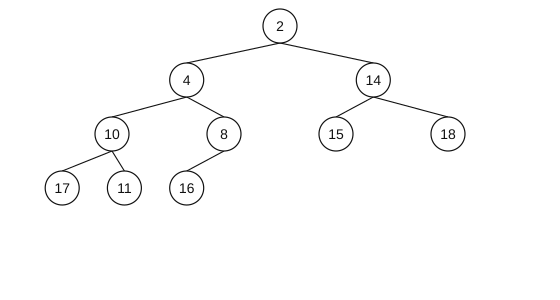

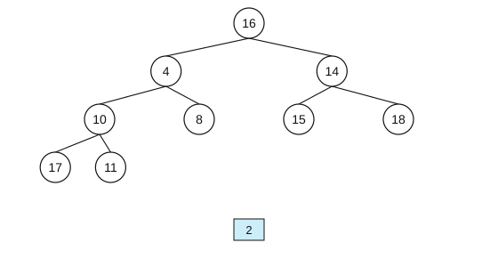

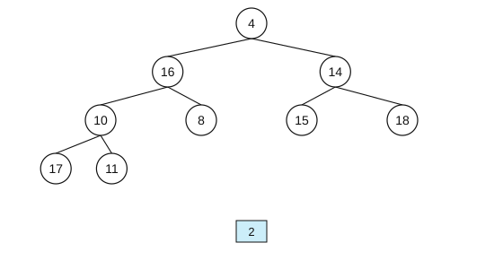

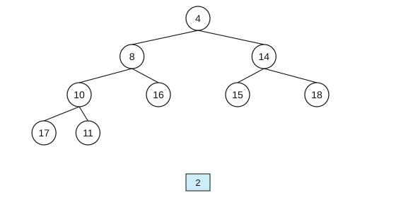


Each round is the same three moves, extract, move the last element to the
top, and sift down, until the heap is empty and the output is sorted.

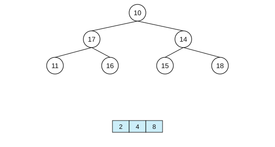

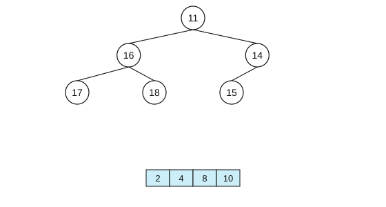

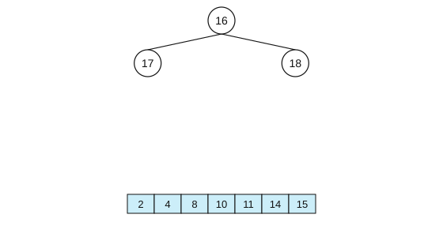

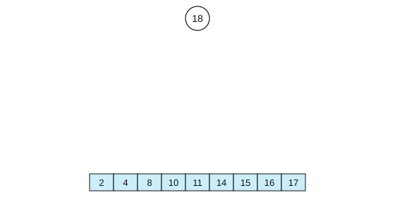

Each extraction costs about $\log_2 n$ swaps, the depth of the heap, and there
are $n$ extractions, which is what we will call $O(n \log n)$ in the next
session. The pseudocode of heapsort and of the heap operations is in Cormen
(2013, pp. 98–99), and the exercise of the lecture is to write the pseudocode
to build a heap and to extract the minimum, and to decide whether heapsort is
stable. As a note on the figures, the 31 states of the trace were produced by
actually running the algorithm, not drawn by hand, so the tree, the output
array and the captions agree with each other by construction, and you can use
them to check your own pen-and-paper trace.

---

## 9. Why sorting matters for us

The lecture closes with a footnote from a 2021 paper by Stanley Fung, "Is
this the simplest (and most surprising) sorting algorithm ever?":

```
Procedure I-CANT-BELIEVE-IT-CAN-SORT(A, n)
Inputs:
      A: an array
      n: the number of elements in A to sort
Result: the elements of A are sorted into nondecreasing order
For i = 1 to n:
      For j = 1 to n:
            If A[i] < A[j]
                  then swap A[i] with A[j]
```

Look at the comparison. It swaps when `A[i] < A[j]`, the opposite of what you
would expect from selection sort, and both loops run over the whole array. It
looks like it should be wrong, but it sorts correctly, and the proof is short
but not obvious. It is a good reminder that "obviously wrong" is not an
argument, and that the correctness of an algorithm is something to be shown,
not assumed. If you want to build intuition for how the algorithms of this
session move data around, the sorting visualizations linked from the slides
are a good way to spend fifteen minutes.

---

## 10. Check yourself

**1.** You have a table of survey responses and you want it ordered by region, and within each region by date. What do you sort by first?

<details><summary>Answer</summary>

By date first, then by region, and the second sort must be stable. Sorting by
region first and date second would destroy the region grouping. The general
rule is to sort by the least significant key first.

</details>

**2.** Is selection sort ever the right choice?

<details><summary>Answer</summary>

Rarely, but yes, because it makes the minimum possible number of swaps, at most
$n-1$, which matters if writing is far more expensive than reading, for
example on flash memory with limited write cycles, or with records so large
that moving them dominates. It is also simple enough to get right on paper,
which is why it opens the course.

</details>

**3.** Mergesort needs extra memory, while quicksort does not. Why is mergesort still used?

<details><summary>Answer</summary>

Because it is stable and its worst case is as good as its average case, while
the worst case of quicksort degenerates badly with an unlucky pivot. Real
libraries often use hybrids. For example, Python's `sorted` uses Timsort, a mergesort
variant that exploits runs already present in the data and is stable.

</details>

**4.** A heap is not sorted. So how can heapsort be a sorting algorithm?

<details><summary>Answer</summary>

The heap property only guarantees that the root is the minimum, and that is
all heapsort needs. Repeatedly taking the minimum yields a sorted sequence,
and the weak, local invariant is exactly why restoring it after each
extraction is cheap, $\log n$ instead of $n$.

</details>

**5.** Selection sort and mergesort on an already-sorted list of a million elements. Which is faster, and by roughly how much?

<details><summary>Answer</summary>

Mergesort, by a factor of about $n / (2 \log_2 n) = 10^6/40 = 25\,000$.
Selection sort does the same $n^2/2 \approx 5 \times 10^{11}$ comparisons
regardless of the input, and mergesort does about $n \log_2 n \approx 2
\times 10^7$. Session 8 makes this precise.

</details>

---

## 11. References

- **Cormen, T. H. (2013).** *Algorithms Unlocked*, MIT Press. Chapter 2 (how to
  describe and evaluate algorithms) and chapter 3 (selection sort pp. 32–34,
  insertion sort pp. 35–39, merge sort pp. 40–48, quicksort pp. 49–56) are the
  reading for this session and the source of all the pseudocode here; chapter
  4 gives the lower bound for comparison sorting, and pp. 98–99 the heap
  operations and heapsort.
- **Cormen, T. H., Leiserson, C. E., Rivest, R. L. & Stein, C. (2009).**
  *Introduction to Algorithms*, 3rd ed., chapters 2, 6 and 7. The full
  treatment, including the correctness proofs we skip.
- **Knuth, D. E. (1998).** *The Art of Computer Programming, Vol. 3: Sorting
  and Searching*, 2nd ed. Addison-Wesley. The exhaustive reference; von
  Neumann's 1945 mergesort is documented here.
- **Fung, S. P. Y. (2021).** "Is this the simplest (and most surprising)
  sorting algorithm ever?" *arXiv:2110.01111*. <https://arxiv.org/abs/2110.01111>
- **Peters, T.** *Timsort*, the algorithm behind Python's `sorted`:
  <https://github.com/python/cpython/blob/main/Objects/listsort.txt>
- **Sorting algorithm visualizations**, useful for building intuition:
  <https://www.youtube.com/watch?v=kPRA0W1kECg>
